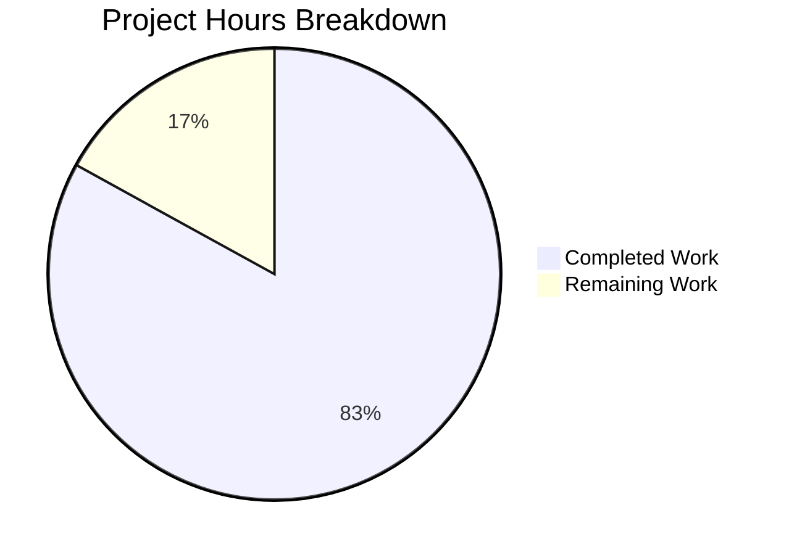

# 1. Executive Summary

## 1.1 Project Overview

The Proactive Insights Demo API is a compact FastAPI fixture whose project, task, billing, role and session behaviour runs entirely in process, with no database or external service. This release completes `tests/test_api.py`: six API behaviours are pinned at integration level through the ASGI application — ownership-filtered listings, billing validation and quota, task creation and status transitions, role-change validation and the owner gate — plus every refusal path they expose, with production code untouched. The measured outcome is 98% statement coverage of `app/main.py` (119 of 121 statements), a passing 90% gate and 16 green tests.

## 1.2 Completion Status

44 of 53 plan-scoped and path-to-production hours are delivered: 44 ÷ (44 + 9) × 100 = **83% complete**.



Blitzy palette: Completed = Dark Blue `#5B39F3`, Remaining = White `#FFFFFF`.

| Metric | Hours |
| --- | --- |
| Total Hours | 53 |
| Completed Hours (Baseline: Human with agentic-assist) | 44 |
| Remaining Hours | 9 |
| Percent Complete | 83% |

## 1.3 Key Accomplishments

- Ownership-filtered listings pinned both ways: the owner sees both projects by exact id set, the member only its own (`tests/test_api.py:27-46`).
- Billing quota proven: non-positive units refused with the counter intact, accumulation to the limit with the default proven twice, over-limit refused with `used` still 5 (`tests/test_api.py:55-77`).
- Task creation and status transitions pinned: an absent project writes nothing, stored defaults are asserted, and `open → in_progress → done` persist while 404 and 422 leave the store intact (`tests/test_api.py:80-124`).
- Role changes gated and validated: both invalid inputs share the 404 contract, a member caller is refused 403 without a write, and the owner's grant persists (`tests/test_api.py:127-147`).
- 98% statement coverage of `app/main.py`, the 90% floor cleared by exit status, and order independence restored by a single shared reset.

## 1.4 Critical Unresolved Issues

Three items remain open; none of the seven credited test items is unresolved.

| Issue | Impact | Owner | ETA |
| --- | --- | --- | --- |
| The suite has never run on CPython 3.12.3, the interpreter the plan names; every run used CPython 3.13.18 | An interpreter-specific incompatibility would surface only in a developer's own environment | Backend | 3h |
| The coverage gate exists only as a developer command; nothing binds it to CI | A regression can merge undetected, because the 90% floor is enforced only when someone runs it | Platform | 4h |
| `app/main.py:178` and `app/main.py:189` — the concurrent rotate/revoke loser guards — are unreachable in a single-threaded run | The rotate/revoke race carries no test evidence and the module's coverage ceiling is 98% | Backend | 2h |

## 1.5 Access Issues

No access issues identified: the suite and gate need no credential, environment variable or external service; the demo tokens are source constants (`app/main.py:8`) and all state is in memory.

## 1.6 Recommended Next Steps

1. [Medium] Run the suite and the coverage gate on CPython 3.12.3, then record the supported interpreter.
2. [Medium] Bind `python -m pytest -q` and the coverage gate to CI so a non-zero exit fails a build.
3. [Low] Exercise the concurrent rotate/revoke guards at `app/main.py:178` and `:189`, or record them as accepted-uncovered.
4. [Low] Confirm the deployment stance: `README.md` declares the fixture non-deployable and the task endpoints carry no ownership check.

# 2. Project Hours Breakdown

## 2.1 Completed Work Detail

| Component | Hours | Description |
| --- | --- | --- |
| Ownership listing test (credited items 1 and 7) | 5 | Replaces element-0 sampling with exact membership: owner listing length and id set, member listing exactly its own id, both identities created through the API; every success response status-pinned (`tests/test_api.py:27-46`) |
| Billing validation, accumulation and limit test (item 2) | 6 | Non-positive units refused 422 with `USAGE["used"]` still 0, accumulation 1→3→4→5 with the query default proven twice, over-limit refused 429 with the counter unchanged — each response captured and status-pinned (`tests/test_api.py:55-77`) |
| Task status persistence and rejection test (item 3) | 6 | `open` default, `in_progress` and `done` persisted in body and store, unknown task 404, unsupported status 422 with the stored value retained (`tests/test_api.py:98-124`) |
| Task creation validation and defaults test (item 5) | 5 | Absent project refused 404 with `TASKS` still empty, then stored `status`, `created_by`, echoed `project_id` and store equality asserted (`tests/test_api.py:80-95`) |
| Role input-validation test (item 4) | 4 | Both refusals — unknown user and unsupported role — asserted against the shared 404 detail with `TEAM` unchanged (`tests/test_api.py:127-135`) |
| Owner-gate and role-write test (item 6) | 4 | Member caller refused 403 without a write, owner grant returns the exact body and updates `TEAM` (`tests/test_api.py:138-147`) |
| Test harness: identity constant, import extension, reset contract | 3 | `MEMBER` header constant, `TEAM` import, and `setup_function` restoring `PROJECTS`, `TASKS`, `TEAM`, `USAGE["used"]`, `USAGE["limit"]` and the session registry (`tests/test_api.py:2-18`) |
| Coverage measurement and acceptance gate | 4 | Baseline re-mapped to the 121-statement module, coverage collection, the `--fail-under=90` exit status, and a proof that the gate fails at 50% and at a 99% threshold |
| Live HTTP verification of the credited behaviours | 4 | Server start and stop, health and readiness, both 401 branches, projects, tasks, roles and billing driven over real HTTP with store read-backs |
| Isolation, order-independence and regression verification | 3 | Repeated package runs, reversed and interleaved node orders, single-process repeats, and both test modules green in either order |
| **Total** | **44** | |

## 2.2 Remaining Work Detail

| Category | Hours | Priority |
| --- | --- | --- |
| Runtime conformance on CPython 3.12.3, the interpreter the plan names (traces to the plan's environment requirement, which no repository file pins) | 3 | Medium |
| CI enforcement of the suite and the coverage gate, so a non-zero exit fails a build (path to production) | 4 | Medium |
| Concurrent rotate/revoke guard coverage for `app/main.py:178` and `app/main.py:189` (path to production) | 2 | Low |
| **Total** | **9** | |

# 3. Test Results

The whole package was executed from the repository root on CPython 3.13.18 with pytest 8.3.5: **16 collected, 16 passed, 0 failed, 0 skipped, 0 xfailed**, exit 0, in 0.30 s. Each test in the delivered module also passes alone (1 passed, exit 0), and a mistyped node id exits non-zero, so every credited node id is proven addressable.

| Area / Category | Framework | Tests | Passed | Failed | Coverage | What This Proves |
| --- | --- | --- | --- | --- | --- | --- |
| Project ownership and listing | pytest 8.3.5 / TestClient | 1 | 1 | 0 | `app/main.py:104-117` executed | The owner sees both projects by exact id set and the member only its own; duplicates or a dropped filter arm fail the test |
| Billing validation, accumulation and quota | pytest / TestClient | 1 | 1 | 0 | `app/main.py:156-164` executed | Non-positive units are refused with no write, the default of one unit is real, and the over-limit refusal leaves the counter at 5 |
| Task status transitions | pytest / TestClient | 1 | 1 | 0 | `app/main.py:133-142` executed | `open → in_progress → done` persist in both the response and the store; 404 and 422 leave the stored status intact |
| Task creation validation and defaults | pytest / TestClient | 1 | 1 | 0 | `app/main.py:120-130` executed | An unknown project is refused before any write, and a member's task stores `status`, `created_by` and an allocated id |
| Role-change validation and owner gate | pytest / TestClient | 2 | 2 | 0 | `app/main.py:145-153` executed | Unknown user and unsupported role share the 404 with `TEAM` untouched; a member caller is refused 403 without a write and the owner's grant persists |
| Authentication and health baseline | pytest / TestClient | 2 | 2 | 0 | `app/main.py:58-81, 94-96` executed | Liveness returns 200 with its exact body; a missing credential is refused with the branch-specific detail rather than a generic 401 |
| Session lifecycle (pre-existing module) | pytest / TestClient | 8 | 8 | 0 | `app/main.py:43-55, 58-81, 99-101, 167-190` executed | Expiry, revocation and rotation behave as documented on every guarded route, which is what keeps the demo identities usable inside the suite — the 8 rows above account for all 16 collected tests |
| Statement coverage acceptance | coverage 7.17.5 (`--source=app`) | 16 traced | 16 | 0 | 119/121 statements, 98% | The same suite under the tracer measures the module; the 90% floor is met by exit status, and the gate fails at 50% and at a 99% threshold, so it measures what it claims |

## Not Covered

- **Concurrent rotate/revoke losers** — `app/main.py:178` and `app/main.py:189` raise for the request that loses a race between two rotate or revoke calls. A single-threaded suite cannot reach them, so the last two statements carry no evidence; a threaded probe is the way to close them.
- **Multi-process behaviour** — all state lives in module memory, so nothing exercises two workers sharing a store, and the billing quota would be per process.
- **Other interpreters** — every run used CPython 3.13.18; the suite has not been executed on 3.12 or 3.14.
- **Warning-strict execution** — `-W error` (or `filterwarnings = error` in `pytest.ini`) aborts collection on the upstream anyio `BlockingPortal` alias raised from starlette's `TestClient`; anyone enabling a warning gate must scope or pin it first.
- **The OpenAPI document** — nothing asserts `securitySchemes`, 401 responses, or that `/redoc` renders; `/docs` works and `/redoc` is blank.
- **Task authorization** — `POST /tasks` and `PATCH /tasks/{task_id}` apply no ownership check, and no test pins the behaviour either way; if the fixture is ever promoted, the absence is currently unasserted.
- **Load, performance, TLS, CORS, rate limiting and the credential lifecycle** — outside the delivered scope and not exercised.

# 4. Runtime Validation & UI Verification

Runtime checks below were performed against the application served by `uvicorn` on `127.0.0.1:8791`, driven with `curl`, and cross-checked by reading the module dictionaries directly.

- ✅ **Start-up and shutdown** — `Application startup complete` with no error; `GET /health` returned `HTTP/1.1 200 OK` with `{"status":"ok"}`; the process stopped cleanly and the port was released.
- ✅ **Authentication** — no header returns `401 {"detail":"Missing bearer token"}`; `Bearer nonsense` returns `401 {"detail":"Invalid token"}`; the two branches remain distinguishable.
- ✅ **Session lifecycle** — `POST /sessions/rotate` returns a replacement token and the retired token is then refused 401; `POST /sessions/revoke` returns `{"revoked": true}` and ends the session.
- ✅ **Projects** — `POST /projects` with the owner token returns `{"id":1,"name":"Guide Check","owner_id":1}` and appears in the owner's listing; the member's listing omits it.
- ✅ **Tasks** — creation stores `status:"open"` with `created_by`; `?status=in_progress` and `?status=done` return 200 with the store updated; `/tasks/999` returns 404 and `?status=blocked` returns 422 with the stored value retained.
- ✅ **Teams** — a member caller receives `403 {"detail":"Owner role required"}`; the owner receives `200 {"user_id":2,"role":"owner"}`.
- ✅ **Billing** — `?units=0` returns `422 {"detail":"Units must be positive"}`; accumulation reaches `{"used":5,"limit":5}` and the next call returns `429 {"detail":"Usage limit reached"}` with `used` still 5.
- ✅ **Refusal hygiene** — every refusal is a single-key `{"detail": …}` body in `application/json`, free of tracebacks, paths, module names and framework types; no 5xx was produced.
- ⚠ **Documentation surfaces** — `/docs`, `/openapi.json`, `/ready` and `/metrics` return 200, but `/redoc` renders blank: FastAPI 0.115.12 loads the floating ESM-only bundle as a classic script, so the page fails in the browser console.

There is no user interface to verify: every route returns JSON, there is no static mount and no HTML route, so no browser step applies. **Never exercised at runtime:** two competing rotate or revoke calls, multi-worker operation, any interpreter other than CPython 3.13.18, warning-strict execution, and the fixture behind TLS or a reverse proxy.

# 5. Compliance & Quality Review

## 5.1 Compliance Matrix

| Deliverable or criterion | Benchmark | Status | Progress |
| --- | --- | --- | --- |
| Integration level only — every test drives the ASGI app through `TestClient` | No unit tests, no direct handler calls, no socket | ✅ Pass | 100% |
| Production code untouched — `app/main.py`, `app/__init__.py` | No guard reordered, no message reworded, no refactor for testability | ✅ Pass | 100% |
| Scope containment — one tracked path changed (`tests/test_api.py`, +124/−4) | No `conftest.py`, fixtures module, data directory, `.coveragerc`, CI wiring, `.gitignore`, new test module or plugin | ✅ Pass | 100% |
| Assertion density — status code, body field, and store state where the call mutates | Every test in the delivered module | ✅ Pass | 100% |
| Refusal specificity — the measured `detail` string, not only the status | All seven credited refusals | ✅ Pass | 100% |
| Refusal state integrity — the store a refusal must not change is asserted | `TASKS` empty after 404, status retained after 422, `TEAM` intact after 403/404, `USAGE` at 5 after 429 | ✅ Pass | 100% |
| Visibility asserted in both directions | Owner length plus exact id set; member exactly its own id | ✅ Pass | 100% |
| Isolation and order independence | Shared reset restores every mutated store and the session registry; reversed and interleaved runs green | ✅ Pass | 100% |
| Determinism | No clock, network, filesystem, randomness or sleep in the delivered module | ✅ Pass | 100% |
| Conventions — 8 module-level `test_<behaviour>` functions, header constants, inline literals | No class, docstring, decorator, mock, monkeypatch or recorded HTTP fixture | ✅ Pass | 100% |
| Acceptance measure — coverage of `app/main.py` | 119 of 121 statements, 98%; `coverage report -m --fail-under=90` exits 0 | ✅ Pass | 100% |
| Manifest and dependency integrity | `requirements.txt` unchanged, no `pytest-cov` or any plugin, `pip check` clean | ✅ Pass | 100% |

## 5.2 AAP & Rule Divergences and Gaps

Four departures from the agreed plan exist. Each is settled by a higher-ranked source — the approved environment instructions for the first three, and the plan's own instruction to preserve existing resets for the fourth — so none of them is a defect in the delivered code.

| What the AAP/Rule Required | What Was Delivered Instead | Why It Diverged | Impact | Remediation |
| --- | --- | --- | --- | --- |
| CPython 3.12.3 in an isolated virtual environment (plan, environment section) | CPython 3.13.18, reached through the host's `python3.13`, in a local `.venv` (Sanctioned) | No 3.12 interpreter exists on the host; the approved environment instructions fix 3.13.18 and forbid installing into the system interpreter, and no repository file pins an interpreter | Suite and gate verified only on 3.13.18; 3.12 remains unverified | Run the suite and the gate on 3.12.3 (3h, `app/main.py` unchanged) |
| 81 statements, 60% baseline, 96% expected, with statements 31, 42 and 110 uncovered (plan, coverage sections) | 121 statements, 86% baseline, 98% delivered, with `app/main.py:178` and `:189` uncovered (Sanctioned) | The figures predate the session lifecycle already present in the base (`app/main.py:8, 15-16, 58-81, 173-190`); production code is frozen, and the approved environment instructions re-map the bar to 121 statements (≥109 covered) | The stated target percentage and the named uncovered statements no longer describe this module | None to the code; describe the target as ≥90% of 121 statements (109 covered) |
| The untouched suite shows `3 passed`, and `8 passed` once the module is extended (plan, command and acceptance sections) | 16 passed — the 8 credited tests plus 8 in the pre-existing `tests/test_token_lifecycle.py` (Sanctioned) | The second module is pre-existing content added by base commit `0c897ec`; the plan forbids creating new test modules and does not credit its removal | Any check that asserts an exact count of 8 or 11 must be re-based on 16 | None to the code; re-base count-based checks, or scope the gate by path |
| Import line exactly `from app.main import app, PROJECTS, TASKS, TEAM, USAGE` (plan, environment and transformation sections) | The line also imports `seed_sessions`, and `setup_function` calls it (Sanctioned) | The plan's own instruction to keep the existing `setup_function` resets outranks the illustrative snippet; dropping the call would let token rotation or revocation in the other module leak into this one | None — order independence depends on this line | None |

**Interpreter version (settled, needs a decision only if 3.12 must be supported).** The plan names CPython 3.12.3; the delivered suite, the coverage measurement and every runtime check ran on CPython 3.13.18. The divergence is environmental: no 3.12 interpreter exists on this host, the approved environment instructions fix the installed 3.13 one, and no repository file pins an interpreter, so no in-scope change could have satisfied the original wording. The delivered code needs only 3.10 or newer, set by the `str | None` annotations in `app/main.py`. A human should decide whether 3.12 is a supported runtime; if it is, run `.venv/bin/python -m pytest -q` and the coverage gate on a 3.12 interpreter before release.

**Coverage arithmetic (settled, needs a decision only on how the target is stated).** The plan's 81-statement, 60%-baseline, 96%-expected arithmetic describes a version of `app/main.py` without the session lifecycle; the module now holds 121 statements, and the delivered suite covers 119 of them. Production code is frozen, so those figures cannot be restored by any permitted change, and the acceptance rule the plan actually decides on — `coverage report -m --fail-under=90` exiting 0 — holds with ten statements of headroom. A human should restate the target as at least 109 of 121 statements and note that the two remaining misses are the concurrency losers at `app/main.py:178` and `:189`, not the `GET /ready`, `GET /metrics` and invalid-token statements the plan named.

**Whole-suite counts (settled, needs a decision if the gate is count-based).** The plan expects `3 passed` on the untouched suite and `8 passed` once the module is extended. The repository already contained a second test module, `tests/test_token_lifecycle.py`, added by base commit `0c897ec`, whose eight session-lifecycle tests also run under `python -m pytest -q`; the delivered package therefore passes 16. That module is pre-existing and outside the plan's scope, and removing or deselecting it is not sanctioned. A human should re-base any expectation that asserts a count of 8 or 11, and decide whether the acceptance gate should run the whole package or only the delivered module — the whole-package gate is stricter, but it can fail for a reason that has nothing to do with this module.

# 6. Risk Assessment

| Risk | Category | Severity | Probability | Mitigation | Status |
| --- | --- | --- | --- | --- | --- |
| The acceptance run also executes `tests/test_token_lifecycle.py`, a module this release does not change, so a failure there fails acceptance while the delivered module is sound | Operational | Medium | Medium | Keep that suite green, or scope the gate to `tests/test_api.py` and run the full package as a second step | Open |
| `app/main.py:178` and `:189` are unreachable in a single-threaded run, so coverage tops out at 98%; a refactor that moves credited statements behind a similar concurrency guard would erode the headroom above the 90% floor | Technical | Medium | Low | Treat 98% as the ceiling, keep the floor at 90%, and add a threaded probe if the race must be evidenced | Open |
| The suite is verified on CPython 3.13.18 only; 3.12 and 3.14 have never executed it | Operational | Medium | Medium | Run the suite and the gate on the interpreter you intend to support and pin it in the pipeline | Open |
| Warning-strict execution aborts at collection: the upstream anyio `BlockingPortal` alias raised from starlette's `TestClient` becomes an error | Operational | Medium | High | Scope `filterwarnings` to that message, or upgrade starlette before enabling a warning gate | Open |
| `POST /tasks` and `PATCH /tasks/{task_id}` apply no ownership check, so any authenticated identity can attach a task to another caller's project and change any task's status | Security | Medium | High | Keep the fixture non-deployable as `README.md` states, or add project/owner checks with tests before any promotion | Open |
| Credentials are source constants with a 900-second window and no re-issue route, and a `TEAM` role write grants no permission because authorization reads the session record seeded from `USERS` | Security | Medium | High | Restart the process to re-seed credentials; if roles must authorize, mint sessions from `TEAM` rather than `USERS` | Open |
| The OpenAPI document declares no `securitySchemes` and no 401 responses, and `/redoc` renders blank, so generated clients and Swagger UI cannot express the bearer requirement | Integration | Low | High | Declare the bearer scheme and the 401 responses in the app, then pin the document in a test | Open |
| The repository has no lint, type-check, security scan or CI gate, so a regression surfaces only when someone runs the commands locally | Operational | Medium | High | Bind the suite and the coverage gate to CI, and add a linter and type check if the project adopts them | Open |

# 7. Visual Project Status


Completed = Dark Blue `#5B39F3` · Remaining = White `#FFFFFF` · 83% of 53 hours delivered.

**Remaining hours by category**

| Category | Hours |
| --- | --- |
| Runtime conformance on CPython 3.12.3 | 3 |
| CI enforcement of the suite and the coverage gate | 4 |
| Concurrent rotate/revoke guard coverage | 2 |
| **Total** | **9** |

**Remaining work by priority**

| Priority | Hours | Tasks |
| --- | --- | --- |
| Medium | 7 | Interpreter conformance; CI enforcement |
| Low | 2 | Concurrent rotate/revoke guard coverage |
| **Total** | **9** | **3** |

# 8. Summary & Recommendations

This release turns `tests/test_api.py` from three thin smoke tests into the complete integration contract for the demo API: eight module-level tests that drive the real ASGI application in process and pin six behaviours — ownership-filtered project listings, billing validation and quota, task creation, task status transitions, role-input validation and the owner-only role gate — together with all seven refusal paths those behaviours expose. Production code was not touched: the entire branch diff is one file, +124/−4, and `app/main.py`, `app/__init__.py`, `pytest.ini`, `requirements.txt` and `README.md` are byte-identical to the base commit.

The evidence a reviewer can reproduce in three commands: `python -m pytest -q` shows 16 passed with no failure, skip or expected failure; `coverage run --source=app -m pytest -q` follows with the same result under the tracer; and `coverage report -m --fail-under=90` shows 119 of 121 statements covered and exits 0. The gate also fails when it should — a single-test subset measures 50% and the same command exits 2 — and the assertions discriminate: narrowing the handler's accepted status set to `open` and `done` makes the task test fail on the `in_progress` assertion it now carries (`tests/test_api.py:107-110`).

Against the plan's scope the project is **83% complete**: 44 of 53 hours delivered, with 9 hours outstanding and three open items — runtime conformance on CPython 3.12.3 (3h), CI enforcement of the suite and the coverage gate (4h), and coverage of the concurrent rotate/revoke guards at `app/main.py:178` and `:189` (2h). The critical path to a releasable state is the CI binding, because until it exists the 90% floor is enforced only by whoever remembers to run it; the interpreter question is a decision (support 3.12 or state 3.13 as the supported runtime) rather than work on the code.

| Metric | Value |
| --- | --- |
| Plan-scoped completion | 83% (44 of 53 hours) |
| Tests collected / passed | 16 / 16 |
| Statement coverage of `app/main.py` | 119 of 121 — 98% |
| Acceptance gate (`--fail-under=90`) | exit 0 |
| Credited refusal branches exercised | 7 of 7 |
| Open items | 3 |

**Production readiness.** The deliverable — an integration test module — is ready to hand off: deterministic, order-free, mock-free, sub-second, and gated by a measure that fails when a regression lands. The application it pins is explicitly not production software: `README.md` calls it a synthetic fixture intended for tooling evaluation, with in-memory state, source-constant demo tokens and no persistence, and the task endpoints apply no ownership check. Treat the suite as the asset to carry forward, and treat any promotion of the application itself as a new project that starts with authorization on `/tasks`.

**Recommended next steps.** Add the two test commands to CI on a pinned interpreter so the floor is enforced on every change; decide and document the supported interpreter, then run the gate on it; close the two concurrency statements with a threaded probe or record them as accepted-uncovered; and, if the fixture is ever promoted beyond test use, address the task-authorization gap and the role model before the first deployment.

# 9. Development Guide

### System Prerequisites

- **CPython 3.10 or newer** — the source uses runtime-evaluated `str | None` annotations (`app/main.py:30, 58, 78, 105, 115, 121, 134, 146, 157, 174, 185`). Every command below was verified on **CPython 3.13.18**, reachable as `python3.13` on this host.
- **No infrastructure** — no database, broker, cache, container, message queue, seed data, environment variable or secret. All state lives in module dictionaries.
- **No browser surface** — every route returns JSON, so nothing here needs Chrome or Docker.
- The system interpreter is externally managed (PEP 668); never install into it.

### Environment Setup

```bash
python3.13 -m venv .venv
.venv/bin/python -m pip install --no-input -q -r requirements.txt
.venv/bin/python -m pip install --no-input -q coverage==7.17.5
.venv/bin/python -m pip check
```

`pip check` prints `No broken requirements found.` The manifest pins exactly four packages (`fastapi==0.115.12`, `uvicorn==0.34.0`, `pytest==8.3.5`, `httpx==0.28.1`); `coverage` is installed into the environment only and is deliberately absent from `requirements.txt`, and no pytest plugin is installed.

### Running the Suite

```bash
.venv/bin/python -m pytest -q                                   # 16 passed, 1 warning, exit 0
.venv/bin/python -m pytest -q tests/test_api.py                  # 8 passed
.venv/bin/python -m pytest -q tests/test_token_lifecycle.py      # 8 passed
.venv/bin/python -m pytest -q tests/test_api.py::test_billing_consume_validates_units_and_enforces_limit   # 1 passed
```

Always use the `-m` form from the repository root: `tests/` is not a package, so the bare console script fails with `ModuleNotFoundError: No module named 'app'`. The single warning is the upstream anyio `BlockingPortal` deprecation raised from starlette's `TestClient`.

### Coverage Acceptance Gate

```bash
.venv/bin/python -m coverage run --source=app -m pytest -q
.venv/bin/python -m coverage report -m --fail-under=90
```

Expected output and exit status:

```text
Name              Stmts   Miss  Cover   Missing
-----------------------------------------------
app/__init__.py       0      0   100%
app/main.py         121      2    98%   178, 189
-----------------------------------------------
TOTAL               121      2    98%
```

Exit 0 means the 90% floor (109 of 121 statements) is met; exit 2 means it fell short.

### Starting the Service

```bash
.venv/bin/python -m uvicorn app.main:app --host 127.0.0.1 --port 8000
```

Run it in the foreground and stop it with `Ctrl-C`; when started as a shell background job, stop it with `kill %1`. Do not pass `--reload` for scripted checks. Verify it is up:

```bash
curl -s -i http://127.0.0.1:8000/health                 # HTTP/1.1 200 OK, {"status":"ok"}
curl -s -o /dev/null -w "%{http_code}\n" http://127.0.0.1:8000/ready        # 200
curl -s -o /dev/null -w "%{http_code}\n" http://127.0.0.1:8000/openapi.json # 200
```

If the port is taken, pick another; the application binds exactly one port. Interactive docs live at `/docs`; `/redoc` renders blank and is a known behaviour of the pinned FastAPI version.

### Example Usage

Authentication first — the two demo identities are source constants seeded at import (`app/main.py:8`):

```bash
curl -s http://127.0.0.1:8000/projects                                  # {"detail":"Missing bearer token"}
curl -s -H 'Authorization: Bearer nonsense' http://127.0.0.1:8000/projects   # {"detail":"Invalid token"}
curl -s -H 'Authorization: Bearer owner-token' -H 'Content-Type: application/json' \
     -d '{"name":"Release QA"}' http://127.0.0.1:8000/projects          # {"id":1,"name":"Release QA","owner_id":1}
curl -s -H 'Authorization: Bearer owner-token' http://127.0.0.1:8000/projects   # [{"id":1,...}]
```

The credited workflows, noting that `status`, `role` and `units` travel in the query string:

```bash
curl -s -X POST -H 'Authorization: Bearer owner-token' -H 'Content-Type: application/json' \
     -d '{"title":"Write tests","project_id":1}' http://127.0.0.1:8000/tasks
curl -s -X PATCH -H 'Authorization: Bearer owner-token' 'http://127.0.0.1:8000/tasks/1?status=done'
curl -s -X POST -H 'Authorization: Bearer member-token' 'http://127.0.0.1:8000/teams/2/role?role=owner'
curl -s -X POST -H 'Authorization: Bearer owner-token' 'http://127.0.0.1:8000/teams/2/role?role=owner'
curl -s -X POST -H 'Authorization: Bearer owner-token' 'http://127.0.0.1:8000/billing/consume?units=2'
```

### Troubleshooting

- **`ModuleNotFoundError: No module named 'app'`** — the bare `pytest` console script was used, or the command ran outside the repository root. Use `.venv/bin/python -m pytest` from the root.
- **`ModuleNotFoundError: No module named 'fastapi'`** — a host-global `pytest` outside the virtual environment. Use `.venv/bin/python -m pytest`.
- **Coverage gate exits 2** — the measured total is below 90%. Read the `Missing` column; a partial run (a single test) cannot clear the floor.
- **`No data to report.` with exit 1** — `coverage report` ran before `coverage run`.
- **401 on every call late in a debugging session** — tokens expire 900 seconds after process start, and rotation or revocation retires them; restart the process to re-seed both demo tokens.
- **`/redoc` blank while `/docs` works** — FastAPI 0.115.12 loads the floating ESM-only bundle as a classic script.
- **No Authorize button in Swagger UI** — the OpenAPI document declares no `securitySchemes`; send the `Authorization` header with `curl` instead.
- **A `BlockingPortal` DeprecationWarning on every run** — upstream in starlette's `TestClient`; nothing gates warnings, and `-W error` would abort collection.

# 10. Appendices

## A. Command Reference

| Purpose | Command (from the repository root) | Expected result |
| --- | --- | --- |
| Create the environment | `python3.13 -m venv .venv` | `.venv/` created, exit 0 |
| Install dependencies | `.venv/bin/python -m pip install --no-input -q -r requirements.txt` | exit 0, four pins installed |
| Install the measuring tool | `.venv/bin/python -m pip install --no-input -q coverage==7.17.5` | exit 0, not added to the manifest |
| Verify the environment | `.venv/bin/python -m pip check` | `No broken requirements found.` |
| Whole suite | `.venv/bin/python -m pytest -q` | 16 passed, 1 warning, exit 0 |
| Delivered module only | `.venv/bin/python -m pytest -q tests/test_api.py` | 8 passed, exit 0 |
| One test | `.venv/bin/python -m pytest -q tests/test_api.py::<node>` | 1 passed, exit 0 |
| List collected tests | `.venv/bin/python -m pytest -q --collect-only` | 16 tests collected |
| Diagnose a failure | `.venv/bin/python -m pytest tests/test_api.py::<node> --tb=long -l -rA` | full traceback and locals |
| Coverage collection | `.venv/bin/python -m coverage run --source=app -m pytest -q` | 16 passed under the tracer |
| Coverage gate | `.venv/bin/python -m coverage report -m --fail-under=90` | table plus exit 0 |
| Syntax check | `.venv/bin/python -m compileall -q app tests` | exit 0, no output |
| Serve the application | `.venv/bin/python -m uvicorn app.main:app --host 127.0.0.1 --port 8000` | startup banner, serving |
| Liveness probe | `curl -s -i http://127.0.0.1:8000/health` | `200 OK`, `{"status":"ok"}` |

## B. Port Reference

| Port | Bound by | Notes |
| --- | --- | --- |
| 8000 | `uvicorn` (default in the examples and in `README.md`) | The only port the application binds. Choose another free port if it is taken. |
| — | No database, broker, cache or queue | Nothing else in the project listens on a port. |

## C. Key File Locations

| Path | Role |
| --- | --- |
| `app/main.py` | The application: stores, request models, session guard, 11 route operations and a request-counting middleware (190 lines, 121 statements) |
| `app/__init__.py` | Package marker; holds no statements |
| `tests/test_api.py` | The delivered test module: 8 tests plus `setup_function`, 147 lines |
| `tests/test_token_lifecycle.py` | Pre-existing session-lifecycle tests, 8 tests, unchanged by this release |
| `pytest.ini` | Discovery only: `testpaths = tests`, `python_files = test_*.py` |
| `requirements.txt` | The four pinned dependencies |
| `README.md` | Run instructions, demo-token behaviour and the fixture's non-deployable notice |

## D. Technology Versions

| Component | Version | Note |
| --- | --- | --- |
| CPython | 3.13.18 | Verified runtime; source floor is 3.10 |
| fastapi | 0.115.12 | Pinned in `requirements.txt` |
| uvicorn | 0.34.0 | Pinned; used only to serve the app manually |
| pytest | 8.3.5 | Pinned; no plugin installed |
| httpx | 0.28.1 | Pinned; transport under `TestClient` |
| coverage | 7.17.5 | Environment-only measuring tool |
| starlette | 0.46.2 | Transitive from fastapi |
| pydantic / pydantic_core | 2.14.4 / 2.50.5 | Transitive; request validation |
| anyio / httpcore / h11 | 4.16.0 / 1.0.9 / 0.16.0 | Transitive; transport and threading bridge |

## E. Environment Variable Reference

No environment variable or secret is required or read. `app/main.py` contains no `os.environ` or `getenv` call; the demo bearer tokens are source constants (`app/main.py:8`), the session window is the constant `TOKEN_TTL_SECONDS = 900` (`app/main.py:15`), and every store is a module-level dictionary.

## F. Developer Tools Guide

| Tool | Status |
| --- | --- |
| Test runner | pytest 8.3.5, invoked as `python -m pytest` |
| Coverage | `coverage` 7.17.5, invoked as `python -m coverage` |
| Linter / formatter | None configured and none installed; no `pyproject.toml`, `setup.cfg`, `.flake8` or `ruff.toml` in the tree |
| Type checker | None configured |
| Security scanner | None configured |
| CI configuration | None — the suite and the gate run only when a developer runs them |
| Debugger | `--tb=long -l -rA` for traces; `--pdb` needs an interactive terminal |

## G. Glossary

- **ASGI application** — the callable FastAPI builds in `app/main.py`; the unit every test drives.
- **`TestClient`** — the in-process HTTP client that exercises the application without a socket or server.
- **Statement coverage** — the share of executable statements in `app/main.py` executed by the suite; measured here by `coverage`.
- **Acceptance gate** — `coverage report -m --fail-under=90`; its exit status, not a reading of the table, decides pass or fail.
- **Credited behaviour** — one of the seven API behaviours this release set out to pin; each is exercised through its real route.
- **Refusal branch** — a guard that raises instead of writing: 401, 403, 404, 422 and 429 in this application.
- **Reset contract** — the `setup_function` block that restores every mutable store and re-seeds the session registry before each test.
- **Session lifecycle** — issuance, expiry, rotation and revocation of bearer tokens, implemented in `app/main.py` and covered by the pre-existing module.
- **Fixture** — a deliberately small, in-memory application intended for tooling and test evaluation rather than deployment.
