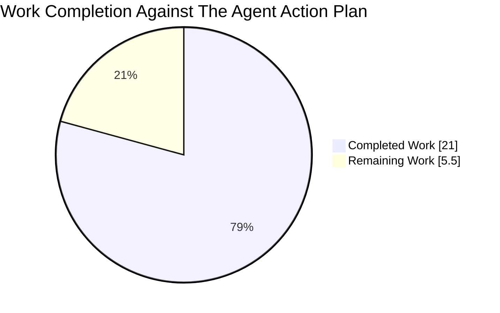
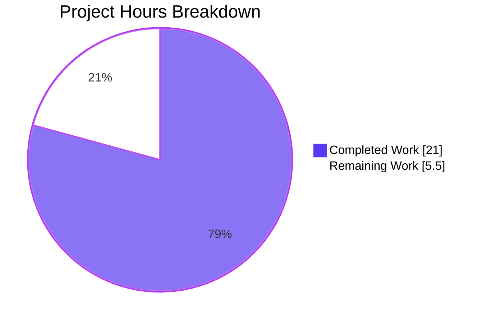
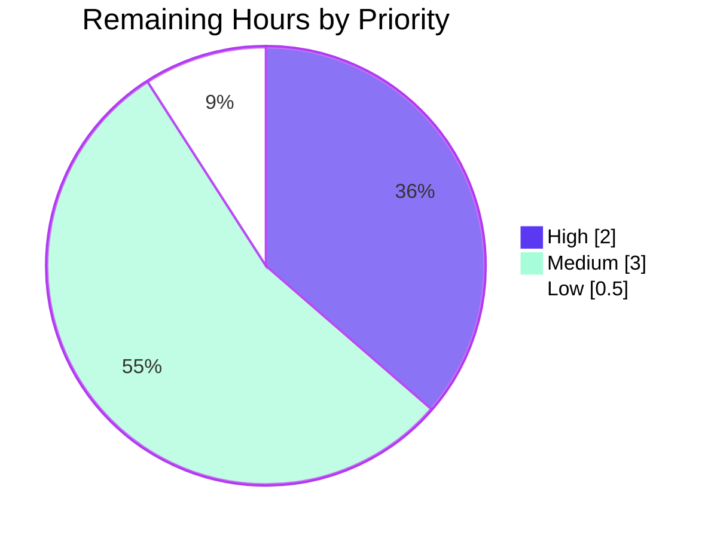

# 1. Executive Summary

## 1.1 Project Overview

This project closes a time-of-check-to-time-of-use race (CWE-367) in `POST /billing/consume` of the Proactive Insights Demo API, a FastAPI fixture serving project, task, team-role and quota operations to Bearer-token callers. The handler checked the requested units against the remaining quota and then re-read the shared counter to add them, so concurrent callers could all pass the check on the same stale value and be served beyond the ceiling. The repair makes the check, the rejection and the increment indivisible and returns a snapshot taken inside the critical section.

## 1.2 Completion Status



**79% complete — 21 of 26.5 hours delivered.**

| Metric | Hours |
| --- | --- |
| Total Hours | 26.5 |
| Completed Hours (Baseline: Human with agentic-assist) | 21 |
| Remaining Hours | 5.5 |
| Percent Complete | 79% |

Counts cover only the plan's deliverables and the path-to-production activities that deploy them: 22 of 23 requirements are met in full, with commit packaging (0.5 h) the partial item.

## 1.3 Key Accomplishments

- ✅ Quota check-and-increment indivisible: one `threading.Lock` spans comparison, rejection, increment and snapshot (`app/main.py:104-109`).
- ✅ Ceiling holds under an 8-way burst: exactly 5 units served, bodies `used` 1..5, the rest rejected.
- ✅ Rejected requests write nothing; equality at the ceiling is still accepted.
- ✅ Proof fails without the repair: the unsynchronised handler trips `assert (2 * 5) <= 5` (`tests/test_billing_atomicity.py:276`).
- ✅ Proof independent of host speed: dispatch skew is absorbed at the handler entry, and an unforced run is reported rather than passed.
- ✅ Contract pinned by test and live replay: `401`×2, `422`, `429`, `200 {"used","limit"}`.
- ✅ Suite green with the pre-existing tests untouched (6 passed, 1 pre-existing warning); no dependency or tooling change.

## 1.4 Critical Unresolved Issues

3 of the 25 scoped items remain open: 1 of the plan's 23 requirements and 2 path-to-production needs.

| Issue | Impact | Owner | ETA |
| --- | --- | --- | --- |
| The repair and its proof are delivered as separate single-file commits; no commit carries both paths | A reviewer of any one commit sees the guard without the proof that fails without it | Engineering | 0.5 h |
| The per-process scope of the ceiling is stated in the plan but nowhere in the repository or operator documentation | An operator who runs `--workers N` or a second replica silently loses the ceiling | Engineering / Operations | 1.5 h |
| The committed suite does not exercise the burst timeout diagnostic, the snapshot return or the `units` default and framework `422` | Those behaviours rest on inspection; a regression there would pass the suite | Engineering | 3 h |

## 1.5 Access Issues

No access issues identified. The project needs no credentials, external service, database or environment variable: the bearer tokens are in-source fixtures and the store is in memory.

## 1.6 Recommended Next Steps

1. [High] Land the guard and its regression proof in one commit so the repair is reviewable with its evidence (0.5 h).
2. [High] State the per-process ceiling in the README and the release description (1.5 h).
3. [Medium] Commit tests for the burst timeout diagnostic, the snapshot return, and the `units` default with its framework `422` (3 h).
4. [Medium] Make `python -m pytest -q tests/test_billing_atomicity.py -k drive_usage` the release gate: it is the only test that fails against an unsynchronised handler.
5. [Low] Refresh the plan's schedule description and quoted evidence anchors to match the delivered module (0.5 h).

# 2. Project Hours Breakdown

## 2.1 Completed Work Detail

| Component | Hours | Description |
| --- | --- | --- |
| Vulnerability analysis and fix design | 3 | Traced the two independent reads of `USAGE["used"]`, classified the defect as CWE-367, proved each pre-existing control (type binding, non-positive rejection, single-request cap, authentication, the GIL) insufficient, and fixed the mechanism as one lock over comparison, rejection and increment. |
| Atomic quota guard in `POST /billing/consume` | 2 | Three edits in `app/main.py`: `from threading import Lock` (L4), `USAGE_LOCK = Lock()` beside the guarded state (L13), and the guarded block with the in-lock snapshot (L104-109). 8 insertions, 4 deletions, no other line touched. |
| Deterministic forced-interleaving regression proof | 6 | `tests/test_billing_atomicity.py`: a counter substitute that captures each thread's first read, parks it on a two-party barrier and staggers the second reads; a handler-entry rendezvous that removes dispatch skew; a soundness assertion that reports an unforced run instead of passing on it. |
| Concurrent fan-out invariant test | 1.5 | Ten rounds each of 32×`units=1` and 8×`units=5`, asserting the ceiling, that the burst serves the ceiling in full, and that served units equal the counter. |
| Preserved-contract test | 1.5 | Pins both `401` messages, `422` for 0 and -1, `429` for 6, the accepted body, the counter after acceptance, and acceptance of a request landing exactly on the ceiling. |
| Determinism and mutation verification | 3 | Dispatch-skew sweeps from 0.0 s to 1.0 s (and 3.0 s, 9.0 s), CPU-saturated runs, and mutation checks against an unguarded handler, a `>=` off-by-one, a reject-everything handler and a body rendered without the increment. |
| Live HTTP contract, burst and endpoint continuity verification | 3 | Fresh single-process servers driven over real HTTP: contract paths, 8-, 20- and 40-way bursts, and regression of the eight sibling operations plus `/docs`, `/openapi.json`, `/metrics` and the `/` 404. |
| Meter isolation, burst diagnostics and module documentation | 1 | Autouse snapshot/restore of both counter keys, a bounded executor teardown that names the state of a wedged burst instead of hanging, and timeless module and test docstrings. |
| **Total** | **21** | |

## 2.2 Remaining Work Detail

| Category | Hours | Priority |
| --- | --- | --- |
| Land the repair and its regression proof in a single commit (plan requirement) | 0.5 | High |
| State the per-process ceiling where the service is started and operated (path to production) | 1.5 | High |
| Committed coverage of the burst timeout path, the snapshot return, and the `units` default with its framework `422` (path to production) | 3 | Medium |
| Refresh the Agent Action Plan's schedule description and quoted evidence anchors (documentation) | 0.5 | Low |
| **Total** | **5.5** | |

## 2.3 Estimation Basis

Hours cover engineering work only — analysis, implementation, tests, and the verification runs that establish the outcome. Completed hours are summed across the eight components above and are the numerator of the completion figure. Remaining hours are the plan requirement that is only partly delivered (commit packaging, 0.5 h), two path-to-production needs (deployment-boundary documentation, 1.5 h; suite completeness, 3 h) and one documentation refresh (0.5 h). The calculation is: completed 21 ÷ total 26.5 = 79.2%, reported as 79%. No hours are claimed for work the Agent Action Plan excludes — per-caller quota accounting, a shared-store counter, CI tooling, transport hardening and the unsynchronised id counters are all outside its scope and are recorded here as decisions rather than as effort.

# 3. Test Results

Every figure below is from a run performed on the delivered tree: `python -m pytest -q` from the repository root with the pinned `pytest 8.3.5`, then a live single-process server driven over HTTP. The suite reports **6 passed, 1 warning** — collected across the two test modules — where the warning is the pre-existing `starlette` `anyio.abc.BlockingPortal` deprecation notice that the untouched base also emits. No coverage tool is configured and none was added, so no coverage percentage exists for this repository.

| Area / Category | Framework | Tests | Passed | Failed | Coverage | What This Proves |
| --- | --- | --- | --- | --- | --- | --- |
| Quota atomicity under a forced interleaving | pytest + `fastapi.testclient` | 1 | 1 | 0 | none configured | Two full-ceiling requests cannot both be served; the counter lands at exactly the accepted units |
| Concurrent fan-out invariant | pytest + `fastapi.testclient` | 1 | 1 | 0 | none configured | Ten rounds of 32×`units=1` and 8×`units=5` bursts serve the ceiling exactly and never exceed it |
| Preserved HTTP contract | pytest + `fastapi.testclient` | 1 | 1 | 0 | none configured | `401`/`422`/`429`/`200` codes, messages and bodies are unchanged; a rejection writes nothing; equality is accepted at the ceiling |
| Pre-existing API suite, unmodified | pytest + `fastapi.testclient` | 3 | 3 | 0 | none configured | `/health`, project create/list and missing-token rejection behave exactly as before the repair |
| Regression-proof sensitivity | pytest against the unsynchronised handler in a scratch copy | 1 | 0 | 1 expected | none configured | The proof fails where it must: `assert (2 * 5) <= 5` with `([200, 200], 10, 5)` at `tests/test_billing_atomicity.py:276` |
| Running service: contract, burst and sibling endpoints | uvicorn + HTTP client | 22 checks | 22 | 0 | n/a | Every documented status path, an 8-way burst served to the ceiling, and the eight sibling operations unchanged |

**Not Covered**

- **The burst timeout diagnostic.** `_burst`'s `except TimeoutError` branch and its `shutdown(wait=collected, cancel_futures=not collected)` teardown are exercised during development but not by any committed test, so the failure message for a wedged handler could regress unnoticed.
- **The in-lock snapshot.** No assertion distinguishes `consumed = dict(USAGE)` from returning the live dictionary; a serial request cannot observe the difference, so a regression to `return USAGE` would pass the suite.
- **The query-parameter edges.** The `units` default of `1` and the framework's own `422` for a non-integer `units` are unasserted, as is the lax parsing that accepts `1_0`, `+5`, `05` and `"5.0"`.
- **A handler that guards only the comparison.** It produces `[200, 429]` with `used=5`, which the forced-interleaving assertions accept; the fan-out ceiling assertions bound the observable behaviour but do not identify this shape.
- **Multi-process deployments.** `--workers N`, a second replica and a restart each carry their own counter, so no test in this repository can prove the ceiling across processes.
- **The fan-out and contract tests are not fix discriminators.** Both pass against the unsynchronised handler (observed: 1 failed, 2 passed), so the atomicity claim rests on the single forced-interleaving test.
- **Coverage is unmeasured.** With no coverage tool configured, the depth of the corpus cannot be stated as a percentage.
- **Sibling-operation depth.** `/tasks` creation and update rejections and `/teams/{user_id}/role` have no committed test; they are covered only by the runtime sweep in Section 4 and by the three pre-existing tests.

A human preparing a release should run the suite plus the release gate — `python -m pytest -q tests/test_billing_atomicity.py -k drive_usage` — and repeat the live burst and contract sweep, because those are the checks that distinguish an atomic handler from a racy one.

# 4. Runtime Validation & UI Verification

The service was started as a single process (`uvicorn app.main:app --host 127.0.0.1 --port 8000`) and every flow below was driven over real HTTP against it. It starts cleanly, serves, and shuts down with no traceback and no 5xx in its log.

- ✅ **Start-up and readiness** — `{"status":"ok"}` on `/health`, `{"ready":true,"checks":{"storage":"ok"}}` on `/ready`, `{"requests_total":0,"uptime_seconds":…}` on `/metrics`.
- ✅ **Authentication** — a request with no header returns `401 "Missing bearer token"` and an unknown token returns `401 "Invalid token"`; the counter is untouched by both.
- ✅ **Input validation** — `units=0` and `units=-1` return `422 "Units must be positive"` before any shared state is read.
- ✅ **Quota accounting** — `units=1` → `{"used":1,"limit":5}`, `units=2` twice → `{"used":3,"limit":5}` then `{"used":5,"limit":5}`, so an accepted request reports its own post-increment state and equality at the ceiling is accepted.
- ✅ **Rejection** — `units=6` returns `429 "Usage limit reached"` and leaves the counter untouched; once the meter is full, every further request returns `429`, including with the second demo token, which shares the counter.
- ✅ **Ceiling under concurrency** — an 8-way simultaneous `units=1` burst on a fresh process returned exactly five `200` with bodies `used` 1..5 and three `429`; a follow-up request returned `429`, and a repeat burst on the drained meter returned eight `429`.
- ✅ **Project, task and team operations** — `POST /projects` → `200 {"id":1,…,"owner_id":1}`, `POST /tasks` with an unknown project → `404 "Project not found"`, `POST /teams/2/role?role=owner` as owner → `200`, as member → `403 "Owner role required"`.
- ✅ **Discovery surface** — `/docs` returns `200 text/html`, `/openapi.json` publishes 8 paths, and `GET /` returns `404` by design.
- ⚠ **Browser-driven consumption** — the interactive documentation is the only user interface, and it cannot send the `authorization` header (a reserved name in its bundled client, with no security scheme declared), so a browser caller can only reach the `401` path; the `200`/`429` ceiling must be demonstrated with `curl`. The published schema also lists only `200` and `422`.
- ❌ **Never exercised at runtime** — any deployment with more than one process (`--workers N`, a second replica), a restart in place of a running counter, the burst timeout diagnostic, and the injection or escaping behaviour of a future HTML client consuming validation-error bodies. No HTML, template or static asset exists in the route inventory, so there is no other screen or flow to drive.

A pre-existing quirk is visible on every run and is unrelated to this change: `/metrics` reports a hardcoded `requests_total` of `0` and a monotonic-clock reading labelled `uptime_seconds`, not elapsed process uptime.

# 5. Compliance & Quality Review

## 5.1 Compliance Matrix

| Deliverable | Verified Status | Progress | Evidence |
| --- | --- | --- | --- |
| Quota comparison and increment indivisible | ✅ Pass | ██████████ | `app/main.py:104-109`; one lock, one critical section |
| Ceiling holds under concurrency | ✅ Pass | ██████████ | 8-way burst served exactly 5 units; fan-out test asserts `served == LIMIT` |
| A rejected request writes nothing | ✅ Pass | ██████████ | Raise precedes the increment; contract test asserts the counter is unchanged |
| Observable contract and signature preserved | ✅ Pass | ██████████ | `401`×2, `422`×2, `429`, `200 {"used","limit"}`, plain `def` at `app/main.py:100` |
| Existing mitigations verified before adding a control | ✅ Pass | ██████████ | Per-control verdicts, each traced against the attack path |
| Smallest complete change | ✅ Pass | ██████████ | 8 insertions / 4 deletions, three hunks, no second guarded region |
| Regression proof fails without the repair | ✅ Pass | ██████████ | `assert (2 * 5) <= 5`, `([200, 200], 10, 5)` at line 276 |
| Schedule independent of host speed | ✅ Pass | ██████████ | Guard-removed fails and guard-kept passes across dispatch skews; a 12 s skew is reported |
| Test isolation and order independence | ✅ Pass | ██████████ | Autouse counter snapshot/restore; no assertion names an implementation identifier |
| No dependency, configuration or tooling change | ✅ Pass | ██████████ | `requirements.txt`, `pytest.ini`, `README.md` byte-identical; `threading` is stdlib |
| Out-of-scope boundaries respected | ✅ Pass | ██████████ | Id counters, `TEAM` write, demo tokens, storage and hardening untouched |
| Repair and its proof delivered as one change | ⚠ Partial | █████░░░░░ | Both paths delivered, but no commit carries both |

## 5.2 AAP & Rule Divergences and Gaps

| What The AAP/Rule Required | What Was Delivered Instead | Why It Diverged | Impact | Remediation |
| --- | --- | --- | --- | --- |
| The patch "is applied as one change, and the new test module lands with it so the repair is provable in the same commit" | `app/main.py` and `tests/test_billing_atomicity.py` arrive in separate single-file commits; the branch is nine linear commits with no merge, and no commit touches both paths | The guard was committed before the test module existed, each later change touched one file, and the branch's history was rebuilt change by change, which discarded the combined commit that had been built for this requirement | A reviewer of any single commit sees either the guard or its proof, never both; branch-level provability is intact | Land one commit whose diff carries both paths; the tree must not change (0.5 h) |
| The schedule is shaped by the substituted counter alone: a two-party barrier on the first read plus staggered second reads | The same counter hook, plus a handler-entry rendezvous that wraps `current_user`, records the values each contender first read, and asserts both were inside the handler together (`tests/test_billing_atomicity.py:118-156`, `263-274`) | The barrier's 0.25 s bound alone turns a late contender into a silent pass — observed as repeated false passes against an unsynchronised handler at 0.5 s dispatch skew — which contradicts the same requirement that nothing depend on host speed; the plan document was not amended | Strictly stronger proof; no production behaviour, constant or recorded evidence changed | A human decides whether to refresh the plan's mechanism sentence; no code work |
| The recorded pre-fix evidence is quoted at `tests/test_billing_atomicity.py:123` and the suite at "0.70 s" | The assertion sits at line 276 and the suite takes about 2.3 s (2.67 s on first run, 2.33 s for the module alone) | The module grew through four later changes — schedule hardening, assertion strengthening, burst diagnostics, prose — while the plan document was not amended; the assertion text, statuses and counter values reproduce verbatim | Documentation drift only; a reader comparing the plan to the tree meets a stale anchor first | Refresh the anchor and timing in the plan document (0.5 h) |
| A lint pass with no autofix as the static gate | `python -m compileall -q app tests` (exit 0) plus the full test suite | Sanctioned: the repository configures and ships no linter, the plan records security linting as Not Applicable, and adding tooling is excluded | None; no coding standard exists to enforce | None |
| Only the two planned paths change | Bytecode caches, scratch harnesses and browser captures were kept outside the delivered tree; the working tree is clean including untracked files | Sanctioned: the file plan authorises only the two in-scope paths, so artefacts were never committed | None | None |

**Commit packaging (release-blocking).** The plan's change-discipline constraint asks for the repair and its proof to be reviewable as one change, and the delivered history does not provide that: `git log --name-status` over the nine commits above the base shows one path each, `git rev-list --merges --count` is zero, and no commit contains both `app/main.py` and `tests/test_billing_atomicity.py`. The content is complete and the proof does fail against an unsynchronised handler, so nothing about the code is in question — a reviewer simply cannot see the guard and the evidence for it at the same time. Closing it is a history operation: build one commit whose diff carries both paths on top of the current tip's tree, then verify the tree is unchanged (`git diff` empty) and the suite still reports 6 passed.

**Schedule mechanism (needs a human decision on the record, not on the code).** The delivered proof forces the raced interleaving in two stages: contenders are held at the handler entry before either reaches the counter, then the counter hook captures each first read onto a barrier and staggers the second reads. The plan describes only the second stage. The addition exists because the barrier's 0.25 s bound expires when a contender is dispatched late, at which point an unsynchronised handler and the repaired one both answer `[200, 429]` with `used=5`, and the proof would pass against the defect it exists to catch. The stronger design keeps every constant the plan fixes and reports, rather than passes, a run it could not force (`assert entry.overlapped`, `tests/test_billing_atomicity.py:269-274`). The only open question is documentary: whether the plan's mechanism sentence is refreshed to describe the entry rendezvous, which no code change can settle.

**Evidence anchors (documentation only).** The plan quotes the pre-fix failure at line 123 of the test module and a suite time near 0.70 s; the assertion now lives at line 276 and the suite takes about 2.3 s because the module gained the schedule hardening, the assertion strengthening, the burst diagnostics and the prose rewrite. The quoted expression, the two `200` statuses and the `used=10` against `limit=5` outcome all reproduce exactly, so the evidence is accurate and only its coordinates have moved. A human refreshing the plan should update the two references together so document and code agree.

# 6. Risk Assessment

Each risk below is forward-looking: what could still go wrong once this change is in service, and the mitigation that bounds it.

| Risk | Category | Severity | Probability | Mitigation | Status |
| --- | --- | --- | --- | --- | --- |
| The ceiling is enforced per process, so `--workers N`, a second replica or a fresh process each carry their own counter and aggregate served units can reach N × limit | Operational | High | Medium | Keep the documented single-process start command; moving the counter to a shared atomic store is the only durable fix and is outside this plan | Open — documented limitation |
| Regression protection is concentrated in one test: an unsynchronised handler fails only the forced-interleaving test (the fan-out and contract tests pass against it) | Technical | Medium | Medium | Treat `-k drive_usage` as a release gate and extend committed coverage of the guarded path | Open |
| No assertion distinguishes the in-lock snapshot from returning the live counter, so a regression to `return USAGE` would pass the suite | Technical | Low | Medium | Assert each caller's response body under overlap | Open |
| The schedule hook depends on the handler reading the counter twice; a refactor to a single read makes the stagger and the barrier inert | Technical | Medium | Low | Re-derive the hook whenever the critical section's shape changes; the fan-out ceiling assertions still bound observable behaviour | Open — accepted |
| A handler that guards only the comparison produces `[200, 429]` with `used=5` and is not distinguished from a correct one | Technical | Low | Low | Add a write-side probe; the fan-out and contract assertions continue to guard the invariant | Open — recorded |
| One token holder can drain the shared five-unit budget, after which every other principal receives `429`, and the counter is unattributable | Security | Medium | High | Per-caller accounting keyed by the identity the handler currently discards — a contract change the plan defers | Open — deferred by scope |
| A restart re-seeds the counter and no endpoint exposes consumed units, so billing state cannot be audited or persisted | Operational | Medium | High | Export or persist the counter if it ever becomes billable | Open — fixture property |
| Nothing runs the suite automatically and no coverage tool is configured, so regression protection depends on someone running the commands | Integration | Medium | Medium | Wire `python -m pytest -q` into CI and add coverage measurement | Open |

# 7. Visual Project Status

Project hours split into delivered and outstanding work, followed by the priority distribution of what remains. Completed work is shown in Blitzy dark blue `#5B39F3` and remaining work in white `#FFFFFF`.





| Measure | Value |
| --- | --- |
| Total project hours | 26.5 |
| Completed hours | 21 |
| Remaining hours | 5.5 |
| Percent complete | 79% |
| Remaining High priority | 2 h (single-commit landing 0.5 h, deployment-boundary documentation 1.5 h) |
| Remaining Medium priority | 3 h (suite completeness) |
| Remaining Low priority | 0.5 h (plan documentation refresh) |

# 8. Summary & Recommendations

The metered-billing endpoint no longer has a check-then-act window. `POST /billing/consume` now performs the ceiling comparison, the rejection, the counter increment and the response snapshot inside one module-level `threading.Lock` hold (`app/main.py:104-109`), which is three dictionary operations and a two-key copy with no I/O, no await and no second lock. Every observable behaviour is unchanged: `422 "Units must be positive"`, `429 "Usage limit reached"`, `200 {"used","limit"}`, both `401` messages, equality accepted exactly at the ceiling, and a handler that is still a plain synchronous `def` with the same signature. The production change is eight inserted lines and four removed in three hunks, adds no dependency, and touches no other handler, module global or configuration.

The verification is what makes that claim checkable. The suite runs 6 passed with one pre-existing warning, and the three original tests in `tests/test_api.py` are byte-identical to the base. The forced-interleaving test drives two full-ceiling requests through a schedule the host cannot flatten — contenders are held at the handler entry, then each thread's first counter read is captured onto a two-way barrier and the second reads are staggered — and it fails against an unsynchronised handler with `assert (2 * 5) <= 5` and `([200, 200], 10, 5)`, exactly the breach that motivated the work. A live single-process server confirmed the same picture over HTTP: an 8-way burst served five units with bodies `used` 1..5 and rejected the rest with `429`, a rejection wrote nothing, and the eight sibling operations behaved as documented.

Two things are not yet finished, and both are small and specific. The repair and its proof sit in separate single-file commits, so the plan's requirement that the change be reviewable with its evidence is only satisfied at branch level, not per commit; and the fact that the ceiling is enforced per process is recorded in the plan but nowhere in the repository, which means an operator who adds workers or a replica loses the guarantee without warning. Closing those, plus three hours of committed tests over the burst timeout path, the snapshot return and the input edges, takes the project from 79% to complete on its own scope. The forecast is 5.5 hours of work with no unknowns beyond documentation refresh.

Success for this project is measurable: the suite stays green with the pre-existing tests unmodified; `-k drive_usage` fails whenever the mutual exclusion is removed; an 8-way burst never serves more than the ceiling; and every documented status path answers exactly as before. All four hold today and are reproducible from the commands in Section 9. The evidence that the regression gate has teeth is the mutation sweep: an off-by-one in the comparison, a handler that rejects everything, a body rendered without incrementing and an unguarded handler are each caught, and a run whose schedule could not be forced is reported rather than passing.

Production readiness is therefore **conditionally ready for the documented single-process deployment and not ready for scale-out**. Within one process the quota ceiling is an enforced invariant rather than a best effort, the endpoint contract is pinned by test, and no dependency or configuration risk was introduced. Before this is offered as a multi-worker or multi-replica service, the counter must move to a shared atomic store and the per-caller attribution gap must be closed, because a `threading.Lock` cannot span processes and the counter is still shared by every principal. The release recommendation is to land the single commit, publish the per-process caveat where operators will see it, and keep the forced-interleaving test as the gate for any future change to this handler.

# 9. Development Guide

## Prerequisites

- **Python 3.10 or newer** (the module uses PEP 604 annotations such as `authorization: str | None` at `app/main.py:27`). Verified on CPython 3.13.18.
- A POSIX shell (Linux, macOS or WSL). No database, message broker, container runtime, network service or environment variable is required — storage is in memory and the demo bearer tokens are in-source fixtures.
- No build step: the project is pure Python with no compilation, migration or asset pipeline.

## Environment Setup and Dependencies

```bash
# from the repository root
python3 -m venv .venv
source .venv/bin/activate            # Windows: .venv\Scripts\activate
python -m pip install --upgrade pip
python -m pip install -r requirements.txt
```

`requirements.txt` pins exactly four packages: `fastapi==0.115.12`, `uvicorn==0.34.0`, `pytest==8.3.5`, `httpx==0.28.1`. Their resolved transitives are `starlette 0.46.2`, `pydantic 2.14.4`, `pydantic-core 2.50.5`, `anyio 4.16.0`, `httpcore 1.0.9`, `h11 0.16.0`, `click 8.5.1` and `certifi`. Nothing else is needed; the fix itself uses only the standard library (`threading`).

If your system Python is PEP 668 "externally managed", the virtual environment above is the supported route — do not install into the system interpreter.

## Application Startup

```bash
# single process, the shape the quota ceiling is guaranteed for
uvicorn app.main:app --host 127.0.0.1 --port 8000

# development, with automatic reload
uvicorn app.main:app --reload
```

Startup prints `Application startup complete.`. If the port is taken, choose another with `--port 8001`. Open `http://127.0.0.1:8000/docs` for the interactive documentation; `GET /` returns `404` by design.

**Run exactly one process.** The quota guard is a `threading.Lock`, so `--workers N` or a second replica gives each process its own counter and its own ceiling.

## Verification Steps

```bash
# syntax check over the whole tree (no output, exit 0)
python -m compileall -q app tests

# whole suite — expect: 6 passed, 1 warning
python -m pytest -q

# the atomicity module alone — expect: 3 passed
python -m pytest -q tests/test_billing_atomicity.py

# the regression proof alone — expect: 1 passed, 2 deselected
python -m pytest -q tests/test_billing_atomicity.py -k drive_usage
```

The `-m` form is mandatory and must be run from the repository root: `tests/` is not a package, so the `pytest` console script fails at collection with two errors and `ModuleNotFoundError: No module named 'app'`. The single warning in the suite output is the pre-existing `starlette` `anyio.abc.BlockingPortal` deprecation notice.

Live smoke checks against a running server:

```bash
curl -s http://127.0.0.1:8000/health            # {"status":"ok"}
curl -s http://127.0.0.1:8000/ready             # {"ready":true,"checks":{"storage":"ok"}}
curl -s http://127.0.0.1:8000/metrics           # {"requests_total":0,"uptime_seconds":...}
curl -s -o /dev/null -w '%{http_code}\n' http://127.0.0.1:8000/docs   # 200
curl -s -o /dev/null -w '%{http_code}\n' http://127.0.0.1:8000/       # 404 by design
```

## Example Usage

All billing calls take the bearer token in a header and `units` as a query parameter.

```bash
O='Authorization: Bearer owner-token'
M='Authorization: Bearer member-token'

# no token / unknown token
curl -s -X POST "http://127.0.0.1:8000/billing/consume?units=1"
# {"detail":"Missing bearer token"}   (401)
curl -s -X POST -H 'Authorization: Bearer not-a-token' "http://127.0.0.1:8000/billing/consume?units=1"
# {"detail":"Invalid token"}          (401)

# validation, acceptance, rejection
curl -s -X POST -H "$O" "http://127.0.0.1:8000/billing/consume?units=0"   # 422 Units must be positive
curl -s -X POST -H "$O" "http://127.0.0.1:8000/billing/consume?units=2"   # {"used":2,"limit":5}
curl -s -X POST -H "$O" "http://127.0.0.1:8000/billing/consume?units=3"   # {"used":5,"limit":5} — equality accepted
curl -s -X POST -H "$O" "http://127.0.0.1:8000/billing/consume?units=1"   # 429 Usage limit reached
curl -s -X POST -H "$M" "http://127.0.0.1:8000/billing/consume?units=1"   # 429 — the counter is shared

# concurrency: eight simultaneous one-unit requests on a FRESH process
seq 8 | xargs -P8 -I{} curl -s -o /dev/null -w '%{http_code}\n' -X POST -H "$O" \
  "http://127.0.0.1:8000/billing/consume?units=1" | sort | uniq -c
# expect exactly five 200 and three 429
```

Restart the server to reset the meter: only a fresh process re-seeds `used` to `0`. A plain burst is a weak probe of the race — it may not win the few-bytecode window — so rely on `-k drive_usage` for the atomicity claim and use bursts to confirm the ceiling end to end.

## Troubleshooting

| Symptom | Cause | Resolution |
| --- | --- | --- |
| `Interrupted: 2 errors during collection` / `ModuleNotFoundError: No module named 'app'` | The `pytest` console script, or `python -m pytest` run from inside `tests/`, puts the wrong directory on `sys.path` | Run `python -m pytest -q` from the repository root |
| Every request returns `429` | The in-memory meter was drained by an earlier run; only a restart re-seeds it | Restart the server |
| `404` on `http://127.0.0.1:8000/` | Expected — there is no root route | Use `/docs`, `/health` or an API path |
| `Address already in use` | Another process holds the port | Start with `--port 8001` or stop the other process |
| `AttributeError: 'ASGITransport' object has no attribute '__enter__'` | `httpx` 0.28.1's ASGI transport is async-only, so a synchronous `httpx.Client(transport=…)` cannot be used | Use `httpx.AsyncClient`, or drive `fastapi.testclient.TestClient` from threads as the committed tests do |
| A burst of requests passes but you expect a failure | Plain concurrency does not reliably reproduce this race | Use `-k drive_usage`, which forces the schedule deterministically |
| `__pycache__/` or `.pytest_cache/` appears in the tree | Bytecode and test caches are written by default | Run tests with `-p no:cacheprovider` and set `PYTHONPYCACHEPREFIX` to a directory outside the checkout |

## Project Layout

| Path | Role |
| --- | --- |
| `app/main.py` | The whole service: module state, `current_user`, nine route handlers, and the guarded billing endpoint at lines 99-109 |
| `tests/test_api.py` | The three pre-existing tests (`/health`, project create/list, missing-token `401`); unchanged by this work |
| `tests/test_billing_atomicity.py` | The atomicity proof, the fan-out invariant and the contract pins; 349 lines, three tests |
| `pytest.ini` | `testpaths = tests`, `python_files = test_*.py` — collects both modules with no further configuration |
| `requirements.txt` | The four exact pins |
| `README.md` | Purpose, run and test commands, and the fixture disclaimer |

# 10. Appendices

## A. Command Reference

| Purpose | Command (from the repository root) | Expected result |
| --- | --- | --- |
| Create and populate a virtual environment | `python3 -m venv .venv && source .venv/bin/activate && pip install -r requirements.txt` | Four packages installed plus transitives |
| Install dependencies into an existing environment | `python -m pip install -r requirements.txt` | All requirements already satisfied |
| Syntax check | `python -m compileall -q app tests` | No output, exit 0 |
| Whole suite | `python -m pytest -q` | 6 passed, 1 pre-existing warning |
| Atomicity module | `python -m pytest -q tests/test_billing_atomicity.py` | 3 passed |
| Regression proof only | `python -m pytest -q tests/test_billing_atomicity.py -k drive_usage` | 1 passed, 2 deselected |
| Pre-existing API suite | `python -m pytest -q tests/test_api.py` | 3 passed |
| Start the service | `uvicorn app.main:app --host 127.0.0.1 --port 8000` | `Application startup complete.` |
| Start with reload | `uvicorn app.main:app --reload` | `Application startup complete.` |
| Liveness | `curl -s http://127.0.0.1:8000/health` | `{"status":"ok"}` |
| Readiness | `curl -s http://127.0.0.1:8000/ready` | `{"ready":true,"checks":{"storage":"ok"}}` |
| Metrics | `curl -s http://127.0.0.1:8000/metrics` | `{"requests_total":0,"uptime_seconds":…}` |
| Schema | `curl -s http://127.0.0.1:8000/openapi.json` | 8 paths, 9 operations |

## B. Port Reference

| Port | Service | Notes |
| --- | --- | --- |
| 8000 | FastAPI/uvicorn default | Where `README.md` and `/docs` point; one process only, otherwise the quota ceiling is per process |
| any free port | Alternative start | Pass `--port <n>`; the tests bind no port at all, so they can run in parallel with a server |

## C. Key File Locations

| Path | Contents |
| --- | --- |
| `app/main.py` | Module state (`USERS`, `PROJECTS`, `TASKS`, `TEAM`, `USAGE`, `USAGE_LOCK`, `NEXT_PROJECT`, `NEXT_TASK`), `current_user`, nine handlers; the atomic section is lines 104-109, the lock object at line 13, the import at line 4 |
| `tests/test_billing_atomicity.py` | `_ScheduledUsage` (schedule hook), `_HandlerEntry` (handler-entry rendezvous), `isolated_meter` fixture, `_burst` helper, and the three tests at lines 245, 282 and 304 |
| `tests/test_api.py` | Three pre-existing tests and the shared fixture that resets `PROJECTS`, `TASKS` and `USAGE["used"]` |
| `pytest.ini` | Collection configuration |
| `requirements.txt` | The four runtime/test pins |
| `README.md` | Purpose, run/test commands, fixture disclaimer |

## D. Technology Versions

| Component | Version | Role |
| --- | --- | --- |
| CPython | 3.13.18 (minimum 3.10) | Runtime |
| fastapi | 0.115.12 | ASGI framework; dispatches the synchronous handlers to a worker-thread pool |
| starlette | 0.46.2 | Underlying toolkit; provides `TestClient` over an httpx transport |
| uvicorn | 0.34.0 | ASGI server |
| pydantic | 2.14.4 | Request models and parameter validation |
| pydantic-core | 2.50.5 | Validation core |
| pytest | 8.3.5 | Test runner |
| httpx | 0.28.1 | HTTP client used by `TestClient` |
| anyio | 4.16.0 | Thread/portal machinery behind the synchronous dispatch |
| httpcore / h11 / click / certifi | 1.0.9 / 0.16.0 / 8.5.1 / 2026.11.20 | Transitives |
| `threading` | standard library | The mutual-exclusion primitive used by the repair |

## E. Environment Variable Reference

None. The application reads no environment variable, has no `.env` file and no settings module; the demo bearer tokens and the quota limit are in-source constants (`app/main.py:8`, `app/main.py:12`). Nothing needs to be configured to build, run or test the project.

## F. Developer Tools Guide

| Need | Tool | Notes |
| --- | --- | --- |
| Run the suite | `pytest 8.3.5` via `python -m pytest` | The console script fails collection; always use the `-m` form from the repository root |
| Exercise the API by hand | `curl` | The interactive docs cannot send the `authorization` header, so use `curl` for the `200`/`429` paths |
| Explore the schema | `/docs`, `/redoc`, `/openapi.json` | Generated by FastAPI; the schema lists `200` and `422` only |
| Drive concurrency in a scratch script | `httpx.AsyncClient` with `ASGITransport`, or `TestClient` from threads | The synchronous `httpx.Client` cannot wrap the ASGI transport |
| Keep the tree clean | `-p no:cacheprovider`, `PYTHONPYCACHEPREFIX=<dir outside the checkout>` | The repository ships no `.gitignore`, so caches would otherwise appear as untracked files |
| Linting and coverage | not configured | No linter, formatter, type checker, coverage tool or CI workflow exists; `compileall` plus the suite are the gates |

## G. Glossary

| Term | Meaning |
| --- | --- |
| TOCTOU / CWE-367 | Time-of-check to time-of-use: a resource's state changes between the check and the act that relies on it |
| Check-then-act | The code shape that produces TOCTOU — a comparison followed by a write that re-reads the same value |
| Critical section | The statements executed while holding the lock: comparison, rejection, increment and snapshot |
| Snapshot | `consumed = dict(USAGE)`, taken inside the lock so an accepted request reports its own post-increment state |
| Forced interleaving | The deterministic schedule the regression test builds so the race is provoked on any host |
| Handler-entry rendezvous | The barrier that holds both contenders inside the handler before either reaches the counter, removing dispatch skew |
| Fan-out burst | Many simultaneous requests used to confirm the ceiling end to end |
| Per-process ceiling | The guarantee's boundary: each OS process has its own counter and lock |
| Mutation check | Running the proof against a deliberately broken handler to show the assertions still bite |
| Release gate | `python -m pytest -q tests/test_billing_atomicity.py -k drive_usage` — the one test that fails without the mutual exclusion |
