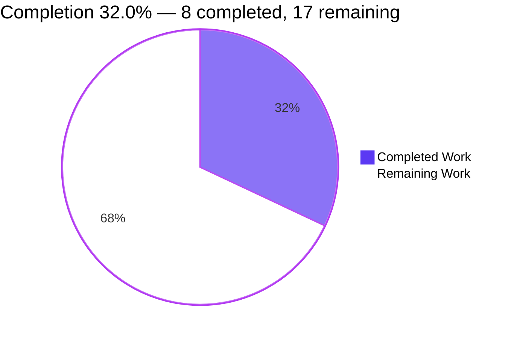
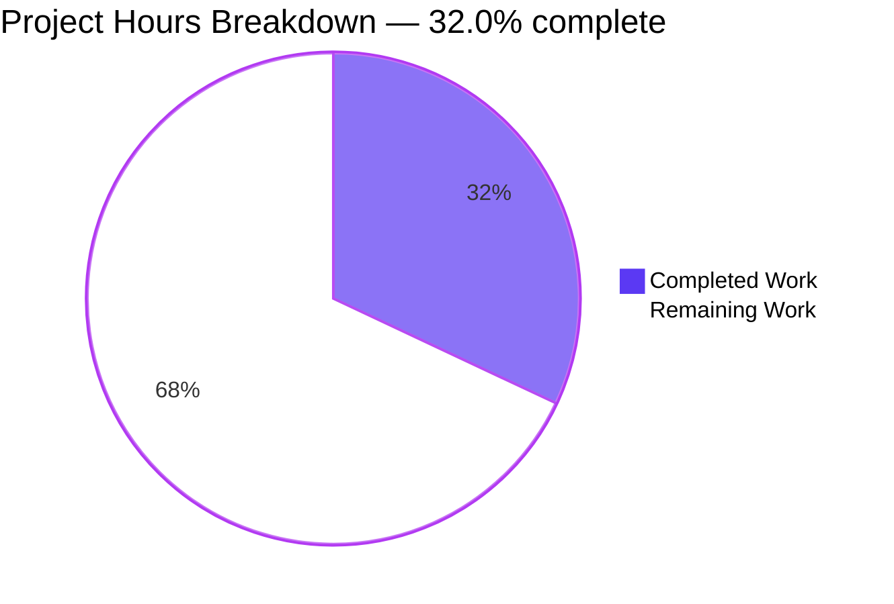

# 1. Executive Summary

## 1.1 Project Overview

The Proactive Insights Demo API is a compact FastAPI service — projects, tasks, team roles and a usage quota behind bearer-token authentication, all held in memory. This project is its integration test suite: five pytest modules that drive the ASGI application in process through `TestClient`, behind a 90% line-coverage gate over `app`. The suite is the safety net for the service's HTTP contract, and it records, as one marked expected failure, the authorization rule the service does not honour.

## 1.2 Completion Status

8 of 25 scoped hours are complete: **32.0%**. The role-administration work is delivered in full; the remaining 17 hours are the path to a deployable state.



Dark blue (#5B39F3) is completed work; white (#FFFFFF) with a violet outline (#B23AF2) is remaining work.

| Metric | Hours |
|---|---|
| Total Project Hours | 25.0 |
| Completed Hours (Baseline: Human with agentic-assist) | 8.0 |
| Remaining Hours | 17.0 |

8.0 ÷ (8.0 + 17.0) = 8.0 ÷ 25.0 = **32.0%**.

## 1.3 Key Accomplishments

- 19 integration tests in five modules; 18 pass and one is a documented expected failure.
- 100.00% line coverage of `app/main.py` (81 of 81 statements), with the 90% gate satisfied.
- The stored role is bound by assertions that fail when the grant write is removed: deleting `app/main.py:93` gives `1 failed, 3 passed, 1 xfailed`.
- `--runxfail` fails at the widening assertion alone (`tests/test_e2e_team_role_journey.py:35`).
- The grant contract and both refusals stay asserted: 200, 403 `Owner role required`, 404 `User or role not found`.
- Project visibility, the task journey and the usage quota are bound by unmarked tests.

## 1.4 Critical Unresolved Issues

Five items are open. Of the 20 requirements this work was scoped against, 19 are met in full and one only in part; four further gaps sit around the delivered suite.

| Issue | Impact | Owner | ETA |
|---|---|---|---|
| A granted role never governs later authorization: the grant writes `TEAM` (`app/main.py:93`) while every authorization decision reads `USERS` (`app/main.py:29`, `:58`, `:89-90`), so the highest-priority behaviour has no passing test | High — the service returns 200 for a role change that changes nothing; the behaviour is documented only as an expected failure | Backend owner | 4 hours |
| Three probe assertions pin literals the handlers return (`tests/test_e2e_service_ops.py:11`, `:18`, `:21-22`) | Medium — the tests pass without proving request counting, readiness or uptime | QA and backend owner | 8 hours |
| No continuous integration: nothing runs the gated suite unless a person does | Medium — a regression lands unnoticed | Platform owner | 4 hours |
| No ignore rules and no interpreter pin; the documented runtime (CPython 3.12.3) is not the validated one (CPython 3.13.18) | Low — artifacts land untracked and readers may use the wrong interpreter | Maintainer | 1 hour |
| The 15-behaviour roster behind the 90% target is not a repository artifact, so its priority split cannot be re-derived from the tree (the node counts agree: 1 expected failure, 0 skips, 19 tests) | Low — the coverage figure is auditable only from this guide | Maintainer | No code work |

## 1.5 Access Issues

No access issues identified: no database, broker, container, credential or outbound service is needed, and the six dependencies install from public wheels.

## 1.6 Recommended Next Steps

1. **[High]** Point the three authorization decisions at the grant store and delete the marker in the same change (4 hours).
2. **[Medium]** Give `/metrics`, `/ready` and the uptime field real instruments, then rewrite the three probe assertions (8 hours).
3. **[Medium]** Add a pipeline that runs the gated suite (4 hours).
4. **[Low]** Add ignore rules, pin the validated interpreter, and correct the documented `-rx` command (1 hour).
5. **[Low]** Record the behaviour roster the 90% target is counted against.

# 2. Project Hours Breakdown

## 2.1 Completed Work Detail

| Component | Hours | Description |
|---|---|---|
| Role-grant test narrowing and expected-failure discipline | 3.0 | Removed the pre-grant listing assertion and the grant body echo from the marked test so the marker holds only the two consequences the frozen application violates, and kept the strict marker with its four-reference reason so the defect stays visible and cannot outlive a fix (`tests/test_e2e_team_role_journey.py:11-43`). |
| Stored-role assertions in the grant test | 2.5 | Added the module import, a second grant back to `member` with its own status and body assertions, and one `main.TEAM[2]` assertion after each grant, so the grant's stored value — not the response echo — is what the suite binds (`tests/test_e2e_team_role_journey.py:4`, `:46-59`). |
| Suite verification | 1.5 | Reproduced the pre-change baseline, ran the gated suite, captured the expected-failure reason, proved the marker's narrowness with `--runxfail`, and proved the store assertion carries weight by deleting the grant write on a copy of the tree. |
| Coverage accounting and the expected-failure record | 1.0 | Confirmed the behaviour ratio (14 of 15 = 93.33%) and that 81 of 81 statements are covered, that no threshold or exclusion moved, and prepared the test id, reason, code reference and effect statement for the pull request. |
| **Total** | **8.0** | |

## 2.2 Remaining Work Detail

| Category | Hours | Priority |
|---|---|---|
| Authorization: read the grant store, retire the expected failure, reword the comment above the grant test | 4.0 | High |
| Operational probes: real request counter, storage-backed readiness, process uptime, and the three rewritten assertions | 8.0 | Medium |
| Continuous integration: a pipeline that installs the six pins and runs the gated suite | 4.0 | Medium |
| Repository hygiene: ignore rules, interpreter pin, corrected diagnostic command, in-repo behaviour roster | 1.0 | Low |
| **Total** | **17.0** | |

## 2.3 How These Hours Were Derived

Completed hours are the engineering effort the delivered change represents: designing the narrowed expected-failure body against the frozen handlers, binding the stored role with assertions that can fail, and the verification work that proves both (baseline, gated runs, narrowness diagnostic, mutation check). Remaining hours are estimated from the same base rates used for the completed work: a read-path change across three handlers plus a suite re-run (4 hours), three production instruments plus their assertions (8 hours), a pipeline (4 hours), and hygiene (1 hour). Confidence is high for the authorization and hygiene items, both of which are well bounded by code already read; medium for the probe instruments, which do not exist yet; and high for the pipeline, which is configuration only.

Total: 8.0 completed + 17.0 remaining = **25.0 hours**, of which **32.0%** is complete.

# 3. Test Results

All figures below were produced by running the suite on this tree: pytest 8.3.5 driving FastAPI's in-process `TestClient`, with pytest-cov 7.1.0 over coverage 7.17.3, on CPython 3.13.18.

| Area / Category | Framework | Tests | Passed | Failed | Coverage | What This Proves |
|---|---|---|---|---|---|---|
| Role administration journey (`tests/test_e2e_team_role_journey.py`) | pytest + `TestClient` | 5 | 4 | 0 | Not measured separately | The grant returns its documented body, the stored role is written, both refusals hold and the visibility filter is bound in both directions; the grant's effect on later authorization is a marked expected failure |
| Project and task journey (`tests/test_e2e_project_task_journey.py`) | pytest + `TestClient` | 6 | 6 | 0 | Not measured separately | Project-to-task flow, unknown project and unknown task 404s, the status allow-list and the title minimum length all behave as documented |
| Operational probes (`tests/test_e2e_service_ops.py`) | pytest + `TestClient` | 3 | 3 | 0 | Not measured separately | `/health`, `/ready` and `/metrics` answer with their documented shapes and the bearer guard refuses unauthenticated callers — assertion depth is limited (see below) |
| Usage quota (`tests/test_e2e_usage_limit_journey.py`) | pytest + `TestClient` | 2 | 2 | 0 | Not measured separately | The counter increments, the 429 refusal fires at the limit, and non-positive units are rejected without moving the counter |
| Project API basics (`tests/test_api.py`) | pytest + `TestClient` | 3 | 3 | 0 | Not measured separately | Health body, owner project creation and listing, and the missing-token refusal |
| Whole suite, gated run | pytest + pytest-cov | 19 | 18 | 0 | 100.00% of `app/main.py` (81 of 81 statements) | The suite is green with one expected failure and no skips, and the repository's 90% line gate is satisfied |
| Marker narrowness diagnostic (`--runxfail`) | pytest | 19 | 18 | 1 by design | — | The expected failure is genuine and the marker absorbs nothing that can pass: the only failure is the widening assertion at `tests/test_e2e_team_role_journey.py:35` |
| Mutation check on a copy of the tree (grant write at `app/main.py:93` deleted) | pytest | 5 | 3 | 1 by design | — | The stored-role assertion carries weight: the grant test fails at `tests/test_e2e_team_role_journey.py:54` with `assert 'member' == 'owner'` |

**Not covered.** The following are delivered but not exercised by any test, and are what a human should test before release:

- **A granted role governing later authorization.** No passing test exists for it: the only test that drives the promotion and the demotion is a strict expected failure, and its demotion half never executes because the body stops at the widening assertion. The revoke call, its echo assertion and the narrowing assertion have therefore never run.
- **Operational probe behaviour.** The three probe assertions compare against values the handlers return unconditionally, so nothing tests a real request counter, a storage-backed readiness check or process uptime. Driven live, `/metrics` reported `requests_total` 0 regardless of traffic and an `uptime_seconds` of 3,795,739.97 on a process seconds old.
- **Role storage for any user other than user 2.** Both store assertions read `main.TEAM[2]`; a write keyed off a different user id would pass.
- **Duplicate query parameters** on the role route (`?role=owner&role=member` returns 200 and the last value wins) are unbound by any assertion.
- **Concurrency, load and restart behaviour.** The suite is serial, state is process-global, and nothing tests what happens to projects, tasks and roles when the process stops.
- **The documentation page.** `/docs` was verified by hand rather than by a test: it returns 200, lists all 9 operations and executed `GET /health` successfully from its "Try it out" control.

# 4. Runtime Validation & UI Verification

The service was started with `uvicorn app.main:app` on a loopback port and driven with live HTTP requests, then its documentation page was exercised in a headless browser.

- ✅ **Start-up** — the ASGI application bound and answered within seconds; no environment variable, database or external service was needed.
- ✅ **Health and readiness** — `GET /health` returned 200 `{"status":"ok"}`; `GET /ready` returned 200 `{"ready":true,"checks":{"storage":"ok"}}`.
- ✅ **Bearer guard** — `GET /projects` without a token returned 401 `{"detail":"Missing bearer token"}`; every protected route refused unauthenticated callers.
- ✅ **Project creation and visibility** — the owner created project 1 and the member project 2; the owner's listing returned `[1, 2]` and the member's returned `[2]`.
- ✅ **Role route contract and refusals** — `POST /teams/2/role?role=owner` returned 200 `{"user_id":2,"role":"owner"}`; a member caller got 403 `Owner role required`; an unknown user and `role=admin` both got 404 `User or role not found`.
- ⚠ **Role grant effect** — after the owner promoted user 2, the member's listing stayed `[2]`: the grant is stored but does not change what the user may do. This is the documented defect, observed live.
- ✅ **Task journey** — creation returned status `open`, `PATCH /tasks/1?status=done` returned `done`, and `?status=blocked` returned 422 `Unsupported status`.
- ✅ **Usage quota** — `POST /billing/consume?units=2` returned `{"used":2,"limit":5}`.
- ⚠ **Metrics** — `GET /metrics` returned 200, but `requests_total` stayed 0 after twenty requests and `uptime_seconds` reported 3,795,739.97 seconds on a process seconds old (host clock, not process uptime).
- ✅ **Documentation page** — `/docs` returned 200 with the Swagger UI rendered, all 9 operations listed, and its "Try it out" control executed `GET /health` successfully (200 `{"status":"ok"}`); `/openapi.json` returned 200 with 8 paths carrying those 9 operations. No console errors originated from the application.

Screenshots of this pass: `blitzy/screenshots/swagger_docs.png`, `blitzy/screenshots/swagger_health_exec.png`, `blitzy/screenshots/ready_json.png`, `blitzy/screenshots/openapi_json.png`.

**Never exercised at runtime.** The usage-limit refusal (429), the unknown-project and unknown-task 404 branches, and the title-length rejection were not driven against a live server; each is exercised only in process by the suite. The demotion half of the role journey has never run anywhere — neither live nor in process — because the marked body stops at the widening assertion. No concurrency, sustained load or restart-and-recover scenario was attempted.

# 5. Compliance & Quality Review

## 5.1 Compliance Matrix

| Deliverable | Benchmark | Status | Evidence |
|---|---|---|---|
| Integration-level tests drive the application in process | Test-level discipline | ✅ PASS | 19 tests, each through a module-level `TestClient(app)`; no socket, no server, no second level introduced |
| Production code untouched | Change containment | ✅ PASS | `app/main.py` and every non-test file byte-identical to the pre-change tree; one changed path, +11/−9 |
| Defect disclosed, never hidden | Test integrity | ✅ PASS | One `xfail(strict=True)` with a four-reference reason; no skip, no weakened or deleted test; the reason prints under `-rx` |
| Marker discipline — no assertion that can pass is absorbed | Test integrity | ✅ PASS | `--runxfail` fails at `tests/test_e2e_team_role_journey.py:35` alone |
| Stored state bound by a falsifiable assertion | Test integrity | ✅ PASS | `main.TEAM[2]` asserted at `:54` and `:59`; deleting `app/main.py:93` fails `:54` |
| Coverage target and gate | Coverage | ✅ PASS | 81 of 81 statements, 100.00%; 14 of 15 counted behaviours (93.33%); 90% gate satisfied from `pytest.ini:5` |
| Repository conventions | Consistency | ✅ PASS | Module-level client and header literals, exact-value assertions, inline payloads, ids from responses, no new fixture, mock or parametrisation |
| Isolation and determinism | Reliability | ✅ PASS | The autouse reset re-seeds every store per test; each test passes alone and in any order; identical results across repeated runs |
| Security baseline | Security | ✅ PASS | Only the two documented demo tokens appear in code; no injection, deserialisation or execution surface added; the 401/403/404 refusals are asserted |
| Probe assertions test behaviour | Assertion efficacy | ⚠ PARTIAL | Three assertions in `tests/test_e2e_service_ops.py` compare against literals the handlers return (see 5.2) |
| Automated enforcement | Operability | ❌ FAIL | No pipeline, workflow file or pre-commit hook runs the suite; nothing guards it but a human running `pytest -q` |
| Runtime and tooling documentation | Operability | ⚠ PARTIAL | No interpreter pin anywhere; the documented runtime (CPython 3.12.3) is not the validated one (CPython 3.13.18); the documented expected-failure command uses `-rX`, which prints no reason |

## 5.2 AAP & Rule Divergences and Gaps

| What the AAP/Rule Required | What Was Delivered Instead | Why It Diverged | Impact | Remediation |
|---|---|---|---|---|
| Work-list entry #1 (`rec-79f30bedd1`, high) asked for a test that passes while proving a granted role governs later authorization | A strict expected failure that runs the promotion and demotion consequences and reports `xfailed` (`tests/test_e2e_team_role_journey.py:11-43`) — **Sanctioned**: the user's "do not change production behaviour" made a pass impossible, and the specification resolves the conflict the same way | The grant writes `TEAM` (`app/main.py:93`) while authorization reads `USERS` (`:29`, `:58`, `:89-90`); no test can pass without the production change the work forbids | High — the highest-priority behaviour has no passing test, so a regression in it is invisible and a partial fix keeps reporting `xfailed` | Make the read path consult the grant store, then delete the marker in the same change (4 hours) |
| The stated runtime is CPython 3.12.3, "the only interpreter present" | Built and validated on CPython 3.13.18 | The host carries 3.13.18 and no manifest pins an interpreter | Low — documentation only; all six pins resolve and the suite is green with the gate reached | Pin and document the interpreter actually validated (part of the 1-hour hygiene task) |
| The acceptance command `-q -rX` is described as printing the expected-failure reason | The reason is produced under `-rx` (and `-rA`/`-v`); `-rX` selects xpassed lines | The command text is inaccurate for pytest 8.3.5 | Low — the stated command alone shows `1 xfailed` with no reason; the reason is verbatim in the decorator | Correct the documented command (folded into the 1-hour hygiene task) |
| The quality findings on `tests/test_e2e_service_ops.py` — a literal request counter, a host-clock uptime and a literal readiness body — were known and left unrepaired | The three assertions still pin those literals (`:11`, `:18`, `:21-22`) | They were outside the ordered work list, and a meaningful assertion needs production instruments the freeze forbids | Medium — three tests pass without proving the behaviour they name; monitoring built on them would be blind | Build the instruments and rewrite the assertions (8 hours) |
| The comment above the grant test states that every other step of the marked test is bound by an unmarked test | Delivered verbatim as specified (`tests/test_e2e_team_role_journey.py:46-49`), although the demotion steps it also covers are bound by no unmarked test | The specification prescribed this wording while itself keeping the demotion assertions inside the marker | Low — a reader could overestimate the safety net for a partial production fix | Reword to "every step that can pass today" when the marker is removed (no extra hours) |

**A granted role never governs authorization (release-blocking).** The service answers `POST /teams/{user_id}/role` with 200 and stores the new role in `TEAM`, but all three authorization decisions resolve the caller's role from `USERS` (`app/main.py:29`, used at `:58` and `:89-90`), and the only `TEAM` read is a membership test at `:91`. Driven live, a promoted member's `GET /projects` still returned only its own project. The specification forbade changing production, so the suite records the defect instead of fixing it — and because a pytest expected-failure marker attaches to the whole test, a partial repair (say, a visibility filter that reads the grant store while the owner guard does not) still reports `xfailed`. The decision a human must take is whether to repair the read path now; if so, the marker at `tests/test_e2e_team_role_journey.py:11-18` must be deleted in the same change, or the suite will fail with `[XPASS(strict)]`.

**Three probe assertions do not test the behaviour they name (medium).** `tests/test_e2e_service_ops.py:11` compares `/ready` against the literal the handler returns, `:18` asserts `requests_total == 0` — true only because the handler hardcodes zero — and `:21-22` assert the type and sign of an `uptime_seconds` read from the host's monotonic clock. Against the live service, `requests_total` stayed 0 after twenty requests and `uptime_seconds` reported 3,795,739.97 on a seconds-old process. Making these assertions meaningful requires a request counter, a storage-backed readiness check and a process-start timestamp in `app/main.py`, which is why they were left alone; a human must decide whether to build those instruments (8 hours) or delete the assertions rather than keep tests that cannot fail.

**The documented runtime is not the validated one (low).** The work's specification states CPython 3.12.3 as the only interpreter present; the suite was built and validated on CPython 3.13.18, and no manifest pins an interpreter at all. Every pin resolves on 3.13.18, the suite is green and the coverage gate is satisfied, so nothing depends on the discrepancy — but a new contributor following the documentation may build an environment nobody has run. A human should pin and document the interpreter the suite is validated on; that is folded into the 1-hour hygiene task alongside the ignore rules.

**The documented diagnostic command does not print the reason (low).** The specification describes `-q -rX` as the acceptance command that prints the expected-failure reason. In pytest 8.3.5 `-r` takes a character set in which capital `X` selects xpassed lines, so `-rX` prints nothing for an expected failure; `-rx` does. The deliverable is unaffected — the reason is verbatim in the decorator at `tests/test_e2e_team_role_journey.py:13-17` and prints under `-rx`, `-rA` and `-v` — but anyone re-running the documented command will see `1 xfailed` with no explanation. Correcting the documented command is part of the hygiene task.

**The comment above the grant test reads more broadly than the code (low).** The block at `tests/test_e2e_team_role_journey.py:46-49` states that every other step of the marked test is bound by an unmarked test. That holds for every step that can pass today — the seeds, the grant call and its status assertion — but not for the demotion steps at `:37-39`, which no unmarked test binds because they cannot pass while authorization reads `USERS`. The wording was prescribed by the work's specification, so it was delivered as specified rather than rewritten; a maintainer reading only the comment could overestimate the safety net for a partial production fix. The accurate phrasing — "every step of that test that can pass today" — belongs with the change that removes the marker, and needs no separate work.

# 6. Risk Assessment

| Risk | Category | Severity | Probability | Mitigation | Status |
|---|---|---|---|---|---|
| A role grant is stored but never governs authorization: the grant writes `TEAM` (`app/main.py:93`) while every authorization decision reads `USERS` (`:29`, `:58`, `:89-90`), so a promoted member keeps member rights and a demoted owner keeps owner rights | Technical | High | Certain — present in the code and observed live | Make the three read sites consult the grant store; the strict marker then reports `[XPASS(strict)]` and fails the run until it is deleted, so the fix cannot land silently | Open, documented by the expected failure |
| A partial production repair stays invisible: the marker attaches to the whole test, so fixing only the visibility filter still reports `xfailed` | Technical | Medium | Likely | Remove the marker with the production change and assert the promotion and demotion consequences unmarked | Open, accepted with the delivery |
| The stored-role assertions bind user 2 only; a write keyed off a different user id would pass | Technical | Low | Moderate | Add a store assertion for a second user id, which the route already supports | Open |
| No dependency, static-analysis or secret scanning is configured, and the two demo bearer tokens live in code and tests | Security | Medium | Possible | Add `pip-audit` and a static analyser to the pipeline; move any non-demo credential into configuration | Open |
| Nothing runs the gated suite automatically — there is no pipeline, workflow or hook | Operational | High | Likely | Add the 4-hour pipeline task so every change runs `pytest -q` with the coverage gate | Open |
| `/metrics` and `/ready` return fixed values, so alerting built on them is blind: `requests_total` stays 0 and readiness never reflects storage | Operational | Medium | Certain | Give both handlers real instruments and rewrite their assertions | Open |
| All state lives in process memory, so a restart discards every project, task and role, and a second worker would not see another's writes | Integration | Medium | Certain if run with more than one worker | Keep the service single-process as the fixture it is declared to be, or add persistence before any shared use | Open, by design |
| The Swagger UI loads its CSS and JavaScript from a public CDN, so without outbound HTTPS `/docs` renders unstyled | Integration | Low | Possible | Serve the documentation assets locally if the page must work offline | Open |

# 7. Visual Project Status



Dark blue (#5B39F3) is completed work; white (#FFFFFF) with a violet outline (#B23AF2) is remaining work. The chart reads 8 completed hours against 17 remaining, matching Sections 1.2 and 2.2.

Remaining work by category, with priority:

| Category | Hours | Priority |
|---|---|---|
| Authorization: read the grant store, retire the expected failure, reword the comment above the grant test | 4.0 | High |
| Operational probes: real counter, storage-backed readiness, process uptime, rewritten assertions | 8.0 | Medium |
| Continuous integration: pipeline running the gated suite | 4.0 | Medium |
| Repository hygiene: ignore rules, interpreter pin, corrected diagnostic, in-repo behaviour roster | 1.0 | Low |
| **Total** | **17.0** | |

Priority distribution: 1 high-priority task (4.0 hours), 2 medium-priority tasks (12.0 hours), 1 low-priority task (1.0 hour).

# 8. Summary & Recommendations

The integration suite for the Proactive Insights Demo API is in a sound, self-consistent state. Nineteen tests across five modules drive the ASGI application in process, eighteen pass, one is a documented expected failure, and the whole `app` package is covered line for line — 81 of 81 statements at 100.00%, comfortably above the repository's 90% gate. The change this project contributed is concentrated in the role-administration module: the expected-failure test now holds only the two consequences the frozen application violates, and the grant test binds the role the handler actually stores, so deleting that write fails the suite. Verified first-hand, both claims hold: `--runxfail` fails at the widening assertion alone, and removing `app/main.py:93` on a copy of the tree produces `1 failed, 3 passed, 1 xfailed` at the store assertion.

Against the work it was scoped to, **32.0%** of the total 25 hours is complete — 8 completed hours of delivered test work and 17 remaining hours of path-to-production work. The percentage is deliberately not a count of requirements: 19 of the 20 scoped requirements are met in full and one only in part. The gap that dominates the remainder is behavioural rather than numeric. A role granted through `POST /teams/{user_id}/role` is answered with 200 and stored, but no authorization decision ever reads that store, so a promoted member keeps member rights and a demoted owner keeps owner rights. The suite cannot fix that — production was frozen by the terms of the work — so it records the defect as one reviewed, strict expected failure that will turn red the moment someone repairs the code without removing the marker.

The critical path to a deployable state is short and well defined: repair the three read sites in `app/main.py` and delete the marker together (4 hours); replace the three probe assertions that pin handler literals with assertions on real instruments (8 hours); add a pipeline that runs the gated suite (4 hours); and finish hygiene — ignore rules, an interpreter pin, the corrected `-rx` diagnostic (1 hour). Until the first of those lands, the highest-priority behaviour has no test that can pass, and a half-fix stays hidden behind the marker.

Success for the delivered work is easy to state and already measurable: 18 of 19 tests green with one reviewed expected failure, 100.00% line coverage, the gate satisfied with no skip and no weakened test, one changed file, and production untouched. Production readiness is another matter, and the repository says so itself: `README.md` declares the service a synthetic QA fixture whose in-memory storage and demo tokens are for evaluation only and must not be deployed with real credentials. Read that way, what remains is not a blocker for the fixture but a checklist for anyone who turns it into a real service — the authorization repair first, then instruments and a pipeline, so the suite that guards it is run without being asked.

# 9. Development Guide

## 9.1 System Prerequisites

- **CPython 3.13** — validated on 3.13.18. The suite has no syntax or library dependency on a minor version, but no manifest pins one, so use the interpreter the suite is validated on.
- **git** and a shell; about 50 MB of disk for the checkout plus the virtual environment.
- **A free TCP port** if you intend to run the service. Nothing else is needed: no database, broker, container runtime, environment variable, secret or outbound service. The only optional outbound dependency is the public CDN that styles `/docs`.

## 9.2 Environment Setup

From the repository root:

```bash
python3 -m venv .venv
.venv/bin/python -m pip install -r requirements.txt
```

The install resolves to exactly these versions (verified with `pip list`): fastapi 0.115.12, uvicorn 0.34.0, pytest 8.3.5, httpx 0.28.1, pytest-cov 7.1.0, coverage 7.17.3, plus pydantic 2.14.4 and starlette 0.46.2 pulled in transitively. It completes from wheels in about ten seconds. There is no build step, no code generation and no database migration.

Activating the environment is optional; every command below calls the interpreter by path, which keeps the shell and the run consistent.

## 9.3 Running the Test Suite

The whole suite, with the coverage gate that `pytest.ini` applies through `addopts`:

```bash
.venv/bin/python -m pytest -q
```

Expected on this tree:

```
18 passed, 1 xfailed, 1 warning in 0.14s
app/__init__.py       0      0  100.00%
app/main.py          81      0  100.00%
Required test coverage of 90% reached. Total coverage: 100.00%
```

A single module or a single test, with the whole-suite coverage gate switched off — a narrowed run cannot satisfy a gate measured over `app`:

```bash
.venv/bin/python -m pytest tests/test_e2e_team_role_journey.py -q --no-cov
.venv/bin/python -m pytest "tests/test_e2e_team_role_journey.py::test_owner_grants_member_the_owner_role" -q --no-cov
```

Expected: `4 passed, 1 xfailed` for the module and `1 passed` for the grant test. To read the expected-failure reason, use `-rx` (capital `X` selects xpassed lines and prints nothing for an expected failure):

```bash
.venv/bin/python -m pytest "tests/test_e2e_team_role_journey.py::test_role_grant_governs_later_requests" -q -rx --no-cov
```

Expected: `1 xfailed` plus the reason naming `app/main.py:29`, `:58`, `:89-90` against `:93`. To confirm the marker hides nothing that can pass, run the suite with the markers disabled — this is a diagnostic, never a fix path:

```bash
.venv/bin/python -m pytest tests/ --runxfail -q --no-cov
```

Expected: `1 failed, 18 passed`, the single failure being the widening assertion at `tests/test_e2e_team_role_journey.py:35`.

## 9.4 Starting the Service

```bash
.venv/bin/python -m uvicorn app.main:app --host 127.0.0.1 --port 8000
```

Substitute any free port; the commands below were exercised on `127.0.0.1:18417`. Run it as a managed background job and stop it when finished.

```bash
curl -s http://127.0.0.1:8000/health
curl -s http://127.0.0.1:8000/ready
curl -s -H 'Authorization: Bearer owner-token' http://127.0.0.1:8000/projects
```

Expected: `{"status":"ok"}`, `{"ready":true,"checks":{"storage":"ok"}}`, and `[]` on a fresh process (or the projects created so far). The demo credentials are `owner-token` (user 1, owner) and `member-token` (user 2, member); they are seeded fixtures, not secrets. The documentation page is at `/docs` and the schema at `/openapi.json`.

## 9.5 Example Usage

Each call below was issued against a running instance, with the exact body shown:

```bash
B=http://127.0.0.1:8000
O='Authorization: Bearer owner-token'
M='Authorization: Bearer member-token'

# Projects: one per identity, then each identity's listing
curl -s -X POST -H "$O" -H 'Content-Type: application/json' -d '{"name":"Owner Scope"}' $B/projects
curl -s -X POST -H "$M" -H 'Content-Type: application/json' -d '{"name":"Member Scope"}' $B/projects
curl -s -H "$O" $B/projects      # both projects
curl -s -H "$M" $B/projects      # only the member's own

# Tasks: create, move through the status allow-list, reject an unsupported status
curl -s -X POST -H "$O" -H 'Content-Type: application/json' -d '{"title":"Review deck","project_id":1}' $B/tasks
curl -s -X PATCH -H "$O" "$B/tasks/1?status=done"
curl -s -X PATCH -H "$O" "$B/tasks/1?status=blocked"    # 422 {"detail":"Unsupported status"}

# Roles: owner-only route, then its two refusals
curl -s -X POST -H "$O" "$B/teams/2/role?role=owner"     # {"user_id":2,"role":"owner"}
curl -s -X POST -H "$M" "$B/teams/1/role?role=member"    # 403 {"detail":"Owner role required"}
curl -s -X POST -H "$O" "$B/teams/2/role?role=admin"     # 404 {"detail":"User or role not found"}

# Quota and metrics
curl -s -X POST -H "$O" "$B/billing/consume?units=2"     # {"used":2,"limit":5}
curl -s $B/metrics                                        # 200; both values are placeholders
```

The role change above returns 200 and stores the new role, but the member's `GET /projects` does not widen: that is the authorization defect the suite documents, not a defect in the call sequence.

## 9.6 Troubleshooting

| Symptom | Cause | Resolution |
|---|---|---|
| `error: externally-managed-environment` from pip | The system interpreter was used instead of the virtual environment | Run `.venv/bin/python -m pip install -r requirements.txt` |
| `FAIL Required test coverage of 90% not reached` on a narrowed run, with all tests passing | The coverage gate in `pytest.ini` measures the whole `app` package, so a module or single-test run cannot reach 90% (observed: 66.67%, exit 1) | Add `--no-cov` for per-change runs; keep the gated whole-suite run for hand-off |
| `ModuleNotFoundError: No module named 'app'` | pytest was started outside the repository root | Run it from the root, where `pytest.ini` sets `pythonpath = .` |
| The suite fails with `[XPASS(strict)]` | Production was fixed (authorization now reads the grant store) and the marker outlived the defect | Delete `@pytest.mark.xfail` at `tests/test_e2e_team_role_journey.py:11-18` in the same change |
| The expected-failure reason never prints | `-r` takes a character set in which `x` is xfailed and capital `X` is xpassed, so `-rX` prints nothing for an expected failure | Use `-rx` (or `-rA`, `-v`); the reason is also verbatim at `tests/test_e2e_team_role_journey.py:13-17` |
| `/docs` renders as unstyled HTML | The CDN serving the Swagger UI assets was unreachable | Check outbound HTTPS, or serve the assets locally |
| `git status` shows `.coverage`, `__pycache__/` or `.pytest_cache/` after a run | The repository has no ignore rules | Delete them, or add ignore rules as part of the hygiene task; redirect coverage with `COVERAGE_FILE` if the tree must stay clean |

# 10. Appendices

## Appendix A — Command Reference

| Purpose | Command (from the repository root) | Observed result |
|---|---|---|
| Create the environment | `python3 -m venv .venv` | `.venv/bin/python` reports CPython 3.13.18 |
| Install the pins | `.venv/bin/python -m pip install -r requirements.txt` | The six pinned versions, plus pydantic 2.14.4 and starlette 0.46.2 |
| Gated whole suite | `.venv/bin/python -m pytest -q` | `18 passed, 1 xfailed, 1 warning`; 81/81 statements, 100.00%; gate reached; exit 0 |
| One module | `.venv/bin/python -m pytest tests/test_e2e_team_role_journey.py -q --no-cov` | `4 passed, 1 xfailed` |
| One test | `.venv/bin/python -m pytest "tests/test_e2e_team_role_journey.py::test_owner_grants_member_the_owner_role" -q --no-cov` | `1 passed` |
| Expected-failure reason | `.venv/bin/python -m pytest "tests/test_e2e_team_role_journey.py::test_role_grant_governs_later_requests" -q -rx --no-cov` | `1 xfailed` with the four-reference reason |
| Marker narrowness diagnostic | `.venv/bin/python -m pytest tests/ --runxfail -q --no-cov` | `1 failed, 18 passed`; the failure is `tests/test_e2e_team_role_journey.py:35` |
| Collection only | `.venv/bin/python -m pytest --collect-only -q` | `19 tests collected` |
| Start the service | `.venv/bin/python -m uvicorn app.main:app --host 127.0.0.1 --port 8000` | Uvicorn binds and serves |
| Probe the service | `curl -s http://127.0.0.1:8000/health` | `{"status":"ok"}` |

## Appendix B — Port Reference

| Port | Service | Notes |
|---|---|---|
| 8000 | The FastAPI service under uvicorn | The port the README documents; any free port works, and a loopback bind is sufficient. The suite itself opens no port — `TestClient` dispatches in process. |
| `/docs`, `/openapi.json` | Same origin as the service | Served by the framework; `/docs` loads its CSS and JavaScript from `cdn.jsdelivr.net`. |

## Appendix C — Key File Locations

| Path | Role |
|---|---|
| `app/main.py` | The whole service: 9 routes, the in-memory stores (`USERS`, `PROJECTS`, `TASKS`, `TEAM`, `USAGE`), the bearer guard and the role handler. 81 statements. |
| `app/__init__.py` | Empty package marker that makes `from app import main` importable. |
| `tests/conftest.py` | The suite's only fixture: an autouse reset that re-seeds every store and rewinds the id counters before each test. |
| `tests/test_e2e_team_role_journey.py` | Role administration and project visibility; holds the expected failure at `:11-43` and the stored-role assertions at `:54` and `:59`. |
| `tests/test_e2e_project_task_journey.py` | Project-to-task journey and task validation (6 tests). |
| `tests/test_e2e_service_ops.py` | `/health`, `/ready`, `/metrics` and the bearer guard (3 tests). |
| `tests/test_e2e_usage_limit_journey.py` | Billing counter and its two refusals (2 tests). |
| `tests/test_api.py` | Health body, owner project creation and listing, missing-token 401 (3 tests). |
| `pytest.ini` | `testpaths = tests`, `pythonpath = .`, and the coverage gate `--cov=app --cov-report=term-missing --cov-fail-under=90 --cov-precision=2`. |
| `requirements.txt` | The six pins. |
| `README.md` | Run instructions and the declaration that the service is a synthetic QA fixture. |

## Appendix D — Technology Versions

| Technology | Version | Role |
|---|---|---|
| CPython | 3.13.18 | Interpreter the environment and suite were validated on |
| fastapi | 0.115.12 | Web framework and `TestClient` source |
| starlette | 0.46.2 | Resolved transitively inside fastapi's range |
| pydantic | 2.14.4 | Request models and validation |
| uvicorn | 0.34.0 | ASGI server for local runs |
| pytest | 8.3.5 | Test framework, collection and the expected-failure marker |
| httpx | 0.28.1 | In-process transport beneath `TestClient` |
| pytest-cov | 7.1.0 | Coverage plugin invoked from `pytest.ini` |
| coverage | 7.17.3 | Coverage engine |

## Appendix E — Environment Variable Reference

None. The service reads no environment variable and requires no secret: both bearer tokens are seeded fixtures in `app/main.py:7`, the stores are in process memory, and the suite runs green under a completely empty environment. The only variables worth setting locally are those that keep build artifacts out of the tree — `COVERAGE_FILE` to redirect the coverage data file — and, if you run the gated suite in a checkout, `PYTHONDONTWRITEBYTECODE=1` to suppress `__pycache__/`.

## Appendix F — Developer Tools Guide

| Tool | Use | Notes |
|---|---|---|
| pytest | Collection and execution; `-q`, `-rx`, `-v`, `--runxfail`, `--collect-only` | Configured entirely through `pytest.ini`; the coverage options travel with every run unless `--no-cov` is passed |
| pytest-cov / coverage | Line coverage of `app` and the 90% floor | A narrowed run cannot satisfy a whole-package gate — observed exit 1 at 66.67% |
| FastAPI `TestClient` | The suite's only client: in-process ASGI calls, no socket | Module-level `client = TestClient(app)` in every test module |
| uvicorn | Local service runs | `.venv/bin/python -m uvicorn app.main:app` |
| curl | Probing a running instance | `lsof`, `ss`, `netstat` and `fuser` are not present in this environment, so verify reachability with a request |
| Swagger UI | Manual exploration of the nine operations | `/docs`; its "Try it out" control executed `GET /health` successfully |
| Not configured | Linters, formatters, type checkers, security scanners, CI | The repository contains no such configuration and `requirements.txt` pins no such tool |

## Appendix G — Glossary

| Term | Meaning |
|---|---|
| ASGI | The asynchronous server gateway interface FastAPI applications are built on; `TestClient` calls the application through it without a network socket. |
| `TestClient` | Starlette's in-process HTTP client, which the suite uses so every test is an integration test with no server running. |
| Bearer token | The credential in the `Authorization: Bearer <token>` header; two demo tokens are seeded, `owner-token` (user 1) and `member-token` (user 2). |
| Expected failure (`xfail`) | A test a maintainer knows fails for a documented reason. With `strict=True`, an unexpected pass fails the run, so the marker cannot outlive the defect. |
| Marker | A pytest decorator that changes how a test's result is reported; the suite has exactly one. |
| Autouse fixture | The `tests/conftest.py` reset that runs before every test and re-seeds all stores and counters. |
| Coverage gate | The `--cov-fail-under=90` threshold in `pytest.ini`: the run fails if fewer than 90% of the statements in `app` execute. |
| Visibility filter | The rule in `list_projects` (`app/main.py:58`) that returns a caller's own projects, plus every project when the caller's role is `owner`. |
| Grant store (`TEAM`) | The dictionary the role route writes (`app/main.py:93`) — and which no authorization decision reads. |
| Behaviour roster | The list of 15 high- and medium-priority behaviours the 90% target is counted against; 14 are covered by a test that can fail.
