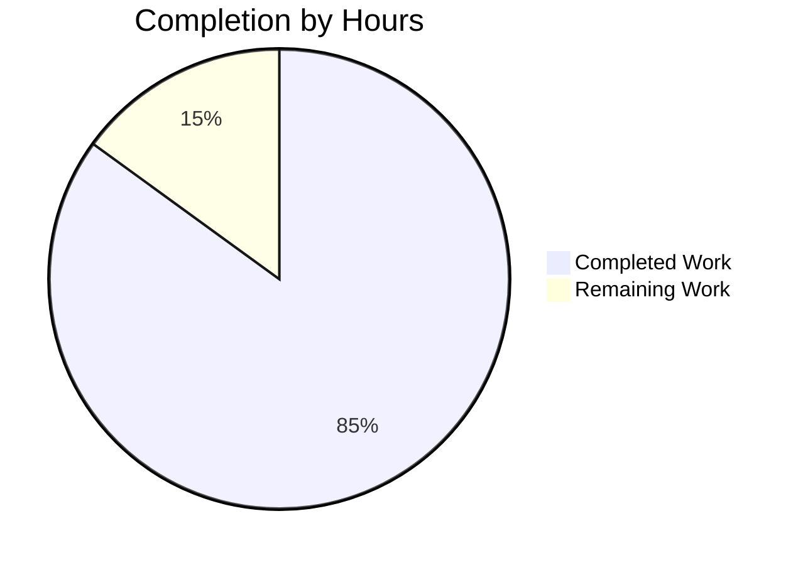
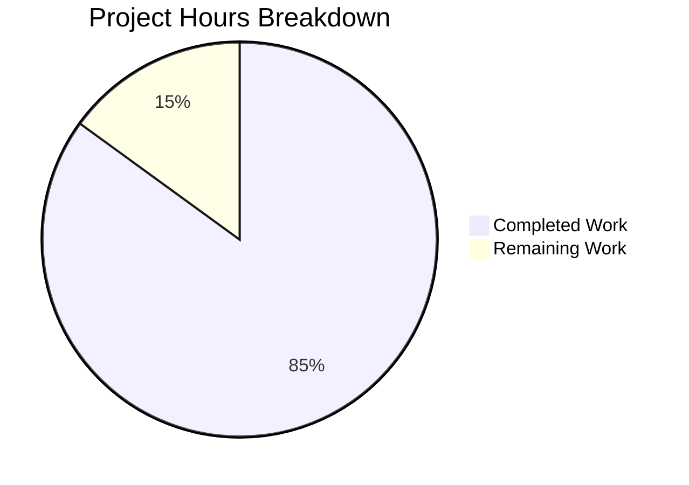

# 1. Executive Summary

## 1.1 Project Overview

This release is a documentation change to the Proactive Insights Demo API, a compact FastAPI service whose nine handlers cover health and readiness probes, projects, tasks, team roles, usage metering and metrics. It adds a one-line declaration comment above the first request handler — the liveness probe on `GET /health` — and reduces `README.md` from thirty-one lines to the three facts a newcomer needs: the project name, the install command and the run command. Two files change; no dependency, route or behaviour moves.

## 1.2 Completion Status

**85% complete** — 8.5 of 10.0 hours.



Completed work is dark blue (#5B39F3); remaining work is white (#FFFFFF).

| Metric | Hours |
|---|---|
| Total Hours | 10.0 |
| Completed Hours (Baseline: Human with agentic-assist) | 8.5 |
| Remaining Hours | 1.5 |

Completion = 8.5 ÷ 10.0 = **85%**. All twenty requirements are delivered; the remaining 1.5 hours are one path-to-production item (Section 2.2).

## 1.3 Key Accomplishments

- **Handler comment** — one line above the health probe's decorator (`app/main.py:35`), accurate against the response it returns.
- **README quick-start** — the project name, the install command and the run command only, in thirteen lines.
- **Nothing else moved** — the module's syntax tree is identical to the previous revision, and no dependency changed.
- **Scope held** — two files differ; nothing was created, deleted or renamed.
- **Both commands proven** — the install completes from a clean environment and the run command serves the probe.
- **Contract exercised** — repeated, parallel and hostile requests returned the documented bodies with no server error, and the three tests pass.

## 1.4 Critical Unresolved Issues

**4 open items** are carried: one outstanding path-to-production item with an estimate, and three caveats that follow from the agreed content limits. All twenty requirements are delivered, and nothing here blocks release.

| Issue | Impact | Owner | ETA |
|---|---|---|---|
| No automated check asserts the comment line or the README text — the repository configures no test, script, digest or CI step for either | A later edit to either artifact would pass every gate silently | Maintainer | 1.5 hours (Section 2.2) |
| The quick-start omits the environment preconditions it relies on — an activated virtual environment, the repository root as working directory — and its run command binds `127.0.0.1:8000` | A newcomer on an externally-managed interpreter, in the wrong directory, or with port 8000 taken meets an error the README does not explain | Documentation owner | Next README revision, if the three-fact limit is lifted |
| The service keeps hardcoded demo bearer tokens (`app/main.py:7`) while the previous "synthetic fixture, do not deploy" warning was removed with the old README content | The service could be mistaken for deployable and the tokens for real configuration | Service owner | Decision at next planning |
| No ignore rule for Python build artefacts, so the documented run command without bytecode suppression leaves untracked `__pycache__` in the tree | A clean working tree depends on how the command is launched | Maintainer | Next repository hygiene pass |

## 1.5 Access Issues

No access issues identified. The repository needs no credentials, service accounts, third-party APIs, databases or containers: the four pinned packages install from the public index, all state lives in memory, and no environment variable is read.

## 1.6 Recommended Next Steps

1. **[High]** Add a regression test pinning the handler comment and the README's exact thirteen lines (1.5 hours).
2. **[Medium]** Decide how the service is exposed, and treat the demo bearer tokens as public if anything outside the team can reach it.
3. **[Medium]** Decide whether the quick-start may state the preconditions it relies on — virtual environment, working directory, port.
4. **[Low]** Pin `pydantic` directly and ignore `__pycache__/` and `.pytest_cache/`.

# 2. Project Hours Breakdown

Eight and a half hours of completed work cover the plan's scope in full; one and a half hours of path-to-production work remain, for a total of 10.0 hours.

## 2.1 Completed Work Detail

| Component | Hours | Description |
|---|---|---|
| Scope analysis and comment-form resolution | 2.0 | Locating the request handler, auditing both target files in full, confirming the repository holds no file of the name the request used, and resolving the requested JavaScript-style summary into the module's own comment syntax without altering behaviour. |
| Health-handler declaration comment | 0.5 | The single inserted line at `app/main.py:35`, directly above the `@app.get("/health")` decorator, stating the response the handler returns. |
| README quick-start reduction | 0.5 | Replacing thirty-one lines of description and five sections with the thirteen-line quick-start, keeping the title and both commands verbatim from the previous revision. |
| Static conformance verification | 2.5 | Byte comparison of both artifacts against their agreed text, syntax-tree identity against the previous module, compile and import gates with warnings as errors, and dependency-resolution checks. |
| Runtime and test verification | 3.0 | Clean-environment install, boot in both the plain and reload forms, contract and adversarial smoke across all nine routes, cross-instance parity, and the project's own suite. |
| **Total** | **8.5** | All twenty requirements of the plan are delivered and evidenced. |

## 2.2 Remaining Work Detail

| Category | Hours | Priority |
|---|---|---|
| Automated regression guard for the two documentation artifacts — a test in `tests/` asserting the handler comment line and the README's exact content, in the repository's only executable gate | 1.5 | Medium |
| **Total** | **1.5** | |

## 2.3 Estimation Method and Confidence

Hours are measured against the plan's scope only: analysis, the two artifact changes, and the verification needed to prove them. Confidence is **high** for the completed rows — each is anchored to an artifact that exists and to commands that were run against it — and **high** for the remaining row, which is a single small test in an existing suite with an established harness.

The completed figure is dominated by verification rather than editing, which is proportionate here: the two artifact changes are one line and one file, while proving them required byte comparison against their agreed text, syntax-tree identity against the previous revision, two independent boot forms, nine routes, and a clean-environment install. No row includes work outside the plan's scope, and the three accepted caveats in Section 1.4 carry no estimate because closing them requires a product decision rather than engineering.

# 3. Test Results

All counts below are from executions against this revision: the project's own suite in-process, and a counted campaign of checks run against a live instance started with the documented run command, from a virtual environment built from the pinned requirements.

| Area / Category | Framework | Tests | Passed | Failed | Coverage | What This Proves |
|---|---|---|---|---|---|---|
| Project test suite | pytest 8.3.5 | 3 | 3 | 0 | Not configured | The probe's contract, an authenticated create-then-list project flow, and token rejection hold inside the app. |
| Service contract and route inventory | httpx against live uvicorn | 10 | 10 | 0 | n/a | The nine documented operations are the entire served surface, with exact bodies, identity and metrics shape. |
| Authentication and authorization | httpx against live uvicorn | 9 | 9 | 0 | n/a | Bearer-token admission, owner-only enforcement and unknown-user rejection behave exactly as the handlers define. |
| Lifecycle and validation | httpx against live uvicorn | 13 | 13 | 0 | n/a | Project and task creation, status transitions and usage metering honour their rules and reject bad input. |
| Error surfaces and adversarial input | httpx against live uvicorn | 12 | 12 | 0 | n/a | Unknown paths, wrong methods and hostile payloads fall to framework defaults with no server error and no reflection. |
| Documentation artifacts | Static assertions over the files and the history | 14 | 14 | 0 | n/a | Both delivered files hold their agreed content and the module's syntax tree is unchanged. |

**Total: 61 checks, 61 passed, 0 failed.** The live instance logged zero 5xx responses and zero tracebacks across the campaign, and shut down cleanly.

**Not Covered**

- **The two delivered artifacts have no automated assertion in the repository.** No test, script, digest or CI step in the repository checks the handler comment or the README text; the static checks above were run for this assessment and are not committed. This is the remaining work in Section 2.2.
- **Seven of the nine handlers have no test in the project's suite.** Only the probe, project create/list and token rejection are covered there; the task, team-role, billing and metrics handlers are exercised only through the runtime campaign, and their business rules — for example whether a member may change their own role, or how usage limits interact across owners — are not asserted anywhere.
- **State lifetime is untested.** All state is in module-level dictionaries, so nothing survives a restart; no test asserts that, and no test asserts behaviour under concurrent writers to those dictionaries.
- **No quality gate beyond the suite exists.** The repository configures no linter, type checker, security scanner, coverage measurement, CI pipeline or container build, so none was run.
- **`/ready` and `/metrics` are checked for status and shape only.** The values they report (a constant readiness claim, a request counter that never increments, an uptime derived from a monotonic clock) are not asserted.

Before release, a human should decide whether the quick-start's missing environment preconditions matter to the audience (Section 1.4) and should read the two artifacts against the request, since nothing else will.

# 4. Runtime Validation & UI Verification

- ✅ **Start-up** — `uvicorn app.main:app` booted in both the plain and the `--reload` form to "Application startup complete", served every request, and shut down cleanly with no traceback.
- ✅ **Liveness probe** — `GET /health` returned `200` with `{"status":"ok"}` (15 bytes) on every instance, across repeated calls, a parallel burst and a real browser.
- ✅ **Readiness probe** — `GET /ready` returned `200` with `{"ready":true,"checks":{"storage":"ok"}}`.
- ✅ **Self-description and interactive docs** — `/openapi.json` (5,113 bytes, 8 path templates, 9 operations) and `/docs` answered `200`, reporting the title and version the README names.
- ✅ **Authentication and roles** — a missing token and an invalid token each returned `401` with a distinct message, a member was refused on the owner-only role route with `403`, and an owner succeeded.
- ✅ **Project lifecycle** — creation returned the project with its owner attribution, and the next listing included it.
- ✅ **Task lifecycle** — creation bound the task to its project, an unknown project returned `404`, a status transition to `done` was accepted, and an unsupported status or missing parameter was rejected.
- ✅ **Usage metering** — a permitted call incremented the meter, an over-limit call returned `429`, and a non-positive unit count returned `422`.
- ✅ **Error surfaces** — unknown paths returned the framework's default `404`, wrong methods `405`, a trailing slash a `307`, invalid bodies `422`, and traversal, NUL-byte and over-long paths `404`; hostile query payloads were neither echoed nor executed, and no `5xx` appeared anywhere.
- ⚠ **Browser rendering** — the service has no HTML interface; `/health` and `/openapi.json` were loaded in Chrome at 375, 768, 1280 and 1920 pixels, parsed as JSON at every width, produced no console error beyond the browser's automatic favicon request, and showed no horizontal overflow.

**Never exercised at runtime:** concurrent *writes* to the shared in-memory dictionaries — every check drove a single client in sequence and the parallel burst was read-only, so no contention between two writers was ever created; the movement of `/metrics`' `requests_total`, which the handler returns as a constant zero; and any state across a restart, which by design is discarded because all state lives in module-level dictionaries. There are no external integrations — no database, cache, broker, queue, container or outbound client exists in this repository — so none was available to exercise.

# 5. Compliance & Quality Review

Every deliverable in scope was measured against the benchmark it was accepted under. Twelve benchmarks apply; all twelve are met, and the three departures recorded in 5.2 are sanctioned by the plan itself rather than carried as gaps.

## 5.1 Compliance Matrix

| Deliverable | Benchmark | Verified Status | Progress |
|---|---|---|---|
| Declaration comment above the first request handler | The handler's behaviour stated inline, in one line | `app/main.py:35`, directly above the probe's decorator, stating the response the handler returns | ✅ Pass |
| Comment form and brevity | One line, a single summary, no `@param`/`@returns`, no usage example | One 71-character sentence, no tags, no docstring added | ✅ Pass |
| Comment valid for the file's language | The module must still compile and import | Compiles, imports with warnings as errors, syntax tree identical to the previous revision | ✅ Pass |
| README limited to the three requested facts | Project name, install command, run command only | Three headings, two fenced commands, no other section, description, badge or link | ✅ Pass |
| README length and formatting | Under 15 lines, plain Markdown, one `bash` fence per command | 13 lines, four fence lines, no table, diagram, image or footnote | ✅ Pass |
| Documentation accuracy against the code | Each documented fact backed by the repository | Title equals the served app title; install consumes the root manifest; run targets `app.main:app` | ✅ Pass |
| Scope containment | Two files only; nothing created, deleted or renamed | Two modified files; tracked set unchanged at seven paths | ✅ Pass |
| Dependency stability | No dependency added, upgraded or removed | Four pins identical to the previous revision; resolution and `pip check` clean | ✅ Pass |
| No unrequested change | No handler, route, middleware, error handler or environment configuration added | Framework defaults still answer unknown paths; no new route or middleware | ✅ Pass |
| Behavioural continuity | All nine handlers still registered and answering | Nine operations confirmed on the running service; the project's three tests pass | ✅ Pass |
| Repository hygiene of the delivered change | No build artefact, tool configuration or generated file added | Working tree clean; no `__pycache__`, documentation tooling or CI file present | ✅ Pass |
| Rule compliance | No project rules exist, so ordinary conventions apply and none may be invented | No rule or policy file invented; PEP 8 separation, a 79-column comment, heading hierarchy and tagged fences observed | ✅ Pass |

## 5.2 AAP & Rule Divergences and Gaps

The **Agent Action Plan (AAP)** and the project's rules set the values this release was held to. Three departures exist, and each is sanctioned by the plan itself rather than carried as a defect.

| What the AAP/Rule Required | What Was Delivered Instead | Why It Diverged | Impact | Remediation |
|---|---|---|---|---|
| The summary written as a one-line `/** ... */` JSDoc block above the request handler | A single Python `#` line at `app/main.py:35` | `app/main.py` is Python, where a `/** ... */` line parses as operators and raises `SyntaxError`, breaking the module the documented run command serves and that the tests import. The plan's design resolves the request's JavaScript-shaped wording into the file's own comment syntax while keeping the one-line, single-summary constraint. **Sanctioned by the plan itself.** | The comment's syntax differs from the request's literal wording; its content, position and brevity do not. | None — closing it would break the module. |
| A README of "eleven lines", described as "the ten lines that follow" the title | A 13-line README | The verbatim block the plan quotes as the whole acceptance criterion is itself 13 lines, because it keeps a blank line around each heading and each fence. Deleting those blank lines would alter the acceptance artifact and break Markdown heading and code-block rendering; 13 remains inside the 15-line ceiling. **Sanctioned by the plan's own quoted text.** | A two-line count difference against the plan's prose; no requested content is missing. | None, unless a literal 11-line file is required — see below. |
| The comment placed in `server.js` | The comment placed in `app/main.py`; no JavaScript file created | The repository holds seven tracked paths and no JavaScript file at all; the request handler lives in `app/main.py`, and creating a file to match the requested name would have broken the two-file scope. **Sanctioned by the plan's discovery section.** | None: the requested file name has no counterpart in the repository, and nothing was renamed or created to satisfy it. | None. |

Only one of the three invites a decision, and it is editorial. The delivered README is byte-identical to the block the plan quotes as its acceptance criterion, so the file is right under that criterion and two lines longer than the plan's prose. The difference is structural rather than substantive: those two lines are the blank lines that separate each heading from the following fence, and removing them would both alter the quoted artifact and break Markdown rendering of the two commands — the artifact a reader copies. `README.md` is the evidence: thirteen lines, headings on 1, 3 and 9, fences on 5, 7, 11 and 13. A documentation owner who wants the prose count honoured literally should amend the counted wording rather than the file.

**No divergence from a user rule exists:** this project supplies no user-specified rules, and the delivered change invents none. The three caveats carried in Section 1.4 — the missing environment preconditions, the demo tokens without their former warning, and the absent ignore rule — are not divergences: each is a direct consequence of the content the plan required, which limits the README to three facts and forbids any hardening or third file.

# 6. Risk Assessment

| Risk | Category | Severity | Probability | Mitigation | Status |
|---|---|---|---|---|---|
| Nothing executable asserts the handler comment or the README text, so a later edit can change either with every gate still green | Technical | Medium | High | Add the regression test costed in Section 2.2 | Open |
| The documented run command binds `127.0.0.1:8000`, so a second concurrent run fails with "address already in use" | Operational | Medium | Medium | Pass an explicit `--port` when running beside another instance (Section 9) | Accepted — the content is fixed by the three-fact limit |
| The documented install command assumes an already-provisioned interpreter; an externally-managed Python refuses a global install | Operational | Medium | Medium | Create and activate a virtual environment first (Section 9) | Accepted |
| Both documented commands are relative to the repository root; run elsewhere the service fails to import | Operational | Low | Medium | Run from the repository root | Accepted |
| The service still accepts two hardcoded demo bearer tokens while the previous not-for-production warning is gone from the README | Security | High | Medium | Treat the tokens as public; restrict who can reach the service, or remove the tokens if it ever leaves the team | Open — needs an exposure decision |
| `/docs`, `/redoc` and `/openapi.json` answer without credentials and disclose the whole route inventory | Security | Low | High | Restrict them at the network layer if the service is exposed | Accepted — framework defaults |
| `pydantic` is imported directly but pinned only through `fastapi==0.115.12`; a future bump could move it out of range | Integration | Low | Low | Pin `pydantic` directly in `requirements.txt` | Open — advisory |
| The default `404`/`405`/`307` shapes and the bundled documentation pages come from FastAPI 0.115.12 and Starlette 0.46.2 | Integration | Low | Medium | Pin the framework versions and re-run the guard whenever they move | Open — advisory |

# 7. Visual Project Status



Completed work in dark blue (#5B39F3); remaining work in white (#FFFFFF). 8.5 of 10.0 hours are complete — **85%**.

Remaining work sits in one category only, so a bar chart would carry a single bar: 1.5 hours for the automated regression guard (Section 2.2).

| Requirement status | Count |
|---|---|
| Requirements delivered and evidenced | 20 |
| Requirements partially delivered | 0 |
| Requirements not started | 0 |
| Open items carried into the next cycle (one with an estimate, three as caveats) | 4 |

# 8. Summary & Recommendations

The release is **85%** of its planned work, and the part that matters is finished: one comment line now describes the service's liveness probe at `app/main.py:35`, and `README.md` has been reduced from thirty-one lines to a thirteen-line quick-start carrying the project name, `pip install -r requirements.txt` and `uvicorn app.main:app --reload`. Exactly two files differ from the previous revision, no dependency moved, and the module's syntax tree is identical — so the service that was running before behaves the same way now, with a reader-facing description it did not have.

What the work proves is narrower than it is deep, and deliberately so. Both artifacts match their agreed text byte for byte; the comment's claim is the body the service actually returns; the documented install command completes from a clean environment with no broken requirements; and the documented run command boots a service that answers all nine of its routes, rejects unauthenticated and unauthorised callers as intended, and returns framework defaults for unknown paths, wrong methods and hostile input. Sixty-one checks were executed against this revision — three in the project's own suite and fifty-eight more across the contract, authentication, lifecycle, error surfaces and the artifacts themselves — with no failure, no server error and no traceback, and the JSON endpoints were additionally loaded in a real browser at four widths.

What remains is one item of work and three decisions. The work is a test that pins both artifacts, because nothing in the repository currently fails when either is edited: 1.5 hours, and the whole of the outstanding estimate. The decisions are whether the quick-start may state the preconditions it relies on, how this demo service is exposed given the two hardcoded bearer tokens it still accepts, and whether the dependencies should be pinned more tightly than `fastapi`'s transitive range. None of them blocks release; each is a consequence of the content limits the request itself set.

Production readiness: **ready to ship as a documentation change**. The deliverable is exactly what was asked for and nothing more, its accuracy is verified against the running service rather than asserted, and the repository is left clean — seven tracked paths, no untracked artifact. Success for this release means a newcomer can name the project, install it and start it from the README alone, and a reader of `app/main.py` meets an accurate description of the first handler they encounter. Both hold today. The residual risk is documentation-shaped: without a guard, that accuracy is maintained by review rather than by a failing gate, which is the single reason this release is not marked fully complete.

# 9. Development Guide

### Prerequisites

- Python 3.13 (verified on 3.13.18) with `venv`; `pip`; `git`; `curl` for the smoke checks.
- No database, broker, cache, container or environment variable is needed: the service keeps all state in module-level dictionaries and reads no environment.
- The repository root is the working directory for every command below.

### Environment Setup

```bash
cd <repository-root>
python3 -m venv .venv
.venv/bin/pip install --disable-pip-version-check -r requirements.txt
.venv/bin/pip check
```

`pip check` must print `No broken requirements found.` The install pulls the four pins in `requirements.txt` (`fastapi==0.115.12`, `uvicorn==0.34.0`, `pytest==8.3.5`, `httpx==0.28.1`) plus their transitive closure — twenty distributions in total. `.venv/` ignores itself and must never be committed.

### Verification Gates

Run these before and after any change under `app/`, keeping bytecode out of the tree:

```bash
PYTHONDONTWRITEBYTECODE=1 .venv/bin/python -c "compile(open('app/main.py').read(),'app/main.py','exec')"
PYTHONDONTWRITEBYTECODE=1 .venv/bin/python -c "from app.main import app; print(app.title)"
PYTHONDONTWRITEBYTECODE=1 .venv/bin/python -m pytest -q -p no:cacheprovider
```

Expected: the compile command prints nothing and exits 0; the import prints `Proactive Insights Demo API`; the suite reports `3 passed` with one third-party `DeprecationWarning` from `starlette/testclient.py` (anyio's `BlockingPortal` alias), which is expected and not a failure.

### Running the Service

```bash
PYTHONDONTWRITEBYTECODE=1 .venv/bin/uvicorn app.main:app --host 127.0.0.1 --port 18090
```

Choose a free port and pass it explicitly: the documented README command omits `--port` and therefore binds uvicorn's default `127.0.0.1:8000`, which collides with any other instance using it. Expected output:

```
INFO:     Started server process [<pid>]
INFO:     Waiting for application startup.
INFO:     Application startup complete.
INFO:     Uvicorn running on http://127.0.0.1:18090 (Press CTRL+C to quit)
```

### Verification Checklist

```bash
curl -s http://127.0.0.1:18090/health          # {"status":"ok"}
curl -s http://127.0.0.1:18090/ready           # {"ready":true,"checks":{"storage":"ok"}}
curl -s -o /dev/null -w '%{http_code}\n' http://127.0.0.1:18090/docs          # 200
curl -s http://127.0.0.1:18090/openapi.json    # title "Proactive Insights Demo API", version "1.0.0", 9 operations
curl -s -w '\n%{http_code}\n' http://127.0.0.1:18090/projects                 # 401 {"detail":"Missing bearer token"}
curl -s -w '\n%{http_code}\n' http://127.0.0.1:18090/no-such-route            # 404 {"detail":"Not Found"}
```

To confirm the two documentation artifacts directly:

```bash
sed -n '35p' app/main.py        # # Liveness probe: returns {"status": "ok"} when the service is running.
sed -n '36p' app/main.py        # @app.get("/health")
wc -l README.md                 # 13
python3 -c "print(sum(1 for line in open('README.md') if line.startswith(chr(96)*3)))"                 # 4 fence lines
python3 -c "print(sum(1 for line in open('app/main.py') if line.lstrip().startswith('#')))"           # 1 comment line
```

### Example Usage

The endpoints other than `/health`, `/ready` and `/metrics` expect a bearer token. The service ships two demo identities: `owner-token` (role `owner`) and `member-token` (role `member`).

```bash
# create a project as the owner, then list it
curl -s -X POST -H 'Authorization: Bearer owner-token' -H 'Content-Type: application/json' \
     -d '{"name":"Release QA"}' http://127.0.0.1:18090/projects
curl -s -H 'Authorization: Bearer owner-token' http://127.0.0.1:18090/projects

# add a task to project 1 and move it to done
curl -s -X POST -H 'Authorization: Bearer owner-token' -H 'Content-Type: application/json' \
     -d '{"title":"Write docs","project_id":1}' http://127.0.0.1:18090/tasks
curl -s -X PATCH -H 'Authorization: Bearer owner-token' 'http://127.0.0.1:18090/tasks/1?status=done'

# an owner-only route refuses a member, then succeeds for the owner
curl -s -w '\n%{http_code}\n' -X POST -H 'Authorization: Bearer member-token' \
     'http://127.0.0.1:18090/teams/2/role?role=owner'          # 403 {"detail":"Owner role required"}
curl -s -X POST -H 'Authorization: Bearer owner-token' \
     'http://127.0.0.1:18090/teams/2/role?role=owner'          # {"user_id":2,"role":"owner"}

# usage metering permits small calls and refuses over-limit ones
curl -s -X POST -H 'Authorization: Bearer owner-token' 'http://127.0.0.1:18090/billing/consume?units=1'
curl -s -w '\n%{http_code}\n' -X POST -H 'Authorization: Bearer owner-token' \
     'http://127.0.0.1:18090/billing/consume?units=100'        # 429 {"detail":"Usage limit reached"}
```

Stop the service with `Ctrl+C` — it shuts down gracefully — and confirm the port is free before starting another instance.

### Troubleshooting

| Symptom | Cause | Resolution |
|---|---|---|
| `error: externally-managed-environment` during install | The system Python is marked externally managed (PEP 668) | Install inside the `.venv` created above; never install globally |
| `ERROR: [Errno 98] address already in use` | Another process holds the port | Pass a different `--port`, or stop the instance holding it |
| `ModuleNotFoundError: No module named 'app'` | The command ran outside the repository root | `cd` to the repository root first |
| `404` logged for `/favicon.ico` | The client requests an icon the service does not serve | Expected; not a failure |
| A `BlockingPortal` deprecation warning from `starlette/testclient.py` | A third-party deprecation notice emitted by the test client | Expected; not a failure |
| `app/__pycache__` appears in `git status` | Bytecode was written by a run without suppression | Prefix commands with `PYTHONDONTWRITEBYTECODE=1`, pass `-p no:cacheprovider`, or delete the directory |

# 10. Appendices

A. **Command Reference** — the commands used to build, verify and run the service.
B. **Port Reference** — the port the documented command uses and the choice made for verification.
C. **Key File Locations** — where each artifact lives.
D. **Technology Versions** — the interpreter and every pinned package.
E. **Environment Variable Reference** — none are read.
F. **Developer Tools Guide** — the five tools that matter here and what each is for.
G. **Glossary** — the terms this guide uses.

## A. Command Reference

| Command | Purpose | Observed Result |
|---|---|---|
| `python3 -m venv .venv` | Create the project environment | Python 3.13.18 environment created |
| `.venv/bin/pip install --disable-pip-version-check -r requirements.txt` | Install the four pins and their closure | Exit 0; 20 distributions installed |
| `.venv/bin/pip check` | Confirm the environment is consistent | `No broken requirements found.` |
| `PYTHONDONTWRITEBYTECODE=1 .venv/bin/python -c "compile(open('app/main.py').read(),'app/main.py','exec')"` | Syntax gate on the module | Exit 0, no output |
| `PYTHONDONTWRITEBYTECODE=1 .venv/bin/python -c "from app.main import app; print(app.title)"` | Import gate and served identity | `Proactive Insights Demo API` |
| `PYTHONDONTWRITEBYTECODE=1 .venv/bin/python -m pytest -q -p no:cacheprovider` | The project's only executable gate | `3 passed`, one expected third-party warning |
| `PYTHONDONTWRITEBYTECODE=1 .venv/bin/uvicorn app.main:app --host 127.0.0.1 --port 18090` | Run the service on an explicit port | Application startup complete; clean shutdown on `Ctrl+C` |
| `curl -s http://127.0.0.1:18090/health` | Liveness probe | `{"status":"ok"}` |
| `curl -s http://127.0.0.1:18090/ready` | Readiness probe | `{"ready":true,"checks":{"storage":"ok"}}` |
| `curl -s http://127.0.0.1:18090/openapi.json` | The service's self-description | 8 path templates, 9 operations, title and version as documented |
| `sed -n '35p' app/main.py` | Inspect the handler comment | `# Liveness probe: returns {"status": "ok"} when the service is running.` |
| `wc -l README.md` | Confirm the quick-start's length | `13` |
| `git status --porcelain --untracked-files=all` | Confirm the tree is clean | Empty output |
| `git diff --numstat origin/2011_01...HEAD` | Confirm the change's shape | `4 22 README.md`, `1 0 app/main.py` |

## B. Port Reference

| Port | Used By | Notes |
|---|---|---|
| `127.0.0.1:8000` | The documented README run command (uvicorn's default) | Binds on first use; a second concurrent instance fails with `[Errno 98]`. Free it before running the command verbatim. |
| `127.0.0.1:18090` | The verification and example commands in Section 9 | Any free port works; passing `--port` explicitly avoids collisions. |

## C. Key File Locations

| Path | Contents |
|---|---|
| `app/main.py` | The service module: the FastAPI app, its nine handlers, two request models, the bearer-token helper and the in-memory state. The handler comment is at line 35. |
| `app/__init__.py` | Empty package marker that makes `app.main:app` importable. |
| `tests/test_api.py` | The project's three tests: health contract, owner create/list project, missing-token rejection. |
| `pytest.ini` | Test configuration: `testpaths = tests`, `python_files = test_*.py`. |
| `requirements.txt` | The four pinned dependencies. |
| `README.md` | The thirteen-line quick-start: project name, install command, run command. |

## D. Technology Versions

| Component | Version | Source |
|---|---|---|
| Python | 3.13.18 | Interpreter used for every command in this guide |
| fastapi | 0.115.12 | `requirements.txt` pin |
| uvicorn | 0.34.0 | `requirements.txt` pin |
| pytest | 8.3.5 | `requirements.txt` pin |
| httpx | 0.28.1 | `requirements.txt` pin |
| pydantic | 2.14.4 | Transitive, resolved by `fastapi==0.115.12` |
| starlette | 0.46.2 | Transitive, resolved by `fastapi==0.115.12` |
| anyio | 4.16.0 | Transitive, supplied through starlette (source of the expected test-client warning) |

## E. Environment Variable Reference

No environment variables are read. `app/main.py` imports only `fastapi`, `pydantic` and the standard library's `time`; there is no `os.environ`, `getenv`, `.env` loader or settings object anywhere in the package. The service was started both normally and with an empty environment and answered identically, so no variable is required for it to run. The only environment settings this guide recommends are the ones that keep the working tree clean — `PYTHONDONTWRITEBYTECODE=1` — and they affect Python's bytecode caching, not the application.

## F. Developer Tools Guide

| Tool | Invocation | What It Gives You |
|---|---|---|
| pytest | `.venv/bin/python -m pytest -q -p no:cacheprovider` | The repository's only executable gate: three tests over the probe contract, an authenticated project flow and token rejection. |
| uvicorn | `.venv/bin/uvicorn app.main:app --host 127.0.0.1 --port <port>` | Serves the ASGI app. Add `--reload` while editing; the watcher restarts on change and leaves the response unchanged. |
| pip | `.venv/bin/pip install -r requirements.txt`, `pip check` | Installs and verifies the dependency set. Never install into the system interpreter, which is externally managed. |
| curl | `curl -s -w '\n%{http_code}\n' <url>` | The quickest way to read a status and body; `-o /dev/null -w '%{http_code}'` when only the status matters. |
| FastAPI's own docs | `http://127.0.0.1:<port>/docs` and `/openapi.json` | A live, generated description of all nine operations — the fastest way to confirm the route inventory after a change. |

## G. Glossary

| Term | Meaning in This Project |
|---|---|
| **ASGI** | The asynchronous server interface FastAPI applications expose; `app.main:app` is the ASGI object uvicorn serves. |
| **Liveness probe** | A request that answers only "is the process alive" — here `GET /health`, returning `{"status":"ok"}`. Distinct from the readiness probe. |
| **Readiness probe** | `GET /ready`, which reports whether the service is ready to receive traffic; here a constant affirmative claim with a storage check. |
| **Request handler** | A Python function bound to a route by a decorator — for example `health()` bound by `@app.get("/health")`. The nine handlers are the service's entire surface. |
| **Bearer token** | The credential the protected endpoints accept in the `Authorization: Bearer <token>` header. Two demo identities ship in code: `owner-token` and `member-token`. |
| **Role** | `owner` or `member`; only an owner may change team roles, and a member attempting it receives `403`. |
| **Declaration comment** | A comment placed immediately above a function's decorator describing what it does — the artifact this release adds to `app/main.py`. |
| **Quick-start** | The README's minimal path from clone to running service: project name, install command, run command. |
| **Framework default** | Behaviour supplied by FastAPI or Starlette rather than by this code — the `404`/`405`/`307` shapes, and the `/docs` and `/openapi.json` pages. |
