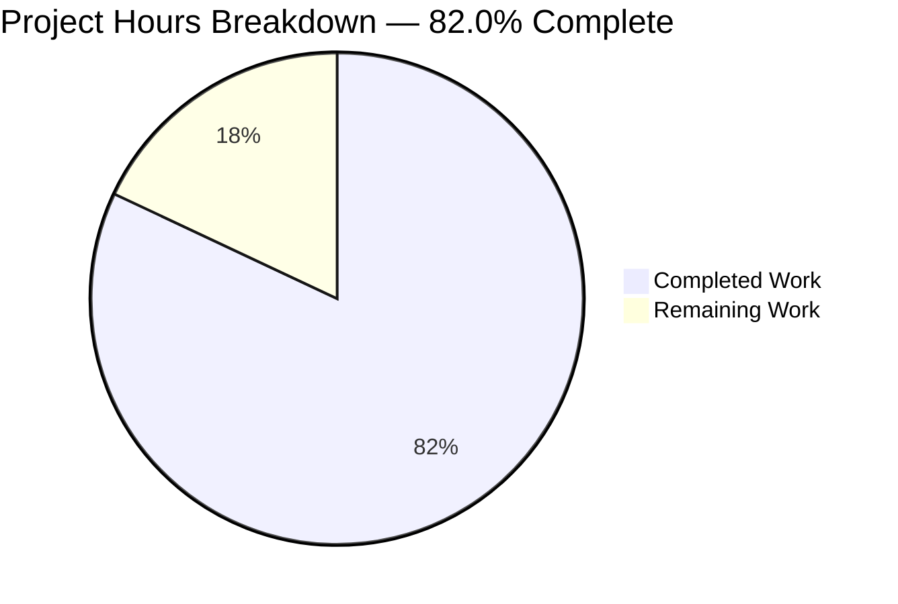
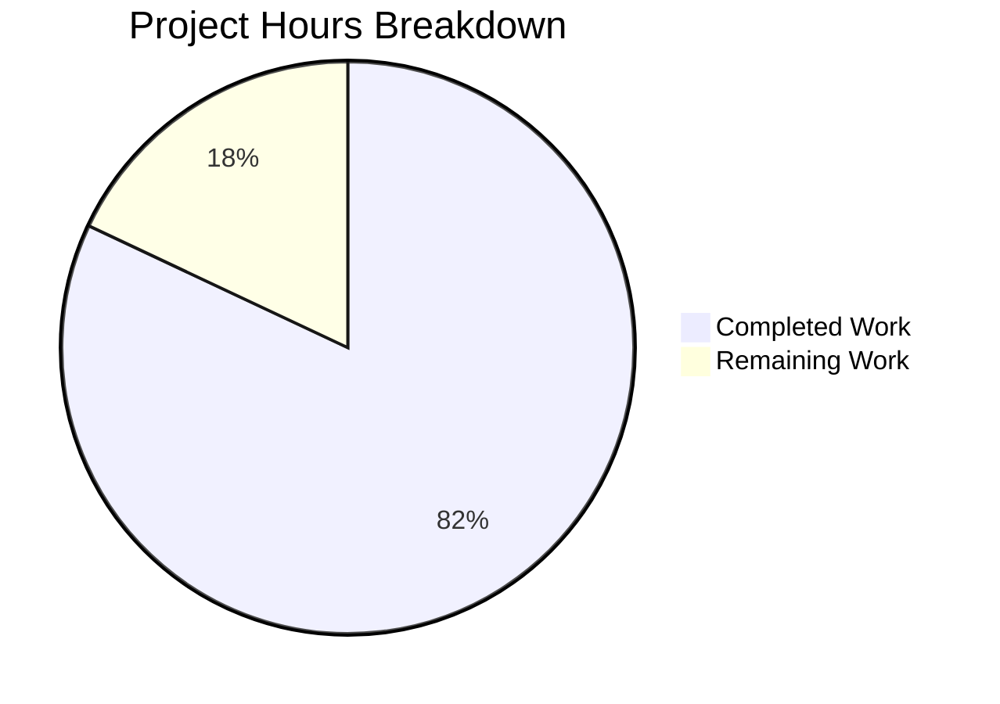

# 1. Executive Summary

## 1.1 Project Overview

The Proactive Insights Demo API is a compact FastAPI service: nine routes, bearer-token identities, all state in memory. Its suite drove the application only in-process, so two above-low-priority behaviours had no test reaching a running service. This work adds an end-to-end level — a harness that runs the service as a child process on a loopback port, and two ordered journeys over real HTTP — taking behavioural coverage from 0 of 2 to 2 of 2 (100.0%) against a 90% target.

## 1.2 Completion Status

Every deliverable is exercised and green. Remaining work is path-to-production: nothing automates the suite, its teardown does not survive an abrupt runner kill, and the sanctioned per-change run form is recorded nowhere.



Completed = Dark Blue (#5B39F3) · Remaining = White (#FFFFFF) · 20.5 of 25.0 hours = **82.0% complete**.

| Metric | Hours |
|---|---|
| Total Hours | 25.0 |
| Completed Hours (Baseline: Human with agentic-assist) | 20.5 |
| Remaining Hours | 4.5 |

## 1.3 Key Accomplishments

- Harness runs uvicorn as a child on an ephemeral loopback port, gates readiness on the health body, always tears down.
- It survives a dead child, a hung child, a lost port race, a chatty child, a foreign responder, a proxied environment.
- Task lifecycle proved end to end: project, task, `done`, re-read, still listed (18 assertions).
- Role grant recorded live: both identities stamped, post-grant listing unchanged.
- Authorization defect reported, never repaired: `TEAM` written at `app/main.py:93`, `USERS` read at `:29`, `:58`, `:89`.
- The `e2e` marker selects exactly the two socket-driven tests of 21, warning-free; the suite passes its gate at 19 passed, 2 xfailed, 100.00% statements.
- Pre-existing suite untouched and green: 3 in-process tests plus 16 nodes, strict expected failure intact.

## 1.4 Critical Unresolved Issues

Two behaviours were scoped; both are covered — **0 of 2 remain open**. Five items are open outside that scope.

| Issue | Impact | Owner | ETA |
|---|---|---|---|
| Role grants never affect authorization: `change_role` writes `TEAM` (`app/main.py:93`) while the filter (`:58`) and role gate (`:89`) read `USERS` (`:29`) | A member granted the owner role keeps member rights; the second journey records it rather than passing | Application owner | Not scheduled — reported by directive |
| Nothing runs the suite automatically: no workflow, hook or runner configuration exists | Regressions are caught only when a human runs `pytest` | Platform owner | 3.0 h |
| Subset runs exit 1 under the whole-suite coverage gate (43.21% level, 60.49% API module) while every selected test passes | A pipeline or developer reading exit status alone calls a green suite red | Platform owner | 0.5 h |
| `SIGTERM`/`SIGKILL` of the pytest process orphans the uvicorn child, which keeps its port | A timed-out job can leak a listener; every normal path releases the child | Platform owner | 1.0 h |
| No security headers on any response and development tokens held in source (`app/main.py:7`) | The service must not be exposed as-is; `README.md` declares it a synthetic fixture | Application owner | Out of scope |

## 1.5 Access Issues

No access issues identified — the service needs no database, broker, container, secret or environment variable.

## 1.6 Recommended Next Steps

1. **[High]** Wire the gated suite and the `--no-cov` level run into a pipeline (3.0 h).
2. **[High]** Decide the defect's fate: repair `change_role`, retire both expected-failure records together (1.5 h).
3. **[Medium]** Reap the harness's child as a process group so a killed runner leaves no listener (1.0 h).
4. **[Medium]** Quote the tree's real figures wherever the plan's counts appear (0.5 h).
5. **[Low]** Add response security headers before the service is exposed beyond a fixture (1.0 h).

# 2. Project Hours Breakdown

## 2.1 Completed Work Detail

| Component | Hours | Description |
|---|---|---|
| End-to-end service harness (`tests/e2e/conftest.py`) | 10.0 | Session-scoped `live_server` and `api` fixtures: ephemeral loopback port, uvicorn child launched with `sys.executable` and the repository root as its working directory, readiness on `200` plus the literal `{"status": "ok"}` body with the probe isolated from proxy variables, a drained and lock-guarded child-output buffer, fail-fast on child death and on the 30 s deadline with the captured output attached, retry of a lost port race with each attempt reaped, and `terminate → wait(10) → kill → wait` teardown in `finally`. Includes the eight direct failure-mode exercises. |
| Task-lifecycle journey (`tests/e2e/test_project_task_journey.py`) | 3.5 | Five ordered requests over the live socket with 18 assertions: server-stamped `owner_id` and `created_by`, echoed name, title and carried `project_id`, the `open` → `done` transition, the repeated `PATCH` read-back, and membership of the project in its creator's listing. Mutation-checked against three handler regressions. |
| Role-grant journey (`tests/e2e/test_team_role_journey.py`) | 3.5 | Five ordered steps across two callers with 11 assertions: each caller's project stamped with its own identity, the member's pre-grant listing scoped to its own project, the grant accepted with its exact response body, the member's own project still asserted, and the post-grant expectation signalled as an expected failure behind a fix guard, with all three outcomes proved. |
| Level registration (`pytest.ini`) | 1.0 | One `markers` entry defining `e2e`; module-level marker on both journeys; selection and warning-free registration proved, and the entry shown to be load-bearing. |
| Verification runs and evidence | 2.5 | Baseline, per-journey, level, in-process selection, whole-suite gate, live-service probes, teardown checks and change-scope proof, all re-run to their recorded figures. |
| **Total** | **20.5** | Matches Completed Hours in Section 1.2. |

## 2.2 Remaining Work Detail

| Category | Hours | Priority |
|---|---|---|
| Automated pipeline for the suite and its coverage gate (path-to-production) | 3.0 | High |
| Harness teardown under abrupt runner termination (path-to-production) | 1.0 | Medium |
| In-repository record of the sanctioned per-change run form and of the tree's real suite figures, closing the last 10% of the evidence-record requirement (path-to-production) | 0.5 | Low |
| **Total** | **4.5** | |

The 4.5 remaining hours equal the Remaining Hours in Section 1.2 and the "Remaining Work" value in Section 7, and 20.5 + 4.5 = 25.0 total hours. The open authorization defect in the application is **not** counted here: repairing it was excluded from this work by directive, so it sits in Sections 1.4, 6 and 8 as an owner decision with its own 1.5-hour estimate rather than as a residual of the delivered suite.

## 2.3 Estimation Basis and Confidence

Completed hours are measured from the delivered artefacts — 129 lines of harness, 88 lines of journeys, 21 assertions, and the failure-mode exercises each capability needed before it could be called done — not from elapsed time. Remaining hours use the same scale: a pipeline that installs six pins and runs two pytest invocations (3.0), a process-group change to one fixture plus its verification (1.0), and a short written note plus the figures it must state (0.5). Confidence is high on every estimate: the deliverable is test-and-configuration only, touches no production file, adds no dependency, and every figure quoted in this guide was reproduced on this checkout.

# 3. Test Results

Every figure below was produced by running the command on this checkout (CPython 3.13.18; pytest 8.3.5, httpx 0.28.1, pytest-cov 7.1.0, coverage 7.17.3).

| Area / Category | Framework | Tests | Passed | Failed | Coverage | What This Proves |
|---|---|---|---|---|---|---|
| Task-lifecycle journey, run alone (`tests/e2e/test_project_task_journey.py`) | pytest + httpx over TCP | 1 | 1 | 0 | — | A live service takes a project through a filed task to `done`, keeps the record addressable and still lists the project for its creator |
| Role-grant journey, run alone (`tests/e2e/test_team_role_journey.py`) | pytest + httpx over TCP | 1 | 0 (1 expected failure) | 0 | — | The grant is accepted with its exact body and every earlier step holds; the member's later listing is unchanged, which is the recorded authorization defect |
| End-to-end level selection (`pytest -q -m e2e -rx --no-cov`) | pytest marker | 2 selected, 19 deselected | 1 | 0 (1 expected failure) | — | The marker selects exactly the two socket-driven journeys and nothing else, warning-free |
| In-process API module (`tests/test_api.py`) | pytest + `TestClient` | 3 | 3 | 0 | — | Health body, project create-and-list, and 401 without a token still hold |
| Pre-existing in-process suites (four `tests/test_e2e_*.py` modules) | pytest + `TestClient` | 16 | 15 | 0 (1 expected failure) | — | Task, role, usage and service-ops behaviours are unchanged, including the strict expected failure that still reports `XFAIL` |
| Whole suite with the repository's gate (`pytest -q`) | pytest with pytest-cov | 21 | 19 | 0 (2 expected failures) | `app/main.py` 81/81 statements, 100.00% | No regression anywhere in the tree, and the 90% floor is met on every whole-suite run |

**Not Covered.** Each item below is a real gap in what the suite proves, not a defect to be re-litigated:

- **The harness's own failure branches.** Nothing in the tree exercises a child that dies at import, a child that hangs, a foreign responder answering `200` with the wrong body, a lost port race, or a child writing past the pipe buffer. Every journey run covers the readiness and teardown happy path only, so a future edit to those branches would not be caught by `pytest`.
- **The seven behaviours outside the counted set.** Filing or moving a task on a project the caller does not own; a member's role change refused and an unknown user or role refused; metered usage run to its limit; token rejection as a counted behaviour; `/health`, `/ready` and `/metrics` payloads; owner demotion; unknown project, unknown task and unsupported status. There is no end-to-end test for any of them.
- **The journeys themselves under the coverage figure.** `pytest-cov` instruments the pytest process while both journeys issue their requests in the uvicorn child, so the 100.00% statement figure says nothing about them. Their measure is behavioural: 2 of 2 behaviours.
- **The application's security posture.** No test asserts the absence of `X-Content-Type-Options`, `X-Frame-Options`, `Cache-Control` or `Strict-Transport-Security`, and none asserts anything about the bearer tokens held in source at `app/main.py:7`.
- **Concurrency and lost-update behaviour** at the wire: nothing runs two writers against one task or project.
- **The harness's `reader.join(timeout=5)` expiry path**, reachable only if a process other than the child holds the pipe's write end.
- **Pipeline enforcement.** Nothing runs the suite where a merge would be blocked by it, so no test proves the gate is enforced at the point it matters.
- **Any browser or visual surface.** The service is JSON-only and mounts no HTML, template or static asset, so nothing UI-level exists to assert.

# 4. Runtime Validation & UI Verification

Driven against a live service on a loopback port (a background uvicorn process on `127.0.0.1:42347`), against the two journeys over their own socket, and against the runner at both the module and the level:

- ✅ **Service startup** — `app.main:app` serves on the loopback port; `GET /health` → `200 {"status":"ok"}`; `GET /ready` → `{"ready":true,"checks":{"storage":"ok"}}`.
- ✅ **Level selection** — `pytest -q -m e2e -rx --no-cov` selects exactly 2 of 21 nodes, deselects 19, prints the expected-failure reason, and exits 0 in about half a second.
- ✅ **Task-lifecycle journey** — five ordered requests over the socket, every assertion holding; `1 passed`.
- ⚠ **Role-grant journey** — steps 1–4 hold as ordinary assertions and step 5 records the authorization defect as an expected failure with its cause quoted; `1 xfailed`.
- ✅ **Authentication and authorization** — `401` without a token and with an unknown token; `403` when a member attempts a role change.
- ✅ **Projects surface** — creation stamped `owner_id 1` and `2` from the caller's token; the member's listing scoped to its own project both before and after an accepted grant.
- ✅ **Tasks surface** — creation echoes the carried `project_id`, stamps `created_by`, defaults `status` to `open`; `PATCH ?status=done` returns the stored record with its id and project preserved, and repeating it returns the identical record.
- ✅ **Metering and probes** — `GET /metrics` → 200; `POST /billing/consume?units=1` → `{"used":1,"limit":5}`.
- ✅ **Teardown** — after every run the port refuses connections; no child of this checkout survives, on normal completion, on a failing journey, and after a harness control.
- ⚠ **Never exercised at runtime** — there is no browser or visual surface to drive (the service is JSON-only, with `/docs` supplied by the framework); no concurrency or lost-update scenario; none of the seven behaviours outside the counted set beyond ad-hoc probes; none of the harness's own failure branches under a committed test; and a `SIGTERM` of the pytest process, which leaves the child alive and holding its port.

# 5. Compliance & Quality Review

## 5.1 Compliance Matrix

| Deliverable | Benchmark | Status |
|---|---|---|
| Live-server harness (`tests/e2e/conftest.py`) | End-to-end means a running service reached over a socket, not a filename | ✅ Pass — child process on an ephemeral loopback port, readiness on the literal health body, teardown in `finally`; no module under `tests/e2e/` imports the application |
| Counted behaviours covered at the end-to-end level | Both high- and medium-priority behaviours, 2 of 2 | ✅ Pass — one journey per behaviour, both collected and both reporting their specified outcome |
| Level registration (`pytest.ini`) | Selectable marker, no unknown-mark warning, no other setting added | ✅ Pass — `-m e2e` selects exactly two nodes; `-W error::pytest.PytestUnknownMarkWarning` exits 0; the diff is the two marker lines |
| Assertion quality (18 and 11 assertions) | Every request's status plus the identity, id and status fields it is responsible for; at least ten per journey | ✅ Pass — server-stamped identities asserted rather than echoed; the listing asserts membership, never list equality or length |
| Order independence and carried state | Any module may run first, alone, or repeatedly | ✅ Pass — ids read from response bodies; reversed order and repeat runs report identically |
| Production code untouched | No change to `app/**` | ✅ Pass — `app/main.py` blob `cf315329…` identical to its pre-work blob |
| Defect reporting | Kept as a test, signalled as an expected failure with its cause, production unchanged | ✅ Pass — imperative expected failure behind a fix guard that names both edits a repair requires; the reason cites the write site and all three read sites |
| Pre-existing suite | `tests/test_api.py` and the four in-process modules untouched and green | ✅ Pass — zero diff; 3 passed and 16 nodes with their strict expected failure intact |
| Coverage gate | Whole-suite run at or above 90%, gate never lowered | ✅ Pass — `app/main.py` 81/81 statements, 100.00%, "Required test coverage of 90% reached" |
| Dependency and tooling inventory | Nothing added, removed or re-versioned | ✅ Pass — `requirements.txt` byte-identical; no mocking, parallel-execution or browser tooling introduced |
| Change scope | Only the mapped paths, no deletion, rename or reclassification | ✅ Pass — `M pytest.ini` and three `A` files under `tests/e2e/`; the four pre-existing `test_e2e_*.py` modules retained as collected |
| Recorded evidence for the level | Nine items, each with a measured result | ⚠ Partial — eight items reproduce on this tree; the third is recorded in the sanctioned `--no-cov` form because its literal command and counts cannot be produced here (see 5.2) |

## 5.2 AAP & Rule Divergences and Gaps

Ten departures were established. Seven are additive or sanctioned — a higher-ranked instruction, or the plan's own conflicting requirement, decided them. Three need a human decision, and the two that govern how the level is run and how its results are read are set out below the table.

| What the AAP/Rule Required | What Was Delivered Instead | Why It Diverged | Impact | Remediation |
|---|---|---|---|---|
| §0.2.4/§0.6.1: validate on CPython 3.12.3 | Built and validated on CPython 3.13.18 | Sanctioned — the environment supplies only 3.13, and its instructions rank above the plan | None observed; nothing in the harness or the journeys depends on the version beyond PEP 604 syntax | None |
| §0.4.3: `pytest.ini` gains the `markers` entry and nothing else; no coverage options or `pythonpath` | The file also carries `pythonpath = .` and `addopts = --cov=app --cov-report=term-missing --cov-fail-under=90 --cov-precision=2` | Sanctioned — both keys pre-date this work in the destination, and the environment's instructions make the 90% gate mandatory and `pythonpath` what makes `app` importable | Narrower runs exit 1 on the gate unless `--no-cov` is passed | None — the keys stay byte-identical |
| §0.4.5: four pins, no coverage tooling | `requirements.txt` pins six, including `pytest-cov 7.1.0` and `coverage 7.17.3` | Sanctioned — same higher-ranked instruction; both pins pre-date the work and the file is unchanged | The gate exists and is green; no package was added by this work | None |
| §0.6.1/§0.6.2 reference figures: `3 passed` baseline, `4 passed, 1 xfailed` suite, `3 deselected` at the level, a 0.50 s level cost | 21 nodes over seven modules: `19 passed, 2 xfailed` with the gate at 100.00%; the level deselects 19 and costs 0.48 s | The checkout already carried 19 in-process nodes over five modules before this work, and §0.5.4 forbids deleting, renaming or re-marking them | The plan's figures describe a four-node tree that does not exist here; anyone quoting them will mis-size the suite | Restate the real figures wherever the old ones are quoted (0.5 h) |
| §0.6.2 item 3: `pytest -q -m e2e -rx` exits 0 with `1 passed, 1 xfailed, 3 deselected` | The bare command exits 1 at 43.21% in-process coverage; the same run with `--no-cov` exits 0 with `1 passed, 19 deselected, 1 xfailed` | The gate is a whole-suite measure and both journeys execute inside the child process, so a marker-only selection cannot reach 90%; the deselect count is 19 because 21 nodes are collected | A pipeline that runs the bare form reads a green selection as a failure | Record and use the `--no-cov` form; never lower the gate (0.5 h) |
| §0.3.1/§0.4.2/§0.4.5: the harness's named constants, five standard-library imports, and a first-spawn port conflict surfacing as a failure | Four further named constants (`READINESS_TIMEOUT`, `SPAWN_ATTEMPTS`, `OUTPUT_LINES`, `HEALTH_BODY`), `threading` and `collections`, and up to three spawn attempts before the same failure is raised with the child's cause | Keeping a diagnostic that carries the child's output across a mutation-prone read, and surviving a port race on a shared host, needed them | Purely additive: still no environment variable, no configuration file, no package, and the failure still arrives with its cause attached | None |
| §0.3.5 illustrative snippet: the fix guard reads "delete this guard, keep the assertion" | The guard reads "replace this guard and the xfail below with assert owner_project_id in seen" | Following the snippet literally would delete the guard alone, leave the expected-failure call below it, and retire the journey permanently on the day the defect is fixed | The guard's condition, the expected-failure call, the reason and all three outcomes are unchanged; only the instruction is more precise | None |
| §0.3.4: two module-level header dicts per module | Journey 1 declares `MEMBER` and never sends it | §0.3.4 requires both dicts while §0.3.3 defines journey 1 as single-caller; no linter or dead-code gate exists to object | An unused constant in a test module | None |
| §0.3.3 step table for journey 2 does not list an owner identity assertion | `assert owner_project.json()["owner_id"] == 1` at `tests/e2e/test_team_role_journey.py:12` | §0.4.2 and §0.5.2 require each caller's project to be asserted as stamped by the server; the step table sets no upper bound | Journey 2 now carries 11 assertions, above the stated floor of ten | None |
| §0.3.5/§0.6.2 item 8: the defect entry is listed "in the PR summary" | The entry is carried by the runtime reason (`tests/e2e/test_team_role_journey.py:41-42`), by the commit body, and by the tracked delivery document | A pull-request summary is not a file a repository can contain | The defect is durable in three places and invisible to a reader who opens none of them | Keep the entry in the pull request that carries this change |

**The level's literal evidence command cannot be produced here.** The gate the repository mandates (`addopts` in `pytest.ini`) measures the pytest process, and both journeys issue every request inside a uvicorn child, so a marker-only selection reaches 43.21% of `app/main.py` and fails the floor however well the journeys behave. The two ways to make the literal command pass are to lower the gate — forbidden by the environment's instructions — or to delete 15 pre-existing nodes, forbidden by the plan's own out-of-scope list. The substance the item exists to prove does hold: the marker selects exactly the two socket-driven tests, no unknown-mark warning is emitted, and the run is green with `--no-cov` at `1 passed, 19 deselected, 1 xfailed`. A human decision is needed only on where that form is written down so the next reader does not mistake exit 1 for a failing test.

**The recorded reference counts describe a tree that is not this one.** The plan quotes a three-test baseline, a `4 passed, 1 xfailed` suite and three deselected nodes; this checkout carried 19 in-process nodes over five modules before any work and 21 over seven after it, because four `tests/test_e2e_*.py` modules were already committed and are protected from removal by the plan's own out-of-scope list. The measured values are `18 passed, 1 xfailed` before, `19 passed, 2 xfailed` after, and `1 passed, 19 deselected, 1 xfailed` at the level. Nothing in the delivered code is wrong; what is wrong is any figure copied from the plan without re-deriving it, which is why the numbers in this guide are the measured ones.

# 6. Risk Assessment

| Risk | Category | Severity | Probability | Mitigation | Status |
|---|---|---|---|---|---|
| Role grants never affect authorization: `change_role` writes `TEAM` at `app/main.py:93` while `current_user` (`:29`), the visibility filter (`:58`) and the role gate (`:89`) read `USERS` | Security | High | Certain — present today | Repair the write to target the store authorization reads, then retire both expected-failure records in the same change so neither turns into a silent `XPASS` | Open — reported by directive, not repaired |
| A repaired defect could be silently retired rather than confirmed: deleting the fix guard without the expected-failure call below it leaves the journey permanently `XFAIL` | Technical | Medium | Low | The guard's message names both edits and a repair trips `pytest.fail` with an instruction the next reader can act on | Mitigated by design |
| The 90% statement-coverage figure says nothing about the journeys, because they execute inside the child process; an end-to-end path can break with the gate still green | Technical | Medium | Medium | Treat the behavioural 2-of-2 count and the level run as the real measure, and run the level on every change | Accepted — stated in Section 3 |
| The harness trusts the port it allocated: a foreign responder that claims it and answers `200` with exactly `{"status":"ok"}` would be accepted as the service under test | Technical | Low | Low | Loopback-only bind, exact-body readiness predicate, a race retried up to three attempts with the last child's cause attached | Accepted — millisecond window, test-level harness |
| No pipeline runs the suite, so a regression is caught only when a human runs `pytest` | Operational | Medium | Medium | Wire `pytest -q` and the level run into a pipeline with the gate carried | Open — 3.0 h |
| A job that times out and `SIGTERM`s pytest orphans the uvicorn child, which keeps its port until something reaps it | Operational | Medium | Low | Launch the child into its own process group and reap the group on teardown | Open — 1.0 h |
| Every subset or per-module run exits 1 under the whole-suite gate while all selected tests pass (43.21% at the level, 60.49% for the API module) | Operational | Medium | High | Use the sanctioned `--no-cov` form and record it where a newcomer will read it before running anything narrow | Open — 0.5 h |
| The application is a synthetic fixture: development bearer tokens held in source, state only in memory, no security headers on any response | Security | High if exposed | Very low — `README.md` declares it non-deployable | Keep it a fixture; externalise credentials and add `X-Content-Type-Options`, `X-Frame-Options`, `Cache-Control` and HSTS before any real deployment | Accepted — documented |

# 7. Visual Project Status



**82.0% complete** — 20.5 hours of AAP-scoped and path-to-production work delivered out of 25.0; 4.5 hours remaining. Completed = Dark Blue (#5B39F3); Remaining = White (#FFFFFF).

**Requirement status** — 33 requirements recorded against the plan and the environment's instructions: 32 completed, 1 partially completed (the level's literal evidence command, standing at 90% and carried in the sanctioned form), 0 not started.

| Remaining Category | Hours | Priority | Share of Remaining |
|---|---|---|---|
| Automated pipeline for the suite and its coverage gate | 3.0 | High | 66.7% |
| Harness teardown under abrupt runner termination | 1.0 | Medium | 22.2% |
| In-repository record of the sanctioned run form and the real suite figures | 0.5 | Low | 11.1% |
| **Total** | **4.5** | | **100.0%** |

| Priority | Open Items | Hours |
|---|---|---|
| High | 1 | 3.0 |
| Medium | 1 | 1.0 |
| Low | 1 | 0.5 |

# 8. Summary & Recommendations

The Proactive Insights Demo API now has an end-to-end level it did not have before. A session-scoped harness starts the service as a child process on a kernel-assigned loopback port, waits for `/health` to answer with its literal body, drives two ordered journeys over real HTTP, and always tears the child down. Both behaviours the coverage report flagged above low priority are covered at that level — the task lifecycle passing outright, the role grant recording a genuine authorization defect as an expected failure with its cause quoted — so coverage measured in behaviours runs from 0 of 2 to 2 of 2 (100.0%) against a 90% target. The whole suite reports 19 passed, 2 xfailed with `app/main.py` at 81/81 statements and 100.00%, the gate satisfied, and the pre-existing tests and production code are byte-identical to where they started.

**82.0% of the plan's scoped and path-to-production work is complete** (20.5 of 25.0 hours). Every deliverable the plan names is delivered and verified; the 4.5 hours that remain are path-to-production gaps rather than missing functionality: nothing runs this suite automatically, the harness's teardown does not survive an abrupt kill of the runner, and the sanctioned way to run a subset is written down nowhere in the tree.

The critical path to production is short and has one decision in it. First, wire two pytest invocations into a pipeline — the gated whole-suite run and the level run with `--no-cov` — so a regression stops a merge instead of waiting for someone to notice. Second, decide the authorization defect's fate: fixing `change_role` to write the store that authorization reads is a few lines, and the same change must delete the guard and the expected-failure call in `tests/e2e/test_team_role_journey.py` and retire the strict marker in the pre-existing in-process module, or the suite reports a fix as a failure. Third, record the real figures so the next reader does not inherit the plan's stale counts.

Success looks measurable from here. The suite's gate stays green on every whole-suite run; the level run stays green at `1 passed, 19 deselected, 1 xfailed` while the defect stands and becomes a plain pass the day it is fixed; every assertion in the two journeys continues to bind a handler contract, so a handler that returns the right status with the wrong body still fails; and the four remaining hours are spent on automation rather than on repair.

**Production readiness: the test-and-configuration deliverable is ready to merge; the application it tests is not ready to deploy.** The deliverable touches no production file, adds no dependency, and meets its single quality gate at 100.00% statement coverage. The application beneath it remains a synthetic fixture — bearer tokens in source, state lost on restart, no security headers — with a live authorization defect that this work was scoped to report rather than repair. Treat the suite as the fixture's protection against regression and the defect list in Section 1.4 as the application owner's queue.

# 9. Development Guide

## System Prerequisites

- **CPython 3.13** — this checkout was built and validated on 3.13.18. The application's `str | None` annotations set a floor of 3.10, so any modern Python works, but the pins below were resolved on 3.13.
- No database, message broker, cache, container runtime or external service. The application reads no configuration and holds all state in module-level dictionaries.
- No environment variable and no secret is required, for the application or for the suite.
- Commands below assume bash and a checkout of the repository; run them from the repository root so `pytest.ini` supplies the root directory and `pythonpath = .` makes the `app` package importable.

## Environment Setup and Dependency Installation

Build the virtual environment once per checkout (about three seconds):

```bash
/usr/bin/python3.13 -m venv .venv
.venv/bin/python -m pip install -r requirements.txt
```

Expected resolved set: `fastapi 0.115.12`, `uvicorn 0.34.0`, `pytest 8.3.5`, `httpx 0.28.1`, `pytest-cov 7.1.0`, `coverage 7.17.3`, with `starlette 0.46.2` and `pydantic 2.14.4` arriving transitively. Confirm it:

```bash
.venv/bin/python -V                       # Python 3.13.18
.venv/bin/python -m pip check             # No broken requirements found.
```

## Running the Tests

The whole suite, carrying the repository's coverage gate (`--cov=app --cov-fail-under=90` from `pytest.ini`):

```bash
.venv/bin/python -m pytest -q
```

Expected output on this tree:

```text
19 passed, 2 xfailed, 1 warning in 0.61s
app/main.py   81   0   100.00%
Required test coverage of 90% reached. Total coverage: 100.00%
```

The end-to-end level alone — two journeys over a live socket, `--no-cov` because the gate is a whole-suite measure:

```bash
.venv/bin/python -m pytest -q -m e2e -rx --no-cov
```

Expected output:

```text
XFAIL tests/e2e/test_team_role_journey.py::test_owner_grants_member_owner_role_and_member_then_sees_team_projects
  - reason: Role grants are written to TEAM (app/main.py:93) while the visibility
    filter (app/main.py:58) and the role gate (app/main.py:89) read USERS (app/main.py:29)
1 passed, 19 deselected, 1 xfailed, 1 warning in 0.48s
```

Each journey on its own, and the in-process level:

```bash
.venv/bin/python -m pytest tests/e2e/test_project_task_journey.py -q --no-cov        # 1 passed
.venv/bin/python -m pytest tests/e2e/test_team_role_journey.py -q -rx --no-cov       # 1 xfailed
.venv/bin/python -m pytest -m "not e2e" -q --no-cov                                   # 18 passed, 2 deselected, 1 xfailed
.venv/bin/python -m pytest --collect-only -q -o addopts=""                            # 21 tests collected
```

## Application Startup

The harness starts the server itself; run it by hand only when you want to drive the API:

```bash
.venv/bin/python -m uvicorn app.main:app --host 127.0.0.1 --port 8000
```

Bind loopback only. Use any free port — `8000` is the port `README.md` documents, and the suite never uses it, because the harness allocates an ephemeral one at run time. Stop the process with Ctrl-C when finished; the suite's own child is always terminated by its fixture.

## Verification Steps

```bash
B=http://127.0.0.1:8000

curl -s $B/health        # {"status":"ok"}
curl -s $B/ready         # {"ready":true,"checks":{"storage":"ok"}}
curl -s $B/metrics       # {"requests_total":0,"uptime_seconds":...}

# Projects, stamped with the caller's identity from the token
curl -s -X POST $B/projects -H 'Authorization: Bearer owner-token' \
     -H 'Content-Type: application/json' -d '{"name":"Insight Delivery"}'
# {"id":1,"name":"Insight Delivery","owner_id":1}

curl -s -X POST $B/projects -H 'Authorization: Bearer member-token' \
     -H 'Content-Type: application/json' -d '{"name":"Member Scope"}'
# {"id":2,"name":"Member Scope","owner_id":2}

# The member sees only its own project, before and after a grant
curl -s $B/projects -H 'Authorization: Bearer member-token'
# [{"id":2,"name":"Member Scope","owner_id":2}]

curl -s -X POST "$B/teams/2/role?role=owner" -H 'Authorization: Bearer owner-token'
# {"user_id":2,"role":"owner"}

curl -s $B/projects -H 'Authorization: Bearer member-token'
# [{"id":2,...}]  <- unchanged: the recorded authorization defect

# Tasks: create, move to done, observe the stored record
curl -s -X POST $B/tasks -H 'Authorization: Bearer owner-token' \
     -H 'Content-Type: application/json' -d '{"title":"Draft the insight report","project_id":1}'
# {"id":1,"title":"Draft the insight report","project_id":1,"created_by":1,"status":"open"}

curl -s -X PATCH "$B/tasks/1?status=done" -H 'Authorization: Bearer owner-token'
# {"id":1,...,"project_id":1,"created_by":1,"status":"done"}

curl -s -o /dev/null -w '%{http_code}\n' $B/projects                       # 401
curl -s -o /dev/null -w '%{http_code}\n' -X POST "$B/teams/1/role?role=member" \
     -H 'Authorization: Bearer member-token'                               # 403
curl -s -X POST "$B/billing/consume?units=1" -H 'Authorization: Bearer owner-token'
# {"used":1,"limit":5}
```

Seeded credentials: `owner-token` (user 1, role `owner`) and `member-token` (user 2, role `member`). `status` on `PATCH /tasks/{task_id}` and `role` on `POST /teams/{user_id}/role` are **query parameters**, not body fields — sending them in the body returns 422.

## Example Usage

A full lifecycle in one sequence, the way the first journey drives it:

```bash
B=http://127.0.0.1:8000
PROJECT=$(curl -s -X POST $B/projects -H 'Authorization: Bearer owner-token' \
  -H 'Content-Type: application/json' -d '{"name":"Insight Delivery"}')
PROJECT_ID=$(printf '%s' "$PROJECT" | .venv/bin/python -c 'import json,sys; print(json.load(sys.stdin)["id"])')

TASK=$(curl -s -X POST $B/tasks -H 'Authorization: Bearer owner-token' \
  -H 'Content-Type: application/json' -d "{\"title\":\"Draft the insight report\",\"project_id\":$PROJECT_ID}")
TASK_ID=$(printf '%s' "$TASK" | .venv/bin/python -c 'import json,sys; print(json.load(sys.stdin)["id"])')

curl -s -X PATCH "$B/tasks/$TASK_ID?status=done" -H 'Authorization: Bearer owner-token'
curl -s $B/projects -H 'Authorization: Bearer owner-token'   # still lists $PROJECT_ID
```

## Troubleshooting

| Symptom | Cause | Fix |
|---|---|---|
| `FAIL Required test coverage of 90% not reached. Total coverage: 43.21%` (or 60.49% for the API module) | The gate is a whole-suite measure, and both journeys do their work inside the uvicorn child | Add `--no-cov` for any narrower run; never lower the gate |
| `ModuleNotFoundError: No module named 'app'` | `pytest` was invoked without discovering `pytest.ini` as its root directory | Run from the repository root, where `pythonpath = .` applies |
| `error: externally-managed-environment` from pip | The system interpreter was used | Always `.venv/bin/python -m pip …` |
| `Address already in use` when starting uvicorn | Another process holds that port | Pick a different port; the harness itself allocates a free one at run time |
| A run ends with `1 xfailed` | By design: the second journey records the authorization defect | Read the printed reason; it names the write site and the three read sites |
| A repair to `change_role` makes a test fail with "the role grant now governs visibility" | The fix guard fired | Follow its message: replace the guard *and* the expected-failure call below it with the owner-project assertion, and retire the strict marker in `tests/test_e2e_team_role_journey.py` |
| `/docs` renders unstyled | The page loads its assets from a CDN | The API itself is unaffected; use `curl` against the JSON routes |

# 10. Appendices

## Appendix A — Command Reference

| Purpose | Command |
|---|---|
| Build the environment | `/usr/bin/python3.13 -m venv .venv && .venv/bin/python -m pip install -r requirements.txt` |
| Verify the resolved pins | `.venv/bin/python -m pip check` |
| Whole suite with the coverage gate (finishing run) | `.venv/bin/python -m pytest -q` |
| Whole suite with expected-failure reasons | `.venv/bin/python -m pytest -q -rx` |
| End-to-end level only | `.venv/bin/python -m pytest -q -m e2e -rx --no-cov` |
| In-process level only | `.venv/bin/python -m pytest -m "not e2e" -q --no-cov` |
| One journey, passing | `.venv/bin/python -m pytest tests/e2e/test_project_task_journey.py -q --no-cov` |
| One journey, expected failure with its reason | `.venv/bin/python -m pytest tests/e2e/test_team_role_journey.py -q -rx --no-cov` |
| The pre-existing API module | `.venv/bin/python -m pytest tests/test_api.py -q --no-cov` |
| Collected inventory | `.venv/bin/python -m pytest --collect-only -q -o addopts=""` |
| Markers registered | `.venv/bin/python -m pytest --markers` |
| Treat an unknown marker as an error | `.venv/bin/python -m pytest -q -m e2e --no-cov -W error::pytest.PytestUnknownMarkWarning` |
| Run the service by hand | `.venv/bin/python -m uvicorn app.main:app --host 127.0.0.1 --port 8000` |
| Change scope of the delivered work | `git diff --name-status dc00d2a..HEAD` |

## Appendix B — Port Reference

| Port | Used by | Notes |
|---|---|---|
| Kernel-assigned, ephemeral | The test harness (`live_server` in `tests/e2e/conftest.py`) | Allocated per session by binding `("127.0.0.1", 0)` and closing the socket; a lost race is retried up to three attempts |
| `8000` | The developer run documented in `README.md` | Never used by the suite, so a running dev server cannot collide with a test run |
| Any free port | Manual runs while following Section 9 | Bind `127.0.0.1` only; `0.0.0.0` is never used |

## Appendix C — Key File Locations

| Path | Role |
|---|---|
| `app/main.py` | The application: nine handlers, seeded identities, in-memory stores, and the role-grant defect at `:93` against the reads at `:29`, `:58` and `:89` |
| `tests/e2e/conftest.py` | The live-server harness — session-scoped `live_server` and `api` fixtures, no assertions and no tests |
| `tests/e2e/test_project_task_journey.py` | The task-lifecycle journey (behaviour `rec-fd6c247d8d`, high priority) |
| `tests/e2e/test_team_role_journey.py` | The role-grant journey (behaviour `rec-5973b8deae`, medium priority), with the expected failure and its fix guard |
| `tests/test_api.py` | The three pre-existing in-process tests |
| `tests/conftest.py` | The autouse `reset_app_state` fixture that isolates the in-process tests |
| `tests/test_e2e_*.py` | Four pre-existing in-process modules (16 nodes), named "e2e" but driven through `TestClient`; one carries a strict expected failure for the same authorization defect |
| `pytest.ini` | Collection scope, `pythonpath`, the coverage gate, and the `e2e` marker |
| `requirements.txt` | The six pins |

## Appendix D — Technology Versions

| Component | Version | Note |
|---|---|---|
| CPython | 3.13.18 | The interpreter this checkout was built and validated on |
| fastapi | 0.115.12 | Application framework |
| uvicorn | 0.34.0 | Runtime server and the service under test |
| pytest | 8.3.5 | Runner, markers, expected failures |
| httpx | 0.28.1 | Live-socket client and readiness probe; also the `TestClient` transport |
| starlette | 0.46.2 | Resolved transitively by fastapi |
| pydantic | 2.14.4 | Resolved transitively by fastapi |
| pytest-cov | 7.1.0 | Carries the coverage gate from `pytest.ini` |
| coverage | 7.17.3 | Coverage engine behind the gate |

## Appendix E — Environment Variable Reference

None. The application reads no environment variable, and neither the suite nor the harness requires one — the harness takes every setting from module constants and from `__file__`. Two variable names matter only to the tooling: `COVERAGE_FILE` relocates the coverage data file and `PYTHONPYCACHEPREFIX` relocates bytecode caches, both useful when you want a run to leave the working tree untouched.

## Appendix F — Developer Tools Guide

The repository configures no linter, formatter, type checker, pre-commit hook or CI workflow — none exists to run, and none was added. The available checks are:

- `.venv/bin/python -m pytest -q` — the only quality gate: the suite plus the 90% statement-coverage floor over `app`.
- `.venv/bin/python -m compileall -q app tests` — a syntax check over every module.
- `.venv/bin/python -m pytest --collect-only -q` — confirms the collected inventory: 21 nodes over seven modules.

Two conventions to preserve when adding tests: the in-process level reaches the application through `TestClient`, the end-to-end level reaches it only over a socket, and the `e2e` marker plus the `tests/e2e/` package is what separates them. Assertions on listings should use set membership rather than list order or length, because the session-scoped server accumulates records from both journeys.

## Appendix G — Glossary

| Term | Meaning here |
|---|---|
| End-to-end level | A test that drives the application as a running process over a real socket. Decided by transport, not by filename: the four `tests/test_e2e_*.py` modules are in-process and do not qualify |
| Counted behaviour | A behaviour from the attached coverage report rated high or medium priority. Two qualified for this work; seven others were explicitly out of the count |
| Harness | The session-scoped fixtures in `tests/e2e/conftest.py` that start, gate and stop the service |
| Ephemeral port | A port the kernel assigns when a socket binds port 0; the harness reads it, closes the socket and gives it to the child |
| Expected failure (`xfail`) | A test outcome that records a known defect instead of failing the run. Here it is raised imperatively inside the test body at one step, never declared on the test |
| Fix guard | The `pytest.fail` immediately before the expected-failure call: it trips the day the defect is repaired, so the repair cannot pass unnoticed |
| Strict marker | The declarative `@pytest.mark.xfail(strict=True)` in `tests/test_e2e_team_role_journey.py`, which reports `XPASS` as a failure. It records the same defect at the in-process level |
| Coverage gate | `--cov=app --cov-fail-under=90 --cov-precision=2` in `pytest.ini`. A whole-suite measure: narrower selections fall below the floor and exit 1 |
| Behavioural coverage | Counting behaviours proved end to end rather than statements executed. The measure this work reports: 2 of 2 |
| Sanctioned run form | `--no-cov` (equivalently `-o addopts=""`) for any selection narrower than the whole suite, so the gate is neither lowered nor bypassed |
