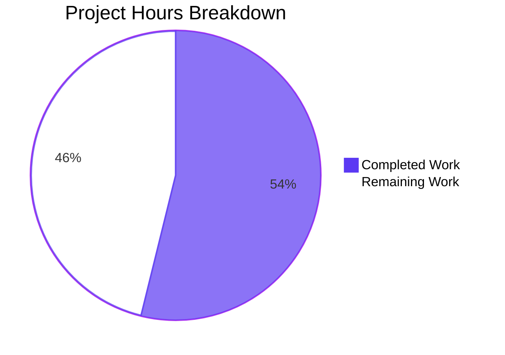

# 1. Executive Summary

## 1.1 Project Overview

This repository holds a small FastAPI demo API and, beside it, a single-file Flask program that reproduces a one-line Node.js HTTP server. `app.py` answers every request on port 3000 with the fixed 14-byte body `Hello, World!\n` and status 200, prints one startup line, and listens on every interface. Its users are the clients and readiness checks that spoke to the Node process. The work is 17 lines of Flask 3.1.3: one view on a root and a catch-all rule, a nine-verb method list, a neutralised banner, and a run call that pins the port and keeps the reloader off.

## 1.2 Completion Status



Completed work is Dark Blue (`#5B39F3`); remaining work is White (`#FFFFFF`).

| Metric | Hours |
|---|---|
| Total Hours | 26.0 |
| Completed Hours (Baseline: Human with agentic-assist) | 14.0 |
| Remaining Hours | 12.0 |

**54% complete** — 14.0 completed hours of 26.0 total (14.0 + 12.0), calculated as 14.0 ÷ 26.0 × 100 = 53.8%, rounded to 54%. Every scoped requirement is implemented and verified; all 12.0 remaining hours are path-to-production work, not missing functionality.

## 1.3 Key Accomplishments

- Every path and all nine methods answer `200` with the exact 14-byte body, including `/static/*`.
- `HEAD` answers `200`, empty, with `Content-Length: 14`.
- `OPTIONS` is answered by the program, not the framework's empty default.
- It listens on the literal TCP 3000 on all interfaces and releases the port on `SIGTERM`.
- The startup line prints once, from the program, on stdout; framework text stays on stderr.
- One process with `FLASK_DEBUG=1` exported: no reloader, no debugger, one line.
- Forty simultaneous requests all return the identical 14 bytes.
- The demo API still passes its three tests and answers its endpoints.

## 1.4 Critical Unresolved Issues

**6 of 6 path-to-production items remain open; 0 of the 1 scoped deliverable remains open.** The Flask program the request asked for is complete and verified.

| Issue | Impact | Owner | ETA |
|---|---|---|---|
| No automated test covers `app.py` | An edit that removes either behaviour-critical keyword silently breaks a stated behaviour | Backend engineer | 4 h |
| Flask is not declared in `requirements.txt` | A rebuild from the manifest fails at import with `ModuleNotFoundError: No module named 'flask'` | Platform engineer | 1 h |
| No CI gate exists | Nothing compiles, tests or scans a change before merge | Platform engineer | 2 h |
| No operations runbook | The entry path, the readiness trap and the port exposure are undocumented | Operations engineer | 2 h |
| Repository hygiene: tracked `.DS_Store`, no `.gitignore`, an untracked capture directory | Build and capture artefacts can be committed by accident | Maintainer | 1 h |
| Development-server posture is undecided | Plaintext, unauthenticated, unthrottled exposure on all interfaces | Owner / architect | 2 h |

## 1.5 Access Issues

No access issues identified. The program needs no credential, external service or network access beyond its own listener; the demo API's tokens are literals in `app/main.py`.

## 1.6 Recommended Next Steps

1. **[High]** Declare `flask==3.1.3` and `werkzeug==3.1.9` in the manifest.
2. **[High]** Add contract tests for bytes, methods, path classes, `HEAD` and the startup line.
3. **[Medium]** Wire a CI gate that compiles, tests and scans dependencies.
4. **[Medium]** Write the runbook: `python app.py` is the only entry path, and the line is no readiness signal.
5. **[Low]** Decide the serving posture; add a `.gitignore`.

# 2. Project Hours Breakdown

## 2.1 Completed Work Detail

Each row traces to a requirement the delivery was scoped against.

| Component | Hours | Description |
|---|---|---|
| Behaviour analysis and framework mapping | 2.0 | The quoted Node program's four behaviours resolved to documented Flask 3.1.3 / Werkzeug 3.1.9 mechanisms (string return → body and status, `methods` list → declared verbs and suppressed automatic OPTIONS, `path` converter → a separate root rule, `print` plus banner neutralisation → the startup stream). |
| The ported program: `app.py` | 1.5 | Application object, nine-verb constant, root and catch-all rules, the single `hello` view returning `"Hello, World!\n", 200`, banner neutralisation, startup print, run call — 17 lines, no comment, no second file. |
| Path coverage for every path class | 1.5 | The catch-all made the whole routing surface, including the `/static/*` namespace that Flask's auto-registered static rule would otherwise answer with its own 404 and an empty-body OPTIONS. |
| Startup-line and stream contract | 1.5 | Exact 41-byte line on stdout, framework banner and access log confined to stderr, print placed before the server starts as the design specifies. |
| Single-process guarantee under any environment | 1.0 | Debug pinned off on the run call so an exported `FLASK_DEBUG` cannot start the reloader or the interactive debugger and print the line twice. |
| Static gates and file constraints | 1.5 | `py_compile` with `SyntaxWarning` as error, `compileall` over the whole package, warning-free import, zero comments, no added file, manifest untouched, no substitute for the absent Node source. |
| HTTP contract verification | 3.0 | 180 path×method pairs through the WSGI test client, live method and path matrices over a real socket, `HEAD` semantics, `CONNECT`, nested and encoded paths, concurrency. |
| Process, stream and environment verification | 1.5 | Separate stream capture, seven environment conditions including `FLASK_DEBUG=1`, restart cycles, `SIGTERM` port release, bind-conflict behaviour. |
| Dependency inventory and repository continuity | 0.5 | CPython 3.12.3 with Flask 3.1.3 / Werkzeug 3.1.9, the module-resolution seam beside the `app/` package, and the demo API's endpoints unchanged. |
| **Total** | **14.0** | Matches Completed Hours in Section 1.2. |

## 2.2 Remaining Work Detail

All remaining hours are path-to-production work; no scoped requirement is left unimplemented.

| Category | Hours | Priority |
|---|---|---|
| Runtime dependency declaration — make the environment reproducible from files in the repository | 1.0 | High |
| Contract regression tests — body bytes, the nine methods, root and catch-all path classes, `HEAD` semantics, the startup line | 4.0 | High |
| CI gate — compile, run the suite, and scan dependencies on every change | 2.0 | Medium |
| Operations runbook — entry path, readiness by HTTP probe rather than the startup line, port exposure, serving-stack caveat | 2.0 | Medium |
| Repository hygiene — `.gitignore`, untrack the committed `.DS_Store`, dispose of the untracked capture directory | 1.0 | Low |
| Production-serving decision — a WSGI server behind a reverse proxy, or a formal acceptance of the development-server posture | 2.0 | Low |
| **Total** | **12.0** | Matches Remaining Hours in Section 1.2 and the Section 7 pie chart. |

# 3. Test Results

Every count below was executed against this checkout on CPython 3.12.3 with Flask 3.1.3 / Werkzeug 3.1.9. No coverage tool is configured in the repository, so no coverage figure is shown.

| Area / Category | Framework | Tests | Passed | Failed | Coverage | What This Proves |
|---|---|---|---|---|---|---|
| Repository test suite (`tests/test_api.py`) | pytest 8.3.5 | 3 | 3 | 0 | Not configured | The demo API's health endpoint, project create-and-list flow and missing-token rejection still hold after the new root-level module was added. |
| Ported program's HTTP contract | Flask WSGI test client | 180 | 180 | 0 | Not configured | 20 path classes × the nine methods all answer `200` with the exact 14-byte body (160 body responses) and `HEAD` answers empty with `Content-Length: 14` (20), including `/static/*`, dot segments, encoded targets and a 2000-character query. |
| Ported program over a live socket | curl over TCP | 49 | 49 | 0 | Not configured | The same contract survives real HTTP serialisation: 7 body methods × 6 path shapes, plus `HEAD` on each shape and `CONNECT`. |
| Concurrency | parallel curl | 40 | 40 | 0 | Not configured | Forty simultaneous requests all receive `200` with the identical body; the handler holds no state. |
| Compilation gates | `py_compile` (`SyntaxWarning` as error) and `compileall` | 3 modules | 3 | 0 | Not applicable | `app.py`, the `app/` package and `tests/` compile cleanly; no syntax-level debt sits in the tree. |
| Startup and process contract | subprocess stream capture | 2 | 2 | 0 | Not applicable | A normal start prints the exact 41-byte line once on stdout with framework text on stderr; a start with `FLASK_DEBUG=1` still yields one process and one line. |
| Demo API over HTTP | curl against Uvicorn | 5 | 5 | 0 | Not applicable | `/health` 200, `/ready` 200, `/projects` 401 without a token and 200 with `Bearer owner-token`, `/docs` 200 — the pre-existing service is intact. |
| Demo API interactive documentation | headless Chrome | 4 | 4 | 0 | Not applicable | The Swagger UI renders at `/docs`, `GET /health` executed from the UI returns `200 {"status":"ok"}`, `/openapi.json` lists 8 paths, and `/projects` answers `401 {"detail":"Missing bearer token"}` without a token. |

**Not Covered**

- **No committed test exercises `app.py`.** Every contract count above comes from checks run against this checkout, not from a test in the repository that a pipeline could re-run. This is the largest coverage gap and the first remaining-work item.
- **No lint, type-check, coverage or vulnerability scanning is configured**, so none was exercised; the repository binds only compilation and its three demo-API tests.
- **Interactive shutdown was not exercised.** `SIGINT` cannot reach a background process from a non-interactive shell; `SIGTERM` was exercised and released the port cleanly.
- **Protocol-level and exotic behaviour was not tested by design**: non-standard parser verbs, chunked encoding, HTTP/0.9, header-count limits, `Expect: 100-continue` and connection keep-alive are accepted framework defaults, outside the contract's scope.
- **Request targets whose decoding contains a line feed answer the framework's 404 page** rather than the fixed body; that path class is outside the contract and is an accepted framework default.
- **No deployment path was exercised**: there is no container, no CI pipeline, no reverse proxy and no second host, so nothing about packaging or multi-host operation was tested.

# 4. Runtime Validation & UI Verification

- ✅ **Startup and stream contract** — `python app.py` printed exactly the 41-byte line `Server running at http://127.0.0.1:3000/` once on stdout; the framework banner, its `Running on` lines and the per-request access log appeared only on stderr.
- ✅ **HTTP contract over a live socket** — 49 curl requests across seven body methods and six path shapes, plus `HEAD` and `CONNECT`, all answered `200` with bodies byte-identical to `Hello, World!\n`.
- ✅ **Path coverage** — `/`, nested and deep paths, dot segments, double slashes, percent-encoded and raw UTF-8 targets, a 7900-character segment and the whole `/static/*` namespace all reach the single view.
- ✅ **Method surface** — the nine accepted methods answer on both rules; `OPTIONS` returns the 14-byte body rather than the framework's empty default.
- ✅ **Port and bind** — the process listens on the literal TCP 3000 on `0.0.0.0`, is reachable on the host's non-loopback address, ignores `PORT`/`FLASK_RUN_PORT`/`APP_PORT`, and releases the port on `SIGTERM`.
- ✅ **Single process under a hostile environment** — with `FLASK_DEBUG=1` exported the process ran alone, with no reloader, no debugger PIN and one startup line; framework and fixture remained reachable.
- ✅ **Concurrency** — 40 simultaneous requests all returned `200` with the identical body.
- ✅ **Demo API service** — `/health` 200, `/ready` 200, `/projects` 401 without a token and 200 with `Bearer owner-token`, `/docs` 200 with the Swagger UI rendering nine operations, and `GET /health` executed from that UI returning `200 {"status":"ok"}`.
- ⚠ **Bind-conflict path** — when port 3000 is already held, the startup line is still printed and the process exits 1 with `Address already in use` on stderr. This is consistent with the design's print-before-bind ordering, but it means the line must never be treated as a readiness signal.
- ❌ **Not applicable — no user interface exists for the ported program.** Its only output is a plain-text body; the rendering check that matters for it is the byte comparison above, not a screen.

**Never exercised at runtime:** non-standard parser verbs and other protocol-level behaviours (accepted framework defaults, deliberately untested); interactive `SIGINT` shutdown (unreachable from a non-interactive shell); sustained load, soak or memory behaviour (no performance target exists); any container, reverse proxy or multi-host topology (none exists in the repository); and the program under a second operating system.

# 5. Compliance & Quality Review

## 5.1 Compliance Matrix

| # | Deliverable / Requirement | Benchmark | Status | Progress |
|---|---|---|---|---|
| 1 | One new root-level file, nothing else created, edited or deleted | Scope discipline | PASS | ✅ Complete |
| 2 | Response body is exactly the 14 bytes `Hello, World!\n` | Behavioural equivalence | PASS | ✅ Complete |
| 3 | `200` for all nine accepted methods on every path | Behavioural equivalence | PASS | ✅ Complete |
| 4 | Method surface correct, `OPTIONS` declared so it is answered with the body | Functional correctness | PASS | ✅ Complete |
| 5 | Root rule plus catch-all cover every path, including `/static/*` | Functional correctness | PASS | ✅ Complete |
| 6 | Listens on the literal TCP port 3000 on all interfaces | Operability | PASS | ✅ Complete |
| 7 | Startup line printed once by the program; single process under any environment | Operability | PASS | ✅ Complete |
| 8 | File constraints honoured: no comment, no added file, no manifest or CI change | Code hygiene | PASS | ✅ Complete |
| 9 | Dependency inventory matched and the rest of the repository untouched | Reproducibility | PARTIAL | ⚠ Versions verified; the runtime dependency is not declared in the manifest |
| 10 | No input sink, no secret, no debugger on the listener | Security hygiene | PASS | ✅ Complete |
| 11 | The delivered code protected by an automated test | Verification | GAP | ❌ No test covers `app.py` |
| 12 | Build, test and run documentation plus an automated gate | Delivery automation | GAP | ❌ No CI gate; the README documents the demo API only |

## 5.2 AAP & Rule Divergences and Gaps

No user-specified rules exist for this project, so no rule was violated. Five divergences from the Agent Action Plan exist; four are required by a higher-ranked requirement inside the same plan and one is a deliberate exclusion that leaves a reproducibility gap.

| # | What the AAP or Rule Required | What Was Delivered Instead | Why It Diverged | Impact | Remediation |
|---|---|---|---|---|---|
| D1 | §0.3.1's structural block writes `app = flask.Flask(__name__)` | `app = flask.Flask(__name__, static_folder=None)` (`app.py:5`) | §0.1's body and status goals and the "no path escapes" rule cannot hold with the static rule the default constructor registers, and §0.4 licenses moving a framework default that changes one of the four behaviours | Positive: the only path class that could not meet the contract now answers it | None — the keyword must not be removed |
| D2 | The same block writes `app.run(host="0.0.0.0", port=3000)` | `app.run(host="0.0.0.0", port=3000, debug=False)` (`app.py:17`) | `Flask.run` re-reads `FLASK_DEBUG` after construction and only the explicit argument overrides it; §0.1's single-print goal holds only with the keyword, and §0.4 licenses the move | Positive: no reloader, no interactive debugger and one startup line in every environment tested | None — the keyword must not be removed |
| D3 | §0.7 keeps Flask outside `requirements.txt`, which stays at four pins | Flask 3.1.3 and Werkzeug 3.1.9 live in the environment only; the manifest is unedited | The plan records it as a decided exclusion and forbids manifest edits; the project setup instructions repeat the constraint | An environment rebuilt from the manifest cannot import the program | Declare the runtime dependency (1.0 h, Section 2.2) |
| D4 | §0.2.3 excludes test files, so the contract is verified by running the program | No committed test covers `app.py`; the three existing tests cover the demo API | The plan's own exclusion | The contract is unprotected: CI cannot catch a regression, and the two behaviour-critical keywords are easy to delete as "style" | Add contract tests (4.0 h, Section 2.2) |
| D5 | §0.6 accepts every other framework difference in one shared sentence; §0.3.1 fixes the print-before-bind ordering | Delivered as accepted: a target whose decoding contains a line feed answers the framework's 404 page; non-standard verbs answer 405; each connection is closed; `FLASK_RUN_FROM_CLI=true` returns without binding; responses carry `text/html; charset=utf-8` and a `Server: Werkzeug/3.1.9` header; the line precedes the bind | The plan's own accepted-defaults sentence and its explicit ordering decision | An operator meets behaviour the Node program did not have, and the startup line is not a readiness signal | Document in the runbook (2.0 h, Section 2.2); no code change is warranted |

**D1 — the constructor keyword that keeps the catch-all total.** Flask's constructor registers a static route `/static/<path:filename>` whenever a static folder is configured, and the router tries static prefixes before dynamic ones. With the default in place, `GET` and `HEAD` of any `/static/<non-empty>` target reach that route and answer the framework's 404 page, while `OPTIONS` answers an empty `200`, so the body, status and `OPTIONS` obligations are not met for that namespace. Passing `static_folder=None` (`app.py:5`) leaves exactly two routes, both bound to `hello`, and every path class answers the contract. A maintainer who simplifies this line back to the plain constructor reopens the `/static/*` gap, and the file cannot explain itself because comments are excluded by design.

**D2 — the run keyword that keeps the process single.** `Flask.run` reads `FLASK_DEBUG` again after the application object is built and gives the explicit `debug` argument the last word; setting the attribute beforehand does not survive. Without the keyword, an exported `FLASK_DEBUG=1` starts the reloader and the interactive debugger on the all-interface listener, printing the startup line twice and exposing a debugger to every network interface. With `debug=False` (`app.py:17`) the seven environment conditions tested each produced one process, one line, and no debugger. This line is the second thing a future editor must not remove.

**D3 — the runtime dependency lives outside the manifest.** `requirements.txt` pins FastAPI, Uvicorn, pytest and httpx and deliberately omits Flask, so the manifest describes the demo API and not the delivered program. The consequence is concrete: a clean machine that follows the install line in the repository's README produces an environment in which `python app.py` fails immediately with `ModuleNotFoundError: No module named 'flask'`. Nothing about the program is wrong; the record of what it needs is incomplete. Declaring the dependency, or adding a second runtime manifest the README points at, closes the gap in about an hour.

**D4 — the contract rests on procedure, not on a test.** The plan excludes test files, so the repository's only suite covers the demo API, and the delivered program's behaviour is protected by nothing that a pipeline can re-run. The practical risk is not hypothetical: the two keywords in D1 and D2 look incidental, and either one removed turns a working program into one that fails a stated goal for a whole path class or under one environment variable. Four hours of contract tests — body bytes across the methods, the nine-method surface on both route shapes, `HEAD` semantics, and one subprocess check of the startup line — turns the checks described in Section 3 into a gate.

**D5 — the accepted differences an operator will meet.** The plan accepts every framework difference beyond the four behaviours, and the delivered program shows them: a request target whose decoding contains a line feed reaches no route and answers the framework's 404 page; non-standard verbs answer 405 with an `Allow` header; each connection closes after one response; and with `FLASK_RUN_FROM_CLI=true` the run call returns without binding and the framework adds text to stdout. The startup line is printed before the socket binds, so a supervisor that gates readiness on it can route traffic to a closed port — on a host where port 3000 is already taken, the line appears and the process exits 1. All of this belongs in the runbook rather than in the code.

# 6. Risk Assessment

Risks are forward-looking: what can still go wrong once this program is operated. Items the plan intentionally accepts are marked Accepted and carry a documentation mitigation rather than a code change.

| Risk | Category | Severity | Probability | Mitigation | Status |
|---|---|---|---|---|---|
| The contract has no automated test, and the two behaviour-critical keywords read like incidental style with no comment allowed in the file — removing either silently breaks a stated behaviour | Technical | High | Medium | Add contract regression tests and a CI gate (Section 2.2 items 2 and 3) | Open |
| The runtime dependency is not declared in the manifest, so a rebuild from `requirements.txt` produces a program that cannot import Flask | Integration | High | High | Declare `flask==3.1.3` and `werkzeug==3.1.9` (Section 2.2 item 1) | Open |
| The startup line is printed before the socket binds, so readiness gating on the line can route traffic to a closed port; a port conflict prints the line and exits 1 | Operational | Medium | Medium | Probe an HTTP request for readiness and supervise on process liveness (Section 2.2 item 4) | Open |
| `app.py` sits beside the `app/` package, so `python -m app` and `flask --app app run` resolve to the package and never start the program | Integration | Medium | Medium | Document `python app.py` as the only entry path in the runbook | Open |
| The listener is plaintext, unauthenticated and unthrottled on all interfaces, served by Werkzeug's development server, and discloses `Server: Werkzeug/3.1.9 Python/3.12.3` | Security | Medium | Low | Keep it behind a controlled network boundary; decide the serving posture (Section 2.2 item 6) — the response body is a fixed public string and no data store exists | Accepted |
| No lock file, no dependency scanning and no pinned transitive set; upgrades are unmanaged | Security | Low | Medium | Add a scan step to the CI gate and pin the transitive pair | Open |
| Observability is one startup line plus framework stderr: no health or readiness endpoint, no metrics, no structured logging, no log-level control, and ANSI escapes reach redirected stderr | Operational | Low | High | External probe for liveness; strip ANSI in the log collector — adding endpoints is outside the plan's scope | Accepted |
| Framework-default deviations from the Node program remain for malformed and exotic input: a line-feed bearing target answers 404, non-standard verbs answer 405, connections close per request, and `FLASK_RUN_FROM_CLI` prevents binding | Technical | Low | Low | Document as accepted behaviour; no code change is warranted within the plan's scope | Accepted |

# 7. Visual Project Status


Completed work is Dark Blue (`#5B39F3`); remaining work is White (`#FFFFFF`). The chart's values are the same hours stated in Sections 1.2 and 2.2: 14.0 completed, 12.0 remaining, 26.0 total.

**Remaining hours by category** (from Section 2.2, summing to 12.0):

| Category | Hours | Priority |
|---|---|---|
| Runtime dependency declaration | 1.0 | High |
| Contract regression tests | 4.0 | High |
| CI gate | 2.0 | Medium |
| Operations runbook | 2.0 | Medium |
| Repository hygiene | 1.0 | Low |
| Production-serving decision | 2.0 | Low |
| **Total** | **12.0** | |

**Priority distribution:** 5.0 hours High, 4.0 hours Medium, 3.0 hours Low. Nothing sits in the High band for missing functionality — the two High items protect and reproduce work that is already delivered.

# 8. Summary & Recommendations

The project is **54% complete** against the hours it was scoped against: 14.0 completed hours of 26.0 total, with 12.0 hours remaining entirely in path-to-production work. That figure is worth reading carefully, because it understates how finished the delivered functionality is. The one program the work was asked for exists, is the only path the change touches, and satisfies every behaviour it was scoped to reproduce. The remaining hours are what a team needs to keep it protected and to operate it deliberately.

What was delivered and verified is narrow and total. A 17-line Flask program answers every request on port 3000 with the same 14 bytes the Node server returned, for all nine standard methods, across every path class including the `/static/*` namespace that a framework default would otherwise capture. It prints the required startup line once, by itself, on stdout, with the framework's chatter confined to stderr, and it stays a single process even when a debug environment variable is exported. Those claims are supported by 180 path-and-method pairs through the WSGI client, 49 requests over a real socket, 40 concurrent requests, seven environment conditions, restart cycles, and compile gates over the whole tree.

The gaps that remain are few and specific. The dependency the program needs is not in the manifest, so an environment rebuilt from files in the repository cannot import it. No committed test covers the program, so the two keywords that keep the catch-all total and the process single are protected by nothing a pipeline can run. There is no CI gate, no operations runbook, no `.gitignore`, and the serving posture — Werkzeug's development server, plaintext, unauthenticated, on all interfaces — has never been formally accepted or replaced.

The critical path to production is therefore five steps, in order: declare the runtime dependency, add contract tests, wire the CI gate that runs them, write the runbook that names `python app.py` as the only entry path and the startup line as no readiness signal, and decide the serving posture. The first two are the ones that matter; the rest can proceed in parallel. Everything else an operator might want — health endpoints, metrics, TLS, rate limiting — is outside the plan that shaped this program, and adding it is a product decision rather than a completion task.

Production readiness: **ready for delivery against its specification, not ready to be exposed as a service.** The program is correct, minimal and safe in what it does — no caller input reaches a sink, no credential or secret exists anywhere in it, and no debugger is reachable — but its reach, headers and transport are the Node program's own, and the plan forbids hardening them. Success for the next stage is measurable: a green pipeline that rebuilds the environment from the manifest, runs the contract tests, and proves the 14-byte body across the method surface, with a runbook an operator can follow without reading the source.

# 9. Development Guide

## 9.1 System prerequisites

- Linux with `git` and `curl` available.
- `uv` 0.13 or newer on `PATH` (a `python3 -m venv` fallback is given below).
- CPython 3.12.x. The provisioned interpreter is 3.12.3; `python3` on `PATH` may be a newer release and is **not** the project interpreter — never use it for this repository.

## 9.2 Environment setup

Run from the repository root. The virtual environment belongs inside the checkout and must never be shared or copied.

```bash
uv venv --python 3.12.3 --seed .venv
uv pip install --python .venv/bin/python -r requirements.txt flask==3.1.3
```

Fallback without `uv` (produces a newer interpreter, which also satisfies both programs):

```bash
python3 -m venv .venv && .venv/bin/python -m pip install -r requirements.txt flask==3.1.3
```

`requirements.txt` pins the demo API's four dependencies and deliberately omits Flask, which is why Flask is named on the install line above. Adding it to the manifest is a remaining task (Section 2.2); until then, always install with the line shown here.

## 9.3 Verify the install

```bash
.venv/bin/python -V
.venv/bin/python -c "import importlib.metadata as m; print('flask', m.version('flask'), 'werkzeug', m.version('werkzeug'))"
```

Expected: `Python 3.12.3` and `flask 3.1.3 werkzeug 3.1.9`.

## 9.4 Run the ported program

```bash
.venv/bin/python app.py
```

Expected on stdout, exactly once and nothing else:

```text
Server running at http://127.0.0.1:3000/
```

The process then serves `0.0.0.0:3000`; Flask's banner, its `Running on` lines and the per-request access log go to stderr. `python app.py` is the only working entry path — `python -m app` and `flask --app app run` both resolve to the `app/` package instead of this file and fail.

Check the contract from another shell:

```bash
curl -s -i http://127.0.0.1:3000/ | head -6
curl -s http://127.0.0.1:3000/static/x.js | od -An -tx1
```

Expected: `HTTP/1.1 200 OK`, `Content-Length: 14`, and the body bytes `48 65 6c 6c 6f 2c 20 57 6f 72 6c 64 21 0a`.

## 9.5 Check the contract without binding the port

Port 3000 is a fixed literal, so on a shared machine it may already be in use. This check exercises the same routing surface without opening a socket:

```bash
.venv/bin/python - <<'PY'
import importlib.util

spec = importlib.util.spec_from_file_location("ported", "app.py")
module = importlib.util.module_from_spec(spec)
spec.loader.exec_module(module)
client = module.app.test_client()

for path in ["/", "/a/b", "/static/x.js", "/static/./x", "/STATIC/x"]:
    for method in ["GET", "HEAD", "POST", "PUT", "DELETE", "CONNECT", "OPTIONS", "TRACE", "PATCH"]:
        response = client.open(path, method=method)
        assert response.status_code == 200, (path, method, response.status_code)
        expected = b"" if method == "HEAD" else b"Hello, World!\n"
        assert response.get_data() == expected, (path, method, response.get_data()[:20])
print("contract OK: 5 paths x 9 methods")
PY
```

## 9.6 Run the demo API

```bash
.venv/bin/python -m uvicorn app.main:app --host 127.0.0.1 --port 8000
```

Then open `http://127.0.0.1:8000/docs` for the interactive documentation, or call the endpoints directly. Choose any free port; on a shared machine prefer one well away from 3000.

```bash
curl -s http://127.0.0.1:8000/health
curl -s -o /dev/null -w '%{http_code}\n' http://127.0.0.1:8000/projects
curl -s -o /dev/null -w '%{http_code}\n' -H 'Authorization: Bearer owner-token' http://127.0.0.1:8000/projects
```

Expected: `{"status":"ok"}`, then `401`, then `200`. The bearer tokens are literals in `app/main.py`: `owner-token` (role owner) and `member-token` (role member).

## 9.7 Run the suite and the gates

```bash
.venv/bin/python -m pytest -q
.venv/bin/python -m compileall -q app tests
.venv/bin/python -W error::SyntaxWarning -m py_compile app.py
```

Expected: `3 passed` with one third-party `DeprecationWarning` from Starlette's test client, then both compile commands exiting 0.

## 9.8 Troubleshooting

| Symptom | Cause | Resolution |
|---|---|---|
| `ModuleNotFoundError: No module named 'flask'` | Flask is not in `requirements.txt`, or the wrong interpreter was used | Install with `uv pip install --python .venv/bin/python -r requirements.txt flask==3.1.3` and run with `.venv/bin/python` |
| The startup line appears, then `Address already in use` and exit 1 | Port 3000 is a fixed literal and another process holds it; the line is printed before the bind | Free port 3000, or verify behaviour with the test-client check in 9.5 |
| `Error: Failed to find Flask application or factory in module 'app'` | The `app/` package shadows `app.py` for the Flask CLI's import path | Start the program with `python app.py` |
| `No module named app.__main__; 'app' is a package and cannot be directly executed` | Same shadowing, reached through `python -m app` | Start the program with `python app.py` |
| The startup line appears twice and a debugger PIN is printed | A local edit removed `debug=False` from the `app.run` call | Restore `app.run(host="0.0.0.0", port=3000, debug=False)` |
| Requests to `/static/...` return a framework 404 page | A local edit removed `static_folder=None` from the constructor | Restore `flask.Flask(__name__, static_folder=None)` |
| `pytest` collects nothing | Run from the repository root; `pytest.ini` sets `testpaths = tests` | `cd` to the repository root and rerun |

# 10. Appendices

## A. Command Reference

| Purpose | Command |
|---|---|
| Create the environment | `uv venv --python 3.12.3 --seed .venv` |
| Install dependencies | `uv pip install --python .venv/bin/python -r requirements.txt flask==3.1.3` |
| Confirm versions | `.venv/bin/python -c "import importlib.metadata as m; print(m.version('flask'), m.version('werkzeug'))"` |
| Run the ported program | `.venv/bin/python app.py` |
| Run the demo API | `.venv/bin/python -m uvicorn app.main:app --host 127.0.0.1 --port 8000` |
| Run the suite | `.venv/bin/python -m pytest -q` |
| Compile the tree | `.venv/bin/python -m compileall -q app tests` |
| Compile one file strictly | `.venv/bin/python -W error::SyntaxWarning -m py_compile app.py` |
| Inspect the route map | `.venv/bin/python -c "import importlib.util as u; s=u.spec_from_file_location('p','app.py'); m=u.module_from_spec(s); s.loader.exec_module(m); print([(str(r), len(r.methods)) for r in m.app.url_map.iter_rules()])"` |
| Inspect the body bytes | `curl -s http://127.0.0.1:3000/ \| od -An -tx1` |

## B. Port Reference

| Service | Port | Host | Configurable |
|---|---|---|---|
| Ported program (`app.py`) | 3000 | `0.0.0.0` | No — literal in the file, by design |
| Demo API (`app/main.py`) | any free port, e.g. 8000 | `127.0.0.1` as started | Yes — `--port` on the Uvicorn command line |

## C. Key File Locations

| Path | Role |
|---|---|
| `app.py` | The delivered 17-line Flask program (port 3000, fixed body) |
| `app/main.py` | The pre-existing FastAPI demo API (8 paths, bearer tokens as literals) |
| `app/__init__.py` | Package marker; it wins module resolution over `app.py` |
| `tests/test_api.py` | The only committed test module — 3 tests, all against the demo API |
| `pytest.ini` | `testpaths = tests`, `python_files = test_*.py` |
| `requirements.txt` | Four pins for the demo API; Flask deliberately absent |
| `README.md` | Install and run instructions for the demo API only |

## D. Technology Versions

| Component | Version | Notes |
|---|---|---|
| CPython (project) | 3.12.3 | `.venv/bin/python`; inside Flask's `Requires-Python >=3.9` |
| CPython (`python3` on `PATH`) | 3.13.18 | Not the project interpreter |
| Flask | 3.1.3 | The ported program's only import |
| Werkzeug | 3.1.9 | Arrives with Flask; supplies routing and the development server |
| FastAPI | 0.115.12 | Demo API framework |
| Uvicorn | 0.34.0 | Demo API server |
| pytest | 8.3.5 | Test runner |
| httpx | 0.28.1 | Required by FastAPI's test client |
| uv | 0.13.10 | Environment and dependency installer |

## E. Environment Variable Reference

The ported program reads **no** environment variable: the port, bind address and debug state are literals in `app.py`, and `debug=False` is passed explicitly so an exported `FLASK_DEBUG` cannot change behaviour. The demo API reads none either; its tokens are module constants.

| Variable | Effect | Status |
|---|---|---|
| `FLASK_DEBUG` | Would enable the reloader and debugger in a default Flask app | Neutralised by `debug=False` in `app.py` |
| `PORT`, `FLASK_RUN_PORT`, `APP_PORT` | Would relocate a default Flask app's listener | Ignored — the port is the literal 3000 |
| `FLASK_RUN_FROM_CLI` | Makes `app.run` return without binding | Framework-internal; only set by the Flask CLI, which cannot load this file |

## F. Developer Tools Guide

| Tool | Purpose | Notes |
|---|---|---|
| `.venv/bin/python -m pytest -q` | Runs the committed suite | 3 tests, demo API only |
| `.venv/bin/python -m compileall -q app tests` | Whole-tree syntax gate | Exits 0 on the delivered tree |
| `flask.Flask.test_client()` | Drives the ported program without a socket | The reliable way to verify on a machine where port 3000 is busy |
| `curl --path-as-is` | Sends a request target without normalising it | Needed for `/static/./x`, `/static//x` and similar shapes |
| `uvicorn app.main:app --reload` | Live-reloading demo API server | For the demo API only; never reloads `app.py` |

## G. Glossary

| Term | Meaning |
|---|---|
| **Catch-all rule** | The URL rule `/<path:path>` that matches any non-empty path, so every request reaches the one view |
| **Root rule** | The rule `/`, needed because the `path` converter requires at least one non-slash character |
| **Equivalence surface** | The four behaviours the port must reproduce: body bytes, status, port, startup line |
| **Body contract** | `Hello, World!` followed by one line feed — exactly 14 bytes, `48 65 6c 6c 6f 2c 20 57 6f 72 6c 64 21 0a` |
| **Banner neutralisation** | Replacing `flask.cli.show_server_banner` so stdout carries only the program's own line |
| **Reloader** | Werkzeug's file-watching child process that re-executes the module; off here, so the startup line cannot repeat |
| **Readiness signal** | An indication the service can accept traffic; the startup line is not one, because it is printed before the socket binds |
