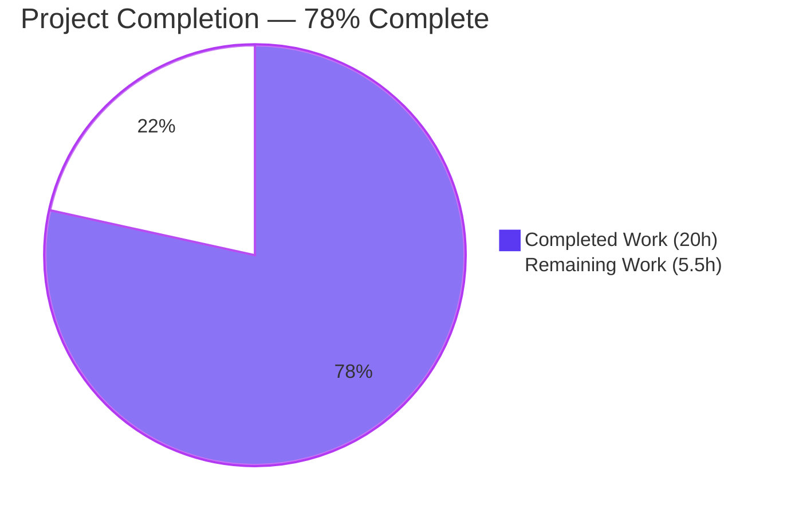
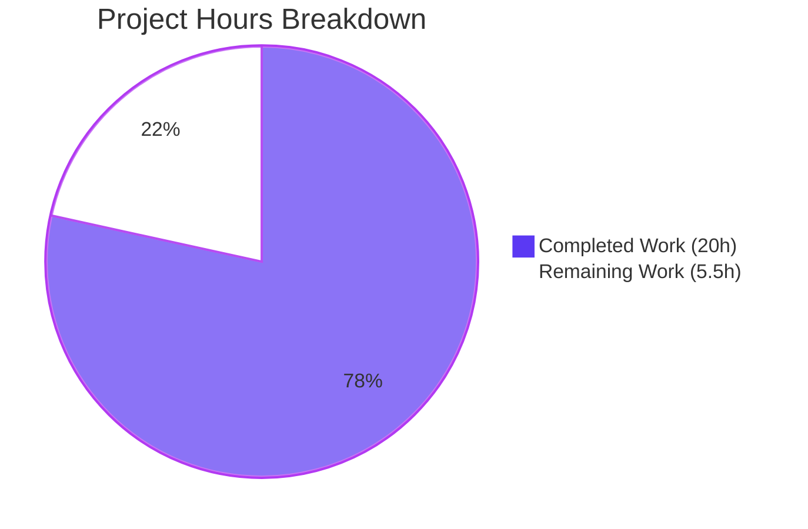

# 1. Executive Summary

## 1.1 Project Overview

Proactive Insights Demo API is a compact FastAPI service that serves projects, tasks, team roles and a simulated billing quota, keeps all state in module memory, and ships a pytest suite that drives it in process. This project closed a quota-scoping flaw in `POST /billing/consume`: one process-wide counter let any authenticated caller exhaust the billing allowance for everyone else (CWE-770, CWE-799). The quota is now keyed on the authenticated principal, and the response contract is unchanged.

## 1.2 Completion Status



All 17 tracked requirements are delivered and verified. What remains is follow-through the change left open: three repository documents still describe the pre-change counter, and the per-principal increment is not yet atomic. Completion is calculated on hours: 20.0 completed ÷ 25.5 total × 100 = 78%.

| Metric | Hours |
|---|---|
| Total Hours | 25.5 |
| Completed Hours (Baseline: Human with agentic-assist) | 20.0 |
| Remaining Hours | 5.5 |

## 1.3 Key Accomplishments

- [x] Quota keyed on the authenticated principal, one five-unit ceiling per caller (`app/main.py:11`, `:99-106`).
- [x] A caller exhausting its quota no longer refuses anyone else (`tests/test_api.py:29-38`).
- [x] Success body preserved to the byte, keys in order: 200 `{"used": <int>, "limit": 5}` (`app/main.py:106`).
- [x] Rejections preserved: 401 `Missing bearer token`, 401 `Invalid token`, 422 `Units must be positive`, 429 `Usage limit reached`, framework 422 for a non-integer `units`.
- [x] Path, method, `units` query parameter and its default untouched; the OpenAPI document is identical.
- [x] Quota state stays resettable, so the suite does not depend on module or node order (`tests/conftest.py:20`, `tests/test_api.py:11`).
- [x] Suite green under a 90% coverage floor: 21 tests, 20 passed, 1 expected failure, 100% of `app/main.py`.
- [x] Six pins unchanged; no new package, environment variable or secret.

## 1.4 Critical Unresolved Issues

The requested change is delivered and verified: 1 of 1. Six further items remain open; none belongs to the requested change, and each is listed so it is not mistaken for delivered scope.

| Issue | Impact | Owner | ETA |
|---|---|---|---|
| The documents under `blitzy/documentation/` still describe `USAGE = {"used": 0, "limit": 5}` and a quota global to all tokens | A reader is told the quota is process-global and per-caller isolation absent, and could reintroduce the flaw | Maintainer | 1.5h |
| Concurrent requests from one principal can both pass the cap (`app/main.py:103-105`) | Two simultaneous requests can exceed the five-unit ceiling, each returning 200 | Backend engineer | 4h |
| Task routes lack ownership checks: `PATCH /tasks/{task_id}` (`app/main.py:74-83`) and `POST /tasks` (`app/main.py:61-71`) | Any valid token can change any task or file into any project | Backend engineer | 4h |
| Role grants are written to `TEAM` (`app/main.py:93`) but authorization reads `USERS` (`app/main.py:58`, `:89-90`) | A granted role has no effect; documented by one expected-failure test | Backend engineer | 3h |
| No CI pipeline, container definition, linter or type checker exists | The suite and its coverage floor run only when someone runs them | Maintainer | 6h |
| Transitive `starlette` and pinned `pytest` carry advisories that were not addressed | Unpatched advisory exposure in the service and test stack | Maintainer | 2h |

## 1.5 Access Issues

No access issues identified. Every check ran locally; no external service, credential or permission was required. The `/docs` page loads its assets from `cdn.jsdelivr.net`, and outbound HTTPS was available.

## 1.6 Recommended Next Steps

1. [High] Make the per-principal increment atomic at `app/main.py:102-105` and add a concurrency test.
2. [Medium] Refresh the three documents under `blitzy/documentation/` against the delivered code.
3. [High] Add ownership checks to `PATCH /tasks/{task_id}` and `POST /tasks`.
4. [Medium] Add a CI job running `python -m pytest -q` under the 90% coverage floor.
5. [Medium] Replace the two literal demo tokens at `app/main.py:7` before any deployment.

# 2. Project Hours Breakdown

## 2.1 Completed Work Detail

| Component | Hours | Description |
|---|---|---|
| Vulnerability research and classification | 4.0 | Classified the quota flaw as CWE-770 and CWE-799, mapped it to OWASP API4:2023 and ASVS 11.1.3 / 2.1.3, established that no CVE or package is implicated, and reproduced the cross-principal refusal on the unchanged code. |
| Root-cause trace and fix design | 3.0 | Traced the path from the `units` parameter through the guard to the state write, decided to scope the state at the sink rather than validate the input, and assessed the three controls already on the path. |
| Quota state reshape and handler rebind | 2.5 | Gave the counter the principal dimension it lacked at `app/main.py:11` and rewrote the handler at `:99-106`, preserving the decorator, signature, positivity check and both rejection strings. |
| Test isolation and the quota tests | 4.5 | Converted both reset hooks to clear per-principal state (`tests/conftest.py:20`, `tests/test_api.py:11`) and wrote the isolation and contract cases at `tests/test_api.py:29-38` and `:41-58`. |
| Contract completion in the suite | 2.0 | Bound the rejection responses, pinned the response key order, and covered the unknown-token and non-integer `units` branches (`tests/test_api.py:46-58`). |
| Verification | 4.0 | Ran the full-suite gate with its coverage floor, ran the isolation case against a shared-counter handler to confirm it discriminates, swept all nine routes over live HTTP, and checked the Swagger UI. |
| **Total** | **20.0** | |

## 2.2 Remaining Work Detail

| Category | Hours | Priority |
|---|---|---|
| Documentation alignment — bring `blitzy/documentation/Technical Specifications.md` and both Project Guide documents in line with the delivered counter, its per-principal keying and the 21-test suite | 1.5 | Medium |
| Atomic per-principal increment — close the window between the cap test and the write at `app/main.py:103-105`, keep the accounting keyed on the authenticated id, and add a concurrency test | 4.0 | High |
| **Total** | **5.5** | |

The four weaknesses the requested change deliberately left untouched — the task-route authorization gaps, the inert role store, and the in-memory single-process quota — are carried as open items in Section 1.4 and as risks in Section 6. They are not counted here because they lie outside the approved change.

## 2.3 Estimation Basis and Confidence

Completed hours are a bottom-up estimate of the work visible in the delivered change: 42 inserted and 7 deleted lines across three files, the six-pin toolchain left untouched, and the test and verification effort those changes required. Remaining hours are per-task estimates rounded up to the nearest half hour, one item per open gap that this change owns.

Completion is calculated on hours, not on requirement count: 20.0 completed ÷ (20.0 completed + 5.5 remaining) × 100 = 78%.

| Estimate | Confidence | Basis |
|---|---|---|
| Completed: state reshape, handler, tests, contract completion, verification (13.0h) | High | Files, lines, test names and run output were read directly in this checkout. |
| Completed: research, classification and design (7.0h) | Medium | Effort inferred from the breadth of the delivered analysis and the shape of the final change. |
| Remaining: atomic increment (4.0h) | Medium | A contained change to one handler plus one new test, but concurrency tests are the slow part. |
| Remaining: documentation alignment (1.5h) | High | Three documents with a bounded set of stale statements to correct. |

# 3. Test Results

The suite runs from the repository root with `.venv/bin/python -m pytest -q`, which collects 21 tests across five modules and exits 0 with 20 passed and 1 expected failure.

| Area / Category | Framework | Tests | Passed | Failed | Coverage | What This Proves |
|---|---|---|---|---|---|---|
| Billing quota and contract — `tests/test_api.py` | pytest 8.3.5, in-process TestClient | 5 | 5 | 0 | `app/main.py` 82/82 statements, 100.00% | Each authenticated caller has its own five-unit quota, and the 200, 401, 422 and 429 contract is pinned at every branch. |
| Billing journey — `tests/test_e2e_usage_limit_journey.py` | pytest, in-process TestClient | 2 | 2 | 0 | included in the total above | Consumption accumulates to the ceiling, a request past it is refused, and a non-positive `units` is rejected without spending anything. |
| Projects and tasks — `tests/test_e2e_project_task_journey.py` | pytest, in-process TestClient | 6 | 6 | 0 | included in the total above | Project creation and listing, task filing, the accepted status list and the 404/422 branches all hold. |
| Service operations — `tests/test_e2e_service_ops.py` | pytest, in-process TestClient | 3 | 3 | 0 | included in the total above | Readiness reports its storage check, metrics reports its payload, and an unknown token or wrong scheme is rejected. |
| Team and roles — `tests/test_e2e_team_role_journey.py` | pytest, in-process TestClient | 5 | 4 | 0 (1 expected failure) | included in the total above | Owner-only role change and ownership-scoped project listing hold; one test records the role-grant behaviour and is marked as an expected failure. |
| Coverage gate — `pytest.ini` addopts with pytest-cov 7.1.0 and coverage 7.17.3 | pytest-cov | enforced on every run | met | 0 | 100.00% of `app/main.py`, floor 90.00% | Every statement of the service executes under the suite, and a run that misses the floor fails. |
| Syntax gate — `.venv/bin/python -m compileall -q app tests` | compileall | 7 tracked modules | 7 | 0 | not applicable | All tracked Python compiles without error. |
| Dependency resolution — `.venv/bin/python -m pip check` | pip | 6 pinned packages | 6 | 0 | not applicable | The six pins resolve together with no broken requirement. |

Per module the counts are 5, 6, 3, 4 plus 1 expected failure, and 2; the single expected failure is `tests/test_e2e_team_role_journey.py::test_role_grant_governs_later_requests`, which documents that a role grant is stored but never consulted.

## Not Covered

- **Concurrent requests from one principal.** No test drives two simultaneous requests through the cap-and-write window at `app/main.py:103-105`, so a lost update is neither proven nor excluded by the suite.
- **Multi-worker quota behaviour.** Every run used a single uvicorn process; the service keeps `USAGE` in module memory, so a deployment with more than one worker behaves differently and is untested.
- **Task and project ownership.** `PATCH /tasks/{task_id}` and `POST /tasks` implement no ownership rule, so there is nothing for a test to assert until the rule is decided and written.
- **Role administration beyond the expected failure.** No test asserts that a granted role changes an authorization decision, because it does not.
- **`/metrics` content beyond its shape.** `requests_total` is a constant 0 and is asserted as 0; nothing verifies a real request count.
- **Performance, load and soak behaviour.** No test measures latency, throughput or memory growth.
- **Static analysis.** No linter, formatter, type checker or security scanner is configured anywhere in the tree, so none ran.

Before release a human should test concurrent overshoot against the quota, behaviour under more than one worker, the ownership rules once implemented on the task routes, and credential handling once the demo tokens are externalised.

# 4. Runtime Validation & UI Verification

Every line below was driven against a running service on `127.0.0.1` and observed directly; the browser line was driven in Chrome against the same process.

- ✅ **Service startup** — `uvicorn app.main:app` starts clean, logs `Application startup complete`, and `GET /health` answers 200 `{"status":"ok"}` on the first poll.
- ✅ **Per-principal quota isolation** — owner spends 5 → 200 `{"used":5,"limit":5}`; owner again → 429 `Usage limit reached`; member 1 → 200 `{"used":1,"limit":5}`; member 4 → 200 `{"used":5,"limit":5}`; member capped → 429; owner still 429. Neither principal's spend moves the other's figure.
- ✅ **Success and rejection contract** — every branch observed with its exact status and body: 401 `Missing bearer token`, 401 `Invalid token`, 422 `Units must be positive`, 429 `Usage limit reached`, the framework's `int_parsing` 422 for `units=abc`, and 405 with `allow: POST` for a GET on the billing path.
- ✅ **Parameter binding and route surface** — a request with no query string consumes 1; a JSON body is ignored; `/openapi.json` reports `units` as a query integer defaulting to 1 with an optional `authorization` header and no request body.
- ✅ **Projects, tasks and roles** — project create and list return 200, task create returns 200, a member's `PATCH /tasks/1?status=done` returns 200, a role change returns 200 as owner and 403 `Owner role required` as member.
- ✅ **Operational endpoints** — `/health`, `/ready` and `/metrics` return 200 with their documented bodies before, during and after the flows.
- ✅ **Swagger UI** — `/docs` renders all 9 operations with its stylesheet applied, shows `POST /billing/consume` with `units` as a query integer defaulting to 1 plus an optional `authorization` header, and produced no console errors and no failed requests.
- ✅ **Log and disclosure surface** — access-log lines carry method, path and status only; no token value, quota figure or `by_user` map appears in any log or any response body, and a 429 body carries no figure at all.
- ⚠ **Concurrency under simultaneous requests** — bursts of five and ten simultaneous requests from a single principal settled at exactly five 200s with no overshoot in the runs made, but the read-modify-write window at `app/main.py:103-105` is not closed, so a lost update remains possible.

Never exercised at runtime: a deployment with more than one uvicorn worker (the quota lives in module memory, so each process would keep its own accounting); sustained or high load; the ownership rules on the task routes, which do not exist yet; and any client other than `curl` and Chrome against `/docs`, since the service exposes no HTML interface of its own.

# 5. Compliance & Quality Review

## 5.1 Compliance Matrix

| Deliverable | Benchmark | Status | Evidence |
|---|---|---|---|
| Quota scoped to the authenticated principal | OWASP API4:2023 and ASVS 11.1.3 / 2.1.3 per-user business-logic limits; CWE-770 / CWE-799 remediation | ✅ PASS | `app/main.py:11`, `:99-106`; `tests/test_api.py:29-38` |
| Single ceiling, applied per principal | One definition, no second constant, no parameterisation | ✅ PASS | `app/main.py:11` is the only literal `5`; read at `:103` and `:106` |
| Success contract preserved | Status, keys and key order unchanged | ✅ PASS | `app/main.py:106`; `tests/test_api.py:44-46`; live body byte-exact |
| Rejection contract preserved | Exact status and detail string at every branch | ✅ PASS | `app/main.py:27`, `:31`, `:101`, `:104`, plus the framework 422 from `:98`; `tests/test_api.py:47-58` |
| Route, method and parameter surface | Signature and OpenAPI document unchanged | ✅ PASS | `app/main.py:97-98`; 8 paths, 9 operations, `units` query integer default 1 |
| State resettable, suite deterministic | Order- and seed-independent suite | ✅ PASS | `tests/conftest.py:20`, `tests/test_api.py:11`; green under reversed module order, reversed node order and four hash seeds |
| Minimal change | No route, model, dependency, middleware or configuration added | ✅ PASS | Three files, 42 insertions / 7 deletions against `b9ee016` |
| Dependency and configuration integrity | Six pins unchanged; no setting moved | ✅ PASS | `requirements.txt` and `pytest.ini` byte-identical to `b9ee016`; `pip check` clean |
| Known weaknesses recorded and left unchanged | Adjacent findings untouched | ✅ PASS | `app/main.py:61-71`, `74-83`, `10`, `91`, `93`, `103-105` byte-identical to `b9ee016` |
| Verification record | Full suite green under its coverage floor plus a live HTTP check | ✅ PASS | 21 tests, 20 passed, 1 expected failure, 100.00% of `app/main.py`; full route sweep on a live process |
| Documentation matches the delivered code | Repository documents describe the current state | ❌ FAIL | `blitzy/documentation/Technical Specifications.md` and both Project Guide documents still carry `USAGE = {"used": 0, "limit": 5}`, 81/81 statements and 19 tests |
| Static analysis gate | Linter, formatter, type checker or security scanner | ❌ FAIL | None exists in the tree or the environment, so none ran |

## 5.2 AAP & Rule Divergences and Gaps

No user-specified rules were supplied for this project, so no rule divergence exists to report; the table records the four places where delivery departed from the approved plan.

| What the AAP/Rule Required | What Was Delivered Instead | Why It Diverged | Impact | Remediation |
|---|---|---|---|---|
| Two rejection cases asserted from a discarded response — the 422 status and the missing-token detail were not asserted — and no assertion of response key order, the unknown-token branch or a non-integer `units` | Both rejections are bound and their status asserted on the same call, and the four missing facts are asserted (`tests/test_api.py:46-58`) | The preserved-behaviour requirement demands the 422 status and both 401 detail strings be proven; a discarded response proves neither | None on runtime behaviour; test-only, +12/−2, and a strictly stronger contract proof | None required |
| The change was specified as two files with a single test reset line in `tests/test_api.py` | Three files changed: the second reset hook at `tests/conftest.py:20` was updated as well | The reshape left that hook clearing a key that no longer exists, which fails `tests/test_e2e_usage_limit_journey.py::test_non_positive_units_are_rejected`; the whole test tree is inside the approved scope and the state had to stay resettable | Keeps the pre-existing billing journey green and the suite order-independent | None required |
| Repository documentation recorded as needing no update, on the assumption that no document describes the counter's internal shape | The three documents under `blitzy/documentation/` are unchanged and still describe `USAGE = {"used": 0, "limit": 5}`, a quota global to all tokens, 81/81 statements and 19 tests | Not implemented in this change: the approved scope covered service code and tests only, and the assumption that no document describes the counter was not correct | A reader of those documents is told the quota is process-global and that per-caller isolation is absent — exactly the shape this change removed | Refresh the three documents against `app/main.py:11`, `:99-106` and the 21-test suite (1.5h, Section 2.2) |
| Adjacent weaknesses recorded and left unchanged: the check-then-act window, the task-route ownership gaps and the inert role store | All four are unchanged and byte-identical to `b9ee016` (`app/main.py:61-71`, `74-83`, `10`, `91`, `93`, `103-105`) | The approved change scoped the billing counter only; a lock or an ownership check is a distinct change with its own behaviour and tests | Concurrent requests from one principal can overshoot 5; any valid token can mutate any task; a granted role has no effect | Sanctioned by the approved scope; carried as open items in Section 1.4 and risks in Section 6, with the quota race counted in Section 2.2 (4h) |

The documentation set is the one open item this change owns. `blitzy/documentation/Technical Specifications.md` states the counter's old shape in four places and treats per-account enforcement as intentionally absent, and both Project Guide documents repeat the same model while quoting 81 of 81 statements and 19 tests where the tree now reports 82 of 82 and 21. None of that changes runtime behaviour, but a maintainer reading the specification beside the code could restore the shared-counter design this change removed. The correction is bounded — the counter shape, the per-principal keying, the projected response, both reset hooks and the suite totals — and is estimated at 1.5h in Section 2.2.

The concurrency window is the item that needs a decision as well as work. `app/main.py:103-105` reads the principal's figure, compares it against the ceiling and writes the result with nothing between the three steps, so two simultaneous requests from one principal can both pass the cap and each return 200, spending more than five units between them. The behaviour is unchanged by this change and was deliberately not closed with it, because a lock is a distinct change with its own test obligations. Whoever takes it must keep the write keyed on `user["id"]`: reverting that keying would reopen the cross-principal denial this change closed. The work is estimated at 4h in Section 2.2 and should ship with a test that fires concurrent requests from a single principal and asserts the counter settles at five.

# 6. Risk Assessment

| Risk | Category | Severity | Probability | Mitigation | Status |
|---|---|---|---|---|---|
| Two simultaneous requests from one principal can both pass the cap and jointly exceed five units, each returning 200 (`app/main.py:103-105`) | Technical | Medium | Medium under concurrent load | Guard the read, cap test and write with a lock or an atomic increment, keep the accounting keyed on `user["id"]`, and add a concurrency test (4h, Section 2.2) | Open |
| `USAGE` lives in process memory, so more than one worker gives each process its own accounting and a restart restores every principal's full quota | Technical | Medium | High if the service is scaled out | Persist or centralise the quota, or pin the service to one worker and record the constraint beside the handler | Open |
| `PATCH /tasks/{task_id}` never compares `created_by` and `POST /tasks` never checks project ownership (`app/main.py:74-83`, `:61-71`) | Security | High | Certain — observed live: a member patched the owner's task and received 200 | Compare the caller against the task's creator and the project's owner before mutating; add tests (4h) | Open |
| Role grants are written to `TEAM` (`app/main.py:93`) while authorization reads `USERS` (`:58`, `:89-90`), so a granted role has no effect | Security | Medium | Certain — one expected-failure test records it | Read the role from `TEAM` or persist the grant to `USERS`, then remove the expected-failure marker | Open |
| Two bearer tokens are source literals (`app/main.py:7`) and the README declares the service a non-production fixture | Security | High if deployed | Low while the service stays a fixture | Replace the literals with a real credential source before any deployment; the README warning is the only current control | Accepted |
| No CI pipeline, container or lint/type gate exists, and `/metrics` reports a constant `requests_total` of 0 | Operational | Medium | Medium | Add a CI job running `python -m pytest -q` with the existing coverage floor, and increment a real request counter in the metrics handler | Open |
| The documentation under `blitzy/documentation/` still describes a process-global quota, so a maintainer reading it beside the code could restore the shared counter | Operational | Medium | Certain until the documents are refreshed | Refresh the three documents against `app/main.py:11`, `:99-106` and the suite totals (1.5h, Section 2.2) | Open |
| The Swagger UI at `/docs` loads its stylesheet and script from `cdn.jsdelivr.net`, so the documentation page renders unstyled in an environment without outbound HTTPS | Integration | Low | Low | Vendor the Swagger assets locally if offline API documentation matters; no other external integration exists | Accepted |

# 7. Visual Project Status



All 17 tracked requirements are complete and verified; the remaining hours are follow-through the approved change left open.

| Priority | Remaining Hours | Share of Remaining Work | Item |
|---|---|---|---|
| High | 4.0 | 73% | Atomic per-principal increment with a concurrency test |
| Medium | 1.5 | 27% | Documentation alignment across the three repository documents |
| **Total** | **5.5** | **100%** | |

# 8. Summary & Recommendations

The billing quota in `POST /billing/consume` is now scoped to the authenticated principal. The counter that any caller could once exhaust on behalf of everyone else has become a per-principal map under a single ceiling of five (`app/main.py:11`), the handler binds the identity it previously discarded and keys its read, cap test and write on it (`app/main.py:99-106`), and the response is a projection of the caller's own figure. Every observable part of the endpoint is unchanged: the path, the method, the `units` query parameter and its default, the 200 body with its key order, and the four hand-written rejections plus the framework's own 422.

What makes that a verified claim rather than an assertion is the evidence underneath it. The suite collects 21 tests across five modules and reports 20 passed with one documented expected failure, under a coverage floor that fails any run below 90% and currently measures 100.00% of the service module (82 of 82 statements). The two quota cases assert the cross-principal property directly, and forcing the handler back to a single shared key makes the isolation case the one test that fails — the proof is specific, not incidental. On a live process the full chain was driven: an exhausted owner left a member free to draw its own five units, both principals were then refused at their own ceilings, and every rejection returned its exact status and detail string.

The gaps that remain are small, bounded and named. Two carry hours: closing the window between the cap test and the write so concurrent requests from one principal cannot overshoot (4.0h), and refreshing the three documents under `blitzy/documentation/` that still describe the process-global quota this change removed (1.5h). Four more are open without hours against this change because the approved scope deliberately excluded them — ownership checks on the two task routes, an effective role store, a CI job running the existing gate, and the dependency advisories. Nothing blocks using the service as it stands; the two counted items clear the last correctness and documentation debts this change touched, and the remaining four are backlog decisions for whoever owns the service next.

| Measure | Value |
|---|---|
| Completion | 78% — 20.0h of 25.5h |
| Requirements complete | 17 of 17 |
| Tests | 21 collected: 20 passed, 1 expected failure, 0 failed |
| Coverage | 100.00% of `app/main.py` (82/82 statements) against a 90% floor |
| Files changed | 3 — 42 insertions, 7 deletions against `b9ee016` |
| Dependency changes | none; six pins unchanged |
| Open items | 6, none of them inside the requested scope |

On production readiness the repository speaks for itself: `README.md` declares the service a synthetic QA fixture whose in-memory storage and demo tokens are for evaluation only and must not be deployed with real credentials. Judged as a fixture it is ready — the quota flaw is closed, the contract is pinned, and the suite guards both. Judged as a production service it is not, for reasons that predate this change and are listed in Section 6: no credential store, no ownership checks on the task routes, a quota that lives in process memory, and no pipeline to run the gate. Closing those would turn a well-tested fixture into a service, and each is scoped in Section 1.4 so the decision stays with the owner rather than the code.

# 9. Development Guide

## 9.1 Prerequisites

- CPython 3.13.18, available as `python3.13` on the PATH. The annotations in `app/main.py` need 3.10 or newer.
- No database, broker, cache, container or external service. No environment variable and no secret is read by the service or the suite.
- `curl` for the manual HTTP checks. `lsof`, `ss`, `fuser` and `netstat` are not installed on this host, so probe a port by requesting it.

## 9.2 Environment Setup

Run everything from the repository root. The default system interpreter is externally managed, so build a virtual environment rather than installing into it, and name 3.13 explicitly because a bare `python3` may be a newer release.

```bash
python3.13 -m venv .venv
.venv/bin/python -V
```

Expected: `Python 3.13.18`. Use `.venv/bin/python` for every command afterwards; a bare `pip install` fails with `error: externally-managed-environment`.

## 9.3 Dependency Installation

```bash
.venv/bin/python -m pip install -r requirements.txt
.venv/bin/python -m pip check
```

Expected: the six pins install — fastapi 0.115.12, uvicorn 0.34.0, pytest 8.3.5, httpx 0.28.1, pytest-cov 7.1.0, coverage 7.17.3 — and `pip check` prints `No broken requirements found.`

`requirements.txt` and `pytest.ini` are the only configuration that matters:

- `requirements.txt` pins the six packages above.
- `pytest.ini` sets `testpaths = tests`, `python_files = test_*.py`, `pythonpath = .` and the coverage floor `--cov=app --cov-report=term-missing --cov-fail-under=90 --cov-precision=2`.

## 9.4 Verification

The whole-suite gate, which is the check to run before handing work back:

```bash
.venv/bin/python -m pytest -q
```

Expected: `20 passed, 1 xfailed, 1 warning`, `app/main.py 82/82` statements at `100.00%`, `Required test coverage of 90% reached`, exit 0. The single expected failure is `tests/test_e2e_team_role_journey.py::test_role_grant_governs_later_requests`.

Any narrower run must pass `--no-cov`, because the coverage floor is inherited from `pytest.ini` and a subset cannot reach 90%:

```bash
.venv/bin/python -m pytest tests/test_api.py -q -k usage --no-cov
.venv/bin/python -m pytest "tests/test_api.py::test_usage_quota_is_isolated_per_principal" -q --no-cov
.venv/bin/python -m pytest tests/test_e2e_usage_limit_journey.py -q --no-cov
```

Expected: `2 passed, 3 deselected`, then `1 passed`, then `2 passed`. Without `--no-cov` the first command reports `2 passed, 3 deselected` and still exits 1 with `FAIL Required test coverage of 90% not reached. Total coverage: 60.98%`.

The README's own command works unchanged, because `pytest.ini` supplies the import path:

```bash
PATH=$PWD/.venv/bin:$PATH pytest -q
```

Syntax gate, the only static check the repository has:

```bash
.venv/bin/python -m compileall -q app tests
```

Expected: no output, exit 0.

## 9.5 Running the Application

Start the service on a free loopback port and stop that process when finished; bind `127.0.0.1`, never `0.0.0.0`.

```bash
.venv/bin/python -m uvicorn app.main:app --host 127.0.0.1 --port 8000
```

Expected log sequence: `Started server process`, `Waiting for application startup.`, `Application startup complete.`, `Uvicorn running on http://127.0.0.1:8000`.

The service seeds two principals in `app/main.py:7`: `owner-token` (id 1, role owner) and `member-token` (id 2, role member).

```bash
curl -s http://127.0.0.1:8000/health
curl -s http://127.0.0.1:8000/ready
curl -s http://127.0.0.1:8000/metrics
```

Expected: `{"status":"ok"}`, `{"ready":true,"checks":{"storage":"ok"}}`, and `{"requests_total":0,"uptime_seconds":…}`.

## 9.6 Example Usage

The per-principal quota, driven in order against a freshly started process:

```bash
curl -s -X POST "http://127.0.0.1:8000/billing/consume?units=5" -H 'Authorization: Bearer owner-token'
# {"used":5,"limit":5}
curl -s -X POST "http://127.0.0.1:8000/billing/consume?units=1" -H 'Authorization: Bearer owner-token'
# {"detail":"Usage limit reached"}
curl -s -X POST "http://127.0.0.1:8000/billing/consume" -H 'Authorization: Bearer member-token'
# {"used":1,"limit":5}
```

The owner's exhaustion does not affect the member, and the member's spend does not lift the owner's refusal.

Every rejection, for reference:

```bash
curl -s -X POST http://127.0.0.1:8000/billing/consume
# {"detail":"Missing bearer token"}
curl -s -X POST http://127.0.0.1:8000/billing/consume -H 'Authorization: Bearer not-a-real-token'
# {"detail":"Invalid token"}
curl -s -X POST "http://127.0.0.1:8000/billing/consume?units=0" -H 'Authorization: Bearer member-token'
# {"detail":"Units must be positive"}
curl -s -X POST "http://127.0.0.1:8000/billing/consume?units=abc" -H 'Authorization: Bearer member-token'
# {"detail":[{"type":"int_parsing","loc":["query","units"],…}]}
```

The rest of the surface:

```bash
curl -s -X POST http://127.0.0.1:8000/projects -H 'Authorization: Bearer owner-token' \
  -H 'Content-Type: application/json' -d '{"name":"Release QA"}'
# {"id":1,"name":"Release QA","owner_id":1}
curl -s -X POST http://127.0.0.1:8000/tasks -H 'Authorization: Bearer owner-token' \
  -H 'Content-Type: application/json' -d '{"title":"Verify quota","project_id":1}'
# {"id":1,"title":"Verify quota","project_id":1,"created_by":1,"status":"open"}
curl -s -X PATCH "http://127.0.0.1:8000/tasks/1?status=done" -H 'Authorization: Bearer owner-token'
curl -s -X POST "http://127.0.0.1:8000/teams/2/role?role=member" -H 'Authorization: Bearer owner-token'
# {"user_id":2,"role":"member"}
```

Interactive documentation is at `/docs` and the machine-readable contract at `/openapi.json`; the Swagger page pulls its assets from `cdn.jsdelivr.net`, so it needs outbound HTTPS to render styled.

## 9.7 Troubleshooting

| Symptom | Cause | Resolution |
|---|---|---|
| `error: externally-managed-environment` from pip | The system interpreter was used | Install through `.venv/bin/python -m pip` |
| `FAIL Required test coverage of 90% not reached` on a narrow run | `pytest.ini` applies its coverage floor to every run | Add `--no-cov`, or run the whole suite |
| `ModuleNotFoundError: No module named 'app'` | pytest was not started from the repository root | Run it from the root; `pythonpath = .` in `pytest.ini` resolves `app` from there |
| `Address already in use` | Another process holds the port | Choose a different port and confirm with `curl -s http://127.0.0.1:<port>/health` |
| `ModuleNotFoundError: No module named 'fastapi'` | The system interpreter is being used instead of the virtual environment | Prefix every command with `.venv/bin/` |
| `/docs` renders unstyled or blank | The `cdn.jsdelivr.net` assets did not load | Check outbound HTTPS, or read the JSON contract from `/openapi.json` instead |
| Import or syntax errors that appear only under a newer interpreter | The virtual environment was created from a different Python | Recreate it with `python3.13 -m venv .venv` |
| The expected-failure test reports `xpassed` | The role-store condition has been corrected without removing the marker | Remove the `xfail` marker from that test; an `xpass` means the condition no longer holds |
| `DeprecationWarning: The anyio.abc.BlockingPortal alias is deprecated` | Third-party warning from `starlette/testclient.py` | Ignore it; it is present on a clean tree and is not a repository issue |

# 10. Appendices

## A. Command Reference

| Purpose | Command | Expected |
|---|---|---|
| Create the environment | `python3.13 -m venv .venv` | `.venv/bin/python -V` prints `Python 3.13.18` |
| Install dependencies | `.venv/bin/python -m pip install -r requirements.txt` | Six pins install, exit 0 |
| Verify dependencies | `.venv/bin/python -m pip check` | `No broken requirements found.` |
| Whole-suite gate | `.venv/bin/python -m pytest -q` | `20 passed, 1 xfailed`, coverage 100.00%, exit 0 |
| Collect only | `.venv/bin/python -m pytest --collect-only -q --no-cov` | `21 tests collected` |
| Single module | `.venv/bin/python -m pytest tests/test_api.py -q --no-cov` | `5 passed` |
| Single test | `.venv/bin/python -m pytest "tests/test_api.py::test_usage_quota_is_isolated_per_principal" -q --no-cov` | `1 passed` |
| Quota cases only | `.venv/bin/python -m pytest tests/test_api.py -q -k usage --no-cov` | `2 passed, 3 deselected` |
| Syntax gate | `.venv/bin/python -m compileall -q app tests` | No output, exit 0 |
| Start the service | `.venv/bin/python -m uvicorn app.main:app --host 127.0.0.1 --port 8000` | `Application startup complete` |
| Liveness | `curl -s http://127.0.0.1:8000/health` | `{"status":"ok"}` |
| Readiness | `curl -s http://127.0.0.1:8000/ready` | `{"ready":true,"checks":{"storage":"ok"}}` |
| Inspect the contract | `curl -s http://127.0.0.1:8000/openapi.json` | 8 paths, 9 operations |

## B. Port Reference

| Item | Value |
|---|---|
| Service bind address | `127.0.0.1` only — never `0.0.0.0` |
| Documented development port | `8000` (`README.md`) |
| Port for a scripted harness | an ephemeral free port: bind `("127.0.0.1", 0)`, read the assigned port, pass it to uvicorn |
| Port probes | `curl -s http://127.0.0.1:<port>/health`; `lsof`, `ss`, `fuser` and `netstat` are not installed |
| Swagger UI | same port, path `/docs` |
| Ports in use by the service | exactly one |

## C. Key File Locations

| Path | Purpose |
|---|---|
| `app/main.py` | The whole service: six module stores (`USERS`, `PROJECTS`, `TASKS`, `TEAM`, `USAGE`, `NEXT_*`), the `current_user` guard, and nine routes |
| `app/main.py:11` | `USAGE = {"limit": 5, "by_user": {}}` — the only ceiling definition |
| `app/main.py:97-106` | `POST /billing/consume` — the per-principal quota handler |
| `app/__init__.py` | Empty package marker |
| `tests/test_api.py` | Billing quota isolation and contract cases, plus three platform smoke tests |
| `tests/conftest.py` | Autouse `reset_app_state` fixture that clears every store in place |
| `tests/test_e2e_usage_limit_journey.py` | Pre-existing single-principal billing journey |
| `tests/test_e2e_project_task_journey.py` | Project and task journeys |
| `tests/test_e2e_service_ops.py` | Readiness, metrics and token rejection |
| `tests/test_e2e_team_role_journey.py` | Role administration, including the expected-failure test |
| `pytest.ini` | Discovery, import path and the 90% coverage floor |
| `requirements.txt` | The six pins |
| `README.md` | Run instructions and the service's non-production declaration |
| `blitzy/documentation/` | Analysis documents describing the service; currently stale against the delivered code |

## D. Technology Versions

| Component | Version | Source |
|---|---|---|
| CPython | 3.13.18 | `python3.13` on the PATH |
| fastapi | 0.115.12 | `requirements.txt` |
| uvicorn | 0.34.0 | `requirements.txt` |
| pytest | 8.3.5 | `requirements.txt` |
| httpx | 0.28.1 | `requirements.txt` |
| pytest-cov | 7.1.0 | `requirements.txt` |
| coverage | 7.17.3 | `requirements.txt` |
| starlette | 0.46.2 | Transitive, resolved by fastapi |
| pydantic | 2.14.4 | Transitive, not pinned |

## E. Environment Variable Reference

The service and its suite read no environment variable; nothing needs to be set to run or test it.

| Variable | Effect |
|---|---|
| `PYTHONDONTWRITEBYTECODE` | Optional; set to `1` to keep `__pycache__/` out of the working tree |
| `COVERAGE_FILE` | Optional; relocates coverage data away from `.coverage` in the repository root |
| `PATH` | Only relevant for the README's bare `pytest -q`, which needs `.venv/bin` ahead of the system interpreter |

## F. Developer Tools Guide

- **pytest selections** — `-k <expression>` filters by test name, `--no-cov` disables the coverage floor for a narrow run, `-p no:cacheprovider` avoids writing `.pytest_cache/`, and `-q -v` together list each test id with its outcome.
- **Interpreter probe** — `.venv/bin/python -c "from app import main; print(main.USAGE)"` prints `{'limit': 5, 'by_user': {}}`, the fastest way to confirm the state shape.
- **Live probing** — `uvicorn` plus `curl` is the whole toolchain: `curl -s -i` shows status and headers, `curl -s -o body -w '%{http_code}'` isolates the status, and `od -c` on a saved body proves byte-level key order.
- **Not present in this repository or environment** — no linter, formatter, type checker, security scanner, container definition or CI workflow. `compileall` and the gated suite are the static and dynamic checks of record.

## G. Glossary

| Term | Meaning |
|---|---|
| Principal | The authenticated caller, resolved by `current_user` from the bearer token into `{"id": …, "role": …}` |
| Bearer token | The `Authorization: Bearer <token>` header value the guard matches against `USERS` |
| Quota / ceiling | The five units each principal may consume before the endpoint refuses with 429; defined once at `app/main.py:11` |
| `by_user` | The per-principal map inside `USAGE` that holds each id's consumed units |
| Projection | The response body built from the caller's own figure rather than the internal state object |
| CWE-770 / CWE-799 | Allocation of resources without limits or throttling; improper control of interaction frequency — the two weakness classes this change addresses |
| Coverage gate | The 90% statement floor `pytest.ini` applies to every run |
| Expected failure | A test marked `xfail`; it fails by design and records a known condition without failing the suite |
| Test isolation | Clearing every module store between tests so one test cannot observe another's residue |
