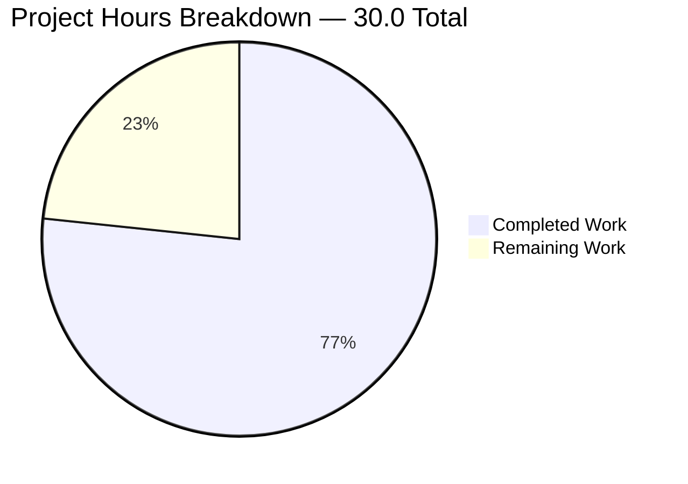

# 1. Executive Summary

## 1.1 Project Overview

The Proactive Insights Demo API is a compact FastAPI service built as a scanner-evaluation fixture: eleven routes cover projects, tasks, team roles, a simulated billing quota, health probes and a bearer-authenticated credential lifecycle. It is deliberately non-deployable — storage is in-memory, both credentials are demo literals in source, and `README.md` forbids real credentials.

The work assessed here closed the weakness in its single bearer guard: a token was valid for the life of the process, with no expiry, revocation or rotation. The service now keeps a server-side session per credential with a 900-second lifetime, ends sessions on request and replaces them on rotation.

## 1.2 Completion Status

**76.7% complete — 23.0 hours completed of 30.0 total hours, 7.0 hours remaining.**


Completion covers 22 scoped requirements (20 delivered, 2 partial) plus 3 open path-to-production items.

| Metric | Hours / Value |
|---|---|
| Total Hours | 30.0 |
| Completed Hours (Baseline: Human with agentic-assist) | 23.0 |
| Remaining Hours | 7.0 |
| Completion | 76.7% (23.0 ÷ 30.0) |

## 1.3 Key Accomplishments

- **Bounded lifetime** — every guarded route rejects a credential once its 900-second window closes (`app/main.py:15-16`, `app/main.py:72-74`).
- **Server-side termination** — `POST /sessions/revoke` ends only the caller's session (`app/main.py:184-190`).
- **Rotation** — `POST /sessions/rotate` retires the presented credential and returns a same-identity replacement with `Cache-Control: no-store` (`app/main.py:173-181`).
- **Uniform rejection** — unknown, expired, revoked and rotated credentials all answer `401 {"detail": "Invalid token"}`.
- **Preserved contract** — nine routes, both 401 bodies, identity stamping and the 403/404/422/429 messages unchanged, verified live.
- **Atomic termination** — a lost race answers 401, not 500, confirmed with concurrent rotations and revocations.
- **Regression safety** — eight lifecycle tests alongside the three existing ones; 11 of 11 pass.
- **Operability** — `README.md` documents the window and both session routes; `/metrics` reports live traffic and process age.

## 1.4 Critical Unresolved Issues

5 of the 25 tracked requirements and path-to-production items remain open.

| Issue | Impact | Owner | ETA |
|---|---|---|---|
| `/metrics` values (request count, process-age uptime) have no automated test | A regression in the counter or uptime origin would pass the suite unnoticed | Backend owner | 2 h |
| Session-route concurrency is proven only by ad-hoc harnesses | A future edit could reintroduce a 500 on a lost race without a failing test | Backend owner | 3 h |
| `tests/test_api.py` resets four of the seven mutable module items | A future order-dependent test could inherit a role or id counter | Test owner | 0.5 h |
| Transport-level credential normalisation is undocumented in `README.md` | A caller reading only the README may expect a trailing space to be rejected | Documentation owner | 1 h |
| The structural map in older planning notes no longer matches the module | A reader locating the guard by line number will miss it in a 190-line file | Maintainer | 0.5 h |

## 1.5 Access Issues

No access issues identified. The service needs no database, broker, container or environment variable: the four pins in `requirements.txt` are its only dependency and both credentials are in-source fixtures (`app/main.py:8`). Two operational notes: run the suite as `python -m pytest` from the repository root, and expect `/docs` "Try it out" to return 401, because Swagger UI cannot send a header named `authorization` — use `curl` or an in-page fetch.

## 1.6 Recommended Next Steps

1. **[High]** Test the `/metrics` values, stubbing the clock so the test does not wait.
2. **[High]** Add a repeatable concurrency test for both session routes.
3. **[Medium]** Restore the full seven-item reset in `tests/test_api.py`.
4. **[Medium]** Document the transport's trailing-whitespace normalisation in `README.md`.
5. **[Low]** Replace line-number references in planning notes with an element map.

# 2. Project Hours Breakdown

## 2.1 Completed Work Detail

Every component below traces to a scoped requirement of the security fix; the requirement identifiers are those used throughout this guide.

| Component | Hours | Description |
|---|---|---|
| Session state and lifetime constant (R2) | 1.0 | `TOKEN_TTL_SECONDS = 900` and the `SESSIONS` registry, with records carrying identity, role, issue time and expiry (`app/main.py:15-16`, `app/main.py:43-44`). |
| Import, constant and dependency wiring; seed directory preserved (R1, R3, R15) | 1.5 | `Response` added to the existing `fastapi` import, `secrets` imported, `USERS` left byte-identical, `requirements.txt` untouched. |
| Guard split and session helpers (R4, R5, R6) | 4.5 | `_issue_session`, `seed_sessions`, `_resolve_session` and `current_user`, with the guard's original statements retained verbatim, the six handler call sites unedited and the `{"id", "role"}` shape preserved. |
| Retained scheme checks and single rejection body (R7, R8) | 1.0 | Presence and case-sensitive `Bearer ` checks kept; one `401 {"detail": "Invalid token"}` body for unknown, expired, revoked and rotated credentials. |
| Expiry at the boundary with atomic removal (R9) | 1.0 | Rejection at `monotonic() >= expires_at`, the expired record removed in the same request. |
| `POST /sessions/rotate` (R10) | 1.5 | Replacement for the same identity and role, `token_ttl_seconds` echoed, `Cache-Control: no-store`, presented credential retired before issuance. |
| `POST /sessions/revoke` (R11) | 0.5 | Per-credential termination returning `{"revoked": true}`. |
| Lifecycle test module T1–T8 (R12) | 5.0 | Eight tests in `tests/test_token_lifecycle.py`: lifetime, boundary instant, expiry on every guarded route, revocation, rotation with role carry-over and enforced span, malformed/unknown/expired/rotated rejection, and the preserved probe surface. |
| Existing-suite reset wiring (R13) | 0.5 | `seed_sessions()` imported and called from `tests/test_api.py`'s `setup_function`; its three tests and header literal untouched. |
| README authentication note and runnable test command (R14) | 1.0 | The 900-second window, both session routes, restart-only recovery and the `python -m pytest` form (`README.md:6`, `README.md:20-26`, `README.md:28-32`). |
| Preserved route surface and declared posture verified (R16, R18, R19, R22) | 2.5 | Nine routes, both 401 bodies, identity stamping, owner bypass and the five domain messages re-verified live; lifetime held as a constant with no environment read; unsynchronised single-process registry confirmed. |
| Acceptance gate, credential census and live smoke (R21) | 1.0 | `python -m pytest -q` to 11 passed, the credential-surface census re-derived (24 sites across three files), and an end-to-end smoke of every route. |
| Malformed-credential preservation at the guard boundary (R17, partial) | 1.5 | Three of the four named variants hold at both layers and the fourth is pinned in-process; the wire-level trailing-whitespace case cannot be met (see Section 5.2). |
| Element and route order held (R20, partial) | 0.5 | Every specified element present in the specified order with both session routes appended after `/metrics`; the absolute line map is not reproducible. |
| **Total** | **23.0** | Matches Completed Hours in Section 1.2. |

## 2.2 Remaining Work Detail

| Category | Hours | Priority |
|---|---|---|
| Test coverage for the shipped `/metrics` semantics — request counter liveness, process-age uptime and the counting middleware (path-to-production) | 2.0 | High |
| Repeatable concurrency test for `POST /sessions/rotate` and `POST /sessions/revoke` — a lost race answers 401 rather than 500 and a rotation yields exactly one replacement (path-to-production) | 3.0 | High |
| Full seven-item reset in `tests/test_api.py` — add `TEAM`, `NEXT_PROJECT` and `NEXT_TASK` to the existing reset | 0.5 | Medium |
| Transport-level credential normalisation documented in `README.md`, with the trailing-space expectation restated as transport-scoped | 1.0 | Medium |
| Element map replacing the structural line map in planning notes | 0.5 | Low |
| **Total** | **7.0** | Matches Remaining Hours in Section 1.2. |

# 3. Test Results

The suite was executed first-hand on the delivered tree. Coverage is not quantified because the project configures no coverage tool and none is installed; measuring it would mean adding tooling the project does not carry.

| Area / Category | Framework | Tests | Passed | Failed | Coverage | What This Proves |
|---|---|---|---|---|---|---|
| Credential lifetime, expiry boundary and lazy record removal | pytest 8.3.5 + httpx/TestClient | 3 | 3 | 0 | Not measured | A credential is accepted only inside its 900-second window, and the boundary instant itself is the first rejected instant. |
| Expiry enforcement across every guarded route | pytest | 1 (5 route cases) | 1 | 0 | Not measured | The lifetime check sits at the shared guard, so no guarded route can bypass it. |
| Revocation and rotation | pytest | 2 | 2 | 0 | Not measured | Termination ends only the presented credential, and a replacement keeps identity and role inside a fresh window with `Cache-Control: no-store`. |
| Malformed, unknown, expired and rotated credentials | pytest | 1 (8 header variants) | 1 | 0 | Not measured | Every post-lookup rejection returns one indistinguishable `401 {"detail": "Invalid token"}`, while prefix failures return the distinct `Missing bearer token` body. |
| Preserved probe surface and role checks | pytest | 1 | 1 | 0 | Not measured | `/health`, `/ready` and `/metrics` stay unauthenticated and the 403/404/422 messages are unchanged. |
| Pre-existing credential contract | pytest | 3 | 3 | 0 | Not measured | The `owner-token` header literal, the create-then-list round trip and the 401 on a missing credential still hold. |
| **Total** | | **11** | **11** | **0** | | |

**Run observed:** `python -m pytest -q -p no:cacheprovider` from the repository root → `11 passed, 1 warning in 0.57s`, exit 0. Per module: `tests/test_token_lifecycle.py` → 8 passed; `tests/test_api.py` → 3 passed. `--collect-only -q` lists exactly 11 node ids, so the counts are tests rather than cases. The suite is order-independent: running the lifecycle tests in reverse order and after the API module still gives 11 passed. The single warning is the pinned starlette `anyio.abc.BlockingPortal` deprecation from `starlette/testclient.py`, present regardless of this work. No test sleeps on the 900-second window; the expiry cases substitute the module-level clock.

### Not Covered

The following capabilities are delivered but not exercised by any test in the repository, and should be checked before release:

- **`GET /metrics` values.** No test asserts that `requests_total` advances with traffic or that `uptime_seconds` measures process age; the counting middleware is only touched incidentally by the suite's own requests.
- **Restart behaviour of the metric set.** That a restart resets both values is verified only by running the service, not by an assertion.
- **Wire-level credential normalisation.** The suite pins the guard in-process; the served behaviour for a trailing space (`Authorization: Bearer <token> ` authenticates over HTTP/1.1) has no test at all.
- **Concurrency of the two session routes.** Nothing in the repository forces a lost race, so "one replacement per rotation" and "the loser gets 401, not 500" are proven by runtime harnesses rather than regression-protected.
- **Real elapsed-time expiry.** Every expiry assertion moves the clock; no test waits out the window, so a mis-sized constant would not be caught by the suite alone.
- **Everything outside the change's own assertions.** `/ready`, and the `/tasks`, `/teams` and `/billing` branches beyond the preserved responses the suite names, have no dedicated tests; no coverage, lint, type-check or dependency scan is configured in the project.

# 4. Runtime Validation & UI Verification

✅ **Service start-up and probes** — uvicorn on `127.0.0.1:8332`: `/health` 200 `{"status":"ok"}`, `/ready` 200, `GET /` 404 by design, `/docs` 200, `/openapi.json` 200 listing all 11 operations.

✅ **Authentication** — owner and member credentials accepted; absent header, `Basic`, `Bearer` alone and lower-case `bearer` → 401 `Missing bearer token`; unknown, expired, revoked and rotated → 401 `Invalid token`.

✅ **Rotation** — 200 `{"token": "<43 characters>", "token_ttl_seconds": 900}` with `cache-control: no-store`; the presented credential then 401; the member credential unaffected throughout.

✅ **Revocation** — `{"revoked": true}` followed by 401 on replay, and only the presented credential is affected.

✅ **Project and task flows** — create stamps `owner_id` 1; a member's listing is scoped to `[]`; `PATCH` status transitions answer 200 and 422; an unknown project answers 404 `Project not found`.

✅ **Role gate and billing** — member on `POST /teams/{id}/role` → 403 `Owner role required`, owner → 200; `units=0` → 422 `Units must be positive`; five accepted units then 429 `Usage limit reached`.

✅ **Metrics** — `requests_total` advanced 8 → 18 across the run while `uptime_seconds` read 6.0 → 6.67 (process age, not boot time); unauthenticated 200 with the two-key body preserved.

✅ **Real-time expiry and recovery** — over the wire, both seeded credentials were rejected at 920 s after process start, and only a process restart re-seeded them with a fresh window.

✅ **Concurrency** — 20 rounds of 8 concurrent rotations produced exactly one 200 per round, and 10 concurrent revocations produced one 200 and nine 401s, with zero 5xx across every run.

⚠ **`/docs` interactivity** — the page renders and publishes both session routes, but "Try it out" cannot send a header named `authorization`, so interactive calls always return 401 `Missing bearer token`; credentials were exercised with `curl` and in-page fetches instead. This is a limitation of the plain `Header()` parameters, not of the API.

**Never exercised at runtime:** a multi-worker or multi-process deployment (each process would hold its own registry), TLS termination, a lifetime change without a code edit, HTTP/2 clients, and any deployment behind a caching proxy — the `Cache-Control: no-store` header on rotation is present but was never observed through an intermediary cache.

# 5. Compliance & Quality Review

## 5.1 Compliance Matrix

| Deliverable | Requirement | Status | Progress |
|---|---|---|---|
| Bounded 900-second lifetime on every guarded route | Lifetime enforced server-side, not from the credential | ✅ Pass | 100% |
| Server-side expiry | Rejected at the boundary instant, record removed on first rejected presentation | ✅ Pass | 100% |
| Revocation | `POST /sessions/revoke` ends exactly the caller's session | ✅ Pass | 100% |
| Rotation | Replacement for the same identity and role, `Cache-Control: no-store`, presented credential retired | ✅ Pass | 100% |
| Uniform rejection | One indistinguishable 401 body for unknown, expired, revoked and rotated credentials | ✅ Pass | 100% |
| Input checks preserved | Header presence and case-sensitive `Bearer ` prefix unchanged | ✅ Pass | 100% |
| Backward compatibility | Nine pre-existing routes, both 401 bodies, identity stamping and all domain messages unchanged | ✅ Pass | 100% |
| Lifecycle test module | Eight tests covering lifetime, boundary, fan-out, revocation, rotation, rejection matrix and preserved surface | ✅ Pass | 100% |
| Existing-suite wiring | `seed_sessions()` reset added; the three original tests and header literal untouched | ✅ Pass | 100% |
| Documentation | Authentication note with window, routes and restart recovery; runnable test command | ✅ Pass | 100% |
| Dependency and configuration posture | No dependency change, no environment surface, no new secret in source | ✅ Pass | 100% |
| Structural map and trailing-whitespace exactness | Line map reproducible; `Bearer <token> ` rejected at every layer | ⚠ Partial | 50% / 75% |

## 5.2 AAP & Rule Divergences and Gaps

No user-specified rules exist for this project, so every divergence below is a departure from the security-fix plan rather than from a rule.

| What the AAP/Rule Required | What Was Delivered Instead | Why It Diverged | Impact | Remediation |
|---|---|---|---|---|
| `Bearer owner-token ` (trailing space) returns 401, asserted by the malformed-header test | 401 at the guard and in-process (`tests/test_token_lifecycle.py:147-151`), but 200 over HTTP/1.1 | h11 strips optional trailing whitespace (RFC 9110 §5.5) below the ASGI scope, so the application receives a header byte-identical to the valid credential | One preservation claim holds only at the guard boundary; pre-existing behaviour identical; no escalation | Restate the expectation as transport-scoped and document it in `README.md` (1.0 h) |
| `metrics()` stays byte-identical and the module registers no middleware | `metrics()` returns the live counter and process-relative uptime; a request-counting middleware is registered (`app/main.py:17-18`, `87-91`, `167-170`) | The route previously returned a hardwired `0` and the host boot clock, so neither traffic nor a restart was observable; a middleware sees every request, including guard rejections, while per-handler increments would have edited the six handler bodies the plan keeps byte-identical | `/metrics` values change with no test covering them; keyset, order, status and authentication preserved | Add the `/metrics` test (2.0 h) and one README line |
| Absolute line map: 158 lines, guard L28–L64, rotate L145–L152, revoke L154–L158 | 190 lines; helpers at L30–L84; rotate L173–L181; revoke L184–L190 | Documented helpers and the metrics block account for the difference; the plan's numbers were descriptive estimates of a layout, not a required one | A reader auditing by line number will not find the anchors; element order and route order are preserved | Replace line numbers with an element map (0.5 h) |
| New test module "roughly 90 lines", no refactoring | 186 lines, with the expiry fan-out and the malformed-header matrix table-driven | Every specified assertion was retained, plus the isolation and enforced-span assertions; table-driving was how the size was reduced without losing a case | Size only — 54 assertions execute and each variant is asserted exactly once | None |
| Leave the shipped `pytest -q` line in `README.md` untouched | `python -m pytest -q` plus a sentence explaining why (`README.md:28-32`) — **Sanctioned**: the plan's verification section mandates the `-m` form, and the plan outranks the earlier instruction | The shipped command collects 0 tests and exits 2 with `ModuleNotFoundError: No module named 'app'` | Documentation is now runnable from a clean checkout; no code change | None |
| Credential-surface census command and its expected count | The printed form matches a literal pipe and returns nothing; the corrected pattern returns 24 sites across three files | Escaped alternation inside `-E`, and the expected result predates the new module | Verification statement only | None in code; use the corrected command |
| Concurrent rotation's loser "terminates the credential the other just issued"; `del SESSIONS[token]` | `SESSIONS.pop(token, None)` at three sites; the loser receives 401 and cannot mint a second replacement (`app/main.py:73`, `177-178`, `188-189`) | Handlers are synchronous functions dispatched to a worker thread pool, so two requests could both pass the lookup and the second `del` raised `KeyError` → 500 | Removes a 500 path and preserves the one-live-record bound; single-caller rotation unchanged | None |
| `tests/test_api.py` diff limited to the two-line `seed_sessions()` wiring | Exactly that; the lifecycle module restores all seven mutable items while this module restores four (`tests/test_token_lifecycle.py:11-19` vs `tests/test_api.py:8-12`) | The plan bounded that file's change and the gap predates this work | Latent order dependence if a future test asserts an absolute id or writes a different role | Restore the three missing items (0.5 h) |

**Trailing-whitespace exactness (blocks release sign-off).** The plan states that `Bearer owner-token ` must return 401. An HTTP/1.1 server trims optional trailing whitespace from the field value before the application sees it, so the request that reaches `_resolve_session` carries the valid credential and answers 200; the same string handed directly to the guard returns 401, and `tests/test_token_lifecycle.py:147-151` pins that in-process behaviour. No product change can satisfy the wire-level expectation without rejecting the credential itself, and the served behaviour is identical to the pre-change build. What a human must decide is whether the published contract should say that a trailing space is normalised by the transport — 1.0 h of documentation work.

**`/metrics` rewritten outside the plan's change set (needs a decision).** The observability route previously returned a hardwired `0` and `round(monotonic(), 2)`, i.e. the host's boot clock, so neither traffic nor a restart was observable. The delivered route counts every request the process answers — including guard rejections and its own scrape — and subtracts a process-start reading (`app/main.py:17-18`, `87-91`, `167-170`). The change is defensible, but it is not in the plan's change set, it shifts every later line number, and no test covers the values. The decision for the owner is whether to keep the improvement (with a test, 2.0 h) or revert it to restore exact plan conformance.

**Structural map drift (needs a decision).** The delivered module is 190 lines and holds four documented session helpers, a middleware and the metrics block, so the plan's 158-line map cannot be reproduced without deleting work. Element order is intact: constant and registry (`app/main.py:15-16`), helpers (`30-84`), import-time seeding (`84`), routes (`94-170`), session routes (`173-190`). If planning notes or review checklists reference line numbers, they will point at the wrong places; replacing them with an element map costs 0.5 h and removes the ambiguity permanently.

**Documented test command corrected (sanctioned).** `README.md` shipped `pytest -q`, which on a clean checkout exits 2 with two collection errors and `ModuleNotFoundError: No module named 'app'`, because `tests/` is not a package and only `python -m pytest` puts the repository root on the import path. The corrected block (`README.md:28-32`) also explains the requirement so the shorter form is not reintroduced. The earlier instruction not to touch that line is overridden by the plan's own verification section, which mandates the module form; no code changed and the documented command now reproduces the 11-passing gate.

**Narrower reset in the original suite (needs 0.5 h).** `tests/test_api.py:8-12` restores `PROJECTS`, `TASKS`, `USAGE` and the session registry but not `TEAM`, `NEXT_PROJECT` or `NEXT_TASK`, whereas the lifecycle module restores all seven items. No current test depends on the difference, so the suite is green in either order. It becomes a live risk the moment a test asserts an absolute project or task id or assigns a different team role, and the fix is three lines mirroring `tests/test_token_lifecycle.py:15-18`.

# 6. Risk Assessment

| Risk | Category | Severity | Probability | Mitigation | Status |
|---|---|---|---|---|---|
| `/metrics` values are unverified by any test, so a regression in the counter or the uptime origin would pass the suite | Technical | Medium | Medium | Assert counter liveness and process-age uptime with a stubbed clock (2.0 h) | Open |
| Session-route concurrency is proven only by ad-hoc harnesses, so a future edit could reintroduce a 500 on a lost race | Technical | Medium | Low | Add a repeatable lost-race test that asserts 401 and a single replacement (3.0 h) | Open |
| While a credential is live, a replay is indistinguishable from its holder, and no record exists of issue, rotation or revocation | Security | Medium | Medium | The 900-second window plus revoke and rotate bound the duration; audit logging is out of scope | Accepted |
| Rotation starts a fresh window each time, so an active holder can sustain access indefinitely, and a demoted principal keeps its captured role for up to one window | Security | Medium | Medium | The bound is per credential, not per session; idle timeouts, session caps and role-store unification are out of scope | Accepted |
| Credentials cross plain HTTP, and the rotation response carries a live credential | Security | High | Very low — the fixture is declared non-deployable | `Cache-Control: no-store` on issuance; TLS out of scope; the do-not-deploy notice governs | Accepted |
| The two demo literals are valid for up to one window after every process start, and a lapsed credential is recoverable only by restart | Operational | Medium | Certain on any reachable instance | Time bound plus the do-not-deploy notice; restart recovery documented in `README.md:23` | Accepted |
| The registry is process-local and unlocked, so a second worker would silently break rotation across workers | Operational / Integration | Medium | Low | Single-process operation is declared; a lost race answers 401 rather than forking the credential chain | Accepted |
| `starlette` 0.46.2 sits inside the affected ranges of CVE-2025-54121 and CVE-2025-62727 | Integration | Low | Very low — no multipart parsing and no file responses exist | Not reachable from this tree; upgrade `fastapi`/`starlette` in a separate change | Accepted |

# 7. Visual Project Status




**Colour convention:** Completed work is shown in Dark Blue `#5B39F3`; remaining work in White `#FFFFFF` against the Violet-Black `#B23AF2` heading and accent treatment, with Mint `#A8FDD9` reserved for the pass indicators.

| Measure | Value |
|---|---|
| Total project hours | 30.0 |
| Completed hours (Dark Blue `#5B39F3`) | 23.0 |
| Remaining hours (White `#FFFFFF`) | 7.0 |
| Completion | 76.7% |
| Open items of 25 tracked requirements | 5 |
| Remaining hours — High priority | 5.0 |
| Remaining hours — Medium priority | 1.5 |
| Remaining hours — Low priority | 0.5 |

# 8. Summary & Recommendations

The weakness — a bearer credential whose validity was static string membership, usable for as long as the process lived — is closed on every path that can produce an identity. The service now keeps a server-side session record per credential carrying identity, role, issue time and expiry; `_resolve_session` keeps the shipped presence and case-sensitive `Bearer ` checks verbatim, then requires a live record and compares its expiry against the process clock read at request time (`app/main.py:58-84`). Expiry, revocation and rotation all end a credential by removing its record, and every post-lookup rejection emits the same `401 {"detail": "Invalid token"}` body, so an ended credential is indistinguishable from one never issued. Eight of the eleven routes carry the check; the three probe routes are public by design. **76.7% of the scoped work is complete: 23.0 hours done, 7.0 hours remaining.**

The delivered behaviour was exercised well beyond the test suite: 11 of 11 tests pass, every guarded and unguarded route was driven against a live server, both seeded credentials were rejected at 920 seconds after process start with only a restart restoring them, and concurrency was pushed with 20 rounds of 8 simultaneous rotations and 10 simultaneous revocations — exactly one 200 per round, zero 5xx. Termination is atomic, so a lost race on revoke, rotate or expiry answers 401 instead of the 500 a naive delete produces on a threaded server, and the one-live-record-per-chain bound holds. The nine pre-existing routes, both 401 bodies, identity stamping, the owner listing bypass and the 403/404/422/429 messages are unchanged, verified against a pre-change build.

What remains is narrow but real. Five items account for the 7.0 remaining hours: a test for the `/metrics` values the session work introduced (2.0 h), a repeatable concurrency test for the two session routes (3.0 h), the full seven-item reset in `tests/test_api.py` (0.5 h), documentation of the transport's trailing-whitespace normalisation (1.0 h), and an element map to replace drifting line numbers (0.5 h). The critical path to a release-quality gate is the two test tasks — they are the only behaviours that ship without a regression guard — and both are independent of each other, so they can proceed in parallel.

| Success measure | Result |
|---|---|
| Scoped requirements fully delivered | 20 of 22 (2 partial) |
| Path-to-production items delivered | 0 of 3 |
| Tests passing | 11 of 11 |
| Guarded routes enforcing the lifetime | 8 of 8 |
| Unintended changes to pre-existing behaviour | None found across every route, message and status code |
| Completion | 76.7% (23.0 of 30.0 hours) |

**Production readiness: ready as the self-contained, non-deployable fixture it declares itself to be — not ready for deployment.** It compiles clean, needs no external service, configuration, secret store or new dependency, and passes its gate. The residual exposures are the ones the plan records as out of scope: demo literals in tracked source that re-arm for up to one window per process start, plain HTTP with the rotation response the only credential-bearing response, in-memory single-process sessions lost on restart, no idle timeout or per-user session cap, a role captured at issue time that a demotion does not reach until the window closes, no audit record of issuance or termination, and no constant-time comparison. Before this pattern is reused with real credentials, the owner should decide on transport security, a session store that survives restarts, session caps and an audit trail — the code is a sound template for those additions, not a substitute for them.

# 9. Development Guide

### System prerequisites

- CPython 3.13 (verified on 3.13.18). The floor is 3.10, set by the PEP 604 unions in the route signatures.
- No database, broker, container runtime, environment variable or secret is required; all state is in-process.
- One free TCP port. When several checkouts share a host, give each one a block of four ports so they never collide.

### Environment setup and dependency installation

```bash
cd <repository root>
python3.13 -m venv .venv
source .venv/bin/activate          # Windows: .venv\Scripts\activate
pip install -r requirements.txt
```

Expected resolution: `fastapi 0.115.12`, `uvicorn 0.34.0`, `pytest 8.3.5`, `httpx 0.28.1`, `starlette 0.46.2`, `pydantic 2.14.4`. Nothing else is needed and nothing else should be added — the project pins exactly these four.

Optional syntax check. It writes `__pycache__` directories beside the sources, so delete them before committing:

```bash
python -m compileall -q app tests        # exit 0, no output
```

### Running the service

```bash
uvicorn app.main:app --host 127.0.0.1 --port 8332
```

Startup logs `Application startup complete`. Verification from a second shell:

```bash
curl -s http://127.0.0.1:8332/health          # {"status":"ok"}
curl -s http://127.0.0.1:8332/ready           # {"ready":true,"checks":{"storage":"ok"}}
curl -s -o /dev/null -w '%{http_code}\n' http://127.0.0.1:8332/     # 404 — by design
curl -s http://127.0.0.1:8332/metrics         # {"requests_total":N,"uptime_seconds":T}
```

The browser entry is `/docs` on the same port. `GET /` is 404 by design; `/openapi.json` lists all eleven operations.

### Authentication and the credential lifecycle

Both demo credentials are seeded when the process starts and are valid for 900 seconds from that moment:

```bash
O='Authorization: Bearer owner-token'      # id 1, owner
M='Authorization: Bearer member-token'     # id 2, member

curl -s -H "$O" http://127.0.0.1:8332/projects
curl -s -X POST -H "$O" -H 'Content-Type: application/json' \
     -d '{"name":"Signoff QA"}' http://127.0.0.1:8332/projects      # owner_id 1
curl -s -H "$M" http://127.0.0.1:8332/projects                      # [] — member scoping

curl -s -i -X POST -H "$O" http://127.0.0.1:8332/sessions/rotate
# HTTP/1.1 200 OK, cache-control: no-store
# {"token":"<43 characters>","token_ttl_seconds":900}
# the presented owner-token now returns 401 {"detail":"Invalid token"}

curl -s -X POST -H "$M" http://127.0.0.1:8332/sessions/revoke        # {"revoked":true}
curl -s -H "$M" http://127.0.0.1:8332/projects                       # 401 {"detail":"Invalid token"}
```

The scheme check is case-sensitive: a lower-case `bearer` prefix returns `401 {"detail": "Missing bearer token"}`.

### Running the tests

```bash
python -m pytest -q -p no:cacheprovider                                 # 11 passed, 1 warning
python -m pytest -q -p no:cacheprovider tests/test_token_lifecycle.py   # 8 passed
python -m pytest -q -p no:cacheprovider tests/test_api.py               # 3 passed
python -m pytest --collect-only -q                                      # 11 node ids
```

The `-m` form is mandatory: `tests/` is not a package, so only `python -m pytest` puts the repository root on the import path. `-p no:cacheprovider` keeps `.pytest_cache` out of the checkout.

To exercise expiry without waiting, substitute the module-level clock — the guard, the seeding helper and the metrics route all read the same name:

```python
import app.main as app_main
from fastapi.testclient import TestClient

client = TestClient(app_main.app)
expires_at = app_main.SESSIONS["owner-token"]["expires_at"]
app_main.monotonic = lambda: expires_at          # the boundary instant itself is rejected
r = client.get("/projects", headers={"Authorization": "Bearer owner-token"})
assert r.status_code == 401 and r.json() == {"detail": "Invalid token"}
assert "owner-token" not in app_main.SESSIONS
```

### Troubleshooting

| Symptom | Cause | Resolution |
|---|---|---|
| `ModuleNotFoundError: No module named 'app'`, exit 2, tests not collected | The `pytest` console script does not put the repository root on `sys.path` | Run `python -m pytest -q` from the repository root |
| Every guarded route returns `401 Invalid token` | The 900-second window seeded at process start has closed | Restart the process; both demo tokens are re-seeded with a fresh window |
| `/docs` "Try it out" always returns `401 Missing bearer token` | Swagger UI cannot send a header named `authorization` with the plain `Header()` parameters | Use `curl` or an in-page `fetch`; this is a documentation-surface limitation, not an API defect |
| `[Errno 98] address already in use` | Another checkout holds the port | Pick a free port in your own block; probe it before starting |
| One `anyio.abc.BlockingPortal` deprecation warning | Emitted by starlette's `TestClient` in the pinned release | Expected; it predates this work and no test depends on it |
| Lifetimes reset on their own during development | `uvicorn --reload` starts a fresh process on every file change, re-seeding the registry | Expected; run without `--reload` when timing matters |
| Untracked `__pycache__` or `.pytest_cache` directories appear | Bytecode and pytest caches are written next to the sources | Pass `-p no:cacheprovider`, and point `PYTHONPYCACHEPREFIX` at a directory outside the checkout |

# 10. Appendices

## Appendix A — Command Reference

| Purpose | Command (from the repository root) |
|---|---|
| Create the environment | `python3.13 -m venv .venv && source .venv/bin/activate` |
| Install dependencies | `pip install -r requirements.txt` |
| Syntax check | `python -m compileall -q app tests` |
| Full suite | `python -m pytest -q -p no:cacheprovider` |
| Lifecycle tests only | `python -m pytest -q -p no:cacheprovider tests/test_token_lifecycle.py` |
| Original contract only | `python -m pytest -q -p no:cacheprovider tests/test_api.py` |
| List tests | `python -m pytest --collect-only -q` |
| Start the service | `uvicorn app.main:app --host 127.0.0.1 --port 8332` |
| Health probe | `curl -s http://127.0.0.1:8332/health` |
| Rotate a credential | `curl -s -X POST -H 'Authorization: Bearer owner-token' http://127.0.0.1:8332/sessions/rotate` |
| Revoke a credential | `curl -s -X POST -H 'Authorization: Bearer member-token' http://127.0.0.1:8332/sessions/revoke` |
| Credential-surface census | `grep -rn -E "USERS\|current_user\|Authorization" --include="*.py" .` |

## Appendix B — Port Reference

| Port | Use |
|---|---|
| 8000 | The port named in `README.md`'s `uvicorn app.main:app --reload` example, with `/docs` at `http://127.0.0.1:8000/docs`. |
| 8332 | Port used for the runtime verification described in this guide; any free port works. |
| Per-checkout blocks of four | When several copies share a host, assign each a block of four consecutive ports and bind-probe before starting. |

## Appendix C — Key File Locations

| Path | Contents |
|---|---|
| `app/main.py` | The whole service: models, module state, the four session helpers, the request-counting middleware and all eleven routes. |
| `app/__init__.py` | Package marker, empty. |
| `tests/test_token_lifecycle.py` | Eight lifecycle tests: lifetime, boundary instant, expiry fan-out, revocation, rotation, rejection matrix, preserved surface. |
| `tests/test_api.py` | The three original contract tests plus the session-registry reset. |
| `pytest.ini` | `testpaths = tests`, `python_files = test_*.py`. |
| `requirements.txt` | The four pins. |
| `README.md` | Feature summary, run and test instructions, the authentication note and the do-not-deploy notice (last section). |

## Appendix D — Technology Versions

| Component | Version | Role |
|---|---|---|
| CPython | 3.13.18 (floor 3.10) | Runtime and test interpreter |
| fastapi | 0.115.12 (pinned) | Routing, `Header`, `HTTPException`, `Response` |
| starlette | 0.46.2 (transitive) | Router, header binding, middleware, `TestClient` |
| pydantic | 2.14.4 (transitive) | Request models (`ProjectIn`, `TaskIn`) |
| uvicorn | 0.34.0 (pinned) | ASGI server |
| pytest | 8.3.5 (pinned) | Test runner and `monkeypatch` |
| httpx | 0.28.1 (pinned) | Transport under `TestClient` |
| stdlib `secrets` | CPython 3.13.18 | Mints rotated credentials with `token_urlsafe(32)` |

## Appendix E — Environment Variable Reference

The application reads no environment variable, and `README.md` declares the fixture self-contained. The lifetime is the module constant `TOKEN_TTL_SECONDS` at `app/main.py:15`, so changing it is a source edit plus a restart.

| Variable | Read by | Purpose |
|---|---|---|
| *(none)* | — | The service has no configuration surface. |
| `PYTHONPYCACHEPREFIX` | Developer tooling only | Redirects `__pycache__` outside the checkout during local runs. |

## Appendix F — Developer Tools Guide

- **`fastapi.testclient.TestClient`** drives the ASGI stack in-process, with no port bound — this is how all eleven tests run. Header values reach the guard exactly as written, which is why the malformed-header assertions are transport-independent.
- **`monkeypatch.setattr(app_main, "monotonic", …)`** moves the clock for expiry tests, because `monotonic` is imported as a module-level name and read by `_issue_session`, `_resolve_session` and `metrics()`. Binding the clock locally inside a function would silently defeat every expiry test.
- **Raw-socket probes** are needed only to send header forms a client library refuses, such as a trailing space; `curl` normalises those the same way an HTTP/1.1 server does.
- **`compileall`** is the only static gate the project has; no linter, type checker, coverage tool or dependency scanner is configured, and the four pins are the whole dependency surface.

## Appendix G — Glossary

| Term | Meaning |
|---|---|
| Credential | The value after the `Bearer ` prefix; the key of a session record. |
| Session record | `{id, role, issued_at, expires_at}` held in `SESSIONS`; its presence plus an unexpired window is what makes a credential valid. |
| TTL | `TOKEN_TTL_SECONDS`, the 900-second absolute lifetime measured from issue. |
| Rotation | Replacing a credential: the presented record is removed and a new value is issued for the same identity and role. |
| Revocation | Removing the caller's own record, ending that credential immediately. |
| Expiry boundary | The instant `monotonic()` equals `expires_at`; it is the first rejected instant, so the last accepted one is strictly earlier. |
| `no-store` | The `Cache-Control` value on the rotation response, preventing an intermediary from caching a fresh credential. |
| Lost race | Two requests terminating the same credential at once; the loser receives 401 and cannot mint a second replacement. |
| Session chain | The sequence of replacements produced by successive rotations from one seeded credential; exactly one record is live at a time. |
