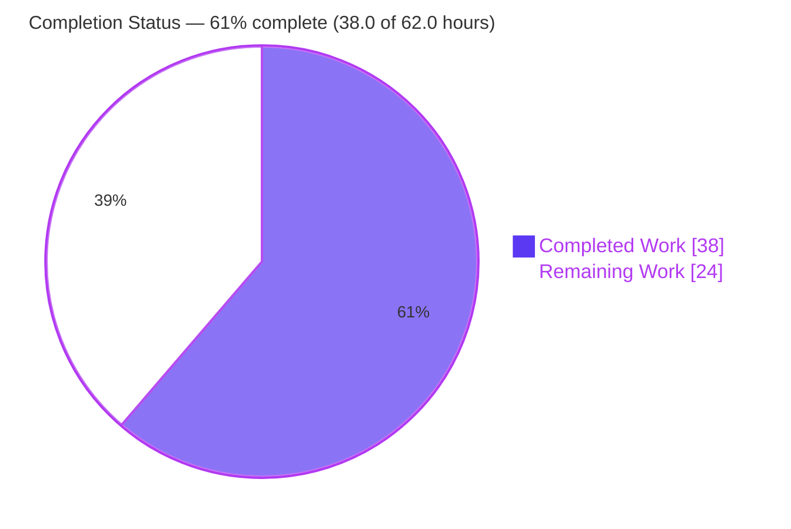

# 1. Executive Summary

## 1.1 Project Overview

The Proactive Insights Demo API is a compact FastAPI fixture: a project and task workflow, bearer-token identities with owner and member roles, and a simulated billing pool granting five units per process. All state is process memory. The defect this release closes is in that pool — the quota comparison and the usage increment formed one read-modify-write on the process-global `USAGE` mapping with nothing protecting it, so parallel callers holding any valid token could each pass the check and overspend (CWE-362). The change makes the pair indivisible under a module-level lock and adds a regression test that reproduces the race deterministically.

## 1.2 Completion Status

38.0 hours are complete out of 62.0 total: **61% complete** (38.0 ÷ 62.0 = 61.3%). Every scoped requirement is delivered and verified: the atomic guard, the preserved contract and boundary, unchanged dependencies and endpoints, and a test red on the unguarded handler and green on the guard. The remaining 24.0 hours are release-readiness work — the two defects left alone deliberately, plus the CI, packaging and documentation a release needs.



| Metric | Value |
|---|---|
| Total Hours | 62.0 |
| Completed Hours (Baseline: Human with agentic-assist) | 38.0 |
| Remaining Hours | 24.0 |
| Completion | 61% (38.0 ÷ 62.0) |

## 1.3 Key Accomplishments

- Quota check and increment made indivisible; a 32-caller burst granted five units and refused twenty-seven.
- Billing contract and the eight other endpoints preserved: 401/422/429 details, the `200 {"used","limit"}` body, the exact-fit boundary.
- Regression test that pins both ends of the race window and fails whenever the guard is weakened.
- Omitted-`units` default covered: a parameter-less `POST /billing/consume` returns `200 {"used":1,"limit":5}`.
- Suite green at 21 nodes (20 passed, 1 expected failure), 100% statement coverage, 90% gate reached.
- No dependency, configuration value or external service added; two files, +118/−3 lines.

## 1.4 Critical Unresolved Issues

0 of the 6 scoped requirements remain open; six items outside that scope are open, so **6 of 12 tracked items are open**.

| Issue | Impact | Owner | ETA |
|---|---|---|---|
| Role grants do not govern authorization: `POST /teams/{user_id}/role` writes `TEAM` (`app/main.py:95`) while authorization reads `USERS` (`app/main.py:29`, `:31`, `:60`, `:91`) | A promoted member keeps member rights; the endpoint answers `200` and changes nothing | API owner | 1 sprint (6.0 h) |
| `POST /projects` and `POST /tasks` allocate ids through a non-atomic read-modify-write (`app/main.py:49-53`, `:65-72`) | Concurrent creates can duplicate or skip ids | API owner | 1 sprint (4.0 h) |
| No CI pipeline, linter or type checker exists anywhere in the repository | Regressions depend on local runs; nothing enforces the coverage gate on a change | Platform owner | 1 sprint (6.0 h) |
| No deployment packaging or readiness wiring for a managed environment | Release needs a hand-built process and manual probes | Platform owner | 1 sprint (6.0 h) |
| Tracked documentation still describes a lock-less quota path, pre-change line numbers and a 19-node suite (`blitzy/documentation/`) | Onboarding and incident response misled about the billing path | Docs owner | 1 week (1.5 h) |
| Five stale `app/main.py:NN` citations in `tests/test_e2e_team_role_journey.py:14-15`, `:52-53`, `:72`, printed as part of the expected-failure reason | Maintainers following the reason string land two lines off | Test owner | Next touch of that file (0.5 h) |

## 1.5 Access Issues

No access issues identified.

## 1.6 Recommended Next Steps

1. [High] Make role grants govern authorization and drop the expected-failure marker (6.0 h).
2. [High] Serialize the two id allocators as the quota path did, plus a test (4.0 h).
3. [Medium] Add lint, type checks and a CI pipeline running the coverage gate (6.0 h).
4. [Medium] Package the service with `/health` and `/ready` as probes (6.0 h).
5. [Low] Refresh the documentation and stale line citations (2.0 h).

# 2. Project Hours Breakdown

## 2.1 Completed Work Detail

| Component | Hours | Description |
|---|---|---|
| Atomic quota check-and-act (`app/main.py:13`, `:104-107`) | 5.0 | `from threading import Lock`, `USAGE_LOCK = Lock()` beside `USAGE`, and a `with USAGE_LOCK:` block around the limit comparison and the increment. Authentication, the `units` guard and `return USAGE` stay outside the guard, so the lock is held for two dictionary reads, one addition, one comparison and one store. |
| Preserved contract, evaluation order and boundary (requirements R2, R3) | 5.0 | Framework validation, then `current_user`, then the `units < 1` guard, then the limit check. `401 Missing bearer token`, `401 Invalid token`, `422 Units must be positive`, `429 Usage limit reached` and `200 {"used","limit"}` verified value for value; `used + units == limit` accepted, only exceeding refused. |
| Concurrency regression harness (`tests/test_billing_concurrency.py`) | 12.0 | 32 callers released from a barrier over three repetitions, with every caller's first read of `used` and first store of `used` parked at a generation-scoped rendezvous, so both ends of the window are pinned. Five assertions cover the invariant, both response counts, the refusal detail and the accounting identity. |
| Red-before-green confirmation of the regression test | 3.0 | The harness reproduces the overrun on the unguarded handler (all 32 callers accepted) and admits exactly one caller on the delivered guard, so R6's two directions are both demonstrated. |
| Concurrency, abandonment and lock-release validation | 6.0 | 40-caller bursts, dual-identity traffic, mixed unit sizes, quota exhaustion and client aborts; no overrun, deadlock, traceback or 5xx, and the lock released on the fall-through, the refusal raise and the abandoned-request path. |
| Dependency, scope-minimality and change-set verification (R4, R5, planned file set) | 3.0 | Six pins unchanged, stdlib import only, two files touched, per-handler statement counts identical and `NEXT_PROJECT`, `NEXT_TASK`, `PROJECTS`, `TASKS`, `TEAM` and `USERS` untouched. |
| Suite integration and coverage gate | 2.0 | 21 nodes green as one package, `app/main.py` 84/84 statements at 100.00%, the `--cov-fail-under=90` gate reached, cross-module state isolation and the strict expected failure preserved. |
| Route and contract regression sweep over the other endpoints | 2.0 | Health, readiness, both project routes, both task routes, the team role route, metrics, docs and openapi.json verified unchanged over live HTTP. |
| **Total** | **38.0** | |

## 2.2 Remaining Work Detail

| Category | Hours | Priority |
|---|---|---|
| Role-grant authorization defect and removal of the strict expected-failure marker | 6.0 | High |
| Atomic id allocation for `NEXT_PROJECT` and `NEXT_TASK`, with regression tests | 4.0 | Medium |
| Static analysis (lint and type checks) and a CI pipeline running the coverage gate | 6.0 | Medium |
| Production packaging with health and readiness probes | 6.0 | Medium |
| Documentation refresh: line citations and suite figures in `blitzy/documentation/` | 1.5 | Medium |
| Stale citation cleanup in `tests/test_e2e_team_role_journey.py` | 0.5 | Low |
| **Total** | **24.0** | |

### Task detail

**H1 — Role grants must govern authorization (6.0 h, High).** Resolve the effective role from `TEAM` in `current_user`, the `list_projects` visibility filter and the `change_role` owner check, or write `USERS` and `TEAM` together so the two cannot disagree, then drop `@pytest.mark.xfail(strict=True)` from `tests/test_e2e_team_role_journey.py:10-17` and let `test_role_grant_governs_later_requests` stand on its own assertions. Done when a member granted the owner role sees both projects on its next request, the suite reports 21 passed and 0 expected failures, and the four other team-role tests are unchanged.

**H2 — Atomic id allocation (4.0 h, Medium).** Hold one module-level lock across the read, the increment and the store in `create_project` (`app/main.py:49-53`) and `create_task` (`:65-72`), and add a regression test that drives concurrent creates of each and asserts every id is distinct. Done when N concurrent creates yield N distinct ids and no other endpoint changes.

**H3 — Static analysis and CI (6.0 h, Medium).** Configure a linter and a type checker over `app/` and `tests/`, and add a pipeline that installs `requirements.txt` and runs the suite with the existing coverage addopts from `pytest.ini`. Done when the pipeline is green on the branch, the 90% gate is enforced on every change, and no runtime behaviour changes.

**H4 — Production packaging (6.0 h, Medium).** Build an image or platform manifest that takes its port from the environment, runs a single worker process — `USAGE` and `USAGE_LOCK` are per process, so a second worker would hold a second five-unit pool — and uses `/health` and `/ready` as its liveness and readiness probes. Done when the artifact builds, both probes pass, and a restart resets the pool exactly as documented.

**H5 — Documentation refresh (1.5 h, Medium).** Replace the pre-change `app/main.py` line citations in `blitzy/documentation/Project Guide - 745e998e-a25d-415e-ab18-5c7f37fbe99a.md` and `blitzy/documentation/Technical Specifications.md` with statement names, update the 19-node and 0.30 s run figures to the current 21-node gate result, and correct the statement that the quota path holds no lock.

**H6 — Citation cleanup (0.5 h, Low).** Replace the five stale line citations at `tests/test_e2e_team_role_journey.py:14-15`, `:52-53` and `:72` — including the reason string printed on every run — with the statement names they refer to.

### How these hours were estimated

Each figure is the effort a human developer working with an agentic assistant would need, measured against the same work already delivered: implementation plus the tests, contract verification and load evidence that justify calling it done. Confidence is high for H1, H2 and H6, whose scope is a known line range with a neighbouring pattern to copy; medium for H3 and H4, whose toolchain choices are open; and high for H5, which is a text update against a known diff.

# 3. Test Results

| Area / Category | Framework | Tests | Passed | Failed | Coverage | What This Proves |
|---|---|---|---|---|---|---|
| Billing quota under concurrency (`tests/test_billing_concurrency.py::test_concurrent_consume_never_exceeds_limit`) | pytest 8.3.5 with the in-process `TestClient` | 1 | 1 | 0 | 100.00% (app) | Across 32 simultaneous callers and three repetitions, the stored total never passes the limit and exactly the affordable units are granted. |
| Billing contract and boundary (`tests/test_e2e_usage_limit_journey.py`, `tests/test_api.py::test_missing_token_is_rejected`, `tests/test_billing_concurrency.py::test_omitted_units_defaults_to_one`) | pytest | 4 | 4 | 0 | 100.00% (app) | `401`, `422`, `429` and `200` details, the exact-fit boundary, the refusal after the limit and the omitted-`units` default all hold. |
| Service and project basics (`tests/test_api.py::test_health_endpoint`, `::test_owner_can_create_and_list_project`) | pytest | 2 | 2 | 0 | 100.00% (app) | Health answers, and an owner can create a project and read it back in its own listing. |
| Project and task journeys (`tests/test_e2e_project_task_journey.py`) | pytest | 6 | 6 | 0 | 100.00% (app) | Task filing, status transitions through the allow list, unknown project and unknown task, and input rejections behave as specified. |
| Team role journeys (`tests/test_e2e_team_role_journey.py`) | pytest | 5 | 4 | 0 (1 expected failure) | 100.00% (app) | Owner and member role paths, the visibility filter and the rejections behave as documented; the role-grant defect is pinned by a strict expected failure rather than hidden. |
| Service operations (`tests/test_e2e_service_ops.py`) | pytest | 3 | 3 | 0 | 100.00% (app) | The readiness payload, the metrics payload and token rejection are unchanged. |

Run as one package with `.venv/bin/python -m pytest -q -rxX` on CPython 3.13.18: **21 tests collected, 20 passed, 1 expected failure, 1 warning in 1.76 s**, `app/main.py` 84 of 84 statements at **100.00%** statement coverage, and `Required test coverage of 90% reached`. The single warning is the pre-existing Starlette `BlockingPortal` deprecation notice from `starlette/testclient.py:37`. Coverage is measured app-wide because `pytest.ini` sets `--cov=app`, so the column carries the same package figure for every row; `pytest tests/test_billing_concurrency.py -q --no-cov` alone gives 2 passed in 1.60 s, the bulk of which is the three rendezvous timeouts the guarded code necessarily incurs.

The concurrency test was also run against a copy of the tree with `USAGE_LOCK` replaced by a no-op context manager: it fails there, with all 32 callers accepted and the accepted-count assertion reporting `32 == (5 - 4)`. The detection therefore runs in both directions — green on the guard, red without it.

## Not Covered

- **The concurrency burst over a real socket.** The regression test drives the in-process `TestClient`; the live 32-caller burst against uvicorn recorded in Section 4 was a manual check, not an automated one. A human should decide whether a socket-level burst belongs in CI.
- **Concurrent id allocation.** No test drives `POST /projects` or `POST /tasks` in parallel, because both allocators are non-atomic and outside this change's scope (Section 1.4, item 2). A regression test belongs with the fix for that item.
- **A role grant changing authorization.** That behaviour is the strict expected failure, so no test asserts it; it becomes assertable when the defect is fixed (Section 1.4, item 1).
- **The values inside `/metrics`.** `requests_total` is fixed at `0` and `uptime_seconds` is a monotonic reading, so only the presence of the payload is asserted; nothing checks the numbers.
- **Comment and expected-failure reason text.** Neither can be executed. The reason string is printed on every run and was read back; the surrounding comments can only be read.
- **Swagger UI rendering.** `/docs` is served and its HTML was requested, but the page's CSS and JavaScript load from a CDN, so its rendering is not asserted anywhere.
- **Multi-process and restart behaviour.** Nothing exercises a second worker process, or the effect of a restart on the pool: `USAGE` and `USAGE_LOCK` are per process, so a second worker would enforce a second five-unit pool.

# 4. Runtime Validation & UI Verification

- ✅ **Start-up** — `.venv/bin/python -m uvicorn app.main:app --host 127.0.0.1 --port 18123` served `/health` as `{"status":"ok"}` and `/ready` as `{"ready":true,"checks":{"storage":"ok"}}`; the process log carried no traceback, error or exception.
- ✅ **Authentication** — `POST /billing/consume` with no header returned `401 {"detail":"Missing bearer token"}`; with `Bearer nope` it returned `401 {"detail":"Invalid token"}`; both seeded identities were then accepted.
- ✅ **Billing pool under a 32-way burst on a fresh process** — exactly **5 × 200 and 27 × 429**, after which the owner token, the member token and `units=6` all received `429 {"detail":"Usage limit reached"}`; the total stayed pinned at the limit.
- ✅ **Billing contract** — omitted `units` → `200 {"used":1,"limit":5}`; `units=3` → `{"used":4,"limit":5}`; exact fit → `{"used":5,"limit":5}`; one past the limit → `429` with the total unchanged.
- ✅ **Validation guard** — `units=0` and `units=-1` → `422 {"detail":"Units must be positive"}`, raised before any acquisition.
- ✅ **Project and task flows** — create project `200 {"id":1,"name":"Member Scope","owner_id":2}`, member listing shows only its own project, create task `200`, `PATCH /tasks/1?status=done` → `"status":"done"`, unsupported status `422`, task on an unknown project `404`.
- ⚠ **Team roles** — an owner grant answers `200 {"user_id":2,"role":"owner"}`, but the member's project listing is unchanged afterwards: the `TEAM` write at `app/main.py:95` is inert because authorization reads `USERS` (Section 1.4, item 1).
- ✅ **Service operations and API description** — `/metrics` `200`, `/docs` `200`, `/openapi.json` `200`; no 5xx and no traceback appeared in any access log for the session.
- ✅ **Control with the guard removed** — with `USAGE_LOCK` replaced by a no-op context manager in a separate copy of the tree, the regression test fails with all 32 callers accepted, so the test does detect the window it exists to detect.
- ❌ **Browser UI** — none exists. `/docs` was requested for its status code only; its Swagger stylesheet and script load from a CDN and were not rendered.

**Never exercised at runtime:** a multi-worker deployment (a second uvicorn worker holds its own `USAGE` and its own lock, so each process would enforce its own five-unit pool); any TLS terminator, reverse proxy or gateway; a sustained soak longer than the bursts above; cross-process or datastore-backed accounting; client retry behaviour after a `429`; and the effect of a role grant on a later request, because that effect does not exist in this code. Each of these is a deployment decision rather than a property of the delivered change.

# 5. Compliance & Quality Review

## 5.1 Compliance Matrix

| Deliverable | Requirement it answers | Status | Progress | Evidence |
|---|---|---|---|---|
| Atomic quota check-and-act | R1 — the stored total can never exceed the limit | ✅ PASS | 100% | `app/main.py:104-107`; 32-caller burst → 5 × 200 / 27 × 429 |
| Preserved observable contract | R2 — order, detail strings, codes and body unchanged | ✅ PASS | 100% | `app/main.py:101-103`, `:106`, `:108`; live probes byte-identical |
| Boundary semantics | R3 — exact fit accepted, only exceeding refused | ✅ PASS | 100% | `app/main.py:105`; `{"used":5,"limit":5}` then `429` |
| Dependency and configuration footprint | R4 — no dependency, value or service added | ✅ PASS | 100% | `requirements.txt` untouched; stdlib `threading` import only |
| Change-set containment | R5 — no other endpoint or shared-state site | ✅ PASS | 100% | Two files in the diff; `NEXT_PROJECT`, `NEXT_TASK`, `TEAM` unchanged |
| Concurrency regression test | R6 — red on the unguarded handler, green on the guard | ✅ PASS | 100% | `tests/test_billing_concurrency.py`; 2 passed on the tree, 4 of 6 assertions fail with the guard removed |
| Planned file transformation | Planned file set, with the reference files untouched | ✅ PASS | 100% | `app/main.py` +6/−3, `tests/test_billing_concurrency.py` +112; five reference files byte-identical |
| Harness construction | In-process client, monkeypatch teardown, no added plugin or fixture | ✅ PASS | 100% | `tests/test_billing_concurrency.py:1-6`, `:78-86` |
| Scope boundaries | In-scope and excluded items as planned | ✅ PASS | 100% | Net change set limited to the two planned files |
| Execution order | Test exercised against the unmodified application before the guard | ⚠ PARTIAL | 60% | Red run produced against unmodified code, but outside the branch's history |
| Path to production | Stateless, revert-only rollback, released change set | ⚠ PARTIAL | 50% | No CI, no static analysis, no packaging (Section 2.2) |
| Recorded run figures | Figures describe this repository | ❌ FAIL | 0% | Six pins not four; 21 nodes not 4; interpreter 3.13.18 — see 5.2, row 2 |

## 5.2 AAP & Rule Divergences and Gaps

No user-specified rules exist for this repository (no environment, variable, secret or attachment was supplied), so the Agent Action Plan is the only agreement, and the eight rows below are every place the delivered repository departs from it. Rows marked *sanctioned* are choices the plan's own scope required; the rest are gaps a human still owns.

| # | What the AAP/Rule Required | What Was Delivered Instead | Why It Diverged | Impact | Remediation |
|---|---|---|---|---|---|
| 1 | One test, with a single rendezvous on each caller's first read of `used` | Two tests and a second rendezvous on each caller's first store (`tests/test_billing_concurrency.py:31`, `:38`, `:57-71`, `:104-113`) | A read-side rendezvous alone is satisfied by a lock that guards only the comparison — still racy, because the `+=` re-reads and writes. Pinning the store makes that wrong fix fail. *(sanctioned: a design decision inside the file the plan creates)* | Stronger detection; two node ids and a ~1.6 s module | None needed |
| 2 | Recorded figures: four pins, `4 passed` in ~0.95 s, a red failure of `assert 36 <= 5`, CPython 3.12.3 | Six pins, 21 nodes (20 passed + 1 expected failure), a red failure on the accepted-count assertion, CPython 3.13.18 | The figures were measured on a reduced tree and a different interpreter before the repository's 19 pre-existing nodes were in view | None on behaviour; a reader checking those numbers against the gate sees different ones, and the repository is authoritative | None needed |
| 3 | Write the test and run it against the unmodified application before applying the guard | The guard commit precedes the test commit; the red run was produced against unmodified code in a separate copy of the tree | Delivery sequencing: the red evidence was captured before the guard landed, but not in the branch's history | The red run is reproducible by reverting the guard, not by reading the history | None needed |
| 4 | Change only the quota path; `NEXT_PROJECT` and `NEXT_TASK` are explicitly excluded | Both allocators left non-atomic (`app/main.py:49-53`, `:65-72`) | The plan scoped the work to the reported finding and barred touching other shared-state sites. *(sanctioned by the plan's scope)* | Concurrent creates can duplicate or skip ids; no over-limit exposure | Task H2, 4.0 h |
| 5 | Hold the change set to `app/main.py` plus the new test module | Five `app/main.py:NN` citations in `tests/test_e2e_team_role_journey.py:14-15`, `:52-53`, `:72` were left stale by the two inserted lines | Updating that third file would have broken the two-file change set the plan requires. *(sanctioned by the plan's scope)* | Maintainability only; the printed reason string points two lines off, with no executable effect | Task H6, 0.5 h |
| 6 | Documentation is outside the planned change set | `blitzy/documentation/Project Guide - 745e998e-a25d-415e-ab18-5c7f37fbe99a.md` and `Technical Specifications.md` still cite pre-change line numbers, a 19-node run and a lock-less quota path | The plan kept the change set to code and tests, so no documentation was touched | Onboarding and incident response misled about the path that changed | Task H5, 1.5 h |
| 7 | Run the linter in check mode as part of validation | No linter, formatter, type checker or CI job exists anywhere in the repository; static verification was `compileall` and `py_compile` | There is nothing to configure or run, and adding one would change the repository's dependency and tooling footprint the plan froze. *(Rule departed from because the rule cannot be met as written)* | No automated static analysis or type checking at all | Task H3, 6.0 h |
| 8 | `TEAM` semantics are excluded from this change | The role-grant write at `app/main.py:95` still has no effect: `current_user` reads `USERS` (`:29`, `:31`), the visibility filter reads the user record (`:60`), the owner check reads it (`:91`), and `TEAM` is read only for membership (`:93`) | A pre-existing defect, explicitly outside the plan's scope and pinned by a strict expected failure at `tests/test_e2e_team_role_journey.py:10-17`. *(sanctioned by the plan's scope)* | High: a promoted member keeps member rights, so the role endpoint answers `200` and changes nothing | Task H1, 6.0 h |

### Role grants do not govern authorization

`POST /teams/{user_id}/role` writes `TEAM[user_id] = role` at `app/main.py:95`, but every authorization decision reads the `USERS` record instead: `current_user` resolves the token to `USERS` (`:29`, `:31`), the `list_projects` filter compares `user["role"]` from that record (`:60`), and `change_role`'s owner check does the same (`:91`). The only read of `TEAM` is the membership test at `:93`. Against a live process, an owner granting `role=owner` to user 2 returned `200 {"user_id":2,"role":"owner"}`, and the member's next `GET /projects` still returned only its own project. The behaviour is pinned by a strict expected failure, `tests/test_e2e_team_role_journey.py::test_role_grant_governs_later_requests`, which reports XFAIL on every run and would report a failure if the marker's expectation were met. The decision a human must take is whether the effective role should live in `TEAM` (read it wherever authorization happens) or in `USERS` (write both on a grant); either way the marker comes off only when the test passes on its own assertions.

### Concurrent creates can collide on an id

`create_project` and `create_task` each read a module-level counter, build a record, store it and increment, with nothing excluding a second thread between the read and the write (`app/main.py:49-53`, `:65-72`). Two simultaneous `POST /projects` calls can therefore allocate the same id, and the second overwrites the first record in `PROJECTS`; the same shape applies to `TASKS`. This is the identical defect class the billing pool carried, and it was left in place because the plan explicitly excluded these two sites and the finding named only the quota path. The pattern needed is already in the repository: the `USAGE_LOCK` block at `:104-107` shows the shape, and a fairness-free non-reentrant lock is sufficient. A human should decide whether to commission it now or accept duplicate ids as fixture behaviour; nothing in the endpoint's contract or tests depends on which caller wins.

### No static analysis and no CI

The repository configures no linter, formatter, type checker or pipeline: `pytest.ini` carries only the coverage addopts, `requirements.txt` carries the six runtime and test pins, and there is no workflow file anywhere. Every quality statement in this project therefore rests on `compileall`/`py_compile` plus the test suite and the coverage gate, and a change can reach a branch with no automated review beyond that. The gap matters here because the delivered guard is the kind of code where a future edit inside `with USAGE_LOCK:` — a log call, an I/O call, a second lock — silently converts a microseconds-long hold into a contention or deadlock risk that no test in this suite would catch. A linter and a type check would not catch that either, but a CI job running the concurrency test and the 90% gate on every change would.

### Documentation describes the pre-change service

The two tracked documents under `blitzy/documentation/` still describe the billing path as it was before the guard: they cite `app/main.py` line numbers that the two inserted lines shifted by two, quote a 19-node suite that now collects 21, and state that the quota comparison and increment are unprotected. Anyone onboarding onto this service, or reading the documentation during an incident on the billing pool, would be told the opposite of what the code now does. The change set deliberately stopped at code and tests, so the correction is a separate, purely textual task (H5, 1.5 h); it blocks a release only in the sense that a shipped release should not carry documentation contradicted by its own source.

# 6. Risk Assessment

| Risk | Category | Severity | Probability | Mitigation | Status |
|---|---|---|---|---|---|
| A role grant changes nothing: authorization reads `USERS` while the grant writes `TEAM`, so a promoted member keeps member rights | Security | High | High — deterministic, reproduced live | Reconcile the two sources of truth and let the strict expected failure become a passing test (H1) | Open |
| Concurrent `POST /projects` or `POST /tasks` allocate the same id and overwrite a record | Technical | Medium | Medium — needs simultaneous creates | Guard both allocators with the pattern used on the quota path (H2) | Open |
| With no CI, lint or type gate, a future edit inside `with USAGE_LOCK:` could widen the hold or reintroduce a race with nothing to catch it | Operational | Medium | High — nothing prevents it | Run the concurrency test and the 90% coverage gate on every change; add lint and type checks (H3) | Open |
| The tracked documentation states the billing path holds no lock and cites shifted line numbers | Operational | Medium | High — the text is already wrong | Refresh the citations and run figures (H5) | Open |
| The quota counter and its lock are per process: a second uvicorn worker would enforce a second five-unit pool, and a restart resets the count | Operational | Medium | Certain if run multi-worker | Run a single worker, and document it; move the counter to a datastore if the pool must be shared (H4) | Accepted — fixture scope |
| Seeded bearer tokens are static, never expire, and resolve to a fixed identity map | Security | High | Certain for any non-demo use | Keep the service out of production as `README.md` states; replace the token layer before real use | Accepted — fixture scope |
| `GET /projects` scans an unbounded in-memory map and returns every visible record with no pagination | Performance | Low | Certain as the map grows | Add pagination if the data set can outgrow a fixture | Accepted — fixture scope |
| A sustained billing burst queues on the shared 40-token threadpool, adding sub-millisecond latency to the other `def` routes | Performance | Low | Low | Keep the guarded region free of I/O so the hold stays at microseconds; watch billing latency under load | Accepted |

# 7. Visual Project Status


| Status | Hours | Share |
|---|---|---|
| Completed work (38.0 h) | 38.0 | 61% |
| Remaining work (24.0 h) | 24.0 | 39% |
| **Total** | **62.0** | **100%** |

| Remaining category | Hours | Priority |
|---|---|---|
| Role-grant authorization defect and marker removal | 6.0 | High |
| Atomic id allocation with regression tests | 4.0 | Medium |
| Static analysis and CI pipeline | 6.0 | Medium |
| Production packaging with probes | 6.0 | Medium |
| Documentation refresh | 1.5 | Medium |
| Stale citation cleanup | 0.5 | Low |
| **Total** | **24.0** | |

# 8. Summary & Recommendations

The billing pool's read-modify-write is now indivisible. `consume_usage` acquires a module-level `threading.Lock` before comparing `USAGE["used"] + units` against `USAGE["limit"]` and releases it only after the increment, with authentication, the `units` guard and the response untouched outside the guard. Everything the endpoint promised before it still promises: `401` for a missing or unknown token, `422` for non-positive units, `429` with its detail string above the limit, `200 {"used","limit"}` on success, and an exact-fit request accepted rather than refused. Against a live process, 32 simultaneous callers on a fresh pool produced exactly five acceptances and twenty-seven refusals, and the total never moved past five.

The verification behind that claim is a regression test that forces the interleaving rather than waiting for it: 32 callers park at a rendezvous on their first read of `used` and again on their first store, over three repetitions, and five assertions cover the invariant, both response counts, the refusal detail and the accounting identity. On the delivered guard the test passes; with the guard replaced by a no-op it fails with all 32 callers accepted, so it detects the defect it was written for rather than merely passing alongside it. The whole package runs as 21 nodes — 20 passed and one strict expected failure — with 100% statement coverage of `app/main.py` and the repository's 90% gate reached.

**AAP-scoped completion stands at 61%**: 38.0 hours of delivered and verified work against a 62.0-hour scope, of which 24.0 hours remain. All six scoped requirements are met; what is left is release-readiness rather than repair. Two defects of the same family are still live — the role-grant endpoint that changes nothing (6.0 h) and the two non-atomic id allocators (4.0 h) — and the repository has no CI, no static analysis and no deployment packaging, which together account for the other 14.0 hours with the documentation and citation updates.

The critical path to production is therefore: reconcile role authorization and re-enable its test, guard the two allocators, then put the suite behind a pipeline so those fixes cannot regress. Success for the next iteration is measurable: 21 passed and no expected failures, concurrent creates yielding distinct ids, the coverage gate enforced on every push, `/health` and `/ready` wired as probes in a single-worker deployment, and documentation whose citations match the source.

Production readiness overall: the delivered change is ready to ship and is safe to revert if it must be, since it touches no persisted data, needs no migration and holds no configuration. The service as a whole is not yet production-ready, for reasons that predate this change and are unchanged by it: an authorization endpoint that does not authorize, two id allocators that can collide, static demo credentials, and no pipeline to keep the coverage gate honest. Treat the billing guard as done and the surrounding release engineering as the work that remains.

# 9. Development Guide

## 9.1 System prerequisites

- **Python 3.13.** The service and its suite are exercised on CPython 3.13.18; `app/main.py` needs 3.10 or newer for its PEP 604 annotations, but 3.13 is the tested interpreter.
- **No database, broker, cache, container or external service.** All state lives in process memory, so a checkout plus a virtual environment is the entire environment.
- **`curl`** for the manual probes below. `lsof`, `ss`, `netstat` and `fuser` are not present on this host, so reachability is verified with `curl` rather than by inspecting sockets.
- **Shell:** `bash`; every command runs from the repository root, which is also where `pytest.ini` sets `pythonpath = .`.

## 9.2 Environment setup and dependency installation

`.venv/` is not committed. Create it from the system interpreter and install the six pins — this takes a few seconds:

```bash
/usr/bin/python3.13 -m venv .venv
.venv/bin/python -m pip install -r requirements.txt
```

Expected result: `fastapi 0.115.12`, `uvicorn 0.34.0`, `pytest 8.3.5`, `httpx 0.28.1`, `pytest-cov 7.1.0`, `coverage 7.17.3`. Confirm them with:

```bash
.venv/bin/python -V
.venv/bin/python -m pip show fastapi uvicorn pytest httpx pytest-cov coverage | grep -E '^(Name|Version)'
```

Never install into the system interpreter: its `pip` writes to a host-global package directory. Always use `.venv/bin/python -m pip`.

## 9.3 Validation commands

Per-change command, with the coverage gate disabled because the gate is a whole-suite measure:

```bash
.venv/bin/python -m pytest tests/<module>.py -q --no-cov
```

A single test:

```bash
.venv/bin/python -m pytest "tests/test_billing_concurrency.py::test_omitted_units_defaults_to_one" -q --no-cov
```

The whole-package gate, which carries `--cov=app --cov-report=term-missing --cov-fail-under=90 --cov-precision=2` from `pytest.ini`:

```bash
.venv/bin/python -m pytest -q -rxX
```

Observed on the current tree: `20 passed, 1 xfailed, 1 warning in 1.76s`, `app/main.py` 84 of 84 statements at `100.00%`, `Required test coverage of 90% reached`. Static sanity check without running anything:

```bash
.venv/bin/python -m compileall -q app tests
```

Two conventions to keep intact. `tests/test_e2e_team_role_journey.py::test_role_grant_governs_later_requests` carries `@pytest.mark.xfail(strict=True)`; it must report **xfailed**, and an xpass means the role-grant defect was fixed and the marker should be removed. `tests/conftest.py`'s autouse fixture is the isolation mechanism — it rebinds the id counters and clears and reseeds `PROJECTS`, `TASKS`, `TEAM` and `USAGE["used"]` in place — so reuse it rather than building a fresh app per test.

## 9.4 Running the application

Pick a port that is not already in use and keep one server running at a time:

```bash
.venv/bin/python -m uvicorn app.main:app --host 127.0.0.1 --port 8000
```

`README.md` documents `uvicorn app.main:app --reload` for interactive work. The seeded credentials are `owner-token` (user 1, owner) and `member-token` (user 2, member).

## 9.5 Verification probes

```bash
curl -s http://127.0.0.1:8000/health          # {"status":"ok"}
curl -s http://127.0.0.1:8000/ready           # {"ready":true,"checks":{"storage":"ok"}}
curl -s -H 'Authorization: Bearer owner-token' http://127.0.0.1:8000/projects
curl -s -o /dev/null -w '%{http_code}\n' http://127.0.0.1:8000/docs        # 200
```

Billing contract, in this order on a freshly started process:

```bash
P=http://127.0.0.1:8000
curl -s -w ' [%{http_code}]\n' -X POST $P/billing/consume            # {"used":1,"limit":5} [200]
curl -s -w ' [%{http_code}]\n' -X POST "$P/billing/consume?units=3"  # {"used":4,"limit":5} [200]
curl -s -w ' [%{http_code}]\n' -X POST "$P/billing/consume?units=1"  # {"used":5,"limit":5} [200]
curl -s -w ' [%{http_code}]\n' -X POST "$P/billing/consume?units=1"  # {"detail":"Usage limit reached"} [429]
curl -s -w ' [%{http_code}]\n' -X POST "$P/billing/consume?units=0"  # {"detail":"Units must be positive"} [422]
curl -s -w ' [%{http_code}]\n' -X POST $P/billing/consume            # {"detail":"Missing bearer token"} [401]
```

A concurrency spot check — 32 simultaneous single-unit calls on a fresh process must yield exactly five `200`s and twenty-seven `429`s:

```bash
seq 32 | xargs -P32 -I{} sh -c 'curl -s -o /dev/null -w "%{http_code}\n" -X POST \
  -H "Authorization: Bearer owner-token" "http://127.0.0.1:8000/billing/consume?units=1"' \
  | sort | uniq -c
```

Each client prints one short line here, which sorts reliably. If you print more per call — a timestamp, a body, a duration — write each client's result to its own file instead: interleaved writes from 32 clients corrupt shared rows.

## 9.6 Troubleshooting

| Symptom | Cause and fix |
|---|---|
| `error: externally-managed-environment` from `pip` | You used the system interpreter's `pip`. Use `.venv/bin/python -m pip`. |
| `FAIL Required test coverage of 90% not reached` on a single-test or collect-only run | Expected: the gate is a whole-suite measure. Add `--no-cov`, or run the whole suite. |
| `ModuleNotFoundError: app` | `pytest` was run outside the repository root. `pytest.ini` sets `pythonpath = .`, so run it from the root. |
| `[Errno 98] address already in use` | Another process holds the port. Choose a different `--port` and keep one server running at a time. |
| The suite prints `1 xpassed` instead of `1 xfailed` | The role-grant defect was fixed. Remove the `xfail` marker and let the test assert its own behaviour. |
| Unstyled or blank `/docs` | The page's Swagger CSS and JavaScript come from a CDN. The API itself does not depend on them. |
| A concurrent burst shows more than five `200`s | You are hitting a process that is not the one you restarted, or running more than one worker: `USAGE` and `USAGE_LOCK` are per process. |

## 9.7 Repository conventions

- `pytest.ini` is the only test configuration: `testpaths = tests`, `python_files = test_*.py`, `pythonpath = .`, and the coverage addopts. Never lower or bypass the gate.
- Every handler is a plain `def`, so FastAPI runs it in a worker thread; that is why the quota path needs a thread lock rather than an `asyncio` primitive.
- `README.md` states the service is a synthetic fixture: in-memory storage, demo tokens and deliberately incomplete coverage. Do not deploy it as it stands.

# 10. Appendices

## A. Command Reference

| Purpose | Command |
|---|---|
| Create the virtual environment | `/usr/bin/python3.13 -m venv .venv` |
| Install the pins | `.venv/bin/python -m pip install -r requirements.txt` |
| List installed pins | `.venv/bin/python -m pip show fastapi uvicorn pytest httpx pytest-cov coverage` |
| Run one module, gate disabled | `.venv/bin/python -m pytest tests/test_billing_concurrency.py -q --no-cov` |
| Run one test | `.venv/bin/python -m pytest "tests/test_billing_concurrency.py::test_omitted_units_defaults_to_one" -q --no-cov` |
| Run the whole-package gate | `.venv/bin/python -m pytest -q -rxX` |
| Collect without running | `.venv/bin/python -m pytest --collect-only -q --no-cov` |
| Static compile check | `.venv/bin/python -m compileall -q app tests` |
| Start the service | `.venv/bin/python -m uvicorn app.main:app --host 127.0.0.1 --port 8000` |
| Probe health and readiness | `curl -s http://127.0.0.1:8000/health` and `curl -s http://127.0.0.1:8000/ready` |
| Show the change set | `git diff --stat origin/2011_01...HEAD` |

## B. Port Reference

| Port | Use |
|---|---|
| 8000 | Documented default in `README.md` and the uvicorn command above |
| 18123, 18124, 18125 | Ports used for the live validation recorded in Section 4; all three were released afterwards |
| 18000 + *n* | Convenient convention for a per-checkout port when several clones share one host |

`app/main.py` binds exactly one HTTP port. Verify reachability with `curl`; `lsof`, `ss`, `netstat` and `fuser` do not exist on this host.

## C. Key File Locations

| Path | Role |
|---|---|
| `app/main.py` | The whole service: routes, in-memory state, `USAGE_LOCK` at line 13 and the guarded region at lines 104-107 |
| `app/__init__.py` | Package marker, empty |
| `tests/conftest.py` | Autouse fixture that rebinds the id counters and reseeds the in-memory stores between tests |
| `tests/test_billing_concurrency.py` | The concurrency regression test and the omitted-units default test |
| `tests/test_e2e_team_role_journey.py` | Role journeys, including the strict expected failure for the role-grant defect |
| `tests/test_e2e_usage_limit_journey.py` | Quota enforcement and non-positive units |
| `tests/test_e2e_project_task_journey.py` | Project and task journeys |
| `tests/test_e2e_service_ops.py` | Readiness, metrics and token rejection |
| `tests/test_api.py` | Baseline health, project and token tests |
| `pytest.ini` | Test paths and the coverage gate |
| `requirements.txt` | The six exact pins |
| `README.md` | How the fixture is meant to be run, and the do-not-deploy notice |

## D. Technology Versions

| Component | Version |
|---|---|
| CPython | 3.13.18 |
| fastapi | 0.115.12 |
| uvicorn | 0.34.0 |
| pytest | 8.3.5 |
| httpx | 0.28.1 |
| pytest-cov | 7.1.0 |
| coverage | 7.17.3 |
| Starlette (via fastapi) | 0.46.2 |

## E. Environment Variable Reference

No environment variable, secret or configuration value is required to build, test or run this service.

| Variable | Meaning |
|---|---|
| `PYTHONPATH` | Set to `.` by `pytest.ini` for test runs; not needed elsewhere |
| `COVERAGE_FILE` | Optional; relocates the `.coverage` data file if you want build artefacts outside the tree |
| `PYTHONPYCACHEPREFIX` | Optional; keeps `__pycache__` out of the tree during static checks |

## F. Developer Tools Guide

- **pytest.** `-q` for the documented quiet output, `-rxX` to print the reasons for expected failures and skips, `--no-cov` to bypass the coverage gate on a partial run, `--durations=3` to see which tests dominate the runtime.
- **uvicorn.** `--host 127.0.0.1` keeps the service off every interface except loopback; `--reload` is convenient while editing; a single worker process is required for the quota pool to mean anything.
- **curl.** Use `-w '%{http_code}'` for the status, `-o /dev/null` to discard the body, and one output stream per concurrent client when driving a burst.
- **git.** The checkout's hooks (`pre-push`, `post-checkout`, `post-commit`, `post-merge`) are git-lfs shims; commit with the identity already configured in the checkout.

## G. Glossary

| Term | Meaning |
|---|---|
| CWE-362 | Concurrent execution using shared resources with improper synchronisation — the class this change closes |
| Read-modify-write | A sequence that reads a value, computes a new one and stores it; without exclusion two threads can both read the old value |
| Check-then-act | A read-modify-write whose decision depends on the value read, so a stale read lets both callers proceed |
| Critical section | The statements that must execute as one indivisible unit; here the comparison at `app/main.py:105` and the increment at `:107` |
| Rendezvous / barrier | A synchronisation point every participating thread must reach before any continues, used by the regression test to force the interleaving |
| Strict expected failure | `@pytest.mark.xfail(strict=True)`: the test must fail; if it ever passes, pytest reports a failure |
| Coverage gate | `--cov-fail-under=90` from `pytest.ini`: the suite fails if statement coverage of `app/` drops below 90% |
| Exact-fit boundary | A request where `used + units == limit`; it is accepted, and only a request that would exceed the limit is refused |
| Threadpool dispatch | FastAPI runs a plain `def` handler in a worker thread, so two requests can execute the handler body simultaneously |
