# Technical Specification

# 1. Introduction

## 1.1 Executive Summary

The **Proactive Insights Demo API** is a compact FastAPI service that exists to be analyzed. Its README describes it as "a compact FastAPI service designed as a test fixture for repository-level proactive insights" and states plainly that it is "a synthetic QA fixture, not a production application" whose "in-memory storage, demo tokens, and intentionally incomplete test coverage are for scanner evaluation only" (`README.md`, lines 3 and 31). The entire product is one 110-line module, `app/main.py`, backed by a 26-line pytest suite in `tests/test_api.py`, a pinned dependency manifest in `requirements.txt`, and pytest discovery configuration in `pytest.ini`.

**Project overview at a glance**

| Attribute | Observed value |
| --- | --- |
| Product name and version | "Proactive Insights Demo API", version `1.0.0` (`app/main.py`, line 5) |
| Runtime and framework | Python 3.12 target environment with FastAPI `0.115.12`, served by Uvicorn `0.34.0` (`requirements.txt`) |
| Entry point | ASGI application object `app` in `app/main.py`, run as `uvicorn app.main:app --reload` (`README.md`, line 16) |
| HTTP surface | 9 routes: `GET /health`, `GET /ready`, `POST /projects`, `GET /projects`, `POST /tasks`, `PATCH /tasks/{task_id}`, `POST /teams/{user_id}/role`, `POST /billing/consume`, `GET /metrics` (`app/main.py`, lines 35-110) |
| State model | Five module-level dictionaries (`USERS`, `PROJECTS`, `TASKS`, `TEAM`, `USAGE`) and two integer counters; nothing is persisted (`app/main.py`, lines 7-13) |
| Identity model | Two hard-coded bearer tokens mapped to a seeded owner and member principal (`app/main.py`, line 7) |
| Test suite | 3 tests in `tests/test_api.py`; observed result `3 passed` when the pinned requirements are installed |
| External dependencies | None at runtime beyond FastAPI and Pydantic; no database, service, queue, or outbound call exists in the source |
| Delivery packaging | No Dockerfile, CI workflow, migration set, or infrastructure definition is present in the repository |

**Core business problem.** The problem this repository addresses is the *verifiability* of automated repository analysis, not a business domain such as project management. To evaluate a scanner that is supposed to surface "proactive insights" about a codebase, the evaluator needs a subject whose findings are already known and cheap to confirm. This fixture supplies exactly that: authentication that is obviously hand-rolled (`current_user` performs a plain dictionary lookup with no signature verification, expiry, or constant-time comparison, `app/main.py` lines 25-32); role checks that are obviously incomplete in test coverage (the owner-only branch at lines 89-90 has no test); an obviously stubbed telemetry contract (`GET /metrics` returns a hard-coded `requests_total` of `0` and an `uptime_seconds` value derived from `time.monotonic()`, lines 108-110); and an obviously simulated commercial constraint (`USAGE = {"used": 0, "limit": 5}`, line 11). Each of those is a defect a scanner should report and a reviewer can confirm in seconds, which makes the repository a calibration instrument for insight quality rather than a product for end users.

**Key stakeholders and users**

| Stakeholder | Relationship to the system | What they depend on |
| --- | --- | --- |
| Platform and QA engineers evaluating repository analysis | Run the analysis tooling against this repository and grade the insights it produces | A small, fully readable codebase whose true findings are enumerable by hand; the README even prescribes the scan setup ("Scan the repository root", "Select the `main` branch", "Do not configure an environment", `README.md` lines 25-28) |
| Test and fixture maintainers | Extend or vary the fixture so that different defect classes are represented | Deterministic in-memory seed data, module-level stores the tests can reset (`tests/test_api.py`, lines 8-11), and a single file to edit |
| API developers learning or referencing the pattern | Exercise the endpoints interactively or in tests | The auto-generated OpenAPI UI at `http://127.0.0.1:8000/docs` (`README.md`, line 18) and the seeded `owner-token` / `member-token` credentials (`app/main.py`, line 7) |
| Reviewers and auditors of generated insight reports | Confirm each claimed finding against the code | File-and-line traceability across just two source files |

The *system's own end users* are correspondingly narrow: the only principals that can authenticate are the two seeded identities — `owner-token` resolving to user id `1` with role `owner`, and `member-token` resolving to user id `2` with role `member` (`app/main.py`, line 7). No registration, login, or token-issuance route exists, so the user population is fixed at design time.

**Expected business impact and value proposition.** The value lies in low-cost, high-signal evaluation:

- **Cheap to run.** No external database or service is required and all data is held in memory (`README.md`, line 9); the README instructs evaluators not to configure an environment at all (`README.md`, line 28).
- **Fast to establish a baseline.** Installing the four pinned packages and running the suite from the repository root yields `3 passed` in well under a second, giving an unambiguous "the subject works" starting point before any insight is judged.
- **Readable end to end.** 110 lines of application code plus 26 lines of tests mean a reviewer can hold the whole system in mind, so a scanner's claim can be classed as true, false, or unverifiable without deep archaeology.
- **Deliberately uneven quality.** Role-based visibility, status transitions, metered billing, and identity handling each sit at a different maturity level, which lets an evaluation measure whether analysis distinguishes a real control from an absent one.
- **Explicitly not a revenue-bearing deployment.** The README closes with "Do not deploy it or use real credentials" (`README.md`, line 31), so the impact to be measured is analysis quality, never production traffic.


## 1.2 System Overview

The system is a single-process FastAPI application whose behaviour is fully determined by two files: the application module `app/main.py` and its pytest suite `tests/test_api.py`. Everything below describes the implementation as observed, at the altitude needed to place the detailed sections that follow.

### 1.2.1 Project Context

**Business context and market positioning.** The domain vocabulary of the API — projects, tasks, team membership, metered usage — mimics a multi-tenant project-tracking SaaS, but the repository explicitly is not that product. `README.md` positions it as "a test fixture for repository-level proactive insights" (line 3) and repeats the disclaimers that it is "a synthetic QA fixture, not a production application" with "in-memory storage, demo tokens, and intentionally incomplete test coverage … for scanner evaluation only" (line 31). Its market position is therefore internal tooling: it is a calibration subject for a code-analysis capability, sized so that the ground truth can be enumerated by a human reviewer in a single sitting.

**Current system limitations.** No prior or legacy system is being replaced; the git history holds three commits (initial commit, "Add proactive insights testing project", "Resolve README merge conflict") and the application has existed in its present single-module form. The relevant limitations are those of the current implementation, each of which the fixture exposes on purpose:

| Limitation | Evidence | Operational consequence |
| --- | --- | --- |
| No persistence | `PROJECTS`, `TASKS`, `TEAM`, `USAGE` are module-level dictionaries (`app/main.py`, lines 8-11); no database, ORM, or file I/O exists in the repository | All records vanish on process restart; replicas would not share state |
| Hand-rolled, static identity | Two literal tokens in `USERS` (`app/main.py`, line 7); `current_user` does a dictionary lookup with no signature check, expiry, or constant-time comparison (lines 25-32) | No credential rotation, issuance, revocation, or audit path |
| Auth is not a declared security scheme | Handlers call `current_user(...)` directly; no `Depends`, `Security`, or middleware appears anywhere in `app/` | The generated OpenAPI document advertises no bearer security scheme, so clients and scanners cannot discover the requirement from the spec |
| Incomplete read surface | Tasks can be created and patched but never listed — no `GET /tasks` route exists among the 9 routes at `app/main.py` lines 35-110 | Created tasks are observable only through their create/update responses |
| Stubbed telemetry | `GET /metrics` returns `{"requests_total": 0, ...}` with `uptime_seconds` computed from `time.monotonic()` (`app/main.py`, lines 108-110) | The endpoint is a constant plus a process-relative clock reading, not a measurement of traffic or service age |
| Deliberately thin tests | 3 tests cover only `/health`, project creation, project listing, and a missing-token 401 (`tests/test_api.py`, lines 14-26) | Six of nine routes, the member-versus-owner visibility filter, and the owner-only 403 branch are unverified |

**Integration with the existing enterprise landscape.** There is none to describe at the integration layer, and the absence is itself a design property: a source search of `app/` and `tests/` for database drivers, ORM, HTTP clients, message brokers, environment-variable access, and logging frameworks returns no matches. The application makes no outbound calls, reads no configuration besides its own literals, and writes nowhere. Its only contracts with the outside world are:

| Contract | Shape | Consumed by |
| --- | --- | --- |
| HTTP/JSON API | 9 routes under `/`, request bodies validated by two Pydantic models (`ProjectIn`, `TaskIn`) | Interactive users via `/docs`; Uvicorn-served clients |
| Bearer header convention | `Authorization: Bearer <token>` with a case-sensitive `"Bearer "` prefix (`app/main.py`, lines 26-28) | The six token-guarded routes |
| In-process test contract | `fastapi.testclient.TestClient` over `httpx==0.28.1`, with direct import of `PROJECTS`, `TASKS`, `USAGE` for state reset (`tests/test_api.py`, lines 1-11) | The pytest suite |

Because nothing external is configured, the README's instruction to evaluators — "Do not configure an environment; this fixture is self-contained" (`README.md`, line 28) — matches the code.

### 1.2.2 High-Level Description

**Primary system capabilities.** The nine routes group into five capability clusters, three of which are deliberately unauthenticated so that liveness and metric probes work without credentials:

| Capability | Routes | Guarded by `current_user` |
| --- | --- | --- |
| Liveness and readiness probes | `GET /health`, `GET /ready` | No |
| Project lifecycle | `POST /projects`, `GET /projects` (member sees own projects, owner sees all) | Yes |
| Task lifecycle | `POST /tasks` (project must exist), `PATCH /tasks/{task_id}?status=` (`open`, `in_progress`, `done`) | Yes |
| Team role administration | `POST /teams/{user_id}/role?role=` (owner only; `owner`/`member`) | Yes |
| Metered usage and metrics | `POST /billing/consume?units=` (hard limit 5), `GET /metrics` | Consume: yes; metrics: no |

Validation is delegated to Pydantic v2 models — `ProjectIn.name` is 2–80 characters and `TaskIn.title` is 2–120 characters with an integer `project_id` (`app/main.py`, lines 16-22) — so malformed bodies are rejected with HTTP 422 by FastAPI before any handler body runs. Business-rule failures raise explicit `HTTPException`s: 401 for a missing or unknown token, 403 for a non-owner attempting a role change, 404 for an unknown project, task, user, or role value, 422 for an unsupported status or non-positive usage units, and 429 when consumption would exceed the limit (`app/main.py`, lines 27, 31, 66, 79, 81, 90, 92, 101, 103).

**Major system components**

| Component | Location | Responsibility |
| --- | --- | --- |
| Application object | `app/main.py`, line 5 | `FastAPI(title="Proactive Insights Demo API", version="1.0.0")`, the ASGI entry point and OpenAPI source |
| Request models | `app/main.py`, lines 16-22 | `ProjectIn`, `TaskIn` — declarative field constraints only |
| Auth helper | `app/main.py`, lines 25-32 | `current_user`: prefix check, token lookup in `USERS`, 401 on failure |
| Route handlers | `app/main.py`, lines 35-110 | Nine synchronous functions, one per route, each owning its own validation and state mutation |
| In-memory state | `app/main.py`, lines 7-13 | `USERS`, `PROJECTS`, `TASKS`, `TEAM`, `USAGE`, plus the `NEXT_PROJECT` / `NEXT_TASK` counters rebound via `global` |
| Package marker | `app/__init__.py` | 0 bytes; makes `app` importable, nothing else |
| Test suite | `tests/test_api.py` | In-process integration tests with a `setup_function` state reset |
| Toolchain manifests | `requirements.txt`, `pytest.ini` | Pinned runtime/test dependencies; `testpaths = tests`, `python_files = test_*.py` |

**Core technical approach.** The module is intentionally plain: synchronous `def` handlers throughout, no dependency-injection graph, no middleware, no async I/O, and no abstraction layer between HTTP and the dictionaries. Identifiers are issued by module-level counters incremented under `global` (`app/main.py`, lines 47-51, 63-70), which makes the sequence of ids deterministic within a process. State ownership is positional rather than structural: project visibility is decided inline by comparing `owner_id` to the caller's id and short-circuiting for the `owner` role (line 58), and task project existence is a membership test against `PROJECTS` (line 65). Testing drives the real application through the framework's HTTP boundary rather than calling handlers directly, so the tests pin the status codes and JSON shapes clients see.

The runtime topology is correspondingly flat — one Uvicorn worker process hosting one application object, with all state living inside that process:

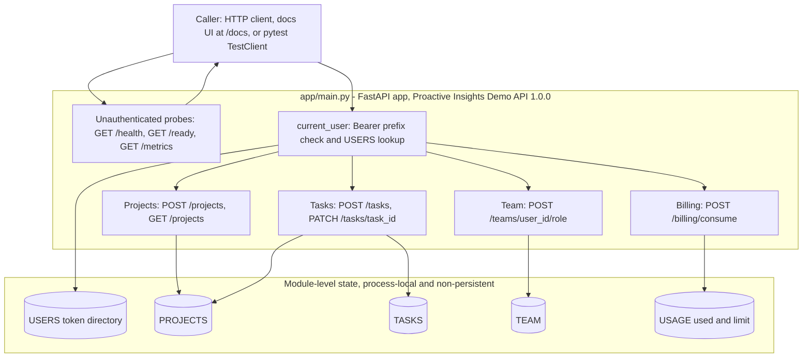

### 1.2.3 Success Criteria

**Measurable objectives.** The repository declares no service-level objectives, latency budgets, or adoption targets, and nothing in the source implies them; inventing them would misrepresent the project. What can be measured is whether the fixture behaves as designed, and each of those measurements is observable from the two source files and an installed environment:

| Objective | Measurement | Observed evidence | State today |
| --- | --- | --- | --- |
| Dependency set installs cleanly from pinned versions | `pip install -r requirements.txt` resolves `fastapi==0.115.12`, `uvicorn==0.34.0`, `pytest==8.3.5`, `httpx==0.28.1` | Install into an isolated target completed and the app imported | Met |
| Regression suite passes | `python -m pytest` from the repository root | `3 passed, 1 warning` in 0.14 s | Met |
| Service starts and reports liveness | `GET /health` returns exactly `{"status": "ok"}` (`app/main.py`, lines 35-37) | Asserted by `test_health_endpoint` (`tests/test_api.py`, lines 14-15) | Met |
| Readiness is advertised | `GET /ready` returns `{"ready": true, "checks": {"storage": "ok"}}` (lines 40-42) | No test exercises this route | Met by code, unverified by tests |
| Interactive documentation is available | `/docs` served by FastAPI from the application object (README line 18) | Auto-generated from the 9 decorated routes | Met |
| Every capability is covered by a test | Route coverage of the 9 routes | 3 of 9 routes asserted; `/ready`, `POST /tasks`, `PATCH /tasks/{task_id}`, `POST /teams/{user_id}/role`, `POST /billing/consume`, `GET /metrics` are untested | Not met, by design |
| State resets between tests | `setup_function` clears `PROJECTS` and `TASKS` and zeroes `USAGE["used"]` (`tests/test_api.py`, lines 8-11) | Present, but `NEXT_PROJECT`, `NEXT_TASK`, and `USAGE["limit"]` are not reset | Partially met |

**Critical success factors.** The fixture only works if (a) it stays self-contained, so an evaluator never has to stand up a database or a peer service; (b) its seeded identities and roles stay obvious, so findings about access control are unambiguous rather than debatable; (c) its known gaps stay genuine gaps — the thin suite and the stubbed metrics endpoint must not be quietly "fixed", since they are the signal being measured; and (d) it stays small enough to be read exhaustively, which is what makes every generated insight checkable.

**Key performance indicators.** The system exposes no indicator that could serve as a production KPI, and the specification should say so rather than imply otherwise: `GET /metrics` returns a literal `requests_total` of `0` alongside `uptime_seconds` derived from `time.monotonic()`, which is a process-relative monotonic clock reading rather than elapsed service time (`app/main.py`, lines 108-110). No counter is incremented anywhere in the codebase, and no metrics exporter, tracing, or structured logging is configured. The only counters that do move are the fixture's own business instruments — the id counters and the `USAGE` meter capped at 5 units — and those exist to make metered-billing behaviour testable, not to report on the service.

| Signal exposed | Route | Behaviour observed in code | Suitable as a KPI |
| --- | --- | --- | --- |
| Liveness | `GET /health` | Constant `{"status": "ok"}` | Yes, as an availability probe only |
| Readiness | `GET /ready` | Constant `ready: true` with a hard-coded `storage: "ok"` check | Availability probe; the storage assertion cannot fail because no storage is probed |
| Traffic volume | `GET /metrics` | `requests_total` fixed at `0`; no increment site exists | No — it is a stub |
| Service age | `GET /metrics` | `uptime_seconds = round(monotonic(), 2)`, the host monotonic clock at request time | No — not process uptime |
| Consumed metered units | `POST /billing/consume` | `USAGE["used"]` grows by `units` and rejects overage with 429 once the sum would exceed `5` | Demonstrative of the billing rule, not an operational KPI |


## 1.3 Scope

The boundary of this system is unusually crisp because the whole implementation is 110 lines in one module. Everything below was determined by enumerating every route decorator, every state mutation, and every import in the repository; "in scope" means the code performs it today, and "out of scope" means a text search of `app/`, `tests/`, `README.md`, `requirements.txt`, and `pytest.ini` shows no implementation of it.

### 1.3.1 In-Scope

**Core features and functionalities.** The must-have capabilities are the nine routes of `app/main.py`, grouped as follows; each row is the complete behaviour the handler implements, including its own validation.

| Capability | Behaviour today | Route and evidence |
| --- | --- | --- |
| Liveness probe | Returns exactly `{"status": "ok"}` | `GET /health`, lines 35-37 |
| Readiness probe | Returns `{"ready": true, "checks": {"storage": "ok"}}` with a hard-coded storage check | `GET /ready`, lines 40-42 |
| Project creation | Validates `name` (2-80 chars), stamps `id` and `owner_id`, stores it | `POST /projects`, lines 45-52 |
| Project listing with role-based visibility | Members see only projects they own; the `owner` role sees every project | `GET /projects`, lines 55-58 |
| Task creation | Validates `title` (2-120 chars) and `project_id`, rejects an unknown project with 404, stores the task with `status: "open"` | `POST /tasks`, lines 61-71 |
| Task status transition | Accepts `status` as a query parameter, rejects values outside `open` / `in_progress` / `done` with 422, otherwise overwrites the stored status | `PATCH /tasks/{task_id}`, lines 74-83 |
| Team role administration | Owner-only; rejects an unknown user or a role outside `owner` / `member` with 404; writes the role into `TEAM` | `POST /teams/{user_id}/role`, lines 86-94 |
| Metered usage consumption | Rejects `units < 1` with 422, rejects overage past the `limit` of 5 with 429, otherwise increments `USAGE["used"]` | `POST /billing/consume`, lines 97-105 |
| Metrics endpoint | Returns `requests_total` and `uptime_seconds` for scrape-style consumers | `GET /metrics`, lines 108-110 |
| Bearer-token authentication | Case-sensitive `"Bearer "` prefix, dictionary lookup of the token, 401 with distinct messages for missing versus invalid credentials | `current_user`, lines 25-32, applied by the six guarded handlers |
| Request-body validation | Declarative constraints on `ProjectIn` and `TaskIn`, enforced by Pydantic v2 before the handler runs | Lines 16-22 |
| Generated OpenAPI documentation | Served by FastAPI at `/docs` from the application object (README line 18) | Line 5 |
| In-process regression suite | Three integration tests over `TestClient` with a state-resetting hook | `tests/test_api.py`, lines 1-26 |

**Primary user workflows.** The workflows the system supports end to end are short and all fully local:

1. **Probe a running instance.** Call `GET /health` for liveness and `GET /ready` for readiness; neither requires credentials.
2. **Owner project round-trip.** `POST /projects` with `{"name": "Release QA"}` and `Authorization: Bearer owner-token` returns the created project, and `GET /projects` then returns it first in the list — this exact sequence is asserted by `test_owner_can_create_and_list_project` (`tests/test_api.py`, lines 18-22).
3. **Member visibility check.** The same `GET /projects` with `Bearer member-token` returns only projects whose `owner_id` equals `2`, because the owner-role short-circuit at line 58 does not apply.
4. **Task lifecycle.** Create a task against an existing `project_id`, then drive it through `open` → `in_progress` → `done` one `PATCH` at a time.
5. **Role change.** As the owner, call `POST /teams/2/role?role=owner` and receive `{"user_id": 2, "role": "owner"}`.
6. **Meter exhaustion.** Call `POST /billing/consume?units=<n>` repeatedly until `used + units` would exceed 5 and observe 429.
7. **Evaluation run.** Install `requirements.txt`, run `python -m pytest` from the repository root for a green baseline, then point the analysis tooling at the repository per the README's scan setup (lines 25-28).

**Essential integrations.** There are no outbound integrations; every dependency is inbound or in-process. The essentials are exactly: an ASGI server to host `app.main:app` (Uvicorn `0.34.0` pinned), a Python 3.12 interpreter, FastAPI `0.115.12` with its transitive Pydantic v2, and — only for the test path — `pytest==8.3.5` with `httpx==0.28.1` backing `TestClient`. No environment variables, secrets, certificates, or service endpoints are read.

**Key technical requirements.** Pinned dependency versions must be honoured, since the app relies on Pydantic v2 field constraints and on `str.removeprefix`; tests must run with the repository root on `sys.path` (invoking `pytest` as a console script from the root fails to import the `app` package because `tests/` has no `__init__.py`, whereas `python -m pytest` succeeds); and the process must be treated as single-instance, because state lives in module-level dictionaries.

**Implementation boundaries**

| Boundary dimension | What is included |
| --- | --- |
| System boundary | One FastAPI object in one module (`app/main.py`) inside one process; synchronous handlers; state confined to five module-level dictionaries and two integer counters (lines 7-13) |
| User groups covered | Exactly two seeded principals: user `1` (`owner`) via `owner-token`, user `2` (`member`) via `member-token` (line 7); no other identity can authenticate |
| Geographic and market coverage | None — the service is local-only, single-locale, English-language payloads, with no currency, timezone, or localization handling |
| Data domains included | Tokens and roles (`USERS`), projects (`PROJECTS`: id, name, owner_id), tasks (`TASKS`: id, title, project_id, created_by, status), team membership (`TEAM`), and one global usage meter (`USAGE`: used, limit) |
| Lifecycle coverage | Create and read for projects; create and status-update for tasks; role assignment; usage metering; probes and metrics reads. No delete operation exists for any entity |

### 1.3.2 Out-of-Scope

**Explicitly excluded features and capabilities.** Each exclusion below is a verified absence, not a deferral:

| Excluded capability | Evidence of exclusion |
| --- | --- |
| Any persistence layer | No database driver, ORM, migration tool, or file write exists; state is the dictionaries at `app/main.py` lines 8-11 and is lost on restart |
| Credential issuance, login, registration, revocation | `USERS` is a literal two-entry dictionary (line 7); no route creates, rotates, or expires a token |
| Cryptographic token verification | `current_user` only performs `USERS.get(token)` (lines 28-32) — no signature, expiry, scope, or constant-time comparison |
| Declared security scheme in OpenAPI | No `Depends`, `Security`, or middleware anywhere in `app/`; the guard is a plain function called inside each handler |
| Task listing or task retrieval | No `GET /tasks` or `GET /tasks/{task_id}` route exists among the nine |
| Project update or deletion | No `PUT`, `PATCH`, or `DELETE` route targets `/projects` |
| Overage handling, invoicing, or payment integration | The "billing" surface is a single integer meter with a fixed limit of 5 (line 11); no provider, price, invoice, or reconciliation concept exists |
| Pagination, sorting, or filtering | No `limit`, `offset`, cursor, or query-filter parameter appears in any handler |
| Observability beyond stubs | `requests_total` is the literal `0` and is never incremented (lines 108-110); no logging call, trace, or metrics exporter is configured |
| CORS, rate limiting, TLS, or other middleware | No middleware registration exists; the app relies on whatever fronts it |
| Packaging and delivery automation | No Dockerfile, CI workflow, or infrastructure definition is tracked; `git ls-files` lists only the seven repository files |

**Future phase considerations.** The repository declares no roadmap, release plan, or phased delivery. Its only forward-looking statement is a prohibition: "This is a synthetic QA fixture … Do not deploy it or use real credentials" (`README.md`, line 31). Consequently this specification records no committed future scope. Where extension would naturally land is inferable from the gaps — the six untested routes, the missing task read path, and the write-only `TEAM` store — but those are observations about absent coverage, not plans the project has made.

**Integration points not covered.** The specification explicitly does not cover, and the code does not implement: an external identity provider (OIDC, OAuth 2.0, SAML) or API gateway; any relational or document database; a message broker or event/webhook delivery mechanism; a payment or metering provider; a metrics backend such as Prometheus and any OpenTelemetry exporter; a centralized log sink; and any browser-facing integration requiring CORS headers. No outbound HTTP client is imported in `app/` — `httpx` appears in `requirements.txt` solely to back the test `TestClient`.

**Unsupported use cases.** Workflows a reader might reasonably expect from a project-tracking API that this system does not support:

- **Production tenancy.** Two fixed identities cannot model real tenants, and the usage meter is global — every caller mutates the same `USAGE` record, so consumption is not attributed per user or per project.
- **Role changes that change authorization.** `change_role` writes to `TEAM` (line 93), but `current_user` and `list_projects` read roles from `USERS` (lines 29-32, 58), and no handler ever reads `TEAM` back for an authorization decision. Promoting user `2` therefore returns a success payload without altering what that user may do.
- **Role-gated consumption.** `POST /billing/consume` checks only for a valid token (line 99); a `member` may exhaust the shared meter.
- **Ownership enforcement on tasks.** `PATCH /tasks/{task_id}` verifies only that the caller is authenticated (line 76); it does not check that the caller created the task or owns its project, so any valid token can transition any task.
- **Durable or shared state.** Restarting the process erases projects, tasks, and usage; running a second replica would produce divergent, non-shared state because storage is process-local.
- **Audit and accountability.** No creation or modification timestamp, actor trail, or version field is recorded on any entity.


## 1.4 References

All statements in this section were verified against the tracked files of the repository. No external or web sources were consulted; every fact about the system originates in the files below.

**Repository files**

- `README.md` — stated purpose ("a test fixture for repository-level proactive insights"), product description, local run and test commands, scan-setup guidance, and the "synthetic QA fixture … do not deploy" disclaimer (lines 3, 9, 16, 18, 25-28, 31).
- `app/main.py` — the entire application: FastAPI object and version (line 5), module-level state and seeded tokens (lines 7-13), `ProjectIn` and `TaskIn` validation models (lines 16-22), `current_user` bearer-token helper (lines 25-32), and the nine route handlers with their error codes and state mutations (lines 35-110).
- `app/__init__.py` — 0-byte package marker; established that no package-level configuration, re-export, or side effect exists.
- `tests/test_api.py` — the three-test regression suite, `TestClient` usage, owner token header, `setup_function` state reset, and the exact project round-trip workflow (lines 1-26).
- `requirements.txt` — pinned versions: `fastapi==0.115.12`, `uvicorn==0.34.0`, `pytest==8.3.5`, `httpx==0.28.1`.
- `pytest.ini` — `testpaths = tests` and `python_files = test_*.py`, establishing how the suite is discovered and why the package requires the repository root on `sys.path`.

**Folders**

- `app/` — contains only `__init__.py` and `main.py`; confirmed the single-module system boundary.
- `tests/` — contains only `test_api.py`; confirmed there are no fixtures, conftest, or helper packages.

**Repository metadata**

- Git history (`git log`) — three commits: initial commit, "Add proactive insights testing project", "Resolve README merge conflict"; established that no prior or legacy system is being replaced.
- `git ls-files` — the seven tracked files, used to confirm the absence of deployment, CI, and migration assets.

**Executed verification**

- `python -m pytest` from the repository root with the pinned dependencies installed — produced `3 passed`, establishing the baseline the success criteria refer to, and revealed that the console-script invocation fails to import the `app` package.


# 2. Product Requirements

## 2.1 Feature Catalog

The catalog below enumerates every capability the repository actually implements. The inventory is closed by construction: `app/main.py` contains nine route decorators (lines 35-110), plus the bearer-guard helper `current_user` (lines 25-32), the two request models (lines 16-22), and the FastAPI object that auto-generates the OpenAPI surface (line 5). `tests/test_api.py` contributes the eleventh feature as the fixture's verification harness. No requirement, roadmap, backlog item, or `TODO`/`FIXME` marker exists anywhere in the tracked files, so nothing is listed that the code does not perform today.

### 2.1.1 Feature Inventory

| ID | Feature Name | Category | Priority Level |
| --- | --- | --- | --- |
| F-001 | Liveness and Readiness Probes | Operations / Observability | High |
| F-002 | Bearer Token Authentication | Security / Access Control | Critical |
| F-003 | Project Creation | Project Management | Critical |
| F-004 | Role-Based Project Listing | Project Management / Access Control | Critical |
| F-005 | Task Creation | Task Management | High |
| F-006 | Task Status Transition | Task Management | High |
| F-007 | Team Role Administration | Team Administration | Medium |
| F-008 | Metered Usage Enforcement | Billing / Quota | High |
| F-009 | Metrics Endpoint (Stub) | Operations / Observability | Low |
| F-010 | Generated API Documentation | Developer Experience | Medium |
| F-011 | In-Process Regression Suite | Quality Assurance | Medium |

| ID | Implementation Evidence | Status | Test Coverage |
| --- | --- | --- | --- |
| F-001 | `app/main.py` lines 35-42 | Completed | `/health` asserted by `test_health_endpoint`; `/ready` untested |
| F-002 | `app/main.py` lines 25-32, 7 | Completed | Missing-token 401 asserted by `test_missing_token_is_rejected`; invalid-token and prefix-variant branches untested |
| F-003 | `app/main.py` lines 45-52 | Completed | Asserted by `test_owner_can_create_and_list_project` (status, name echo) |
| F-004 | `app/main.py` lines 55-58 | Completed | Owner branch asserted; member-visibility branch untested |
| F-005 | `app/main.py` lines 61-71 | Completed | Untested |
| F-006 | `app/main.py` lines 74-83 | Completed | Untested |
| F-007 | `app/main.py` lines 86-94 | Completed | Untested |
| F-008 | `app/main.py` lines 97-105 | Completed | Untested |
| F-009 | `app/main.py` lines 108-110 | Completed | Untested |
| F-010 | `app/main.py` line 5 (FastAPI default `/docs`, `/openapi.json`) | Completed | Untested |
| F-011 | `tests/test_api.py` lines 1-26, `pytest.ini` lines 1-3 | Completed | Self-evident: 3 tests, `3 passed` |

**How the priority levels were assigned.** The repository declares no priority or release plan, so each level is read off the dependency structure in the code rather than invented. *Critical* marks a feature without which no other data-producing feature can succeed: identity resolution is the first statement of every guarded handler (F-002), and projects are the parent entity that `POST /tasks` validates against and `GET /projects` reports on (F-003, F-004). *High* marks a workflow the API exposes as a headline capability in `README.md` lines 6-7 — probes, task lifecycle, and the simulated billing limit. *Medium* marks capabilities that exist and function but whose effect is confined or whose product value is administrative (role assignment whose result is never read back, documentation surface, test harness). *Low* marks the metrics route, which returns a constant and is a stub by construction.

**Status vocabulary.** All eleven features carry the status *Completed* because each is implemented and reachable in the shipped module. The vocabulary's other values (*Proposed*, *Approved*, *In Development*) are unused: the repository holds no backlog, issue reference, or design document, and `git log` shows three commits that introduced the fixture in its present form. Where a feature is implemented but unverified, the gap is recorded in the *Test Coverage* column and in §2.5 rather than expressed as a status change.

### 2.1.2 F-001 Liveness and Readiness Probes

| Field | Value |
| --- | --- |
| Unique ID | F-001 |
| Feature Name | Liveness and Readiness Probes |
| Feature Category | Operations / Observability |
| Priority Level | High |
| Status | Completed |

**Overview.** Two unauthenticated `GET` routes return constant JSON. `GET /health` returns exactly `{"status": "ok"}` (lines 35-37). `GET /ready` returns `{"ready": true, "checks": {"storage": "ok"}}` (lines 40-42).

**Business Value.** The probes are the only capability that can be confirmed without credentials, which lets an evaluator establish that the subject service starts and answers before judging any generated insight. They also make the README's claim that the fixture is self-contained testable: neither handler imports, reads, or waits on anything external.

**User Benefits.** A caller distinguishes "process is up" from "process can serve requests" without holding a token, and both responses are byte-stable, so an automated check needs no tolerance for variance.

**Technical Context.** Both handlers are synchronous, take no parameters, and touch no module-level state. The readiness payload's `storage` field is a literal `"ok"`, so the readiness assertion cannot fail regardless of the state of `PROJECTS` or `TASKS`; the check reports readiness of a storage layer that does not exist as a separate component.

**Dependencies.**

| Dependency Type | Detail |
| --- | --- |
| Prerequisite Features | None — the probes are the only features with no upstream feature requirement |
| System Dependencies | The FastAPI application object (`app/main.py` line 5) and an ASGI server (`uvicorn==0.34.0`, `requirements.txt` line 2) |
| External Dependencies | None — no database, service, clock, or network call is consulted |
| Integration Requirements | None for `/ready`; `/health` is asserted by `test_health_endpoint` (`tests/test_api.py` lines 14-15), which is the suite's baseline check |

### 2.1.3 F-002 Bearer Token Authentication

| Field | Value |
| --- | --- |
| Unique ID | F-002 |
| Feature Name | Bearer Token Authentication |
| Feature Category | Security / Access Control |
| Priority Level | Critical |
| Status | Completed |

**Overview.** A single helper, `current_user(authorization)` (lines 25-32), decides caller identity for six of the nine routes. It rejects an absent header or one that does not begin with the case-sensitive literal `"Bearer "` with `401 "Missing bearer token"`, then resolves the remainder through `USERS` and rejects an unknown token with `401 "Invalid token"`. The directory holds exactly two entries (line 7): `owner-token` → `{"id": 1, "role": "owner"}` and `member-token` → `{"id": 2, "role": "member"}`.

**Business Value.** Identity is decided in one three-statement function, which makes every access-control finding in this fixture attributable to a single file location. Because the failure modes are fixed and distinct, an evaluator can verify a claim about authentication in one request.

**User Benefits.** Two stable, documented principals let a caller demonstrate both the owner path and the member path with nothing to provision. The two 401 messages distinguish "you sent no usable credential" from "your credential is unrecognised", which shortens diagnosis for anyone driving the API by hand through `/docs`.

**Technical Context.** The guard is a plain function called inline inside each handler — no `Depends`, `Security`, or middleware appears in `app/` — and the token is compared by exact dictionary lookup, with no signature verification, expiry, scope, hashing, or constant-time comparison. This absence is confirmed in the generated document: `/openapi.json` contains no `components.securitySchemes`, and each guarded operation instead exposes an optional `in: header` parameter named `authorization`.

**Dependencies.**

| Dependency Type | Detail |
| --- | --- |
| Prerequisite Features | None |
| System Dependencies | The module-level `USERS` dictionary (`app/main.py` line 7) and `fastapi.HTTPException` |
| External Dependencies | None — no identity provider, key material, or secret store is read |
| Integration Requirements | Called by F-003, F-004, F-005, F-006, F-007, and F-008; every one of those features depends on the `{"id", "role"}` shape it returns |

### 2.1.4 F-003 Project Creation

| Field | Value |
| --- | --- |
| Unique ID | F-003 |
| Feature Name | Project Creation |
| Feature Category | Project Management |
| Priority Level | Critical |
| Status | Completed |

**Overview.** `POST /projects` (lines 45-52) authenticates the caller, validates the body through `ProjectIn`, assigns `id` from the `NEXT_PROJECT` counter, stamps `owner_id` from the authenticated principal, writes the record into `PROJECTS`, and returns the created object as `{"id", "name", "owner_id"}` with status 200.

**Business Value.** Projects are the parent record of the fixture: task creation validates `project_id` against this store (line 65) and listing filters on the `owner_id` this handler stamps (line 58). Without project creation the task and visibility features have no data to operate on.

**User Benefits.** Any authenticated principal can create a project in one request and receives the identifier needed for every subsequent call, together with the ownership field that determines what that principal will later see.

**Technical Context.** The identifier sequence is process-wide and monotonic, incremented under a `global` declaration (lines 47-51), so ids are not scoped per owner and are not reset between requests or, by the harness, between tests. The record is a plain dictionary appended to a module-level `dict` keyed by id, so listing order is insertion order and nothing is persisted.

**Dependencies.**

| Dependency Type | Detail |
| --- | --- |
| Prerequisite Features | F-002 — the handler's first executed statement is `current_user(authorization)` (line 48) |
| System Dependencies | `ProjectIn` (`app/main.py` lines 16-17), the `PROJECTS` store and `NEXT_PROJECT` counter (lines 8, 12) |
| External Dependencies | None |
| Integration Requirements | Its output feeds F-004 (listing filter), F-005 (project-existence check at line 65), and the shared `PROJECTS` store reset by `setup_function` (`tests/test_api.py` line 9) |

### 2.1.5 F-004 Role-Based Project Listing

| Field | Value |
| --- | --- |
| Unique ID | F-004 |
| Feature Name | Role-Based Project Listing |
| Feature Category | Project Management / Access Control |
| Priority Level | Critical |
| Status | Completed |

**Overview.** `GET /projects` (lines 55-58) authenticates the caller and returns a JSON array filtered by a single inline predicate: a project is included when `p["owner_id"] == user["id"]` **or** `user["role"] == "owner"`. Members therefore see only projects they own; the owner role sees the full store.

**Business Value.** This is the fixture's only enforced data-visibility rule and its clearest authorization specimen: the whole access decision is one boolean expression at line 58, so a reviewer can confirm or refute a claim about tenant isolation by reading a single line.

**User Benefits.** A member receives a focus list of its own projects rather than every project in the process; an owner receives the complete inventory for administration. Both shapes are the same array type, so one client path handles either.

**Technical Context.** Filtering happens in Python over `PROJECTS.values()`; there is no query parameter, pagination, sorting, or projection — records are returned whole. Because the role is read from `USERS` and never from `TEAM`, a run-time role assignment (F-007) does not change what this handler returns.

**Dependencies.**

| Dependency Type | Detail |
| --- | --- |
| Prerequisite Features | F-002 (identity and role), F-003 (source of the records being filtered) |
| System Dependencies | `PROJECTS` (line 8) and the `role` field of `USERS` (line 7) |
| External Dependencies | None |
| Integration Requirements | Asserted for the owner path by `test_owner_can_create_and_list_project` (`tests/test_api.py` line 22); the member path is untested |

### 2.1.6 F-005 Task Creation

| Field | Value |
| --- | --- |
| Unique ID | F-005 |
| Feature Name | Task Creation |
| Feature Category | Task Management |
| Priority Level | High |
| Status | Completed |

**Overview.** `POST /tasks` (lines 61-71) authenticates the caller, validates the body through `TaskIn`, rejects a `project_id` absent from `PROJECTS` with `404 "Project not found"`, then stores `{"id", "title", "project_id", "created_by", "status": "open"}` in `TASKS` and returns it with status 200.

**Business Value.** Tasks are the fixture's second entity and the only place where a cross-entity referential check is enforced, which makes it the specimen for "does the analysis notice a validated foreign key".

**User Benefits.** A caller gets a task bound to an existing project, pre-set to the `open` status, stamped with the creating principal, and carrying the id required for the status transition feature.

**Technical Context.** Existence is a membership test against the `PROJECTS` dictionary (line 65). No ownership check follows it: the authenticated principal need not own the referenced project, and an observed request in which `member-token` created a task on a project owned by user `1` returned 200. Ids come from `NEXT_TASK` under `global` (lines 63-70), mirroring project ids.

**Dependencies.**

| Dependency Type | Detail |
| --- | --- |
| Prerequisite Features | F-002 (identity), F-003 (the project that must already exist) |
| System Dependencies | `TaskIn` (lines 20-22), the `TASKS` store and `NEXT_TASK` counter (lines 9, 13) |
| External Dependencies | None |
| Integration Requirements | Shares the `PROJECTS` store read by F-003/F-004; its output is the input to F-006; `TASKS` is cleared by `setup_function` (`tests/test_api.py` line 10) |

### 2.1.7 F-006 Task Status Transition

| Field | Value |
| --- | --- |
| Unique ID | F-006 |
| Feature Name | Task Status Transition |
| Feature Category | Task Management |
| Priority Level | High |
| Status | Completed |

**Overview.** `PATCH /tasks/{task_id}` (lines 74-83) authenticates the caller, looks the task up in `TASKS`, returns `404 "Task not found"` when it is absent, rejects any `status` value outside `{"open", "in_progress", "done"}` with `422 "Unsupported status"`, then overwrites the stored status and returns the full task object.

**Business Value.** The status field is the only mutable attribute in the fixture, so this route is the specimen for a state-transition rule with a closed value set and for the ordering of existence checks versus value checks.

**User Benefits.** A caller advances a task through a fixed three-state vocabulary without risking an arbitrary string, and receives the updated record in the same response so no follow-up read is needed.

**Technical Context.** `status` arrives as a **required query parameter**, not in a request body; omitting it produces FastAPI's own 422 for a missing required parameter before the handler body executes. Within the handler, the 404 lookup precedes the value check, so `PATCH /tasks/99?status=bogus` returns 404 rather than 422 (verified). `current_user(...)`'s return value is discarded at line 76, so the caller's identity is proved but never compared with the task's `created_by` or its project owner.

**Dependencies.**

| Dependency Type | Detail |
| --- | --- |
| Prerequisite Features | F-002 (authentication only), F-005 (the task record being mutated) |
| System Dependencies | `TASKS` (line 9); FastAPI query-parameter parsing |
| External Dependencies | None |
| Integration Requirements | None outbound — no other feature reads task status; the read side that would consume it (`GET /tasks`) does not exist (405 observed) |

### 2.1.8 F-007 Team Role Administration

| Field | Value |
| --- | --- |
| Unique ID | F-007 |
| Feature Name | Team Role Administration |
| Feature Category | Team Administration |
| Priority Level | Medium |
| Status | Completed |

**Overview.** `POST /teams/{user_id}/role` (lines 86-94) authenticates the caller, rejects any caller whose role is not `owner` with `403 "Owner role required"`, rejects an unknown `user_id` or a `role` value outside `{"owner", "member"}` with `404 "User or role not found"`, then writes the role into `TEAM` and returns `{"user_id", "role"}`.

**Business Value.** It is the fixture's only privileged operation and its only write to a second identity structure, which makes it the specimen for role-escalation reasoning — including the finding that the write is not honoured anywhere.

**User Benefits.** An owner can record a role change for a known team member in one call and receives a confirmation echoing exactly the values applied.

**Technical Context.** `TEAM` (`{1: "owner", 2: "member"}`, line 10) is validated as the user directory at line 91 and mutated at line 93, but no handler ever reads it back: `current_user` and `list_projects` resolve roles from `USERS` (lines 29-32, 58). A verified promotion of user `2` to `owner` left `USERS` unchanged and left that principal still seeing only its own project. The two error classes share one 404 with the message "User or role not found", so a caller cannot tell which input was rejected.

**Dependencies.**

| Dependency Type | Detail |
| --- | --- |
| Prerequisite Features | F-002 — the `owner` role in the caller's `USERS` record is the gate at lines 89-90 |
| System Dependencies | `TEAM` (line 10); `USERS` (line 7) as the authorization source |
| External Dependencies | None — no identity provider, invitation flow, or notification |
| Integration Requirements | Writes a store no other feature reads; therefore it has no downstream consumer and no authorization effect |

### 2.1.9 F-008 Metered Usage Enforcement

| Field | Value |
| --- | --- |
| Unique ID | F-008 |
| Feature Name | Metered Usage Enforcement |
| Feature Category | Billing / Quota |
| Priority Level | High |
| Status | Completed |

**Overview.** `POST /billing/consume?units=<n>` (lines 97-105) authenticates the caller, rejects `units < 1` with `422 "Units must be positive"`, rejects a consumption that would push `USAGE["used"] + units` past `USAGE["limit"]` with `429 "Usage limit reached"`, and otherwise increments the meter and returns `{"used", "limit"}`.

**Business Value.** It is the fixture's simulated commercial constraint: a single global counter with a hard ceiling of `5` (`USAGE = {"used": 0, "limit": 5}`, line 11), which gives the evaluator a deterministic rate/limit rule with an exact boundary to check.

**User Benefits.** A caller can meter itself and receive a clear overage signal (`429`) instead of a silent truncation; hitting the limit exactly is allowed, so the boundary is inclusive and predictable.

**Technical Context.** `units` defaults to `1` and is a query parameter; the check is arithmetic against the shared meter, and `used` is incremented only after both guards pass, leaving state unchanged on 429 (verified). The meter is process-global and not attributed to a user, project, or request: a `member` token can exhaust it and no handler reads `limit` from outside the module. `setup_function` zeroes `USAGE["used"]` but never restores `USAGE["limit"]` (`tests/test_api.py` line 11).

**Dependencies.**

| Dependency Type | Detail |
| --- | --- |
| Prerequisite Features | F-002 (authentication; no role requirement beyond a valid token) |
| System Dependencies | `USAGE` (line 11); FastAPI query-parameter parsing and integer coercion |
| External Dependencies | None — no payment provider, invoice, price, or reconciliation concept exists |
| Integration Requirements | None outbound; the meter is read and written only inside this handler |

### 2.1.10 F-009 Metrics Endpoint (Stub)

| Field | Value |
| --- | --- |
| Unique ID | F-009 |
| Feature Name | Metrics Endpoint (Stub) |
| Feature Category | Operations / Observability |
| Priority Level | Low |
| Status | Completed |

**Overview.** `GET /metrics` (lines 108-110) is unauthenticated and returns `{"requests_total": 0, "uptime_seconds": <float>}`, where the second value is `round(monotonic(), 2)` — a reading of the host monotonic clock at request time.

**Business Value.** The route gives scrape-style consumers a well-known shape and deliberately violates its own contract, which is what makes it a calibrated "stubbed telemetry" finding for the analysis being evaluated.

**User Benefits.** A caller can poll one unauthenticated route for a metrics-shaped document; there is no configuration, exporter, or sidecar to run.

**Technical Context.** `requests_total` is the literal `0`; no counter is incremented anywhere in `app/`, and two consecutive calls were observed returning the identical value. `uptime_seconds` derives from `time.monotonic()` (imported at line 3), which reports elapsed host time, not process age, so the field's name and its meaning diverge. The route is synchronous and reads no state.

**Dependencies.**

| Dependency Type | Detail |
| --- | --- |
| Prerequisite Features | None |
| System Dependencies | `time.monotonic` (`app/main.py` line 3); the FastAPI application object |
| External Dependencies | None — no metrics backend, exporter, or tracer is configured |
| Integration Requirements | None; no feature reads these values and no test asserts this route |

### 2.1.11 F-010 Generated API Documentation

| Field | Value |
| --- | --- |
| Unique ID | F-010 |
| Feature Name | Generated API Documentation |
| Feature Category | Developer Experience |
| Priority Level | Medium |
| Status | Completed |

**Overview.** The FastAPI object declared at line 5 publishes an OpenAPI document at `/openapi.json` and an interactive UI at `/docs`; `README.md` line 18 points users at `http://127.0.0.1:8000/docs`. The document titles the service "Proactive Insights Demo API" at version `1.0.0` and describes 8 paths carrying 9 operations.

**Business Value.** It is the only client-facing contract artefact the repository produces, and the only place where the API's shape is stated independently of the source — including the absence of a declared bearer security scheme, which an evaluator can observe without reading Python.

**User Benefits.** A caller can discover every route, its parameters, and its request bodies in a browser and issue calls with the seeded tokens directly from the page.

**Technical Context.** Both routes are generated by FastAPI from the route decorators; no document is written by hand and no description, example, or tag metadata is supplied. Each guarded operation declares an optional header parameter named `authorization` (`required: false`) because the guard is a plain function argument rather than a `Security` dependency, and `components.securitySchemes` is absent from the served document.

**Dependencies.**

| Dependency Type | Detail |
| --- | --- |
| Prerequisite Features | The nine route definitions (F-001, F-003, F-004, F-005, F-006, F-007, F-008, F-009) — the document is derived from them |
| System Dependencies | FastAPI `0.115.12` and its Pydantic-derived schema generation (`requirements.txt` lines 1-2) |
| External Dependencies | None at build time; a browser or HTTP client is needed to view `/docs` |
| Integration Requirements | None; nothing consumes the document programmatically inside the repository |

### 2.1.12 F-011 In-Process Regression Suite

| Field | Value |
| --- | --- |
| Unique ID | F-011 |
| Feature Name | In-Process Regression Suite |
| Feature Category | Quality Assurance |
| Priority Level | Medium |
| Status | Completed |

**Overview.** `tests/test_api.py` drives the real application in-process through `fastapi.testclient.TestClient` and asserts three behaviours: `GET /health` equality, an owner project create-then-list round trip, and a 401 for a missing token (lines 14-26). `pytest.ini` restricts collection to `testpaths = tests` with `python_files = test_*.py`.

**Business Value.** The suite supplies the green baseline an evaluator runs before judging any generated insight, and its deliberately small scope is itself a measured property: coverage gaps are enumerated in the coverage-gap analysis below.

**User Benefits.** One command (`pytest -q`, `README.md` line 22) confirms the environment is correctly installed and the service behaves as documented, with no fixtures, database, or network to arrange.

**Technical Context.** Tests import the live objects — `from app.main import app, PROJECTS, TASKS, USAGE` (line 2) — and reset state in `setup_function` by clearing both stores and zeroing `USAGE["used"]` (lines 8-11); `NEXT_PROJECT`, `NEXT_TASK`, and `USAGE["limit"]` are intentionally left alone, so identifiers keep advancing between tests while lists and usage stay deterministic. Nothing is mocked, so assertions cover the HTTP status codes and JSON bodies a client would see.

**Coverage gap analysis.** Six of nine routes have no assertion (`/ready`, `POST /tasks`, `PATCH /tasks/{task_id}`, `POST /teams/{user_id}/role`, `POST /billing/consume`, `GET /metrics`), and two implemented branches are unreached: the member-versus-owner filter in `list_projects` (line 58) and the owner-only 403 in `change_role` (lines 89-90). The suite also never asserts the invalid-token 401 branch or any 422/404/429 path.

**Dependencies.**

| Dependency Type | Detail |
| --- | --- |
| Prerequisite Features | F-001, F-003, F-004, F-002 — the features it asserts |
| System Dependencies | `pytest==8.3.5` and `httpx==0.28.1` (`requirements.txt` lines 3-4); `pytest.ini`; the repository root on `sys.path` so `app` imports |
| External Dependencies | None — no network, container, or database |
| Integration Requirements | Imports the module-level stores directly (`tests/test_api.py` line 2), so it depends on their names and on `setup_function` mutating them in place rather than rebinding them |


## 2.2 Functional Requirements Table

Every requirement below is stated against behaviour that was exercised on the running application and cross-read in `app/main.py`; the acceptance criteria are the exact status codes and bodies that were observed, so each one is testable as written. Requirement identifiers follow `F-XXX-RQ-YYY`, where `F-XXX` is the owning feature from §2.1 and `RQ-YYY` is sequential within that feature.

### 2.2.1 Requirement Conventions

| Convention | Values used | Meaning in this repository |
| --- | --- | --- |
| Priority | Must-Have, Should-Have, Could-Have | *Must-Have* is behaviour the code enforces unconditionally today; *Should-Have* is behaviour implemented but not load-bearing for another feature; *Could-Have* is behaviour that exists only as framework default (for example, type-coercion errors) |
| Complexity | High, Medium, Low | *Low* is a single expression or a Pydantic constraint; *Medium* is a rule whose ordering or scope must be reasoned about (two-store divergence, check precedence, boundary equality); no requirement here is *High*, because no handler exceeds nine lines |
| Validation owner | Pydantic / handler / FastAPI | Where the rejection happens, which determines the response *shape*: Pydantic and FastAPI emit `{"detail": [ ... ]}` lists, handler `HTTPException`s emit `{"detail": "<string>"}` |
| Requirement version | 1.0 (baseline) | Requirements are stated at version `1.0`, matching the application's declared version (`app/main.py` line 5). The repository records no requirement history, so no prior versions or change records exist |
| Testability | Observed response | Every acceptance criterion names a route, a status code, and either the exact body or the distinguishing field |

### 2.2.2 F-001 Requirements — Liveness and Readiness Probes

| Requirement ID | Description | Acceptance Criteria | Priority |
| --- | --- | --- | --- |
| F-001-RQ-001 | `GET /health` reports process liveness | 200 with body exactly `{"status": "ok"}` | Must-Have |
| F-001-RQ-002 | `GET /ready` reports readiness with a storage sub-check | 200 with body exactly `{"ready": true, "checks": {"storage": "ok"}}` | Must-Have |
| F-001-RQ-003 | Both probes are callable without credentials | Request without any `Authorization` header returns 200 on both routes | Must-Have |

| Requirement ID | Input Parameters | Output / Response | Validation Rules |
| --- | --- | --- | --- |
| F-001-RQ-001 | None | JSON object, one key `status` | Handler reads no state or header; no failure path exists in the handler |
| F-001-RQ-002 | None | JSON object with `ready` (bool) and `checks.storage` (string) | The storage check is a literal `"ok"`; no store is inspected, so the rule cannot evaluate false |
| F-001-RQ-003 | None | Same bodies as above | No security requirement — deliberate, so probes work before a token is available |

**Complexity.** Low for all three; each handler is two to three statements.

**Performance criteria.** No latency target is declared anywhere in the repository. Both handlers perform constant work with no I/O and no state access, so response time is bounded by framework overhead alone; the full three-test suite completes in 0.11 s.

**Data requirements.** None. Neither probe reads `PROJECTS`, `TASKS`, `TEAM`, `USAGE`, or `USERS`.

**Security and compliance.** No authentication (by design for probes), no authorization, no rate limiting, no audit record. No compliance regime is implemented or declared.

### 2.2.3 F-002 Requirements — Bearer Token Authentication

| Requirement ID | Description | Acceptance Criteria | Priority |
| --- | --- | --- | --- |
| F-002-RQ-001 | An absent or unusable `Authorization` value is rejected as a missing credential | No header → 401 `{"detail": "Missing bearer token"}`; header `Basic owner-token` → same; header `bearer owner-token` (lower-case scheme) → same | Must-Have |
| F-002-RQ-002 | A syntactically valid but unknown token is rejected as invalid | `Bearer bogus` → 401 `{"detail": "Invalid token"}`; `Bearer ` with an empty token → same | Must-Have |
| F-002-RQ-003 | A known token resolves to a principal identity | `Bearer owner-token` → principal `{"id": 1, "role": "owner"}`; `Bearer member-token` → `{"id": 2, "role": "member"}`, as seeded at `app/main.py` line 7 | Must-Have |
| F-002-RQ-004 | Every state-bearing route requires the guard | `/projects` (POST, GET), `/tasks` (POST), `/tasks/{task_id}` (PATCH), `/teams/{user_id}/role`, `/billing/consume` all return 401 without a header; `/health`, `/ready`, `/metrics` do not | Must-Have |

| Requirement ID | Input Parameters | Output / Response | Validation Rules |
| --- | --- | --- | --- |
| F-002-RQ-001 | `authorization` header, optional in the signature (`str \| None = Header(default=None)`) | 401, string `detail` | Prefix test `authorization.startswith("Bearer ")` is case-sensitive; an absent header and a wrong scheme collapse into one message |
| F-002-RQ-002 | Same header | 401, string `detail` | Token extracted with `removeprefix("Bearer ")` then a plain `USERS.get(token)` lookup — no signature, expiry, scope, or constant-time comparison |
| F-002-RQ-003 | Same header | Principal dict consumed by the calling handler | The identity directory is a two-entry literal; no issuance, rotation, or revocation path exists |
| F-002-RQ-004 | Route participation | 401 before any state mutation | The guard runs as the first statement of each guarded handler; a rejection therefore leaves `PROJECTS`, `TASKS`, `TEAM`, and `USAGE` untouched |

**Complexity.** Low for all four; the guard is a three-branch function of eight lines.

**Performance criteria.** One dictionary lookup per guarded request; no cryptographic work, so the guard adds no measurable cost and no declared budget applies.

**Data requirements.** `USERS` must contain an entry per accepted token; each entry must carry `id` (int, used as `owner_id`/`created_by` and in the visibility filter) and `role` (string, compared to `"owner"`).

**Security and compliance.** Credentials are static literals compared by exact match; no hashing, TLS termination, token expiry, or audit logging is implemented, and the OpenAPI document declares no security scheme (verified at `/openapi.json`). The README states the demo tokens must not be used with real credentials (`README.md` line 31).

### 2.2.4 F-003 Requirements — Project Creation

| Requirement ID | Description | Acceptance Criteria | Priority |
| --- | --- | --- | --- |
| F-003-RQ-001 | An authenticated caller creates a project from a name | 200 with body `{"id": <int>, "name": "<submitted name>", "owner_id": <caller id>}`; observed `{"id": 2, "name": "OwnerP", "owner_id": 1}` for `owner-token` | Must-Have |
| F-003-RQ-002 | The name is bounded at 2–80 characters | 1-character name → 422 with `detail[0].type = "string_too_short"`; 80 characters → 200; 81 characters → 422 with `type = "string_too_long"`; absent name → 422 with `type = "missing"` | Must-Have |
| F-003-RQ-003 | Ownership is stamped from the authenticated principal, never from the body | `owner_id` equals the caller's `id` for both seeded tokens (`1` and `2`); the request body has no owner field to override | Must-Have |
| F-003-RQ-004 | Identifiers are process-wide and monotonic | Sequential creations yield consecutively increasing `id` values from `NEXT_PROJECT`, which is not reset per owner or per test | Should-Have |
| F-003-RQ-005 | Unauthenticated creation is refused | No header → 401 `{"detail": "Missing bearer token"}` and no record is stored | Must-Have |

| Requirement ID | Input Parameters | Output / Response | Validation Rules |
| --- | --- | --- | --- |
| F-003-RQ-001 | JSON body `{"name": string}` (model `ProjectIn`), `authorization` header | 200, JSON project object | Body parsed by Pydantic v2 before the handler runs, so an invalid body never reaches the store |
| F-003-RQ-002 | `name` constrained by `Field(min_length=2, max_length=80)` | 422 with a `detail` list naming `["body", "name"]` | Length is measured on the string as submitted; no trimming, normalisation, or duplicate-name check exists |
| F-003-RQ-003 | Caller principal | `owner_id` field | Derived from the token, not the payload; a client cannot assert another owner |
| F-003-RQ-004 | Module counter `NEXT_PROJECT` | `id` field | Incremented under `global` on every successful creation; not persisted, so a restart restarts the sequence |
| F-003-RQ-005 | Header presence | 401 | Guard precedes body use, following the handler's statement order |

**Complexity.** Low; the handler is six statements, with validation delegated to the model.

**Performance criteria.** Constant-time dictionary insert plus one counter increment; no declared latency budget, and no per-caller or per-name uniqueness scan exists to slow it down.

**Data requirements.** `PROJECTS` keyed by integer id stores `{"id": int, "name": str, "owner_id": int}`; `NEXT_PROJECT` holds the next id. No timestamps, descriptions, status, or version fields are recorded.

**Security and compliance.** Any authenticated principal may create projects; there is no quota, uniqueness rule, or approval step, and no audit trail records who created what beyond the `owner_id` field.

### 2.2.5 F-004 Requirements — Role-Based Project Listing

| Requirement ID | Description | Acceptance Criteria | Priority |
| --- | --- | --- | --- |
| F-004-RQ-001 | A member sees only the projects it owns | With projects owned by users `1` and `2`, `GET /projects` as `member-token` returns only the record whose `owner_id` is `2` | Must-Have |
| F-004-RQ-002 | The owner role sees every project regardless of ownership | The same request as `owner-token` returns all three stored projects, including the one owned by user `2` | Must-Have |
| F-004-RQ-003 | Unauthenticated listing is refused | No header → 401 `{"detail": "Missing bearer token"}` | Must-Have |
| F-004-RQ-004 | The response is a complete JSON array in insertion order | 200 with a bare array (not an envelope object), each element carrying `id`, `name`, `owner_id`; no pagination, sort, or projection parameters exist | Should-Have |

| Requirement ID | Input Parameters | Output / Response | Validation Rules |
| --- | --- | --- | --- |
| F-004-RQ-001 | `authorization` header only | 200, JSON array (possibly empty) | Single predicate at `app/main.py` line 58: include when `owner_id == user["id"]` **or** caller role is `"owner"` |
| F-004-RQ-002 | Same | 200, JSON array of all projects | Role is read from `USERS` (line 7), never from `TEAM`, so F-007 role changes do not widen this result |
| F-004-RQ-003 | Header presence | 401 | Guard precedes the filter |
| F-004-RQ-004 | None | Array of full records | Every record is returned whole; an empty store yields `[]`, which is what the observed unauthenticated-store case produced for the owner |

**Complexity.** Medium — the predicate is one line but its `or` short-circuit is the fixture's entire multi-tenant isolation story, and its interaction with the unused `TEAM` store must be reasoned about.

**Performance criteria.** Linear scan over `PROJECTS.values()` per request in Python; no index, no pagination, so response size grows with the number of stored projects. No budget is declared; the store is process-local and unbounded.

**Data requirements.** Reads `PROJECTS` (`id`, `name`, `owner_id`) and the caller's `id` and `role` from `USERS`. Requires neither timestamps nor ordering metadata; ordering is dictionary insertion order.

**Security and compliance.** The only data-visibility control in the system. It is not declared in the OpenAPI document, has no test for the member branch, and exposes whole records with no field-level redaction.

### 2.2.6 F-005 Requirements — Task Creation

| Requirement ID | Description | Acceptance Criteria | Priority |
| --- | --- | --- | --- |
| F-005-RQ-001 | An authenticated caller creates a task against an existing project | 200 with body `{"id": 1, "title": "Write tests", "project_id": 1, "created_by": 1, "status": "open"}` | Must-Have |
| F-005-RQ-002 | An unknown project is refused | `project_id: 999` → 404 `{"detail": "Project not found"}`, and no task is stored | Must-Have |
| F-005-RQ-003 | The title is bounded at 2–120 characters | 1 character → 422 `string_too_short`; 121 characters → 422 `string_too_long` | Must-Have |
| F-005-RQ-004 | New tasks start in the `open` status and record their author | `status` is `"open"` and `created_by` equals the caller's `id` in every created record | Must-Have |
| F-005-RQ-005 | Project ownership is not required to attach a task | `member-token` creating a task on a project owned by user `1` returns 200 with `created_by: 2` | Must-Have |

| Requirement ID | Input Parameters | Output / Response | Validation Rules |
| --- | --- | --- | --- |
| F-005-RQ-001 | JSON body `{"title": string, "project_id": int}` (model `TaskIn`), `authorization` header | 200, JSON task object | `project_id` must be an integer; a non-integer produces a Pydantic 422 before the handler |
| F-005-RQ-002 | `project_id` | 404, string `detail` | Membership test `payload.project_id not in PROJECTS`; the check precedes every write |
| F-005-RQ-003 | `title` with `Field(min_length=2, max_length=120)` | 422 with `detail` list naming `["body", "title"]` | No trimming, deduplication, or status input; the client cannot set the initial status |
| F-005-RQ-004 | Caller principal | `created_by`, `status` fields | Both assigned by the handler, not the payload |
| F-005-RQ-005 | Caller principal vs. project owner | 200 | No ownership comparison exists in the handler or in the guard |

**Complexity.** Low; five statements after validation, one membership test.

**Performance criteria.** O(1) membership test plus one insert and one counter increment; no declared budget.

**Data requirements.** `TASKS` keyed by integer id stores `{"id", "title", "project_id", "created_by", "status"}`; `NEXT_TASK` holds the next id. Requires `PROJECTS` to already contain the referenced id.

**Security and compliance.** Authentication only; no authorization decision about which project a caller may attach work to, and no audit record beyond `created_by`. There is no delete or archive path, so a mistakenly created task cannot be removed.

### 2.2.7 F-006 Requirements — Task Status Transition

| Requirement ID | Description | Acceptance Criteria | Priority |
| --- | --- | --- | --- |
| F-006-RQ-001 | `status` is a required query parameter | `PATCH /tasks/1` without `status` → 422 with `detail[0].loc = ["query", "status"]` and `type = "missing"` | Must-Have |
| F-006-RQ-002 | Only the three-value vocabulary is accepted | `status=in_progress` → 200 and the record's status becomes `"in_progress"`; `status=bogus` → 422 `{"detail": "Unsupported status"}` | Must-Have |
| F-006-RQ-003 | Task existence is checked before the status value | `PATCH /tasks/99?status=done` → 404 `{"detail": "Task not found"}`, and `PATCH /tasks/99?status=bogus` → 404 (not 422) | Must-Have |
| F-006-RQ-004 | The response echoes the updated record | 200 with the full task object including the new `status` | Must-Have |
| F-006-RQ-005 | Any authenticated caller may transition any task | `member-token` patching a task created by user `1` returns 200 | Must-Have |
| F-006-RQ-006 | A non-integer path value is rejected by the framework | `PATCH /tasks/abc?status=done` → 422 with `type = "int_parsing"` | Could-Have |

| Requirement ID | Input Parameters | Output / Response | Validation Rules |
| --- | --- | --- | --- |
| F-006-RQ-001 | `task_id` path param, `status` query param, `authorization` header | 422 with a `detail` list | FastAPI rejects the missing parameter before the handler body runs; no default exists |
| F-006-RQ-002 | `status` value | 200 updated task, or 422 with string `detail` | Closed set `{"open", "in_progress", "done"}`; no transition matrix is enforced, so `done` → `open` is accepted |
| F-006-RQ-003 | `task_id` | 404 string `detail` | Ordering inside the handler: lookup, then value validation — the reverse of a body-validated route |
| F-006-RQ-004 | Stored task | Task object | The stored dict is mutated in place, so later reads would see the change |
| F-006-RQ-005 | Caller principal (discarded at line 76) | 200 | Identity is proved but never compared with `created_by` or the project owner |
| F-006-RQ-006 | `task_id` type | 422 `int_parsing` | Framework-level coercion, not a handler rule |

**Complexity.** Medium — the handler's check ordering (404 before 422) and the mismatch between a query-parameter state change and a body-validated resource are the behaviours an implementer must preserve.

**Performance criteria.** One dictionary lookup plus one in-place assignment; no declared budget, no locking.

**Data requirements.** Mutates only `TASKS[task_id]["status"]`. No transition history, timestamp, or actor is appended, so the prior state is lost.

**Security and compliance.** Authentication only. With no ownership check and no audit trail, any valid token can move any task, and nothing records who did it.

### 2.2.8 F-007 Requirements — Team Role Administration

| Requirement ID | Description | Acceptance Criteria | Priority |
| --- | --- | --- | --- |
| F-007-RQ-001 | Only the owner role may change roles | `member-token` calling `/teams/2/role?role=owner` → 403 `{"detail": "Owner role required"}`, and `TEAM` is unchanged | Must-Have |
| F-007-RQ-002 | An owner applies a role from the closed vocabulary to a known user | `owner-token` calling `/teams/2/role?role=owner` → 200 `{"user_id": 2, "role": "owner"}`, and `TEAM` becomes `{1: "owner", 2: "owner"}` | Must-Have |
| F-007-RQ-003 | An unknown user or an out-of-vocabulary role is refused | `user_id 99` → 404 `{"detail": "User or role not found"}`; `role=admin` → the same 404 | Must-Have |
| F-007-RQ-004 | `role` is a required query parameter | `/teams/2/role` without `role` → 422 with `loc = ["query", "role"]` | Must-Have |
| F-007-RQ-005 | Authentication precedes the ownership check | No header → 401 `{"detail": "Missing bearer token"}` rather than 403 | Must-Have |

| Requirement ID | Input Parameters | Output / Response | Validation Rules |
| --- | --- | --- | --- |
| F-007-RQ-001 | `user_id` path, `role` query, caller principal | 403 string `detail` | Compares the caller's `USERS` role to `"owner"` |
| F-007-RQ-002 | Same | 200 `{"user_id": int, "role": string}` | Membership test against `TEAM` keys and the set `{"owner", "member"}`; both failures share one message |
| F-007-RQ-003 | Same | 404 string `detail` | A single combined condition makes the two rejection causes indistinguishable to the caller |
| F-007-RQ-004 | Query parameter | 422 with `detail` list | No default value in the signature |
| F-007-RQ-005 | Header | 401 | Guard is the first statement, so authorization is never evaluated for an unauthenticated caller |

**Complexity.** Medium — the write target (`TEAM`) and the authorization source (`USERS`) are different stores, and the requirement's observable effect is the divergence between them.

**Performance criteria.** Two dictionary operations; no declared budget.

**Data requirements.** Writes `TEAM` (int user id → string role) seeded as `{1: "owner", 2: "member"}`. Reads `USERS` for the caller's role. No handler reads `TEAM` for an authorization decision, so the write has no downstream consumer.

**Security and compliance.** Privilege escalation is checked against a static role, and the resulting assignment changes nothing that is enforced; no notification, approval, or audit record accompanies the change.

### 2.2.9 F-008 Requirements — Metered Usage Enforcement

| Requirement ID | Description | Acceptance Criteria | Priority |
| --- | --- | --- | --- |
| F-008-RQ-001 | A request consumes units against a global meter and returns the meter | `POST /billing/consume` with no parameters → 200 `{"used": 1, "limit": 5}` | Must-Have |
| F-008-RQ-002 | Non-positive consumption is refused | `units=0` → 422 `{"detail": "Units must be positive"}`; `units=-3` → the same | Must-Have |
| F-008-RQ-003 | Consumption beyond the limit is refused without changing state | With `used = 1`, `units=4` → 200 `{"used": 5, "limit": 5}`; a further `units=1` → 429 `{"detail": "Usage limit reached"}` with `USAGE` still `{"used": 5, "limit": 5}` | Must-Have |
| F-008-RQ-004 | The limit boundary is inclusive | `used + units == limit` succeeds (5 of 5), and the next unit fails | Must-Have |
| F-008-RQ-005 | Any authenticated principal consumes the same shared meter | `member-token` consumes and observes the same `used` value as an owner-issued request; no role check exists in the handler | Must-Have |
| F-008-RQ-006 | Unauthenticated consumption is refused | No header → 401, meter unchanged | Must-Have |

| Requirement ID | Input Parameters | Output / Response | Validation Rules |
| --- | --- | --- | --- |
| F-008-RQ-001 | `units` query parameter with default `1`, `authorization` header | 200 with `{"used": int, "limit": int}` | Default applies when the parameter is omitted; a non-integer value yields a framework 422 `int_parsing` |
| F-008-RQ-002 | `units` value | 422 string `detail` | `units < 1` rejected by the handler after authentication |
| F-008-RQ-003 | `units` value and current meter | 429 string `detail` | Condition `USAGE["used"] + units > USAGE["limit"]`; the increment happens only after both guards pass, so rejection is side-effect free |
| F-008-RQ-004 | Same | 200 at equality | Strict `>` comparison, so the boundary is permitted |
| F-008-RQ-005 | Caller principal | 200 | The principal is fetched and discarded; the meter is not keyed by user, project, or token |
| F-008-RQ-006 | Header | 401 | Guard precedes the meter read |

**Complexity.** Medium — the boundary comparison, the side-effect-free rejection, and the single global meter that ignores identity each need to be preserved exactly.

**Performance criteria.** Two integer reads and one write per request, in-process; no declared budget, and no reset endpoint, so the meter saturates at 5 for the life of the process unless a caller manipulates `USAGE` directly (as the test harness does).

**Data requirements.** `USAGE = {"used": 0, "limit": 5}` (`app/main.py` line 11). No period, invoice, price, or attribution field exists; consumption is never recorded per principal.

**Security and compliance.** A member can exhaust the shared quota, and there is no metering audit trail, no idempotency key, and no reconciliation against any provider — the billing surface is a demonstration of the limit rule only.

### 2.2.10 F-009 Requirements — Metrics Endpoint

| Requirement ID | Description | Acceptance Criteria | Priority |
| --- | --- | --- | --- |
| F-009-RQ-001 | The metrics route returns a metrics-shaped document | 200 with keys `requests_total` (number) and `uptime_seconds` (number); observed `{"requests_total": 0, "uptime_seconds": 40860.22}` | Must-Have |
| F-009-RQ-002 | The route is unauthenticated | A request with no `Authorization` header returns 200 | Must-Have |
| F-009-RQ-003 | `requests_total` is a constant zero, not a measurement | Two consecutive calls return `requests_total: 0`, and no increment site exists anywhere in `app/` | Must-Have |
| F-009-RQ-004 | `uptime_seconds` reflects the host monotonic clock, rounded to two decimals | Values differ between calls and are far larger than process age, consistent with `time.monotonic()` passed through `round(..., 2)` | Should-Have |

| Requirement ID | Input Parameters | Output / Response | Validation Rules |
| --- | --- | --- | --- |
| F-009-RQ-001 | None | 200 JSON object with two numeric keys | Body is a literal dict; no state or configuration is consulted |
| F-009-RQ-002 | None | 200 | No guard call appears in the handler |
| F-009-RQ-003 | None | `requests_total: 0` | Documented stub: the value is written literally at `app/main.py` line 110 |
| F-009-RQ-004 | None | `uptime_seconds` float | Value is the host monotonic clock reading at request time, which is not process uptime despite the field name |

**Complexity.** Low; a single return statement.

**Performance criteria.** One clock read per request; no budget declared.

**Data requirements.** None; the endpoint stores and reads nothing.

**Security and compliance.** Unauthenticated by design, exposing a host-clock reading; no metric is sourced from traffic, so nothing confidential is disclosed and nothing auditable is recorded.

### 2.2.11 F-010 Requirements — Generated API Documentation

| Requirement ID | Description | Acceptance Criteria | Priority |
| --- | --- | --- | --- |
| F-010-RQ-001 | The interactive documentation is served | `GET /docs` → 200 with HTML | Must-Have |
| F-010-RQ-002 | The OpenAPI document describes the implemented surface | `GET /openapi.json` → 200 with `info.title = "Proactive Insights Demo API"`, `info.version = "1.0.0"`, 8 paths and 9 operations | Must-Have |
| F-010-RQ-003 | The document declares no security scheme and exposes the credential as an optional header | `components.securitySchemes` is absent; every guarded operation carries an optional `in: header` parameter named `authorization` (`required: false`) | Must-Have |
| F-010-RQ-004 | Request bodies appear where the handlers accept them | Only `POST /projects` and `POST /tasks` declare a `requestBody`; path and query parameters appear for `PATCH /tasks/{task_id}` and `POST /teams/{user_id}/role` | Should-Have |

| Requirement ID | Input Parameters | Output / Response | Validation Rules |
| --- | --- | --- | --- |
| F-010-RQ-001 | None | HTML page | Generated by FastAPI; nothing is authored by hand |
| F-010-RQ-002 | None | JSON OpenAPI 3 document | Derived from the nine route decorators and the two Pydantic models |
| F-010-RQ-003 | None | Document metadata | A consequence of the guard being a plain function argument rather than a `Security` dependency |
| F-010-RQ-004 | None | Document metadata | Derived from handler signatures; no descriptions, examples, or tags are supplied |

**Complexity.** Low; the capability is framework-provided and requires no code beyond the application object.

**Performance criteria.** The document is generated by the framework on request; no caching layer, custom schema, or budget is configured.

**Data requirements.** None beyond the route definitions and models.

**Security and compliance.** The document omits the authentication requirement, so a client or scanner reading only the specification cannot discover that credentials are needed — a documentation-level security gap, not an enforcement one.

### 2.2.12 F-011 Requirements — In-Process Regression Suite

| Requirement ID | Description | Acceptance Criteria | Priority |
| --- | --- | --- | --- |
| F-011-RQ-001 | The suite runs green from the repository root | `python -m pytest` completes with `3 passed` (observed in 0.11 s) | Must-Have |
| F-011-RQ-002 | Collection is restricted to the `tests` folder and `test_*.py` files | `pytest.ini` supplies both settings; only `tests/test_api.py` is collected | Must-Have |
| F-011-RQ-003 | State is reset before each test without rebinding the stores | `setup_function` clears `PROJECTS` and `TASKS` and sets `USAGE["used"] = 0`; `NEXT_PROJECT`, `NEXT_TASK`, and `USAGE["limit"]` are untouched | Must-Have |
| F-011-RQ-004 | Tests exercise the real application through the HTTP boundary | The module imports `app` and the three stores from `app.main` and drives it with `TestClient`; no mock, patch, or fixture library is used | Must-Have |
| F-011-RQ-005 | The suite asserts the three required behaviours | Assertions cover `/health` equality, project creation echo plus first-position listing for the owner, and 401 for a missing token | Must-Have |

| Requirement ID | Input Parameters | Output / Response | Validation Rules |
| --- | --- | --- | --- |
| F-011-RQ-001 | Pinned `pytest==8.3.5`, `httpx==0.28.1`, repository root on `sys.path` | Exit status 0 with `3 passed` | The suite imports the `app` package, so the working directory must be the repository root |
| F-011-RQ-002 | `pytest.ini` | Collected test list | `testpaths = tests`, `python_files = test_*.py`; no conftest, fixtures package, or `__init__.py` participates |
| F-011-RQ-003 | Module-level stores | Deterministic lists and usage per test | Id counters are deliberately not reset, so ids keep advancing while contents stay predictable |
| F-011-RQ-004 | `TestClient(app)` as a module-level constant | HTTP responses asserted directly | Nothing is mocked, so an assertion failure points at real handler behaviour |
| F-011-RQ-005 | Owner header constant `{"Authorization": "Bearer owner-token"}` | Pass/fail per test | Six of nine routes, the member visibility branch, and the owner-only 403 have no assertion |

**Complexity.** Low; three tests totalling seventeen non-blank lines.

**Performance criteria.** The suite runs in well under a second because every call is in-process with no network or disk I/O; no coverage threshold, timeout, or CI gate exists.

**Data requirements.** Relies on the seeded `USERS` tokens and on the store objects imported by reference; changing a store from a mutated `dict` to a rebound one would break the reset hook.

**Security and compliance.** No security-relevant branch beyond the missing-token case is asserted, and no CI pipeline runs the suite, so nothing enforces it before code is merged.


## 2.3 Feature Relationships

The relationships below are the ones the source makes explicit: a handler calling `current_user`, one handler reading a store another handler writes, the framework deriving a document from the route decorators, and the suite asserting three of the routes. No event bus, message contract, or asynchronous hand-off exists between features, so every relationship is a synchronous in-process call or a shared dictionary.

### 2.3.1 Feature Dependency Map

Solid edges are implemented prerequisites (the dependent feature cannot succeed if the target rejects); dashed edges are verification or documentation dependencies, which do not affect behaviour at request time.

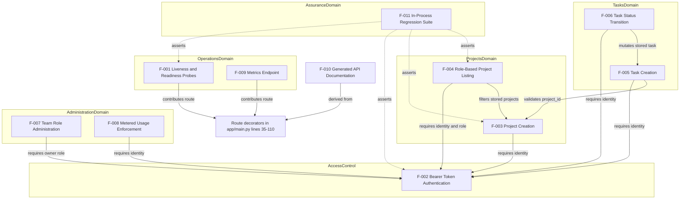

Two structural observations follow from the map. First, F-002 is the single articulation point: removing it disconnects six of the eight route-bearing features, and none of those six has any other identity source. Second, F-001, F-009, and the two id counters are the only elements with no inbound dependency, which is why they are the features that keep working when a token is wrong or absent.

The guarded request path that all six dependent features share is a single sequence, and it is the process flow referenced by every requirement in §2.2 that names a 401:

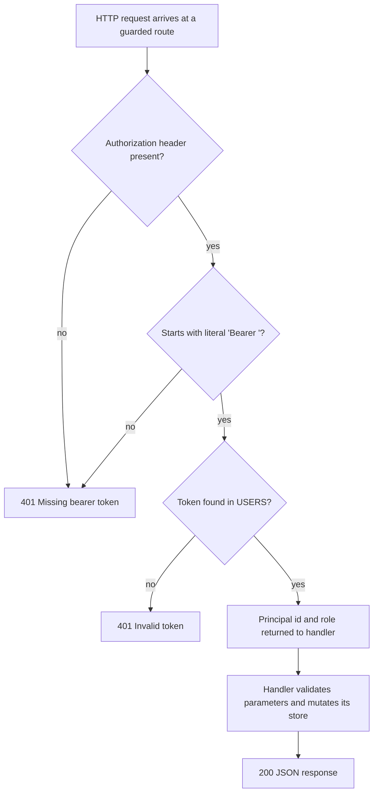

### 2.3.2 Integration Points

| Integration Point | Participants | Contract | Evidence |
| --- | --- | --- | --- |
| In-handler authentication call | `current_user` ↔ six guarded handlers | Function originals/returns a principal dict; raises `HTTPException(401, ...)` on failure | `app/main.py` lines 48, 57, 64, 76, 88, 99 |
| Project-existence check | `POST /tasks` ↔ `PROJECTS` | Integer `project_id` must be a key in the store, otherwise 404 | `app/main.py` line 65 |
| Ownership-derived visibility | `GET /projects` ↔ `PROJECTS` and the caller's `id`/`role` | Record included when `owner_id == user["id"]` or role is `owner` | `app/main.py` line 58 |
| Task mutation | `PATCH /tasks/{task_id}` ↔ `TASKS` | `task_id` must resolve to a stored dict; `status` overwritten in place | `app/main.py` lines 77-82 |
| Role write with no reader | `POST /teams/{user_id}/role` ↔ `TEAM` | `TEAM[user_id] = role`; no handler reads `TEAM` for authorization | `app/main.py` lines 91-93 versus lines 29-32, 58 |
| Shared usage meter | `POST /billing/consume` ↔ `USAGE` | Single process-global record read and written on every call | `app/main.py` lines 100-105 |
| ASGI hosting | Uvicorn ↔ the `app` object | `uvicorn app.main:app --reload` serves the module-level application | `README.md` line 16; `app/main.py` line 5 |
| Specification generation | FastAPI ↔ route decorators and Pydantic models | Every decorated route and model field appears in `/openapi.json` and `/docs` | `app/main.py` lines 5, 16-22, 35-110; observed 8 paths / 9 operations |
| In-process test client | `testclient.TestClient` ↔ `app` | Requests traverse the real ASGI stack over `httpx`, with the stores imported directly for reset | `tests/test_api.py` lines 1-4, 8-11 |
| Collection configuration | `pytest.ini` ↔ `tests/` | `testpaths = tests`, `python_files = test_*.py` | `pytest.ini` lines 1-3 |
| Generated docs consumed by a client | `/docs` ↔ a browser or HTTP client | Interactive UI documented at `http://127.0.0.1:8000/docs` | `README.md` line 18; observed 200 on `GET /docs` |

None of these integration points leaves the process. There is no outbound HTTP dependency in `app/`; `httpx` is present in `requirements.txt` only because `TestClient` requires it (`tests/test_api.py` line 1).

### 2.3.3 Shared Components

| Component | Definition and location | Shared by | Shared behaviour |
| --- | --- | --- | --- |
| Bearer guard | `current_user(authorization)`, `app/main.py` lines 25-32 | F-003, F-004, F-005, F-006, F-007, F-008 | Same two 401 messages and same prefix rule for all six routes; the guard is called inline, not injected, so it appears to the framework as an ordinary header parameter |
| Request models | `ProjectIn` (lines 16-17) and `TaskIn` (lines 20-22) | F-003, F-005 | Both use `Field(min_length=..., max_length=...)` only; both are validated before the handler runs, so a constraint failure always yields FastAPI's 422 list and never a handler-authored error |
| Error taxonomy | `fastapi.HTTPException` raised by handlers | F-002 through F-008 | Handler-raised failures return `{"detail": "<string>"}`; framework-raised validation failures return `{"detail": [ {...} ]}` — two distinct shapes for the same HTTP status |
| Module-level stores | `USERS`, `PROJECTS`, `TASKS`, `TEAM`, `USAGE` (lines 7-11) | Every feature except F-001, F-009, F-010 | Process-wide, non-persistent, and mutated in place; the test harness depends on that in-place mutation |
| Identifier counters | `NEXT_PROJECT`, `NEXT_TASK` (lines 12-13), rebound through `global` | F-003, F-005 | Identical issuance pattern duplicated in two handlers; not reset by the suite, so ids keep advancing across tests |
| Status vocabulary | Literal set `{"open", "in_progress", "done"}` at line 80, seeded value `"open"` at line 68 | F-005 (writes), F-006 (validates) | The two features agree through duplicated literals rather than a shared constant |
| Role vocabulary | Literal set `{"owner", "member"}` at line 91, seeds at lines 7 and 10 | F-004, F-007 | Both stores use the same two role names, but only `USERS` is read for authorization |
| Test harness constants | `client = TestClient(app)` and `OWNER` header dict, `tests/test_api.py` lines 4-5 | All three tests | One client and one credential header are reused by every assertion |

### 2.3.4 Common Services

| Common Service | How it is provided | Features relying on it | Limits of the service |
| --- | --- | --- | --- |
| Identity resolution | A single function call at the top of each guarded handler | F-002 for all six guarded features | No dependency-injection graph, no middleware, and no `Security` dependency, hence no declared scheme in the OpenAPI document |
| State access | Direct dictionary subscripting on module globals; no data-access layer | F-003, F-004, F-005, F-006, F-007, F-008 | No transaction boundary, no locking, no isolation between requests; a failure mid-handler leaves earlier writes applied (only the billing handler orders its guard before its write to avoid this) |
| Identifier issuance | Two independent counters incremented under `global` | F-003, F-005 | Duplicated logic, one counter per entity; ids are per-process, so a restart reissues them |
| Response serialisation | FastAPI returning plain `dict` and `list` objects | All nine routes | No response models are declared, so no field filtering, coercion, or documented response schema exists |
| Error formatting | `HTTPException` for business rules, framework validation for malformed input | All routes that validate anything | Two payload shapes, and the 404 in F-007 conflates two distinct causes under one message |
| Probe surface | Unauthenticated handlers with constant bodies | External pollers, F-011 for `/health` | `/ready`'s storage check is a literal, so the service cannot report a degraded state |
| Specification generation | FastAPI's OpenAPI generation from decorators and models | Clients reading `/docs` or `/openapi.json` | Documents no authentication requirement and no response schemas |

The end-to-end workflows a reader can follow across these relationships — owner project round trip, member visibility, task lifecycle, role change, meter exhaustion — are enumerated in §1.3.1, and the runtime topology that hosts them is drawn in §1.2.2.


## 2.4 Implementation Considerations

### 2.4.1 Assumptions and Constraints

The following assumptions hold for every requirement in §2.2. Each is either enforced by the code or stated by the README; none is an aspiration.

| Assumption | Basis | Consequence if violated |
| --- | --- | --- |
| The service runs as a single process | All state lives in module-level dictionaries (`app/main.py` lines 7-13) | A second replica would hold divergent projects, tasks, and usage; nothing synchronises them |
| Exactly two credentials exist: `owner-token` (user 1, owner) and `member-token` (user 2, member) | Two-entry literal `USERS` (`app/main.py` line 7); no issuance route exists | Any other token is rejected with 401 "Invalid token"; no onboarding path exists |
| The scheme token is sent as `Authorization: Bearer <token>` with an upper-case `Bearer` | Case-sensitive `startswith("Bearer ")` test (line 26) | A lower-case or alternative scheme yields 401 "Missing bearer token" (verified) |
| `status`, `role`, and `units` arrive as query parameters; `name` and `title`/`project_id` arrive in JSON bodies | Handler signatures (lines 46, 75, 87, 98) and the two models (lines 16-22) | Sending a state change in a body yields 422 "missing query parameter", not a success |
| The interpreter is Python 3.10 or newer | `str \| None` annotations evaluated at definition time (line 25) and `str.removeprefix` (line 28) | The module fails to import on 3.9 and earlier |
| Tests are run as `python -m pytest` from the repository root | `tests/` has no `__init__.py`, so the root must be on `sys.path` | Invoking the `pytest` console script interrupts collection with an import error (verified) |
| State is disposable: no persistence, backup, or migration is required | README line 9 ("data is held in memory"); no file or database code exists | Restarting the process erases every project, task, and usage count |
| Requirements are tracked at version 1.0 only | The repository records no requirement history; the application declares version `1.0.0` (line 5) | Any change to a requirement is a new baseline; the specification holds no change log to reconcile against |

Constraints imposed by the fixture's purpose are as binding as technical ones: the in-memory stores, the demo tokens, the stubbed metrics route, and the incomplete test coverage must not be "repaired", because they are the properties the repository exists to exercise (`README.md` line 31).

### 2.4.2 Technical Constraints, Performance, and Scalability by Feature

| Feature | Technical Constraints | Performance and Scalability Considerations |
| --- | --- | --- |
| F-001 Probes | Handlers are synchronous and parameterless; `/ready` reports a literal `"ok"` rather than probing a store | Constant work per call, so scaling is limited only by the ASGI server; the readiness signal cannot reflect a degraded dependency because none is inspected |
| F-002 Authentication | Plain function, not a `Security` dependency, so the OpenAPI document advertises no security scheme; exact-match token lookup with no signature, expiry, or constant-time comparison | One dictionary lookup per request; because the token set is fixed at two entries, cost does not grow with users, and no caching or key material is needed |
| F-003 Project Creation | Global `NEXT_PROJECT` counter incremented under `global`; body validated by `ProjectIn` before the handler runs; no uniqueness or trimming rule | One insert per request; the store grows unbounded and no delete path exists, so memory and listing cost rise with total projects created during the process lifetime |
| F-004 Project Listing | Linear Python filter over the whole store; no pagination, projection, sort, or field selection | Cost is O(number of projects) per request and the full record set is serialised on every owner call; with a single process this is the feature that degrades first as the store grows |
| F-005 Task Creation | Membership test against `PROJECTS`; no ownership rule; `NEXT_TASK` counter mirrors the project counter | O(1) per request; the store grows unbounded and there is no listing route, so created tasks become unreachable except through their own responses |
| F-006 Task Transition | `status` is a required **query** parameter; 404 is evaluated before the 422 value check; no transition matrix, so any state may be set from any state | Dictionary lookup plus in-place assignment; no history is appended, so memory does not grow but prior states are unrecoverable |
| F-007 Role Administration | Writes `TEAM` while authorization reads `USERS`; single 404 message for two distinct rejection causes | Two dictionary operations; the write is inert, so the feature scales trivially and confers no capability |
| F-008 Usage Metering | One process-global meter with a fixed `limit` of 5; increment occurs only after both guards pass; no reset endpoint | Bounded, constant-cost state; concurrent callers read and write the same integer without locking, so two simultaneous requests can both pass the check |
| F-009 Metrics | `requests_total` is the literal `0`; `uptime_seconds` is the host monotonic clock, not process age | One clock read per call; the route measures nothing, so it cannot be used to reason about load |
| F-010 Documentation | Generated from decorators and models; no hand-written descriptions, examples, tags, or response schemas | Served per request by the framework with no configured caching; cost is proportional to the number of routes |
| F-011 Regression Suite | In-process `TestClient`; stores imported directly and reset by mutation; ids intentionally not reset | Runs in well under a second; no coverage threshold, timeout, retry, or CI gate exists, so nothing enforces it outside a manual run |

### 2.4.3 Security and Maintenance Implications by Feature

| Feature | Security Implications | Maintenance Requirements |
| --- | --- | --- |
| F-001 Probes | Deliberately unauthenticated; the readiness body asserts a storage health that is never evaluated, so it can mask a real problem | Any future dependency check must replace the literal at line 42; the payload shape is otherwise stable |
| F-002 Authentication | Static literals compared by exact match: no hashing, expiry, revocation, rotation, or constant-time comparison; credentials are visible in source and in the README; not declared to OpenAPI consumers | Changing the token set means editing line 7; adding a real scheme requires introducing a `Security` dependency so the document and enforcement agree |
| F-003 Project Creation | Any authenticated principal may create projects without quota or approval; `owner_id` is server-derived, which is the one ownership guarantee in the system | Id issuance assumes a single process; adding persistence requires replacing the `global` counter with a durable sequence |
| F-004 Project Listing | The only data-visibility control in the product; it is not documented in OpenAPI and its member branch is untested, so a regression would be silent | Role source must stay `USERS`; the unused `TEAM` store invites a maintainer to "fix" the filter against the wrong store |
| F-005 Task Creation | Authenticated-only; no verification that the caller may attach work to the referenced project | `TASKS` has no read path, so a mistake is observable only from the create response; task adds must duplicate the counter pattern |
| F-006 Task Transition | Any valid token can transition any task; no actor, timestamp, or prior-state record, so no accountability | State values are duplicated literals at lines 68 and 80; they must be changed together or a create/validate mismatch appears |
| F-007 Role Administration | Privilege escalation is gated by a static role, and the resulting assignment changes no enforcement decision — the most likely finding to be misread as a working control | Either `current_user` and `list_projects` must read `TEAM`, or the store should be removed; until then the two role vocabularies must stay aligned by hand |
| F-008 Usage Metering | A member can exhaust the shared quota; no attribution, idempotency key, or audit record, so consumption cannot be reconstructed | Limit is a literal in the store initialiser; any change requires restarting the process, and the suite never restores `limit`, so a test that mutates it would leak |
| F-009 Metrics | Unauthenticated and exposes a host-clock reading; discloses nothing confidential because no metric derives from traffic | The stub must keep returning the two documented keys; replacing it with real counters requires an increment site, which does not exist |
| F-010 Documentation | Omits the authentication requirement, so specification-only clients cannot discover it | Regenerates automatically; keeping it truthful depends on keeping the guard signature and route decorators in order |
| F-011 Regression Suite | Does not assert any authorization branch except the missing-token 401, so broken access control would pass the suite | Requires the repository root as the working directory and `python -m pytest`; six untested routes and two untested branches are the documented backlog |

### 2.4.4 Cross-Cutting Risks

| Risk | Evidence | Consequence | Control present today |
| --- | --- | --- | --- |
| Process-local state | Stores at `app/main.py` lines 8-11 | Restart or a second replica loses or forks data | None — no persistence, session affinity, or shared cache |
| Static credentials | `USERS` literal, line 7 | No rotation, revocation, or per-user provisioning | None — the README forbids real credentials (line 31) |
| Authorization gaps in tasks | Lines 65-66 and 76 ignore ownership | Any token can attach work to any project and move any task | None — authentication only |
| Inert role administration | `TEAM` written at line 93; roles read from `USERS` at lines 29-32 and 58 | A "successful" role change confers nothing, which misleads a reader | None — the divergence is the documented behaviour |
| Two error payload shapes | Framework 422 lists versus handler `{"detail": "<string>"}` | Clients must handle both shapes for the same status code | None — no response models normalise them |
| Stubbed telemetry | `requests_total` literal at line 110 | No traffic signal exists to diagnose the running service | None — no logging, tracing, or exporter configured |
| Unverified surface | 6 of 9 routes and 2 branches untested (`tests/test_api.py` lines 14-26) | A regression passes the suite silently | Only the manual `python -m pytest` run; no CI workflow exists in the repository |
| Single shared meter | `USAGE` line 11, unlocked read-modify-write at lines 102-104 | Concurrent requests can over-consume past the limit | None — no lock, atomic operation, or per-caller accounting |

Every risk above is reachable from the two source files, and each is a property the fixture was built to expose rather than a defect awaiting an unrecorded fix; the repository contains no issue tracker reference, `TODO`, or `FIXME` that assigns ownership of any of them.


## 2.5 Traceability Matrix

### 2.5.1 Requirement-to-Implementation Traceability

Every requirement from §2.2 maps to an implementation location and to its verification status. "Direct request" means the behaviour was exercised on the running application while preparing this specification; it is **not** coverage in the repository's suite, which is the distinction the last column preserves.

| Feature | Requirement IDs | Implementation | Verification |
| --- | --- | --- | --- |
| F-001 | F-001-RQ-001 … RQ-003 | `GET /health` `app/main.py` 35-37; `GET /ready` 40-42 | RQ-001 asserted by `test_health_endpoint` (`tests/test_api.py` 14-15); RQ-002, RQ-003 direct request |
| F-002 | F-002-RQ-001 … RQ-004 | `current_user` 25-32; `USERS` line 7 | RQ-001 asserted by `test_missing_token_is_rejected` (25-26) for `/projects` only; RQ-002 … RQ-004 direct request |
| F-003 | F-003-RQ-001 … RQ-005 | `POST /projects` 45-52; `ProjectIn` 16-17; `NEXT_PROJECT` 12 | RQ-001 and the 200 branch of RQ-002 asserted by `test_owner_can_create_and_list_project` (18-22); RQ-003 … RQ-005 direct request |
| F-004 | F-004-RQ-001 … RQ-004 | `GET /projects` 55-58 | RQ-002 (owner sees all) partially exercised at line 22; RQ-001, RQ-003, RQ-004 direct request |
| F-005 | F-005-RQ-001 … RQ-005 | `POST /tasks` 61-71; `TaskIn` 20-22; `NEXT_TASK` 13 | Direct request only |
| F-006 | F-006-RQ-001 … RQ-006 | `PATCH /tasks/{task_id}` 74-83 | Direct request only |
| F-007 | F-007-RQ-001 … RQ-005 | `POST /teams/{user_id}/role` 86-94; `TEAM` 10 | Direct request only |
| F-008 | F-008-RQ-001 … RQ-006 | `POST /billing/consume` 97-105; `USAGE` 11 | Direct request only |
| F-009 | F-009-RQ-001 … RQ-004 | `GET /metrics` 108-110 | Direct request only |
| F-010 | F-010-RQ-001 … RQ-004 | Application object line 5; decorators 35-110 | Direct request only (`/docs`, `/openapi.json` inspected) |
| F-011 | F-011-RQ-001 … RQ-005 | `tests/test_api.py` 1-26; `pytest.ini` 1-3 | Self-verifying: `python -m pytest` reported `3 passed` |

### 2.5.2 Coverage Summary

| Feature | Requirements | Asserted by repository suite | Verified only by direct request |
| --- | --- | --- | --- |
| F-001 | 3 | 1 | 2 |
| F-002 | 4 | 1 (single route, single branch) | 3 |
| F-003 | 5 | 2 (partial: success path only) | 3 |
| F-004 | 4 | 1 (owner branch, partial) | 3 |
| F-005 | 5 | 0 | 5 |
| F-006 | 6 | 0 | 6 |
| F-007 | 5 | 0 | 5 |
| F-008 | 6 | 0 | 6 |
| F-009 | 4 | 0 | 4 |
| F-010 | 4 | 0 | 4 |
| F-011 | 5 | 5 (the feature is the suite itself) | 0 |
| **Total** | **51** | **4 with suite coverage** | **47** |

Four of fifty-one requirements are covered by the repository's own tests, which matches the three-test count in `tests/test_api.py` and the untested-route list recorded in §2.1.12. The remaining forty-seven are stated from exercised requests, so they are testable as written even though no test asserts them today.

### 2.5.3 Requirement Version and Change Tracking

Requirements are recorded at version **1.0**, the only version this specification defines, aligned with the application's declared `version="1.0.0"` (`app/main.py` line 5). The repository holds no requirement document, issue tracker, changelog, or `TODO`/`FIXME` marker, so there is no prior baseline to reconcile and no planned change to trace.

| Change type | Required update |
| --- | --- |
| New or changed behaviour on an existing route | Amend the affected `F-XXX-RQ-YYY` row in §2.2, then update its verification cell in §2.5.1 and the counts in §2.5.2 |
| New feature | Add an `F-0XX` entry to §2.1 with its dependency table, add the corresponding §2.2 and §2.4 rows, then extend the matrix |
| Withdrawn behaviour | Remove the requirement row and record the withdrawal in §2.4.1 rather than deleting the feature silently |
| Version bump of the application | The only version marker in the codebase is the literal at `app/main.py` line 5; a bump there should accompany a new requirement baseline |


## 2.6 References

Every requirement, dependency, and risk in this section rests on the tracked files below plus the requests executed against the running application. No web source was consulted, and no statement here depends on documentation outside the repository.

**Repository files**

- `app/main.py` — the entire service, and the source of every feature: application object and version (line 5), seeded `USERS`, stores and id counters (lines 7-13), `ProjectIn` and `TaskIn` constraints (lines 16-22), the `current_user` bearer guard (lines 25-32), and the nine route handlers with their status codes, parameter bindings, and state mutations (lines 35-110).
- `tests/test_api.py` — the three-test suite: `TestClient` construction and the owner header constant (lines 1-5), the `setup_function` state reset (lines 8-11), and the asserted behaviours behind F-011 and the coverage gaps in §2.5.2 (lines 14-26).
- `README.md` — stated purpose and feature summary (lines 3, 5-9), run and test commands (lines 11-23), scan guidance (lines 25-28), and the "synthetic QA fixture … do not deploy" constraint (line 31).
- `requirements.txt` — pinned `fastapi==0.115.12`, `uvicorn==0.34.0`, `pytest==8.3.5`, `httpx==0.28.1`, the system dependencies cited for F-001, F-010, and F-011.
- `pytest.ini` — `testpaths = tests` and `python_files = test_*.py`, the collection contract in F-011-RQ-002.

**Folders**

- `app/` — contains only `__init__.py` (0 bytes) and `main.py`; established that the whole product surface documented here is one module, and that no middleware, dependency module, or data-access layer exists.
- `tests/` — contains only `test_api.py`; established the absence of conftest, fixtures, and `__init__.py`, which is why the suite requires the repository root on `sys.path`.

**Repository metadata**

- `git ls-files` and `git log --oneline` — seven tracked files and three commits ("Initial commit", "Add proactive insights testing project", "Resolve README merge conflict"); established that no roadmap, backlog, or requirement history exists, which is why every feature is recorded as *Completed* at requirement version 1.0.
- A repository-wide search for `TODO`, `FIXME`, `XXX`, `roadmap`, and `backlog` across `*.py`, `*.md`, `*.ini`, and `*.txt` returned no matches, confirming that no deferred work item is recorded anywhere.

**Executed verification**

- `python -m pytest -q` from the repository root with the pinned dependencies installed — `3 passed`, establishing the F-011 baseline and the suite-coverage counts in §2.5.2.
- Two `TestClient` exercises covering all nine routes, the 401 variants (absent header, empty token, lower-case scheme, `Basic` scheme, unknown token), the 422 boundaries for `name` (1/80/81 characters) and `title` (1/121 characters), the 404-versus-422 ordering on `PATCH /tasks/{task_id}`, the 403 owner-only role change, the `TEAM`-versus-`USERS` divergence after a promotion, and the 422/429 usage-meter boundaries including the inclusive equality case at `used + units == 5`.
- `GET /openapi.json` inspection — confirmed the title, version, 8 paths, 9 operations, absence of `components.securitySchemes`, and the optional `authorization` header parameter behind F-010-RQ-003.
- Console-script versus module invocation of pytest — the console script interrupts collection with an import error while `python -m pytest` succeeds, the constraint recorded in §2.4.1.


# 3. Technology Stack

## 3.1 Programming Languages

### 3.1.1 Language Allocation by Component

Python is the only programming language in the repository. `git ls-files` lists seven tracked paths, and every one that contains executable logic is a Python module; there is no JavaScript, TypeScript, shell, SQL, HTML template, or compiled native source anywhere in the tree.

| Component | Path | Language / form | Evidence |
| --- | --- | --- | --- |
| Application service (9 route operations) | `app/main.py` | Python 3, synchronously defined handlers | Imports at lines 1-3; `FastAPI(...)` at line 5; decorated handlers lines 35-110 |
| Package marker | `app/__init__.py` | Python, empty | 0 bytes; makes `app` importable as `app.main` |
| Regression suite (3 tests) | `tests/test_api.py` | Python 3, pytest module | `TestClient` at line 1; `setup_function` lines 8-11; tests lines 14-26 |
| Runtime/test dependency manifest | `requirements.txt` | PEP 508 requirement lines | Four `==` pins, lines 1-4 |
| Test discovery configuration | `pytest.ini` | INI | `testpaths = tests`, `python_files = test_*.py` |
| Operator documentation | `README.md` | Markdown | Run, test and scan instructions, lines 11-28 |

The language surface actually exercised is deliberately small: module-level dictionary and integer literals (`app/main.py` lines 7-13), type-annotated function signatures (lines 25, 46, 56, 62, 75, 87, 98), `str.removeprefix` (line 28), `global` rebinding of the two id counters (lines 47-51, 63-70), and `time.monotonic` (lines 3, 110). No class hierarchy, decorator of the project's own, thread, process, async `def`, or third-party import beyond the HTTP/validation stack appears in `app/`.

### 3.1.2 Interpreter Version Floor and Observed Runtime

No file in the repository pins the interpreter: there is no `.python-version`, `runtime.txt`, `pyproject.toml`, `setup.cfg`, `tox.ini`, Dockerfile, or CI definition. The floor must therefore be derived, and three independent sources agree on Python 3.10 or newer.

| Source of the constraint | Evidence | Implied floor |
| --- | --- | --- |
| Source syntax | PEP 604 unions in annotations evaluated at definition time — `authorization: str \| None` at `app/main.py` line 25, repeated at lines 46, 56, 62, 75, 87, 98 — plus `str.removeprefix` at line 28 | 3.10 (`str \| None` raises `TypeError` at import on 3.9) |
| Resolved dependency metadata | `pydantic` 2.14.4 declares `Requires-Python >=3.10`; `starlette` 0.46.2 and `uvicorn` 0.34.0 declare `>=3.9`; `fastapi` 0.115.12, `httpx` 0.28.1 and `pytest` 8.3.5 declare `>=3.8` | 3.10, set by Pydantic |
| Interpreter actually used | CPython 3.12.3 executing the suite, with bytecode caches `app/__pycache__/main.cpython-312.pyc` and `tests/__pycache__/test_api.cpython-312-pytest-8.3.5.pyc` in the working tree | 3.12 in practice |

Two consequences follow. First, the effective floor is a property of the *resolved* graph, not of `requirements.txt`: because Pydantic is not pinned (see §3.3.1), a 3.9 host would resolve an older Pydantic 2.x and install successfully, but `app/main.py` would still fail to import. Second, nothing enforces the interpreter version at build or run time, so the only guard is the source itself failing loudly at import.

### 3.1.3 Selection Criteria and Constraints

The language choice is justified by what this repository exists to do — be small enough to read exhaustively and self-contained enough to run with no external service (`README.md` lines 3, 9, 31).

| Selection criterion | How the Python choice satisfies it | Evidence |
| --- | --- | --- |
| Minimal dependency surface | One language plus four pinned packages delivers HTTP serving, request validation, an OpenAPI contract, and the test transport | `requirements.txt` lines 1-4 |
| Declarative validation instead of hand-written parsing | Type-annotated models turn field rules into enforced constraints with no parsing code | `app/main.py` lines 16-22 |
| Contract generation at no extra cost | The framework derives an OpenAPI 3.1.0 document from the same annotations and decorators | `/openapi.json` served by the running app |
| Exhaustive readability | The whole service is one module with no abstraction layer between HTTP and the dictionaries | `app/main.py` |
| No operational footprint | No database driver, broker client, cache client, or environment-variable read exists | Imports at `app/main.py` lines 1-3 are the complete import set |

The constraints the chosen language and runtime impose on the system are equally part of the stack decision:

| Constraint | Cause | Consequence |
| --- | --- | --- |
| State cannot outlive the process | Stores and id counters are module-level objects (`app/main.py` lines 7-13, rebounded via `global` at lines 47-51 and 63-70) | A restart erases all projects, tasks and usage; a second worker would hold divergent state |
| Shared mutable state is unsynchronised | Starlette runs `def` handlers on worker threads, so the increments at lines 51, 70, 82, 93 and 104 mutate shared dictionaries without a lock | Concurrent requests can interleave a read-modify-write, e.g. two `/billing/consume` calls both passing the limit check at line 102 |
| Annotations are documentation, not enforcement | No `mypy`, `pyright`, `py.typed` marker, or type-check step in any configuration file | Type errors surface only as runtime failures |
| No lint or format gate | No `ruff`, `black`, `flake8`, `isort`, `pre-commit` or `pyproject.toml` exists in the repository | Style and import hygiene are unenforced |
| Not installable as a distribution | No packaging metadata; the app is imported by module path (`app.main:app`) | Deployment means shipping the source tree and installing `requirements.txt` |


## 3.2 Frameworks & Libraries

### 3.2.1 Core Runtime Frameworks

Four packages form the runtime path: one application framework, its ASGI toolkit, its validation engine, and the server that hosts the app object. All versions below are the pins in `requirements.txt` or the versions the pins resolve to on CPython 3.12.

| Framework | Version | Role in this system | Evidence |
| --- | --- | --- | --- |
| FastAPI | `0.115.12` (pinned) | Application object, routing, header/query parameter binding, exception mapping, OpenAPI generation | `app/main.py` line 5; `FastAPI`, `Header`, `HTTPException` imported line 1; 9 operations decorated lines 35-110 |
| Starlette | `0.46.2` (transitive) | ASGI toolkit underneath FastAPI and the in-process test transport (`TestClient`) | Required by FastAPI as `starlette>=0.40.0,<0.47.0`; `fastapi.testclient` imported at `tests/test_api.py` line 1 |
| Pydantic | `2.14.4` (transitive) | Declarative request-body models with length constraints | `BaseModel`/`Field` imported at `app/main.py` line 2; `ProjectIn`, `TaskIn` lines 16-22 |
| Uvicorn | `0.34.0` (pinned) | ASGI server that hosts `app.main:app` | `README.md` line 16 (`uvicorn app.main:app --reload`); application runs under it |

**Why FastAPI (and not a hand-rolled WSGI/ASGI app).** The service's only non-trivial behaviour is validation and error mapping, and both are obtained declaratively: `ProjectIn.name` is `min_length=2, max_length=80` and `TaskIn.title` is `min_length=2, max_length=120` with an integer `project_id` (`app/main.py` lines 16-22), so malformed bodies are rejected with 422 before any handler body executes. The framework also supplies the machine-readable contract for free — the running app serves OpenAPI `3.1.0` at `/openapi.json`, `Swagger UI` at `/docs`, and `ReDoc` at `/redoc` (all returned 200 in a verified run). Consequences of that choice are recorded in §1.3.2: because authentication is a plain function rather than a `Security` dependency, the generated document contains no `components.securitySchemes` (verified absent) and each guarded operation carries an optional `authorization` header parameter instead.

**Why Uvicorn, and what the plain pin does and does not include.** `requirements.txt` line 2 pins bare `uvicorn==0.34.0`, with no `[standard]` extra. The resolved dependency set is therefore only `click 8.5.1`, `h11 0.16.0`, and `typing-extensions` (the last only for Python < 3.11): the server runs the default `asyncio` event loop with the `h11` HTTP protocol implementation, with no `uvloop`, `httptools`, `websockets`, `watchfiles`, or `python-dotenv`. `--reload` still works, because Uvicorn falls back to its polling `StatReload` supervisor when `watchfiles` is absent (`uvicorn/supervisors/__init__.py`, `statreload.py`), but `--reload-include`/`--reload-exclude` have no effect in that mode. No WebSocket route exists in the application, so the missing `websockets` package costs nothing.

The resulting layering inside a single process is:

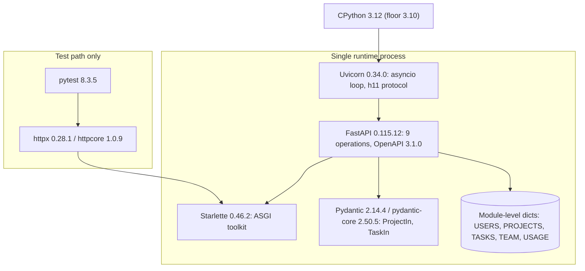

### 3.2.2 Supporting and Test-Only Libraries

No library outside the four pinned packages is imported by project code. The remaining resolved distributions exist only to satisfy those four.

| Library | Version | Purpose | Evidence |
| --- | --- | --- | --- |
| pytest | `8.3.5` (pinned) | Test runner and assertion introspection | `tests/test_api.py`; `pytest.ini` lines 1-3 |
| httpx | `0.28.1` (pinned) | HTTP client that backs `fastapi.testclient.TestClient` | `tests/test_api.py` line 1; no `httpx` import exists in `app/` |
| anyio | `4.16.0` | Async/thread primitives shared by Starlette and httpx | Required by `starlette` (`anyio<5,>=3.6.2`) and `httpx` |
| httpcore | `1.0.9` | Low-level HTTP transport for httpx | Required by `httpx` as `httpcore==1.*` |
| click | `8.5.1` | Uvicorn command-line interface | Required by `uvicorn` as `click>=7.0` |
| h11 | `0.16.0` | HTTP/1.1 protocol state machine used by Uvicorn | Required by `uvicorn` as `h11>=0.8` |
| idna, certifi | `3.20`, `2026.11.20` | IDNA codec and CA bundle for httpx | Required by `httpx` |
| pluggy, iniconfig, packaging | `1.7.0`, `2.3.1`, `26.4` | pytest plugin engine, INI parsing, version handling | Required by `pytest` |
| typing-extensions, typing-inspection, annotated-types | `4.16.0`, `0.4.5`, `0.8.0` | Annotation utilities for FastAPI and Pydantic | Required transitively |

Two absences are load-bearing for the stack, because they show which framework capabilities the system deliberately does not use: no `jinja2` (templates), no `python-multipart` (form/upload parsing), no `itsdangerous` (signed sessions), no `email-validator` (email-typed fields). None of these is imported anywhere in `app/` or `tests/`.

### 3.2.3 Compatibility Requirements

Compatibility is governed by the declared ranges in each package's metadata. The table pairs every binding range with the version actually resolved from the pins on CPython 3.12.

| Declaring package | Declared requirement | Resolved version | Status |
| --- | --- | --- | --- |
| fastapi 0.115.12 | `starlette>=0.40.0,<0.47.0` | 0.46.2 | Satisfied |
| fastapi 0.115.12 | `pydantic>=1.7.4,<3.0.0` excluding 1.8, 1.8.1, 2.0.0, 2.0.1, 2.1.0 | 2.14.4 | Satisfied |
| fastapi 0.115.12 | `typing-extensions>=4.8.0` | 4.16.0 | Satisfied |
| starlette 0.46.2 | `anyio<5,>=3.6.2` | 4.16.0 | Satisfied |
| starlette 0.46.2 (`full` extra) | `httpx>=0.27.0,<0.29.0` | 0.28.1 | Satisfied — the pin choice is inside the range Starlette tests its `TestClient` against |
| httpx 0.28.1 | `httpcore==1.*`, `anyio`, `certifi`, `idna` | 1.0.9 plus the rest | Satisfied |
| uvicorn 0.34.0 | `click>=7.0`, `h11>=0.8` | 8.5.1, 0.16.0 | Satisfied |
| pytest 8.3.5 | `pluggy<2,>=1.5`, `iniconfig`, `packaging` | 1.7.0, 2.3.1, 26.4 | Satisfied |

The compatibility set was verified end to end: installing exactly the four pins into an isolated target on CPython 3.12 and running `python -m pytest` from the repository root produced `3 passed, 1 warning`. The single warning is a `DeprecationWarning` raised inside `starlette/testclient.py` (the `anyio.abc.BlockingPortal` alias), not from project code.

Two compatibility hazards are inherent to the current manifest. Because only the four top-level packages are pinned, the transitive set floats inside the declared ranges — `pydantic` could resolve anywhere from the 2.x line up to a 2.x release below 3.0, and `starlette` anywhere inside `0.40.0`–`0.46.x` — so two installs made months apart are not bit-identical. And the only reason the boundary holds is FastAPI's own ranges: a `starlette` release past `0.47.0` or a `pydantic` 3.x would make the pinned FastAPI uninstallable rather than silently incompatible, because pip enforces those ceilings.

### 3.2.4 Declared Versus Transitive Dependencies

`requirements.txt` declares four packages; a clean install resolves nineteen distributions. The distinction matters for maintenance and for any future container build.

| Category | Packages | Notes |
| --- | --- | --- |
| Declared, runtime | `fastapi==0.115.12`, `uvicorn==0.34.0` | The only packages a deployment of the service requires |
| Declared, test-only | `pytest==8.3.5`, `httpx==0.28.1` | Needed by `tests/` only; `httpx` is never imported by `app/` |
| Undeclared direct import | `pydantic` | `app/main.py` line 2 imports `BaseModel` and `Field` directly, yet Pydantic appears in no requirement line. It arrives because FastAPI requires it, so the import depends on another package's dependency graph rather than on this project's manifest |
| Purely transitive | the remaining 14 distributions | See §3.2.2 |

Because runtime and test dependencies share one unpinned-transitive file, `pip install -r requirements.txt` puts `pytest` and `httpx` into the same environment as the server. That is consistent with a self-contained fixture that has no deployment target, but it is the concrete constraint a future packaging effort would have to split — along with the absence of any constraints file, lock file, or `pip freeze` record.


## 3.3 Open Source Dependencies

### 3.3.1 Declared Requirements

The complete third-party surface the project states is four lines in `requirements.txt` (lines 1-4), in this file order:

| Package | Pin | Role | Import site |
| --- | --- | --- | --- |
| `fastapi` | `==0.115.12` | Runtime web framework | `app/main.py` line 1 |
| `uvicorn` | `==0.34.0` | Runtime ASGI server | Invoked by `README.md` line 16, not imported by code |
| `pytest` | `==8.3.5` | Test runner | `tests/test_api.py` (collected as a pytest module) |
| `httpx` | `==0.28.1` | Transport for `TestClient` | `tests/test_api.py` line 1, indirectly |

The file's format is itself a stack decision: one PEP 508 requirement per line, every version pinned with `==`, and no comments, blank lines, index URL, `-r` include, environment marker, extra, or hash. `README.md` line 15 installs it with `pip install -r requirements.txt`. Exact `==` pins on the four top-level packages make the *entry points* reproducible; nothing makes the rest of the graph reproducible (§3.3.2).

### 3.3.2 Resolved Dependency Graph

The pins resolve to nineteen distributions on CPython 3.12 from the public PyPI index. Versions and licences below come from each distribution's installed metadata.

| Package | Resolved version | Licence | Reachability |
| --- | --- | --- | --- |
| `fastapi` | 0.115.12 | MIT | Declared, runtime |
| `uvicorn` | 0.34.0 | BSD-3-Clause | Declared, runtime |
| `httpx` | 0.28.1 | BSD-3-Clause | Declared, test |
| `pytest` | 8.3.5 | MIT | Declared, test |
| `starlette` | 0.46.2 | BSD-3-Clause | Via `fastapi` |
| `pydantic` | 2.14.4 | MIT | Via `fastapi` (also imported directly by `app/main.py`) |
| `pydantic-core` | 2.50.5 | MIT | Via `pydantic` |
| `annotated-types` | 0.8.0 | MIT | Via `pydantic` |
| `typing-inspection` | 0.4.5 | MIT | Via `pydantic` |
| `typing-extensions` | 4.16.0 | PSF-2.0 | Via `fastapi` / `pydantic` |
| `anyio` | 4.16.0 | MIT | Via `starlette` / `httpx` |
| `h11` | 0.16.0 | MIT | Via `uvicorn` |
| `click` | 8.5.1 | BSD-3-Clause | Via `uvicorn` |
| `httpcore` | 1.0.9 | BSD-3-Clause | Via `httpx` |
| `idna` | 3.20 | BSD-3-Clause | Via `httpx` |
| `certifi` | 2026.11.20 | MPL-2.0 | Via `httpx` |
| `pluggy` | 1.7.0 | MIT | Via `pytest` |
| `iniconfig` | 2.3.1 | MIT | Via `pytest` |
| `packaging` | 26.4 | Apache-2.0 OR BSD-2-Clause | Via `pytest` |

Two properties of this graph bear on deployment. `pydantic-core` is a compiled Rust extension shipped as a CPython- and platform-specific binary (`_pydantic_core.cpython-312-x86_64-linux-gnu.so` in the verified install), so it binds the stack to a CPython minor version and a compatible C runtime — a manylinux/musllinux wheel must exist for the target image, or the build needs a Rust toolchain. And `certifi` is the only package whose licence is not MIT/BSD/Apache/PSF: MPL-2.0, a file-level copyleft that places no obligation on this project's own source.

### 3.3.3 Registry, Licensing and Supply-Chain Posture

| Aspect | State in this repository | Evidence |
| --- | --- | --- |
| Registry | Public PyPI only; no `--index-url`, `--extra-index-url`, or `--find-links` override, and no vendored wheels or `vendor/` directory | `requirements.txt` lines 1-4 are bare requirement strings |
| Lock / constraints file | None — no `requirements.lock`, `constraints.txt`, `poetry.lock`, `Pipfile.lock`, or `uv.lock` | Repository tree contains five first-order entries only |
| Hash verification | None — no `--require-hashes` and no per-requirement `--hash` fragments | `requirements.txt` |
| Vulnerability or licence scanning | None — no `pip-audit`, `safety`, Dependabot, Renovate, or SBOM configuration, and no CI to run one | No `.github/`, `.gitlab-ci.yml`, or equivalent file exists |
| Licence compatibility | Entire graph is permissive or weak-copyleft (MIT, BSD-3-Clause, Apache-2.0/BSD-2-Clause, PSF-2.0, MPL-2.0) | Per-distribution metadata above |
| Repository hygiene | No `.gitignore`; macOS `.DS_Store` is tracked, and generated `app/__pycache__/` and `tests/__pycache__/` sit in the working tree | `git ls-files` lists `.DS_Store`; no ignore rules match it |

The practical reading: the dependency inventory is trivially auditable because it is four lines and nineteen packages, but the *reproducibility* controls an enterprise stack would expect — a lock file and hash pinning — are absent, so the transitive half of the graph is whatever PyPI offers at install time inside FastAPI's declared ranges. That is an accepted property of a fixture whose README forbids deployment (`README.md` line 31), not an oversight to be inferred as future work.


## 3.4 Third-Party Services

### 3.4.1 No Server-Side Third-Party Services

The system integrates with no external service. A text search of every tracked file for the markers an integration would leave — `auth0`, `jwt`, `jose`, `boto3`, `requests.`, `sentry`, `prometheus`, `opentelemetry`, `logging`, `os.environ`, `getenv`, `dotenv`, `langchain`, `openai`, `anthropic`, `pymongo`, `redis` — returns exactly one hit: the string `httpx` in `requirements.txt` line 4, where it exists to back the test client rather than to call anything. `app/main.py` makes no outbound call, opens no socket, reads no configuration, and writes nothing.

| Integration category | Typical component | Present here | What the repository does instead |
| --- | --- | --- | --- |
| Authentication / identity | OIDC or OAuth 2.0 provider, Auth0, Keycloak | None | Two literal tokens in `USERS` (`app/main.py` line 7) compared by exact dictionary lookup in `current_user` (lines 25-32). No issuance, expiry, signature check, rotation, or revocation path exists |
| Authorisation metadata | External policy engine or directory | None | Roles are inline strings `owner`/`member` inside the same literal (`USERS`, line 7; `TEAM`, line 10) |
| Monitoring / APM / error tracking | Prometheus, Datadog, Sentry, OpenTelemetry collector | None | `GET /metrics` returns a literal `{"requests_total": 0, "uptime_seconds": ...}` (`app/main.py` lines 108-110); no counter, tracer, exporter, or log call exists |
| Cloud services | AWS S3, SQS, SNS, Secrets Manager | None | No SDK import and no endpoint literal; the README's evaluator guidance is explicit — "Do not configure an environment; this fixture is self-contained" (line 28) |
| External APIs / AI services | LLM or third-party REST API | None | The whole nine-route surface is served locally; only `time.monotonic` is imported beyond the HTTP stack (line 3) |
| Messaging / payments | Broker, webhook target, payment processor | None | "Billing" is one integer meter, `USAGE = {"used": 0, "limit": 5}` (line 11) mutated by `POST /billing/consume` (lines 97-105) |
| Configuration / secrets store | Environment variables, Vault, SSM | None | Every value is a module-level literal (lines 5-13); no environment read exists |

### 3.4.2 One External Runtime Dependency: Browser-Side Documentation Assets

`GET /docs` and `GET /redoc` are served by the application, but the HTML they return references assets on public CDNs rather than bundling them. This is the only third-party runtime dependency in the stack, and it is browser-side — the server itself never fetches these URLs.

| Asset | Source | Where it comes from |
| --- | --- | --- |
| Swagger UI bundle | `https://cdn.jsdelivr.net/npm/swagger-ui-dist@5/swagger-ui-bundle.js` | FastAPI 0.115.12 default, `fastapi/openapi/docs.py` line 56 |
| Swagger UI stylesheet | `https://cdn.jsdelivr.net/npm/swagger-ui-dist@5/swagger-ui.css` | Same module, line 66 |
| ReDoc bundle | `https://cdn.jsdelivr.net/npm/redoc@next/bundles/redoc.standalone.js` | Same module, line 191 |
| Web fonts and favicon | `fonts.googleapis.com`, `fastapi.tiangolo.com/img/favicon.png` | Same module, lines 74, 230 |

Operational consequence: `/docs` renders correctly only where the client's browser can reach `cdn.jsdelivr.net`. In an air-gapped or egress-filtered network the API is unaffected — `/openapi.json`, `/health`, `/ready` and every business route are served from the process alone — but the interactive documentation degrades, and self-hosting the Swagger UI assets would be the remedy.

### 3.4.3 Enterprise Integrations Considered and Not Adopted

The stack a reader might expect for a service with projects, teams, roles and metered billing is not the stack here, and the divergence is total rather than partial. Every component below is absent by design, and the absence is verifiable from the repository tree rather than from any statement of intent.

| Candidate component | Evidence of absence | Substitution in this repository |
| --- | --- | --- |
| Cloud platform (AWS or other) and infrastructure as code | No `*.tf`, `terraform/`, CloudFormation, SAM, CDK, or serverless definition is tracked | Runs on a developer workstation per `README.md` lines 11-18 |
| Container runtime (Docker) and orchestration | No `Dockerfile`, `docker-compose.yml`, `.dockerignore`, Kubernetes manifest, or Helm chart | Process started directly with `uvicorn app.main:app` |
| CI/CD service (GitHub Actions or other) | No `.github/workflows/`, `.gitlab-ci.yml`, `Jenkinsfile`, `.circleci/`, or `.travis.yml` | Manual `python -m pytest` (§3.6.4) |
| Alternative application framework (Flask or other) | `requirements.txt` lists no web framework besides FastAPI; `app/main.py` line 1 imports from `fastapi` only | FastAPI 0.115.12 |
| Hosted identity provider (Auth0 or other) | No auth SDK in `requirements.txt`; `USERS` literal at `app/main.py` line 7 | Static bearer-token lookup (lines 25-32) |
| Document or relational database (MongoDB, PostgreSQL) | No driver, ORM, or migration tool; imports at lines 1-3 are the complete set | Module-level dictionaries (lines 8-11) |
| AI / LLM framework (LangChain or other) | No such package in `requirements.txt` and no import in `app/` or `tests/` | None — no AI capability exists |
| JavaScript/TypeScript front end (React, TailwindCSS, React Native) | No `package.json`, `node_modules/`, `.tsx`/`.jsx`, or static asset directory | Server-rendered JSON plus the framework's generated `/docs` |
| Native or cross-platform clients (Swift, Kotlin, Objective-C, Electron) | No mobile, desktop, or Xcode/Gradle project file of any kind | HTTP clients only |

Because none of these exists, there are no cross-component integration requirements to document: no environment variables to inject, no service endpoints or credentials to configure, no network egress from the server, and no CORS or TLS layer configured in the application — a reverse proxy would have to terminate TLS and add CORS, since no middleware is registered anywhere in `app/`.


## 3.5 Databases & Storage

### 3.5.1 Primary and Only Datastore: Process-Local Dictionaries

There is no database, no ORM, no migration tool, and no file or object storage. The persistence layer is six module-level objects in `app/main.py` lines 7-13, held in the memory of the single Uvicorn process.

| Store | Shape | Written by | Read by |
| --- | --- | --- | --- |
| `USERS` | `{token: {id, role}}`, two literal entries (`owner-token` → user 1 `owner`, `member-token` → user 2 `member`) | Never — it is a constant | `current_user` line 29; `list_projects` line 58; `change_role` line 89 |
| `PROJECTS` | `{int: {id, name, owner_id}}` | `create_project` line 50; id from `NEXT_PROJECT` (line 47-51) | `list_projects` line 58; `create_task` line 65 |
| `TASKS` | `{int: {id, title, project_id, created_by, status}}` | `create_task` line 69 with `status: "open"`; mutated in place by `update_task` line 82 | `update_task` line 77 |
| `TEAM` | `{user_id: role}`, seeded `{1: "owner", 2: "member"}` | `change_role` line 93 | Never — no authorization decision reads it |
| `USAGE` | `{"used": int, "limit": 5}` — one global meter | `consume_usage` line 104 | `consume_usage` lines 102-105 |
| `NEXT_PROJECT`, `NEXT_TASK` | Module-level integers, rebound under `global` | Lines 51 and 70 | Lines 49 and 67 (id assignment) |

The stores are the data model. There is no schema, no index, no constraint beyond the Pydantic field rules applied at the edge, no uniqueness rule (two projects may share a name), and no timestamp, version, or audit column on any record.

### 3.5.2 Data Persistence Strategy, Caching and Secondary Storage

| Concern | Implementation | Consequence |
| --- | --- | --- |
| Durability | None. No `open()`, `json.dump`, SQL, or network write exists anywhere in `app/` or `tests/`; state exists only as CPython objects | Process exit discards every project, task, role change and usage count |
| Horizontal scaling | None. A second Uvicorn worker or replica would hold its own empty dictionaries | Requests routed to different workers see different data; the id counters would also collide |
| Caching | No cache library (`redis`, `memcached`, `cachetools`), no HTTP cache headers, no in-process memoisation | Every read walks the live dictionary; the linear filter over `PROJECTS` at line 58 is the only non-constant read path |
| Sessions and cookies | No session middleware, no cookie handling; `itsdangerous` (Starlette's signed-session dependency) is not installed | Authentication is re-derived per request from the `Authorization` header and the `USERS` literal |
| File and object storage | None. No upload, download, static-file mount, or blob reference exists | Every payload is JSON produced from dictionaries |
| Readiness signal for storage | `GET /ready` returns `{"ready": true, "checks": {"storage": "ok"}}` with the storage verdict hard-coded (`app/main.py` line 42) | The probe cannot detect a degraded store because no store is contacted |
| Test-time reset | `setup_function` clears `PROJECTS`, `TASKS` and zeroes `USAGE["used"]` by direct mutation (`tests/test_api.py` lines 8-11) | Tests share the process's memory; `NEXT_PROJECT`, `NEXT_TASK` and `USAGE["limit"]` are deliberately not reset |

### 3.5.3 Constraints That Follow From the Storage Choice

| Constraint | Mechanism | Operational effect |
| --- | --- | --- |
| Single-process affinity | State lives in module globals (lines 7-13) | Deployment must be exactly one worker; `uvicorn --workers N` would fragment state |
| Unbounded growth, no reclamation | `PROJECTS` and `TASKS` only ever gain keys — no delete route exists among the nine | Memory and the owner-role listing cost grow with total objects created since start-up |
| Concurrent mutation without a lock | Read-modify-write on `USAGE` at lines 102-104, and `global` integer rebinding at lines 47-51 and 63-70, run on Starlette's worker threads | Simultaneous requests can over-consume past the limit of 5 or receive duplicate ids |
| Lost role state | `change_role` writes `TEAM` (line 93) while authorisation reads `USERS` (lines 29-32, 58) | The write is inert for the life of the process and also disappears on restart |
| No migration path | No serialisation format, schema version, or mapping layer exists between handlers and dictionaries | Introducing a real store means replacing the access sites in the handlers themselves; the dictionaries are the only seam |


## 3.6 Development &amp; Deployment

### 3.6.1 Local Development Toolchain

Development uses nothing beyond the interpreter's standard tooling and the two root configuration files. The complete documented workflow is four commands in `README.md` lines 12-18.

| Tool | Version / source | Role | Evidence |
| --- | --- | --- | --- |
| CPython | 3.12.3 observed; floor 3.10 (§3.1.2) | Interpreter | Bytecode caches tagged `cpython-312`; suite executed under it |
| `venv` | Standard library | Isolated environment at `.venv` | `README.md` lines 13-14 |
| `pip` | Bundled with the interpreter | Installs `requirements.txt` | `README.md` line 15 |
| Uvicorn | `0.34.0` | Development server with `--reload` | `README.md` line 16 |
| Swagger UI at `/docs` | Served by the app | Interactive exploration of the contract | `README.md` line 18; `/docs` returns 200 |
| pytest | `8.3.5` | Test runner | `README.md` line 22; `pytest.ini` |

`pytest.ini` is three lines and only affects discovery: `testpaths = tests` and `python_files = test_*.py`, with no `addopts`, markers, timeouts, coverage settings, or plugins. There is no `conftest.py` and no `tests/__init__.py`.

One invocation constraint is part of the toolchain rather than a preference: the suite must be run as `python -m pytest` from the repository root. Because `tests/` is not a package, the root directory is added to `sys.path` only by the `-m` form; invoking the `pytest` console script interrupts collection with `ModuleNotFoundError: No module named 'app'`. The `README.md` line 22 instruction `pytest -q` therefore works only for a shell whose `sys.path` already contains the root.

No formatter, linter, or type checker is configured — the repository has no `pyproject.toml`, `.flake8`, `.ruff.toml`, `.isort.cfg`, `mypy.ini`, `setup.cfg`, or `.pre-commit-config.yaml`, so `ruff`, `black`, `flake8`, `isort`, and `mypy` would all run with defaults if someone installed them.

### 3.6.2 Build System and Packaging

There is no build system. The repository contains no `pyproject.toml`, `setup.py`, `setup.cfg`, `MANIFEST.in`, `Makefile`, or `tox.ini`, so no wheel or sdist is produced, and `app` is never installed as a distribution — it is imported by module path (`app.main:app`), which requires the repository root as the working directory.

| Packaging concern | State | Evidence |
| --- | --- | --- |
| Project metadata (name, version, authors) | Absent from any packaging file | No packaging file exists |
| Application version | Declared only as a constructor argument, `version="1.0.0"` | `app/main.py` line 5; surfaces as `info.version` in the served OpenAPI document (verified `1.0.0`) |
| Dependency declaration | Single flat `requirements.txt`, runtime and test mixed (§3.2.4) | `requirements.txt` lines 1-4 |
| Build artifact | None — the deployable unit is the source tree plus the installed environment | `git ls-files` lists the seven source and config paths |
| Version/commit stamping | None — the service does not report its git commit | No such code in `app/main.py` |

### 3.6.3 Containerization and Infrastructure as Code

Neither exists. No `Dockerfile`, `docker-compose.yml`, `.dockerignore`, Kubernetes manifest, Helm chart, Terraform/CloudFormation/CDK definition, or serverless configuration is tracked, and no deployment target is described in `README.md`; the guidance is the opposite, "Do not deploy it or use real credentials" (line 31).

Should the service ever be containerized, the stack fixes four requirements: a CPython 3.10-or-newer base image with a matching `pydantic-core` wheel (`manylinux` or `musllinux`; a musl-based image without a published wheel would need a Rust toolchain to compile `_pydantic_core`); a single worker, because all state is process-local; an exposed port matching the Uvicorn `--port` default of `8000`; and no configuration injection, since no environment variable is read. `--reload` from `README.md` line 16 is a development flag and would be dropped.

### 3.6.4 CI/CD

No CI/CD pipeline exists: there is no `.github/workflows/`, `.gitlab-ci.yml`, `Jenkinsfile`, `.circleci/`, `.travis.yml`, `azure-pipelines.yml`, or `bitbucket-pipelines.yml`, and no quality gate, coverage threshold, or artifact publication is configured anywhere.

| Pipeline stage | Tooling in this repository |
| --- | --- |
| Build | None — nothing to compile or package |
| Dependency install | `pip install -r requirements.txt`, run manually |
| Test | `python -m pytest` from the repository root, run manually; 3 tests, `3 passed, 1 warning` in the verified run |
| Static analysis / security scan | None |
| Publish / deploy | None |

Version control is the only delivery mechanism in use: the working branch is `2411_01`, with `main` and `origin/main` present, and the history holds three commits (`10ef954` initial commit, `d71e73c` "Add proactive insights testing project", `6e1eebd` "Resolve README merge conflict"). The practical consequence is that nothing prevents a regression — six of the nine routes are already outside the suite's coverage — and the only enforcement is a developer remembering to run pytest.

### 3.6.5 Deployment Topology and Runtime Constraints

The only topology the stack supports is one process on one host, reached directly over HTTP:

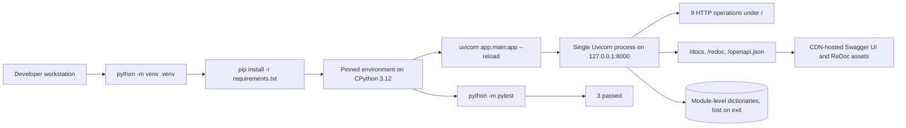

| Runtime constraint | Reason | Implication for any deployment |
| --- | --- | --- |
| Exactly one process per dataset | State is process-local (`app/main.py` lines 7-13) | No load balancing across workers; no rolling restart without data loss |
| Synchronous handlers on a thread pool | All nine handlers are `def`, not `async def` | Throughput is bounded by the worker-thread pool and by the interpreter, not by I/O concurrency |
| No configuration surface | No environment variable, file, or flag is read beyond Uvicorn's own CLI | Promotion between environments cannot change behaviour; the code is the configuration |
| No TLS, CORS, or rate limiting in the app | No middleware is registered in `app/` | A reverse proxy must provide TLS, CORS, and throttling |
| Probes are served but not integrated | `/health` and `/ready` exist and require no credentials (`app/main.py` lines 35-42) | They are usable by an orchestrator, but `/ready` reports storage health from a literal and cannot fail |
| Documentation depends on CDN reachability | `/docs` and `/redoc` reference `cdn.jsdelivr.net` assets (§3.4.2) | Interactive docs need client-side egress; the JSON API does not |


## 3.7 References

- `requirements.txt` — the four declared pins (`fastapi==0.115.12`, `uvicorn==0.34.0`, `pytest==8.3.5`, `httpx==0.28.1`), the file format (bare PEP 508 lines, `==` only, no index URL, markers, extras, or hashes), and the absence of a Pydantic declaration.
- `pytest.ini` — the entire test-discovery configuration: `testpaths = tests`, `python_files = test_*.py`, no `addopts` or plugins.
- `README.md` — the documented run path (`python -m venv`, `pip install -r requirements.txt`, `uvicorn app.main:app --reload`), the `/docs` URL, the `pytest -q` instruction, the "do not configure an environment" guidance (line 28), and the no-deployment disclaimer (line 31).
- `app/main.py` — the whole application: framework constructor and version string (line 5), literal state stores (lines 7-13), Pydantic models (lines 16-22), the hand-rolled bearer check (lines 25-32), the nine handlers (lines 35-110), and the complete import set (lines 1-3), which establishes that no database, cache, cloud, or auth SDK is used.
- `app/__init__.py` — 0-byte package marker that makes `app.main:app` importable without any packaging metadata.
- `tests/test_api.py` — `TestClient` usage over httpx (lines 1-5), the direct import of the in-memory stores, and the `setup_function` state reset (lines 8-11) that shows tests share process memory.
- `app/`, `tests/`, and the repository root — folder listings and `git ls-files` used to establish what does not exist: no `pyproject.toml`, `setup.py`, `Dockerfile`, compose file, CI workflow, or infrastructure definition, and a tracked `.DS_Store` with no `.gitignore`.
- Installed distribution metadata for the resolved graph (PyPI) — `Requires-Python` and `Requires-Dist` ranges for `fastapi` 0.115.12, `starlette` 0.46.2, `pydantic` 2.14.4, `uvicorn` 0.34.0, `httpx` 0.28.1 and `pytest` 8.3.5, plus the licence field of all nineteen resolved distributions.
- `fastapi/openapi/docs.py` (from the `fastapi==0.115.12` wheel) — the default Swagger UI, ReDoc, font, and favicon URLs on `cdn.jsdelivr.net`, `fonts.googleapis.com`, and `fastapi.tiangolo.com` (lines 56, 66, 74, 191, 230).
- `uvicorn/supervisors/__init__.py` and `uvicorn/supervisors/statreload.py` (from the `uvicorn==0.34.0` wheel) — the fallback to `StatReload` when `watchfiles` is not installed, which explains how `--reload` works with the bare `uvicorn` pin.
- `pydantic_core/_pydantic_core.cpython-312-x86_64-linux-gnu.so` (from the resolved `pydantic-core` 2.50.5 wheel) — evidence that the validation layer ships as a CPython- and platform-specific compiled extension.


# 4. Process Flowchart

## 4.1 Workflow Actors, System Boundaries, and Process Inventory

Every process in this repository is request-scoped. The single module `app/main.py` declares nine operations on one FastAPI object (`app/main.py` line 5), and each operation runs start-to-finish inside the handling of a single HTTP request. There is no scheduler, queue consumer, background task, worker thread, or outbound call anywhere in `app/` or `tests/`: a search of the tracked files for `BackgroundTasks`, `async`, `await`, `threading`, `httpx`, `requests`, `celery`, `kafka`, `sched`, and `webhook` matches only `httpx==0.28.1` in `requirements.txt`, which is the transport beneath `TestClient`. The process inventory is therefore closed at nine operations plus the in-process test run that drives three of them.

### 4.1.1 Actors and Their Touchpoints

| Actor | Where it lives | Boundary role | Touchpoints in the flows |
| --- | --- | --- | --- |
| Anonymous client | Outside the process | Untrusted caller with no credential | Reaches `GET /health`, `GET /ready`, `GET /metrics`, `GET /docs`, `GET /openapi.json`; receives 401 on all six guarded routes |
| Owner principal | `USERS["owner-token"] = {"id": 1, "role": "owner"}` (`app/main.py` line 7) | Authenticated caller holding the only privileged role | Every guarded route; `GET /projects` returns the whole store; the only principal that reaches a successful `POST /teams/{user_id}/role` |
| Member principal | `USERS["member-token"] = {"id": 2, "role": "member"}` (line 7) | Authenticated caller with the unprivileged role | Every guarded route except the owner-only success path; `GET /projects` returns only records whose `owner_id` equals `2`; can create tasks on any project and transition any task |
| ASGI server | `uvicorn==0.34.0` (`requirements.txt` line 2) | Owns the socket, event loop, and the threadpool that runs the synchronous handlers | Accepts every request; emits server-level access logs by default; performs no application logic |
| FastAPI application object | `app = FastAPI(title="Proactive Insights Demo API", version="1.0.0")` (line 5) | HTTP boundary: routing, parameter parsing, body validation, serialisation, and the generated `/docs` and `/openapi.json` surface | Intercepts every request before any handler code runs (see §4.2) |
| Handler layer | Nine functions spanning lines 35-110, plus the guard `current_user` (lines 25-32) | Application boundary: identity resolution, business decisions, state mutation | One handler per operation; six of the nine call the guard as their first statement |
| In-memory state | `USERS`, `PROJECTS`, `TASKS`, `TEAM`, `USAGE`, `NEXT_PROJECT`, `NEXT_TASK` (lines 7-13) | The only persistence boundary in the system; process-local module globals | Written by four handlers and the guard's reader; lost on restart; not shared between replicas |
| Regression harness | `tests/test_api.py` (26 lines) driven by `pytest==8.3.5` | In-process actor that impersonates a client without opening a socket | Imports `app`, `PROJECTS`, `TASKS`, `USAGE` directly (line 2); resets state in `setup_function` (lines 8-11) |

### 4.1.2 Process Inventory

| Workflow | Feature | Entry point | Terminal outcomes |
| --- | --- | --- | --- |
| Liveness probe | F-001 | `GET /health` (lines 35-37) | 200 `{"status": "ok"}` |
| Readiness probe | F-001 | `GET /ready` (lines 40-42) | 200 `{"ready": true, "checks": {"storage": "ok"}}` |
| Authentication gate | F-002 | `current_user` (lines 25-32), invoked by six handlers | Resolved principal, or 401 `Missing bearer token` / `Invalid token` |
| Project creation | F-003 | `POST /projects` (lines 45-52) | 200 project object; 401; 422 body-validation list |
| Scoped project listing | F-004 | `GET /projects` (lines 55-58) | 200 JSON array (owner: all records; member: own records only); 401 |
| Task creation | F-005 | `POST /tasks` (lines 61-71) | 200 task object; 401; 404 `Project not found`; 422 body-validation list |
| Task status transition | F-006 | `PATCH /tasks/{task_id}` (lines 74-83) | 200 updated task; 401; 404 `Task not found`; 422 `Unsupported status` |
| Team role administration | F-007 | `POST /teams/{user_id}/role` (lines 86-94) | 200 `{"user_id", "role"}`; 401; 403 `Owner role required`; 404 `User or role not found` |
| Metered usage consumption | F-008 | `POST /billing/consume` (lines 97-105) | 200 `{"used", "limit"}`; 401; 422 `Units must be positive`; 429 `Usage limit reached` |
| Metrics read | F-009 | `GET /metrics` (lines 108-110) | 200 `{"requests_total": 0, "uptime_seconds": <float>}` |
| Generated documentation read | F-010 | `/docs`, `/redoc`, `/openapi.json` served by the application object | 200 HTML or JSON describing 8 paths and 9 operations |
| Regression run | F-011 | `python -m pytest` from the repository root, collection governed by `pytest.ini` | Three tests pass against the live in-memory stores |

### 4.1.3 System Boundaries and Excluded Tiers

The diagram below fixes the four boundaries that every later flow traverses: the client, the ASGI/framework runtime, the handler layer, and the module-level state. It also records the boundaries that do not exist, because most workflows in a comparable service would cross them.

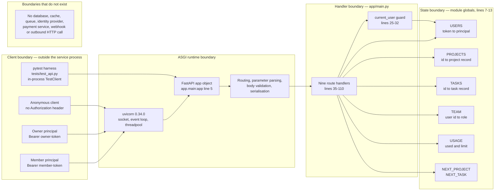

Three consequences follow from this shape and recur in every flow described in §4.3 to §4.7:

- **One hop only.** The server never calls another system, so no workflow has a remote-failure, partial-success, or compensating-transaction state. Every failure is either a framework rejection or an `HTTPException` raised by a handler.
- **State dies with the process.** `PROJECTS`, `TASKS`, `TEAM`, `USAGE`, and both counters are module globals initialised at import (lines 8-13). A restart returns the system to `PROJECTS={}`, `TASKS={}`, `TEAM={1: "owner", 2: "member"}`, `USAGE={"used": 0, "limit": 5}`, `NEXT_PROJECT=1`, `NEXT_TASK=1`; a second uvicorn worker would hold a separate copy of all six.
- **The client is the only external scheduler.** Because nothing runs between requests, the ordering of state changes is exactly the arrival order of requests, which is why §4.6 treats each handler's statement order as the system's transaction boundary.


## 4.2 High-Level System Workflow

All nine operations share one request lifecycle. The framework performs its checks first, the guard performs identity checks second, and the handler performs business checks third; only after all three layers pass does any state change. The swimlane diagram below is the high-level workflow that every later sub-section specialises.

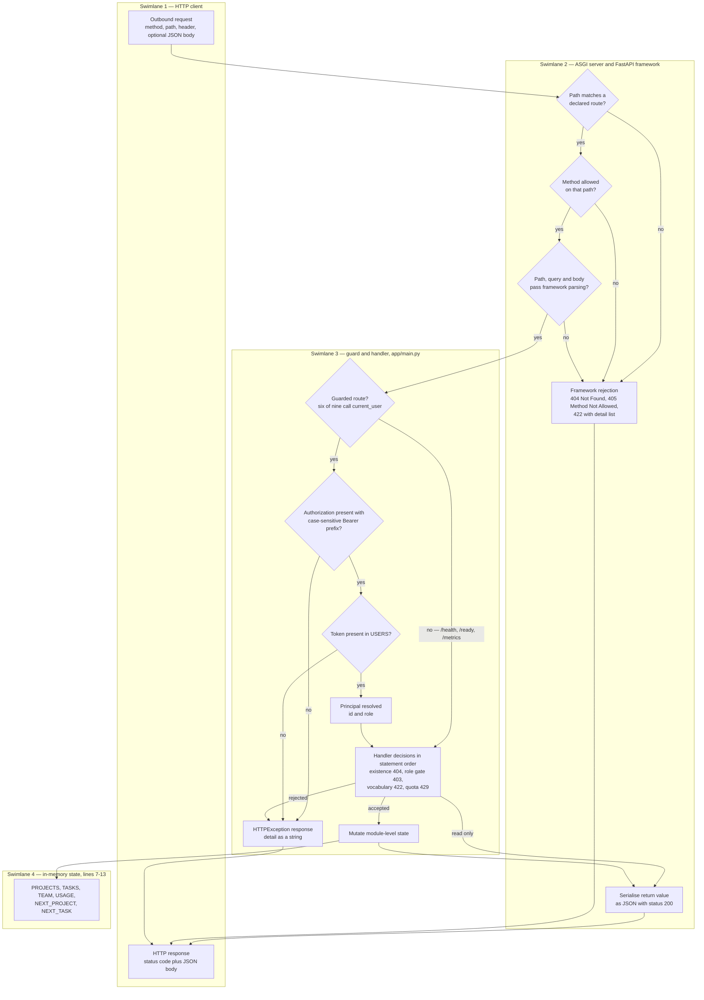

### 4.2.1 Stage Responsibilities and Observed Ordering

| Stage | Owner | What it decides | Failure it produces |
| --- | --- | --- | --- |
| 1. Path resolution | Starlette router, driven by the nine decorators at lines 35-110 | Whether any declared route matches the request path | 404 `{"detail": "Not Found"}` for an unknown path; 405 `{"detail": "Method Not Allowed"}` with an `Allow` header when the path exists under another verb |
| 2. Parameter and body parsing | FastAPI + Pydantic v2 | Whether path parameters coerce, required query parameters exist, and request bodies satisfy `ProjectIn` / `TaskIn` | 422 with a `detail` **list** of `{type, loc, msg, input}` objects |
| 3. Identity | `current_user` (`app/main.py` lines 25-32) | Whether the caller presents a recognised bearer token, and which principal it maps to | 401 with `detail` as a **string**: `Missing bearer token` or `Invalid token` |
| 4. Business rules | The individual handler | Existence (404), role gate (403), value vocabulary (422), quota (429) | `HTTPException` with a string `detail`, in each handler's own statement order |
| 5. Mutation and serialisation | The handler, then FastAPI | Store write, counter increment, JSON response body | None — no branch between a successful write and a successful response |

Two ordering facts from this table drive every downstream flow and are reproduced exactly in §4.3 and §4.5:

- **Framework parsing precedes the guard.** `POST /projects` with an invalid body and *no* `Authorization` header returns 422, not 401, because the body is validated before the handler executes. The same holds for a missing `status`, a non-integer `task_id`, a missing `role`, and a non-integer `units`. Conversely, once the parameters are syntactically valid, the handler's first statement runs first: `PATCH /tasks/99?status=bogus` without a header returns 401, and with a header returns 404 rather than 422.
- **Handler ordering is the specification.** Within a handler the checks are a fixed sequence, and a request can only reach check *n+1* by passing check *n*. §4.3 records each sequence as a numbered ladder; §4.5 maps each rung to its status code and recovery path.

Timing is not a variable anywhere in this workflow. No handler performs I/O, waits on a lock, or calls a network peer, so the stage a request is in is determined solely by its own inputs. §4.8 records the absence of any declared latency, timeout, or retry budget.


## 4.3 Core Business Process Flows

Each core feature is one handler, so its process flow is the handler's statement order plus the framework checks that precede it. The ladders below are normative: a request reaches rung *n+1* only after passing rung *n*, and the rungs are listed in the order the running application evaluates them.

### 4.3.1 Project Creation and Role-Scoped Listing (F-003, F-004)

**Creation ladder — `POST /projects` (`app/main.py` lines 45-52).**

| Rung | Check | Source | Failure |
| --- | --- | --- | --- |
| 1 | Body parses as `ProjectIn`: `name` present, 2-80 characters | Pydantic `Field(min_length=2, max_length=80)` (lines 16-17) | 422, `detail` list with `type` = `missing`, `string_too_short`, or `string_too_long` |
| 2 | Bearer credential resolves to a principal | `current_user(authorization)` (line 48) | 401, `Missing bearer token` or `Invalid token` |
| 3 | Record assembled: `id = NEXT_PROJECT`, `name` from the body, `owner_id = user["id"]` | Lines 49 | No failure path |
| 4 | `PROJECTS[id]` written, then `NEXT_PROJECT += 1` | Lines 50-51 | No failure path |
| 5 | Record returned unchanged | Line 52 | 200 with `{id, name, owner_id}` |

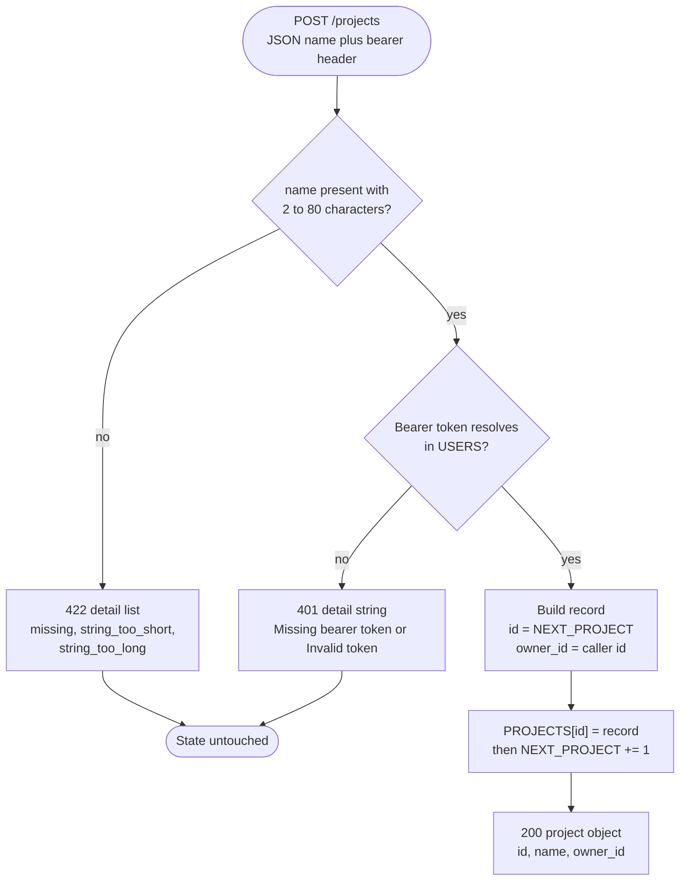

Business rules that shape this flow: the owner is always the authenticated principal, never a body field; identifiers are process-wide and monotonic, shared across both principals and not reset between requests; a rejected body never consumes an identifier (verified — `NEXT_PROJECT` stayed `1` after a 422); and there is no uniqueness, trimming, or idempotency rule, so two identical requests create two records.

**Listing ladder — `GET /projects` (lines 55-58).**

| Rung | Check | Source | Failure |
| --- | --- | --- | --- |
| 1 | Bearer credential resolves to a principal | `current_user` (line 57) | 401 |
| 2 | Single filter predicate over `PROJECTS.values()` | Line 58: include when `p["owner_id"] == user["id"]` **or** `user["role"] == "owner"` | No failure path |
| 3 | Whole records serialised as a JSON array in insertion order | Line 58 | 200; empty store yields `[]` |

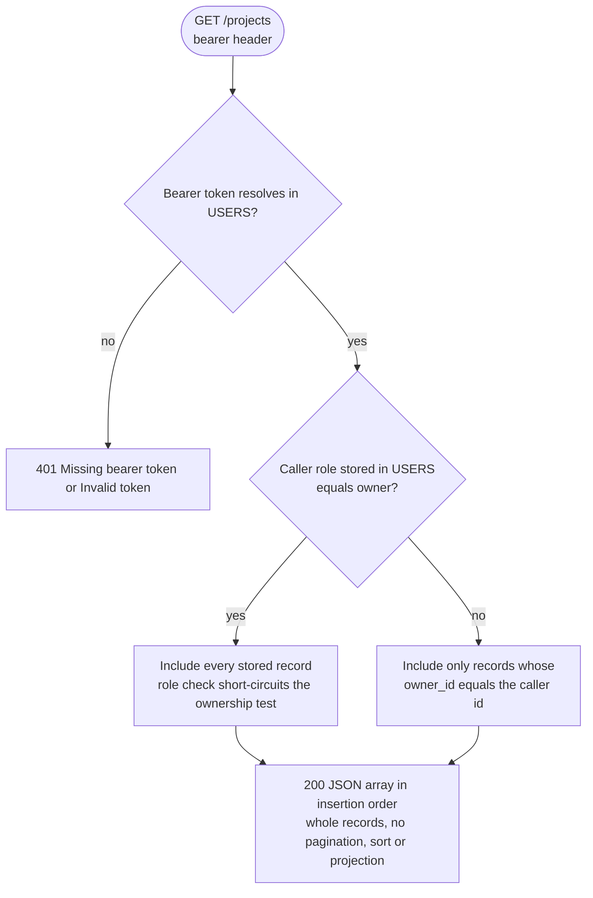

The decision point at rung 2 reads the role from `USERS` (line 7). It never reads `TEAM` (line 10), which is why a successful role change through §4.3.3 does not widen this result — verified by promoting user `2` to `owner` and observing that `GET /projects` as `member-token` still returned only its own record. The filter is the only enforced data-visibility rule in the service and is not asserted for the member branch by `tests/test_api.py`.

### 4.3.2 Task Creation and Status Transition (F-005, F-006)

**Creation ladder — `POST /tasks` (lines 61-71).**

| Rung | Check | Source | Failure |
| --- | --- | --- | --- |
| 1 | Body parses as `TaskIn`: `title` 2-120 characters, `project_id` integral | `Field` constraints (lines 20-22) | 422 `detail` list |
| 2 | Bearer credential resolves to a principal | `current_user` (line 64) | 401 |
| 3 | Referenced project exists | `payload.project_id not in PROJECTS` (line 65) | 404 `Project not found` |
| 4 | Record assembled with `status: "open"` and `created_by = user["id"]` | Lines 67-68 | No failure path |
| 5 | `TASKS[id]` written, then `NEXT_TASK += 1` | Lines 69-70 | No failure path |
| 6 | Record returned | Line 71 | 200 |

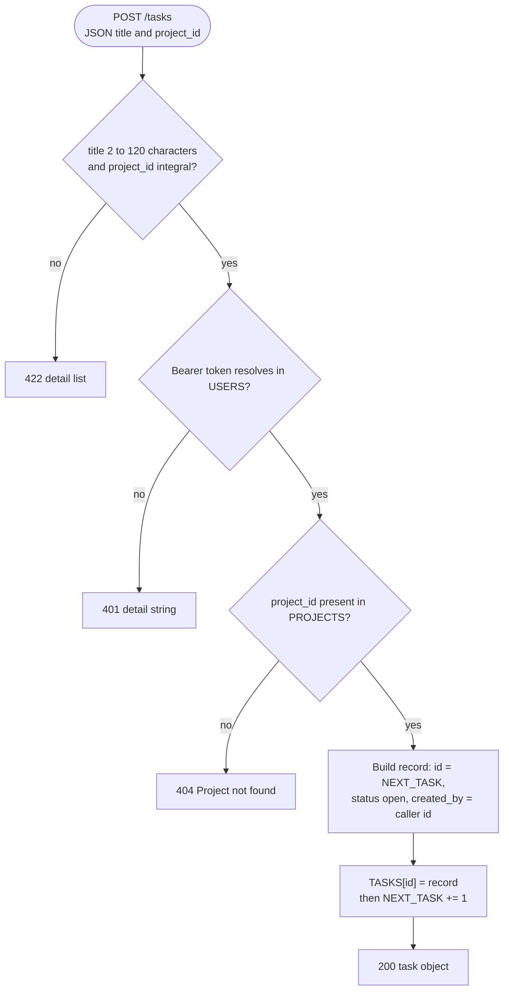

Rung 3 is the only referential-integrity check in the system, and it is followed by no ownership test: a member token creating a task on a project owned by user `1` returned 200 with `created_by: 2` (verified). The initial `status` and `created_by` values are assigned by the handler, so the client cannot set either.

**Transition ladder — `PATCH /tasks/{task_id}` (lines 74-83).**

| Rung | Check | Source | Failure |
| --- | --- | --- | --- |
| 1 | `task_id` coerces to an integer and the required `status` query parameter is present | Handler signature (line 75) | 422 `detail` list (`int_parsing`, or `missing` at `["query", "status"]`) |
| 2 | Bearer credential resolves to a principal | `current_user` (line 76); the returned principal is discarded | 401 |
| 3 | Task exists | `TASKS.get(task_id)` (line 77) | 404 `Task not found` |
| 4 | `status` belongs to the closed set | Line 80: `{"open", "in_progress", "done"}` | 422 `Unsupported status` |
| 5 | Stored record mutated in place | Line 82 | No failure path |
| 6 | Full record returned | Line 83 | 200 |

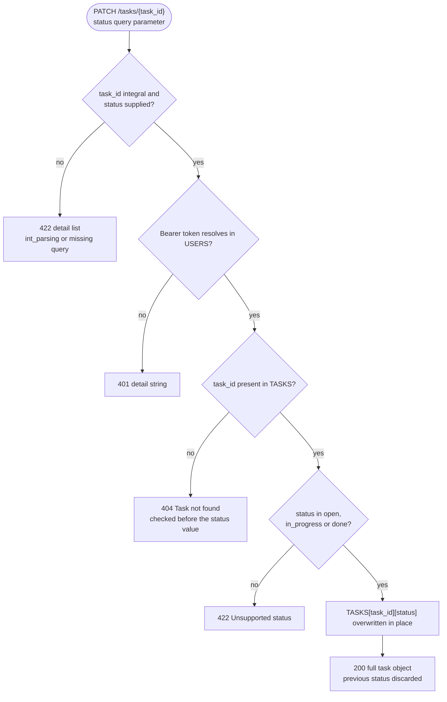

The rung order is observable: `PATCH /tasks/99?status=bogus` returns 404, not 422, and without a header returns 401 before either. Identity is proved at rung 2 but never compared with `created_by` or the project owner, so any valid token may move any task — verified by a member token transitioning a task created by user `1`. There is no transition matrix (any state may follow any state), no history record, and no read route: `GET /tasks` and `GET /tasks/{task_id}` both return 405, so a transition is observable only in its own response or in a later `PATCH`.

### 4.3.3 Team Role Administration (F-007)

| Rung | Check | Source | Failure |
| --- | --- | --- | --- |
| 1 | `user_id` coerces to an integer and the required `role` query parameter is present | Handler signature (line 87) | 422 `detail` list |
| 2 | Bearer credential resolves to a principal | `current_user` (line 88) | 401 |
| 3 | Caller's `USERS` role equals `owner` | Line 89 | 403 `Owner role required` |
| 4 | `user_id` is a key of `TEAM` **and** `role` is `owner` or `member` | Line 91 | 404 `User or role not found` (one message for both causes) |
| 5 | `TEAM[user_id] = role` | Line 93 | No failure path |
| 6 | Applied values echoed | Line 94 | 200 `{user_id, role}` |

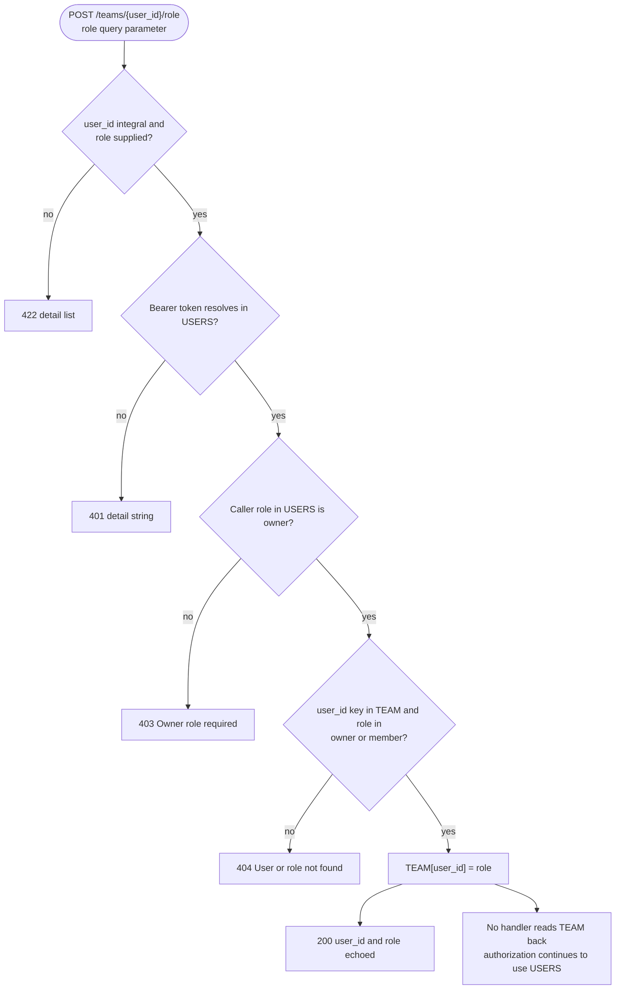

This is the only privileged operation in the service and the only workflow that ends in a write no other workflow consumes. Rung 4 validates the target against `TEAM`, which is seeded `{1: "owner", 2: "member"}` (line 10); rung 5 writes the same store; but `current_user` (lines 29-32) and the listing filter (line 58) both resolve roles from `USERS` (line 7). A verified promotion of user `2` left `TEAM` at `{1: "owner", 2: "owner"}` while `USERS["member-token"]["role"]` stayed `member`, and that principal still received a member-scoped project list. The same reasoning covers self-modification: an owner may set its own `TEAM` entry to `member` and the request succeeds, because the gate at rung 3 reads `USERS` and is already satisfied. No notification, approval, or audit record accompanies the write.

### 4.3.4 Metered Usage Consumption (F-008)

| Rung | Check | Source | Failure |
| --- | --- | --- | --- |
| 1 | `units` coerces to an integer (default `1` when omitted) | Handler signature (line 98) | 422 `detail` list with `type` = `int_parsing` |
| 2 | Bearer credential resolves to a principal | `current_user` (line 99) | 401 |
| 3 | `units >= 1` | Line 100 | 422 `Units must be positive` |
| 4 | `USAGE["used"] + units <= USAGE["limit"]` | Line 102, limit `5` (line 11) | 429 `Usage limit reached`, meter unchanged |
| 5 | `USAGE["used"] += units` | Line 104 | No failure path |
| 6 | Meter returned | Line 105 | 200 `{used, limit}` |

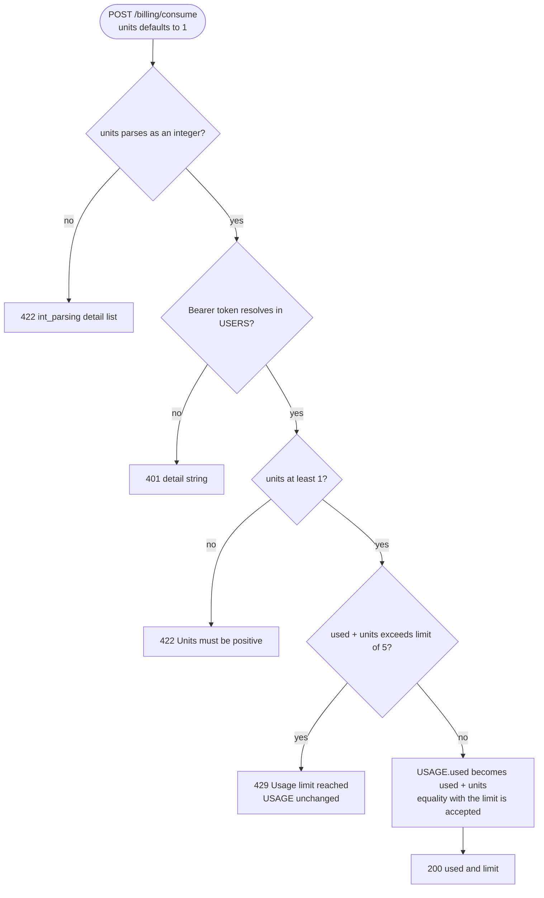

Rung 4 uses a strict `>` comparison, so the boundary is inclusive: from `used = 1`, `units=4` returns `{"used": 5, "limit": 5}`, and the next unit returns 429 with the meter still at `5` (verified). Rejection is side-effect free because the increment sits after both guards. The meter is a single process-global integer, not keyed by principal, project, or request, so a member token can exhaust the quota an owner is consuming, and there is no reset route — only a process restart or direct manipulation of `USAGE` (as `setup_function` does) returns it to zero. The read-modify-write across rungs 4 and 5 holds no lock; a 24-thread probe against a meter holding `4` produced exactly one 200 and twenty-three 429s in each of five trials, so no over-consumption was observed, but nothing in the code prevents it and a second uvicorn worker would hold its own meter.

### 4.3.5 Operational Probe, Metrics, and Documentation Flows (F-001, F-009, F-010)

These routes touch no state and call no guard, so each is a single step from request to constant response. Their omission of the guard is deliberate and is what allows an evaluator to confirm the service is running before holding a token.

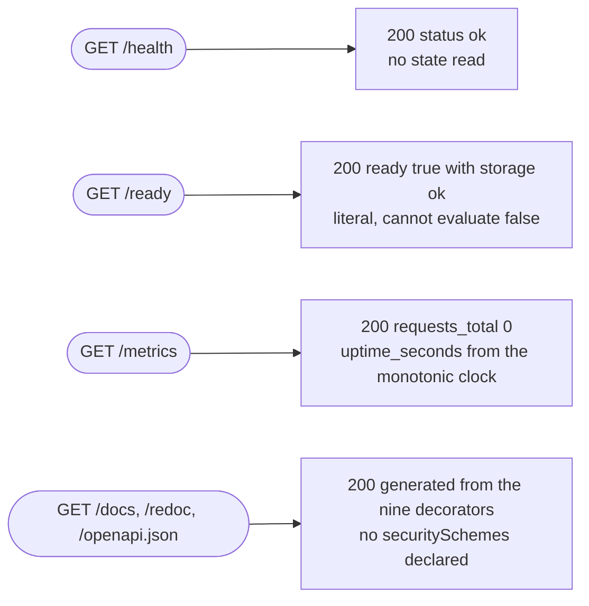

`requests_total` is the literal `0` at line 110 and no increment site exists in `app/`, so repeated calls return identical values while `uptime_seconds` advances with the host clock. `/ready` reports `{"storage": "ok"}` without inspecting `PROJECTS` or `TASKS`, so the readiness signal cannot reflect a degraded store. The documentation routes are produced by the framework from the route decorators; the resulting document declares each guarded operation's `authorization` header as an optional parameter and no security scheme, as recorded in F-010.


## 4.4 Integration Workflows and API Interaction Sequences

The service has exactly two integration surfaces: HTTP between a client and the process, and direct in-process object access between the test harness and the application object. Nothing else crosses a boundary — there is no outbound request, message broker, or scheduled job in `app/` or `tests/`.

### 4.4.1 Client-to-Service Sequence for an Authenticated Write

The sequence below traces `POST /projects`, which exercises every stage of the pipeline: framework validation, guard, principal resolution, store write, and serialisation. The same shape applies to the other five guarded routes with the handler-specific rungs of §4.3 substituted at the final step.

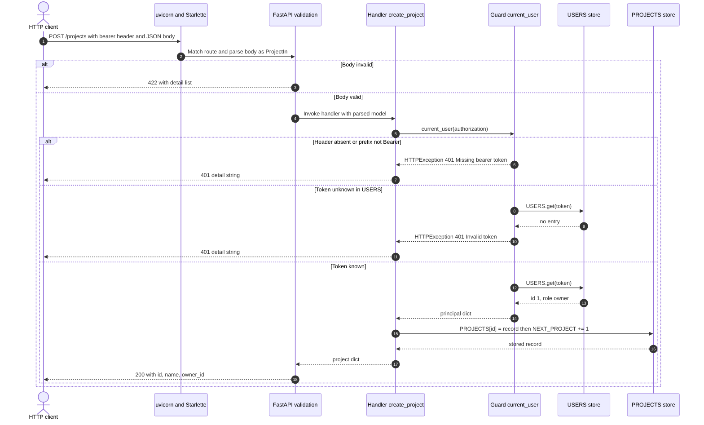

Two properties of this interaction matter for anything built on top of it: the client receives no response until the store write has completed, because the handler returns only after line 51; and every rejection path returns before any write is attempted, so a failed call never leaves a partial record.

### 4.4.2 Harness-to-Application Interaction

The regression suite does not open a socket. It imports the live application object and the live stores (`from app.main import app, PROJECTS, TASKS, USAGE`, `tests/test_api.py` line 2) and drives the same handler code through `TestClient`, so the boundary it crosses is a Python call rather than a network hop.

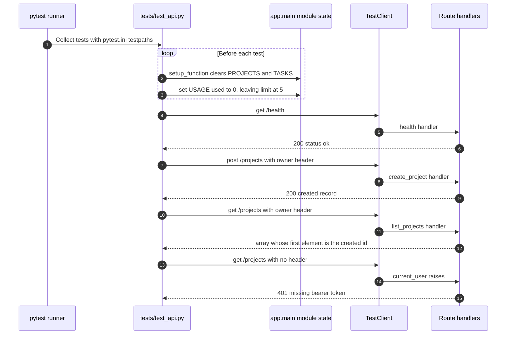

The reset hook mutates the dictionaries rather than rebinding them (`PROJECTS.clear()`, `TASKS.clear()`, `USAGE["used"] = 0`, lines 8-11), which is the only reason the imported references stay valid. `NEXT_PROJECT`, `NEXT_TASK`, and `USAGE["limit"]` are deliberately left alone, so identifiers keep advancing across tests while list contents and usage stay deterministic. The suite must be launched as `python -m pytest` from the repository root: with no `__init__.py` in `tests/`, the `pytest` console script cannot import the `app` package. Six of the nine routes and two implemented branches (member visibility, owner-only 403) receive no assertion.

### 4.4.3 Event, Message, and Batch Processing

None exists, and the absence is structural rather than incidental. `app/` contains no `BackgroundTasks` parameter, no `async def` endpoint, no `lifespan` or startup hook, no thread, no timer, and no third-party client; there is no broker configuration, queue name, or scheduled entry point in the repository, and `requirements.txt` carries no messaging or scheduler dependency. Consequently there is no event-processing flow to document: no message contract, no at-least-once delivery semantics, no ordering guarantee beyond request arrival order, no dead-letter path, and no batch window.

The only sequential multi-step execution in the repository is the test run itself: `pytest.ini` restricts collection to `tests/test_api.py`, and that module executes three tests in definition order, resetting stores before each, completing in roughly a tenth of a second.

### 4.4.4 Data Flow to External Systems

Server-side there is no data flow to any external system. The one network relationship beyond the client-to-service hop is browser-side: opening `/docs` makes the browser fetch the Swagger UI assets that FastAPI `0.115.12` references, which are served from a public CDN rather than the application; `/openapi.json` is generated locally and read only by the client. Both are recorded with the dependency inventory in §3.4. No credential, project record, task record, or usage count leaves the process by any path, because no serialiser other than the HTTP response bodies exists.


## 4.5 Error Handling, Retry, and Recovery Flows

Error handling in this service is rejection, not repair. Nothing in `app/` catches an exception: the module contains exactly nine `raise HTTPException(...)` sites (lines 27, 31, 66, 79, 81, 90, 92, 101, 103) and no `try`/`except` block. Every error path therefore terminates the request before any state change and returns a status code decided by the layer that found the problem.

### 4.5.1 Error Classification Flow

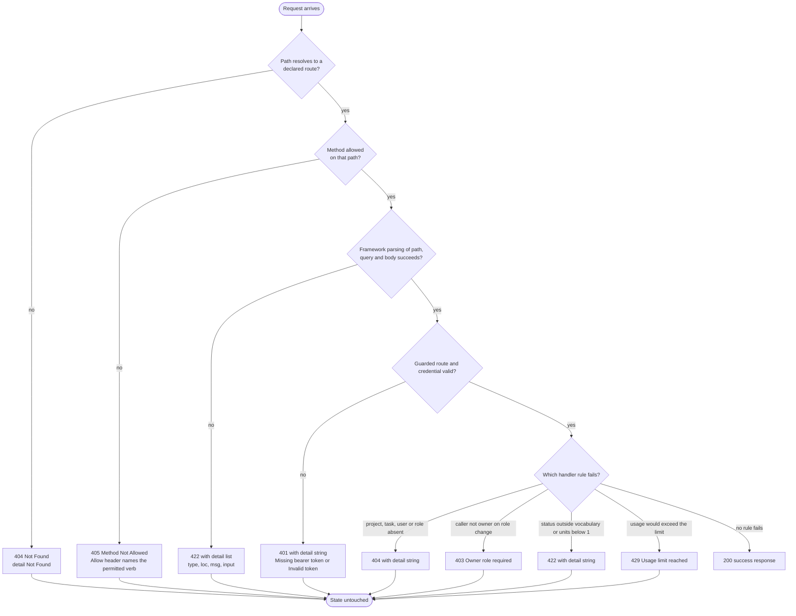

### 4.5.2 Error Response Catalog

| Status and body | Raised by | Trigger observed | State effect |
| --- | --- | --- | --- |
| 404 `{"detail": "Not Found"}` | Starlette router | Any undeclared path, including `GET /projects/1`, `DELETE /projects/1` | None |
| 405 `{"detail": "Method Not Allowed"}` with `Allow` | Starlette router | `GET /tasks` (`Allow: POST`), `POST /health` (`Allow: GET`) | None |
| 422 `{"detail": [{"type", "loc", "msg", "input"}]}` | FastAPI / Pydantic | Bad `name` or `title` length, missing body field, missing `status` or `role` query, non-integer `task_id` or `units` | None |
| 401 `{"detail": "Missing bearer token"}` | `current_user` line 27 | No header, `Basic <token>`, lower-case `bearer <token>` | None |
| 401 `{"detail": "Invalid token"}` | `current_user` line 31 | `Bearer <unknown>`, `Bearer ` with empty token, token with trailing space | None |
| 404 `{"detail": "Project not found"}` | `create_task` line 66 | `project_id` absent from `PROJECTS` | None |
| 404 `{"detail": "Task not found"}` | `update_task` line 79 | Unknown `task_id`; takes precedence over an invalid `status` | None |
| 422 `{"detail": "Unsupported status"}` | `update_task` line 81 | `status` outside `open`, `in_progress`, `done` | None |
| 403 `{"detail": "Owner role required"}` | `change_role` line 90 | Member token calling the role route | `TEAM` unchanged |
| 404 `{"detail": "User or role not found"}` | `change_role` line 92 | Unknown `user_id` **or** `role` outside `owner`/`member` | `TEAM` unchanged |
| 422 `{"detail": "Units must be positive"}` | `consume_usage` line 101 | `units=0`, `units=-3` | Meter unchanged |
| 429 `{"detail": "Usage limit reached"}` | `consume_usage` line 103 | `used + units > limit` | Meter unchanged at `used = 5` (verified) |

The catalog exposes a client-facing inconsistency worth stating explicitly: the same status code carries two payload shapes. Framework rejections return `detail` as a **list** of validation objects; handler rejections return `detail` as a **string**. No response model, exception handler, or envelope normalises them (§2.4.4 records the same risk). Two further error shapes are indistinguishable by design: an unknown `user_id` and an out-of-vocabulary `role` share the message `User or role not found`.

### 4.5.3 Retry, Fallback, and Recovery Behaviour

| Concern | Implementation | Consequence for a caller |
| --- | --- | --- |
| Retry inside the service | None — no loop, backoff, or retry helper exists in `app/` | Retrying is entirely a client decision; there is no automatic reattempt |
| Fallback path | None — no cached or default value is substituted for a rejected request | A failed call has no degraded-response alternative |
| Idempotency | No idempotency key, request id, or de-duplication on any route | Retrying `POST /projects` or `POST /tasks` creates a second record; retrying `POST /billing/consume` consumes a second unit |
| Safe retries | `GET /health`, `GET /ready`, `GET /metrics`, `GET /projects`, `GET /docs` are side-effect free; `PATCH /tasks/{task_id}?status=X` is idempotent because it assigns a value rather than advancing a counter | A retried `PATCH` leaves the task in the state the caller intended |
| Partial-failure recovery | Not applicable — every handler performs exactly one store write as its final side effect, after all checks | There is no compensating action to design; a rejection never needs an undo |
| Process-level recovery | A restart re-imports the module and restores the seeded constants (lines 7-13) | Recovery from corrupted state is a restart, which discards all projects, tasks, and usage |
| Unhandled exceptions | No `@app.exception_handler` and no `try`/`except`, so an unexpected exception would surface as Starlette's default 500 with an empty server-generated body | A 500 carries no correlation id, no domain message, and no store-state guarantee |
| Error notification | None — no logging call, alert, metric increment, or audit write accompanies any error path | Errors are visible only in the response and, at the transport level, in uvicorn's default access log |

Because rejection precedes mutation on every route, the recovery procedure for all twelve catalogued failures is identical and trivial: correct the input and resend. The one genuinely unrecoverable condition is state saturation of the usage meter — with no reset route, a 429 at `used = 5` persists until the process restarts (§4.6.4).


## 4.6 State Management, Persistence Points, and Transaction Boundaries

All state in this service is module-level Python objects created at import. There is no session, no database, no file, and no cache: the six stores at `app/main.py` lines 7-13 are the entire persistence tier, and the lifetime of every record equals the lifetime of the process.

### 4.6.1 State Inventory and Mutation Points

| Object (line) | Shape and seed value | Written by | Read by |
| --- | --- | --- | --- |
| `USERS` (7) | `{"owner-token": {"id": 1, "role": "owner"}, "member-token": {"id": 2, "role": "member"}}` | Nothing — immutable after import; no route issues or edits a token | `current_user` (line 29), `change_role` (line 89), `list_projects` (line 58) |
| `PROJECTS` (8) | `{}`, keyed by integer id; record `{id, name, owner_id}` | `create_project` (line 50) | `create_task` (line 65), `list_projects` (line 58) |
| `TASKS` (9) | `{}`, keyed by integer id; record `{id, title, project_id, created_by, status}` | `create_task` (line 69), `update_task` (line 82, status only) | `update_task` (line 77) — no listing route exists |
| `TEAM` (10) | `{1: "owner", 2: "member"}` | `change_role` (line 93) | `change_role` (line 91, as a key set only); never consulted for an authorization decision |
| `USAGE` (11) | `{"used": 0, "limit": 5}` | `consume_usage` (line 104, `used` only; `limit` is never written) | `consume_usage` (lines 102, 105) |
| `NEXT_PROJECT` (12) | `1` | `create_project` (line 51, `global` declaration at line 47) | `create_project` (line 49) |
| `NEXT_TASK` (13) | `1` | `create_task` (line 70, `global` declaration at line 63) | `create_task` (line 67) |

### 4.6.2 Task Lifecycle State Transition

A task is created directly in `open` (line 68) and has exactly one mutable attribute. The transition rule is a vocabulary check, not a matrix: every value in `{"open", "in_progress", "done"}` is reachable from every other, including from itself, so the diagram below shows the six ordered pairs plus a self-transition and the handler permits all nine.

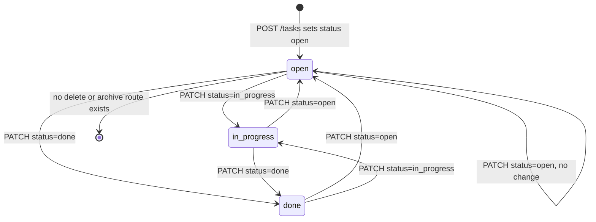

Two properties of this machine are deliberate in the code: `done` is not terminal, because line 80 accepts `open` from any state; and every transition overwrites the stored dict in place (line 82), so the previous state, the actor, and a timestamp are all lost. There is no history, no version field, and no optimistic-concurrency token, which means two `PATCH` calls cannot conflict — the later request simply wins.

### 4.6.3 Identity State: Authoritative Source Versus Write-Only Store

The service holds two role structures that are never synchronised, which produces the one state-transition flow with no observable effect.

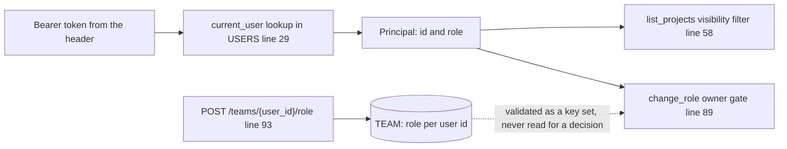

A transition written by `change_role` updates `TEAM` and returns success, but the authority for both the visibility filter and the owner gate is the `role` field inside `USERS`, which no route can change. The observable state machine of a principal is therefore a single state — a token's role is fixed for the process lifetime — while `TEAM` accumulates assignments that are readable only by a subsequent `change_role` key check.

### 4.6.4 Persistence Points, Caching, and Transaction Boundaries

| Concern | Behaviour in this repository | Evidence |
| --- | --- | --- |
| Durable persistence points | None. No file write, database driver, ORM, migration, or serialisation to disk exists; every record lives only in the dictionaries above | `requirements.txt` lists only `fastapi`, `uvicorn`, `pytest`, `httpx`; no storage module in `app/` |
| Restart semantics | A restart re-executes the module and reinstates the seed constants; all projects, tasks, role assignments, and usage counts are lost, and both id counters return to `1` | Lines 7-13; `README.md` line 9 states data is held in memory |
| Caching | None. No cache, memoisation, TTL, or cached OpenAPI document is configured; `/projects` re-scans the store on every call and the documentation routes are regenerated per request | Absence of any caching dependency or decorator; `list_projects` line 58 |
| Write ordering inside a handler | `create_project` writes `PROJECTS[id]` and then increments the counter (lines 50-51); `create_task` writes `TASKS[id]` and then increments (lines 69-70); `update_task`, `change_role`, and `consume_usage` each perform one assignment | Handler bodies |
| Transaction boundary | One handler invocation. The dict assignment is the commit point, and the response body is produced only after it, so a client never sees a record that is not yet stored | Handler bodies |
| Atomicity of the two-step writes | Not guaranteed. The record insert and the counter increment are separate bytecode operations on module globals with no lock, and the sync handlers run in uvicorn's thread pool, so concurrent requests can interleave between them | No `threading.Lock`, no `atomic`, no serialisation primitive anywhere in `app/` |
| Concurrency of the usage meter | A read at line 102 and a write at line 104 with no lock. A 24-thread probe at `used = 4` produced exactly one 200 and twenty-three 429s in each of five trials and never exceeded `used = 5`, so no over-consumption was observed; the code does not prevent it | Probe run against the running app |
| Horizontal scaling | Every replica would own a private copy of all seven objects, so two workers behind one socket would return mutually inconsistent listings and meters | State is process-local (§2.4.4) |
| Test-time reset | `setup_function` clears `PROJECTS` and `TASKS` and sets `USAGE["used"] = 0` by mutation, leaving both counters and `USAGE["limit"]` untouched | `tests/test_api.py` lines 8-11 |

No transaction manager, unit of work, or rollback path is needed at these boundaries because no handler writes more than one logical record, and every handler performs its checks first. The practical consequence is that the only way to reach an inconsistent state is process-level: a restart, a second worker, or an interleaved pair of concurrent requests.


## 4.7 Validation, Authorization, and Compliance Checkpoints

Checks in this service are layered and strictly ordered: framework parsing, then identity, then handler rules. The tables below enumerate every checkpoint that can be reached, where it is declared, and what a violation produces, so a flow can be audited rung by rung against §4.3.

### 4.7.1 Checkpoint Ladder

| Order | Layer | Checkpoint | Applies to | Violation |
| --- | --- | --- | --- | --- |
| 1 | Router | Path matches a declared route | All nine operations | 404 `Not Found` |
| 2 | Router | Verb allowed on that path | All nine operations | 405 with `Allow` header |
| 3 | Pydantic | Body model satisfied (`ProjectIn`, `TaskIn`) | `POST /projects`, `POST /tasks` | 422 `detail` list |
| 4 | FastAPI | Path and query parameters present and coercible | `PATCH /tasks/{task_id}`, `POST /teams/{user_id}/role`, `POST /billing/consume` | 422 `detail` list |
| 5 | Guard | `Authorization` present with case-sensitive `Bearer ` prefix | Six guarded routes | 401 `Missing bearer token` |
| 6 | Guard | Token exists in `USERS` | Six guarded routes | 401 `Invalid token` |
| 7 | Handler | Referenced resource exists | Task create (project), task patch (task), role change (user) | 404 with handler message |
| 8 | Handler | Caller holds the required role | Role change only | 403 `Owner role required` |
| 9 | Handler | Value belongs to the closed vocabulary | Task patch (`status`), role change (`role`) | 422 with handler message |
| 10 | Handler | Quota arithmetic permits the request | Usage consumption only | 429 `Usage limit reached` |
| 11 | Handler | Assignment of server-derived fields | Project create, task create | Not violable — the client cannot supply `owner_id`, `created_by`, or the initial `status` |

Rungs 3 and 4 precede rungs 5 and 6 for a structural reason: FastAPI resolves every declared parameter, including the request body, before it calls the handler, and this application calls the guard from inside the handler. The consequence is observable — a request with a malformed body and no credential receives 422, while a request with well-formed parameters and no credential receives 401.

### 4.7.2 Business Rule Catalog

| Rule | Declared at | Evaluated on | Violation |
| --- | --- | --- | --- |
| Project `name` length 2-80, no trimming or normalisation | `ProjectIn` (line 17) | Every `POST /projects` | 422 `string_too_short` / `string_too_long` / `missing` |
| Task `title` length 2-120 | `TaskIn` (line 21) | Every `POST /tasks` | 422 `string_too_short` / `string_too_long` |
| Task `project_id` must be an integer naming an existing project | Line 22 (type), line 65 (existence) | Every `POST /tasks` | 422 `int_parsing`, or 404 `Project not found` |
| Task status vocabulary `open`, `in_progress`, `done`; new tasks are `open` | Line 68 (default), line 80 (check) | `PATCH /tasks/{task_id}` | 422 `Unsupported status` |
| Role vocabulary `owner`, `member`; target must be a known team member | Line 91 | `POST /teams/{user_id}/role` | 404 `User or role not found` |
| Consumption must be at least one unit | Line 100 | `POST /billing/consume` | 422 `Units must be positive` |
| Cumulative consumption may not exceed the limit, equality permitted | Line 102 against `limit = 5` (line 11) | `POST /billing/consume` | 429 `Usage limit reached`, meter unchanged |
| Ownership of a new project derives from the credential | Line 49 | `POST /projects` | Not violable from the body |
| Project visibility: own records, or all records for the `owner` role | Line 58 | Every `GET /projects` | Not violable — the filter is unconditional |

No rule constrains uniqueness of a project name, duplicate task titles, the number of projects a principal may create, request body size, or the rate at which any route is called. Validation is type- and length-based only; there is no trimming, case folding, or content inspection, and no response model narrows what a handler returns.

### 4.7.3 Authorization Checkpoints by Route

| Route | Credential required | Role gate | Resource scoping | Gap carried into the flow |
| --- | --- | --- | --- | --- |
| `GET /health`, `GET /ready` | No | None | None | Unauthenticated by design so probes work before a token exists |
| `GET /metrics` | No | None | None | Exposes a host-clock reading to any caller |
| `/docs`, `/redoc`, `/openapi.json` | No | None | None | The document does not declare that the six guarded routes need a token |
| `POST /projects` | Yes | None — any principal | None | No quota, approval, or name-uniqueness step |
| `GET /projects` | Yes | `owner` widens the result | `owner_id == caller id` for members | The only enforced data-visibility rule; member branch has no test |
| `POST /tasks` | Yes | None | **None on the referenced project** | A member may attach work to another principal's project (verified 200) |
| `PATCH /tasks/{task_id}` | Yes | None | **None on creator or project owner** | Any valid token may move any task; identity is proved and discarded (line 76) |
| `POST /teams/{user_id}/role` | Yes | `owner`, read from `USERS` | Target must exist in `TEAM` | The write lands in `TEAM`, which no decision reads, so the gate protects an inert assignment |
| `POST /billing/consume` | Yes | None | **None — the meter is global** | A member can exhaust the quota for every principal |

The authorization model is therefore authentication plus one role comparison plus one visibility filter. Three flows — task creation, task transition, and usage consumption — perform no authorization decision beyond "the token is valid", and the role-administration flow performs a decision that changes nothing enforceable (§4.3.3, §4.6.3).

### 4.7.4 Regulatory and Compliance Checkpoints

None is implemented, and the repository declares none. There is no audit log, access record, consent capture, data-retention or deletion path, encryption at rest, field-level redaction, or export control; no compliance regime, standard, or certification is named in `README.md`, `app/`, or `tests/`. The stored records are synthetic (project names, task titles, integer ids), so no personal data category is processed by the code as written. `README.md` line 31 states the fixture must not be deployed or used with real credentials, which is the only governance control the repository carries. A flow designer adding a compliance checkpoint to any of the paths in §4.3 would be adding capability, not preserving existing behaviour.


## 4.8 Timing, SLA, and Observability Considerations

No workflow in this service declares a latency target, timeout, retry budget, rate limit, cache TTL, or expiry. The only timing facts available are structural (what each handler does) and observable (what the running process reports), and both are recorded below so a reader does not mistake a missing constraint for an unstated one.

### 4.8.1 Declared Timing and SLA Constraints

| Timing concern | Status in this repository | Evidence |
| --- | --- | --- |
| Latency SLA or SLO | None declared | No target, percentile, or budget appears in `README.md`, `app/`, `tests/`, or `pytest.ini` |
| Request timeout | None at the application level; no timeout middleware, no per-handler deadline | Absence of middleware in `app/` |
| Retry or backoff budget | None | No retry helper, loop, or backoff constant in `app/` |
| Rate limiting or throttling | None, apart from the usage meter of F-008, which limits consumption rather than request rate | `consume_usage` lines 97-105 |
| Credential lifetime | None — tokens never expire, and no issuance or rotation route exists | `USERS` literal, line 7 |
| Usage quota window | None — the meter is cumulative for the process lifetime with `limit = 5` and no reset route | Line 11 |
| Cache TTL | None — nothing is cached | No caching construct in `app/` |
| Scheduled or batch window | None — no job exists to schedule | §4.4.3 |
| Test-suite time budget | None declared; the run completes in roughly a tenth of a second (observed `3 passed in 0.11-0.14 s`) | `tests/test_api.py`, `pytest.ini` |

### 4.8.2 Latency Characteristics by Route

| Route | Work performed per request | How cost grows |
| --- | --- | --- |
| `GET /health`, `GET /ready` | Returns a literal dict; no state access | Constant |
| `GET /metrics` | One `time.monotonic()` call and a literal `0` | Constant |
| `POST /projects` | Body validation, one dictionary lookup in `USERS`, one insert, one counter increment | Constant |
| `GET /projects` | One dictionary lookup, a linear scan of `PROJECTS.values()` with a per-record predicate, full serialisation of every included record | Linear in the number of stored projects; serialised payload grows with it |
| `POST /tasks` | Body validation, credential lookup, one membership test in `PROJECTS`, one insert, one counter increment | Constant |
| `PATCH /tasks/{task_id}` | Credential lookup, one dictionary lookup, one string comparison, one in-place assignment | Constant |
| `POST /teams/{user_id}/role` | Credential lookup, two membership tests, one assignment | Constant |
| `POST /billing/consume` | Credential lookup, two integer comparisons, one assignment | Constant |
| `/docs`, `/redoc`, `/openapi.json` | The OpenAPI document is generated from the route decorators and models on each request | Proportional to the number of routes; the application configures no caching |

The handlers are declared with `def`, so uvicorn runs them in its worker thread pool; because none of them performs I/O or waits, each occupies a thread only for the duration of a few dictionary operations. The only route whose cost depends on accumulated state is `GET /projects`, and it degrades in both CPU and payload size as projects are created, since no pagination, projection, or sort parameter exists.

### 4.8.3 Observability Touchpoints

| Touchpoint | What it reports | Limitation for measuring flow timing |
| --- | --- | --- |
| `GET /health` | `{"status": "ok"}`, unconditionally | Confirms the process is serving; says nothing about latency or state |
| `GET /ready` | `{"ready": true, "checks": {"storage": "ok"}}` | The storage sub-check is a literal, so it cannot report a degraded store |
| `GET /metrics` | `requests_total` (literal `0`) and `uptime_seconds` (`round(monotonic(), 2)`) | No request counter exists, so throughput cannot be derived; the `uptime_seconds` value is the host monotonic clock, not process age — observed readings of about 41,300 seconds were far larger than the process lifetime |
| Application logging | None — no `logging` import, no print, no audit write in `app/` | Errors and their causes leave no trace inside the process |
| Server access log | uvicorn's `access_log` option defaults to `True` in `uvicorn==0.34.0`, and `README.md` starts the server as `uvicorn app.main:app --reload` with no configuration file | Per-request lines exist at the transport level only, with no domain context and no correlation id |
| Tracing / exporter | None | No span, metric endpoint, or sidecar is configured |

### 4.8.4 Start-up and Reload Flow

The operational sequence is one step long: `README.md` lines 12-16 create a virtual environment, install the four pinned requirements, and launch `uvicorn app.main:app --reload`, after which the OpenAPI UI is available at `http://127.0.0.1:8000/docs`. Because the `--reload` supervisor restarts the process on a source change and all state lives in module globals, a reload follows the same path as a restart from §4.6.4: every project, task, role assignment, and consumed unit is discarded and both id counters return to `1`. That is the only timing relationship the system enforces — the freshness of state is bounded above by process lifetime, not by any expiry rule.


## 4.9 References

### Requirement Anchors

Every flow in this section is traced to the feature and requirement identifiers defined in §2.1 and §2.2, and to the assumptions and risks recorded in §2.4.

| Requirement | Flow where it is exercised | Requirement sub-clauses reflected |
| --- | --- | --- |
| F-001 Liveness and Readiness Probes | §4.1.2, §4.3.5, §4.8.3 | F-001-RQ-001 to F-001-RQ-003 (constant bodies, no credential) |
| F-002 Bearer Token Authentication | §4.2, §4.3.1 to §4.3.4 (rung 2 of every ladder), §4.5.2 | F-002-RQ-001 to F-002-RQ-004 (scheme case sensitivity, `Invalid token`, six guarded routes) |
| F-003 Project Creation | §4.3.1 creation ladder, §4.6.1 | F-003-RQ-001 to F-003-RQ-005 (name bounds, server-derived owner, monotonic id) |
| F-004 Role-Based Project Listing | §4.3.1 listing ladder, §4.6.3 | F-004-RQ-001 to F-004-RQ-004 (owner widens, member scoped, no pagination) |
| F-005 Task Creation | §4.3.2 creation ladder, §4.6.1 | F-005-RQ-001 to F-005-RQ-005 (project existence 404, initial `open`, no ownership rule) |
| F-006 Task Status Transition | §4.3.2 transition ladder, §4.5.2, §4.6.2 | F-006-RQ-001 to F-006-RQ-006 (required query parameter, 404 before 422, any caller may transition) |
| F-007 Team Role Administration | §4.3.3, §4.6.3, §4.7.3 | F-007-RQ-001 to F-007-RQ-005 (owner gate, `TEAM` write, combined 404) |
| F-008 Metered Usage Enforcement | §4.3.4, §4.5.2, §4.6.4 | F-008-RQ-001 to F-008-RQ-006 (inclusive boundary, side-effect-free 429, shared meter) |
| F-009 Metrics Endpoint | §4.3.5, §4.8.3 | F-009-RQ-001 to F-009-RQ-004 (constant `requests_total`, monotonic `uptime_seconds`) |
| F-010 Generated API Documentation | §4.1.2, §4.3.5, §4.4.4 | F-010-RQ-001 to F-010-RQ-004 (no declared security scheme) |
| F-011 In-Process Regression Suite | §4.4.2, §4.6.4 | F-011-RQ-001 to F-011-RQ-005 (reset by mutation, ids not reset, untested surface) |

### Repository Evidence

- `app/main.py` - the entire service: application object (line 5), module state (lines 7-13), request models (lines 16-22), the `current_user` guard (lines 25-32), and all nine handlers (lines 35-110) from which every ladder, diagram, and error path in this section is derived
- `app/` - the source package; confirms that no middleware, exception handler, background task, storage, or outbound client exists beyond the single module
- `tests/test_api.py` - the harness flow of §4.4.2: direct imports of `app`, `PROJECTS`, `TASKS`, `USAGE` (line 2), the `setup_function` reset (lines 8-11), and the three asserted paths (lines 14-26)
- `tests/` - contains only that module, establishing that the sequential test run is the sole multi-step execution in the repository
- `pytest.ini` - collection boundary (`testpaths = tests`, `python_files = test_*.py`) used to describe the regression flow
- `requirements.txt` - the four pinned dependencies that bound the runtime: `fastapi==0.115.12`, `uvicorn==0.34.0`, `pytest==8.3.5`, `httpx==0.28.1`
- `README.md` - documented start-up and test commands (lines 11-23) and the in-memory, non-production disclaimer (lines 30-31)
- `uvicorn/config.py` in the installed `uvicorn==0.34.0` distribution (line 196) - `access_log: bool = True`, which is the only request-level observability present outside the application

### Cross-Referenced Sections

- §2.1 Feature Catalog and §2.2 Functional Requirements Table - feature and requirement identifiers used as flow anchors
- §2.4 Implementation Considerations - single-process assumption, query-parameter conventions, and the cross-cutting risks referenced in §4.5 and §4.6
- §3.4 Third-Party Services - the browser-side CDN assets fetched by `/docs`, referenced in §4.4.4

No external web sources were consulted for this section; every statement is grounded in the repository files above or in behaviour observed by executing the application and its test suite.


# 5. System Architecture

## 5.1 High-Level Architecture

### 5.1.1 System Overview

**Architecture style.** The system is a single-module, single-process, synchronous HTTP service built on FastAPI. One file, `app/main.py` (110 lines), declares the ASGI application object, the two request models, the authorization helper, the nine route handlers, and every object that holds state. `app/__init__.py` is 0 bytes and exists only to make `app` importable. There is no second module, no sub-package, no router aggregation, no service or repository layer, and no build system: `git ls-files` lists seven tracked paths in total (`README.md`, `app/__init__.py`, `app/main.py`, `pytest.ini`, `requirements.txt`, `tests/test_api.py`, and a stray `.DS_Store`).

The style is best described as a **layered single-file application**: transport (uvicorn), ASGI routing and parameter binding (FastAPI/Starlette), edge validation (Pydantic models and typed signatures), a procedural handler layer (nine `def` functions), and a process-local state layer (six module-level objects at `app/main.py` lines 7-13). Layering exists only as call order inside one module — handlers reach directly into the dictionaries, with no interface between them.

**Rationale.** The style is not the residue of an abandoned design; it is the point of the repository. `README.md` line 3 calls it "a compact FastAPI service designed as a test fixture for repository-level proactive insights", and line 31 states that "in-memory storage, demo tokens, and intentionally incomplete test coverage are for scanner evaluation only". A single module with no infrastructure makes the ground truth enumerable by reading two files, which is what the fixture is for. Consequences of that choice — no durability, no horizontal scale-out, stub telemetry — are deliberate and are recorded in §1.2.1 and §3.5 rather than treated here as defects to be corrected.

**Key architectural principles and patterns observed in the code.**

- **Edge-first validation, then business rules.** Declarative constraints live on the Pydantic models (`ProjectIn.name` 2–80 characters, `TaskIn.title` 2–120 characters plus an integer `project_id`, `app/main.py` lines 16-22) and on typed path/query parameters; anything the type system cannot express is a runtime check in the handler body with an explicit status code.
- **Fail-fast rejection with a single failure mechanism.** Every business rejection is an `HTTPException` carrying a status code and a fixed detail string. There is no result-object, error-code enum, or custom exception class.
- **Guard-by-call, not guard-by-declaration.** `current_user(authorization)` is invoked as the first statement of each protected handler (`app/main.py` lines 48, 57, 64, 76, 88, 99). It is a plain function call, not a FastAPI dependency, so nothing in the router, the OpenAPI schema, or the type signature advertises that a route requires credentials.
- **State owned positionally by the module.** Records are plain `dict` literals, identity is assigned by module-level counters rebound through `global` (`NEXT_PROJECT`, `NEXT_TASK`), and the handler that creates a record returns the very dict object it stored.
- **No response models.** No route declares `response_model`, so the wire contract of each endpoint is literally the dict literal in its handler; there is no serialization schema to drift from the code.
- **Operator surface kept unauthenticated and separate.** `GET /health`, `GET /ready` and `GET /metrics` (`app/main.py` lines 35-42, 108-110) return literals and never touch identity or business state.
- **Stateless transport.** No cookies, no session middleware, no `Set-Cookie`, no server-side session object; identity is re-derived from the `Authorization` header on every request.

**System boundaries.** What the process owns and what it deliberately does not:

| Inside the process boundary | Outside the process boundary (absent from the repository) |
| --- | --- |
| Routing for 9 endpoints, request binding, validation, authorization decisions, business rules (visibility filter, referential integrity, status enum, usage cap), state, JSON serialization, OpenAPI generation | Any database, ORM, migration, cache, broker, object store, or file I/O — a search of `app/` and `tests/` for SQL, Redis, filesystem or network writes returns no match |
| Static credential directory `USERS` with two literal tokens (`app/main.py` line 7) | Any identity provider, token issuance, signing, expiry, or revocation mechanism |
| Four process-local counters/stores; nothing is written outside memory | Any outbound HTTP/gRPC call, retry policy, circuit breaker, or third-party SDK (none appear in `requirements.txt`) |
| Default framework behaviour for errors, docs, and access logging | Custom middleware, exception handlers, structured logging, tracing, or a metrics exporter |

**Major interfaces.**

| Interface | Form | Consumers | Where defined |
| --- | --- | --- | --- |
| Business HTTP/JSON API | 4 project/task routes plus role and billing routes, JSON bodies, JSON responses, HTTP 200 on success | External HTTP clients, `/docs` UI | `app/main.py` lines 45-105 |
| Operational probes | `GET /health`, `GET /ready`, `GET /metrics`, unauthenticated | Orchestrator-style liveness/readiness checks, monitoring scrapers | `app/main.py` lines 35-42, 108-110 |
| Credential convention | HTTP header `Authorization: Bearer <token>`, case-sensitive `"Bearer "` prefix | The six guarded routes | `app/main.py` lines 25-32 |
| Generated OpenAPI document | `/openapi.json`, `/docs`, `/redoc`, title "Proactive Insights Demo API", version 1.0.0 | Documentation readers, client generators, scanners | `app/main.py` line 5 |
| In-process Python interface | `from app.main import app, PROJECTS, TASKS, USAGE` and direct mutation for reset | `tests/test_api.py` lines 2, 8-11 | `app/main.py` lines 8-11 |

**Route inventory.** The full set of interfaces the process exposes, and the guards on each:

| Route | Authentication required | Success payload | Rejection codes defined in the handler |
| --- | --- | --- | --- |
| `GET /health` | No | `{"status": "ok"}` | none |
| `GET /ready` | No | `{"ready": true, "checks": {"storage": "ok"}}` | none |
| `GET /metrics` | No | `{"requests_total": 0, "uptime_seconds": <float>}` | none |
| `POST /projects` | Yes | stored project dict `{id, name, owner_id}` | 401 |
| `GET /projects` | Yes | list of project dicts filtered by caller | 401 |
| `POST /tasks` | Yes | stored task dict `{id, title, project_id, created_by, status}` | 401, 404 |
| `PATCH /tasks/{task_id}` | Yes | mutated task dict | 401, 404, 422 |
| `POST /teams/{user_id}/role` | Yes, owner role | `{"user_id": <int>, "role": <str>}` | 401, 403, 404 |
| `POST /billing/consume` | Yes | `{"used": <int>, "limit": 5}` | 401, 422, 429 |

Every route also rejects malformed path, query, or body input with 422 generated by the framework before the handler runs (§5.4.3). No route exists for reading a single project, listing tasks, deleting, or resetting usage; the read surface is limited to `GET /projects` and the create/update responses.

### 5.1.2 Core Components Table

Ten components account for the whole system. Because the specification limits tables to four columns, responsibility and dependency mapping is separated from integration and risk mapping.

| Component Name | Primary Responsibility | Key Dependencies | Integration Points |
| --- | --- | --- | --- |
| C1 Application object and route table | Instantiate `FastAPI(title="Proactive Insights Demo API", version="1.0.0")`, register nine handlers, serve `/docs`, `/openapi.json` | `fastapi==0.115.12` (Starlette, Pydantic v2 transitively) | ASGI callable consumed by uvicorn; the single import target `app.main:app` |
| C2 Request validation layer | Reject malformed bodies, path segments, and query strings before any handler body runs | Pydantic v2 through FastAPI; `ProjectIn`, `TaskIn` (`app/main.py` lines 16-22) | Invoked by the router on every request; emits 422 `RequestValidationError` responses |
| C3 Identity and authorization guard | Extract the bearer token, resolve it to `{id, role}`, raise 401 on failure | `USERS` literal (`app/main.py` line 7), `HTTPException` | Called by all six protected handlers; also read by the listing filter (`line 58`) and role gate (`line 89`) |
| C4 Project component | Create projects with generated ids and list them under a role-aware visibility filter | `PROJECTS` dict, `NEXT_PROJECT` counter, `current_user` | `POST /projects`, `GET /projects`; `PROJECTS` is also read by C5 for referential checks |
| C5 Task component | Create tasks bound to an existing project; transition task status | `TASKS` dict, `NEXT_TASK` counter, `PROJECTS` membership, `current_user` | `POST /tasks`, `PATCH /tasks/{task_id}`; couples task creation to C4's store |
| C6 Team role administration | Accept an owner-only role change for a team member | `TEAM` dict, `current_user` role value | `POST /teams/{user_id}/role`; writes a store that no other component reads |
| C7 Usage meter (billing) | Enforce a hard cumulative cap of 5 units across the process | `USAGE` dict (`used`, `limit`), `current_user` | `POST /billing/consume`; no consumer reads `USAGE` back except its own response |
| C8 Operational probe surface | Report liveness, readiness, and a metrics stub without touching business state | stdlib `time.monotonic` | `GET /health`, `GET /ready`, `GET /metrics`; intended for external probes |
| C9 Runtime host | Serve the ASGI app over HTTP, own the process lifetime, keep module state resident | `uvicorn==0.34.0`, launched as `uvicorn app.main:app --reload` (`README.md` line 16) | TCP listener on 127.0.0.1:8000 by README convention; owns the only copy of state |
| C10 Test harness | Drive the real app through the HTTP boundary in-process and reset shared state between tests | `pytest==8.3.5`, `httpx==0.28.1`, `fastapi.testclient.TestClient`, `pytest.ini` | Imports the app object and three state globals directly (`tests/test_api.py` lines 2, 8-11) |

| Component Name | Critical Consideration | Evidence |
| --- | --- | --- |
| C1 Application object | No router split and no dependency wiring; every route is a top-level function in one namespace, so route growth inflates a single module | `app/main.py` lines 35-110 |
| C2 Request validation layer | Validation precedes authentication, so a malformed body without a token yields 422 rather than 401 — the ordering is a framework property, not a written rule | `app/main.py` lines 16-22, 45-46 |
| C3 Identity and authorization guard | Static two-entry directory; no signature, expiry, constant-time comparison, or issuance; token strings are committed demo values | `app/main.py` line 7, lines 25-32 |
| C4 Project component | `GET /projects` performs a linear scan with a per-record predicate and returns every visible record unpaged; growth is unbounded because no delete route exists | `app/main.py` lines 55-58 |
| C5 Task component | Creation depends on `PROJECTS` membership but never on ownership, so any authenticated caller can attach a task to any project; tasks can never be listed | `app/main.py` lines 61-71 |
| C6 Team role administration | Writes `TEAM`, while every authorization decision reads `USERS`; the role change therefore has no effect for the life of the process | `app/main.py` lines 29, 58, 89, 93 |
| C7 Usage meter | A single global meter, not per-caller, and the limit check plus increment is a non-atomic read-modify-write across a thread pool | `app/main.py` lines 11, 97-105 |
| C8 Operational probe surface | `requests_total` is the literal `0` and `uptime_seconds` is the host monotonic clock rounded to two decimals, not process age; the readiness storage check is hard-coded `"ok"` | `app/main.py` lines 42, 108-110 |
| C9 Runtime host | Exactly one worker is possible: a second worker or replica would hold separate dictionaries and duplicate id sequences | `app/main.py` lines 7-13; `README.md` line 16 |
| C10 Test harness | Resets `PROJECTS`/`TASKS`/`USAGE["used"]` by direct mutation but leaves `NEXT_PROJECT`, `NEXT_TASK`, and `USAGE["limit"]` intact, so ids advance across tests while assertions stay index-based | `tests/test_api.py` lines 8-11, 22 |

### 5.1.3 Data Flow Description

**Primary data flows.** Every request follows the same spine: uvicorn accepts the connection, Starlette matches the path against the nine-route table, FastAPI binds and validates path/query/body values, the handler runs, the handler consults `current_user` if it is protected, the handler reads or mutates module-level state, and FastAPI serializes the returned dict to JSON. Because handlers are declared with `def`, the framework executes them in a worker thread, so concurrent requests interleave at statement boundaries rather than running strictly one at a time.

**Write flow — project creation.** A JSON body is bound to `ProjectIn`, whose `name` constraint (2–80 characters) is enforced before the handler body executes. Inside `create_project` the token is resolved to a user, a dict is built with `id = NEXT_PROJECT`, `owner_id = user["id"]`, stored at `PROJECTS[NEXT_PROJECT]`, and the counter is incremented under `global` (`app/main.py` lines 45-52). The stored dict itself is the response payload — one object, referenced by the store and by the serializer in the same request.

**Read flow — role-aware listing.** `list_projects` resolves the caller, then walks `PROJECTS.values()` and includes a record when `p["owner_id"] == user["id"]` or `user["role"] == "owner"` (`app/main.py` line 58). The `or` short-circuit means an owner sees every project while a member sees only its own. This predicate is the only visibility mechanism in the system and it is evaluated per request with no cached or precomputed view.

**Cross-component flow — task creation.** `create_task` validates `TaskIn`, resolves the caller, tests `payload.project_id in PROJECTS` and raises 404 when it fails, then writes a task with `created_by`, `project_id`, and the initial status `"open"` into `TASKS` under `NEXT_TASK` (`app/main.py` lines 61-71). This is the only place where one component's store (C4's `PROJECTS`) is read by another component's logic, and the check is existence-only: it does not verify that the caller owns or may see the project.

**In-place mutation flow — status change.** `update_task` resolves the caller, looks up the task, rejects an unknown status value with 422, then assigns `task["status"] = status` on the stored dict and returns it (`app/main.py` lines 74-83). No copy, no history, no per-transition rule: any of the three accepted values may follow any other.

**Metered flow — usage consumption.** `consume_usage` reads `units` from the query string (default 1), rejects values below 1 with 422, compares `USAGE["used"] + units` against `USAGE["limit"]` and raises 429 when the sum would exceed 5, otherwise increments and returns the meter (`app/main.py` lines 97-105). The read, comparison, and write are three separate bytecode-level steps with no lock, so two threads can both pass the comparison before either increments.

**Administrative flow — role change.** `change_role` resolves the caller, requires `user["role"] == "owner"` (403 otherwise), then validates the target and role value together against `TEAM` and the `{"owner", "member"}` set, rejecting either mismatch with 404, and finally writes `TEAM[user_id] = role` (`app/main.py` lines 86-94). The write lands in a store that no authorization path consults, so the flow terminates in state that is written but never read.

**Integration patterns and protocols.** One pattern, used everywhere: synchronous in-process request/response over HTTP with JSON encoding, invoked by direct function call inside the same address space. There is no asynchronous message passing, no event emission, no webhook, no polling loop, no background job, and no inter-process communication of any kind. The only non-HTTP interaction in the repository is test code importing the app object and mutating globals in-process.

**Data transformation points.**

| Stage | Input form | Transformation | Output form |
| --- | --- | --- | --- |
| Routing | URL path and HTTP method | Exact-path match against the decorated table, with `{task_id}` and `{user_id}` captured as path parameters | Handler function plus bound parameters |
| Coercion and validation | JSON body, query string, path segments | Pydantic model construction against field constraints; `int`/`str` coercion for `task_id`, `user_id`, `status`, `units` | Typed Python objects inside the handler, or a 422 rejection |
| Credential resolution | `Authorization` header string | Strip the literal `"Bearer "` prefix via `removeprefix`, then `USERS.get(token)` | `{"id": int, "role": "owner"\|"member"}` or a 401 rejection |
| Record construction | Typed payload plus caller record plus counter | Dict literal assembly with generated id and derived fields (`owner_id`, `created_by`, `status: "open"`) | Record stored in memory and returned as-is |
| Serialization | Python dict / list of dicts | FastAPI JSON encoding of the returned object | JSON response body, HTTP 200 |
| Probe computation | Host clock | `round(monotonic(), 2)`; no arithmetic against a start time | `uptime_seconds` field, unrelated to process age |

**Key data stores and caches.** All state is held in six module-level objects in `app/main.py` lines 7-13: `USERS` (immutable two-entry token directory), `PROJECTS` (id-keyed dict written by `create_project`), `TASKS` (id-keyed dict written by `create_task` and mutated by `update_task`), `TEAM` (id-to-role dict written by `change_role` and read by nothing), `USAGE` (`used`/`limit`), and the counters `NEXT_PROJECT`/`NEXT_TASK`. There is **no cache** of any kind — no cache library in `requirements.txt`, no HTTP cache headers, no memoisation — and no secondary store. Durability is nil: process exit or a `--reload` restart discards every record and resets both counters to 1, which is documented in §3.5 and §4.8.4.

### 5.1.4 External Integration Points

The system has no outbound integration. A source search of `app/` and `tests/` for database drivers, ORM, HTTP clients, brokers, environment variables, and logging frameworks returns no matches, and `requirements.txt` contains only `fastapi`, `uvicorn`, `pytest`, and `httpx`. The integrations that do exist are all **inbound**: callers reaching the API, consumers of the generated schema, the server process that hosts the app, and the test harness that drives it in-process. All SLA columns are therefore "none declared" — `README.md` and the code state no latency budget, availability target, timeout, retry, or rate limit (§4.8.1).

| System Name | Integration Type | Data Exchange Pattern | Protocol/Format |
| --- | --- | --- | --- |
| External HTTP caller (user, script, or agent) | Inbound synchronous request/response | Caller-initiated request, immediate single response; no callbacks, streaming, or long-poll; bearer token on protected routes | HTTP/1.1 over TCP, JSON request and response bodies, `application/json` |
| Documentation and schema consumer (`/docs`, `/redoc`, `/openapi.json`) | Inbound, derived artifact | OpenAPI 3 document generated from the route decorators and Pydantic models on each request; no stored schema file | HTTP GET returning HTML or JSON |
| Monitoring or orchestrator probe | Inbound, unauthenticated liveness/readiness/metrics scrape | Fixed-interval polling implied by the existence of `/health`, `/ready`, `/metrics`; nothing in the repository configures an interval | HTTP GET, JSON |
| Uvicorn ASGI server | Host/runtime integration (the process that owns state) | The server imports `app.main:app` and calls it as an ASGI application for each request; launched as `uvicorn app.main:app --reload` (`README.md` line 16) | In-process ASGI interface; externally TCP on port 8000 |
| Pytest suite with `TestClient` | In-process test integration | `httpx` transport drives the ASGI app directly, bypassing the network, while the test module also mutates the app's globals to reset state | Python function calls plus ASGI message passing; no sockets |

| System Name | SLA Requirements | What the repository declares |
| --- | --- | --- |
| External HTTP caller | None | No latency target, timeout, retry budget, rate limit, or availability figure appears in `README.md`, `app/`, `tests/`, or `pytest.ini` |
| Documentation and schema consumer | None | The OpenAPI document is regenerated per request (no caching configured), so there is no freshness contract |
| Monitoring or orchestrator probe | None | `/health` returns a constant; `/ready` returns a hard-coded `"storage": "ok"`; no probe interval or threshold is configured |
| Uvicorn ASGI server | None | Single worker by README invocation; `--reload` is a development supervisor that restarts the process on source change and therefore clears all state |
| Pytest suite | None | Observed suite runtime is a fraction of a second (§4.8.1); no budget is declared |

Two integrations a reader might expect are explicitly absent, and their absence is architectural rather than accidental: there is **no identity provider** (tokens are two literal strings in `USERS` at `app/main.py` line 7) and **no persistence or analytics sink** (nothing is written outside process memory). An observability backend, if one scrapes `/metrics`, would receive a constant `requests_total` of `0` and a monotonic-clock reading — both documented in §5.4.1.


## 5.2 Component Details

### 5.2.1 Application Object and Route Table (C1)

The application object is created once, at import time, by `app = FastAPI(title="Proactive Insights Demo API", version="1.0.0")` (`app/main.py` line 5). Importing the module is therefore the composition step: the same import also seeds `USERS`, `PROJECTS`, `TASKS`, `TEAM`, `USAGE`, `NEXT_PROJECT`, and `NEXT_TASK`. There is no factory function, no settings object, and no start-up hook, so configuration is fixed at module load and a `--reload` restart re-runs the same seeding.

- **Purpose and responsibilities.** Hold the ASGI callable, register the nine handlers, and generate the OpenAPI document that `/docs`, `/redoc`, and `/openapi.json` serve. It performs no business logic itself.
- **Technologies and frameworks.** `fastapi==0.115.12` on top of Starlette routing and Pydantic v2; served by `uvicorn==0.34.0`. Every handler is declared `def`, not `async def`, so Starlette runs them in its worker thread pool.
- **Key interfaces and APIs.** The ASGI entry point `app.main:app`; nine decorators at `app/main.py` lines 35, 40, 45, 55, 61, 74, 86, 97, 108. No `APIRouter`, no path prefix, no `tags`, no `response_model`, and no `status_code` override appear anywhere, so every successful response is HTTP 200 and no route declares a security scheme.
- **Data persistence requirements.** None; the object holds no state of its own.
- **Scaling considerations.** The route table is static and costs nothing, but the OpenAPI document is regenerated per request because no caching or lifespan pre-computation is configured, so schema cost grows with route count. Handler growth is absorbed by one module rather than split across routers, which is a maintainability limit rather than a runtime one.

### 5.2.2 Request Validation Layer (C2)

Validation is entirely declarative at the edge: two Pydantic models for JSON bodies and type annotations for path and query values. No hand-written parser, middleware, or custom validator exists.

- **Purpose and responsibilities.** Reject structurally invalid input with HTTP 422 before any handler body runs, and coerce path/query strings into Python types.
- **Technologies and frameworks.** Pydantic v2 as integrated by FastAPI. `ProjectIn` (`app/main.py` lines 16-17) declares `name: str = Field(min_length=2, max_length=80)`; `TaskIn` (lines 20-22) declares `title: str = Field(min_length=2, max_length=120)` and `project_id: int`. Neither model sets `model_config`, declares a field or model validator, or defines aliases, so Pydantic defaults govern unknown-field handling.
- **Key interfaces and APIs.** JSON request bodies for `POST /projects` and `POST /tasks`; path parameters `task_id: int` (line 75) and `user_id: int` (line 87); required query parameters `status: str` (line 75), `role: str` (line 87), and optional `units: int = 1` (line 98); the optional header parameter `authorization: str | None = Header(default=None)` on all six protected handlers.
- **Data persistence requirements.** None.
- **Scaling considerations.** Validation runs per request with no schema caching beyond the framework's own module-level model compilation; because it happens before handlers, it also fixes the ordering property that 422 outranks 401 for a request that is both malformed and unauthenticated (§5.4.3). The two query parameters that carry business meaning (`status`, `role`) are bare required strings in the URL rather than body fields, so clients must send them as query values; a body-only request is rejected with 422.

### 5.2.3 Identity and Authorization Guard (C3)

`current_user(authorization)` (`app/main.py` lines 25-32) is the single identity mechanism. It requires the header to start with the literal `"Bearer "`, strips that prefix with `removeprefix`, looks the remainder up in `USERS`, and either returns the matching `{"id": int, "role": ...}` record or raises `HTTPException`.

- **Purpose and responsibilities.** Convert a bearer token into a caller identity and role; reject absent, malformed, or unknown credentials with 401. It performs no authorization beyond authentication — role and ownership decisions are taken by the handlers that consume its result.
- **Technologies and frameworks.** Plain Python plus `fastapi.HTTPException`; `USERS` is a two-entry literal at `app/main.py` line 7 (`owner-token` → `{"id": 1, "role": "owner"}`, `member-token` → `{"id": 2, "role": "member"}`) and is never written after import.
- **Key interfaces and APIs.** Called as a statement from `create_project` (48), `list_projects` (57), `create_task` (64), `update_task` (76), `change_role` (88), and `consume_usage` (99). Because it is invoked directly and not registered through `Depends` or `Security`, the OpenAPI document cannot express that these routes need credentials.
- **Data persistence requirements.** Reads only; the credential directory is in memory and re-seeded on every process start.
- **Scaling considerations.** Constant-time dictionary lookup, so cost is negligible; the design limits are elsewhere — no expiry, rotation, issuance, per-caller rate limiting, hashing, or constant-time comparison, and identical token strings across every deployment. Any observer of the repository holds valid credentials.

### 5.2.4 Project Component (C4)

The project component is the pair of handlers at `app/main.py` lines 45-58 backed by `PROJECTS` and `NEXT_PROJECT`. It owns the system's only visibility rule and is the store that task creation depends on.

- **Purpose and responsibilities.** Create a project owned by the caller with a generated integer id; list the projects visible to the caller, applying owner-sees-all and member-sees-own semantics.
- **Technologies and frameworks.** Synchronous FastAPI handlers, Pydantic-validated input, plain dictionaries; identifiers come from a module-level counter rebound with `global NEXT_PROJECT` (lines 47, 51).
- **Key interfaces and APIs.** `POST /projects` (45-52) returns `{"id", "name", "owner_id"}`; `GET /projects` (55-58) returns a list filtered by `p["owner_id"] == user["id"] or user["role"] == "owner"`. Both return 200; `POST` returns no `Location` header and no 201, and there is no read-by-id, update, or delete route.
- **Data persistence requirements.** Process-memory only. `PROJECTS` grows monotonically because no route removes an entry, and ids never repeat within a process because the counter is only incremented.
- **Scaling considerations.** `GET /projects` is the only route whose cost grows with stored data: a full scan of `PROJECTS.values()` with a per-record predicate, serialising every visible record unpaged (§4.8.2). Memory is unbounded, and because the store is a module global, a second worker or replica would expose a different set of projects and restart the id sequence at 1.

### 5.2.5 Task Component (C5)

The task component is `create_task` and `update_task` (`app/main.py` lines 61-83) backed by `TASKS` and `NEXT_TASK`.

- **Purpose and responsibilities.** Create a task against an existing project with `status` initialised to `"open"`, record `created_by`, and transition the status of an existing task among three accepted values.
- **Technologies and frameworks.** The same synchronous handler style; `status` arrives as a required query-string parameter (line 75), not as a body field, so a status change is `PATCH /tasks/{task_id}?status=done`.
- **Key interfaces and APIs.** `POST /tasks` (61-71) returns `{"id", "title", "project_id", "created_by", "status"}` and raises 404 when `project_id` is absent from `PROJECTS`; `PATCH /tasks/{task_id}` (74-83) raises 404 for an unknown task and 422 when the status is outside `{"open", "in_progress", "done"}`. There is no `GET /tasks`, no read-by-id, and no delete route, so tasks are observable only through the responses of the calls that write them.
- **Data persistence requirements.** Process memory only; `update_task` mutates the stored dict in place (line 82), so no version, history, or audit record of a transition survives.
- **Scaling considerations.** Both handlers are constant-cost dictionary operations, but the component introduces two architectural couplings worth naming: it reads another component's store for referential integrity (`payload.project_id in PROJECTS`, line 65) without checking ownership or visibility, and `update_task` authorizes on the presence of a token only, so any authenticated caller may change any task's status regardless of `created_by` or project ownership. The check-and-mutate sequence is also unguarded by any lock, leaving a read-modify-write window on the shared dict.

### 5.2.6 Team Role Administration Component (C6)

`change_role` (`app/main.py` lines 86-94) is the administrative surface: an owner may set another user's role to `owner` or `member`, and the result is written to `TEAM`.

- **Purpose and responsibilities.** Gate the operation on the caller's role, validate the target user and the requested role, and record the new role.
- **Technologies and frameworks.** Synchronous handler; both `user_id` and `role` are request parameters, so the call is `POST /teams/{user_id}/role?role=member`.
- **Key interfaces and APIs.** 401 from the guard, 403 `"Owner role required"` when the caller's `USERS` role is not `owner`, 404 `"User or role not found"` when the target id is absent from `TEAM` or the role string is not one of the two accepted values, and 200 with `{"user_id", "role"}` on success. The 404 conflates two distinct causes — unknown user and unsupported role value — into one code and one message.
- **Data persistence requirements.** Writes `TEAM` (line 93), a dict seeded `{1: "owner", 2: "member"}` at line 10. Nothing reads `TEAM`: `current_user` resolves roles from `USERS` (line 29), `list_projects` filters on the `USERS` role (line 58), and `change_role` itself gates on the caller's `USERS` role (line 89). The write is therefore unobservable for the lifetime of the process and also lost on restart — the single most consequential internal inconsistency in the architecture.
- **Scaling considerations.** Constant cost. If `TEAM` were made authoritative it would become the second shared mutable structure read on every request, which would turn a per-request role decision into a shared hot spot; as written it is inert, so the practical constraint is the absence of an effect, not contention.

### 5.2.7 Usage Meter Component (C7)

`consume_usage` (`app/main.py` lines 97-105) implements the simulated billing limit over `USAGE = {"used": 0, "limit": 5}` (line 11).

- **Purpose and responsibilities.** Reject non-positive consumption, refuse consumption that would exceed the cap, and otherwise add the requested units to the meter.
- **Technologies and frameworks.** Synchronous handler with `units: int = 1` as an optional query parameter; the cap is the literal `5` embedded in the `USAGE` seed, not configuration.
- **Key interfaces and APIs.** `POST /billing/consume?units=N`: 401 from the guard, 422 `"Units must be positive"` when `units < 1`, 429 `"Usage limit reached"` when `USAGE["used"] + units > USAGE["limit"]`, and 200 returning the whole meter `{"used": ..., "limit": 5}`. There is no route that resets, decrements, or reports the meter for a specific caller.
- **Data persistence requirements.** Process memory only, and cumulative for the life of the process. The only reset in the repository is `USAGE["used"] = 0` in the test fixture (`tests/test_api.py` line 11).
- **Scaling considerations.** The meter is global rather than per-caller, so all authenticated callers draw from one five-unit pool and the cap is reached by the first few requests from anyone. The comparison at line 102 and the increment at line 104 are separate operations on a shared dict executed in a thread pool, so concurrent requests can both pass the check and over-consume; a lock, atomic counter, or single-worker serialisation would be required for the cap to hold.

### 5.2.8 Operational Probe Surface (C8)

Three unauthenticated routes form the operator interface: `GET /health` (35-37), `GET /ready` (40-42), and `GET /metrics` (108-110).

- **Purpose and responsibilities.** Provide liveness, readiness, and a metrics endpoint that a probe or scraper can call without credentials.
- **Technologies and frameworks.** Returns of dict literals; the only import used is `time.monotonic` (`app/main.py` line 3).
- **Key interfaces and APIs.** `/health` returns `{"status": "ok"}` unconditionally; `/ready` returns `{"ready": true, "checks": {"storage": "ok"}}` with the storage verdict hard-coded, so it cannot report a degraded dependency; `/metrics` returns `{"requests_total": 0, "uptime_seconds": round(monotonic(), 2)}`.
- **Data persistence requirements.** None; no route reads or writes business state.
- **Scaling considerations.** All three are constant cost and safe to poll at any rate — there is no rate limit. Their architectural limitation is informational: no counter is incremented anywhere in the codebase, so `requests_total` cannot become a measurement without new instrumentation, and `monotonic()` is a host-clock reading rather than elapsed process time (§4.8.3).

### 5.2.9 Runtime Host (C9)

The application is hosted by `uvicorn==0.34.0` and started, per `README.md` lines 12-18, through a virtual environment install plus `uvicorn app.main:app --reload`, with documentation at `http://127.0.0.1:8000/docs`. No Dockerfile, `Procfile`, systemd unit, ASGI gateway configuration, or CI workflow exists in the repository.

- **Purpose and responsibilities.** Accept TCP connections, translate HTTP into ASGI calls, run the synchronous handlers in a worker thread pool, and keep the module's state resident for the process lifetime.
- **Technologies and frameworks.** Uvicorn's default configuration — no `uvicorn` configuration file and no arguments beyond the import string and `--reload` — which also means the access log is enabled by default and no worker count is set.
- **Key interfaces and APIs.** The ASGI callable `app.main:app`; the HTTP listener on port 8000 by README convention.
- **Data persistence requirements.** None provided by the host: durability is exactly the process lifetime, and `--reload` restarts the process on any source change, discarding all state and resetting both counters (§4.8.4).
- **Scaling considerations.** The host is the hard scaling boundary. Because state lives in module globals, running more than one worker, or more than one replica behind a load balancer, would create divergent copies of projects, tasks, and the usage meter, along with colliding id sequences; the only correct deployment shape for this design is a single process, which in turn means the worker thread pool is the sole concurrency resource.

### 5.2.10 Test Harness (C10)

`tests/test_api.py` (26 lines) is the only consumer of the app other than HTTP clients. It builds `client = TestClient(app)` at module level, defines `OWNER = {"Authorization": "Bearer owner-token"}`, and imports `app`, `PROJECTS`, `TASKS`, and `USAGE` directly (`tests/test_api.py` lines 2-5).

- **Purpose and responsibilities.** Verify a small set of behaviours end to end through the framework's HTTP boundary, and restore a deterministic state before each test.
- **Technologies and frameworks.** `pytest==8.3.5` with `httpx==0.28.1` as the transport under `fastapi.testclient.TestClient`; `pytest.ini` sets `testpaths = tests` and `python_files = test_*.py`.
- **Key interfaces and APIs.** `setup_function` (lines 8-11) clears `PROJECTS` and `TASKS` and zeroes `USAGE["used"]` by direct mutation, leaving `NEXT_PROJECT`, `NEXT_TASK`, and `USAGE["limit"]` untouched. Three tests assert `/health` exactly, owner project create-then-list, and a missing-token 401.
- **Data persistence requirements.** None; the harness reaches into the same process-memory objects the handlers use, which makes the test suite a second, unmediated writer to production state — a testing seam that exists because the state is module-level.
- **Scaling considerations.** In-process execution means no socket, no port, and no server lifecycle, so the suite runs in a fraction of a second (§4.8.1). The trade-off is coupling: the tests assert against leading list positions rather than ids, and six of nine routes, the member-versus-owner filter, and the owner-only 403 branch remain unverified (§1.2.1).

### 5.2.11 Component Interaction Diagram

The diagram shows the runtime path from each kind of caller to the state objects. The test harness enters at the router rather than the server because `TestClient` drives the ASGI app in-process; the probe caller is shown twice because `/metrics` is also served through the same table as the other two probes.

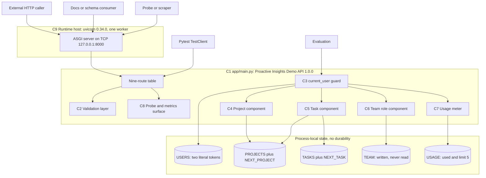

### 5.2.12 Task Status State Transition

Task status is a three-value machine created at `"open"` (`app/main.py` line 68) and changed by `update_task`. The transition rule is deliberately minimal: the handler validates only that the target value is one of `{"open", "in_progress", "done"}` (line 80) and then assigns it, so **every** transition among the three values is legal, including a transition to the current value.

```mermaid
stateDiagram-v2
    [*] --> open: POST /tasks stores status "open"
    open --> open: PATCH ?status=open
    open --> in_progress: PATCH ?status=in_progress
    open --> done: PATCH ?status=done
    in_progress --> open: PATCH ?status=open
    in_progress --> in_progress: PATCH ?status=in_progress
    in_progress --> done: PATCH ?status=done
    done --> open: PATCH ?status=open
    done --> in_progress: PATCH ?status=in_progress
    done --> done: PATCH ?status=done
    note right of open
        No terminal state and no deletion route:
        any value may follow any other, and the
        record disappears only when the process exits
    end note
```

| Transition | Permitted | Guard evaluated before the assignment | Observed status code |
| --- | --- | --- | --- |
| none → `open` | Yes, on creation only | Bearer token, project must exist in `PROJECTS` | 200 (400-class rejection if either fails) |
| any → any of the three values | Yes | Bearer token, task must exist, target value in the accepted set | 200 |
| any → any other string | No | Same guard, spent on the membership test at line 80 | 422 `"Unsupported status"` |
| any → missing `status` query parameter | No | Framework validation, before the handler runs | 422 from the validation layer |

### 5.2.13 Sequence Diagrams for Key Flows

**Authenticated project creation followed by role-filtered listing.** The diagram also shows the ordering property that framework validation precedes the handler and therefore precedes authentication.

```mermaid
sequenceDiagram
    autonumber
    participant C as Caller
    participant S as Uvicorn and Starlette
    participant V as C2 Validation layer
    participant H as create_project
    participant G as C3 current_user
    participant M as USERS, PROJECTS, NEXT_PROJECT
    C->>S: POST /projects with JSON name and Bearer token
    S->>V: Bind body to ProjectIn and header to authorization
    alt name shorter than 2 or longer than 80
        V-->>C: 422 RequestValidationError, handler never runs
    else body valid
        V->>H: create_project(payload, authorization)
        H->>G: current_user(authorization)
        G->>M: USERS.get(token after removing Bearer prefix)
        alt header missing or prefix wrong
            G-->>C: 401 Missing bearer token
        else token unknown
            G-->>C: 401 Invalid token
        else token resolves to id and role
            G-->>H: user record
            H->>M: store PROJECTS[NEXT_PROJECT] and increment
            H-->>C: 200 project dict
        end
    end
    C->>H: GET /projects with Bearer token
    H->>G: current_user(authorization)
    G-->>H: user record
    H->>M: scan PROJECTS values with owner_id or owner-role predicate
    H-->>C: 200 list of visible projects, unpaged
```

**Task creation with a referential rejection, then a status update.** The two failures shown are the component's only domain rejections.

```mermaid
sequenceDiagram
    autonumber
    participant C as Caller
    participant V as C2 Validation layer
    participant T as C5 Task component
    participant G as C3 current_user
    participant P as PROJECTS
    participant K as TASKS
    C->>V: POST /tasks with title and project_id
    V->>T: TaskIn validated, title 2 to 120 characters
    T->>G: current_user(authorization)
    G-->>T: authenticated caller
    T->>P: project_id in PROJECTS
    alt project not stored
        T-->>C: 404 Project not found
    else project exists
        T->>K: store TASKS[NEXT_TASK] with status open
        T-->>C: 200 task dict
    end
    C->>T: PATCH /tasks/1?status=blocked
    T->>G: current_user(authorization)
    T->>K: TASKS.get(task_id)
    alt task not stored
        T-->>C: 404 Task not found
    else status outside the accepted set
        T-->>C: 422 Unsupported status
    else accepted status
        T->>K: assign task status in place
        T-->>C: 200 mutated task dict
    end
```

**Usage consumption hitting the cap.** This flow is the only one that returns 429, and it shows the check-then-mutate window described in §5.2.7.

```mermaid
sequenceDiagram
    autonumber
    participant C as Caller
    participant B as consume_usage
    participant G as C3 current_user
    participant U as USAGE
    C->>B: POST /billing/consume?units=2
    B->>G: current_user(authorization)
    alt token missing or invalid
        G-->>C: 401 from the guard
    else authenticated
        B->>U: read used and limit
        alt units below 1
            B-->>C: 422 Units must be positive
        else used plus units would exceed 5
            B-->>C: 429 Usage limit reached
        else within budget
            B->>U: used equals used plus units
            B-->>C: 200 meter with used and limit
        end
    end
```


### 5.2.14 Component Dependency Edge List

Every caller-to-component and component-to-store dependency of the running system, stated edge by edge. Where the interaction diagram in §5.2.11 and this list differ, this list is the authoritative statement: the diagram's edge leaving the validation layer is the one to reconcile, and the guard is reached only on the six protected routes.

| Source | Target | What flows, and how tightly the two are coupled |
| --- | --- | --- |
| External HTTP caller | C9 uvicorn ASGI server | HTTP/1.1 request and JSON response over TCP on port 8000; no client is modelled in the repository |
| Documentation or schema consumer | C9 uvicorn ASGI server | HTTP GET for `/docs`, `/redoc`, `/openapi.json`; the document is derived from decorators on each request |
| Probe or scraper | C9 uvicorn ASGI server | HTTP GET to `/health`, `/ready`, `/metrics`; unauthenticated, no rate limit |
| C10 test harness | C1 route table | In-process ASGI calls through `TestClient`, bypassing the socket and the server process |
| C9 uvicorn ASGI server | C1 application object | One ASGI invocation per request; the host owns the only copy of state |
| C1 route table | C2 validation layer | Every request passes parameter binding and Pydantic validation before dispatch |
| C2 validation layer | C3 identity guard | Only the six protected routes continue to the guard, and only after validation succeeds |
| C2 validation layer | C8 probe surface | The three probe routes skip the guard entirely |
| C3 identity guard | `USERS` store | Read-only lookup of the token to `{id, role}`; no write path exists |
| C3 identity guard | C4, C5, C6, C7 | Returns the caller record to the handler, which then applies its own rule; the guard never inspects the operation |
| C4 project component | `PROJECTS` and `NEXT_PROJECT` | Insert on create, full scan on list, counter increment under `global` |
| C5 task component | `PROJECTS` | Membership test only (`project_id in PROJECTS`); no ownership or visibility check |
| C5 task component | `TASKS` and `NEXT_TASK` | Insert on create with `status: "open"`, then in-place mutation on patch |
| C6 team role component | `TEAM` | Write-only; no reader exists, so the dependency is one-directional and inert |
| C7 usage meter | `USAGE` | Read-compare-write on a single global meter, with no lock |
| C8 probe surface | Host clock (`time.monotonic`) | A process-relative clock reading, not elapsed process time |
| C10 test harness | `app`, `PROJECTS`, `TASKS`, `USAGE` | Direct import and direct mutation for state reset — a second, unmediated writer to live state |


## 5.3 Technical Decisions

### 5.3.1 Decision Register

The repository contains no ADR directory, design note, or comment block that records why the system is shaped as it is; `README.md` is the only prose artifact. The decisions below are therefore **reconstructed from the code and the README**, and each row states whether the rationale is documented or inferred. Rows marked *inferred* are the most plausible explanation consistent with the implementation, not a claim about intent.

| Decision | Adopted choice | Recorded rationale | Accepted trade-off |
| --- | --- | --- | --- |
| Architecture style | One module, one process, synchronous handlers, no service layer | Documented: a "compact FastAPI service designed as a test fixture" (`README.md` line 3) | No seams for testing, extension, or replacement; every change touches one shared namespace |
| State ownership | Module-level dicts plus `global` counters, no database | Documented: "No external database or service is required; data is held in memory" (`README.md` line 9) | Zero infrastructure at the cost of durability, replica consistency, and transactional guarantees |
| Authentication | Static two-entry token directory, checked by an explicit function call | Inferred from `README.md` lines 6 and 31 ("authentication-like bearer tokens", "demo tokens") | Trivially simple to read; no issuance, expiry, revocation, or schema-visible security requirement |
| Authorization | Inline predicates in handlers (owner-sees-all filter, owner-only role gate) | Inferred; no policy layer or comment exists | Directly auditable per handler; rules cannot be reused or tested independently, and one store (`TEAM`) is written but never consulted |
| Communication pattern | Synchronous HTTP request/response with JSON; no messaging, events, or jobs | Inferred from the absence of any broker, client, or background task | Uniform and easy to exercise; no asynchronous or long-running work can be expressed |
| Validation | Declarative Pydantic constraints at the edge plus explicit handler checks | Inferred from `app/main.py` lines 16-22 and the `HTTPException` call sites | Cheap and consistent; business rules are split between two mechanisms and status codes are chosen ad hoc |
| Error signalling | `HTTPException` with a fixed detail string; no custom handlers | Inferred; no `exception_handler` registration exists | Minimal code; no error codes, no structured error body, no logging of failures |
| Caching | None anywhere in the stack | Inferred from the absence of cache libraries, headers, or memoisation | Always-fresh reads; `GET /projects` and OpenAPI generation pay full cost per request |
| Operator surface | Unauthenticated literal probes and a metrics stub | Inferred from the three routes at `app/main.py` lines 35-42 and 108-110 | Probes work without credentials; they also cannot detect a real degradation or report traffic |
| Test strategy | In-process `TestClient` plus direct mutation of state globals for reset | Inferred from `tests/test_api.py` lines 2-11 | Fast, no fixtures or mocks; couples tests to internal state and to list ordering |

### 5.3.2 Architecture Style Decision and Trade-offs

**Choice.** A single-module layered application is the right shape for a fixture whose purpose is to be read exhaustively, and it is the wrong shape for anything that must survive a restart, scale past one process, or be maintained by more than one team. The style is internally consistent: the layering (transport → validation → handler → state) is respected by every one of the nine handlers, and no handler reaches around the validation layer to parse raw input.

| Alternative style | Why it fits less well here | What it would cost to adopt |
| --- | --- | --- |
| Routed multi-module service (`APIRouter` per domain, service and repository layers) | The fixture's value is that ground truth fits in two files; splitting it reduces readability without adding behaviour | New modules, dependency wiring, and a decision about where state lives |
| Layered service with a persistence abstraction | No durability or concurrency requirement exists to justify it; `README.md` line 9 rules it out explicitly | A schema, migrations, connection handling, and serialization mapping at every access site |
| Event-driven or CQRS design | There are no events, no projections, and no long-running work to model | Brokers, consumers, eventual-consistency semantics, and operational surface |

**Trade-offs accepted.** Handlers mix HTTP concerns, authorization, business rules, and state mutation in one function body. That is legible at this size and becomes the dominant maintenance cost the moment the route count or the rule count grows, because there is no unit at which a rule can change in isolation. Concurrency is similarly deferred: the handlers are synchronous, so correctness under concurrent requests depends entirely on the GIL and on the fact that no operation spans enough bytecode to interleave in practice — an assumption, not a guarantee (§5.3.4).

### 5.3.3 Communication Pattern Choices

**Choice.** One pattern: caller-initiated synchronous request/response over HTTP with JSON payloads, executed in-process by a direct function call. Every handler returns a plain dict that the framework serialises; no handler returns a `Response` object, sets a header, streams, redirects, or negotiates content type. No route accepts or emits anything other than JSON, and the two inputs that are not bodies (`status` on `PATCH /tasks/{task_id}`, `role` on `POST /teams/{user_id}/role`) are query-string parameters.

**Why it is coherent.** Every operation is a short, self-contained read or write with no external dependency, so the request/response pattern introduces no waiting and no partial-failure surface. Nothing in the system can be "in progress": there are no async handlers, no `await`, no background tasks, no retries, and therefore no idempotency keys, correlation identifiers, or compensation logic.

| Pattern dimension | Observed choice | Consequence for integrators |
| --- | --- | --- |
| Payload convention | JSON bodies for create operations; query strings for status, role, and units | Clients must not send `status` or `role` in a body; doing so yields 422 because the query parameter is missing |
| Success semantics | HTTP 200 for every successful route; no 201 on creation, no `Location` header | A client cannot distinguish create from update by status code, only from the response shape |
| Error semantics | `HTTPException` mapped to 401/403/404/422/429 with a single `detail` string; framework 422 for validation | Errors are human-readable but not machine-classifiable; no error code field exists |
| Idempotency | `POST /projects` and `POST /tasks` always create; repeating a call creates another record | No idempotency keys, no dedupe on a natural key (`name` and `title` are not unique) |
| Ordering and causality | None expressed; state changes are visible immediately to every later request in the same process | No event log, no version, no `ETag`, no `If-Match`; last write wins on any field |
| Transport security | None configured; the README assumes local HTTP on port 8000 | TLS termination, if any, must be external to this process |

### 5.3.4 Data Storage Solution Rationale

**Choice.** Six module-level objects at `app/main.py` lines 7-13 are the entire datastore: `USERS`, `PROJECTS`, `TASKS`, `TEAM`, `USAGE`, and the two integer counters. Records are dicts; identity is positional in the dict key and duplicated in the `id` field; there is no schema, index, constraint, timestamp, or version.

**Why it is coherent.** The stated reason is explicit: `README.md` line 9 says no external database or service is required because data is held in memory, and line 31 names in-memory storage as part of the fixture's design. The upside is real for the fixture — the test suite resets state with three statements and no fixtures, and the whole data model is visible in seven lines.

**Why it does not extend.** Every property a datastore normally supplies is absent, and each absence becomes a defect the moment the deployment shape changes:

| Requirement | Supplied? | Mechanism today | First failure it causes |
| --- | --- | --- | --- |
| Durability across restart | No | Nothing is written outside process memory | All projects, tasks, role changes, and consumed units vanish on restart or `--reload` |
| Shared state across replicas | No | `PROJECTS` and `TASKS` are per-process globals | Two workers disagree about existence, so a project created on one is a 404 on the other |
| Unique identifier issuance | Process-local only | `NEXT_PROJECT`/`NEXT_TASK` incremented under `global` | Two workers issue the same ids; clients see collisions |
| Atomic read-modify-write | No | Check at `app/main.py` line 102, write at line 104, no lock | Concurrent consumption can exceed the cap of 5 |
| Referential integrity | Application-level, existence only | Membership tests at lines 65 and 91 | A project disappearing (restart) leaves tasks referring to nothing |
| Query capability | No | Full dictionary scans | No filtering, sorting, projection, or pagination can be expressed |

**Decision on identifiers.** Ids come from a monotonic counter rather than from record content, which makes them stable, human-readable, and deterministic within a process; the tests exploit that determinism by asserting on list position rather than on id values (`tests/test_api.py` line 22). The counter is never reset by the test fixture, which is why ids advance across tests while the stores are cleared.

### 5.3.5 Caching Strategy Justification

**Choice.** There is no cache. No cache library appears in `requirements.txt`, no `Cache-Control`, `ETag`, or `Last-Modified` header is set anywhere, no in-process memoisation exists, and the OpenAPI document is regenerated per request.

**Why it is coherent.** Every read is a dictionary lookup or a short linear scan over an in-memory dict, so a cache would cost at least as much as the operation it replaces. There is also no external or slow dependency whose latency a cache could hide. Adding caching would introduce invalidation obligations against state that six handlers mutate in place — for example `update_task` changes a record that `GET /projects` does not even expose, while `create_project` changes a collection that `GET /projects` serialises in full.

**Where the absence does cost.** Two paths scale with stored data and are recomputed every time: the `GET /projects` scan and serialisation, and the per-request OpenAPI generation. Both are acceptable at fixture scale and become the first candidates for caching — or pagination — if either is exposed to real traffic (§5.4.5).

### 5.3.6 Security Mechanism Selection

**Choice.** Authentication is a static bearer-token directory with a prefix check (`app/main.py` lines 25-32). Authorization is two inline predicates: the visibility filter on listing (line 58) and the owner-only gate on role change (line 89). Sessions, cookies, CSRF tokens, API keys, OAuth scopes, mTLS, and signed tokens are all absent.

**What the selection buys.** The mechanism is transparent: a reader can trace exactly which token maps to which identity and which role, which is precisely what makes the fixture useful for evaluating access-control findings (`README.md` line 6). It also keeps the protected routes callable from a test with a single literal header (`tests/api` header constant, `tests/test_api.py` line 5).

**What the selection concedes.** Every property a credential system normally provides is missing, and the code shows each absence directly:

| Security capability | Status | Evidence |
| --- | --- | --- |
| Credential confidentiality | Not provided | Tokens are literal strings committed to the repository (`app/main.py` line 7) |
| Expiry and rotation | Not provided | No timestamp, `exp` claim, or refresh route exists |
| Issuance and revocation | Not provided | `USERS` is never written; there is no registration or login route |
| Token integrity | Not provided | The token is used directly as a dictionary key; no signature, hash, or constant-time comparison |
| Declared security contract | Not provided | The guard is a plain call, so `/openapi.json` advertises no `securitySchemes`; the generated docs understate the requirement |
| Per-caller limits and audit | Not provided | No throttle, no audit record; the usage meter is global, not per-caller (`app/main.py` line 11) |
| Role source of truth | Inconsistent | Authorization reads `USERS` (lines 29, 58, 89) while administration writes `TEAM` (line 93), so role changes never take effect |
| Object-level authorization | Partially provided | Listing filters by owner, but `PATCH /tasks/{task_id}` authorizes on token presence alone, so any authenticated caller can change any task |

**Decision on the guard's placement.** Calling `current_user` inside each handler body, rather than registering it as a FastAPI dependency, keeps the handler self-contained and makes the check impossible to miss when reading a route — but it also means the requirement is invisible to the OpenAPI schema and to any client or scanner that reads the schema rather than the code. Both facts are consequences of the same decision, and §5.4.4 documents the contract as it actually behaves.

### 5.3.7 Decision Trees for Request Admission and Authorization

The first tree shows the full admission path for an arbitrary request: route match, framework validation, guard, and handler rules. The ordering it encodes is a property of the framework — validation runs before the handler, so a request that is both malformed and unauthenticated is answered 422, not 401.

```mermaid
flowchart TD
    Req[Request arrives] --> Match{Path matches one of<br/>the nine routes?}
    Match -->|No| NF[404 Not Found<br/>framework default]
    Match -->|Yes| Bind{Path, query and body pass<br/>FastAPI binding and Pydantic?}
    Bind -->|No| Val422[422 RequestValidationError<br/>handler never runs]
    Bind -->|Yes| Guarded{Handler body calls<br/>current_user?}
    Guarded -->|No: three probe routes| Run[Execute handler body]
    Guarded -->|Yes| Prefix{Authorization header<br/>starts with Bearer and a space?}
    Prefix -->|No| M401[401 Missing bearer token]
    Prefix -->|Yes| Lookup{Token found in USERS?}
    Lookup -->|No| I401[401 Invalid token]
    Lookup -->|Yes| Rule{Handler-level rule<br/>applies to this caller?}
    Rule -->|Owner-role gate fails| F403[403 Owner role required]
    Rule -->|Passes or no rule| Run
    Run --> State[Read or mutate module-level state]
    State --> OK[200 with dict serialized as JSON]
```

The second tree isolates the authorization decision each handler makes once an identity is known. It shows why the member and owner paths diverge only in the listing filter and the role gate, and why `TEAM` never enters the decision.

```mermaid
flowchart TD
    Id[Identity resolved from USERS] --> Which{Which handler rule applies?}
    Which -->|Project listing| Vis{Record owner_id equals<br/>caller id OR caller role is owner?}
    Vis -->|True| Include[Include record in response]
    Vis -->|False| Exclude[Omit record from response]
    Which -->|Project or task creation| Owner[No ownership rule:<br/>any authenticated caller proceeds]
    Which -->|Task status change| TaskRule[No ownership rule:<br/>task existence and status value only]
    Which -->|Role administration| RoleGate{Caller role from USERS<br/>equals owner?}
    RoleGate -->|No| Deny[403 Owner role required]
    RoleGate -->|Yes| Target{Target id in TEAM and<br/>role in owner or member?}
    Target -->|No| NotFound[404 User or role not found]
    Target -->|Yes| WriteTeam[Write TEAM entry,<br/>never consulted again]
    Which -->|Usage consumption| Cap{used plus units<br/>within limit?}
    Cap -->|No| TooMany[429 Usage limit reached]
    Cap -->|Yes| Meter[Increment USAGE used]
```

### 5.3.8 Architecture Decision Records

The following records state the decisions the code embodies, in ADR form, so that a future change can be reasoned against them. Status is *in force* for all of them; none has a recorded alternative because the repository holds no design history beyond three git commits (`README.md`-only change, initial application, merge-conflict resolution).

**ADR-001 — Single-module synchronous FastAPI service is the delivery unit.**
Context: the system must be readable end to end and startable with one command. Decision: one module (`app/main.py`) with nine top-level handlers, synchronous `def` bodies, no routers, no middleware. Consequences: trivial to read and to exercise; no unit-level boundary exists, so any substitution of behaviour must happen through the HTTP interface or by mutating module globals, as the tests do. Evidence: `app/main.py` lines 1-110; `README.md` line 16.

**ADR-002 — Process-local dictionaries are the only datastore.**
Context: the fixture must run with no external service. Decision: keep `USERS`, `PROJECTS`, `TASKS`, `TEAM`, `USAGE` as module globals and issue ids from two module-level counters. Consequences: no durability, no replica consistency, no transactional guarantee, and unbounded growth; in exchange, state is visible in seven lines and the tests reset it with three statements. Evidence: `app/main.py` lines 7-13; `README.md` line 9; `tests/test_api.py` lines 8-11.

**ADR-003 — Authentication is a static bearer-token directory enforced by explicit call.**
Context: route protection must be obvious and testable with a literal header. Decision: `current_user` is invoked as the first statement of each protected handler instead of being registered as a dependency or security scheme. Consequences: the check is visible in every route body and impossible to bypass inside a handler, but it is invisible to `/openapi.json`, and the credentials are public constants with no expiry or revocation. Evidence: `app/main.py` lines 7, 25-32, 48, 57, 64, 76, 88, 99.

**ADR-004 — Authorization rules live inline in the handlers that need them.**
Context: only two rules exist. Decision: express the visibility rule as a filter predicate and the administrative rule as a role comparison, both inside their handlers, rather than in a shared policy module. Consequences: each rule is auditable in one place, but cannot be reused, unit-tested in isolation, or applied uniformly — which is how `TEAM` came to be written without any reader. Evidence: `app/main.py` lines 58, 89-93.

**ADR-005 — No caching, at any layer.**
Context: every read is a dictionary operation. Decision: cache nothing and configure no HTTP cache headers. Consequences: reads are always fresh and there is no invalidation surface, at the cost of recomputing the `GET /projects` scan and the OpenAPI document on every request. Evidence: `requirements.txt`; the absence of cache headers and memoisation in `app/main.py`.

**ADR-006 — Domain rejections use `HTTPException` with a fixed detail string; everything else is framework default.**
Context: failures must be easy to trigger and easy to observe in tests. Decision: raise `HTTPException(status, "<sentence>")` for business-rule failures and let the framework produce 422 for invalid input and 500 for unexpected exceptions; register no custom exception handler. Consequences: the error body is uniformly `{"detail": ...}` but carries no code, no field path, and no log entry; the status codes chosen per route are inconsistent in kind, using 404 for an unsupported role value (`app/main.py` line 92) and 422 for an unsupported status value (line 81). Evidence: the nine raise sites.

**ADR-007 — Operator endpoints are unauthenticated and return literals.**
Context: probes must work before any credential is available. Decision: `/health`, `/ready`, and `/metrics` bypass the guard and return constant dicts, with `uptime_seconds` computed from the host monotonic clock. Consequences: probes always succeed and cannot report a degraded dependency; the metrics endpoint reports no real traffic because no counter exists. Evidence: `app/main.py` lines 35-42, 108-110.

**ADR-008 — Tests are in-process, black-box at the HTTP boundary and white-box for state reset.**
Context: the suite must run with no server, no fixtures, and no mocks. Decision: drive `TestClient(app)` and reset state by importing and mutating `PROJECTS`, `TASKS`, `USAGE` in `setup_function`. Consequences: the suite is fast and exercises the real application, but it depends on internal names and on list ordering, and the reset is partial — `NEXT_PROJECT`, `NEXT_TASK`, and `USAGE["limit"]` are deliberately left alone. Evidence: `tests/test_api.py` lines 1-11.

### 5.3.9 Documented Architectural Assumptions

Each assumption below is load-bearing: if it is wrong, a described behaviour stops holding. None of them is written down in the repository, so each is marked as inferred, with the code or documentation that makes it the reasonable reading.

| Assumption | Basis in the repository | Consequence if it does not hold |
| --- | --- | --- |
| Exactly one process serves all traffic | State is module-level (`app/main.py` lines 7-13) and the README starts a single uvicorn invocation with no worker count (`README.md` line 16) | Projects, tasks, and the usage meter diverge between workers, and id sequences collide |
| State may be discarded at any time | No persistence, and `--reload` restarts on every source change | Any client that treats a created project or task as durable will lose it without an error |
| Credentials are demonstration values, not secrets | `README.md` line 31 warns against real credentials; tokens are literals at `app/main.py` line 7 | Treating the tokens as secrets would misstate the security posture; they are public to anyone with the repository |
| Callers are already trusted to reach the API | No TLS, no network-level control, no rate limiting; the README binds a local port | Exposure beyond localhost would publish an unauthenticated administrative path? No — but it would expose demo credentials and the whole business surface |
| The role-administration surface is illustrative rather than functional | `change_role` writes `TEAM` while every decision reads `USERS` | Any workflow that depends on a role change taking effect is broken today, not merely unimplemented |
| `status` and `role` are supplied as query parameters, not body fields | Handler signatures at `app/main.py` lines 75 and 87 | A body-only client receives 422 on every status change and role change |
| Scale is a handful of records | No pagination, no filtering, no index; `README.md` describes a compact API | The unpaged `GET /projects` scan grows in CPU and payload without bound |
| Response bodies may be changed freely because no clients are contracted | No `response_model` and no versioning beyond `version="1.0.0"` in the title metadata | Any consumer of these dict shapes would break on a field change, with no schema to detect it |
| Errors are consumed by humans, not code | Every rejection is a single `detail` sentence | Automated clients cannot branch on failures without string matching |


## 5.4 Cross-Cutting Concerns

### 5.4.1 Monitoring and Observability

The system exposes three unauthenticated signals and instruments nothing. There is no metrics client in `requirements.txt`, no counter is incremented in any handler, no span is created, and no health signal depends on business state. An operator can therefore answer "is the process accepting connections?" and nothing else.

| Signal | Source | What it actually proves | Gap |
| --- | --- | --- | --- |
| Liveness | `GET /health` returns `{"status": "ok"}` unconditionally (`app/main.py` lines 35-37) | The process is up and the route table is reachable | Says nothing about state, credentials, or the thread pool |
| Readiness | `GET /ready` returns `{"ready": true, "checks": {"storage": "ok"}}` with the storage verdict hard-coded (lines 40-42) | The process is up; the "storage" check is a literal | Cannot detect a degraded store, because no store is contacted; it will also report ready in a process whose state was just discarded by a `--reload` restart |
| Traffic and uptime | `GET /metrics` returns `{"requests_total": 0, "uptime_seconds": round(monotonic(), 2)}` (lines 108-110) | A constant and a host-clock reading | `requests_total` is literal `0` with no increment site anywhere in the codebase; `uptime_seconds` is not elapsed process time (§4.8.3) |
| Domain state as a proxy | `GET /projects` returns the caller's visible projects | The only way to observe whether records survived | Requires a valid token, reveals only the caller's slice for a member, and exposes no task or usage view |
| Server-level access log | Uvicorn's default access logging, enabled because no configuration disables it (`README.md` line 16) | One line per request at the transport level | No domain context, no correlation id, no status-class breakdown usable as a metric |

**Consequence for monitoring design.** Any real observability would have to be added, not configured: request counters, latency histograms, error counters, and a readiness probe that reads an actual dependency are all absent. Because the metrics endpoint is unauthenticated and unthrottled, a scraper can poll it freely, but the returned document cannot change unless the code changes.

### 5.4.2 Logging and Tracing

There is no logging or tracing in the application. `app/main.py` imports only `FastAPI`, `Header`, `HTTPException`, the two Pydantic symbols, and `monotonic` (lines 1-3); no `logging` import, no `print`, no audit write, and no structured event exists anywhere in `app/` or `tests/`.

| Capability | Status | Detail |
| --- | --- | --- |
| Application logging | Absent | No logger is configured, and no handler emits a message on success or failure |
| Failure logging | Absent in-process | A business rejection is an `HTTPException` that produces a JSON response and leaves no trace inside the application |
| Unexpected-exception logging | Delegated to the server | An uncaught exception is turned into a bare 500 by the framework's error middleware and re-raised, so only the ASGI server reports it |
| Audit trail | Absent | `change_role` writes state without recording who requested it; there is no actor, timestamp, or before/after value |
| Correlation identifiers | Absent | Request ids and trace headers are not read, generated, or propagated |
| Distributed tracing | Not applicable | The process makes no outbound call, so no span can be exported |
| Log format and destination | Server default | Whatever uvicorn emits to its stderr stream; the application contributes nothing to it |

**Consequence.** Diagnosing a rejected request requires reproducing it: the only evidence of a 403 or a 429 is the response the client received. Because the rejections are deterministic functions of the static `USERS` table and the global meter, reproduction is usually possible — which is why the absence of logs has not impaired the fixture, and also why it would be the first gap to close if the service were ever operated.

### 5.4.3 Error Handling Patterns

**Pattern.** One mechanism for every business rejection: `raise HTTPException(status_code, "<fixed sentence>")` inside the handler body. Nine such sites exist and no others; there is no `try`, `except`, or `finally` statement anywhere in `app/` or `tests/`, no custom exception class, and no registered exception handler. Input that fails typing or model constraints is rejected by the framework before the handler is entered, with the framework's own 422 payload.

| Condition | Status and detail string | Raised at | Route(s) |
| --- | --- | --- | --- |
| Header missing, or not prefixed `Bearer ` | 401 `Missing bearer token` | `app/main.py` line 27 | All six protected routes |
| Token not in `USERS` | 401 `Invalid token` | line 31 | All six protected routes |
| Caller's role is not `owner` (role change) | 403 `Owner role required` | line 90 | `POST /teams/{user_id}/role` |
| `project_id` not present in `PROJECTS` | 404 `Project not found` | line 66 | `POST /tasks` |
| `task_id` not present in `TASKS` | 404 `Task not found` | line 79 | `PATCH /tasks/{task_id}` |
| Target user absent from `TEAM`, or role value unsupported | 404 `User or role not found` | line 92 | `POST /teams/{user_id}/role` |
| Status value outside `{open, in_progress, done}` | 422 `Unsupported status` | line 81 | `PATCH /tasks/{task_id}` |
| `units` below 1 | 422 `Units must be positive` | line 101 | `POST /billing/consume` |
| Consumption would exceed the cap | 429 `Usage limit reached` | line 103 | `POST /billing/consume` |
| Body, query, or path fails binding or a model constraint | 422 with the framework's list of field errors | Validation layer, before the handler | Every route with parameters |
| Path matches no route | 404 with the framework's default body | Router | Any unknown path |
| Any unexpected exception | 500 with no domain context | Framework error middleware, then the ASGI server | Any route |

**Ordering rules that follow from the structure.** These are properties of the composition, not documented rules:

- **Validation outranks authentication.** Path, query, and body parameters are resolved before the handler runs, so a request that is both malformed and unauthenticated receives 422, not 401.
- **Authentication outranks every domain check.** `current_user` is the first statement of each protected handler, so an anonymous caller can never learn whether a project or task exists.
- **Semantic checks are ordered within handlers.** In `consume_usage` the non-positive check precedes the cap check, so `units=0` yields 422 rather than 429; in `change_role` the caller's role is checked before the target is validated, so a member probing a nonexistent user receives 403, not 404.
- **The first failure wins.** Each handler raises at the first failed condition and mutates nothing before its checks complete, so a rejected request leaves state untouched — the ordering of the checks, not a transaction, is what provides that property.

**Inconsistencies worth naming.** The status code chosen for an unsupported value differs by route: an unsupported task status is 422 (`line 81`) while an unsupported role value is folded into a 404 alongside an unknown target user (`line 92`), which conflates a client error with a missing resource. No response carries a machine-readable code, a field path, or the request id, so clients must match on the `detail` sentence to distinguish causes.

### 5.4.4 Authentication and Authorization Framework

**Authentication.** Every protected route calls `current_user(authorization)` (`app/main.py` lines 25-32), which enforces a case-sensitive `"Bearer "` prefix and then a dictionary lookup in `USERS`. The header parameter is declared with `Header(default=None)` and a `str | None` type, so a missing header reaches the handler and is answered 401 rather than rejected as a missing required parameter. There is no session, no cookie, no signature, no `exp` claim, and no constant-time comparison; the token is the dictionary key itself.

**Authorization.** Two rules are implemented, both by the consuming handler rather than by the guard:

| Route | Authentication | Object-level rule | Role rule | Who can succeed |
| --- | --- | --- | --- | --- |
| `POST /projects` | Required | None | None | Any authenticated caller; the record is stamped with the caller's id |
| `GET /projects` | Required | `owner_id == caller.id` | `owner` role bypasses the owner check (`line 58`) | Members see their own projects; owners see every project |
| `POST /tasks` | Required | Existence of the parent project only (`line 65`); no ownership or visibility check | None | Any authenticated caller can attach a task to any existing project |
| `PATCH /tasks/{task_id}` | Required | None — the return value of the guard is discarded (`line 76`) | None | Any authenticated caller can change any task's status |
| `POST /teams/{user_id}/role` | Required | Target must exist in `TEAM` | Caller must have `owner` in `USERS` (`line 89`) | Owners only |
| `POST /billing/consume` | Required | None | None | Any authenticated caller, drawing on one global meter |
| `GET /health`, `/ready`, `/metrics` | None | None | None | Everyone |

**The framework's structural weaknesses, as observed.**

- **Declared versus enforced contract.** Because the guard is called rather than injected, `/openapi.json` declares no `securitySchemes` and no per-route `security` requirement. A client generated from the schema will not know that credentials are needed until it receives a 401.
- **Two sources of role truth.** Authorization reads the `USERS` literal (`lines 29, 58, 89`) while `change_role` writes `TEAM` (`line 93`), and nothing reads `TEAM`. A successful role change — including an owner promoting a member to owner — has no effect on any subsequent decision for the life of the process, and is lost on restart.
- **Missing object-level check on task mutation.** `update_task` discards the identity it resolved, so task status is mutable by any authenticated caller regardless of `created_by` or project ownership. `create_task` similarly verifies only that the project exists.
- **No isolation on the usage meter.** `USAGE` is a single global object (`line 11`), so consumption by one caller exhausts the cap for all callers.
- **No credential lifecycle.** Tokens cannot expire, be revoked, or be rotated, and both values are committed to the repository.

### 5.4.5 Performance Requirements and SLAs

No latency target, availability objective, throughput figure, timeout, retry budget, rate limit, or cache TTL is declared anywhere in `README.md`, `app/`, `tests/`, or `pytest.ini` (§4.8.1). What can be stated precisely is the shape of the cost per request and the ceiling imposed by the architecture.

| Dimension | Observed characteristic | Implication |
| --- | --- | --- |
| Per-request work | Six routes are constant-cost dictionary operations; `GET /projects` is a linear scan with a per-record predicate and full serialisation; `/openapi.json`, `/docs`, `/redoc` regenerate the schema per request | All routes are fast at fixture scale; two of them grow with data or route count |
| Concurrency model | Synchronous `def` handlers executed by Starlette in a worker thread pool inside one process; no `await`, no I/O, no blocking call | Throughput is bounded by the thread pool and the GIL, not by I/O; no request ever waits on an external system |
| Correctness under concurrency | The cap check and increment on `USAGE` (`lines 102-104`) and the counter increments (`lines 47-51, 63-70`) are non-atomic read-modify-write sequences | Concurrent consumption can exceed the limit of 5; concurrent creation can interleave counter updates |
| Memory growth | `PROJECTS` and `TASKS` only gain entries; no delete route exists | Process memory grows for the lifetime of the process, and `GET /projects` slows with it |
| Payload growth | No pagination, no projection, no sort parameter | Response size for `GET /projects` is the whole visible collection |
| Scale-out ceiling | State in module globals | Exactly one worker is correct; replicas and multi-worker servers produce divergent data and id collisions |
| Failure blast radius | One process hosts everything | A crash loses all state and every in-flight request; there is no drain or handover |

**Reading of the numbers.** The absence of an SLA is the accurate finding, not a gap in this document: the only timing observation available is that the three-test suite completes in roughly a tenth of a second (§4.8.1), which bounds the cost of a handful of in-process requests and says nothing about sustained traffic. `ADVISORY`-style targets would be invented if stated here.

### 5.4.6 Disaster Recovery and Business Continuity

**Recovery posture.** There is nothing to recover. State exists only in process memory, no backup, snapshot, replica, or export path exists, and no code writes a record outside the process. The recovery objective is therefore bounded by the seed data at `app/main.py` lines 7-13, which is re-created whenever the module is imported.

| Failure scenario | Impact | Recovery procedure | Data loss |
| --- | --- | --- | --- |
| Process crash or host restart | Every in-flight request fails; all state is gone | Restart the process; the module import re-seeds `USERS`, `TEAM`, `USAGE` and empty stores | Total: every project, task, role change, and consumed unit since start-up |
| Source change under `--reload` | Uvicorn restarts the worker on save | None needed; the supervisor restarts automatically | Total, and silently: the counters also return to 1, so ids are reused after a reload (§4.8.4) |
| Second worker or replica added | Two independent copies of every store | Remove the extra worker or replica; there is no reconciliation path | Splits the dataset; records become invisible to whichever process did not create them |
| Accidental or malicious state change | A task status or role is altered; no history exists | No undo mechanism; restart clears the record but also everything else | The change is unrecoverable and untraceable, because nothing records who changed what |
| Credential compromise | Tokens are constants with no rotation path | Replace `app/main.py` line 7 and redeploy | No capability to invalidate a token without a code change |
| Corrupted or exhausted usage meter | The cap of 5 is reached by an earlier caller | Only a process restart, or direct mutation as the tests do (`tests/test_api.py` line 11) | The meter is not persisted, so restart resets it to 0 |

**Business continuity statement.** `README.md` line 31 states that the service must not be deployed and must not be used with real credentials. Read as an architecture statement, that makes disaster recovery out of scope by design: the system has no continuity requirement because it has no production role. The one continuity property it does hold is restart determinism — the same seed data and the same empty stores every time — which is what makes the fixture reproducible for evaluation.

### 5.4.7 Error Handling Flow Diagram

Every request leaves the process through one of five outcomes. The diagram traces the path, including the two boundaries where the framework answers instead of the application.

```mermaid
flowchart TD
    Start[Request enters Starlette router] --> RouteMatch{Path matches a route?}
    RouteMatch -->|No| N404[404 Not Found from the framework router]
    RouteMatch -->|Yes| Validate{Binding and Pydantic validation pass?}
    Validate -->|No| N422[422 RequestValidationError with field error list]
    Validate -->|Yes| Handler[Handler body begins]
    Handler --> Guard{current_user succeeds?}
    Guard -->|Missing or malformed header| A401m[401 Missing bearer token]
    Guard -->|Unknown token| A401i[401 Invalid token]
    Guard -->|Success, or unguarded route| Rules{Handler-specific rule violated?}
    Rules -->|Non-owner on role change| A403[403 Owner role required]
    Rules -->|Unknown project, task, user or role| A404[404 with the handler detail string]
    Rules -->|Unsupported status or non-positive units| A422[422 with the handler detail string]
    Rules -->|Cap would be exceeded| A429[429 Usage limit reached]
    Rules -->|No rule violated| Mutate[Read or mutate module-level state]
    Mutate --> Ok200[200 with the dict serialized as JSON]
    Mutate -.->|Unexpected exception| E500[500 from error middleware,<br/>reported by the ASGI server only]
    A401m --> Body[Response body is JSON with a single detail string]
    A401i --> Body
    A403 --> Body
    A404 --> Body
    A422 --> Body
    A429 --> Body
    N422 --> Body
```


## 5.5 References

Every architectural claim in this section rests on the files below; the repository contains no other code, configuration, or documentation.

**Application source**

- `app/main.py` — the entire service (110 lines): `FastAPI(title="Proactive Insights Demo API", version="1.0.0")` at line 5; module-level state `USERS`, `PROJECTS`, `TASKS`, `TEAM`, `USAGE`, `NEXT_PROJECT`, `NEXT_TASK` at lines 7-13; request models `ProjectIn`, `TaskIn` at lines 16-22; `current_user` at lines 25-32; nine route handlers at lines 35-110; the nine `HTTPException` raise sites at lines 27, 31, 66, 79, 81, 90, 92, 101, 103.
- `app/__init__.py` — 0 bytes; establishes only that `app` is an importable regular package, with no imports, re-exports, or side effects.
- `app/` — the complete Python source package: two files, no sub-packages.

**Tests and toolchain**

- `tests/test_api.py` — 26 lines; `TestClient(app)` at line 4, the `OWNER` bearer header at line 5, direct imports of `PROJECTS`, `TASKS`, `USAGE` at line 2, `setup_function` state reset at lines 8-11, and the three integration tests at lines 14-26.
- `tests/` — the black-box suite folder; a single test module, no `conftest.py`, no fixtures, no test data.
- `requirements.txt` — pinned dependencies: `fastapi==0.115.12`, `uvicorn==0.34.0`, `pytest==8.3.5`, `httpx==0.28.1`; establishes that no database driver, cache client, HTTP client SDK, broker, or logging library is a declared dependency.
- `pytest.ini` — `testpaths = tests`, `python_files = test_*.py`; establishes test discovery only.
- `README.md` — the only prose artifact: the "test fixture" framing and feature list at lines 3-9, the `uvicorn app.main:app --reload` run procedure at lines 12-18, the "do not configure an environment" scan setup at lines 25-28, and the non-production disclaimer at line 31.
- Repository root — `git ls-files` output confirms the seven tracked paths and the absence of container, CI, and build files.

**Internal cross-references**

- §1.2 System Overview — component naming, the documented limitations table, and the runtime topology diagram reused here.
- §3.5 Databases & Storage — the store-by-store write/read audit and the finding that `TEAM` is never consulted.
- §4.8 Timing, SLA, and Observability Considerations — the absence of declared timing constraints, per-route latency shape, and the `monotonic()` reading that is not process age.

**External sources**

- None. Every statement is derived from the repository, and no web source was used.


# 6. SYSTEM COMPONENTS DESIGN

## 6.1 Core Services Architecture

### 6.1.1 Services Overview and Architectural Fit

**Verdict.** **Core Services Architecture is not applicable for this system.** The repository defines exactly one deployable unit — the ASGI application object `app` created at `app/main.py` line 5 — and contains no second process, no network hop between components, and no independently releasable part. Every mechanism this section normally documents (service boundaries between deployables, discovery, load balancing, circuit breaking, retries, auto-scaling, failover) presupposes a set of collaborating services. This system has one, so §6.1.2 through §6.1.4 record each requested concern as an absence together with the nearest operative behaviour that a reader can actually observe in the code.

**Structural prerequisites, and why each fails.** A core services architecture requires four properties. None is present:

| Prerequisite | Observation in this repository | Evidence |
| --- | --- | --- |
| Multiple independently deployable units | One: `app.main:app`. `app/` holds only `__init__.py` (0 bytes) and `main.py` (111 lines) | `app/main.py` line 5; `app/` listing; `git ls-files` returns 7 paths |
| Inter-service communication | None: no HTTP client, RPC stub, message broker, or database driver is imported or declared | Grep of `app/`, `tests/`, `requirements.txt`; `httpx==0.28.1` is test-only (`tests/test_api.py` line 1) |
| Service infrastructure (registry, proxy, breaker) | None, and no manifest in which to configure one | No Dockerfile, compose file, Kubernetes/Helm chart, or CI definition is tracked |
| Shared or replicated state | None: state is seven module-level objects owned by the process | `app/main.py` lines 7-13 |

**Scale of the system.** The whole service is countable, which is the point of the fixture:

| Dimension | Count | Detail |
| --- | --- | --- |
| Source modules | 1 | `app/main.py`, 111 lines; `app/__init__.py` is empty |
| HTTP operations | 9 | 4 project/task routes, 2 team/billing routes, 3 unauthenticated probes |
| Runtime dependencies | 2 | `fastapi==0.115.12`, `uvicorn==0.34.0` (`requirements.txt` lines 1-2) |
| Process-local state objects | 7 | `USERS`, `PROJECTS`, `TASKS`, `TEAM`, `USAGE`, `NEXT_PROJECT`, `NEXT_TASK` |

**Why the single-tier design is deliberate.** `README.md` line 3 describes the service as "a compact FastAPI service designed as a test fixture for repository-level proactive insights", line 9 states that "No external database or service is required; data is held in memory", and line 31 states that it is "a synthetic QA fixture, not a production application" that must not be deployed. The absence of services is therefore a designed property of the artefact rather than an unfinished layer, and the consequences that would otherwise be defects — no durability, no scale-out, stub telemetry — are recorded as architectural facts in §3.5, §5.1.1 and §5.4.6.

**Division of scope with adjacent sections.** §5.1.1 establishes the architectural style and §5.1.2 the ten in-process components; §5.2 documents those components individually; §3.6.5 documents the single-process deployment topology; §5.4.1 documents observability and §5.4.6 the recovery posture. This section stays at the service level: it states which service-level mechanisms exist, which do not, and what the system does instead when a client or an operator depends on them.

**How to read the remainder.** Each of §6.1.2, §6.1.3 and §6.1.4 takes one group of the requested areas in order. For each area it names the requested capability, states its status, and gives the file and line that establishes the status. Where a mechanism is absent, the substitute that produces observable behaviour is named, because that is what a caller or an operator experiences.


### 6.1.2 Service Components

The system has no inter-service composition; it has one service with internal responsibility boundaries drawn by convention inside a single module. §6.1.2.1 enumerates those boundaries, and §6.1.2.2 through §6.1.2.6 record each requested service-level mechanism and what operates in its place.

#### 6.1.2.1 Service Boundaries and Responsibilities

There is exactly one enforced boundary: the process. Inside it, responsibility splits into seven areas that are identifiable only by which module-level object each function touches.

| Responsibility boundary | Handlers (line ranges) | State owned | Enforced by |
| --- | --- | --- | --- |
| Identity guard | `current_user`, lines 25-32 | reads `USERS` (line 7); writes nothing | Convention: each protected handler calls it as its first statement (lines 48, 57, 64, 76, 88, 99) |
| Project component | `create_project` 45-52, `list_projects` 55-58 | `PROJECTS`, `NEXT_PROJECT` | Convention only; nothing prevents another handler from writing those globals |
| Task component | `create_task` 61-71, `update_task` 74-83 | `TASKS`, `NEXT_TASK`; reads `PROJECTS` at line 65 | Convention only |
| Team administration | `change_role` 86-94 | `TEAM` (written at line 93, read by no authorization decision) | Convention only |
| Usage meter | `consume_usage` 97-105 | `USAGE` (line 11) | Convention only |
| Operational probes | `health` 35-37, `readiness` 40-42, `metrics` 108-110 | none | Convention only; these three routes never call the guard |
| Test harness | `tests/test_api.py` lines 2, 8-11 | resets `PROJECTS`, `TASKS`, `USAGE["used"]` | In-process import and direct mutation |

These boundaries are naming conventions, not encapsulation: Python gives the module no visibility control, so every handler can read and write every global, and the split is visible only in the statements each function executes. The one boundary that is enforced is the outer one — no other component can reach the state except over HTTP, which is why the process is also the entire failure domain (§6.1.4). Component-level detail for each of these areas is in §5.2.

#### 6.1.2.2 Inter-Service Communication Patterns

There is no service-to-service channel in either direction. Four communication paths exist, all but the first strictly in-process:

| Channel | Direction | Mechanism | Evidence |
| --- | --- | --- | --- |
| Client to API | Inbound | HTTP/1.1 over TCP, JSON bodies, delivered as ASGI messages | Route decorators lines 35-110; h11 is the protocol because `httptools` is not installed |
| Handler to guard | In-process call | Direct Python call passing the header string positionally | Lines 48, 57, 64, 76, 88, 99 |
| Handler to state | In-process access | Direct reads and writes of module globals | Lines 49-51, 58, 65-70, 77-82, 91-93, 102-105 |
| App to outside | None | No outbound call of any kind | No client library imported; none declared in `requirements.txt` |

Two consequences follow. First, there is no serialization contract between components: no route declares a `response_model`, so the dict literal a handler returns is the wire contract itself. Second, there is no asynchronous channel — no event emission, message queue, webhook, background task, or scheduled job appears anywhere in `app/` (a grep for `background`, `Depends`, `APIRouter`, and `add_event_handler` returns no match). Because nothing is called out to, no request can fail because of a remote dependency.

#### 6.1.2.3 Service Discovery Mechanisms

No discovery mechanism exists, in the sense of either registering or locating a service:

| Discovery concern | Mechanism in this system | Evidence |
| --- | --- | --- |
| Locating the application | Python import path `app.main:app`, resolved from the working directory | `README.md` line 16; no packaging file exists, so the module path is the only address |
| Network endpoint | Fixed default bind of `127.0.0.1` port `8000` | uvicorn 0.34.0 `config.py` lines 180-181; `README.md` line 18 |
| Registration or catalogue | None: no registry client, no service-name DNS record, no mesh annotation | No configuration file or manifest is tracked |
| Health-driven registration | The signals exist (`GET /health`, `GET /ready`) but no consumer is configured | Routes at lines 35-42; no orchestrator or probe configuration in the tree |

A caller must therefore be configured with a literal address. The presence of `/ready` makes health-driven discovery possible in principle, but a discovery system that trusted it would register a process whose stores are empty, because the readiness verdict is the hard-coded literal `"ok"` at line 42 (see §6.1.4.4).

#### 6.1.2.4 Load Balancing Strategy

No load balancer, proxy, or backend pool is configured, and none would be correct:

| Layer | Mechanism in this system | Effect | Evidence |
| --- | --- | --- | --- |
| Client to process | One direct address, no intermediary | A single backend | `README.md` lines 16, 18 |
| Worker fan-out | `workers` defaults to 1; `--reload` warns and ignores `workers > 1` | One worker process holds the only copy of state | uvicorn `config.py` lines 249, 338-339 |
| Admission control | `limit_concurrency` unset, `backlog` 2048 | Requests queue at the socket and in the event loop with no cap | uvicorn `config.py` lines 210, 212 |
| Connection reuse | Keep-alive 5 s by default | Connections recycle quickly | uvicorn `config.py` line 213 |

Placing a balancer in front of the service would break correctness rather than merely distribute load. Two processes started from the same source hold disjoint stores: a verification run created project id 1 in one interpreter while a second interpreter, importing the same `app.main`, answered `GET /projects` with `[]` and simultaneously reported `{"ready": true, "checks": {"storage": "ok"}}`. With two backends, a task creation routed to the process that never saw the project returns 404 `Project not found` (lines 65-66), a listing returns only the records created locally (line 58), and both processes issue id 1 from their own `NEXT_PROJECT` counter. The only strategy consistent with the code is a single backend — that is, no distribution at all.

#### 6.1.2.5 Circuit Breaker Patterns

No circuit breaker exists, and none has anything to protect: a breaker shields a caller from a failing dependency, and this service makes no outbound call — no database, HTTP client, cache, or broker appears in `app/` or in `requirements.txt`. There is also no internal service-to-service call that a breaker could wrap.

Two behaviours are worth distinguishing from a breaker, because both interrupt work:

- **Fail-fast rejection with no side effect.** Every rule violation raises `HTTPException` before any mutation (lines 27, 31, 66, 79, 81, 90, 92, 101, 103), so a rejected request changes nothing. This is request-level failure handling, not a stateful protection pattern; §5.4.3 documents the error surface.
- **The metered cap as a shedding rule.** Lines 102-103 answer 429 `Usage limit reached` once `used + units` exceeds `limit`. It bounds total metered work at five units per process, but it is a business quota, not a breaker: it has no open, half-open, or closed state, no probe, no cooldown, and no reset other than a process restart or the direct mutation the tests perform (`tests/test_api.py` line 11).

#### 6.1.2.6 Retry and Fallback Mechanisms

The application implements neither retries nor fallbacks:

| Mechanism | Status | Evidence |
| --- | --- | --- |
| Retry logic, backoff, or jitter | None | No retry construct anywhere; no retry library in `requirements.txt` |
| Application-level timeouts | None | No outbound call to bound, and no timeout parameter in any handler |
| Fallback or default response | None | Every failure path raises; no route returns a substitute value |
| Process restart under `--reload` | Present, development only | StatReload supervisor because `watchfiles` is absent (uvicorn `supervisors/__init__.py` line 14); `README.md` line 16 |

Because retries are left entirely to the client, retry safety depends on the operation, and four of the six write routes are not safe to repeat:

| Operation | Retry-safe | Effect of a duplicate request | Evidence |
| --- | --- | --- | --- |
| `GET /health`, `/ready`, `/metrics` | Yes | Constant body; no state touched | Lines 35-42, 108-110 |
| `GET /projects` | Yes | Read-only scan of `PROJECTS` | Lines 55-58 |
| `POST /projects` | No | A second project, with a fresh id from `NEXT_PROJECT` | Lines 49-51 |
| `POST /tasks` | No | A second task, with a fresh id from `NEXT_TASK` | Lines 67-70 |
| `PATCH /tasks/{task_id}` | Effectively yes | The same status is re-assigned in place | Line 82 |
| `POST /billing/consume` | No | Draws further units and can turn a retry into a 429 | Lines 102-104 |
| `POST /teams/{user_id}/role` | Effectively yes | The same role is re-written to `TEAM`, which no decision reads | Line 93 |

A client that retries a failed creation must therefore tolerate duplicate records; the service offers no idempotency key, request identifier, or deduplication window to prevent them.


### 6.1.3 Scalability Design

Scalability in this system is bounded by one property: all state lives inside the process that serves the request. The levers that a service-based design would use — replicas, autoscaling, distributed caches — are either unavailable or unsafe, so the practical design is a fixed-size single-writer process.

#### 6.1.3.1 Horizontal and Vertical Scaling Approach

| Direction | Feasible | Binding constraint | Evidence |
| --- | --- | --- | --- |
| Horizontal — more processes or replicas | No | Each process imports the module and starts from seed state, so datasets diverge and ids collide | `app/main.py` lines 7-13; two-interpreter verification in §6.1.2.4 |
| Horizontal — multi-worker server | No | `workers > 1` forks independent copies of the module; `--reload` refuses the combination outright | uvicorn `config.py` lines 249, 338-339 |
| Vertical — a larger process | Yes, partly | Raises the thread and memory ceiling for one dataset; CPU-bound work stays serialised by the interpreter lock | 40-token limiter (§6.1.3.3); synchronous handlers |
| Vertical — a larger thread pool | Yes, but not by configuration in this repository | The pool size is a framework default that no file in the repository changes | No concurrency setting in `app/`; starlette `routing.py` line 66 |

The failure mode of the horizontal path is specifically bad: a second replica does not error, it silently serves and mutates a different dataset while `GET /ready` continues to answer `{"ready": true, "checks": {"storage": "ok"}}`. Nothing in the system would report the split.

#### 6.1.3.2 Auto-Scaling Triggers and Rules

No scaling policy of any kind is declared — no container manifest, autoscaler definition, process supervisor, or CI deployment stage exists in the tree. More fundamentally, none of the available signals could drive one:

| Candidate signal | Provided by | Usable as a trigger | Why |
| --- | --- | --- | --- |
| Liveness | `GET /health` → `{"status": "ok"}` | No | Constant; proves only that the route table is reachable (lines 35-37) |
| Readiness | `GET /ready` → storage verdict `"ok"` | No | The verdict is a literal at line 42 and cannot fail |
| Request rate | `GET /metrics` → `requests_total` | No | Literal `0` at line 109; no increment site exists in the code |
| Uptime | `GET /metrics` → `uptime_seconds` | No | A host clock reading, not process age (line 110) |
| Latency, CPU, error rate | Nothing | No | No instrumentation, exporter, or access-log parser exists in the repository |

The only traffic evidence available is uvicorn's own access log, enabled by default (`access_log` defaults to `True` in uvicorn `config.py` line 196) and written as unstructured lines to the server stream. Deriving a scaling rule from it would require tooling that the repository does not contain — and §6.1.3.1 rules out adding replicas even if such a rule existed.

#### 6.1.3.3 Resource Allocation Strategy

| Resource | Allocation | Configurable in this repository | Evidence |
| --- | --- | --- | --- |
| Processes | 1 | Only through uvicorn `--workers` or `WEB_CONCURRENCY`, both unsafe for state | uvicorn `config.py` lines 249, 329-330 |
| Handler concurrency | 40 simultaneous handler bodies per process | No application-level setting exists | anyio default limiter of 40 (`_backends/_asyncio.py` line 3257); measured peak of exactly 40 for 100 submitted tasks |
| Event loop | One asyncio loop; `uvloop` is not installed | No | `requirements.txt`; uvicorn loop auto-selection |
| Memory | Grows for the life of the process; stores never shrink | No | No delete route exists, so `PROJECTS` and `TASKS` only gain entries |
| CPU and memory quotas | None declared | No | No container or infrastructure-as-code file is tracked |

The concurrency number is the operative one. All nine handlers are declared `def`, so Starlette dispatches them to a worker thread through `run_in_threadpool` (starlette `routing.py` line 66, `concurrency.py` lines 35-37), and anyio caps that pool at 40 tokens. Request 41 does not fail; it waits in the event loop until a token frees.

#### 6.1.3.4 Performance Optimization Techniques

| Technique | Status | Effect at present | Evidence |
| --- | --- | --- | --- |
| Response or query caching | Absent | Every listing rescans `PROJECTS` | Line 58; no cache library in `requirements.txt` |
| Pagination, projection, sorting | Absent | `GET /projects` returns the whole visible collection | Lines 55-58 |
| Response compression | Absent | Payloads are uncompressed; no gzip middleware is registered | `app.user_middleware` is empty |
| Connection reuse | Server default | Keep-alive of 5 s amortises connection setup | uvicorn `config.py` line 213 |
| Schema generation | Cached on the app object after the first build | `/openapi.json` cost is paid once, not per request | fastapi `applications.py` lines 966-975 |
| Per-request work | Dictionary lookups only, except listing | Eight of nine operations are constant-time | Handler bodies lines 35-110 |
| Precomputed or indexed views | Absent | The visibility predicate is evaluated per record per request | Line 58 |

The dominant cost is therefore the listing path: a full scan plus full serialisation, with no way for a client to request a subset. Since no write route ever removes a record, that path degrades monotonically with the number of projects created in the process's lifetime. The one optimisation available without redesign is narrowing the response — pagination or a projection parameter — because nothing else in the hot path can be reduced.

#### 6.1.3.5 Capacity Planning Guidelines

| Capacity dimension | Current envelope | Basis |
| --- | --- | --- |
| Concurrent handler bodies per process | 40 | anyio default thread limiter; measured peak of 40 |
| Replicas that preserve correctness | 1 | Process-local state; divergence verified across two interpreters |
| Records retained | Unbounded until restart | No delete route; append-only dictionaries at lines 8-9 |
| Metered units per process | 5 in total, shared by every caller | `USAGE` at line 11 and the cap check at lines 102-103 |

Planning for this system is therefore sizing a single process, not sizing a fleet. It must be provisioned for the largest dataset it will ever hold in one lifetime, because retention is unbounded and the listing path scans it; it must be assumed to serve at most 40 handler bodies at once, with the remainder queued; and it must be treated as disposable, because a restart is the only operation that reduces memory, resets the five-unit meter, and returns ids to 1. Any requirement that exceeds those bounds — more than one writer, more than one dataset, or durable growth — needs a persistence layer and a shared store, neither of which exists (§3.5).


### 6.1.4 Resilience Patterns

Resilience in this system reduces to two properties: a rejected or failed request leaves state untouched, and a restarted process returns to a known seed state. There is no redundancy, no failover, and no recovery path for data, because there is no second copy of anything.

#### 6.1.4.1 Fault Tolerance Mechanisms

| Mechanism | Present | Behaviour | Evidence |
| --- | --- | --- | --- |
| Validation before work | Yes | Malformed bodies, paths, and queries are rejected with 422 before the handler body runs | Pydantic models lines 16-22; framework binding |
| Guard-first ordering | Yes | Authentication is the first statement of each protected handler, so no domain fact leaks to an anonymous caller | Lines 48, 57, 64, 76, 88, 99 |
| No mutation on rejection | Yes | All nine rejections raise before any write | Raise sites at lines 27, 31, 66, 79, 81, 90, 92, 101, 103 |
| Exception handling inside the app | No | An unexpected error becomes a bare 500; a forced `TypeError` produced `500` with the plain-text body `Internal Server Error` | No `try`/`except` in `app/` or `tests/`; `app.exception_handlers` holds only the three framework defaults |
| Custom error handlers | No | Nothing maps an internal failure to a domain response | Handler registry inspected at runtime |
| Timeouts, retries, bulkheads | No | No request-bound or dependency-bound protection exists | No outbound call and no timeout parameter anywhere |
| Graceful shutdown | Yes, unbounded | Listeners close, connections shut down, in-flight tasks drain with no timeout | uvicorn `server.py` lines 262-281; `timeout_graceful_shutdown` defaults to `None` |

Fault isolation stops at the request boundary. One request cannot corrupt state, because every mutation follows its checks; but the read-modify-write sequences on `USAGE` (lines 102-104) and the two id counters (lines 49-51, 67-70) span multiple statements with no lock, so two concurrent requests can interleave inside them. A probe of 32 concurrent consumption calls at `used = 4` produced one 200 and 31 responses of 429 with the meter ending at 5 — no overspend in that run, while the window itself remains unsynchronised. §5.4.5 records the same property from the performance angle.

#### 6.1.4.2 Disaster Recovery Procedures

There is nothing to restore from: no backup, snapshot, export endpoint, write-ahead log, or filesystem write exists anywhere in the repository. Recovery is restart, and restart restores seed data rather than history.

| Scenario | Effect | Recovery procedure | Data loss |
| --- | --- | --- | --- |
| Process crash or host restart | In-flight requests fail; every store is lost | Restart the process; module import re-seeds lines 7-13 | All projects, tasks, role changes, and metered units since start-up |
| Source change under `--reload` | Supervisor restarts the worker automatically | None needed | Total, and silently: counters return to 1, so ids are reused |
| Accidental or malicious state change | Record overwritten in place; no history is kept | No undo; only a restart clears it | The change is unrecoverable and untraceable, since no actor or timestamp is recorded |
| Corrupted store entry | The affected route answers 500 for that record | Restart clears the store | Total |

Recovery objectives are therefore bounded by the literals at lines 7-13, which are re-created on every import. `README.md` line 31 ("Do not deploy it or use real credentials") makes continuity out of scope by design; the scenario-by-scenario treatment is in §5.4.6.

#### 6.1.4.3 Data Redundancy Approach

| Data set | Copies | Durability | Evidence |
| --- | --- | --- | --- |
| `USERS` credential directory | One, per process | Re-created from a literal on import | Line 7 |
| `PROJECTS`, `TASKS` | One, per process | None: memory only | Lines 8-9 |
| `TEAM` roles | One, per process | None: memory only | Line 10 |
| `USAGE` meter | One, per process | None: memory only | Line 11 |
| `NEXT_PROJECT`, `NEXT_TASK` | One, per process | Reset to 1 on import | Lines 12-13 |

There is no replication of any kind, and replication could not be added by configuration: a second process holds an independent copy that has no relationship to the first, verified by creating a project in one interpreter and receiving `[]` from another. Ids are consequently unique only inside a process, and a restart reissues them.

#### 6.1.4.4 Failover Configurations

| Failover mechanism | Status | Consequence in this system |
| --- | --- | --- |
| Active/passive standby | Absent | A standby would answer from empty stores and look healthy |
| Health-checked traffic shifting | Absent, and its input is unsuitable | `/ready` reports storage `"ok"` from a literal at line 42, so a fresh process passes |
| Cross-zone or cross-region replication | Absent | No mechanism exists to copy state anywhere |
| Automatic restart | Development only | uvicorn `--reload` restarts on a source change; it restores seed state, not data |

Failover here is worse than no failover, because a standby is not a copy. Under a naive orchestrator, traffic shifted to a second instance would receive 200 responses computed from an empty dataset: `GET /projects` would return `[]`, and `POST /tasks` for a project created on the other instance would return 404 `Project not found`. That failure is silent with respect to both probes — `/health` returns `{"status": "ok"}` unconditionally and `/ready` never fails.

#### 6.1.4.5 Service Degradation Policies

| Trigger | Behaviour today | Assessment |
| --- | --- | --- |
| Usage cap reached | 429 `Usage limit reached`, meter unchanged | A single global quota, not per caller, so one caller exhausts it for everyone; relief only by restart |
| Thread pool saturated | Requests wait in the event loop; none are shed | No admission control: `limit_concurrency` is unset (uvicorn `config.py` line 210) |
| Slow handler body | Holds one of the 40 thread tokens until it returns | No application-level timeout; keep-alive applies only to idle connections |
| Unexpected exception | 500 with a plain-text body | No fallback response and no in-app record |
| Planned maintenance mode | Nothing exists | No flag, environment variable, or configuration surface to reduce capability |

The system has no degraded operating mode below full service. The only deliberate reduction of service is the metered cap, and it is a business rule rather than a protection mechanism. Capabilities a service architecture would degrade independently — reads versus writes, priority callers, background work — do not exist as separable parts: there is one process, one state store, and one class of caller.


### 6.1.5 Service Architecture Diagrams

Four labelled diagrams record the service architecture: the deployment as it exists, the request path that crosses its only boundary, the ceiling that bounds its scale, and the way failures resolve. Every box maps to a file and line cited above; the elements drawn as dashed edges are the mechanisms the repository does not contain.

#### 6.1.5.1 Service Interaction Diagram

**Figure 6.1.5-1 — Deployed components and their interaction.** Solid edges are implemented in `app/main.py`; dashed edges are mechanisms that are absent, drawn to show where a service architecture would have placed them.

```mermaid
flowchart LR
    subgraph Present["Present — one process, one module"]
        Client["HTTP client<br/>script or /docs UI"]
        Probe["Probe or metrics scraper"]
        UV["Uvicorn 0.34.0<br/>127.0.0.1:8000, one worker"]
        APP["FastAPI app object<br/>app.main:app, nine routes"]
        GUARD["current_user guard<br/>lines 25-32"]
        STORE[("Module state<br/>PROJECTS, TASKS, TEAM, USAGE")]
    end
    subgraph Absent["Absent — no code or manifest in the repository"]
        LB["Load balancer"]
        PEER["Second replica or worker"]
        DB[("Database or cache")]
        BROKER["Message broker"]
    end
    Client -->|"HTTP/1.1, JSON body"| UV
    Probe -->|"GET /health, /ready, /metrics"| UV
    UV -->|"ASGI call per request"| APP
    APP -->|"direct call, guarded routes only"| GUARD
    GUARD -->|"USERS.get token"| STORE
    APP -->|"read and write dicts"| STORE
    LB -.->|"not configured"| UV
    PEER -.->|"cannot share state"| STORE
    APP -.->|"no outbound call"| DB
    APP -.->|"no publish or consume"| BROKER
```

#### 6.1.5.2 Guarded Request Interaction

**Figure 6.1.5-2 — The only inter-component interaction in the system, and the one rejection that precedes it.** The guard is a plain function call, executed after the framework has bound and validated parameters, and before any state is read or written.

```mermaid
sequenceDiagram
    autonumber
    participant C as HTTP client
    participant U as Uvicorn worker
    participant S as Starlette router
    participant H as Route handler
    participant G as current_user
    participant M as Module state
    C->>U: POST /projects with Authorization header
    U->>S: ASGI scope and body
    S->>S: bind and validate ProjectIn
    alt body fails validation
        S-->>C: 422 with field errors, handler never runs
    else body is valid
        S->>H: call create_project
        H->>G: current_user(authorization)
        alt header missing or token unknown
            G-->>H: HTTPException 401
            H-->>C: 401, no state change
        else token resolves
            G->>M: USERS.get(token)
            M-->>G: id and role
            G-->>H: user record
            H->>M: PROJECTS[NEXT_PROJECT] = project, then increment
            H-->>C: 200 with the stored dict
        end
    end
```

#### 6.1.5.3 Scalability Architecture Diagram

**Figure 6.1.5-3 — Why one process is the only correct shape.** The left side is the measured envelope of a single worker; the right side is what a second worker produces.

```mermaid
flowchart TD
    BURST["Concurrent requests"] --> LOOP["Asyncio event loop<br/>uvloop not installed"]
    subgraph OneProcess["One process — the correct configuration"]
        LOOP --> LIMIT["anyio thread limiter<br/>40 tokens"]
        LIMIT --> B1["Handler body 1"]
        LIMIT --> BN["Handler bodies up to 40"]
        B1 --> MEM1[("PROJECTS, TASKS, USAGE<br/>NEXT_PROJECT starts at 1")]
        BN --> MEM1
    end
    subgraph SecondProcess["Second worker or replica — if started"]
        MEM2[("Its own empty copy<br/>NEXT_PROJECT starts at 1")]
        MEM2 --> DIVERGE["Duplicate ids and a split dataset"]
    end
    MEM1 -.->|"no shared store"| MEM2
    DIVERGE --> SYMPTOM["GET /projects returns a subset<br/>POST /tasks answers 404 Project not found<br/>GET /ready still reports ready"]
```

#### 6.1.5.4 Resilience Pattern Diagram

**Figure 6.1.5-4 — How failures resolve, and what remains after a restart.** The upper path is per-request correctness; the lower path is the recovery posture, where the only surviving state is the seed literal.

```mermaid
flowchart TD
    REQ["Request received"] --> VAL{"Binding and model validation passes?"}
    VAL -->|"no"| V422["422 with field errors<br/>no state written"]
    VAL -->|"yes"| AUTH{"current_user raises?"}
    AUTH -->|"missing or invalid token"| A401["401<br/>no state written"]
    AUTH -->|"resolves a user"| RULE{"Handler rule violated?"}
    RULE -->|"yes"| R4XX["403, 404, 422 or 429<br/>no state written"]
    RULE -->|"no"| MUT["Mutate module state<br/>no lock, no transaction"]
    MUT --> CAP{"Meter at or over limit?"}
    CAP -->|"yes"| R429["429 Usage limit reached"]
    CAP -->|"no"| OK200["200 with the dict as JSON"]
    MUT -.->|"unexpected exception"| E500["500 Internal Server Error<br/>plain text, no in-app log"]
    CRASH["Process crash, host restart, or --reload save"] --> REIMPORT["Re-import app/main.py<br/>seed literals restored<br/>stores empty, ids return to 1"]
    REIMPORT --> LOSS["Every project, task, role change<br/>and metered unit is gone"]
    NORED["No replica, backup, snapshot or standby"] -.->|"nothing to fail over to<br/>or restore from"| LOSS
```


### 6.1.6 References

**Repository files.**

- `app/main.py` — the entire service: `FastAPI(...)` object (line 5), the seven module-level state objects (lines 7-13), the two request models (lines 16-22), the `current_user` guard (lines 25-32), and the nine handlers (lines 35-110) that establish every boundary, communication path, concurrency window, and failure path described in §6.1.1 through §6.1.5.
- `app/__init__.py` — empty (0 bytes); confirms `app` is a single flat package with no sub-packages or re-exports, which is the basis for "one deployable unit" in §6.1.1.
- `tests/test_api.py` — imports the app object and three state globals and mutates them between tests (lines 2, 8-11); establishes that the only non-HTTP interaction in the repository is in-process test manipulation, and that the five-unit meter is reset by direct assignment.
- `requirements.txt` — four pins (`fastapi==0.115.12`, `uvicorn==0.34.0`, `pytest==8.3.5`, `httpx==0.28.1`); establishes that no client, broker, database driver, cache, or load-balancing library is a dependency, and that `httpx` is test-only.
- `pytest.ini` — discovery settings only (`testpaths`, `python_files`); shows no timeout, marker, or plugin configuration that would affect runtime behaviour.
- `README.md` — fixture intent (line 3), in-memory storage and no external service (line 9), the single-process run command `uvicorn app.main:app --reload` (line 16), and the instruction not to deploy (line 31); the source of the "deliberately single-tier" reading in §6.1.1 and of the recovery posture in §6.1.4.2.
- `app/` — folder containing exactly `__init__.py` and `main.py`; establishes that no router, service, repository, or worker module exists.
- `tests/` — folder containing exactly `test_api.py`; establishes the full extent of the automated harness.

**Dependency sources inspected for runtime semantics** (installed from the pinned set: `uvicorn==0.34.0`, `starlette==0.46.2`, `anyio==4.16.0`, `fastapi==0.115.12`).

- `uvicorn/config.py` — defaults that define the single-process envelope: `workers` default 1 (line 249), `WEB_CONCURRENCY` override (lines 329-330), `--reload` ignoring multiple workers (lines 338-339), bind address `127.0.0.1:8000` (lines 180-181), `limit_concurrency` unset (line 210), `backlog` 2048 (line 212), keep-alive 5 s (line 213), `timeout_graceful_shutdown` unset (line 215), `access_log` enabled (line 196).
- `uvicorn/server.py` — shutdown sequence: listeners closed, connections shut down, in-flight tasks drained with an unbounded wait (lines 262-281).
- `uvicorn/supervisors/__init__.py` — reload supervisor falls back to `StatReload` because `watchfiles` is not installed (lines 12, 14).
- `starlette/routing.py`, `starlette/concurrency.py` — synchronous endpoints are dispatched through `run_in_threadpool` (routing line 66; concurrency lines 35-37), which is why handler concurrency is bounded by a thread limiter rather than by the event loop.
- `anyio/_backends/_asyncio.py` — the default limiter is 40 tokens (line 3257); measured peak of exactly 40 concurrent bodies for 100 submitted tasks.
- `fastapi/applications.py` — the OpenAPI schema is cached on the app object after the first build (lines 966-975), the basis for the schema-generation row in §6.1.3.4.

**Cross-referenced specification sections.**

- §3.5 Databases & Storage — absence of persistence and the inert `TEAM` store.
- §3.6.5 Deployment Topology and Runtime Constraints — the single-process deployment shape referenced in §6.1.1.
- §5.1.1, §5.1.2 — architectural style and the ten in-process components that §6.1.2 does not repeat.
- §5.4.1, §5.4.3, §5.4.5, §5.4.6 — observability signals, error surface, performance characteristics, and recovery posture summarized in §6.1.3.2 and §6.1.4.

No external web source was consulted for this section; every statement rests on the repository files and the pinned dependency sources listed above.


## 6.2 Database Design

### 6.2.1 Applicability Assessment and Declared Scope

**Database Design is not applicable to this system.** The repository contains no database, no embedded store, and no file-based persistence. The entire data tier is seven module-level Python objects declared in `app/main.py` (lines 7-13), and the lifetime of every record equals the lifetime of the single uvicorn process that holds them.

The determination rests on the following checks, each of which returns a negative result.

| Check | Result | Evidence |
| --- | --- | --- |
| Database driver, ORM, migration tool, or cache client in the manifest | None. The manifest holds four pins: `fastapi==0.115.12`, `uvicorn==0.34.0`, `pytest==8.3.5`, `httpx==0.28.1` | `requirements.txt` |
| SQL DDL, schema file, migrations folder, or connection configuration | None. `git ls-files` lists seven paths, and no `.sql`, `.db`, `.sqlite`, migration, or configuration path was ever added on any local branch | `git ls-tree` on `2411_01` and `main`; `git log --all --diff-filter=A` |
| Persistence vocabulary anywhere in tracked code | Exactly one match, and it is prose | `git grep -niE "sqlalchemy\|sqlite\|postgres\|mysql\|mongodb\|redis\|database\|migration\|alembic\|persist\|cursor\|orm"` returns only `README.md` line 9 |
| Outbound I/O of any kind | None. The module imports only `fastapi`, `pydantic`, and `time.monotonic` | `app/main.py` lines 1-3 |
| Statement of intent | Deliberate, and documented as a fixture property rather than an omission | `README.md` line 9 ("No external database or service is required; data is held in memory") and line 31 ("in-memory storage … for scanner evaluation only") |

Because no engine exists, none of the conventional database design artefacts can be documented as implemented. What follows instead records the design that does exist — the record shapes, keys, constraints, and access paths of the in-memory stores — and states each absent capability explicitly, so that no reader infers durability, isolation, backup, retention, or replication that the code does not provide.

| Topic from the design assignment | Finding | Documented in |
| --- | --- | --- |
| Entity relationships and data models | Five logical entities expressed as dict literals plus two integer id sequences; relationships are unenforced conventions | §6.2.2 |
| Indexing strategy and constraint catalogue | Four primary-key hash lookups and one full scan; eleven constraints, all in application code, none in a schema | §6.2.3 |
| Partitioning, replication, backup | All three absent; state is process-local and unrecoverable | §6.2.4 |
| Migration, versioning, archival, retrieval, caching | All absent; a shape change is an edit-and-restart event and a restart discards all data | §6.2.5 |
| Data flow through the data tier | Six guarded routes read or mutate the stores; three probes touch nothing | §6.2.6 |
| Retention, privacy, audit, access control | No retention or audit mechanism; access control is an in-memory token directory with uneven enforcement | §6.2.7 |
| Query optimization, caching, pooling, read/write splitting, batching | Only hash lookups versus a linear scan; the other four techniques have no counterpart | §6.2.8 |

Three adjacent sections already own material this section depends on and does not repeat: §3.5 covers the storage-technology decision, §4.6 covers every state mutation point and transaction boundary, and §5.1.3 covers data flow at the architecture level. Section 6.2 treats those stores as a schema would be treated — entities, keys, constraints, integrity rules, and the operational posture around them.


### 6.2.2 In-Memory Data Model and Entity Relationships

The data model is composed of five logical entities and two id sequences, all declared at module scope in `app/main.py` lines 7-13. There is no declarative schema: the effective schema is the set of dict literals that handlers construct (lines 49, 67-68) and the set of keys that readers index, so the field list below was recovered from those literals and access sites rather than from a definition file.

| Entity | Store and declaration | Key | Volatility |
| --- | --- | --- | --- |
| User (principal) | `USERS` (line 7) | Bearer token string | Immutable after import; no route issues, edits, or expires a token |
| Project | `PROJECTS` (line 8) | Integer `id` | Append-only; all fields fixed at creation |
| Task | `TASKS` (line 9) | Integer `id` | Append-only in count; `status` mutated in place |
| Team role assignment | `TEAM` (line 10) | Integer user id | Value overwritten by `change_role`; no insert or delete path |
| Usage meter | `USAGE` (line 11) | Fixed keys `used`, `limit` | `used` incremented; `limit` never written |
| Project id sequence | `NEXT_PROJECT` (line 12) | Module global | Rebound through `global` on each create |
| Task id sequence | `NEXT_TASK` (line 13) | Module global | Rebound through `global` on each create |

**Field inventory.** Every attribute that exists in the data tier, where it is written, and the rule that constrains it.

| Field | Type | Written at | Constraint in force |
| --- | --- | --- | --- |
| `USER.id` | `int` | Literal, line 7 | None; the two value the fixture seeds are `1` and `2` |
| `USER.role` | `str` | Literal, line 7 | `"owner"` or `"member"` by literal only; never rewritten, and it is the authority for every authorization decision (lines 58, 89) |
| `PROJECT.id` | `int` | `create_project`, line 49 | Taken from `NEXT_PROJECT`, which increments immediately after the insert (line 51) |
| `PROJECT.name` | `str` | `create_project`, line 49 | Declarative: 2-80 characters via `ProjectIn.name` (line 17) |
| `PROJECT.owner_id` | `int` | `create_project`, line 49 | Assigned from the caller's `id`; never validated, and no read path re-checks it |
| `TASK.id` | `int` | `create_task`, line 67 | Taken from `NEXT_TASK`, incremented at line 70 |
| `TASK.title` | `str` | `create_task`, line 67 | Declarative: 2-120 characters via `TaskIn.title` (line 21) |
| `TASK.project_id` | `int` | `create_task`, line 67 | Declarative: integer via `TaskIn.project_id` (line 22); referential check at line 65 |
| `TASK.created_by` | `int` | `create_task`, line 68 | Assigned from the caller's `id`; never validated or consulted |
| `TASK.status` | `str` | `create_task` line 68 (`"open"`), `update_task` line 82 | Membership in `{"open", "in_progress", "done"}` checked at line 80 |
| `TEAM[user_id]` | `str` | `change_role`, line 93 | User id must already be a key of `TEAM`; value must be `"owner"` or `"member"` (line 91) |
| `USAGE.used` | `int` | `consume_usage`, line 104 | `units >= 1` (line 100) and `used + units <= limit` (line 102) |
| `USAGE.limit` | `int` | Literal, line 11 | Never written; fixed at `5` for the process lifetime |

**Entity relationships.** The relationships below are conventions encoded in field values. No engine enforces them, and the independent databases section of a check — foreign-key validation — exists for exactly one of the four links.

```mermaid
erDiagram
    USER ||--o{ PROJECT : "owner_id assigned at insert"
    PROJECT ||--o{ TASK : "project_id, existence checked only"
    USER ||--o{ TASK : "created_by, never validated"
    USER ||--|| TEAM_ROLE : "keyed by id, never read for authorization"

    USER {
        int id PK
        string role
    }
    PROJECT {
        int id PK
        string name
        int owner_id
    }
    TASK {
        int id PK
        string title
        int project_id
        int created_by
        string status
    }
    TEAM_ROLE {
        int user_id PK
        string role
    }
    USAGE_METER {
        int used
        int limit
    }
```

`USAGE_METER` appears in the model but participates in no relationship: it is a single process-wide counter with no owner column, so every caller consumes from the same meter.

| Relationship | Cardinality | Integrity rule actually enforced | Call site |
| --- | --- | --- | --- |
| Project to owning user (`owner_id`) | Many-to-one | Assigned from the caller's id at insert; never re-validated, since no route updates a project | `app/main.py` line 49 |
| Task to project (`project_id`) | Many-to-one | Existence only: `payload.project_id not in PROJECTS` raises 404 "Project not found"; ownership and visibility are not required | `app/main.py` lines 65-66 |
| Task to creating user (`created_by`) | Many-to-one | Assignment only; no validation and no ownership check on the subsequent status update | `app/main.py` line 68 |
| User to team role (`TEAM[user_id]`) | One-to-one | The id must already exist in `TEAM`, which makes the store impossible to extend — a principal can only be relabelled | `app/main.py` lines 91-93 |
| Usage meter | Singleton | No relationship; one global meter, not per caller or per project | `app/main.py` lines 102-105 |

Three properties of the model follow from the field list and matter for any later migration to a real store: there is no timestamp or version column on any record, so records cannot be ordered, aged, or selectively migrated; there is no tenancy column, so the stores are global to the process; and the two identity structures are independent, because `USERS` keys on token strings while `TEAM` keys on the integer user id, and nothing synchronises the `role` value they both hold.


### 6.2.3 Constraints, Validation Rules, and Documented Access Paths

The repository defines zero database-level indexes and zero database-level constraints. Every rule that constrains a value is expressed either as a Pydantic field declaration evaluated before the handler body runs, or as an explicit `if` check inside a handler. The catalogue below is therefore the complete constraint set of the data tier.

| Constraint | Layer | Rule | Failure behaviour |
| --- | --- | --- | --- |
| Bearer scheme present | Procedural, `current_user` lines 26-27 | Header exists and starts with the literal `"Bearer "` | 401 "Missing bearer token" |
| Token resolves to a principal | Procedural, line 29 | Token is a key of `USERS` | 401 "Invalid token" |
| Project name present and sized | Declarative, `ProjectIn.name` line 17 | Required string, 2-80 characters | 422 `missing`, `string_too_short`, `string_too_long` |
| Task title present and sized | Declarative, `TaskIn.title` line 21 | Required string, 2-120 characters | 422 `missing`, `string_too_short`, `string_too_long` |
| Task project reference is an integer | Declarative, `TaskIn.project_id` line 22 | Int-coercible value | 422 `int_parsing` |
| Task project reference exists | Procedural, line 65 | `payload.project_id in PROJECTS` | 404 "Project not found" |
| Task status domain | Procedural, line 80 | Value in `{"open", "in_progress", "done"}` | 422 "Unsupported status" |
| Role change requires owner | Procedural, line 89 | Caller's `USERS` role equals `"owner"` | 403 "Owner role required" |
| Role target exists | Procedural, line 91 | `user_id` is a key of `TEAM` | 404 "User or role not found" |
| Role value domain | Procedural, line 91 | Value in `{"owner", "member"}` | 404 "User or role not found" — a vocabulary error reported as not-found, unlike the 422 used for task status |
| Usage units floor | Procedural, lines 100-101 | `units >= 1` | 422 "Units must be positive" |
| Usage cumulative cap | Procedural, line 102 | `USED + units <= limit` (cap of 5) | 429 "Usage limit reached" |
| Primary-key uniqueness | Structural, lines 49-51 and 67-70 | Id taken from a monotonic counter and used as the dict key | Not violable inside one process; a restart resumes at 1 only after every record is gone |

Four constraint classes that a database would supply are absent, and their absence is observable: there is no `NOT NULL` because records are dict literals built in code and every field is always assigned; no `UNIQUE` on any non-key column, so two projects may share a name; no `CHECK` on `owner_id` or `created_by`, which are copied from the caller without validation; and no `DEFAULT`, because the initial task status `"open"` is written into the record at line 68 rather than into a column definition. Neither are there length caps at the storage level — the 2-80 and 2-120 bounds exist only in the request models, so any in-process writer can store an out-of-range value. `tests/test_api.py` line 2 imports `PROJECTS`, `TASKS`, and `USAGE` and mutates them directly, which is the practical demonstration that the stores have no protection beyond the request path.

**Documented indexes.** No index object exists: there is no `CREATE INDEX`, no secondary index, no composite or partial index, and no mechanism to add or drop one. The only index structures are the CPython hash tables that back four keyed dictionaries, plus the two integer id sequences.

| Access path | Structure and cost | Store | Call site |
| --- | --- | --- | --- |
| Token to principal | Hash lookup on a string key, O(1) average | `USERS` | `current_user` line 29 |
| Project id to record | Hash lookup on an integer key, O(1) average | `PROJECTS` | `create_task` line 65 |
| Task id to record | Hash lookup on an integer key, O(1) average | `TASKS` | `update_task` line 77 |
| User id to role | Hash lookup on an integer key, O(1) average | `TEAM` | `change_role` lines 91, 93 |
| Usage fields | Hash lookup on two fixed string keys, O(1) | `USAGE` | `consume_usage` lines 102-105 |
| All projects under the visibility predicate | Full iteration of `.values()` with a per-record predicate, O(n) per request | `PROJECTS` | `list_projects` line 58 |
| Projects by owner | No index; the predicate at line 58 is the only mechanism | `PROJECTS` | `list_projects` line 58 |
| Tasks by project | No access path at all — there is no secondary index and no listing route | `TASKS` | Absent; `GET /tasks` answers 405 |

Two structural behaviours complete the picture. First, iteration order is insertion order, so `PROJECTS.values()` yields ascending id order without a sort and `GET /projects` is ordered by creation for any single process; that ordering is a property of the dictionary, not a declared index. Second, records are stored and returned by reference: `create_project` writes the dict it then returns (lines 49-52), so the response body and the stored record are the same object, and mutating a record through one path is immediately visible through every other. No defensive copy and no serialization boundary protects the store.


### 6.2.4 Indexing, Partitioning, Replication, and Backup Architecture

| Capability | Implemented | Mechanism, or what stands in its place | Evidence |
| --- | --- | --- | --- |
| Indexing | No | Four dictionary hash tables on primary keys; no secondary, composite, or partial index, and no way to declare one | §6.2.3 access-path table |
| Partitioning | No | One dictionary per entity, shared by every caller; no shard, tenant, or time-based partition | `app/main.py` lines 8-10 |
| Replication | No | One CPython heap per process; nothing is shared or shipped between processes | `app/main.py` lines 7-13; two-process probe below |
| Backup and restore | No | No dump, snapshot, export, or write-ahead log; restart re-seeds from literals | `app/main.py` lines 7-13; `README.md` line 9 |

**Indexing strategy.** There is nothing to tune and nothing to add. Lookups on `USERS`, `PROJECTS`, `TASKS`, and `TEAM` resolve through the dictionary's hash table in average constant time, and the only non-key predicate in the system — the visibility filter at line 58 — has no supporting structure of any kind, so it is evaluated record by record on every request. A database design would respond to that by indexing the filter column; here the filter column is a dict value, and the store exposes no interface other than `.values()`.

**Partitioning approach.** None. Each entity has exactly one container in one process's memory, and every request addresses that single container. There is no tenant or organisation column to partition on, no time column to range-partition on, and no delete route in the entire API, so the stores only grow: `PROJECTS` and `TASKS` accumulate for as long as the process lives, bounded solely by available memory. The absence of a delete or archive path is what makes partitioning a live concern rather than a theoretical one for any long-running deployment.

**Replication configuration.** None. The five stores and two id sequences are module-level objects, so each OS process that imports `app.main` constructs its own private set from the same literals. Nothing coordinates them: no shared backing store, no log shipping, no leader election, no sequence allocation service. A two-interpreter probe confirmed the consequence directly — the first process created a project and listed it, while the second listed `[]`, reported `GET /ready` as `{"location": "storage", "status": "ok"}`, and started its own usage meter at `{"used": 1, "limit": 5}` after one consumption. Duplicate primary keys therefore exist across processes by construction, since both sequences restart at `1`.

```mermaid
flowchart TB
    Client["HTTP client"]
    subgraph Primary["Process A - the only holder of state"]
        StoreA[("USERS / PROJECTS / TASKS / TEAM / USAGE<br/>module-level objects, lines 7-13")]
        SeqA["NEXT_PROJECT and NEXT_TASK<br/>current position"]
    end
    subgraph Secondary["Process B - second worker, replica, or failover target"]
        StoreB[("Independent copies seeded<br/>from the same literals")]
        SeqB["Both sequences restart at 1"]
    end
    Client --> StoreA
    StoreA -. "no replication channel, no shared store, no log shipping" .-> StoreB
    SeqA -. "no sequence coordination" .- SeqB
```

The readiness probe compounds the problem rather than exposing it: `GET /ready` returns `{"ready": true, "checks": {"storage": "ok"}}` from a literal at line 42 without reading any store, so a process that has never held a record reports healthy storage. A load balancer or orchestrator routing to such a process would silently serve an empty dataset.

**Backup architecture.** None, and no restore path exists. Recovery consists of the process re-executing `app/main.py`, which reinstates the literal seeds — the two tokens in `USERS`, the two role entries in `TEAM`, and `USAGE` at `{"used": 0, "limit": 5}` — and leaves `PROJECTS` and `TASKS` empty with both sequences back at `1`. The resulting recovery characteristics are absolute: the recovery point objective is the moment of the last successful response, because nothing survives the process, and the recovery time objective is one process start. The test suite performs the closest thing to a scripted reset that the repository contains, clearing `PROJECTS` and `TASKS` and zeroing `USAGE["used"]` before each test (`tests/test_api.py` lines 9-11), and it deliberately leaves `NEXT_PROJECT`, `NEXT_TASK`, and `USAGE["limit"]` untouched — a reset that clears data but preserves sequence position, which no restart does.


### 6.2.5 Data Management: Migration, Versioning, Archival, Retrieval, and Caching Policies

| Concern | Implementation in this repository | Evidence |
| --- | --- | --- |
| Migration procedures | None. A shape change is an edit to the record literals and to every reader; there is no migration script, no backfill path, and no staged rollout | `app/main.py` lines 49, 67-68 with readers at lines 58, 77, 82 |
| Versioning strategy | API version `1.0.0` only, in the FastAPI constructor; no data-schema version and no `schema_version` field on any record | `app/main.py` line 5 |
| Archival policy | None. No TTL, sweeper, compaction, or cold store; records are removed only by process exit or by the test reset | `app/main.py` lines 8-9; `tests/test_api.py` lines 9-11 |
| Storage mechanism | Dict assignment on create, with the id taken from a module-level counter that is then incremented | `app/main.py` lines 49-51, 67-70 |
| Retrieval mechanism | Full scan for listings and hash lookups for identity; tasks and the usage meter are not retrievable by any list route | `app/main.py` line 58; `GET /tasks` returns 405 |
| Update mechanism | In-place mutation of the stored dict; the previous value, the actor, and a timestamp are all overwritten | `app/main.py` lines 82, 93 |
| Deletion | No delete route, no cascade, no soft-delete flag; the record set is append-only for the process lifetime | Route table, `app/main.py` lines 35-110 |
| Caching policy | None of any kind: no cache library, no `Cache-Control` or `ETag` header, no memoised computation | `requirements.txt`; no response-header code in `app/main.py` |

**Migration procedures.** The only migration mechanism available is coordinated source change: the record literal at line 49 (projects) or lines 67-68 (tasks) and every reader that indexes those keys must be edited in the same commit. Readers use direct subscripting rather than tolerant access — `p["owner_id"]` at line 58, `task["status"]` at line 82 — so a record produced by an older shape would raise `KeyError` inside the handler and surface as a bare 500 response, because no exception handler is registered. Nothing makes the existing record population disappear gradually: the population is discarded wholesale when the process exits, so in practice a shape change is applied to an empty dataset on the next start rather than migrated.

**Versioning strategy.** `FastAPI(title="Proactive Insights Demo API", version="1.0.0")` at line 5 exposes `1.0.0` as the `info.version` of the generated OpenAPI document. That value versions the HTTP contract, not the data contract: no record carries a schema version, a creation timestamp, or a last-modified timestamp, so records of different generations could not be told apart even if any survived a restart. The configuration that would carry a storage version — a schema or migration directory, a metadata table, a `PRAGMA user_version` equivalent — does not exist.

**Archival policy.** There is no archival tier and no retention sweep. Because the API exposes no delete route, `PROJECTS` and `TASKS` grow monotonically within a process and are reclaimed only when the process ends; the sole scripted truncation in the repository is the pytest hook that clears both stores and zeroes `USAGE["used"]` before each test (`tests/test_api.py` lines 9-11). A long-running deployment therefore accumulates records with no mechanism to age them out, and a restart discards them all at once — both extremes of an archival policy, and neither of them a policy.

**Data storage and retrieval mechanisms.** Writes are single dict assignments followed by a counter increment (lines 49-51, 67-70), or a single in-place assignment for updates (lines 82, 93) and the usage meter (line 104). Reads take three forms: identity lookups by key for referential checks and updates (lines 65, 77), a full scan with a per-record predicate for the only listing route (line 58), and direct return of the stored object. The read surface is narrow — `GET /projects` is the only listing endpoint, and there is no read-by-id route (`GET /projects/1` answers 404) and no task listing at all (`GET /tasks` answers 405) — so a task is visible only in the response to the `POST` that created it or the `PATCH` that updated it, the usage meter only in the response to `POST /billing/consume`, and team assignments only in the response to `POST /teams/{user_id}/role`. No store exposes a count, an export, or a paginated view.

**Caching policies.** Nothing is cached. `GET /projects` re-runs the scan on every call, the filter predicate is recomputed per record per request, and no response carries cache validators or freshness headers. The one cache in the codebase belongs to the framework rather than the data tier: FastAPI memoises the generated OpenAPI schema on the application object, so `/openapi.json`, `/docs`, and `/redoc` are served from a document computed once per process. That document describes the API, not the stores, so it is not a policy for retaining business data.

```mermaid
flowchart LR
    Seed["Module import seeds the literals<br/>lines 7-13"] --> Live["In-memory records<br/>PROJECTS, TASKS, TEAM, USAGE"]
    Mutate["Writes: create, status PATCH,<br/>role change, usage increment"] --> Live
    Live --> Reads["Reads: GET /projects scan,<br/>internal id lookups"]
    Live --> Exit["Process exit, restart, or reload"]
    Exit --> Lost["Runtime records discarded,<br/>both sequences reset to 1"]
    Lost --> Seed
    Reset["pytest setup_function, lines 9-11<br/>clears PROJECTS and TASKS, zeroes used"] -.-> Live
```


### 6.2.6 Data Flow and Retrieval Paths

All data movement happens inside a single handler invocation in a single process. There is no intermediate store, queue, buffer, or serialization boundary between a request and the dictionaries it reads or writes, and no handler touches more than one logical record.

```mermaid
flowchart LR
    Req["Request: path, query, body,<br/>Authorization header"] --> Val["Binding and validation<br/>422 raised before the handler"]
    Val --> Auth["current_user, lines 25-32"]
    Auth -->|"hash lookup by token"| Users[("USERS")]
    Auth --> Handler["Handler body"]
    Handler -->|"scan with predicate"| Projects[("PROJECTS")]
    Handler -->|"insert and counter increment"| Projects
    Handler -->|"get by id"| Tasks[("TASKS")]
    Handler -->|"insert and counter increment"| Tasks
    Handler -->|"overwrite value"| Team[("TEAM")]
    Handler -->|"read, compare, increment"| Usage[("USAGE")]
    Projects -->|"existence check, line 65"| Handler
    Handler --> Resp["JSON response<br/>the stored object itself"]
```

| Route | Reads | Writes | Response body |
| --- | --- | --- | --- |
| `POST /projects` | `USERS` | `PROJECTS[id]`, then `NEXT_PROJECT += 1` | The stored project dict |
| `GET /projects` | `USERS`, all of `PROJECTS` | Nothing | List of visible project dicts, unfiltered beyond `owner_id` |
| `POST /tasks` | `USERS`, `PROJECTS` membership | `TASKS[id]`, then `NEXT_TASK += 1` | The stored task dict |
| `PATCH /tasks/{task_id}` | `USERS`, `TASKS[id]` | `task["status"]` in place | The mutated task dict |
| `POST /teams/{user_id}/role` | `USERS`, `TEAM` keys | `TEAM[user_id]` | The assignment just written |
| `POST /billing/consume` | `USERS`, `USAGE.used`, `USAGE.limit` | `USAGE["used"]` | The whole usage dict |
| `GET /health`, `GET /ready`, `GET /metrics` | Nothing | Nothing | Constants, including a literal `{"storage": "ok"}` |

Three properties of the flow define the integrity model. First, the write happens before the response is produced, so a client that receives 200 has its record in memory; the response is the stored object itself rather than a copy of it, which is why a mutation made through one path is visible through every other path immediately. Second, the task-to-project edge is the only cross-entity read in the system: `create_task` tests `payload.project_id in PROJECTS` (line 65) and nothing else reads one store to validate another, which is why an ownership check for tasks does not exist. Third, no handler writes two records, so there is no multi-record boundary to make atomic — the only interleaving risk is between concurrent requests touching the same record or the usage meter, and all handlers run in the thread pool because each is declared with plain `def`.

A second data path bypasses HTTP entirely and only exists in the test process: `tests/test_api.py` imports the application and three stores directly (line 2), and `setup_function` clears `PROJECTS` and `TASKS` and sets `USAGE["used"] = 0` before each test (lines 9-11). Those mutations are the only bulk data operation in the repository, and they preserve `NEXT_PROJECT`, `NEXT_TASK`, and `USAGE["limit"]`, so ids keep advancing across tests while listings and usage stay deterministic.


### 6.2.7 Compliance Considerations

| Control area | Status | Mechanism, or the specific gap | Evidence |
| --- | --- | --- | --- |
| Data retention rules | Undefined | No policy in the code or README, no TTL, no delete route; retention equals process lifetime | Route table, `app/main.py` lines 35-110 |
| Backup and fault tolerance | Absent | No backup or restore path; readiness reports healthy storage from a literal; recovery means losing everything created since start | `app/main.py` line 42; lines 7-13 |
| Privacy controls | Incidental only | The model holds ids, roles, names, and titles — no dedicated personal-data field — but two bearer tokens are committed in source and responses return raw records | `app/main.py` line 7, lines 49, 67-68 |
| Audit mechanisms | Absent | No timestamps or actor fields on any record; updates overwrite the previous value; the metrics counter is a literal `0` | `app/main.py` lines 82, 93, 109 |
| Access controls | Application-level only | A static token directory resolved per request, applied unevenly across the six guarded routes | `app/main.py` lines 25-32, 58, 65, 77, 89 |

**Data retention.** No retention rule is stated anywhere: `README.md` and the source describe the fixture's storage as in-memory and nothing more. The effective rule is "retained until the process exits", which means records are held indefinitely while the process lives and destroyed without record at exit. Because the API has no delete route, no erasure path exists either: a request to remove a task cannot be satisfied, and a task cannot even be read back once its creation response has been discarded by the client. The only scripted deletion in the repository is the test hook that clears both business stores (`tests/test_api.py` lines 9-11).

**Backup and fault tolerance.** Nothing is backed up, and no restore path exists. `GET /ready` returns `{"ready": true, "checks": {"storage": "ok"}}` from a literal at line 42, without reading a single store, so it reports healthy storage for a process holding an empty dataset — confirmed by importing the same module in a second interpreter, which listed `[]` projects while still answering readiness with `{"storage": "ok"}`. The consequence for fault tolerance is that a restart, a crash, or a `--reload` cycle returns the process to its seeded baseline: `USERS` and `TEAM` restored from literals, `PROJECTS` and `TASKS` empty, both id sequences at `1`, and `USAGE` back to `{"used": 0, "limit": 5}`.

**Privacy controls.** The field inventory in §6.2.2 is deliberately thin of personal attributes: numeric user ids, a role string, a project name, and a task title. Names and titles are free text up to 80 and 120 characters respectively and are neither filtered nor classified, so they could carry personal data with no control over it. Two privacy-relevant facts are concrete. The two bearer tokens are literal strings in source (`app/main.py` line 7), so anyone with repository access holds the credentials this data tier recognizes — which `README.md` line 31 acknowledges by declaring them demo values and forbidding real credentials or deployment. And responses return records unmodified, with no masking, redaction, or field-level filtering, over plain HTTP as served by the README's `uvicorn` invocation, since no TLS configuration or HTTPS redirect exists in the codebase.

**Audit mechanisms.** Nothing in the data tier is auditable. No record carries `created_at`, `updated_at`, `created_by` as a timestamp, or a version, and the two mutating handlers overwrite in place: `update_task` assigns the new status over the old one with no history (line 82), and `change_role` overwrites the role value (line 93). `GET /metrics` cannot stand in for an access counter because `requests_total` is the literal `0` (line 109). The only trace of data access is uvicorn's default access log on stdout, which the application neither captures nor persists, so questions of the form "who changed this task and when" have no answer in this system.

**Access controls.** Authorization is an in-memory directory lookup, and its application across the routes is uneven enough to record route by route.

| Operation | Control actually applied | Gap |
| --- | --- | --- |
| `POST /projects`, `GET /projects` | Valid token; listing filtered to the caller's own records unless the caller's `USERS` role is `owner` | No pagination, so an owner receives every record |
| `POST /tasks` | Valid token; referenced project must exist | No ownership or visibility check: `PROJECTS` is tested for membership only (line 65), so any authenticated caller can attach a task to any project |
| `PATCH /tasks/{task_id}` | Valid token; task must exist; status must be in the allowed set | No check of `created_by`, no check of the task's project owner, so any authenticated caller can change any task (lines 74-83) |
| `POST /teams/{user_id}/role` | Valid token plus caller role `owner` read from `USERS` | The write lands in `TEAM`, which no authorization decision reads, so the change has no effect; the id must already exist in `TEAM`, so no user can be added |
| `POST /billing/consume` | Valid token | The meter is process-global rather than per caller, so one caller's consumption produces 429 for every other caller |
| `GET /health`, `GET /ready`, `GET /metrics` | None by design | They expose no business state, although `/ready` asserts a storage health it does not verify |

Two controls a database would normally contribute are absent altogether: there is no per-store authorization (every handler addresses the same global dictionaries), and there is no separation between the application's access path and a direct one — `tests/test_api.py` line 2 imports `PROJECTS`, `TASKS`, and `USAGE` and mutates them without passing any authorization check.


### 6.2.8 Performance Optimization

| Technique | Present | Actual behaviour | Evidence |
| --- | --- | --- | --- |
| Query optimization patterns | No planner to optimize for | Every access is a hash lookup or a full scan; no statistics, no query rewriting, no projection, no pagination | `app/main.py` lines 58, 65, 77 |
| Caching strategy | None | Each request recomputes its filter; no `ETag`, `Last-Modified`, or `Cache-Control` header is ever emitted | No header or cache code in `app/main.py` |
| Connection pooling | Not applicable | No outbound connection exists to pool; the only concurrency limiter is the AnyIO worker-thread pool that runs the synchronous handlers | `app/main.py` (all handlers declared `def`); §6.1 |
| Read/write splitting | Not applicable | One store serves both roles in one process; there is no replica to read from | §6.2.4 |
| Batch processing | None | Each request mutates at most one record; no bulk endpoint, background job, or scheduled compaction exists | `app/main.py` lines 45-105 |

**Query optimization patterns.** There is no cost-based planner and nothing to hint. Work per request is determined entirely by store size: identity lookups (lines 65, 77) are constant-time, and the single listing operation (line 58) walks every project record. The predicate is written as `p["owner_id"] == user["id"] or user["role"] == "owner"`, so the owner comparison is evaluated first for every record and the role comparison follows whenever the first is false — an owner pays both comparisons on almost every record. Two limits on optimization are structural rather than tuning choices: there is no projection, so a listing returns whole records, and there is no `limit` or `offset`, so neither response size nor scan length can be bounded by the caller.

| Operation | Complexity per request | Driver of cost |
| --- | --- | --- |
| Create project, create task, patch task, consume usage | Constant | One hash lookup plus one assignment |
| List projects | Linear in project count | Full scan with two comparisons per record, no pagination |
| Token resolution | Constant | One hash lookup per guarded request |

**Caching strategy.** Nothing is cached and nothing can be revalidated by a client. `GET /projects` repeats the full scan on every call even when no write has occurred since the previous one, and no response carries a validator, so a client cannot avoid re-downloading. The only reuse in the process is framework-level: FastAPI memoises the generated OpenAPI schema on the application object, so `/openapi.json`, `/docs`, and `/redoc` are served from a document computed once per process. That is a description of the API surface, not a cache of business data, and it does not reduce the cost of any route that touches a store.

**Connection pooling.** Not applicable in the database sense, because there is no connection: no driver, no socket, no session, and no pool to size. The relevant concurrency constraint sits on the request side instead. All nine handlers are declared with plain `def`, so the framework executes each in a worker thread drawn from AnyIO's default limiter of 40 concurrent tasks; §6.1 records that ceiling, measured. Beyond 40 simultaneous handlers, requests wait in the event loop, and because the thread pool offers no mutual exclusion over the dictionaries, concurrent handlers can interleave inside the read-modify-write window of the usage meter (lines 102-104) and between a record insert and its counter increment (lines 49-51, 67-70).

**Read/write splitting.** Not applicable. Reads and writes address the same objects in the same process, so there is no second copy to route reads to and no lag to consider. The closest observable behaviour is that a write is visible to every subsequent read immediately, because the response body and the stored record are the same object.

**Batch processing approach.** None exists. Every mutation is a single-record operation performed inside the request that triggered it: ids are allocated one at a time from a module-level counter, and there is no bulk create, bulk update, import, export, or background process. The only operation that touches many records at once is the test reset, which clears both business stores and zeroes the usage counter between tests (`tests/test_api.py` lines 9-11). Capacity consequences follow directly: process start cost is constant, because the seed data is four literal entries, while resident memory grows with the number of projects and tasks created and is released only when the process exits.


### 6.2.9 References

- `app/main.py` - The entire data tier: the five store literals and two id sequences (lines 7-13), the two Pydantic request models that carry the only declarative constraints (lines 16-22), every read and write site (lines 29, 49-51, 58, 65, 67-70, 77, 82, 91-93, 102-105), the hard-coded readiness payload (line 42), the version string at line 5, and the absence of any delete route in the route table (lines 35-110).
- `app/__init__.py` - Zero-byte package marker; establishes that the `app` package performs no initialisation, so no engine, connection, or schema setup occurs at import.
- `app/` - Folder containing only the package marker and the single service module, which establishes that no model, repository, or storage module exists.
- `tests/test_api.py` - The direct mutation reset of `PROJECTS`, `TASKS`, and `USAGE["used"]` (lines 9-11) and the in-process import of the stores (line 2), which demonstrate that the data tier is reachable without any access-control path.
- `tests/` - Folder containing only that test module, confirming there is no fixture, seed script, or database harness.
- `requirements.txt` - The four pinned dependencies (`fastapi==0.115.12`, `uvicorn==0.34.0`, `pytest==8.3.5`, `httpx==0.28.1`), establishing the absence of any driver, ORM, migration tool, or cache client.
- `pytest.ini` - Test discovery configuration (`testpaths = tests`, `python_files = test_*.py`); no storage fixture or database plugin is configured.
- `README.md` - Line 9 ("No external database or service is required; data is held in memory") and line 31 (in-memory storage and demo tokens are for scanner evaluation only, with real credentials and deployment excluded) establish that the absence of a database is a stated design property of the fixture.
- Repository root (path `""`) - Seven tracked paths and no schema, migration, configuration, or database file, which is the structural evidence for the non-applicability determination in §6.2.1.
- No external web sources were consulted; every statement in this section is derived from the repository files listed above.


## 6.3 Integration Architecture

### 6.3.1 Integration Surface and Applicability Determination

**Verdict.** The service *is* an integration endpoint; it is not an integrator. It exposes exactly one machine-facing integration surface — a synchronous HTTP/JSON API implemented in `app/main.py` lines 35-110 — and consumes none. Everything else that an Integration Architecture normally documents (outbound clients, brokers, streams, batch jobs, gateways, partner contracts) is absent from the repository rather than stubbed, so §6.3.3 and §6.3.4 record those areas as explicit non-applicability determinations with the evidence that establishes each one, while §6.3.2 documents the inbound contract in full because that contract is the only thing a integrating system can depend on.

| Direction | Mechanism | Present | Evidence |
| --- | --- | --- | --- |
| Inbound, machine | HTTP/1.1 request-response, JSON bodies, bearer-token header | Yes | Route decorators `app/main.py` lines 35-110; wire probe returned `server: uvicorn`, `content-type: application/json` |
| Inbound, human | Swagger UI at `/docs`, ReDoc at `/redoc`, schema at `/openapi.json` | Yes, framework-generated | `app.docs_url`, `app.redoc_url`, `app.openapi_url`; schema is OpenAPI 3.1.0 |
| In-process only | Test harness imports the app object and its stores directly | Yes, test scope | `tests/test_api.py` lines 1-2 |
| Outbound, machine | No HTTP client, RPC stub, broker producer, or SDK is imported or declared | No | `app/main.py` lines 1-3 import only `fastapi`, `pydantic`, `time.monotonic`; `requirements.txt` holds four pins, none a client |
| Asynchronous | No queue, event, stream, scheduler, or background task exists | No | Zero matches for `async def`, `BackgroundTasks`, `Depends`, `lifespan`, `add_middleware`, `APIRouter` across `app/` and `tests/` |
| Gateway or proxy | No reverse proxy, CORS layer, or TLS termination is configured in the repository | No | `app.user_middleware` is empty; no configuration file is tracked |

**Applicability statement.** *Message Processing is not applicable for this system.* Nothing in the service is asynchronous: every one of the nine handlers is a synchronous `def` that reads or writes a module-level dictionary and returns before the response is written, so there is no message to enqueue, no consumer to schedule, no offset to commit, and no delivery guarantee to define. *External System integration is not applicable for this system.* The process makes no outbound call of any kind, so it has no partner contract, no credential for a remote system, and no egress path. The single exception in the whole stack is browser-side and is documented in §6.3.4.4: the HTML returned by `/docs` and `/redoc` references Swagger UI and ReDoc assets on public CDNs, which the *client's browser* fetches; the server never does.

| Requested area | Finding for this repository | Documented in |
| --- | --- | --- |
| API design | Inbound contract exists and is fully specified; protocol, authentication, authorization, versioning and documentation are hand-rolled or framework defaults | §6.3.2.1 - §6.3.2.8 |
| Message processing | Not applicable — no messaging, streaming, or batch machinery of any kind | §6.3.3.1 - §6.3.3.5 |
| External systems | Not applicable server-side; one browser-side asset dependency; no gateway configuration | §6.3.4.1 - §6.3.4.5 |
| Diagrams | Integration flow, API architecture, message flow, and two key sequences | §6.3.5.1 - §6.3.5.5 |

**Why the absence is a designed property.** `README.md` line 3 calls the repository "a compact FastAPI service designed as a test fixture for repository-level proactive insights" and line 9 states that "No external database or service is required; data is held in memory"; line 31 forbids deployment and real credentials. An integration tier is therefore out of scope by construction, not unfinished. The consequence a reader must carry forward is that the inbound API contract is the *whole* integration surface, and it is unversioned, undocumented for its failure codes, and unauthenticated by any declared security scheme — properties quantified in the sub-sections that follow.

**Division of scope with adjacent sections.** §4.4 walks the same request/response boundary as a business workflow and §4.4.3 records the absence of event and batch processing; §3.4 inventories third-party services and the browser-side CDN assets; §5.4.4 documents the authentication and authorization implementation from the application's point of view; §6.1.2.2 establishes that no service-to-service channel exists. This section does not restate those findings; it treats the same boundary as a published contract that an external integrator must conform to, and states what such an integrator can and cannot rely on.


### 6.3.2 API Design

The API is the entire integration contract. It is nine operations declared as route decorators in one module, served by uvicorn as plain HTTP/1.1, and described by a schema the framework generates from the handler signatures. Nothing in the contract is versioned, negotiated, throttled per caller, or described in prose, which means an integrating system has to derive its expectations from three sources only: the endpoint signatures at `app/main.py` lines 35-110, the two Pydantic models at lines 16-22, and the generated OpenAPI document at `/openapi.json`.

#### 6.3.2.1 Protocol and Transport Specification

| Aspect | Specification in this system | Evidence |
| --- | --- | --- |
| Application protocol | HTTP/1.1 over TCP; request and response bodies are application/json | Live probe: `HTTP/1.1 200 OK`, `server: uvicorn`, `content-type: application/json` |
| HTTP implementation | ASGI app served by uvicorn 0.34.0, which falls back to `h11` because `httptools` is not installed | `requirements.txt` line 2; absence of `httptools`/`uvloop` in the resolved environment |
| Bind address | `127.0.0.1` port `8000` by uvicorn default; the README runs `uvicorn app.main:app --reload` with no host or port override | `README.md` line 16; uvicorn `config.py` lines 180-181 |
| TLS | None. No `ssl_keyfile`/`ssl_certfile` is supplied and no HTTP-to-HTTPS redirect exists, so the API is plaintext unless an external proxy terminates TLS | `README.md` lines 11-18; no security middleware registered |
| Methods supported | `GET`, `POST`, `PATCH` on business routes; `HEAD` is rejected on them; `OPTIONS` is rejected everywhere | Live probe: `HEAD /health` → 405 `Allow: GET`; `OPTIONS /projects` → 405 `Allow: POST` |
| Request content type | JSON object bodies are parsed whether or not `Content-Type` is set; a form-encoded body is rejected with 422 `model_attributes_type` | Probe: body sent without `Content-Type` → 200; `data={"name":...}` → 422 |
| Response content type | `application/json` with no charset parameter on every API route; `text/html; charset=utf-8` on `/docs` and `/redoc`; `text/plain; charset=utf-8` on an uncaught 500 | Probes of each route |
| Content negotiation | None. No handler reads `Accept`; the response type is fixed by the route | No header access outside `authorization` in `app/main.py` |
| Compression | None. No GZip middleware is registered, so responses are uncompressed | `app.user_middleware` is empty |
| Connection reuse | uvicorn keep-alive of 5 s by default; no `Connection` header is set by the application | uvicorn `config.py` line 213 |
| Custom response headers | None — no `ETag`, `Cache-Control`, `X-RateLimit-*`, `Retry-After`, `Location`, or `WWW-Authenticate` is emitted on any response | Header dumps of 200, 401, 429 and 500 responses |
| Transport framing | No streaming, chunked write, server-sent event, or WebSocket route exists; bodies are serialized whole and sent with a computed `content-length` | Probe headers; no `async def` or `WebSocket` route in `app/main.py` |
| Server identification | uvicorn emits `server: uvicorn` and `date` on every response; both are uvicorn defaults left enabled | uvicorn `config.py` lines 206-207, 416 |

Three transport-level consequences matter to an integrator. First, a browser-based client cannot call the API cross-origin at all: no CORS middleware exists, so a preflight is answered 405 with `Allow: POST` and no `Access-Control-Allow-*` header, and the browser blocks the request before any handler runs. Second, credentials travel in cleartext over a connection the application never encrypts, so the token is exposed on the wire unless a proxy in front terminates TLS. Third, there is no compression or conditional-GET support, so a client cannot reduce or revalidate payloads.

#### 6.3.2.2 Endpoint and Payload Contract Catalogue

The nine operations below are the complete machine-facing surface. Success is always `200 OK` — no route returns 201, 204, or a `Location` header — and each success body is the stored dictionary itself, serialized as JSON.

| Operation | Purpose | Authentication | Success body |
| --- | --- | --- | --- |
| `GET /health` | Liveness probe | None | `{"status": "ok"}` (constant) |
| `GET /ready` | Readiness probe | None | `{"ready": true, "checks": {"storage": "ok"}}` (constant) |
| `GET /metrics` | Telemetry scrape | None | `{"requests_total": 0, "uptime_seconds": <float>}` |
| `POST /projects` | Create a project owned by the caller | Bearer token | `{"id", "name", "owner_id"}` |
| `GET /projects` | List projects visible to the caller | Bearer token | Array of project objects, possibly empty |
| `POST /tasks` | Create a task under an existing project | Bearer token | `{"id", "title", "project_id", "created_by", "status"}` |
| `PATCH /tasks/{task_id}` | Set a task's status | Bearer token | The mutated task object |
| `POST /teams/{user_id}/role` | Write a team role assignment | Bearer token, owner role | `{"user_id", "role"}` |
| `POST /billing/consume` | Draw units from the process usage meter | Bearer token | `{"used", "limit"}` |

**Request contract.** Every parameter the API accepts, with the validation that actually applies. Parameters not listed here are ignored, including unknown query parameters and unknown JSON body fields.

| Operation | Parameter (location) | Type and default | Constraint enforced |
| --- | --- | --- | --- |
| `POST /projects` | body `name` | string, required | `min_length=2`, `max_length=80` (`ProjectIn`, line 17) |
| `POST /tasks` | body `title` | string, required | `min_length=2`, `max_length=120` (`TaskIn`, line 21) |
| `POST /tasks` | body `project_id` | integer, required | Must be an existing key of `PROJECTS`, else 404 (line 65) |
| `PATCH /tasks/{task_id}` | path `task_id` | integer, required | Must exist in `TASKS`, else 404 (line 77) |
| `PATCH /tasks/{task_id}` | query `status` | string, required | Member of `{open, in_progress, done}`, else 422 (line 80) |
| `POST /teams/{user_id}/role` | path `user_id` | integer, required | Must be a key of `TEAM`, else 404 (line 91) |
| `POST /teams/{user_id}/role` | query `role` | string, required | Member of `{owner, member}`, else 404 (line 91) |
| `POST /billing/consume` | query `units` | integer, default `1` | `>= 1` (line 100); `used + units <= limit` (line 102) |
| All protected routes | header `authorization` | string, optional in the schema | Declared `Header(default=None)`, so a missing value reaches the handler and is answered 401 (lines 46, 56, 62, 75, 87, 98) |

**Body-shape rules an integrator must know.** The identity fields are server-derived, never accepted from the client: `POST /projects` reads only `name`, so a request that also sends `owner_id` has the extra field silently discarded and `owner_id` stamped from the token — verified by sending `{"name": "Alpha2", "owner_id": 99}` and receiving `owner_id: 1` with status 200. `PATCH /tasks/{task_id}` is a status setter rather than a general patch: it accepts no body and reads `status` from the query string, so a client that sends a JSON partial update receives 422. There is no read-by-id route and no collection route for tasks — `GET /tasks` answers 405 with `Allow: POST` — so a task is observable only in the response to the request that created or changed it, and a client cannot enumerate tasks at all.

#### 6.3.2.3 Authentication Method

Authentication is a hand-rolled bearer-token check inside `current_user` (`app/main.py` lines 25-32), invoked as the first statement of each of the six protected handlers. It implements a scheme named `Bearer` but nothing else of RFC 6750: no challenge header, no scope, no expiry, no signature, and no discovery metadata.

| Property | Implementation | Integration consequence |
| --- | --- | --- |
| Scheme | `Authorization: Bearer <token>`, prefix matched case-sensitively against the literal `"Bearer "` | A client sending `authorization: bearer x` or a bare token receives 401 `Missing bearer token` (verified) |
| Credential store | Two literal tokens in `USERS` (line 7): `owner-token` → `{id: 1, role: owner}`, `member-token` → `{id: 2, role: member}` | There are exactly two identities in the system, both committed to source |
| Verification | Exact dictionary key lookup, `USERS.get(token)` (line 29) | No parsing, no signature verification, no clock skew, no constant-time comparison |
| Failure signalling | 401 with `{"detail": "Missing bearer token"}` or `{"detail": "Invalid token"}`; no `WWW-Authenticate` header | A generic client receives no standards-compliant challenge and must infer the scheme from this documentation |
| Lifecycle | No issuance, expiry, rotation, revocation, or logout path exists; no route mints or invalidates a token | A leaked token is valid until the source is edited and the process restarted |
| Transport protection | None in the application; the README runs uvicorn without TLS | The credential crosses the network in cleartext unless a proxy terminates TLS |
| Schema declaration | `/openapi.json` contains no `components.securitySchemes` and no per-operation `security` requirement; `authorization` appears as an ordinary optional header parameter | Code generated from the schema will not attach credentials and will surface a 401 as an unexplained failure (sequence in §6.3.5.4) |
| Precedence | Request binding and validation run before the handler, so a malformed body is answered 422 even when the token is absent or wrong | A client fixing an authentication error may first have to fix a validation error (verified: invalid body plus no token → 422) |

#### 6.3.2.4 Authorization Framework

Authorization is split between the guard, which establishes *who* is calling, and each handler, which decides *what* the caller may do. There is no policy engine, no permission table, no scope list, and no object-ownership helper; the rules are inline `if` statements and one list-comprehension predicate.

| Operation | Authenticated | Object-level rule | Role rule |
| --- | --- | --- | --- |
| `POST /projects` | Required | None; record stamped with the caller's `id` (line 49) | None — any principal may create |
| `GET /projects` | Required | `owner_id == caller.id`, with an owner bypass (line 58) | `owner` sees every project in the process |
| `POST /tasks` | Required | Parent project must exist (line 65); no ownership or visibility test | None |
| `PATCH /tasks/{task_id}` | Required | None; the guard's return value is discarded (line 76) | None — any principal may change any task |
| `POST /teams/{user_id}/role` | Required | Target `user_id` must be a key of `TEAM` (line 91) | Caller's `USERS` role must be `owner`, else 403 (line 89) |
| `POST /billing/consume` | Required | None | None; the meter is process-global (lines 102-105) |

Two structural gaps define what an integrator cannot rely on. The role used for authorization is read from the `USERS` literal, while `change_role` writes to `TEAM`, which no decision reads: an owner who demotes itself through `POST /teams/1/role?role=member` receives 200 and continues to act as an owner for the life of the process (verified), so the "team administration" operation has no authorization effect. And task mutation carries no ownership check, so a token belonging to user 2 can set the status of a task created by user 1 (verified 200). The consequence at the integration boundary is that authorisation is coarse: there is exactly one privileged scope (owner, which sees everything) and one restricted scope (member, which sees only projects it owns), and neither restricts task operations or consumption.

#### 6.3.2.5 Rate Limiting and Quota Strategy

There is no rate limiting anywhere in the stack. No middleware, decorator, dependency, or library implements request throttling; uvicorn's own admission controls are left at their defaults, and no response carries a rate-limit header. The only 429 the API can produce is a business quota on a single process-wide counter, which is a different mechanism with different semantics.

| Control | Status | Detail and evidence |
| --- | --- | --- |
| Per-client request rate limit | Absent | No counting structure, timer, or window exists; a client may issue unlimited requests per second |
| Concurrency or in-flight cap | Absent at application level | uvicorn `limit_concurrency` and `limit_max_requests` are unset (uvicorn `config.py` lines 210-211); the only ceiling is the 40-token thread pool that runs the synchronous handlers |
| Rate-limit response signalling | Absent | No `X-RateLimit-*`, `RateLimit-*`, or `Retry-After` header on any response, including the 429 |
| Consumption quota | Present | `USAGE = {"used": 0, "limit": 5}` (line 11); `POST /billing/consume` rejects with 429 `Usage limit reached` when `used + units > limit` (lines 102-103) |
| Quota scope | Global, not per caller | The meter has no owner column, so a member's consumption exhausts the cap for the owner as well (sequence in §6.3.5.5) |
| Quota reset | Only by process restart | No reset route, no window, no TTL; the test harness zeroes `used` by direct assignment (`tests/test_api.py` line 11) |
| Quota atomicity | Non-atomic read-modify-write | Lines 102-104 read `used`, compare, then increment with no lock; a probe of 25 concurrent single-unit calls ended at the cap with subsequent calls rejected, while the interleaving window itself remains unsynchronised |

The practical reading for an integrator is that the metered endpoint is a single shared budget of five units per process lifetime, not a per-client allowance. A client that needs to distinguish "you are going too fast" from "the budget is spent" cannot: both would arrive as 429, and here 429 always means the latter.

#### 6.3.2.6 Versioning Approach

| Versioning mechanism | Present | Evidence |
| --- | --- | --- |
| Documented API version | Yes, informationally | `FastAPI(title="Proactive Insights Demo API", version="1.0.0")` (line 5) becomes `info.version` in `/openapi.json` |
| URL path versioning | No | Every route is declared at the root — `/projects`, `/tasks`, `/teams/{user_id}/role`, `/billing/consume` — with no `/v1` segment |
| Header or media-type negotiation | No | No handler reads a version header, `Accept`, or `Content-Type` beyond body parsing |
| Deprecation signalling | No | No `Deprecation`, `Sunset`, or `Warning` header is emitted; no route is marked deprecated in the schema |
| Compatibility guarantee | None stated | `README.md` and the source declare no contract policy; `1.0.0` is a literal that only changes when the code changes |
| Schema or payload version field | No | No record, response, or error body carries a version attribute (§6.2.2 field inventory) |

The version string therefore satisfies tooling that reads `info.version` and nothing else. Because there is no prefix or negotiation, a breaking change — renaming a field, tightening a bound, or changing a status code — takes effect for every client the moment the process restarts, with no coexistence window and no way for a client to request the older shape. An integrator should treat the endpoints above as an unversioned, single-generation contract and pin to a snapshot of `/openapi.json` taken from the deployment it targets.

#### 6.3.2.7 Documentation Standards

Documentation is entirely framework-generated. `app/main.py` declares no `description`, no `summary`, no `tags`, no `response_model`, no `responses`, and no `examples`, so every documented element is derived from a Python function name or a Pydantic type.

| Documentation element | State | Evidence |
| --- | --- | --- |
| Schema document | OpenAPI 3.1.0 at `/openapi.json`, generated from handler signatures and cached on the app object after the first build | `app.openapi()`; schema header `{"openapi":"3.1.0"}` |
| Interactive consoles | Swagger UI at `/docs`, ReDoc at `/redoc`, OAuth redirect stub at `/docs/oauth2-redirect` | Framework defaults; `app.docs_url`, `app.redoc_url` |
| Operation identity | Auto-derived camel-joined ids such as `create_project_projects_post`; summaries derived from function names (`Create Project`) | `/openapi.json` operations |
| Grouping | None — no `tags`, no `tags_metadata` | Schema `paths` carry no `tags` key |
| Documented success responses | Only `200` per operation, with no response schema for the returned dictionaries | Every operation declares `{"200": ...}` and, where parameters exist, `{"422": ...}` |
| Documented failure responses | Only the framework's `422 HTTPValidationError`; the 401, 403, 404, 405 and 429 responses the API actually returns are undocumented | Schema `responses` keys per operation |
| Security documentation | Absent — no `securitySchemes`, no `security` requirement | Schema `components` holds only four schemas (`ProjectIn`, `TaskIn`, `ValidationError`, `HTTPValidationError`) |
| Server list | Absent — no `servers` entry, so a generated client must be told the base URL out of band | Schema has no `servers` key |
| Parameter descriptions | Absent — parameters are named only (`authorization`, `status`, `role`, `units`, `task_id`, `user_id`) | Schema `parameters` entries |
| Documentation availability offline | Degraded — the HTML pages load Swagger UI, ReDoc, fonts and favicon from public CDNs | Inspected `/docs` and `/redoc` HTML (§6.3.4.4) |

The documentation is therefore accurate about the happy path and silent about failure: a client author reading `/docs` learns the two request models and the success codes, but not that a bearer token is required, which header carries it, or that the API can answer 401, 403, 404, and 429. Regenerating the document costs nothing, since it is derived from the code, but its completeness can only be raised by adding `responses`, `tags`, `summary`, and a security scheme to the handlers — none of which exists today.

#### 6.3.2.8 Error Contract and Client Retry Semantics

The API returns three different body shapes for failure, and the shape depends on who rejected the request rather than on the status code. This is the single most consequential fact for an integrating client, because a single JSON decoder cannot be written against one shape.

| Rejection source | Statuses produced | Body shape | Evidence |
| --- | --- | --- | --- |
| Request binding or Pydantic model | 422 | `{"detail": [{"type", "loc", "msg", "input", "ctx"}]}` — a list of field errors | Probe: `string_too_short`, `missing`, `int_parsing`, `json_invalid`, `model_attributes_type` |
| Handler `HTTPException` | 401, 403, 404, 422, 429 | `{"detail": "<fixed sentence>"}` — a plain string | `app/main.py` lines 27, 31, 66, 79, 81, 90, 92, 101, 103 |
| Router, before any handler | 404, 405 | `{"detail": "Not Found"}` or `{"detail": "Method Not Allowed"}`; 405 adds an `Allow` header | Probes of `/nope`, `DELETE /projects`, `HEAD /health` |
| Uncaught exception | 500 | `text/plain` body `Internal Server Error`, **not** JSON | Forced-exception probe against the framework default stack |

**Ordering rules the client can depend on.** Validation outranks authentication (a malformed body with no token yields 422), authentication outranks every domain check (an anonymous caller never learns whether a resource exists), and within a handler the first failed condition wins, always before any state is written. Two anomalies a client should code around: an unsupported task status returns 422 with a string `detail`, while an unsupported role value returns 404 with a string `detail`, conflating a bad value with a missing resource; and no error body carries a machine-readable code, a field path (outside the 422 list), or a request identifier, so distinguishing causes requires matching on the sentence.

| Operation | Retry-safe | Effect of a duplicate request |
| --- | --- | --- |
| `GET /health`, `/ready`, `/metrics` | Yes | Constant bodies; no state touched |
| `GET /projects` | Yes | Read-only scan of `PROJECTS` |
| `POST /projects` | No | A second project with a fresh id; no idempotency key exists |
| `POST /tasks` | No | A second task with a fresh id |
| `PATCH /tasks/{task_id}` | Yes | The same status re-assigned in place |
| `POST /teams/{user_id}/role` | Yes | The same role re-written to the inert `TEAM` store |
| `POST /billing/consume` | No | Draws further units and can convert a retry into a 429 |

Because the service offers no `Idempotency-Key` handling, no request identifier, no deduplication window, and no `Retry-After`, retry policy is entirely the client's. The safe pattern is to retry only the idempotent operations and to treat the two creation routes and the metered route as non-retryable: a timeout on `POST /projects` may have created the record, and re-issuing it produces a duplicate rather than the same result.


### 6.3.3 Message Processing

**Message Processing is not applicable for this system, and the absence is structural.** A message-processing architecture presupposes at least one of four things: an asynchronous transport a producer can hand work to, a consumer that runs on a schedule or trigger, a buffer that decouples production from consumption, or a batch window that groups records. This service has none of them. Every unit of work is a single synchronous function call inside one request, performed in a worker thread, completing before the response is written.

| Prerequisite | Result of the check | Evidence |
| --- | --- | --- |
| Messaging dependency (broker client, task queue, scheduler) | None — the manifest holds four pins, none of which is a messaging or scheduling library | `requirements.txt` lines 1-4 |
| Producer or consumer code (`publish`, `send`, `enqueue`, `consume`, `worker`, `job`) | None — no such call exists in `app/` or `tests/` | Text search over every tracked file; `app/main.py` imports only three symbols at lines 1-3 |
| Asynchronous handler or background task | None — all nine handlers are declared `def`, and no `BackgroundTasks` parameter, `async def`, `lifespan`, or startup hook exists | Route definitions `app/main.py` lines 35-110 |
| Queue, topic, exchange, or subscription configuration | None — no configuration file of any kind is tracked | Repository root holds seven files, none configuration for a broker |
| Batch entry point, import, export, or scheduled job | None — no route accepts a collection, and no timer exists | Route table, lines 35-110 |

The five sub-sections below treat each requested topic in turn. Because the finding is the same for all five, each one states the absence, gives the evidence, and then names the mechanism that stands in the message's place — which is always the synchronous HTTP request itself.

#### 6.3.3.1 Event Processing Patterns

No events are produced, published, routed, or consumed. There is no event type, event envelope, event schema, event bus, handler registry, or subscriber list anywhere in the repository, and no state change is announced to anything outside the process.

| Pattern | Present | What operates instead |
| --- | --- | --- |
| Domain event emission on state change | No | `create_project`, `create_task`, `update_task`, `change_role` and `consume_usage` mutate a dictionary and return it; no notification is emitted (lines 45-105) |
| Publish/subscribe fan-out | No | One response returns to the one caller; no other principal can learn of the change except by polling |
| Event-driven reactions (chained handlers) | No | No handler calls another handler; the only cross-entity read is the project-existence check at line 65 |
| Command/event separation | No | The handler is both command processor and response producer in one call |
| Eventual consistency | Not applicable | There is no second copy of the data to converge with (§6.2.4) |

The nearest counterpart to an event stream is uvicorn's default access log: one unstructured line per request written by the server to its own stream, which the application neither formats nor consumes (§5.4.2). A consumer that needs to react to a created project or an exhausted usage meter has to poll `GET /projects` with a valid token, and there is no equivalent poll for tasks — `GET /tasks` answers 405 — so task state cannot be observed at all after the response to the write is discarded.

#### 6.3.3.2 Message Queue Architecture

No queue exists in any form: no broker, no in-process queue, no durable log, no in-memory channel, no outbox table, and no delivery contract. The absence removes an entire class of properties that an integrator would otherwise need to reason about, and it also removes the reliability mechanisms that go with them.

| Queue property | State | Consequence at the integration boundary |
| --- | --- | --- |
| Transport and topology | None | No queue to name, size, or monitor; no producer or consumer to deploy |
| Delivery guarantee | None | A request that fails mid-flight is simply lost; nothing is redelivered by the system |
| Ordering | None beyond request arrival | Concurrent writes to the same counter can interleave; no sequence number exists |
| Dead-letter handling | None | A rejected request leaves no record anywhere except the caller's response |
| Backpressure | None | Excess concurrency waits in the event loop for one of 40 thread tokens rather than being queued or shed (§6.1.3.3) |
| Retry, backoff, poison-message handling | None | Absent from both directions: the service neither retries nor is retried by anything it controls |
| Transactional outbox or two-phase commit | None | Not applicable — there is no second system to commit against |

What replaces the queue is the request-response pair itself: the caller blocks until the handler returns, and the handler has already mutated state before the response is serialized, so the "message" has no life beyond the connection. The practical consequence is that asynchronous notification is impossible. A client that wants to know when a usage limit is reached, or when a project appears, must poll an authenticated read route; there is no webhook registration, no callback URL parameter, and no subscription endpoint.

#### 6.3.3.3 Stream Processing Design

No stream is produced, consumed, windowed, or aggregated. The system has no append-only log, no offset or checkpoint, no watermarks, no windowing, no exactly-once or at-least-once machinery, and no processor topology, so there is nothing to design and nothing to measure.

| Stream concept | State | Nearest observable behaviour |
| --- | --- | --- |
| Source or sink connector | None | The only inputs are HTTP requests; the only output is an HTTP response |
| Partitioning and consumer groups | None | Records live in one dictionary per entity in one process |
| Windowed aggregation | None | The usage meter is a single cumulative integer, not a windowed metric (line 11) |
| Ordering guarantee | Insertion order only | CPython dictionaries iterate in insertion order, so `GET /projects` returns creation order per process — a property of the dict, not a stream guarantee |
| Replayability | None | No log to replay; records are discarded when the process exits (§6.2.4) |
| Stream telemetry | None | `requests_total` is the literal `0` (line 109), so no throughput signal exists even for the request path |

#### 6.3.3.4 Batch Processing Flows

No batch capability exists. No route accepts an array, there is no bulk create or bulk update, no upload or file-drop interface, no scheduled compaction or reconciliation job, and no chunked import or export. Every mutation concerns exactly one record, allocated one identifier at a time from a module-level counter.

| Batch concern | State | Detail |
| --- | --- | --- |
| Bulk ingestion endpoint | Absent | `ProjectIn` and `TaskIn` are single-object models (lines 16-22); a JSON array body is rejected by validation |
| Scheduled job or timer | Absent | No scheduler, no `lifespan` hook, no thread, no cron entry point in the repository |
| Chunking, cursor, or paging over a batch | Absent | `GET /projects` returns the whole visible collection with no `limit`, `offset`, or cursor (§6.2.8) |
| Bulk reset or truncation | Test scope only | `setup_function` clears `PROJECTS` and `TASKS` and zeroes `USAGE["used"]` between tests (`tests/test_api.py` lines 8-11); it is not reachable over HTTP |

The one operation that touches many records is that pytest reset, and it is a harness behaviour rather than a runtime one. For an integrating system the practical consequence is that seeding volume requires a loop of individual requests, each carrying a bearer token and each subject to the same validation, with identifiers consumed one per call and no way to observe progress other than re-listing.

#### 6.3.3.5 Message-Level Error Handling Strategy

Because there are no messages, there is no message-level error handling: no negative acknowledgement, no redelivery, no dead-letter routing, no poison-message quarantine, no compensating transaction, and no saga coordinator. What exists instead is request-level rejection, and it is precise: every business rejection is an `HTTPException` raised before the first write, so a failed request leaves state untouched even though no transaction exists.

| Error mechanism | Present | What the service does instead |
| --- | --- | --- |
| Negative acknowledgement / redelivery | No | The caller receives a status code and decides; the service holds no record of the attempt |
| Dead-letter capture | No | Nothing is captured; the 4xx body is the only trace (`{"detail": ...}`) |
| Poison-message quarantine | No | A malformed request cannot poison state because validation precedes the handler and every check precedes the write |
| Retry with backoff | No | Absent in both directions; the client owns the retry policy (§6.3.2.8) |
| Compensation or saga rollback | No | Not needed for single-record writes, and impossible for the non-atomic counter increments |
| Partial-failure reporting | No | A single status and body per request; no multi-item outcome structure exists |
| Hostile-input handling | Partial | Size bounds on `name` and `title`, domain checks on `status` and `role`, positivity check on `units`; no rate limit, no body-size limit in the application, and no schema validation beyond the two models |

Two failure classes sit outside this scheme and must be handled by the caller. An uncaught exception yields a `text/plain` 500 with no JSON body and no domain context (verified by forcing an exception through the framework stack), so a client that parses JSON unconditionally will fail to parse the error it received. And a rejected request is invisible afterwards: with no logging in the application and a metrics endpoint that reports a constant zero, neither the caller nor an operator can reconstruct what was sent. Diagnosing a 403 or a 429 therefore depends entirely on having captured the response at the client.


### 6.3.4 External Systems

**External System integration is not applicable for this system.** The process initiates no network connection: it holds no outbound HTTP client, no database driver, no broker producer, no cloud SDK, no identity provider client, and no credential for any remote system. Every byte the service emits goes into an HTTP response to the caller that asked for it. The one dependency that leaves the process boundary is browser-side — the HTML returned by `/docs` and `/redoc` instructs the *client's* browser to fetch Swagger UI and ReDoc assets from public CDNs (§6.3.4.4).

| External integration category | Typical component | State here | Evidence |
| --- | --- | --- | --- |
| Identity provider | OIDC or OAuth 2.0 issuer, Auth0, Keycloak | Absent | Tokens are two literals in `USERS` (line 7); no `.well-known` discovery, no JWKS, no token endpoint |
| Data store or cache | PostgreSQL, Redis, MongoDB | Absent | Module-level dictionaries (lines 8-11); no driver in `requirements.txt` |
| Messaging or event service | Kafka, RabbitMQ, SQS, Pub/Sub | Absent | No client library and no broker configuration |
| Payment or metering service | Stripe, usage-rating API | Absent | "Billing" is one integer meter mutated at line 104 |
| Notification service | SMTP, Twilio, SendGrid, Slack webhook | Absent | No `smtp`, no webhook URL, no outbound call |
| Observability backend | Sentry, Datadog, Prometheus, OTLP collector | Absent | No exporter, no tracer; `/metrics` returns a literal `0` (line 109) |
| Secrets or configuration service | Vault, SSM, environment injection | Absent | Every value is a module-level literal (lines 5-13); no `os.environ` read exists |
| AI or third-party REST API | Any external HTTP API | Absent | `app/main.py` lines 1-3 import only `fastapi`, `pydantic`, `time.monotonic` |

#### 6.3.4.1 Third-Party Integration Patterns

There is no third-party integration pattern to document, because there is no third party. The patterns an integration architecture normally enumerates — request/response over HTTP with resilience wrappers, asynchronous messaging, file exchange, shared database, and event streaming — are all absent, and their absence is verifiable from the import list rather than from intent.

| Pattern | Applied | Nearest substitute in this repository |
| --- | --- | --- |
| Synchronous request/response to a remote API | No | The service *is* the remote side of exactly one such pattern; it never plays the client role |
| Retry, timeout, circuit breaking around a remote call | No | No outbound call exists to protect (§6.1.2.5, §6.1.2.6) |
| Asynchronous messaging with a partner | No | No broker, no producer, no consumer (§6.3.3.2) |
| File or dataset exchange | No | No upload, download, or filesystem write route exists |
| Shared-database integration | No | No database is shared or present (§6.2.1) |
| Webhook in either direction | No | No callback URL is accepted and no outbound webhook is emitted |
| API key or client-credential management | No | Two static bearer tokens committed to source; no rotation path |

#### 6.3.4.2 Legacy System Interfaces

No legacy interface exists, and no adapter layer could exist without new code: the API speaks JSON only, uses HTTP/1.1 only, and exposes no XML, SOAP, EDI, fixed-width, delimited-file, or FTP surface. There is no protocol-translation shim, no message-format mapper, and no compatibility facade for an earlier contract.

| Legacy interface type | State | Why it cannot be reached today |
| --- | --- | --- |
| SOAP or XML-over-HTTP | Absent | No XML parser or serializer; every route parses JSON bodies and returns JSON |
| Fixed-width or delimited file transfer | Absent | No file I/O in `app/`, no batch endpoint, no directory the process writes to |
| FTP, SFTP, or mailbox drop | Absent | No such client library and no scheduler to poll one |
| CORBA, EJB, or RMI bridge | Absent | No RPC stub, no IDL, no registry |
| Mainframe or terminal emulation gateway | Absent | No connector of any kind; no credential for any remote host |
| Deprecated route retained for old clients | Absent | Every route in the table is current; no route is marked deprecated and no alias exists (§6.3.2.6) |

The integration consequence is that a legacy consumer must be fronted by a translator outside this repository. Any such translator would also have to supply what the API does not: a version-negotiated contract, retry-safe creation semantics, and asynchronous notification of state changes.

#### 6.3.4.3 API Gateway Configuration

No gateway, reverse proxy, or ingress is configured in the repository: there is no proxy configuration file, no route rule, no upstream definition, no TLS terminator, and no CORS policy. uvicorn is the only HTTP server, and the README starts it directly on the loopback interface (`README.md` lines 11-18). The table below records what a gateway would have to supply, and the framework behaviour that constrains how it may be placed.

| Gateway concern | State in this repository | Consequence for a fronting proxy |
| --- | --- | --- |
| Routing and path rewriting | None | A proxy that strips a path prefix must also set uvicorn's `root_path`, which defaults to `""` (uvicorn `config.py` line 209) and is never set here, or `/docs` and `/openapi.json` will be described at the wrong base path |
| Forwarded-header handling | uvicorn wraps the app in `ProxyHeadersMiddleware` because `proxy_headers` defaults to `True` | `X-Forwarded-Proto`, `X-Forwarded-For` and `X-Forwarded-Host` are honoured only from a trusted peer, defaulting to `FORWARDED_ALLOW_IPS` or `127.0.0.1` (uvicorn `config.py` lines 205-208, 332-336, 471); a proxy on another host must be named explicitly or its headers are ignored |
| TLS termination | None | The application never builds an SSL context (no `ssl_keyfile`/`ssl_certfile`), so HTTPS must be terminated by the proxy; the bearer token crosses plaintext otherwise |
| CORS | None | No CORS middleware is registered in `app.user_middleware`; `OPTIONS /projects` returns 405 with `Allow: POST` and no `Access-Control-*` headers, so a cross-origin browser client is blocked and the proxy would have to answer preflights itself |
| Host header validation | None | No `TrustedHostMiddleware` is registered, so the `Host` header is unvalidated inside the process |
| Client authentication at the edge | None | The only authentication is `current_user` inside each handler; there is no mTLS, IP allow-list, or gateway-level API key |
| Rate limiting and quota at the edge | None | No limit headers are emitted, so an edge limiter cannot derive state from the service; the only 429 comes from the global usage meter (§6.3.2.5) |
| Health and readiness routing | Available as targets only | `GET /health` and `GET /ready` exist and are unauthenticated, but `/ready` reports storage `"ok"` from a literal (line 42), so it cannot be trusted as a routing signal |
| Request and response transformation | None | No mapping layer exists; the proxy would have to translate to and from the JSON contract in §6.3.2.2 |

#### 6.3.4.4 External Service Contracts

The only external contract this system participates in is between the *client's browser* and two public CDNs. The server serves HTML that references those assets and never fetches them itself, so the API's availability is independent of them while its interactive documentation is not.

| Asset | URL referenced | Served by | Versioning |
| --- | --- | --- | --- |
| Swagger UI bundle | `https://cdn.jsdelivr.net/npm/swagger-ui-dist@5/swagger-ui-bundle.js` | FastAPI 0.115.12 default docs template | Floating within major 5 |
| Swagger UI stylesheet | `https://cdn.jsdelivr.net/npm/swagger-ui-dist@5/swagger-ui.css` | Same template | Floating within major 5 |
| ReDoc bundle | `https://cdn.jsdelivr.net/npm/redoc@next/bundles/redoc.standalone.js` | Same template | Floating dist-tag, not a version |
| Web fonts | `https://fonts.googleapis.com/css?family=Montserrat:300,400,700\|Roboto:300,400,700` | ReDoc template | Unversioned |
| Favicon | `https://fastapi.tiangolo.com/img/favicon.png` | Both templates | Unpinned |

Three contract properties follow. The references are floating — a major range for Swagger UI and a moving `next` tag for ReDoc — so the rendered documentation can change without any change to this repository. There is no subresource-integrity attribute and no local copy, so there is no way to pin or verify the assets. And the failure mode is graceful but real: in an egress-filtered or air-gapped network the API, its schema at `/openapi.json`, and every business route continue to work from the process alone, while `/docs` and `/redoc` render empty pages. Self-hosting the two bundles would remove the dependency without touching the API contract.

The second contract — client to service — is the one documented in §6.3.2, and it is the contract an integrating system must code against: unversioned, JSON-only, bearer-token authenticated, and silent about its failure codes in the generated schema.

#### 6.3.4.5 External Dependency Inventory

The runtime dependency set is four declared packages, two of which are test-only. No lock file, hash, or constraint file exists: `requirements.txt` pins the four top-level distributions with `==` and leaves every transitive dependency unpinned, so a fresh install resolves different second-order versions over time.

| Dependency | Declared version | Integration role | Scope |
| --- | --- | --- | --- |
| `fastapi` | `==0.115.12` | Routing, request binding, OpenAPI generation, documentation routes | Runtime |
| `uvicorn` | `==0.34.0` | ASGI server, HTTP/1.1 via `h11`, proxy-header middleware, access log | Runtime |
| `pytest` | `==8.3.5` | Test runner for the three-test suite | Test only |
| `httpx` | `==0.28.1` | Transport beneath `fastapi.testclient.TestClient` | Test only |

| Transitive distribution | Version resolved in this environment | Why it matters to the integration boundary |
| --- | --- | --- |
| `starlette` | 0.46.2 | Owns routing, middleware stack, 405/404 handling, and the plain-text 500 |
| `pydantic` | 2.14.4 | Defines the 422 error body shape and the field bounds on `name` and `title` |
| `pydantic_core` | 2.50.5 | Implements the validators that emit the `type`/`loc`/`msg` error entries |
| `anyio` | 4.16.0 | Supplies the 40-token thread pool that bounds handler concurrency |
| `h11` | 0.16.0 | The HTTP/1.1 protocol implementation actually in use |
| `click` | 8.5.1 | uvicorn command-line interface |
| `httpcore`, `idna`, `certifi` | 1.0.9, 3.20, 2026.11.20 | Test-client transport stack only |

Two inventory risks are worth stating plainly. Because no lock file exists, the unpinned transitive set — including `starlette` and `pydantic`, which decide the wire-level error shapes — can drift on any `pip install -r requirements.txt`, so two deployments of the same commit may not emit identical 422 bodies. And because `httptools` and `uvloop` are not installed, the deployment silently uses the pure-Python HTTP parser and the standard event loop; installing either later would change the transport implementation without changing a line of application code. Neither risk is mitigated in the repository.


### 6.3.5 Integration Architecture Diagrams

Five diagrams record the integration architecture: the surface as deployed, the request pipeline inside the process, the life of a message, and two key flows an integrating client will actually encounter. Solid edges are implemented in `app/main.py` or in the pinned framework; dashed edges mark the mechanisms the repository does not contain, drawn to show where an integration architecture would have placed them.

#### 6.3.5.1 Integration Flow Diagram

**Figure 6.3.5-1 — Integration surface and its boundaries.** Three consumer types reach one process; the process reaches nothing. The message, broker, gateway and datastore boxes are dashed because no code or configuration in the repository establishes them.

```mermaid
flowchart LR
    subgraph Consumers["Consumers of the API"]
        SCRIPT["Integration script or CI job"]
        OPS["Operator or health probe"]
        HUMAN["Developer browser"]
    end
    subgraph Service["Service process: app.main:app"]
        UV["Uvicorn 0.34.0<br/>HTTP/1.1 over h11<br/>single worker"]
        ROUTE["Starlette router<br/>9 application routes"]
        GUARD["current_user guard<br/>lines 25-32"]
        HANDLER["Synchronous handlers<br/>lines 35-110"]
        STATE[("USERS, PROJECTS, TASKS<br/>TEAM, USAGE")]
    end
    subgraph BrowserOnly["Browser-side only"]
        CDN["cdn.jsdelivr.net<br/>Swagger UI and ReDoc assets"]
    end
    subgraph Absent["No such component exists"]
        OUT["Outbound HTTP client"]
        BROKER["Broker or message queue"]
        EDGE["API gateway or reverse proxy"]
        REMOTE[("Remote datastore")]
    end
    SCRIPT -->|"JSON request with Bearer token"| UV
    OPS -->|"GET /health, /ready, /metrics"| UV
    HUMAN -->|"GET /docs and /openapi.json"| UV
    HUMAN -->|"asset fetch by the browser"| CDN
    UV --> ROUTE
    ROUTE --> HANDLER
    HANDLER --> GUARD
    GUARD --> STATE
    HANDLER --> STATE
    HANDLER -->|"200 with the stored dict"| SCRIPT
    ROUTE -->|"401, 403, 404, 405, 422, 429, 500"| SCRIPT
    HANDLER -.->|"never used"| OUT
    HANDLER -.->|"never publishes"| BROKER
    UV -.->|"never fronted"| EDGE
    STATE -.->|"process memory only"| REMOTE
```

#### 6.3.5.2 API Architecture Diagram

**Figure 6.3.5-2 — Request pipeline and where each response class originates.** Binding precedes the guard, the guard precedes every domain rule, and each rejection class is produced by a different layer. The two 500 and 405 exits are the framework's, not the application's.

```mermaid
flowchart TD
    REQ["HTTP/1.1 request<br/>method, path, query, headers, body"] --> LISTEN["Uvicorn listener<br/>127.0.0.1:8000, one worker"]
    LISTEN --> PROXY["ProxyHeadersMiddleware<br/>trusted peers default to 127.0.0.1"]
    PROXY --> ERRM["ServerErrorMiddleware<br/>uncaught error becomes plain-text 500"]
    ERRM --> EXCM["ExceptionMiddleware<br/>HTTPException rendered as JSON detail"]
    EXCM --> MATCH{"Path and method match a route?"}
    MATCH -->|"no"| R404["404 Not Found<br/>or 405 with Allow header"]
    MATCH -->|"yes"| BIND["Binding and validation<br/>path, query, header, ProjectIn, TaskIn"]
    BIND -->|"invalid"| R422["422 with field error list"]
    BIND --> PROT{"Route protected?"}
    PROT -->|"no"| PROBES["health, ready, metrics<br/>constant bodies"]
    PROT -->|"yes"| AUTH["current_user<br/>Bearer prefix, then USERS lookup"]
    AUTH -->|"fails"| R401["401 detail string<br/>no WWW-Authenticate"]
    AUTH -->|"resolves a principal"| POLICY["Handler-level object and role rules"]
    POLICY -->|"rejects"| R4XX["403, 404, 422 or 429"]
    POLICY -->|"permits"| MUT["Synchronous mutation<br/>module-level dictionaries"]
    MUT --> OK["200 application/json<br/>stored dict serialized"]
```

#### 6.3.5.3 Message Flow Diagram

**Figure 6.3.5-3 — The life of a message, and the asynchronous paths that do not exist.** One request and one response constitute the entire message lifecycle: the handler has already mutated state before the response is written, and nothing observes the exchange afterwards.

```mermaid
flowchart LR
    CLIENT["Integrating client"] -->|"must poll to learn of changes"| REQM
    subgraph Sync["Only message path: synchronous request-response"]
        REQM["Request message"] --> PROC["Handler executes<br/>in a worker thread"]
        PROC --> RESM["Response message"]
    end
    RESM --> ENDM["Exchange complete<br/>the message has no further life"]
    subgraph Absent["Absent asynchronous paths"]
        PUB["No publish on state change"]
        SUB["No subscription or webhook"]
        DLQ["No dead-letter, replay or record"]
    end
    PROC -.->|"no event emitted"| PUB
    PUB -.->|"no consumer to notify"| SUB
    ENDM -.->|"a failure leaves no trace"| DLQ
```

#### 6.3.5.4 Sequence Diagram: Onboarding a Client Against the Published Contract

**Figure 6.3.5-4 — What an integrator discovers, and does not discover, from the schema.** The generated document describes the two request models and the success codes; authentication, the identity fields and the failure vocabulary have to be learned from 401 responses and from this specification.

```mermaid
sequenceDiagram
    autonumber
    participant C as Integrating client
    participant D as /openapi.json
    participant A as API process
    participant M as Module state
    C->>D: GET /openapi.json
    D-->>C: OpenAPI 3.1.0, no securitySchemes, only 200 and 422 documented
    C->>A: GET /projects with no Authorization header
    A-->>C: 401 {"detail":"Missing bearer token"}, no WWW-Authenticate
    C->>A: GET /projects with Authorization Bearer owner-token
    A->>M: USERS lookup on the token string
    M-->>A: id 1, role owner
    A->>M: scan PROJECTS through the visibility predicate
    M-->>A: every project, because the role is owner
    A-->>C: 200 with an array of project objects
    C->>A: POST /projects with name plus an extra owner_id field
    A->>A: extra field discarded, owner_id stamped from the token
    A->>M: store the record and advance NEXT_PROJECT
    A-->>C: 200 {"id":1,"name":"Alpha","owner_id":1}
```

#### 6.3.5.5 Sequence Diagram: Shared Quota and Degraded Service

**Figure 6.3.5-5 — Why the metered endpoint degrades every caller at once.** The meter has no owner, so one client's consumption produces 429 for another. No response carries `Retry-After`, and the only relief is a process restart, which also discards all state (§6.2.4).

```mermaid
sequenceDiagram
    autonumber
    participant A as Client A, owner-token
    participant B as Client B, member-token
    participant S as API process
    participant U as USAGE meter, limit 5
    A->>S: POST /billing/consume with units 3
    S->>U: read used 0, compare 0 + 3 <= 5
    U-->>S: admit
    S-->>A: 200 {"used":3,"limit":5}
    B->>S: POST /billing/consume with units 3
    S->>U: read used 3, compare 3 + 3 > 5
    U-->>S: reject
    S-->>B: 429 {"detail":"Usage limit reached"}, no Retry-After
    A->>S: POST /billing/consume with units 2
    S->>U: read used 3, compare 3 + 2 <= 5
    S-->>A: 200 {"used":5,"limit":5}
    A->>S: POST /billing/consume with units 1
    S-->>A: 429 for every caller until the process restarts
```


### 6.3.6 References

**Repository files.**

- `app/main.py` — the entire integration surface: the `FastAPI(...)` object with its title and `1.0.0` version (line 5), the two request models that define the accepted payloads (lines 16-22), the `current_user` bearer-token guard (lines 25-32), the nine route handlers that constitute every endpoint and every rejection in §6.3.2 (lines 35-110), the `USAGE` meter and its 429 quota (lines 11, 102-103), and the literal `requests_total` in `/metrics` (line 109).
- `app/__init__.py` — empty package marker (0 bytes); establishes that no configuration, middleware registration, or router assembly happens outside `main.py`.
- `app/` — folder containing only the package marker and `main.py`; establishes that there is no router module, no client module, and no integration or adapter layer.
- `tests/test_api.py` — the in-process `TestClient` harness and the direct mutation of `PROJECTS`, `TASKS`, `USAGE` (lines 2, 8-11); establishes that the only non-HTTP interaction with the application is test-scoped, and that `httpx` is a test-only dependency.
- `tests/` — folder containing only that module; confirms no integration test, fixture broker, or stub server exists.
- `requirements.txt` — the four `==` pins (`fastapi==0.115.12`, `uvicorn==0.34.0`, `pytest==8.3.5`, `httpx==0.28.1`), with no lock file, hash, or transitive constraint; the basis for the dependency inventory in §6.3.4.5 and for the absence of any messaging, scheduler, client, or datastore library.
- `pytest.ini` — discovery settings only (`testpaths = tests`, `python_files = test_*.py`); no plugin or timeout configuration that would affect runtime behaviour.
- `README.md` — fixture intent and the "no external database or service" statement (lines 3, 9), the single-process run command `uvicorn app.main:app --reload` and the `/docs` address (lines 11-18), the self-contained deployment instruction (line 28), and the prohibition on deploying or using real credentials (line 31).
- Repository root (path `""`) — seven tracked paths and no gateway, proxy, CORS, environment, container, or CI configuration, which is the structural evidence for the non-applicability determinations in §6.3.1, §6.3.3 and §6.3.4.

**Runtime behaviour and dependency sources inspected** (from the pinned set resolved as `starlette==0.46.2`, `pydantic==2.14.4`, `anyio==4.16.0`, `h11==0.16.0`).

- `uvicorn/config.py` — defaults that define the transport and gateway behaviour: `proxy_headers=True`, `server_header`/`date_header` enabled, `forwarded_allow_ips` resolved from `FORWARDED_ALLOW_IPS` or `127.0.0.1`, `root_path` empty, `limit_concurrency` and `limit_max_requests` unset, keep-alive 5 s, bind `127.0.0.1:8000`, and the `ProxyHeadersMiddleware` wrapper applied to the loaded app (lines 180-213, 332-336, 416, 471).
- Live probes of `app.main:app` through `fastapi.testclient.TestClient` and through `python -m uvicorn` on a loopback port — established the exact status codes, headers and bodies cited in §6.3.2 (including the missing `WWW-Authenticate` on 401, the 405 with `Allow` on `OPTIONS`/`HEAD`/`DELETE`, the plain-text 500, the silent discard of the extra `owner_id` body field, the inert `TEAM` role change, the member's ability to patch any task, and the 25-request concurrency probe that ended at the 5-unit cap).
- The generated OpenAPI document at `/openapi.json` — established the OpenAPI 3.1.0 version, the operation ids and summaries, the four component schemas, the absence of `securitySchemes`, `tags` and `servers`, and that only `200` and `422` are documented per operation.
- The HTML served by `/docs` and `/redoc` — established the CDN asset URLs and floating version ranges recorded in §6.3.4.4.

No external web source was consulted for this section; every statement rests on the repository files, the pinned dependency sources, and the probes listed above.


## 6.4 Security Architecture

### 6.4.1 Applicability, Assets, and Trust Zones

**Verdict.** A security architecture exists in this system and is applicable, but it is deliberately minimal: one authentication mechanism (`current_user`, `app/main.py` lines 25-32), one role gate (lines 89-90), and one data-visibility filter (line 58). The section therefore does not claim "not applicable"; it documents what each required control area contains, what it does not contain, and the file and line that establishes each status. Every requirement the software does not implement is recorded as an absence with the nearest operative behaviour a caller or reviewer can observe.

**Security posture in one paragraph.** The service authenticates a caller by dictionary lookup of a static bearer token in a source-code literal (`app/main.py` line 7), authorizes two of its nine operations by comparing a string role (`owner` / `member`), and protects nothing else: no transport encryption, no key management, no session state, no audit record, no rate limit, and no compliance control. `README.md` line 31 makes this posture explicit — "a synthetic QA fixture, not a production application … Do not deploy it or use real credentials" — so the gaps below are designed properties of a test artifact, not unfinished production work (see §6.1.1 for the same judgment at the service level).

**Security objectives and how each is met.**

| Objective | Mechanism as implemented | Assessment |
| --- | --- | --- |
| Prove caller identity | Static bearer token looked up in `USERS` (lines 25-32) | Present, static, unforgeable only by secrecy of the literal |
| Limit what a caller may do | One role comparison on `POST /teams/{user_id}/role` (lines 89-90) | Present on one of six guarded operations |
| Limit which records a caller may read | Owner-id filter with an `owner` bypass (line 58) | Present on the only read-collection route |
| Protect data in transit | None: plain HTTP (see §6.4.4.2) | Absent |
| Protect data at rest | None: process memory only (lines 8-11) | Not applicable to persistent storage; nothing persists |
| Accountability for changes | None: no log, no actor, no timestamp (see §6.4.3.5) | Absent |
| Trust the declared API contract | No `Depends` / `Security` / `HTTPBearer` at line 1, so `/openapi.json` declares no security scheme | Absent (see §5.4.4) |

**Assets in scope.**

| Asset | Representation | Location | If disclosed or corrupted |
| --- | --- | --- | --- |
| Bearer credentials | `"owner-token"`, `"member-token"` | `app/main.py` line 7; `tests/test_api.py` line 5 | Any reader of the repository holds a full credential; no rotation path exists |
| Principal identity and role | `USERS` values `{id, role}` | `app/main.py` line 7 | Impersonation, or role confusion between `USERS` and `TEAM` |
| Business records | `PROJECTS`, `TASKS` (name, title, `owner_id`, `created_by`, `status`) | `app/main.py` lines 8-9 | Cross-tenant read via the member listing filter (line 58); any-token task mutation (line 76) |
| Role directory | `TEAM` `{1: "owner", 2: "member"}` | `app/main.py` line 10 | No security effect: no decision reads its values |
| Metered quota | `USAGE` `{"used": 0, "limit": 5}` | `app/main.py` line 11 | One caller can exhaust the global budget (lines 102-104) |
| Operational signals | `/health`, `/ready`, `/metrics` payloads | `app/main.py` lines 35-42, 108-110 | Reveal process liveness only; already unauthenticated by design |

**Threat actors considered.**

| Actor | Capability | Reaches in this system |
| --- | --- | --- |
| Anonymous HTTP client | Any request without a credential | Three probe routes and the framework's `/docs`, `/redoc`, `/openapi.json`; receives 401 on the six guarded routes |
| Repository reader | Full read access to tracked source | Both bearer tokens and the complete authorization logic (`app/main.py` line 7) |
| Authenticated member | Valid `member-token` | Creates projects and tasks, mutates any task, consumes the global quota |
| Authenticated owner | Valid `owner-token` | Everything a member can do, plus every project in listings and role assignment |
| Operator with process access | Import of `app.main` | Direct mutation of every store, as `tests/test_api.py` lines 8-11 demonstrate |

**Trust zones.** The only enforced boundary is the process: no other component can reach the module-level state except over HTTP, or by importing the module within the same interpreter (§6.1.2.1). Inside that boundary there is no further enforcement — the guard is a plain function call, not a framework dependency, so every zone below the router depends on handler convention.

| Zone | Contents | Boundary control | Evidence |
| --- | --- | --- | --- |
| 1 — Untrusted consumer | API clients, browsers on `/docs` and `/redoc` | None at the edge: no WAF, no TLS termination, no rate limit, no CORS policy | `README.md` lines 16-18; no middleware registered |
| 2 — Transport (absent) | Would hold TLS termination and edge filtering | Not implemented; traffic is plain HTTP/1.1 to the ASGI server | `README.md` line 16 (`uvicorn app.main:app --reload`) |
| 3 — Runtime | Starlette router, parameter binding, `current_user`, nine handlers | Guard call convention plus the two in-handler rules | `app/main.py` lines 25-110 |
| 4 — Data | `USERS`, `PROJECTS`, `TASKS`, `TEAM`, `USAGE`, counters | None: every handler in the process can read and write every store | `app/main.py` lines 7-13 |
| 5 — Source of truth for credentials | Tracked source literals and the test header | None: no secrets manager, no environment lookup | `app/main.py` line 7; `tests/test_api.py` line 5 |

**Figure 6.4.1-1 — Security zones and trust boundaries.** Solid edges are implemented in `app/main.py`; dashed edges mark controls a security architecture would place at the edge, which this repository does not contain.

```mermaid
flowchart LR
    subgraph Z1["Zone 1 - Untrusted consumers"]
        C1["HTTP client or script"]
        C2["Browser on /docs and /redoc"]
    end
    subgraph Z2["Zone 2 - Transport and edge: absent"]
        T1["TLS termination: not configured"]
        T2["WAF, rate limit, CORS policy: not configured"]
    end
    subgraph Z3["Zone 3 - Runtime: one uvicorn process"]
        U1["Uvicorn on 127.0.0.1:8000<br/>plain HTTP/1.1"]
        U2["Starlette router and parameter binding"]
        U3["current_user guard<br/>app/main.py lines 25-32"]
        U4["Handlers: nine operations"]
    end
    subgraph Z4["Zone 4 - Data: process memory"]
        D1[("USERS<br/>token to id and role")]
        D2[("PROJECTS, TASKS, TEAM, USAGE")]
    end
    subgraph Z5["Zone 5 - Source control"]
        S1["app/main.py line 7<br/>cleartext token literals"]
        S2["tests/test_api.py line 5<br/>owner-token header"]
    end
    C1 --> U1
    C2 --> U1
    U1 --> U2
    U2 --> U3
    U3 --> U4
    U3 --> D1
    U4 --> D2
    S1 --> D1
    S2 --> C1
    T1 -.->|"not present"| U1
    T2 -.->|"not present"| U1
```

**Division of scope with adjacent sections.** §4.7.3 enumerates the checks that each route executes and the order they run in; §5.4.4 describes the guard's composition at component level; §6.1.2.1 draws the responsibility boundaries inside the single module. This section treats the same code as a security architecture: it states the strength of each control, the assets the controls are supposed to protect, the specific authorization and confidentiality gaps, and the compliance posture. Storage design itself is in §6.2.


### 6.4.2 Authentication Framework

Authentication in this service is a single function applied by convention at the top of each protected handler. It has no provider, no protocol, no token format, and no lifecycle; it has one property that matters — it fails closed, because a missing, malformed, or unknown credential raises before any state is read or written.

#### 6.4.2.1 Identity Management

Identity is a static, in-source directory of two principals. `USERS` (`app/main.py` line 7) maps each literal token to an integer id and a role string, and that record is the only thing the application ever knows about a caller.

| Identity concern | Implementation | Evidence |
| --- | --- | --- |
| Principal store | Literal dictionary `USERS`, two entries: `owner-token` → `{id: 1, role: "owner"}`, `member-token` → `{id: 2, role: "member"}` | `app/main.py` line 7 |
| Identity attributes | `id` (int) and `role` (str); no name, email, tenant, or status field | line 7 |
| Provisioning / deprovisioning | None: no registration, invitation, or user-management route exists, and `USERS` is never written after import | `USERS` read only at line 29 |
| Second directory | `TEAM = {1: "owner", 2: "member"}` holds membership and a second copy of each role | line 10; written at line 93 |
| Identity propagation | Stamped server-side onto records: `owner_id` on project creation, `created_by` on task creation | lines 49, 68 |
| Anonymous callers | Three routes never resolve an identity: `/health`, `/ready`, `/metrics` | lines 35-42, 108-110 |

The `USERS` / `TEAM` split is the single most consequential identity fact in the system. Authentication and both authorization decisions read `USERS` (lines 29, 58, 89); role administration writes `TEAM` (line 93) and only ever reads its keys, as an existence check at line 91. A caller can therefore change a `TEAM` role and observe no change in behaviour for the life of the process, and the change is discarded on restart because `TEAM` is re-seeded from the literal at line 10.

#### 6.4.2.2 Authentication Flow

Every guarded request follows the same six steps. The guard is declared as a plain parameter (`authorization: str | None = Header(default=None)`) rather than a framework dependency, which is why the header is optional to FastAPI and the 401 is raised by application code rather than by the framework.

| Step | Action | Failure |
| --- | --- | --- |
| 1 | Starlette binds path, query, and body; Pydantic validates `ProjectIn` / `TaskIn` | 422 before any credential is examined |
| 2 | Handler body starts and calls `current_user(authorization)` as its first statement (lines 48, 57, 64, 76, 88, 99) | — |
| 3 | Case-sensitive `"Bearer "` prefix check (line 26) | 401 `Missing bearer token` (line 27) |
| 4 | Prefix stripped with `str.removeprefix` (line 28) | — |
| 5 | `USERS.get(token)` (line 29) | 401 `Invalid token` (line 31) |
| 6 | User record `{id, role}` returned to the handler (line 32) | — |

Two ordering consequences are visible to a client. Because parameter binding precedes the guard, a request that is both malformed and unauthenticated receives 422 rather than 401. Because the guard precedes every domain check, an anonymous caller can never learn whether a project, task, or user exists — a rejection discloses only the two fixed credential sentences and carries no `WWW-Authenticate` challenge header (the exceptions at lines 27 and 31 pass no `headers` argument).

**Figure 6.4.2-1 — Authentication sequence for a guarded request.**

```mermaid
sequenceDiagram
    autonumber
    participant C as Client
    participant R as Router and validation
    participant H as Handler
    participant G as current_user
    participant S as USERS dict
    C->>R: request with Authorization header
    alt parameters or body invalid
        R-->>C: 422 field errors, guard never runs
    else binding succeeds
        R->>H: handler invoked
        H->>G: current_user(authorization)
        alt header absent or prefix is not exactly "Bearer "
            G-->>H: HTTPException 401 Missing bearer token
            H-->>C: 401, no state read or written
        else prefix present
            G->>S: USERS.get(token)
            alt token is not a key
                S-->>G: None
                G-->>H: HTTPException 401 Invalid token
                H-->>C: 401, no state read or written
            else token found
                S-->>G: {id, role}
                G-->>H: user record
                H-->>C: handler result, 200
            end
        end
    end
```

#### 6.4.2.3 Multi-Factor Authentication

Multi-factor authentication is absent. There is exactly one factor — possession of a static string — and no second channel of any kind.

| MFA capability | Status | Detail |
| --- | --- | --- |
| Second factor | Absent | No TOTP, WebAuthn, push, SMS, or hardware-key code path; no dependency in `requirements.txt` could supply one |
| Step-up for privileged operations | Absent | The owner-only role change (lines 86-94) requires the same single token as a read of `/projects` |
| Re-authentication or freshness check | Absent | The token carries no issue time, so recency cannot be evaluated |
| Factor enrolment / recovery | Absent | No principal can be created at runtime, so no enrolment flow exists |
| Scheme advertisement | Absent | No `HTTPBearer`/`OAuth2` security scheme is declared, so `/openapi.json` advertises no authentication requirement at all |

#### 6.4.2.4 Session Management

The service is stateless with respect to authentication: no session object is created, stored, or destroyed, and no per-request cookie is issued.

| Session concern | Implementation | Consequence |
| --- | --- | --- |
| Session state | None; each request re-reads `USERS` (line 29) | Nothing to expire, invalidate, or replicate |
| Cookie handling | No `Set-Cookie`, no cookie parameter, no `Cookie` import in `app/main.py` | No CSRF surface from cookies, and no browser-managed credential |
| Idle / absolute timeout | None | A token that authenticated a request at process start authenticates one at shutdown |
| Logout or revocation endpoint | None | A client cannot relinquish a credential |
| Concurrent session control | None, and not meaningful: a token has no per-session instance | Two clients sharing a token are indistinguishable |
| Credential lifetime | Bounded only by the life of the source literal (line 7) | Survives restarts, deploys, and test runs; changes only when the file is edited |

#### 6.4.2.5 Token Handling

Token handling is string matching plus dictionary lookup, with none of the properties — signature, expiry, audience, issuer, revocation — that make a token self-describing.

| Aspect | Implementation | Evidence |
| --- | --- | --- |
| Format | Opaque static string presented as `Authorization: Bearer <token>`; no JWT, JWE, or structured envelope | lines 26-29 |
| Verification | `USERS.get(token)` — hash-based dictionary key lookup; no signature check and no constant-time string comparison | lines 29-31 |
| Claims | None: no `exp`, `nbf`, `iat`, `iss`, `aud`, `jti`, or `scope`; authorization state comes from the directory record, not the token | line 7 |
| Rotation and revocation | None; the only way to change a token is to edit line 7 and redeploy, which invalidates every issuance at once (§5.4.6) | line 7 |
| Storage | Cleartext literal in tracked source, duplicated in the test suite | `app/main.py` line 7; `tests/test_api.py` line 5 |
| Transmission | Sent as a plaintext HTTP header; no TLS is configured (§6.4.4.2) | `README.md` lines 16-18 |
| Logging | The application logs nothing; the server's default access log records the request line and status, not headers (§5.4.2) | no logging construct in `app/` |
| Response exposure | No handler echoes a token or a `USERS` entry; only project, task, `USAGE`, and metrics payloads are returned | returns at lines 37-110 |

#### 6.4.2.6 Password Policies and Credential Verification

Password policies do not apply, and the reason is structural rather than an omission: the system has no login endpoint, no password field, and no user-supplied secret. `USERS` (line 7) stores a token, an id, and a role — there is no credential attribute to hash, expire, or complexity-check, and a grep of every Python, Markdown, text, and ini file in the repository for `passlib`, `bcrypt`, `argon`, `hash`, and `secret` returns no match.

| Policy area | Status | Reason |
| --- | --- | --- |
| Password composition and length | Not applicable | No password is accepted or stored anywhere |
| Hashing and salting at rest | Not applicable | No credential hash exists; the token is compared as a literal |
| Reset, recovery, lockout, attempt throttling | Not applicable | No authentication attempt can fail against a secret, only against the directory lookup |
| Credential issuance lifecycle | Absent, and the nearest analogue | Token values are constants; issuance is a code commit |

If password-based authentication were introduced, it would be new capability rather than configuration: `requirements.txt` (lines 1-4) declares no hashing library, so a password-verification step would require a new dependency, a user record shape that holds a hash, and a login route that does not exist today.


### 6.4.3 Authorization System

Authorization consists of three decisions in 111 lines of code: a credential guard, a visibility filter that runs inside one handler, and a single role comparison. There is no policy engine, no permission model, and no route-level access declaration. This sub-section documents the model, where it is enforced, what it fails to enforce, and the fact that no decision is recorded anywhere.

#### 6.4.3.1 Role-Based Access Control Model

Role-based access control exists in the weakest form that still qualifies: two role strings, compared literally, sourced from one dictionary.

| Element | Implementation | Evidence |
| --- | --- | --- |
| Role vocabulary | Closed set `{"owner", "member"}`, validated only on role assignment | line 91 |
| Role assignment | `TEAM[user_id] = role` after an owner-only gate; `USERS` is never updated | lines 89-93 |
| Role source for decisions | `USERS` records only — `user["role"]` at lines 58 and 89 | lines 29, 58, 89 |
| Role hierarchy / inheritance | None: no ordering between roles is encoded, and no permission is attached to a role | — |
| Permission objects or scopes | None: no scope string, permission table, or capability check exists | grep for `scope`, `permission`, `acl` returns no match |
| Default posture | Deny for the six guarded routes (guard-first convention); open for `/health`, `/ready`, `/metrics` | lines 35-42, 108-110 |
| Role change propagation | None — assignments land in the store no decision reads | lines 91-93; see §6.4.2.1 |

**Effective capability by role, as the code behaves today.** An `owner` sees every project (line 58) and may assign roles (line 89). A `member` sees only projects stamped with its own id. Both roles can create projects, create tasks on any existing project, mutate any task, and draw on the single global usage meter. The role therefore changes exactly two behaviours in the whole system: the project listing scope and eligibility for `POST /teams/{user_id}/role`.

#### 6.4.3.2 Permission Management and Resource Authorization

There is no permission management — roles are assigned, never granted rights — and resource authorization is applied to one of the nine operations. The matrix below is the complete authorization surface.

| Operation | Credential | Object-level rule | Role rule |
| --- | --- | --- | --- |
| `POST /projects` | Required (line 48) | None; `owner_id` is taken from the caller (line 49) | None |
| `GET /projects` | Required (line 57) | `owner_id == caller.id` (line 58) | `owner` bypasses the object filter (line 58) |
| `POST /tasks` | Required (line 64) | Parent project must exist (line 65); no ownership or membership check | None |
| `PATCH /tasks/{task_id}` | Required (line 76); identity discarded | None: neither `created_by` nor the project owner is consulted | None |
| `POST /teams/{user_id}/role` | Required (line 88) | Target must exist in `TEAM` (line 91) | Caller must be `owner` (lines 89-90) |
| `POST /billing/consume` | Required (line 99); identity discarded | None: `USAGE` is one global object (line 11) | None |
| `GET /health`, `/ready`, `/metrics` | None | None | None |

**Resource-authorization gaps.** Each row states what the missing check permits, which is the behaviour a reviewer or penetration test will observe.

| Operation | Missing check | Observable effect | Evidence |
| --- | --- | --- | --- |
| `POST /tasks` | Membership or ownership of `payload.project_id` | A member can attach work to another principal's project | lines 62-71 |
| `PATCH /tasks/{task_id}` | Creator or project-owner reconciliation | Any valid token moves any task through its state machine | lines 74-83 |
| `POST /billing/consume` | Per-principal quota | One caller exhausts the five-unit budget for every caller | lines 97-105 |
| `POST /teams/{user_id}/role` | Effect on `USERS` | Owner-only write with no authorization consequence | lines 91-93 |
| All routes | Rate, size, or count limits | Unlimited creation and listing per caller | no admission control anywhere |

#### 6.4.3.3 Policy Enforcement Points

Three enforcement points carry every decision. None of them is a framework dependency or middleware, so enforcement depends on the handler author remembering to call them — a new route that omits the guard would publish its data with no framework error.

| Enforcement point | Location | Decision | How it is reached |
| --- | --- | --- | --- |
| PEP-1 — credential guard | `current_user`, lines 25-32 | Is the caller a known principal? | Called as the first statement of each guarded handler: lines 48, 57, 64, 76, 88, 99 |
| PEP-2 — visibility filter | line 58, inside `list_projects` | Which project records may this caller see? | Inline comprehension predicate, evaluated per record |
| PEP-3 — role gate | lines 89-90, inside `change_role` | May this caller assign roles? | Inline `if` before the `TEAM` write at line 93 |

Three properties follow, and each is verifiable in the source rather than inferred. First, PEP-1 protects the six guarded routes only because six handlers call it; there is no router-level or app-level interceptor, and `app/main.py` registers no middleware (`add_middleware` appears nowhere). Second, PEP-2 is the only data-scoping rule in the system and it cannot be bypassed through the query string, because the predicate ignores all client input. Third, domain checks are ordered inside handlers, so an unauthenticated caller never reaches them, while an authenticated caller of the wrong role on `change_role` receives 403 before the target user is validated (lines 89-92) — the ordering is documented per route in §4.7.3.

#### 6.4.3.4 Authorization Flow

**Figure 6.4.3-1 — Authorization decisions after a successful authentication.** Every decision shown inside the handlers; nothing is evaluated before `current_user` returns.

```mermaid
flowchart TD
    AUTH["current_user returned a user record"] --> WHICH{"Which operation?"}
    WHICH -->|"POST /projects"| P1["No rule beyond a valid token<br/>owner_id stamped from caller"]
    WHICH -->|"GET /projects"| P2{"owner_id == caller.id<br/>or role == owner?"}
    WHICH -->|"POST /tasks"| P3{"project_id exists in PROJECTS?"}
    WHICH -->|"PATCH /tasks/task_id"| P4["No object-level rule<br/>identity discarded at line 76"]
    WHICH -->|"POST /teams/user_id/role"| P5{"caller role == owner?"}
    WHICH -->|"POST /billing/consume"| P6{"used + units <= 5?"}
    P2 -->|"yes"| LIST["record included in the response"]
    P2 -->|"no"| SKIP["record silently omitted"]
    P3 -->|"yes"| OK["200 with the result dict"]
    P3 -->|"no"| E404["404 Project not found"]
    P4 --> MUT["status overwritten, no ownership check"]
    P5 -->|"yes"| INERT["TEAM written, no decision reads it"]
    P5 -->|"no"| E403["403 Owner role required"]
    P6 -->|"yes"| OK
    P6 -->|"no"| E429["429 Usage limit reached"]
    P1 --> OK
    MUT --> OK
    INERT --> OK
    SKIP --> OK
```

#### 6.4.3.5 Audit Logging and Accountability

No authorization decision is recorded. The application contains no logging import, no `print`, no audit write, no request identifier, and no timestamped event; the only record of a decision is the response the client received.

| Accountability requirement | Status | Detail |
| --- | --- | --- |
| Record of authentication outcome | Absent | A 401 produces a JSON body and leaves no in-application trace (§5.4.2) |
| Record of authorization decisions | Absent | 403 and the member/owner listing filter are not logged, counted, or emitted |
| Actor, action, before/after value for state changes | Absent | `change_role` overwrites `TEAM[user_id]` (line 93) without recording who requested it or what the prior value was |
| Record retention, integrity, and review path | Absent | No store, file, or stream to retain anything in, and no retention policy declared |
| Correlation identifiers | Absent | Request ids and trace headers are neither read nor generated |

Accountability therefore rests entirely outside the software: the server's access log, which records request line and status at the transport level, and the fixture's reproducibility — the seeded `USERS` table and the global meter make a rejected request deterministic, so a failure can usually be re-run. That substitutes for an audit trail only because both stores are constants; once either becomes mutable at runtime, no record of who changed what would exist.


### 6.4.4 Data Protection

Data protection in this service is a consequence of its storage design: because nothing is persisted and no key material exists, there is nothing to encrypt at rest, and nothing to mask beyond the responses each handler returns. What protection is absent is protection in transit, and it is absent completely.

#### 6.4.4.1 Data Classification and Handling

| Data class | Fields | Where it lives | Protection today |
| --- | --- | --- | --- |
| Credential secret | The two bearer token strings | `app/main.py` line 7; `tests/test_api.py` line 5 | Cleartext in tracked source; no hashing, no encryption, no secret store |
| Principal attribute | `id` (1, 2) and `role` (`owner`, `member`) | `USERS` line 7; `TEAM` line 10 | In memory, re-seeded from literals on import |
| Business content | Project `name` (2-80 chars), task `title` (2-120 chars), `status`, ids, `owner_id`, `created_by` | `PROJECTS`, `TASKS` lines 8-9 | In memory only; returned verbatim to any caller the visibility rule admits |
| Accounting | `USAGE["used"]`, `USAGE["limit"]` = 5 | line 11 | In memory only; global, not attributable to a principal |
| Operational telemetry | `{"status": "ok"}`, readiness literal, `requests_total`, `uptime_seconds` | lines 35-110 | Unauthenticated read access |

All content is synthetic: the request models accept only a bounded name or title and an integer project id (`ProjectIn` line 17, `TaskIn` lines 21-22), and no field is validated as personal data, payment data, or health data. `README.md` line 31 constrains the artefact further by forbidding real credentials, so the classified-but-unprotected classes above carry no regulated data by design — a property of the fixture, not a control implemented in code.

#### 6.4.4.2 Encryption Standards

| Channel or state | Standard in force | Evidence | Consequence |
| --- | --- | --- | --- |
| Client to API (transport) | None: plain HTTP/1.1 | `README.md` line 16 runs `uvicorn app.main:app --reload`; line 18 addresses `http://127.0.0.1:8000/docs` | Bearer tokens travel as cleartext headers wherever the listener is exposed |
| TLS termination / redirect | Absent: no certificate, no proxy, no `HTTPSRedirectMiddleware`, no `https_only` flag | no `add_middleware`, no TLS configuration in any tracked file | No mechanism converts the listener to HTTPS |
| At rest — application state | Not applicable: dictionaries inprocess memory, never written to disk | lines 8-11; no file or database write anywhere | Nothing persists to encrypt |
| At rest — source and repository | None: tokens are cleartext literals | line 7; `tests/test_api.py` line 5 | Repository access equals credential access |
| Passwords or hashes | Not applicable: no password field exists | `USERS` line 7; grep for hash libraries returns no match | No hash algorithm to select or tune |
| Cryptographic library in use | None | `requirements.txt` lines 1-4 declare fastapi, uvicorn, pytest, httpx only | No signing, encryption, or key-derivation capability is even present |

The dependency set is the proof of absence: `requirements.txt` contains four pins and none of them performs cryptography, so encryption cannot be enabled by configuration here — it would require a new dependency, a certificate source, and a termination point, none of which exist.

#### 6.4.4.3 Key and Secret Management

There are no keys, and the two secrets that exist are managed by source control.

| Concern | Status | Detail |
| --- | --- | --- |
| Key material | None | No symmetric or asymmetric key is generated, stored, or referenced |
| Secret source | Hard-coded literal | `app/main.py` line 7 is the only definition; the environment is never read (grep for `os`, `environ`, `getenv`, `dotenv` returns no match) |
| Secret store or KMS | None | No vault client, no mounted file, no configuration surface |
| Distribution to clients | Out of band | Tokens are shared by whoever reads the repository; the test suite hard-codes one at `tests/test_api.py` line 5 |
| Rotation | Code change plus redeploy | Editing line 7 invalidates both principals at once and must be mirrored in the test header to keep the suite green |
| Compromise response | Redeploy only | There is no invalidation endpoint, no revocation list, and no short-lived credential (§6.4.2.5) |

This is the control most consequential for any reuse of the code: a secret that lives in the source tree is exposed to every reader of the repository, and the absence of environment lookup means no deployment can substitute a different value without editing the file.

#### 6.4.4.4 Data Masking and Response Exposure

No route declares a `response_model`, so each handler returns the dictionary it stored, including the server-derived identifiers that identify a principal.

| Field | Returned by | Masking or redaction |
| --- | --- | --- |
| `owner_id`, `created_by` | `POST /projects`, `POST /tasks`, `PATCH /tasks/{task_id}`, `GET /projects` | None: integer ids are returned in full |
| `name`, `title` | Same routes | None: caller-supplied text echoed verbatim, with length bounds only |
| `used`, `limit` | `POST /billing/consume` | None: the global meter is returned in full |
| Bearer tokens, `USERS` records | No route | Not exposed — no handler returns identity material |
| Internal exception detail | Framework 500 handler | No application text; line 5 constructs `FastAPI` with `title` and `version` only, so no `debug` flag is set |

Two exposures remain worth naming. First, `/docs`, `/redoc`, and `/openapi.json` are enabled — the constructor at line 5 disables none of them — so the complete route inventory, parameter schema, and constraint ranges are readable anonymously; `README.md` line 18 advertises the documentation page. Second, the framework's 422 payload names each failed field and its constraint, which discloses model structure but no stored data. Error text itself is safe: all nine rejections use fixed sentences (lines 27, 31, 66, 79, 81, 90, 92, 101, 103) with no record content interpolated, so a failed authorization check cannot be used to probe for existence.

#### 6.4.4.5 Secure Communication Controls

| Control | Status | Effect |
| --- | --- | --- |
| TLS / HTTPS | Absent | Cleartext transport; no redirect from HTTP |
| CORS policy | Absent: no `CORSMiddleware` registered | Browsers fall back to the same-origin policy — permissive cross-origin access is not granted, but no deliberate origin allowlist exists either |
| Security response headers | Absent: none set by the application, and none added by the framework by default | No `Strict-Transport-Security`, `Content-Security-Policy`, `X-Content-Type-Options`, `X-Frame-Options`, or `Referrer-Policy` |
| Host header validation | Absent: no `TrustedHostMiddleware` | Any `Host` value is accepted |
| Request size / rate limits | Absent: no bound on body size, request rate, or record count | A caller may create projects and tasks without limit (§6.1.3.5) |
| Authentication on probes | Deliberately absent for `/health`, `/ready`, `/metrics` | Probes work before a token exists; metrics disclose a host-clock reading to any caller |
| Schema disclosure | Present by default (`/docs`, `/redoc`, `/openapi.json`) | Full API inventory readable anonymously, while no security scheme is declared in it |

#### 6.4.4.6 Compliance Controls

No compliance regime, standard, or certification is named in `README.md`, `app/`, `tests/`, `pytest.ini`, or `requirements.txt`, and no control that a regime would require is implemented. The one governance statement in the repository is `README.md` line 31: the service is a synthetic QA fixture that must not be deployed or used with real credentials.

| Control area | Status | Evidence |
| --- | --- | --- |
| Audit trail and access logging | Absent | §6.4.3.5; no logging construct in `app/` |
| Encryption in transit and at rest | Absent / not applicable | §6.4.4.2; nothing persisted |
| Access control on stored records | Partial: one visibility filter | line 58; §6.4.3.2 |
| Data retention and deletion | Absent: no delete route, no retention rule | `PROJECTS` and `TASKS` only grow until restart (§6.1.3.5) |
| Subject access, export, or erasure | Absent | No route returns or removes a principal's data beyond the listing filter |
| Consent capture and purpose limitation | Not applicable | No user-facing collection of personal data beyond a caller-supplied name or title |
| Segregation of environments and secrets | Absent | One source literal shared by runtime and tests (`app/main.py` line 7; `tests/test_api.py` line 5) |
| Resilience and continuity obligations | Out of scope by declaration | `README.md` line 31; §5.4.6 |

Read as a compliance posture, the system carries exactly one enforceable requirement — the prohibition on deploying it with real credentials — and that requirement is met by documentation rather than by a technical control. Any regulated use would require the audit, encryption, retention, and access-control capabilities catalogued in §6.4.5 as absent.


### 6.4.5 Security Control Matrix and Compliance Requirements

This sub-section consolidates the findings of §6.4.2 through §6.4.4 into one control matrix, the policy set the code actually enforces, an external exposure mapping, and the compliance position. Every status is a statement about `app/main.py`, `tests/test_api.py`, `requirements.txt`, or `README.md`; no control is inferred from a framework default without saying so.

#### 6.4.5.1 Security Control Matrix

| Control domain | Control | Status | Evidence |
| --- | --- | --- | --- |
| Authentication | Bearer credential resolved against a principal directory | Implemented — static | lines 25-32 |
| Authentication | Multi-factor or step-up authentication | Absent | §6.4.2.3 |
| Authentication | Credential expiry, rotation, revocation | Absent | line 7; §6.4.2.5 |
| Authentication | Security scheme declared in the API contract | Absent | line 1 imports no `Security` or `Depends` |
| Authentication | Password policy and hashing | Not applicable | no password field, no hashing dependency |
| Authorization | Function-level role gate | Partial — one of six guarded routes | lines 89-90 |
| Authorization | Object-level record authorization | Partial — one listing filter | line 58; §6.4.3.2 |
| Authorization | Role administration observable by decisions | Defective — writes an unread store | lines 91-93 |
| Authorization | Deny by default | By convention only — guard is a call, not an interceptor | lines 48-99 |
| Accountability | Audit log, decision record, request correlation | Absent | §6.4.3.5 |
| Data protection | Encryption in transit | Absent | `README.md` lines 16-18 |
| Data protection | Encryption at rest | Not applicable — nothing persisted | lines 8-11 |
| Data protection | Secret management or key management | Absent — cleartext literals in source | line 7 |
| Data protection | Response models, masking, field redaction | Absent | no `response_model` on any route |
| Communication | CORS policy, security headers, host validation | Absent | no middleware registered |
| Input handling | Declarative validation of bodies and parameters | Implemented — type and length only | lines 16-22 |
| Resource protection | Rate, size, and count limits | Absent — one global five-unit meter | lines 102-104 |
| Configuration | Debug mode, schema and documentation exposure | Framework defaults; `/docs` public | line 5; `README.md` line 18 |

#### 6.4.5.2 Authentication and Authorization Policy Set

The table states each policy as the code enforces it, without the requirement it was meant to serve.

| Policy | Rule as implemented | Enforced at |
| --- | --- | --- |
| Credential scheme | `Authorization: Bearer <token>`; the prefix is case-sensitive | line 26 |
| Missing or malformed credential | 401 `Missing bearer token`, no state read | line 27 |
| Unknown credential | 401 `Invalid token`, no state read | line 31 |
| Credential lifetime | Unlimited: no expiry, timeout, logout, or revocation path | lines 25-32 |
| Password policy | None applies; no password is accepted or stored | line 7 |
| Role vocabulary | `owner`, `member`; assignment is owner-only | lines 89-91 |
| Record visibility | Own records for a member; every record for an owner | line 58 |
| Task authorization | Valid credential only; no creator or project-owner check | lines 62-83 |
| Usage quota | Five units per process, shared by every principal | lines 11, 102-104 |
| Credential storage | Cleartext literal in tracked source, duplicated in tests | `app/main.py` line 7; `tests/test_api.py` line 5 |

#### 6.4.5.3 Exposure Mapping to OWASP API Security Top 10 (2023)

The OWASP list is used here as an external assessment lens, not as a declared standard of the project; the project names no framework. Categories are cited by their 2023 identifiers and titles.

| Category | Observed exposure in this repository | Evidence |
| --- | --- | --- |
| API1:2023 Broken Object Level Authorization | Task creation checks only that the parent project exists; task mutation discards the resolved identity | lines 62-71, 74-83 |
| API2:2023 Broken Authentication | Static cleartext tokens with no expiry, rotation, revocation, or second factor; the credential is in the source tree | line 7; §6.4.2 |
| API3:2023 Broken Object Property Level Authorization | Partially mitigated: `ProjectIn` and `TaskIn` declare only caller-settable fields, so `owner_id`, `created_by`, and `status` cannot be injected; responses still echo whole records | lines 16-22, 49, 68 |
| API4:2023 Unrestricted Resource Consumption | No body-size, request-rate, or record-count limit; the only bound is a global five-unit meter | lines 97-105 |
| API5:2023 Broken Function Level Authorization | One owner-only gate exists and it guards an assignment no decision reads | lines 86-94 |
| API6:2023 Unrestricted Access to Sensitive Business Flows | Quota consumption is unscoped: any valid token draws on a single global budget | line 11; lines 97-105 |
| API7:2023 Server Side Request Forgery | Not applicable: the service makes no outbound request and imports no HTTP client | `requirements.txt`; no client import in `app/` |
| API8:2023 Security Misconfiguration | Cleartext HTTP, no security headers, no CORS policy, public `/docs`, no `debug` override | `README.md` lines 16-18; line 5 |
| API9:2023 Improper Inventory Management | One version string (`1.0.0`), one environment, no inventory or deprecation surface; documentation discloses the full route set | line 5 |
| API10:2023 Unsafe Consumption of APIs | Not applicable: nothing external is consumed, no third-party data is trusted | §6.1.2.2 |

#### 6.4.5.4 Compliance Requirements

| Framework or regime | Applicability to this repository | Position | Basis |
| --- | --- | --- | --- |
| OWASP API Security Top 10 (2023) | Assessment lens only | Seven exposures, one partial mitigation, two not applicable | §6.4.5.3 |
| OWASP ASVS 4.0.3 — V2 Authentication, V3 Session Management | Assessment lens only; no level claimed | Not satisfied: the chapter's requirements presuppose a credential lifecycle and session model the service does not have | `app/main.py` lines 25-32 |
| PCI DSS | Not applicable | No cardholder data, no persistence, no third-party transmission | `ProjectIn` / `TaskIn` fields; no outbound call |
| GDPR or comparable data-protection law | Not applicable to the fixture's synthetic data | No personal data is collected, retained, exported, or erased; no retention or subject-access capability exists | §6.4.4.6 |
| SOC 2, ISO/IEC 27001 | Not applicable | No audit trail, access review, change-management record, or monitoring control to evidence | §6.4.3.5; §5.4.2 |
| Repository governance rule | Applies | Met by documentation only: `README.md` line 31 forbids deployment and real credentials; nothing enforces it technically | `README.md` line 31 |

**Compliance conclusion.** No regime is declared, and none could be evidenced from this codebase: the necessary records, encryption, retention controls, and per-principal access controls do not exist. The accurate requirement statement is the one the repository itself makes — the artefact must stay out of production and must be run only with the demo tokens it ships (§1.3 records the same scope limit).

#### 6.4.5.5 Remediation Priorities

| Priority | Gap to close | Why it matters first | Evidence |
| --- | --- | --- | --- |
| 1 | Move credentials out of source into injected secrets; add expiry and revocation | Repository read access currently equals full credential access, and no token can be invalidated | line 7; §6.4.4.3 |
| 2 | Add object-level checks to task creation and task mutation | Any valid token can alter any task today | lines 62-83 |
| 3 | Unify the role source of truth so `change_role` affects decisions | Role administration is currently inert, which hides real privilege bugs | lines 89-93 |
| 4 | Terminate TLS and set baseline response headers | Bearer tokens traverse the network in cleartext | `README.md` lines 16-18 |
| 5 | Scope the quota per principal and add rate limits | One caller can exhaust the shared budget for everyone | lines 11, 97-105 |
| 6 | Declare a security scheme and emit audit events for rejected requests | The published contract omits authentication, and no rejection leaves a trace | line 1; §6.4.3.5 |


### 6.4.6 References

**Repository files.**

- `app/main.py` — the entire security surface: the `FastAPI` application object with no `debug`, `docs_url`, or security scheme set (line 5), the cleartext credential directory `USERS` (line 7), the record stores `PROJECTS`, `TASKS`, `TEAM`, `USAGE` and the id counters (lines 8-13), the two length-bounded request models that prevent mass assignment of server-derived fields (lines 16-22), the `current_user` guard (lines 25-32), the unauthenticated probes `/health`, `/ready`, `/metrics` (lines 35-42, 108-110), and the six guarded handlers whose inline checks constitute the whole authorization system (lines 45-105).
- `tests/test_api.py` — establishes the executable authentication contract: the hard-coded `Bearer owner-token` header (line 5) that duplicates the production secret, the 401 assertion for a missing credential (line 26), and the direct mutation of module state between tests (lines 8-11) that demonstrates any in-process caller can rewrite every store.
- `requirements.txt` — four pins (`fastapi==0.115.12`, `uvicorn==0.34.0`, `pytest==8.3.5`, `httpx==0.28.1`); establishes that no cryptographic, token-signing, password-hashing, session, or secrets-management library is available to the application, and that `httpx` is test-only.
- `README.md` — the fixture statement (line 3), the plain-HTTP run command `uvicorn app.main:app --reload` (line 16), the advertised documentation URL `http://127.0.0.1:8000/docs` (line 18), and the governance rule forbidding deployment and real credentials (line 31), which frames every applicability judgment in this section.
- `pytest.ini` — discovery settings only (`testpaths`, `python_files`); confirms the test suite carries no security, timeout, or environment configuration.
- `app/__init__.py` — 0 bytes; confirms the package adds no security middleware, configuration, or import-time side effect.
- `app/` — folder containing exactly `__init__.py` and `main.py`; establishes that no middleware, dependency, policy, or secrets module was omitted from this review.
- `tests/` — folder containing exactly `test_api.py`; establishes that no negative-path suite beyond the single missing-token case exists.

**Cross-referenced specification sections.**

- §1.3 Scope — the declared boundary that keeps production security requirements out of scope.
- §4.7 Validation, Authorization, and Compliance Checkpoints — the per-route checkpoint ladder and the route-by-route authorization table that §6.4.3 frames as a security architecture.
- §5.4.2, §5.4.4, §5.4.6 — logging absence, the guard's component-level description, and the credential-compromise recovery path referenced in §6.4.3.5 and §6.4.4.3.
- §6.1.1, §6.1.2.1, §6.1.3.5 — single-tier service architecture, in-process responsibility boundaries, and the unbounded record retention cited in §6.4.1 and §6.4.4.6.
- §6.2 Database Design — storage design, referenced for why encryption at rest is not applicable.

**External sources.**

- [web] OWASP API Security Top 10 — 2023 edition, <https://owasp.org/API-Security/editions/2023/en/0x11-t10> — the category identifiers and titles used in §6.4.5.3 (`API1:2023` through `API10:2023`); used as an assessment lens, not as a standard the project declares.
- [web] OWASP Application Security Verification Standard 4.0.3, requirement list and chapters V2 Authentication and V3 Session Management — the chapter names cited in §6.4.5.4, version-qualified because ASVS 5.0 renumbers them to V6 and V7.


## 6.5 Monitoring and Observability

### 6.5.1 Monitoring Applicability and Scope Determination

**Verdict: Detailed Monitoring Architecture is not applicable for this system.** No metrics client, instrumentation call, logging configuration, alert rule, dashboard definition, or tracing setup exists anywhere in the repository. The deployable unit is a single 111-line module (`app/main.py`) whose complete observability surface is three unauthenticated routes returning constant bodies, plus the log stream that the ASGI server writes with its own defaults. `README.md` line 3 defines the artefact as "a compact FastAPI service designed as a test fixture for repository-level proactive insights", line 9 records that no external database or service is required, and line 31 forbids deployment ("Do not deploy it or use real credentials"). A production monitoring architecture would have no subject to observe, so the remaining sub-sections record each requested area as it stands: what the system emits, what an operator can conclude from it, and where the evidence stops.

**What the system provides instead.** Five observable signals exist, all generated either by a route handler that returns a literal or by the server process itself.

| Signal | Implementation | Value returned or emitted | What it establishes |
| --- | --- | --- | --- |
| Liveness probe | `GET /health`, `app/main.py` lines 35-37 | `{"status": "ok"}`, HTTP 200, no credential required | The process accepted a connection and the route table is intact |
| Readiness probe | `GET /ready`, lines 40-42 | `{"ready": true, "checks": {"storage": "ok"}}` | The process is serving; the `storage` verdict is the string literal `"ok"`, so it cannot report a failure |
| Metrics document | `GET /metrics`, lines 108-110 | `{"requests_total": 0, "uptime_seconds": <host monotonic seconds>}` | A JSON document is served at the conventional path; neither value depends on traffic |
| Request log | uvicorn `uvicorn.access` logger, default configuration | `INFO:     127.0.0.1:38902 - "GET /health HTTP/1.1" 200 OK` on stdout | One line per response at the transport level, with no application context |
| Process and error log | uvicorn `uvicorn` / `uvicorn.error` loggers, default configuration | Startup, shutdown and reload notices, plus a traceback per unhandled exception, on stderr | The only evidence an exception produces anywhere in the system |

No other signal exists. A keyword sweep of every tracked text file for `logging`, `logger`, `print`, `middleware`, `prometheus`, `opentelemetry`, `tracer`, `sentry`, `datadog`, `statsd`, `cloudwatch`, `grafana`, `alert`, `sla`, `slo`, `dashboard`, `monitor`, `observability`, `uptime`, `access_log` and `instrument` returns only the three probe handlers, the `/metrics` line, and the single probe assertion in `tests/test_api.py` lines 14-15. `app.user_middleware` is empty at runtime, so no instrumentation wrapper is registered, and `app.exception_handlers` holds only the three framework defaults, so no failure path is observed by application code.

**Basic monitoring practices that are followed.** Because the detailed architecture does not apply, these five practices are the operating model the artefact actually supports.

| Practice | How it is performed here | Evidence |
| --- | --- | --- |
| Availability polling | Poll `GET /health` and `GET /ready`; both are unauthenticated and constant-cost, so a non-200 status or a refused connection is the entire health signal | `app/main.py` lines 35-42; both returned 200 with no `Authorization` header in a verified run |
| Log capture | Keep the one process's stdout and stderr; access lines go to stdout, framework and error lines to stderr | uvicorn 0.34.0 `config.py` lines 67-102 (`LOGGING_CONFIG`) |
| State spot-check | Compare `GET /projects` before and after an event of interest; with an owner token the listing returns the whole `PROJECTS` store | `app/main.py` line 58; owner listing returned all records in verification |
| Reset on suspicion | Restart the process, or save a source file under `--reload`, to restore the seed state | `app/main.py` lines 7-13; §6.1.4.2 |
| Regression gate | Run `python -m pytest` from the repository root; the suite is 3 tests and reports `3 passed` | `tests/test_api.py`; `pytest.ini`; §3.6.1 |

**Why these practices are the ceiling.** Each absent monitoring layer depends on a subject the system does not have. There is no outbound call, so no dependency latency or error rate exists to record. There is no store to watch, because state lives in seven module-level objects that vanish with the process (`app/main.py` lines 7-13). There is no second process, so no cross-instance comparison is meaningful. And there is no deployment pipeline, container manifest, or orchestrator definition to carry a probe, a scrape target, or an alert rule (§3.6.3, §3.6.4).

**Division of scope with adjacent sections.** §5.4.1 records the three signals and their per-signal gaps at the component level, §5.4.2 records the absence of application logging and tracing, and §4.8 records the absence of declared timing constraints. This section documents the operating model around those signals — collection, aggregation, alerting, dashboards, health-check semantics, SLAs, incident response — and restates the signal contract only where that model depends on it. Where it names a metric or threshold the code does not implement, it says so explicitly rather than presenting a target design as an existing one.


### 6.5.2 Monitoring Infrastructure

The monitoring infrastructure of this system consists of one metrics document served over HTTP and two server log streams, with no collection agent, no aggregator, no tracing layer, and no alert evaluator. Each request area is recorded below with the mechanism that exists and the evidence that bounds it.

#### 6.5.2.1 Metrics Collection

Collection is pull-only and entirely stateless: a scraper issues `GET /metrics` (`app/main.py` lines 108-110) and receives a two-field JSON object. The route requires no credential, registers no middleware, touches no module state, and performs one clock call, so every scrape costs the same and can be repeated without limit.

```python
@app.get("/metrics")
def metrics():
    return {"requests_total": 0, "uptime_seconds": round(monotonic(), 2)}
```

| Field | Declared shape | Source | Actual semantics |
| --- | --- | --- | --- |
| `requests_total` | Counter, conventionally monotonic | Line 109 | The literal integer `0`. No increment site exists anywhere in `app/`; the value stayed `0` after five `POST /projects` calls and five requests to unknown paths in a verified run |
| `uptime_seconds` | Gauge of process age | Line 110 | `round(time.monotonic(), 2)` — the host monotonic clock. A uvicorn process started seconds earlier reported `42888.98` while `/proc/uptime` read `42888.99`, so the value is host uptime, not process uptime |

Four collection properties follow, and each is a limit rather than a preference.

- **No instrumented library.** `requirements.txt` pins exactly four distributions (`fastapi==0.115.12`, `uvicorn==0.34.0`, `pytest==8.3.5`, `httpx==0.28.1`). No `prometheus_client`, `opentelemetry-*`, `statsd`, or vendor agent appears in the manifest or in the resolved dependency tree.
- **No in-request measurement.** No handler increments a counter, records a duration, or emits a value; the only mutable module state is the business data at lines 7-13.
- **Non-standard exposition.** The response is `application/json` with `content-length: 46`. A Prometheus-format scraper would fail to parse it, so the endpoint is addressable but not ingestible without a translation layer that does not exist.
- **Fixed scrape cost and fixed payload.** Because the body is constant apart from the clock reading, scraping more often produces more samples of the same two facts and never a new one.

#### 6.5.2.2 Log Aggregation

Application-level logging does not exist: `app/main.py` imports only `FastAPI`, `Header`, `HTTPException`, `BaseModel`, `Field` and `monotonic` (lines 1-3), and no `logging` import, `print` call, handler registration, or audit write appears in `app/` or `tests/`. What reaches a collector is therefore exactly what uvicorn 0.34.0 emits under its built-in `LOGGING_CONFIG` (`uvicorn/config.py` lines 67-102), which the repository neither imports nor overrides.

| Property | Value | Consequence for aggregation |
| --- | --- | --- |
| Loggers | `uvicorn`, `uvicorn.error`, `uvicorn.access`, all at `INFO` | Three fixed channels; the application writes to none of them |
| Access line format | `%(levelprefix)s %(client_addr)s - "%(request_line)s" %(status_code)s` | Contains no timestamp field, so the collector must stamp arrival time; verified lines carry none |
| Access handler stream | `ext://sys.stdout` | Access lines and framework lines arrive on different streams and must be captured separately |
| Default/error handler stream | `ext://sys.stderr` | Startup, shutdown, reload notices and tracebacks land here |
| Access logging switch | `access_log` defaults to `True` (`config.py` line 196) | Enabled because nothing disables it; `README.md` line 16 starts the server with no configuration file |

Observed output from a verified run, in emission order:

```text
INFO:     Started server process [12192]
INFO:     Application startup complete.
INFO:     127.0.0.1:38902 - "GET /health HTTP/1.1" 200 OK
INFO:     127.0.0.1:38914 - "GET /projects HTTP/1.1" 401 Unauthorized
WARNING:  StatReload detected changes in 'app/main.py'. Reloading...
```

| Field available | Present | Origin |
| --- | --- | --- |
| Level prefix, client address with port | Yes | `uvicorn.logging.AccessFormatter` |
| Method and full path including the query string | Yes | `get_path_with_query_string` in `uvicorn/protocols/http/h11_impl.py` lines 472-479 |
| Status code | Yes | Same access emission site |
| Timestamp, duration, correlation id, caller identity | No | Not in the format string and not added by the application |
| Failure detail for a 5xx | Partial: traceback on stderr only | Starlette re-raises, uvicorn logs `Exception in ASGI application` |

The failure path is the one place where the log is the sole evidence. A forced `TypeError` in `update_task` returned `500 Internal Server Error` with a `text/plain` body and produced no in-application record; the only trace was stderr, ending at `File ".../app/main.py", line 82, in update_task / task["status"] = status / TypeError: 'str' object does not support item assignment`. Aggregation infrastructure — a shipper, rotation policy, syslog target, cloud logging sink, or container log driver — does not exist in the repository, so log retention is whatever the operator's terminal or redirection keeps.

#### 6.5.2.3 Distributed Tracing

Distributed tracing is not applicable, for a structural reason rather than a missing configuration: the system contains one process and makes no outbound call, so there is no request graph to trace. No trace context is read, generated, or propagated.

| Tracing prerequisite | Status | Evidence |
| --- | --- | --- |
| More than one hop to correlate | Absent — one process, no HTTP client, no database driver, no broker | `app/main.py` imports; `requirements.txt`; §6.1.2.2 |
| Instrumentation library or agent | Absent | No `opentelemetry`, `jaeger`, `zipkin`, or vendor package in `requirements.txt` |
| Trace or correlation header handling | Absent — no header is read except `Authorization`, and none is set on responses | Handler signatures lines 45-110; responses carry only `date`, `server`, `content-length`, `content-type` |
| Span creation, sampling, export | Absent | No instrumentation code in `app/` |

The nearest available correlation primitive is the access-log line: it pairs one client address, one method and path, and one status code. It cannot be joined across a request boundary because no identifier links a log line to a subsequent business change, and no business change records its cause.

#### 6.5.2.4 Alert Management

No alert rule, evaluator, threshold, receiver, or notification channel is defined anywhere in the repository: there is no Prometheus rule file, no Alertmanager configuration, no CloudWatch alarm, no Google Cloud Monitoring policy, and no paging-service manifest, because no infrastructure or configuration manifest of any kind is tracked (seven tracked paths, all source and configuration for the app itself).

Which conditions could be evaluated from the signals that do exist is a short list, and every entry is availability-shaped:

| Candidate condition | Computable today | From which signal | Why it is limited |
| --- | --- | --- | --- |
| Port closed or process gone | Yes | Probe connection failure on `/health` or `/ready` | The only condition the system can express flawlessly |
| Any 5xx response | Yes, externally | Access-log line with status `500` | Requires a log parser; the application reports nothing itself |
| `401` or `429` burst | Yes, externally | Access-log status codes on `/projects` and `/billing/consume` | Counts rejections without identifying the caller, because no identity is logged |
| Readiness failure | No | `/ready` returns `{"ready": true, "checks": {"storage": "ok"}}` unconditionally | The verdict is a literal at line 42; a full or empty store both report `"ok"` |
| Traffic volume or latency | No | `/metrics` returns `requests_total: 0` | The counter has no increment site; the access format records no duration |
| Data loss after a reload | Partially, by a human reader | `WARNING:  StatReload detected changes ...` followed by `Started server process` | Requires someone to read the log and know that state is process-local |

The practical consequence is that an alert can only be raised by an external system watching the transport — a probe or a log query — and never by the application on its own behaviour.

#### 6.5.2.5 Dashboard Design

No dashboard definition exists in the repository: no Grafana JSON, no dashboard-as-code, no HTML page, and no screenshot or link in `README.md`. A dashboard can nevertheless be specified from the five signals above, and the specification is bounded by them: two of the three API signals are constants, so half of any realistic panel set would render a flat line by construction.

| Panel | Feasible today | Data source | Limitation |
| --- | --- | --- | --- |
| Availability (up/down, probe latency) | Yes | External probe of `/health` and `/ready` | Reflects process presence only |
| Request rate and status-class mix | Yes, with a parser | uvicorn access lines on stdout | No timestamp in the line; the parser must stamp arrival |
| Error detail panel | Yes, with a parser | stderr tracebacks | Text, not a metric; needs a log search backend |
| Uptime and request totals | Degenerate | `/metrics` | `requests_total` is always `0`; `uptime_seconds` is host uptime |
| Projects, tasks, usage burn, role distribution | No | Nothing exported | Counts exist only inside process memory; tasks have no read route at all |

Figure 6.5.5-3 in §6.5.5.3 lays these panels out and marks the ones that cannot be populated. The design rule that follows is that any dashboard for this system is a *transport* dashboard — availability plus log-derived traffic — and not an application dashboard.


### 6.5.3 Observability Patterns

The observability patterns an operator can rely on reduce to two probes with fixed answers, one metrics document that does not change, and whatever can be counted in the server's log lines. Each pattern is recorded with the measurement it would normally provide and what the code provides in its place.

#### 6.5.3.1 Health Checks

Two health routes exist and both are unauthenticated. Neither reads state, calls a dependency, or can fail while the process is serving.

```python
@app.get("/health")
def health():
    return {"status": "ok"}          # lines 35-37, unconditional
```

| Aspect | `GET /health` | `GET /ready` |
| --- | --- | --- |
| Location | `app/main.py` lines 35-37 | Lines 40-42 |
| Body | `{"status": "ok"}` | `{"ready": true, "checks": {"storage": "ok"}}` |
| Credential | None required | None required |
| State or dependency read | None | None; the `checks` map is a literal |
| Covered by the test suite | Yes — `tests/test_api.py` lines 14-15 assert the exact body | No |
| What a 200 proves | The process accepted a connection and the route table is intact | The same, plus the existence of a `checks` object shaped like a dependency report |
| What a 200 does not prove | That the stores hold data, that credentials resolve, that the thread pool is free | That storage is healthy — the string `"ok"` is written at line 42 and no store is contacted |

The readiness contract is the significant finding. Its shape invites an orchestrator to trust it as a dependency gate, but the verdict is hard-coded, so it cannot distinguish a working store from an empty one. Verified across two interpreters loading the same module: the first created project id 1 and listed `[{'id': 1, 'name': 'ProcA-proj', 'owner_id': 1}]`, while a second process answered `GET /projects` with `[]` and simultaneously reported `{"ready": true, "checks": {"storage": "ok"}}`. A load balancer or scheduler trusting this probe would route traffic to a process with no data and no error.

Three further properties matter for probe wiring:

- **No startup probe exists.** There is no route that reports initialisation, and there is nothing to initialise beyond the literals at lines 7-13, which are bound at import.
- **`HEAD` is not supported.** `HEAD /health` returns `405 Method Not Allowed` because FastAPI registers only `GET` for these paths, so a monitor configured to use `HEAD` would read a healthy process as failed.
- **Probe cost is constant and unmetered.** Each call does no work and no rate limit applies, so a probe interval can be as short as the operator wishes without affecting the service.

#### 6.5.3.2 Performance Metrics

No latency, throughput, saturation, or error-rate metric is produced. The access-log format string contains the status code but no duration (`uvicorn/config.py` lines 74-78), so response time cannot be recovered from the log either.

| SLI candidate | Instrumented | Nearest available substitute |
| --- | --- | --- |
| Request rate | No | Count access-log lines per interval, keyed by request line |
| Error rate by status class | No | Count non-2xx status codes in access-log lines |
| Latency (p50, p95, max) | No | External probe wall-clock timing on `/health` only |
| Saturation of handler concurrency | No | None; the ceiling is a framework default of 40 simultaneous handler bodies (§6.1.3.3) |
| Response payload size | No | None; the access line records no byte count |
| Process memory or CPU | No | Operating-system observation outside the application |

The structural envelope is known even though it is unmeasured: all nine handlers are synchronous `def`, so Starlette dispatches them through a worker thread pool capped at 40 tokens, and request 41 waits in the event loop rather than failing. A monitoring design that does not expose tokens-in-use cannot show an approaching saturation point; the only symptom available is latency reported by the client.

#### 6.5.3.3 Business Metrics

The system holds four quantities that a business-facing dashboard would normally plot, and none of them is exported. They exist only as process memory (`app/main.py` lines 7-13) and are reachable only through the API paths noted below.

| Business metric | Underlying state | Exposure today | Gap |
| --- | --- | --- | --- |
| Projects created | `PROJECTS`, `NEXT_PROJECT` | `GET /projects` (line 58) returns the caller's slice, or every record for an owner token | Requires a credential; returns records rather than a count; members see only their own |
| Tasks by status | `TASKS`, `NEXT_TASK` | No route lists tasks (`GET /tasks` → `405`) | Task count and status mix are unobservable even by an authenticated caller |
| Metered usage | `USAGE` at line 11 | Only by calling `POST /billing/consume`, which increments the meter | A measuring call changes the value it measures |
| Team role assignments | `TEAM` at line 10 | No read route | Write-only, and no authorization decision reads it (§5.4.4) |

Two consequences follow for anyone designing business instrumentation. First, the natural place for these counters — the `/metrics` document — already exists and could carry them, but it returns two literals instead, so the gap is a code gap rather than a design absence. Second, the rejections that matter operationally are countable only from the access log: a `401` (missing or invalid token), `403` (non-owner role change), `404` (unknown project, task, user or role), and `429` (usage cap reached) each appear as a status code with no detail string, so the log distinguishes the class but not the cause.

#### 6.5.3.4 SLA Monitoring

No service level objective, service level indicator, error budget, or alerting window is declared in `README.md`, `app/`, `tests/`, or `pytest.ini` (§4.8.1, §5.4.5). SLA monitoring therefore has nothing to monitor against, and the honest statement of requirements is the register in §6.5.6.4: every target is recorded as undeclared.

| SLA dimension | Declared target | Measurable today | Basis if one were adopted |
| --- | --- | --- | --- |
| Availability | None | Partially — process presence via probes | Probe on `/health`; reflects the process, not the data |
| Latency | None | No | No duration is recorded anywhere |
| Error rate | None | Partially — status codes in access lines | Log parsing of non-2xx responses |
| Throughput | None | Partially — access-line counts | Log parsing over an interval |
| Recovery time | None | No | Restart re-seeds state; nothing measures the interval |
| Data durability | Explicitly none | No | State is in memory only (`README.md` line 9); a restart loses everything |

The only timing fact the repository documents is that the three-test suite completes in roughly a tenth of a second (`3 passed in 0.11-0.14 s` in verified runs). That bounds the cost of a handful of in-process calls and supports no availability or latency claim about the running service, so this section states no objective rather than inventing one.

#### 6.5.3.5 Capacity Tracking

Capacity is fixed by the architecture and cannot be tracked from inside it. The envelope is recorded in §6.1.3.5; what matters for observability is that every dimension below is invisible until the service refuses work.

| Capacity dimension | Current ceiling | Trackable today | Available tracking method |
| --- | --- | --- | --- |
| Concurrent handler bodies | 40 per process | No | None; no pool metric is exported |
| Correct number of replicas | 1 | No | Manual: a second process serves an independent dataset (§6.1.2.4) |
| Records retained | Unbounded until restart | Partially | Authenticated `GET /projects` shows the visible set; tasks and usage have no read path |
| Metered units | 5 in total, shared by all callers | Indirectly | `429` lines in the access log once the cap is reached |
| Process memory | Grows for the life of the process | No | Operating-system observation |
| Id space | `NEXT_PROJECT` and `NEXT_TASK` restart at 1 after every restart | No | `GET /projects` reveals ids of existing projects |

Two capacity hazards are worth naming because they have no instrumentation at all. `PROJECTS` and `TASKS` only gain entries — no delete route exists — so memory and the cost of `GET /projects` grow monotonically for the life of the process, and the growth curve produces no signal until a listing becomes slow for the caller. And because ids restart at 1 after a reload or restart, an external consumer tracking ids can observe reuse without any warning in the log beyond the reload notice itself.


### 6.5.4 Incident Response

Incident response in this system is entirely manual and terminal-scoped. No alert routes anywhere, no escalation path is defined, no runbook is stored, and no post-mortem or improvement-tracking process leaves a trace in the repository. Each element is recorded below with the manual behaviour that stands in for it.

#### 6.5.4.1 Alert Routing

There is no router: no Alertmanager, no incident-management integration, no webhook, no email or chat receiver, and no notification configuration of any kind exists in the repository, which contains no manifest beyond `requirements.txt`, `pytest.ini` and `README.md` at the root.

| Detection source | Where it lands today | Who acts on it |
| --- | --- | --- |
| A probe of `/health` or `/ready` failing | Nowhere — no probe is configured in the repository | Whoever configured the probe outside it, if anyone |
| A `5xx` access-log line | stdout of the single uvicorn process | Whoever holds the terminal or reads the redirected file |
| A traceback for an unhandled exception | stderr of the single uvicorn process | The same reader; the traceback names the failing file and line |
| A reload notice after a source change | stderr (`WARNING:  StatReload detected changes ...`) | The developer who saved the file, who already knows |
| A caller receiving a rejection or a `500` | The caller's own client | The caller, by informal report |

Routing is therefore a human action performed on a stream the service writes but never interprets. The system contains no component capable of deciding that a condition is worth notifying someone about.

#### 6.5.4.2 Escalation Procedures

No escalation mechanism is defined: there is no on-call rotation, no severity ladder, no response-time commitment, no ownership file (`CODEOWNERS`, `OWNERS` or `MAINTAINERS`), and no operational contact list. The repository has exactly seven tracked paths, none of which names a responsible party.

| Escalation element | Status | Evidence |
| --- | --- | --- |
| Severity definitions | Absent | No document or configuration in the tree |
| On-call rotation or paging | Absent | No paging integration; no alert routing exists (§6.5.4.1) |
| Code or component ownership | Absent | No ownership file; single-author history of three commits |
| Target response or resolution time | Absent | No target appears in `README.md` or code |
| Documented trigger for escalation | Absent | Nothing to escalate — the artefact is not deployed (`README.md` line 31) |

Because `README.md` line 31 states the service must not be deployed and must not be used with real credentials, there is no production incident to escalate. The nearest operative interpretation for this fixture is that an "incident" is a failed evaluation run, and its resolution is a local rerun after a fix (§3.6.1).

#### 6.5.4.3 Runbooks

No runbook file exists — no `RUNBOOK.md`, no `docs/` folder, no operations directory, no wiki export. The only operational instructions in the repository are `README.md` lines 12-18 (create a virtual environment, install, `uvicorn app.main:app --reload`, open `/docs`), lines 20-23 (`pytest -q`), and lines 25-28 (scan the root, select `main`, configure no environment).

An effective runbook can still be derived, because every recovery action the system supports is one of two operations: read the log, or restart the process.

| Failure scenario | Procedure that actually works | Basis |
| --- | --- | --- |
| A route returns `500` for one record | Read stderr for the traceback's file and line, then restart the process to clear the corrupt entry | Verified `TypeError` at `app/main.py` line 82; restart re-seeds state |
| `429 Usage limit reached` for every caller | Restart the process; the meter returns to `{"used": 0, "limit": 5}` | `app/main.py` line 11 |
| Data looks missing but `/ready` reports `"ok"` | Confirm the process identity; a second process or a reload serves an empty store while staying ready | Cross-process verification; §4.8.4 |
| State vanished after editing a file | Expected under `--reload`; look for `StatReload detected changes` in stderr | §4.8.4 |
| Suspected regression before a run | `python -m pytest` from the repository root; `3 passed` means the covered paths still work | `tests/test_api.py`; §3.6.1 |

The steps that a normal runbook would add — drain traffic, roll back a release, fail over, restore a backup, silence an alert — have no counterpart here: there is one process, no release artefact, no standby, no backup, and no alert.

#### 6.5.4.4 Post-Mortem Processes

No post-mortem template, incident log, review checklist, or blameless-review process exists in the repository. More consequential than the missing template is that most of the evidence a post-mortem would use is never captured.

| Post-mortem input | Available | Gap |
| --- | --- | --- |
| When the incident occurred | No, from the application | Access lines carry no timestamp field, so timing comes from the collector if one stamped arrival |
| Which requests failed and why | Partially | Status codes appear in access lines; the `detail` string and the causing identity do not |
| Who changed what | No | `change_role` writes `TEAM` at line 93 with no actor or timestamp; `update_task` overwrites status in place at line 82 |
| Correlation across requests | No | No request id, no trace id, no session id is generated or recorded |
| Post-incident state | No | The remedy (a restart) destroys the state the investigation would examine |
| Stack trace of an internal failure | Yes, when the failure reaches the server | stderr traceback with file and line; nothing else |

A post-mortem for this system is therefore reproducible-experiment-based: the rejections are deterministic functions of two static tokens and a global meter, so re-running the operation usually reproduces the outcome. That property is what makes the absence of captured evidence tolerable in a fixture, and it is also what would fail first if the service were ever operated.

#### 6.5.4.5 Improvement Tracking

No improvement-tracking mechanism is in the repository: no issue-tracker configuration, no `CHANGELOG.md`, no architectural decision records, no `docs/` folder, and no `TODO`, `FIXME`, `XXX` or `HACK` marker in any source file (a sweep of every tracked text file returned none).

| Mechanism | Present | Evidence |
| --- | --- | --- |
| Issue tracker linkage or templates | No | No `.github/`, `.gitlab/`, or tracker configuration is tracked |
| Release notes or changelog | No | No `CHANGELOG.md` or `CHANGES` file |
| Decision records | No | No `docs/` folder or ADR file |
| In-code improvement markers | No | Keyword sweep returns nothing |
| Change history | Yes, minimal | Three commits: `10ef954` initial commit, `d71e73c` "Add proactive insights testing project", `6e1eebd` "Resolve README merge conflict" |

The absence is consistent with the artefact's stated purpose: `README.md` line 3 describes a repository-level proactive-insights fixture and line 31 scopes it to scanner evaluation, so follow-up work — including the deliberately missing test coverage that `README.md` line 8 acknowledges — is tracked outside this repository rather than as in-repository targets.


### 6.5.5 Monitoring and Observability Diagrams

Three diagrams record the observation architecture: what exists, how a failure would have to be noticed, and what a dashboard could display. Solid edges are implemented in `app/main.py` or emitted by uvicorn's default configuration; dashed edges are mechanisms the repository does not contain, drawn to show where they would attach.

#### 6.5.5.1 Monitoring Architecture

**Figure 6.5.5-1 — Implemented and missing monitoring paths.** The present half is one process writing two streams that only an operator reads; the absent half is collection, storage, visualisation, evaluation and tracing.

```mermaid
flowchart LR
    subgraph Present["Present in the repository"]
        PROBE["Probe client"]
        UV["Uvicorn 0.34.0<br/>one worker on 127.0.0.1:8000"]
        PROBES["Probe routes<br/>/health, /ready, /metrics"]
        STATE[("Module state<br/>PROJECTS, TASKS, USAGE")]
        OUT["Access log stream<br/>stdout"]
        ERR["Event and error stream<br/>stderr"]
        TERM["Operator terminal<br/>or redirected file"]
    end
    subgraph Absent["Absent - no code or manifest"]
        SCRAPE["Metrics scraper"]
        SHIP["Log shipper"]
        DASH["Dashboard"]
        ALERT["Alert evaluator<br/>and router"]
        TRACE["Tracing collector"]
    end
    PROBE -->|"GET /health, /ready, /metrics"| UV
    UV --> PROBES
    PROBES -.->|"no state read"| STATE
    UV -->|"one line per response"| OUT
    UV -->|"startup, reload, traceback"| ERR
    OUT --> TERM
    ERR --> TERM
    SCRAPE -.->|"not configured"| PROBES
    OUT -.->|"no shipper"| SHIP
    SHIP -.-> DASH
    DASH -.-> ALERT
    ERR -.->|"no collector"| TRACE
```

#### 6.5.5.2 Alert Flow

**Figure 6.5.5-2 — How a failure is noticed today.** Every path terminates in a human reading a stream; the dashed branch shows where an evaluator, router and on-call page would sit if they existed.

```mermaid
flowchart TD
    REQ["Request arrives at Uvicorn"] --> RESP{"Response status"}
    RESP -->|"2xx"| OK["Access line with status 200"]
    RESP -->|"401, 403, 404 or 429"| REJ["Access line with rejection status"]
    RESP -->|"500"| ERR["Access line with status 500<br/>and traceback on stderr"]
    OK --> SINK["stdout stream"]
    REJ --> SINK
    ERR --> SINK
    SINK --> HUMAN{"Anyone watching the stream?"}
    HUMAN -->|"no"| SILENT["No detection, no alert,<br/>no routing"]
    HUMAN -->|"yes"| READ["Operator reads the line<br/>or the traceback"]
    READ --> ACT["Manual action<br/>restart the process"]
    ACT --> RESET["Seed state restored<br/>ids return to 1"]
    subgraph WouldBe["Mechanisms absent from the repository"]
        RULE["Alert rule or threshold"]
        ROUTE["Alert router or receiver"]
        PAGE["On-call page"]
    end
    SINK -.->|"no evaluator configured"| RULE
    RULE -.->|"no route defined"| ROUTE
    ROUTE -.->|"no rotation defined"| PAGE
```

#### 6.5.5.3 Dashboard Layout

**Figure 6.5.5-3 — A dashboard layout partitioned by data availability.** Row 1 can be built from signals the system emits today; row 2 requires a log search backend because the access format carries no timestamp and no detail string; row 3 cannot be populated at all.

```mermaid
flowchart TB
    subgraph RowOne["Row 1 - buildable from present signals"]
        P1["Availability<br/>probe /health and /ready"]
        P2["Request rate<br/>count access lines"]
        P3["Status mix<br/>2xx versus 4xx versus 5xx"]
    end
    subgraph RowTwo["Row 2 - buildable only with a log search backend"]
        P4["Recent tracebacks<br/>stderr text search"]
        P5["Rejection classes<br/>status code only, no detail"]
        P6["Reload events<br/>StatReload warnings"]
    end
    subgraph RowThree["Row 3 - cannot be populated"]
        P7["requests_total<br/>always zero"]
        P8["Project and task counts<br/>no exported counter"]
        P9["Latency and usage burn<br/>no metric exists"]
    end
```

The layout encodes the section's central finding: a dashboard for this system is a transport dashboard, not an application dashboard. Every panel in row 3 would be blank for structural reasons — a literal counter, a missing read route, and an absent latency measurement — rather than for want of a visualisation tool.


### 6.5.6 Metric Definitions, Alert Threshold Matrix, and SLA Register

This sub-section is the formal register for the section: the metric definitions the system exposes today, the metric set it would need for meaningful monitoring, the alert thresholds an external monitor could apply, and the service level commitments it declares — which is to say, none.

#### 6.5.6.1 Implemented Metric Definitions

Two fields are exposed by `/metrics` (`app/main.py` lines 108-110); three further measures are derivable only by parsing the server log streams. No field carries a unit suffix in its name, and no field is documented in the repository.

| Metric | Definition and unit | Type as exposed | Source and status |
| --- | --- | --- | --- |
| `requests_total` | Requests handled since process start; count | Counter-shaped integer | Line 109 — present, always `0`, no increment site exists |
| `uptime_seconds` | Host monotonic clock reading; seconds | Gauge-shaped float, 2 decimals | Line 110 — present, measures host uptime rather than process age |
| Probe status | HTTP status of `/health` or `/ready`; boolean per probe | Not exposed; observed by an external prober | Routes at lines 35-42 — derivable outside the process |
| Status-class counts | Responses per status code over an interval; count | Not exposed; derivable from `uvicorn.access` lines | `uvicorn/config.py` lines 74-78 — requires a log parser |
| Exception events | Unhandled exceptions reaching the server; count | Not exposed; derivable from `Exception in ASGI application` lines | stderr emission verified for a forced `TypeError` |

#### 6.5.6.2 Proposed Metric Catalog

The following set is **not implemented**. It records the smallest catalog that would make the existing signals meaningful, together with the code site where each value is already available, so that any future work has a fixed target. Nothing in this table exists in the repository today.

| Proposed metric | Type | Where the value already exists | Purpose it would serve |
| --- | --- | --- | --- |
| `http_requests_total` by method, path, status | Counter | Route decorators, lines 35-110 | Request rate and error rate without log parsing |
| `http_request_duration_seconds` | Histogram | Handler bodies, lines 35-110 | Latency SLI; the access log records no duration |
| `in_flight_requests` | Gauge | Framework dispatch to the 40-token thread pool | Saturation indication before requests queue |
| `process_start_time_seconds` | Gauge | Module import, line 5 | True process age, replacing the host clock reading |
| `auth_failures_total` by reason | Counter | `current_user`, lines 27 and 31 | Distinguishing missing from invalid credentials |
| `projects_total`, `tasks_total` by status | Gauge | `PROJECTS` and `TASKS`, lines 8-9 | Business growth; today unreachable because no route lists tasks |
| `usage_units_used`, `usage_limit` | Gauge | `USAGE`, line 11 | Quota burn, visible without consuming units |
| `state_reset_total` | Counter | Import of lines 7-13 | Makes a reload or restart visible as a metric, not a log notice |

#### 6.5.6.3 Alert Threshold Matrix

No alert rule is implemented, and no component in the system can evaluate one. The matrix below states the condition, the threshold an external monitor would reasonably apply, the signal it would read, and whether that evaluation is possible at all.

| Condition | Recommended threshold | Signal to read | Evaluable today |
| --- | --- | --- | --- |
| Process unreachable | 2 consecutive failures within 30 s | External probe of `/health` | Yes — the only condition fully supported |
| Server error rate | Any `500` in a 5-minute window | `uvicorn.access` status code, or stderr traceback | Yes, with a log parser; no in-app producer |
| Credential failure burst | 20 responses of `401` in 5 minutes | `uvicorn.access` status code | Yes, with a log parser; caller identity is not logged |
| Usage cap saturation | Any `429` response | `uvicorn.access` status code | Yes, but late: the cap is already exhausted and only a restart resets it |
| Readiness degraded | Any non-200 from `/ready` | Readiness probe | No — the verdict is the literal `"ok"` at line 42 and cannot fail |
| Latency degradation | p95 above an agreed target | No duration is recorded | No — impossible without new instrumentation |
| Store growth | Record count or memory above a budget | No counter; only authenticated `GET /projects` | No — tasks and usage have no read path |
| Silent data loss after reload | Any increase in resets | Reload notice on stderr; no metric | No metric; visible only to a human reading stderr |

The recommended thresholds are operating guidance for whoever wires an external monitor, not configuration that exists. Three of the eight conditions cannot be evaluated by any external system, because the underlying measurement is never produced.

#### 6.5.6.4 SLA and SLO Register

No service level agreement, objective, indicator, or error budget is declared anywhere in `README.md`, `app/`, `tests/` or `pytest.ini` (§4.8.1, §5.4.5). The register records that absence explicitly, together with the one service-level fact that does hold.

| Commitment | Declared value | Enforceability | Basis |
| --- | --- | --- | --- |
| Availability objective | None | Not measurable as data health | Probes report process presence only, lines 35-42 |
| Latency objective | None | Not measurable | No duration is recorded in any signal |
| Error-rate objective | None | Externally countable only | Status codes appear in access log lines |
| Throughput objective | None | Externally countable only | Access lines per interval |
| Data durability objective | None by design | Not applicable | State is in memory only, `README.md` line 9 |
| Recovery objective (RTO / RPO) | None | Not measurable | Restart is the only recovery; it discards all records |
| Incident response time | None | Not applicable | No routing, escalation or runbook exists (§6.5.4) |

The service-level facts that do hold are structural and are documented in §6.1.3.5: one process per dataset, 40 simultaneous handler bodies per process, unbounded record retention until restart, a single global meter of 5 units, and a restart that returns ids to 1. They bound what any future objective could promise, and they are the reason no objective is claimed here.


### 6.5.7 References

**Repository files.**

- `app/main.py` — the entire service and the source of every signal discussed: the `FastAPI(...)` object (line 5), the seven module-level state objects (lines 7-13), the `current_user` guard (lines 25-32) that emits the 401 paths counted from access logs, the liveness handler (lines 35-37), the readiness handler with the hard-coded `"storage": "ok"` verdict (lines 40-42), the six business handlers (lines 45-105) whose rejections produce the 403/404/422/429 status codes, and the metrics handler (lines 108-110) that returns the literal counter and the host clock reading.
- `app/__init__.py` — empty (0 bytes); confirms there is no package-level logging or instrumentation module to import.
- `tests/test_api.py` — establishes the only automated probe coverage: `test_health_endpoint` (lines 14-15) asserts the exact `/health` body, while `/ready` and `/metrics` are untested; `setup_function` (lines 8-11) mutates state globals directly.
- `requirements.txt` — four pins (`fastapi==0.115.12`, `uvicorn==0.34.0`, `pytest==8.3.5`, `httpx==0.28.1`); establishes that no metrics, tracing, logging, or alerting library is a dependency.
- `pytest.ini` — discovery settings only (`testpaths`, `python_files`); no timeout, plugin, or reporting configuration that would affect observability.
- `README.md` — fixture intent (line 3), deliberately small test suite (line 8), in-memory storage with no external service (line 9), the single run command `uvicorn app.main:app --reload` (line 16), `/docs` location (line 18), test command (line 22), scan setup (lines 25-28), and the instruction not to deploy or use real credentials (line 31) that makes production monitoring and incident response out of scope.
- `app/` — folder containing exactly `__init__.py` and `main.py`; establishes that no instrumentation, middleware, or telemetry module exists.
- `tests/` — folder containing exactly `test_api.py`; establishes the full extent of automated signal verification.

**Dependency sources inspected for runtime observability semantics** (installed from the pinned set, `uvicorn==0.34.0`, `fastapi==0.115.12`).

- `uvicorn/config.py` — `LOGGING_CONFIG` (lines 67-102) defines the `default` format `%(levelprefix)s %(message)s` and the `access` format `%(levelprefix)s %(client_addr)s - "%(request_line)s" %(status_code)s`, with the access handler writing to `ext://sys.stdout` and the default handler to `ext://sys.stderr`, both at `INFO`; `access_log` defaults to `True` (line 196) and `log_config` to `LOGGING_CONFIG` (line 194). These defaults are the entire log contract the section documents.
- `uvicorn/protocols/http/h11_impl.py` — access emission at lines 472-479, using `get_path_with_query_string`, which is why query strings appear in log lines and why no duration field is emitted.
- `fastapi/applications.py` — default documentation endpoints `openapi_url="/openapi.json"` (line 227), `docs_url="/docs"` (line 422), `redoc_url="/redoc"` (line 446); the `/docs` and `/redoc` UI is the only observability-adjacent surface the framework adds without configuration.

**Verified runtime observations.** Probe bodies, header absence, `HEAD`/`OPTIONS` returning 405, `requests_total` remaining `0` across ten requests, `uptime_seconds` matching `/proc/uptime` (42888.98 versus 42888.99) in a freshly started process, an empty `app.user_middleware`, the three default exception handlers, a `500` with a `text/plain` body and a stderr traceback ending at `app/main.py` line 82, a `--reload` run logging `StatReload detected changes` and then serving an empty project list, and two interpreters reporting `{"ready": true, "checks": {"storage": "ok"}}` with divergent datasets.

**Cross-referenced specification sections.**

- §3.6.1, §3.6.3, §3.6.4 — development toolchain, absent containerisation, and absent CI/CD, cited for the absence of any deployment surface that could carry probes, scrapes, or alert rules.
- §4.8.1, §4.8.3, §4.8.4 — declared timing constraints, observability touchpoints, and reload behaviour.
- §5.4.1, §5.4.2, §5.4.4, §5.4.5 — component-level signal inventory, absent logging and tracing, the write-only `TEAM` store, and the absence of performance targets.
- §6.1.2.4, §6.1.3.3, §6.1.3.5, §6.1.4.2 — single-replica correctness constraint, the 40-token handler ceiling, capacity envelope, and restart recovery posture.

No external web source was consulted for this section; every statement rests on the repository files and the pinned dependency sources listed above.


## 6.6 Testing Strategy

### 6.6.1 Testing Applicability and Scope

**Detailed Testing Strategy is not applicable for this system.** The repository is a synthetic QA fixture, not a production application: `README.md` line 31 states that its "in-memory storage, demo tokens, and intentionally incomplete test coverage are for scanner evaluation only" and that it must not be deployed, and line 8 describes the suite as one that "covers a few happy paths while leaving important workflows and non-functional behaviours untested." Those are stated design properties of the fixture, not defects for a document to legislate away. The service is a single 111-line module (`app/main.py`), has no user interface, no database, no outbound integration, no background processing and no configuration surface, so the strategies this section normally prescribes — browser automation, cross-browser matrices, database fixture management, third-party service virtualization, load-generation infrastructure — have nothing in the repository to attach to.

What this section does document, in that order:

1. **The suite as it exists**, measured by executing it (`tests/test_api.py`, three tests).
2. **The unit and in-process integration strategy** that governs any test added to the repository, including the isolation discipline the current suite deliberately omits.
3. **A labelled target state** for automation, coverage and quality gates that the repository lacks entirely, so an owner evolving this fixture beyond its demo role knows what to put in place.

Every claim below is marked **Observed** (verified by running the code in this repository) or **Recommended** (absent from the repository and proposed here). No CI pipeline, coverage plugin or quality gate is configured anywhere in the tree, so nothing in the Recommended material is enforced today.

| Strategy element | Applicability | Basis in repository |
| --- | --- | --- |
| Unit testing of handler, auth and validation logic | Applicable — implemented | `tests/test_api.py` (3 tests) |
| In-process API integration testing | Applicable — this is the suite's actual level | `TestClient(app)` against real stores |
| Database integration testing | Not applicable | No database; state lives in module dictionaries, `app/main.py` lines 7-13 |
| External service mocking | Not applicable | No outbound HTTP client, queue or socket is opened by `app/` |
| End-to-end browser testing / cross-browser matrix | Not applicable | No UI; `/docs` is a CDN-hosted Swagger UI over the same JSON API |
| Load and performance testing | Limited — thresholds can be proposed, no harness or baseline exists | Synchronous handlers, single process, process-local state (§3.6.5) |
| Security and negative-path testing | Applicable and materially incomplete | Six of nine operations are entirely unexercised |
| CI automation and quality gates | Not implemented — recommended only | No `.github/workflows/`, `.gitlab-ci.yml`, `Jenkinsfile` or equivalent (§3.6.4) |

#### 6.6.1.1 Current Suite Inventory (Observed)

`tests/test_api.py` is 27 lines and holds exactly three tests, five assertions between them. All three run in-process against the real `app.main` module; nothing is mocked, patched or stubbed.

| Test | Surface exercised | Asserted outcome |
| --- | --- | --- |
| `test_health_endpoint` | `GET /health`, credential-free (`app/main.py` lines 35-37) | Body equals exactly `{"status": "ok"}` |
| `test_owner_can_create_and_list_project` | `POST /projects` then `GET /projects` with `owner-token` (lines 45-58) | `200`; response `name` echoes the request; the created id appears at index `0` of the list |
| `test_missing_token_is_rejected` | The `Authorization` guard in `current_user` (lines 25-27) | `401` |

The shared machinery is two module-level objects: `client = TestClient(app)` (line 4) and `OWNER = {"Authorization": "Bearer owner-token"}` (line 5). `setup_function` (lines 8-11) clears `PROJECTS` and `TASKS` and zeroes `USAGE["used"]` before every test in the module.

#### 6.6.1.2 Coverage Baseline (Observed)

Running the suite under `coverage run --source=app -m pytest` reports **81 statements, 32 missed, 60%** for `app/main.py` (`app/__init__.py` holds no statements and reports 100%). The gap is not diffuse; it is concentrated in whole operations:

| Operation | Suite status | Handler lines |
| --- | --- | --- |
| `GET /health` | Covered | 35-37 |
| `GET /ready` | No test | 40-42 |
| `POST /projects` | Covered, owner token only | 45-52 |
| `GET /projects` | Covered, owner path only — line 58's member filter never runs with a member token | 55-58 |
| `POST /tasks` | No test | 61-71 |
| `PATCH /tasks/{task_id}` | No test | 74-83 |
| `POST /teams/{user_id}/role` | No test | 86-94 |
| `POST /billing/consume` | No test | 97-105 |
| `GET /metrics` | No test | 108-110 |
| Invalid-token branch of `current_user` | No test — only the missing-header branch is asserted | 30-31 |

Every multi-outcome branch is therefore untested as a branch: the `403` owner requirement and the `404` user-or-role check in `change_role`, the `404` project and task lookups, the `422` unsupported-status and non-positive-units guards, and the `429` usage limit. Measured error codes for those paths are recorded in §6.6.2.2 so that a test added against them asserts exact values rather than approximations.


### 6.6.2 Testing Approach

Testing in this repository has exactly one implemented layer — in-process API tests driven by `pytest` and FastAPI's `TestClient`. The two other layers the term usually implies (out-of-process end-to-end and performance) are not applicable here, and the third (database integration) has no counterpart because there is no database. The table below fixes the vocabulary used in the child sections.

| Layer | Tooling | Status in repository |
| --- | --- | --- |
| Unit / in-process API | `pytest` 8.3.5 + `fastapi.testclient.TestClient` (httpx 0.28.1) | Implemented — 3 tests, 60% statement coverage |
| Out-of-process end-to-end | `uvicorn` 0.34.0 + `httpx` over a real socket | Not implemented; optionally recommended (§6.6.2.3) |
| Database integration | — | Not applicable: state is module-level dictionaries |
| Performance / load | — | Not implemented; thresholds in §6.6.2.3 are proposals only |

#### 6.6.2.1 Unit Testing

**Frameworks and tools.** `requirements.txt` pins the entire test toolchain to four packages, of which two exist only for testing:

| Package | Pin | Testing role |
| --- | --- | --- |
| `pytest` | `8.3.5` | Test runner, assertion rewriting, fixture and parametrization support |
| `httpx` | `0.28.1` | Transport under `TestClient`; no test imports it directly |
| `fastapi` | `0.115.12` | Supplies `fastapi.testclient.TestClient` and the app under test |
| `uvicorn` | `0.34.0` | Runtime server; unused by the suite |

No pytest plugin is declared and none is configured: there is no `pytest-cov`, `pytest-asyncio`, `pytest-xdist`, `pytest-randomly`, `pytest-timeout`, `hypothesis`, `faker`, `freezegun`, `respx` or `responses` in `requirements.txt` or anywhere in the tree. `pytest.ini` is three lines and constrains discovery only — `testpaths = tests` and `python_files = test_*.py`, with no `addopts`, `markers`, `filterwarnings`, `python_classes`, `python_functions` or `minversion` key.

**Invocation constraint.** The suite must be run as `python -m pytest` from the repository root. `tests/` is not a package (no `tests/__init__.py`), so pytest's `prepend` import mode inserts `tests/` — not the root — on `sys.path`; the `-m` form is what puts the root there and makes `from app.main import ...` resolve. Verified: invoking the console script fails at collection with `ModuleNotFoundError: No module named 'app'`. The `README.md` line 22 instruction `pytest -q` therefore only works from a shell whose `sys.path` already contains the root, an inconsistency also noted in §3.6.1.

**Test organization structure.** The suite is one flat module that mirrors the one application module. There is no `conftest.py`, no `tests/__init__.py`, no fixtures module, no test data directory and no sub-package; discovery depends entirely on the `test_*.py` glob.

```
tests/
└── test_api.py        # the single test module, 27 lines
app/
└── main.py            # the single module it imports
```

The conventional extension of this layout, should the suite grow, is one `test_<concern>.py` per axis of behaviour rather than one file per route — `test_auth.py`, `test_projects.py`, `test_tasks.py`, `test_teams_billing.py`, `test_health_metrics.py` — with a shared `conftest.py` holding the client and the isolation fixture. Adding that `conftest.py` does not require `tests/__init__.py` under the default import mode.

**Mocking strategy.** None, and deliberately so. `TestClient(app)` drives the ASGI application in-process through httpx's ASGI transport, so no socket, port, worker or OS process is involved, and the tests import the real mutable stores (`from app.main import app, PROJECTS, TASKS, USAGE`) instead of substituting them. There is nothing external to fake: `app/main.py` imports only `fastapi`, `pydantic` and `time.monotonic`, opens no outbound connection and reads no environment variable.

Two rules follow from the module's shape and are the guidance for any future test:

- **Do not mock the stores.** `PROJECTS`, `TASKS`, `TEAM` and `USAGE` are the behaviour under test — several responses are literally those dictionaries (`POST /billing/consume` returns `USAGE`). Replacing them with mocks would assert on the mock, not the service.
- **Mock only non-determinism.** `GET /metrics` returns `round(monotonic(), 2)` (`app/main.py` line 110), the single non-deterministic value in the whole service; an exact assertion on it needs `monkeypatch.setattr(main, "monotonic", lambda: 12.345)`. Everything else — ids, roles, usage counters — is deterministic given the isolation discipline below.

**Code coverage requirements.** None are enforced: coverage is not installed by `requirements.txt`, `pytest.ini` carries no `addopts` such as `--cov`, and no `fail_under`, `.coveragerc` or `[coverage:*]` section exists. The measured baseline is 60% of statements in `app/main.py` (§6.6.1.2). Recommended target state, expressed as gates an owner can actually wire into a run:

| Gate | Threshold | Command |
| --- | --- | --- |
| Operation coverage | All 9 HTTP operations exercised at least once | Manual review of `--cov-report=term-missing` |
| Statement coverage | ≥ 90% of `app/main.py` | `pytest --cov=app --cov-fail-under=90` |
| Error-branch coverage | Every `HTTPException` raise executed by at least one test | `--cov-branch` missing-line review |

Statement coverage alone is a weak signal for this code: a single happy-path test per route reaches roughly the low nineties while still leaving every `403`, `404`, `422` and `429` branch unexecuted, because those raises occupy one statement each. The branch-level gate is what actually constrains quality here.

**Test naming conventions.** Observed in `tests/test_api.py`:

| Element | Convention | Example in repository |
| --- | --- | --- |
| File | `test_*.py` (set by `pytest.ini`) | `test_api.py` |
| Function | `test_<subject>_<behaviour>`, snake_case, no class, no docstring | `test_owner_can_create_and_list_project` |
| Reusable headers | Uppercase module constant | `OWNER = {"Authorization": "Bearer owner-token"}` |
| Locals | Named for the response, then asserted field by field | `created = client.post(...)`; `created.json()["name"]` |

The module uses no test classes and no `@pytest.mark` decorators; ordering is plain definition order. Recommended refinement, consistent with the above, is to make the expected outcome part of the name so a failing report is self-describing: `test_patch_task_unknown_id_returns_404`, `test_billing_consume_beyond_limit_returns_429`.

**Test data management.** Data is inline and literal: `json={"name": "Release QA"}` (line 19) and the `owner-token` header constant. There are no factories, no fixtures, no data files, no `tmp_path` use and no generated identifiers. Authenticated identities are the two hard-coded demo tokens in `app/main.py` line 7 — `owner-token` (id 1, role `owner`) and `member-token` (id 2, role `member`).

Isolation is partial, and this is the suite's most consequential weakness. `setup_function` (lines 8-11) clears three of the six mutable module globals before each test and leaves the other three untouched:

| Global | Reset by `setup_function` | Consequence when unreset |
| --- | --- | --- |
| `PROJECTS`, `TASKS` | Yes (`.clear()`) | — |
| `USAGE["used"]` | Yes (set to `0`) | — |
| `NEXT_PROJECT`, `NEXT_TASK` | No | Ids drift upward across tests: three consecutive simulated tests returned ids `1`, `2`, `3`, so any assertion on an absolute id is order-dependent |
| `TEAM` | No | A role change made by one test survives into every later test in the session |
| `USAGE["limit"]` | No | Harmless today (constant `5`), but a `429` test that chases the limit would leave the session exhausted |

The practical rule for new tests against the current suite: assert ids by capturing them from the response, never by literal, and restore `TEAM` in the test that mutates it. The durable fix is an autouse fixture that rebinds every store and counter on the module and lets `monkeypatch` undo it — see the third pattern below.

The flow below is the complete path test data takes through the current suite.

```mermaid
flowchart LR
    HDR["OWNER constant<br/>Authorization: Bearer owner-token"] --> REQ["client.get / post / patch<br/>TestClient call"]
    BODY["Inline JSON literal<br/>name = Release QA"] --> REQ
    REQ --> ASGI["ASGI in-process transport<br/>no socket, no Uvicorn"]
    ASGI --> AUTH["current_user()<br/>USERS token lookup"]
    AUTH --> HANDLER["Route handler"]
    HANDLER --> STORE[("Module globals<br/>PROJECTS / TASKS / TEAM / USAGE")]
    STORE --> RES["JSON response body"]
    RES --> ASSERT["assert status_code and json()"]
    RESET["setup_function before each test<br/>clear PROJECTS, TASKS<br/>zero USAGE.used"] --> STORE
    LEAK["Not reset: NEXT_PROJECT, NEXT_TASK,<br/>TEAM, USAGE.limit"] -.-> STORE
```

Example test patterns, written to the conventions above:

```python
@pytest.mark.parametrize("name", ["", "a", "x" * 81])
def test_create_project_rejects_name_outside_2_to_80(name):
    assert client.post("/projects", json={"name": name}, headers=OWNER).status_code == 422
```

```python
def test_create_task_unknown_project_returns_404():
    r = client.post("/tasks", json={"title": "Valid title", "project_id": 999}, headers=OWNER)
    assert (r.status_code, r.json()["detail"]) == (404, "Project not found")
```

```python
@pytest.fixture(autouse=True)
def isolated_state(monkeypatch):
    for name, empty in (("PROJECTS", {}), ("TASKS", {}),
                        ("TEAM", {1: "owner", 2: "member"}),
                        ("USAGE", {"used": 0, "limit": 5}),
                        ("NEXT_PROJECT", 1), ("NEXT_TASK", 1)):
        monkeypatch.setattr(main, name, empty)
    yield
```

The fixture rebinds the module attributes, so assertions must read `main.PROJECTS` rather than a name imported at collection time — a stale `from app.main import PROJECTS` still points at the original dictionary. This is the one place where a test-visible coupling to module internals has to be made explicit.

#### 6.6.2.2 Integration Testing

**Service integration test approach.** The existing suite *is* the integration layer: `TestClient(app)` exercises routing, header parsing, Pydantic validation, the `current_user` guard and store mutation through the real ASGI stack. What it does not exercise is the server itself, which is why §6.6.2.3 optionally adds an out-of-process pass. There is no service-to-service integration to test — the repository holds one deployable, and `app/main.py` opens no outbound connection.

**Lifecycle note.** `app/main.py` registers no `startup`/`shutdown` event and no `lifespan` handler, so the module-level `client = TestClient(app)` never needs the context-manager form. If a startup hook is ever added, tests must switch to `with TestClient(app) as client:` or the hook will not run.

**API testing strategy.** The contract is nine operations on one origin, derived from the served OpenAPI document and confirmed by execution. Two details drive test construction: `status`, `role` and `units` are **query parameters**, not JSON body fields, and the two body-carrying routes supply the only JSON schemas.

| Operation | Auth | Success response | Failure codes |
| --- | --- | --- | --- |
| `GET /health` | None | `200 {"status": "ok"}` | — |
| `GET /ready` | None | `200 {"ready": true, "checks": {"storage": "ok"}}` | — |
| `POST /projects` | Bearer | `200` project object (`id`, `name`, `owner_id`) | `401`, `422` |
| `GET /projects` | Bearer | `200` array, filtered by owner unless role is `owner` | `401` |
| `POST /tasks` | Bearer | `200` task object, `status` starts `"open"` | `401`, `404`, `422` |
| `PATCH /tasks/{task_id}?status=` | Bearer | `200` mutated task object | `401`, `404`, `422` |
| `POST /teams/{user_id}/role?role=` | Bearer, owner role | `200 {"user_id", "role"}` | `401`, `403`, `404` |
| `POST /billing/consume?units=` | Bearer | `200 {"used", "limit"}` | `401`, `422`, `429` |
| `GET /metrics` | None | `200 {"requests_total": 0, "uptime_seconds": <float>}` | — |

Three contract facts are easy to get wrong when writing assertions against this API:

- **No `201`.** Creation returns `200` with the bare object; there is no envelope, no `Location` header and no pagination wrapper.
- **Validation precedes lookup.** `POST /tasks` validates its body before checking the project exists, so a short title sent with a bad `project_id` returns `422`, not `404`. A `404` test must send a schema-valid payload — e.g. title `"Valid title"`, `project_id` `999`.
- **`requests_total` is a literal `0`.** It is not incremented by any handler, so a metrics test can assert the key's presence and the numeric type of `uptime_seconds`, nothing more.

Measured negative-path expectations, all verified against the running app:

| Request | Status | `detail` |
| --- | --- | --- |
| `GET /projects` with no `Authorization` | `401` | `Missing bearer token` |
| `GET /projects` with `Bearer unknown-token` | `401` | `Invalid token` |
| `POST /teams/1/role?role=member` as member | `403` | `Owner role required` |
| `POST /tasks` valid title, `project_id` 999 | `404` | `Project not found` |
| `PATCH /tasks/999?status=done` | `404` | `Task not found` |
| `POST /teams/99/role?role=member` as owner | `404` | `User or role not found` |
| `PATCH /tasks/1?status=bogus` | `422` | `Unsupported status` |
| `POST /billing/consume?units=0` | `422` | `Units must be positive` |
| `POST /billing/consume?units=6` on a fresh process | `429` | `Usage limit reached` |

Note the collision in `change_role` (`app/main.py` lines 91-92): an unknown `user_id` and an unsupported `role` share one `404 User or role not found`, so a test cannot distinguish them and should assert the shared message.

Validation failures from Pydantic return FastAPI's structured list rather than a string `detail`, and the machine-readable type is a stable assertion target: `name` of length 1 yields `detail[0]["type"] == "string_too_short"`, a 121-character `title` yields `string_too_long`, and a non-integer `task_id` or `user_id` path parameter yields `422` from path parsing.

**Database integration testing.** Not applicable — there is no database, no ORM, no migration and no connection string. The functional equivalent is asserting on the module-global stores, and the table below is the full inventory of state a test can change. Because these dictionaries are process memory, the only genuine reset boundary in the whole project is *process start*: each pytest run imports `app.main` once and shares that state across every test file, which is why the isolation discipline of §6.6.2.1 is the database-fixture analogue here.

| Store | Shape | Mutated by |
| --- | --- | --- |
| `USERS` | `{token: {id, role}}` | Nothing at runtime |
| `PROJECTS` | `{id: {id, name, owner_id}}` | `POST /projects` |
| `TASKS` | `{id: {id, title, project_id, created_by, status}}` | `POST /tasks`, `PATCH /tasks/{task_id}` |
| `TEAM` | `{user_id: role}` | `POST /teams/{user_id}/role` |
| `USAGE` | `{used, limit}` | `POST /billing/consume` |
| `NEXT_PROJECT`, `NEXT_TASK` | Integer counters | Both creation routes |

**External service mocking.** Not applicable. No test needs `respx`, `responses`, `vcrpy` or a mock server, because nothing in `app/` leaves the process: the only I/O is the inbound request. Should an outbound call be introduced, the boundary to intercept is the HTTP client instance, and the suite would then need one of the mocking libraries just named, which `requirements.txt` does not currently include.

**Test environment management.** There is one environment and it is created from scratch — `python -m venv .venv`, activate, `pip install -r requirements.txt` (`README.md` lines 13-15). `README.md` line 28 states the fixture is self-contained and needs no environment configuration; consistent with that, `app/main.py` reads no environment variable, so nothing can differ between a developer machine and any other machine except interpreter and package versions. `README.md` line 27 pins the branch to scan/test against, `main`.

One reproducibility caveat belongs here: `requirements.txt` pins only the four top-level packages, so `starlette`, `pydantic`, `pydantic-core`, `anyio`, `httpcore` and `h11` float to whatever resolves at install time. A fresh resolution in this inspection produced `starlette 0.46.2`, `pydantic 2.14.4` and `anyio 4.16.0`, and the suite emitted one `DeprecationWarning` from `starlette/testclient.py` about the `anyio.abc.BlockingPortal` alias — the single warning in the `3 passed, 1 warning` result. Pin or lock the transitive set before treating a green run as a contract.

#### 6.6.2.3 End-to-End Testing

**E2E test scenarios.** There is no user interface, so end-to-end here means a multi-operation journey over a real HTTP socket against `uvicorn app.main:app`, the only configuration in which Uvicorn's port binding, request parsing and worker threadpool are exercised at all. Nothing of this kind exists in the repository; the three journeys below are the recommended minimum, ordered so each leaves the process in a state the next does not depend on.

| Journey | Steps | Terminal assertion |
| --- | --- | --- |
| Owner onboarding | `GET /health` → `GET /ready` → `POST /projects` → `POST /tasks` → `PATCH /tasks/{id}?status=done` → `GET /projects` | Task `status` is `done`; project appears in the owner's list |
| Member isolation | Member creates a project; owner creates one; both call `GET /projects` | Owner's list holds both; member's holds only their own |
| Billing exhaustion | Five `POST /billing/consume` calls with default `units=1`, then a sixth | First five `200` with `used` 1-5; sixth `429 Usage limit reached` |

**UI automation approach.** Not applicable — the service returns JSON only. `/docs` and `/redoc` are Swagger UI and ReDoc pages loaded from CDN assets, so any Selenium or Playwright script pointed at them would be testing a third-party page, not this system.

**Test data setup/teardown.** Out-of-process tests cannot reach into the process memory to clear the dictionaries, which changes teardown from a function into a lifecycle concern:

| Journey | Setup | Teardown |
| --- | --- | --- |
| Owner onboarding | Fresh process; `owner-token` header | Process exit discards all state |
| Member isolation | Fresh process; one client per token | Process exit; no cross-journey cleanup possible |
| Billing exhaustion | Fresh process — `USAGE["used"]` must be `0`, which only a new process guarantees | Process exit |

The rule that follows: one server process per journey, started and stopped by the harness. Reusing a single long-lived process across journeys makes the billing and id assertions order-dependent by construction.

**Performance testing requirements.** No load test, benchmark, threshold or baseline exists. Two structural facts bound any such test: every handler is a synchronous `def`, so requests are served from Starlette's worker threadpool rather than the event loop, and all state is process-local, so throughput cannot be scaled by adding workers without fragmenting the data (§3.6.5). Proposed thresholds below are targets to establish a baseline against, not measurements — no figure here has been observed for this repository, and each should be recorded once, then treated as the reference.

| Scenario | Proposed threshold | Rationale |
| --- | --- | --- |
| `GET /health` under concurrent load | p95 < 50 ms, single process | Handler returns a constant; the cost is HTTP plumbing alone |
| `POST /projects` sustained | p95 < 100 ms, no 5xx | Pure dictionary write behind one token lookup |
| `POST /billing/consume` past limit | ≥ 99% `429` after `used == limit` | The guard is a single comparison; any drift means shared state broke |
| Memory under 10k projects | No unbounded growth per request | `PROJECTS` grows monotonically and is never pruned |

The cheapest harness is `httpx` in a loop against a locally started Uvicorn, which needs no new dependency since `httpx` is already pinned; `locust` or `k6` would add tooling the repository does not carry.

**Cross-browser testing strategy.** Not applicable for the same reason as UI automation: no browser-executed asset ships from this repository.


### 6.6.3 Test Automation

Nothing in this repository runs a test automatically. Automation is therefore documented in two parts: the state of the tree today, and the pipeline an owner would need to add. The only execution path that exists is a developer typing `pytest -q` (`README.md` line 22) — which, as §6.6.2.1 records, must be `python -m pytest` from the repository root to import `app` at all.

#### 6.6.3.1 Current Automation State

| Capability | State | Evidence |
| --- | --- | --- |
| Pipeline definition | Absent | No `.github/workflows/`, `.gitlab-ci.yml`, `Jenkinsfile`, `.circleci/`, `.travis.yml`, `azure-pipelines.yml` or `bitbucket-pipelines.yml` |
| Trigger | Manual only | `README.md` line 22; §3.6.4 |
| Result artifact | Terminal text only | `pytest.ini` carries no `addopts`, so no `--junitxml`, no `--cov` |
| Coverage collection | Not installed | No `pytest-cov`, `coverage`, `.coveragerc` or `[coverage:*]` section anywhere in the tree |
| Failure gate | None | No pipeline exists to consume the exit code |
| Retry / quarantine | Absent | No `pytest-rerunfailures`, no skip-list, no flaky marker |

#### 6.6.3.2 Test Execution Flow

The flow below is what actually happens today, from the invocation in `README.md` to the terminal summary. The failure branch is the only enforcement point in the project, and it enforces nothing unless a human or an external pipeline reads the exit code.

```mermaid
flowchart TD
    START["python -m pytest -q<br/>from repository root"] --> INI["pytest.ini read<br/>testpaths = tests<br/>python_files = test_*.py"]
    INI --> COLLECT["Collect tests/test_api.py<br/>3 test functions"]
    COLLECT --> IMPORT["Import module<br/>TestClient(app), OWNER header<br/>PROJECTS / TASKS / USAGE bound"]
    IMPORT --> RESET["setup_function<br/>clear PROJECTS, TASKS<br/>zero USAGE.used"]
    RESET --> RUN["Test body<br/>client.get / post / patch"]
    RUN --> ASGI["In-process ASGI dispatch<br/>current_user then handler"]
    ASGI --> ASSERT{"Assertions pass?"}
    ASSERT -->|Yes| MORE{"More tests<br/>in module?"}
    ASSERT -->|No| FAIL["Failure with traceback<br/>exit code 1"]
    MORE -->|Yes| RESET
    MORE -->|No| PASS["Summary: 3 passed, 1 warning<br/>exit code 0"]
```

#### 6.6.3.3 Automated Triggers (Recommended)

Each trigger below maps to a command that works against this repository as it stands once `pytest-cov` is added to the environment; none is configured today.

| Trigger | Command | Blocking |
| --- | --- | --- |
| Push to any branch | `python -m pytest -q --junitxml=report.xml` | Yes |
| Pull request to `main` | `python -m pytest -q --cov=app --cov-branch --cov-fail-under=90` | Yes |
| Nightly | Suite plus the out-of-process journeys of §6.6.2.3 | No — alert only |
| Pre-commit hook (optional) | `python -m pytest -q tests/` | No — local convenience |

```yaml
# illustrative pipeline body: pinned install, then the suite from the repository root

pip install -r requirements.txt pytest-cov
python -m pytest -q --cov=app --cov-branch --cov-fail-under=90 --junitxml=report.xml
```

Two environment constraints must be carried into any pipeline: the working directory has to be the repository root, and no secret or environment variable is needed (`README.md` line 28) — the demo tokens are literals in `app/main.py` line 7, so a pipeline needs no configuration store.

#### 6.6.3.4 Parallel Test Execution

The suite runs sequentially in a single process and completes in about 0.12 s for three tests, so parallelism would buy nothing today. Two properties decide how it could ever be introduced:

- **Process-level parallelism is safe.** Under `pytest-xdist`, each worker is a separate process that imports its own copy of `app.main`, and therefore its own `PROJECTS`, `TASKS`, `TEAM` and `USAGE`. Isolation improves rather than degrades.
- **Thread-level concurrency within one process is unsafe.** The stores are module globals mutated without locking by synchronous handlers; two threads clearing `PROJECTS` while a third creates a project produce non-reproducible failures.

`pytest-xdist` is not installed. Adding `-n auto` before the isolation fixture of §6.6.2.1 lands would leave the same order-dependent id and `TEAM` leakage, merely hidden behind worker scheduling.

#### 6.6.3.5 Test Reporting and Failed-Test Handling

Observed reporting is pytest's terminal summary and nothing else: a run prints `3 passed, 1 warning in 0.12s`, the warning being the `starlette/testclient.py` deprecation notice about `anyio.abc.BlockingPortal`. Failed-test handling is pytest's default — the assertion traceback, a failure count, exit code 1 and no retry. Because no pipeline consumes that code, a red suite today blocks nothing.

Recommended reporting adds machine-readable output next to the human summary, and recommended failed-test handling is fail-closed:

| Failure class | Recommended handling |
| --- | --- |
| Assertion failure | Fail the build; do not retry — this suite has no source of legitimate intermittency |
| Collection `ImportError` | Fail the build; the cause is almost always a command not run from the repository root |
| Dependency warning | Record it in the report; act when a `DeprecationWarning` becomes an error |
| Slow suite (wall clock regression) | Warn at 10× the recorded 0.12 s baseline for the current three tests |

#### 6.6.3.6 Flaky Test Management

No flake has been observed: the three tests touch no clock, no network, no filesystem and no randomness, and the module-level `client` is cheap to construct. Flakiness risk in this repository therefore comes from the environment and from shared state, not from the tests' logic.

| Risk | Mechanism | Mitigation |
| --- | --- | --- |
| Order-dependent ids | `NEXT_PROJECT`/`NEXT_TASK` are never reset, so ids climb across tests | Capture ids from responses; restore counters in an autouse fixture |
| Role leakage | `TEAM` is mutated by `change_role` and never restored | Restore `TEAM` in the fixture |
| Transitive dependency drift | `starlette`, `pydantic`, `anyio` are unpinned | Lock the resolved set; treat new warnings as review triggers |
| Wrong invocation | Console-script `pytest` fails collection on `sys.path` | Standardise on `python -m pytest` in docs and pipeline |

A retry plugin would mask the first two rows rather than fix them, which is why the recommendation is isolation, not `pytest-rerunfailures`.


### 6.6.4 Quality Metrics

No quality metric is measured, recorded or enforced in this repository. The figures below are the observed baseline, taken by running the suite and `coverage`, paired with the target an owner would enforce once a pipeline exists (§6.6.3.3).

#### 6.6.4.1 Metric Baseline and Targets

| Metric | Observed | Target |
| --- | --- | --- |
| Statement coverage, `app/main.py` | 60% — 81 statements, 32 missed | ≥ 90% |
| Operations exercised | 3 of 9 | 9 of 9 |
| `HTTPException` paths exercised | 1 of 9 raise sites (only line 27) | 9 of 9 |
| Test functions | 3, containing 5 assertions | ≥ 18 — one success and one failure path per operation |
| Suite wall clock | 0.12 s | < 5 s for the in-process layer |
| Pass rate | 3 of 3 | 100%, no retries |
| Warnings | 1 (`starlette`/`anyio` deprecation) | 0 unexplained |
| Flaky tests observed | 0 | 0 |

The 1-of-9 figure is the metric that matters here. Statement coverage of 60% looks like a modest shortfall; the branch reality is that eight of the nine error contracts this service exposes have never been executed by a test, including the `403` that enforces the owner-only role change and the `429` that enforces the billing limit.

#### 6.6.4.2 Test Success Rate Requirements

The requirement for this fixture is absolute: every test passes on every run, with no retry, no skip and no expected-failure marker. A single failure is a signal, not noise, because the suite has no source of legitimate intermittency — no clock assertion (the only `time.monotonic()` call is in `GET /metrics`, which no test touches), no network, no filesystem and no randomness. Two corollaries:

- A skipped test must carry a reason that names the reason for the skip; there is no mechanism today, since no `skipif` or marker exists in `tests/test_api.py`.
- A failing assertion against a hard-coded id is a defect in the test, not in the service, whenever `NEXT_PROJECT`/`NEXT_TASK` have advanced — see §6.6.2.1.

#### 6.6.4.3 Performance Test Thresholds

None exist and none has been measured; the candidate thresholds are in §6.6.2.3 and are explicitly proposals to baseline against. The only performance-relevant facts observed are structural: every handler is a synchronous `def`, so work is dispatched to Starlette's worker threadpool, and all state is process-local, so a single process is the ceiling on correctness-preserving throughput (§3.6.5). A performance gate should not be enabled for this fixture until a baseline run has been recorded and the numbers in §6.6.2.3 replaced with measurements.

#### 6.6.4.4 Quality Gates

The gate matrix below is the recommended enforcement model, expressed so that each row maps to one command from §6.6.3.3. Today only the last row is true, and nothing consumes it.

| Gate | Threshold | Enforcement point | Effect on failure |
| --- | --- | --- | --- |
| Suite green | 100% of tests pass | Every push and pull request | Block merge |
| Statement coverage | ≥ 90% of `app/main.py` | Pull request to `main` | Block merge |
| Operation coverage | All 9 operations exercised | Reviewer checklist on new routes | Block merge |
| Error-path coverage | All 9 `HTTPException` sites exercised | Reviewer checklist on new guards | Block merge |
| Regression on wall clock | < 10× the recorded 0.12 s baseline | Nightly | Warn |
| Warning budget | No new warnings versus the 1 recorded | Every push | Warn |

#### 6.6.4.5 Documentation Requirements

Test documentation is currently two artefacts: the three tests themselves, self-describing by name, and `README.md` line 22 (`pytest -q`), which as written does not reproduce a passing run from a bare shell. The requirements for keeping documentation truthful as the suite grows:

| Requirement | Detail |
| --- | --- |
| Every test names the behaviour and expected outcome | `test_billing_consume_beyond_limit_returns_429`, not `test_billing_2` |
| Negative tests name the status code they assert | Makes the §6.6.2.2 matrix traceable from the test list |
| `README.md` test instructions match the working invocation | Must read `python -m pytest -q` from the repository root |
| `README.md` line 8's coverage disclaimer is revised once coverage changes | It currently states the suite leaves "important workflows and non-functional behaviours untested", which the §6.6.4.1 target would make false |
| The API contract is not duplicated in prose | `/openapi.json` is generated by the app and is the single source for parameter locations and schemas |

Test docstrings are not used in the existing module and are not required; the naming convention carries the intent.


### 6.6.5 Security Testing Requirements

The service implements two security controls — bearer-token authentication (`app/main.py` lines 25-32) and an owner-role check on one route (lines 88-90) — and delegates everything else to an assumed front proxy. Its exposure is therefore narrow enough to test exhaustively, and none of it is tested today beyond the single missing-header case. The control inventory below is the basis for the test cases that follow.

| Control | State | Evidence |
| --- | --- | --- |
| Authentication | Static token map, two demo identities, no expiry, no hashing | `USERS` literal, `app/main.py` line 7 |
| Authorization | Owner role required for `POST /teams/{user_id}/role`; per-owner filter on `GET /projects` | Lines 58, 89-90 |
| Transport security | Absent in the app — no TLS, no HSTS, no redirect | No middleware registered anywhere in `app/` |
| CORS / CSRF | Absent — no `CORSMiddleware`, no cookie or session use | No middleware; auth is a header |
| Rate limiting | Absent; the usage counter is a business quota, not a throttle | `USAGE`, `app/main.py` lines 97-105 |
| Input bounds | Present via Pydantic: `name` 2-80, `title` 2-120, typed path/query params | `app/main.py` lines 16-22 |
| Documentation exposure | `/docs`, `/redoc`, `/openapi.json` all `200` unauthenticated | Verified |
| Secret storage | Two demo tokens committed in source; `README.md` line 31 forbids real credentials | `app/main.py` line 7 |

#### 6.6.5.1 Authentication Tests

The header parser is `authorization.startswith("Bearer ")` followed by an exact dictionary lookup, and it distinguishes the two failure modes by message. Every variant below was verified against the running app and is worth a permanent test, since a future refactor to `HTTPBearer` would change several of these outcomes.

| Request header | Status | `detail` |
| --- | --- | --- |
| *(absent)* | `401` | `Missing bearer token` |
| `Bearer unknown-token` | `401` | `Invalid token` |
| `Bearer` | `401` | `Missing bearer token` |
| `Token owner-token` | `401` | `Missing bearer token` |
| `bearer owner-token` (lowercase scheme) | `401` | `Missing bearer token` |
| `Bearer ` (empty token) | `401` | `Invalid token` |
| `Bearer  owner-token` (double space) | `401` | `Invalid token` |
| `Bearer owner-token ` (trailing space) | `401` | `Invalid token` |
| `?authorization=Bearer owner-token` in the query string | `401` | `Missing bearer token` — credentials are honoured from the header only |

Two properties these cases pin down: the scheme comparison is case-sensitive and the token comparison exact, so a future migration to a standards-compliant `HTTPBearer` extractor (which is case-insensitive and strips whitespace) will fail this suite loudly rather than silently widening access.

#### 6.6.5.2 Authorization and Isolation Tests

| Requirement | Test | Expected |
| --- | --- | --- |
| Owner-only role change enforced | `POST /teams/1/role?role=member` with `member-token` | `403 Owner role required` — verified |
| Role change cannot target unknown users | `POST /teams/99/role?role=member` with `owner-token` | `404 User or role not found` — verified |
| Role value is whitelisted | `POST /teams/2/role?role=admin` | `404`, indistinguishable from the unknown-user case — verified |
| Members see only their own projects | Member creates one project, owner creates one, both list | Member's list holds exactly theirs; owner's holds both — verified |
| Privilege escalation does not persist silently | Change role, then re-read the effect within the same test | `TEAM` is module-global and never restored (`§6.6.2.1`) |

The last row is a test-design requirement, not a service requirement: because `change_role` mutates `TEAM` for the rest of the process, any role-change test must restore the mapping or it will corrupt later tests.

#### 6.6.5.3 Input Validation and Abuse-Resistance Tests

| Case | Request | Expected |
| --- | --- | --- |
| Under-length name | `POST /projects` with `name` of 1 character | `422`, `detail[0]["type"] == "string_too_short"` — verified |
| Over-length name | `name` of 81 characters | `422`, `string_too_long` |
| Over-length title | `POST /tasks` with a 121-character title | `422`, `string_too_long` — verified |
| Mass assignment blocked | `POST /projects` with an extra `owner_id` field | `200`; the created project is owned by the caller, extra field ignored — verified |
| Type confusion on path params | `/tasks/abc`, `/teams/abc/role` | `422` from path parsing — verified |
| Type confusion on query params | `?status=bogus`, `?units=0`, `?units=6` | `422`, `422`, `429` respectively — verified |
| Error bodies reveal no internals | Any failure above | A string `detail` or a validation list; no traceback, path or module name |
| Quota cannot be bypassed per identity | Owner consumes 3, member consumes 3 | Second call `429` — the counter is process-wide, so the quota is shared across all tokens, verified |

Two findings belong in the record rather than in a passing test. First, the `401` messages distinguish an absent header from an unknown token, a minor enumeration signal that is safe here because the tokens are public demo values. Second, the usage quota is global rather than per-user, so the last row documents current behaviour — a test asserting per-user quotas would fail against this implementation.

#### 6.6.5.4 Security Controls Outside This Service's Scope

Testing the following against this repository would test a nonexistent control; each is a front-proxy or platform responsibility here (§3.6.5):

- **Transport security.** No TLS listener, certificate or HSTS header exists in `app/`.
- **CORS and CSRF.** No `CORSMiddleware`; there are no cookies, sessions or form posts to forge.
- **Injection attacks.** There is no database, ORM or shell invocation, so SQL, command and template injection have no surface. The nearest analogue is the type-confusion rows above.
- **Session management and password policy.** There is no login route, no password field, no session store and no token lifetime — deleting `USERS` entries or rotating tokens is a code change, not an operational control.
- **Secret scanning.** The only credentials in the tree are the two documented demo tokens; a scan should flag nothing else, and `README.md` line 31 already states the deployment prohibition.


### 6.6.6 Test Environment Architecture and Resource Requirements

The test environment is a single Python process with no services attached. `README.md` line 28 states the fixture is self-contained and needs no environment configuration, and `app/main.py` confirms it: the module imports only `fastapi`, `pydantic` and `time.monotonic`, reads no environment variable, opens no socket and touches no file. The diagram shows the whole runtime shape of a test run, including the optional out-of-process variant.

```mermaid
flowchart LR
    subgraph Host["Test host: developer workstation or CI runner"]
        PY["CPython 3.10 or newer"]
        VENV["Isolated environment<br/>python -m venv .venv"]
        DEPS["pip install -r requirements.txt<br/>fastapi, uvicorn, pytest, httpx"]
        RUNNER["pytest 8.3.5<br/>configured by pytest.ini"]
        TC["TestClient<br/>httpx ASGI transport"]
        APPMOD[("app.main imported once<br/>USERS, PROJECTS, TASKS,<br/>TEAM, USAGE, NEXT_* counters")]
        PY --> VENV --> DEPS --> RUNNER
        RUNNER --> TC
        TC --> APPMOD
    end
    ROOT["Repository root on sys.path<br/>required by python -m pytest"] --> RUNNER
    CACHE["Ephemeral writes<br/>.pytest_cache, __pycache__"] -.-> RUNNER
    UV["Optional uvicorn process<br/>127.0.0.1:8000"] -.-> APPMOD
```

#### 6.6.6.1 Environment Variants

| Variant | Purpose | Configuration required |
| --- | --- | --- |
| Local virtual environment | Day-to-day development and the full suite | `python -m venv .venv`, `pip install -r requirements.txt`, run from the repository root (`README.md` lines 12-22) |
| CI runner | Gate suite and coverage report | The same pins plus `pytest-cov`; no service containers, no secrets, repository root as working directory |
| Out-of-process journey | Optional end-to-end pass over a real socket (`§6.6.2.3`) | One `uvicorn app.main:app` process per journey, port `8000` free, process restarted between journeys |

There is no staging, no integration sandbox and no shared test instance: the fixture holds no state outside process memory, so an environment cannot drift from another except through interpreter and package versions.

#### 6.6.6.2 Resource Requirements

| Resource | Requirement | Basis |
| --- | --- | --- |
| Interpreter | CPython 3.10 or newer | `str \| None` annotations at `app/main.py` lines 25, 46, 56, 62, 75, 87, 98; 3.12.3 observed (§3.6.1) |
| Packages | The 4 pinned packages plus roughly 20 unpinned transitive distributions | `requirements.txt`; resolution pulled `starlette`, `pydantic`, `anyio`, `httpcore`, `h11`, `click`, `certifi` |
| Working directory | Repository root | `tests/` is not a package, so `python -m pytest` must add the root to `sys.path` |
| Network | None during the suite | No outbound call in `app/`; CDN assets are needed only by a human opening `/docs` |
| Attached services | None — no database, cache, broker or mock server | All state is module memory (`app/main.py` lines 7-13) |
| Secrets and environment variables | None | No `os.environ` access anywhere in `app/` |
| CPU and memory | One core, tens of megabytes | 3 tests complete in 0.12 s in a single process |
| Disk writes | `.pytest_cache/` and `__pycache__/` per run | Observed; the repository has no `.gitignore` to exclude them |
| Port | `8000` free, only for the optional Uvicorn journey | `README.md` line 16 |

#### 6.6.6.3 Environment Management Gaps

Three gaps make a green run less reproducible than it looks, all of them cheap to close:

- **No lock file.** `requirements.txt` pins four top-level packages, and a fresh resolution in this inspection produced `starlette 0.46.2`, `pydantic 2.14.4` and `anyio 4.16.0` — a set that already emits one `DeprecationWarning` from `starlette/testclient.py`. Freeze the full resolved set (`pip freeze`, `pip-tools` or `uv lock`) so the toolchain that produced a passing run is the toolchain that re-runs it.
- **No `.gitignore`.** A test run writes `.pytest_cache/` and `__pycache__/` into the tree, and `git status` after `python -m pytest` is dirty. Exclude `.pytest_cache/`, `__pycache__/`, `.venv/`, `.coverage` and any `--junitxml` report path.
- **No interpreter declaration.** Nothing records the interpreter the suite is expected to run under, and the `3.10` floor is implicit in the `str | None` annotations. A `.python-version` file, or `python_requires` in packaging metadata, would make the floor explicit; the repository currently has neither, nor any packaging file at all (§3.6.2).


### 6.6.7 References

- `app/main.py` — the entire system under test (111 lines): the 9 HTTP operations, the `current_user` bearer-token guard (lines 25-32), the nine `HTTPException` sites (lines 27, 31, 66, 79, 81, 90, 92, 101, 103), the mutable module globals `USERS`/`PROJECTS`/`TASKS`/`TEAM`/`USAGE`/`NEXT_PROJECT`/`NEXT_TASK` (lines 7-13), the Pydantic bounds on `ProjectIn.name` and `TaskIn.title` (lines 16-22), the literal `requests_total: 0` and `monotonic()` call in `GET /metrics` (line 110), and the `str | None` annotations that set the CPython 3.10 floor.
- `tests/test_api.py` — the single test module (27 lines): `TestClient(app)` and `OWNER` at module scope (lines 4-5), `setup_function` resetting three of six globals (lines 8-11), and the three tests with five assertions (lines 14-26).
- `pytest.ini` — discovery configuration only: `testpaths = tests`, `python_files = test_*.py`, and the absence of any `addopts`, marker, timeout or coverage setting.
- `requirements.txt` — the four exact pins that define the toolchain: `fastapi==0.115.12`, `uvicorn==0.34.0`, `pytest==8.3.5`, `httpx==0.28.1`, and the absence of any coverage, locking or plugin package.
- `README.md` — the fixture's stated purpose and limits (line 3, line 8's "deliberately small test suite", line 31's non-deployable notice), the local environment recipe (lines 12-18), the `pytest -q` instruction (line 22) that conflicts with the `sys.path` requirement, and the self-contained-environment and `main`-branch guidance (lines 27-28).
- `app/__init__.py` — empty package marker; contributes no statements, hence the 100% figure beside it in the coverage report.
- `app/` — folder containing the whole product code as a single module.
- `tests/` — folder containing the whole suite as a single flat module, with no `conftest.py` and no `__init__.py`.

Measurements in this section come from executing the repository: `python -m pytest -q` (`3 passed, 1 warning in 0.12s`), `coverage run --source=app -m pytest` followed by `coverage report -m` (81 statements, 32 missed, 60% for `app/main.py`), direct `TestClient` probes of every operation and error branch to fix the expected status codes and `detail` strings, and a fresh dependency resolution that produced `starlette 0.46.2`, `pydantic 2.14.4`, `pydantic_core 2.50.5`, `anyio 4.16.0`, `httpcore 1.0.9` and `h11 0.16.0`. No web sources were consulted; every figure is local to this checkout.


# 7. User Interface Design

## 7.1 Applicability Verdict and UI Technology Stack

The repository contains no project-authored user interface: no HTML, no stylesheet, no client-side script, no template, and no static asset exists in the working tree or on any branch in the history. The only interface a human can open in a browser is the OpenAPI console that FastAPI generates from the nine route decorators in `app/main.py`, and `README.md` line 18 sends readers to it ("Open http://127.0.0.1:8000/docs."). This section documents that generated console as the system's complete UI surface.

### 7.1.1 Applicability Verdict

The prompt's "no user interface required" condition applies to a bespoke front end, and holds in that narrow sense: the deliverable has none and §1.3.2 records no plan to add one. Because a UI is nevertheless reachable, advertised, and the intended way to operate the service, this section is not left empty; it documents the generated surface instead.

| Applicability check | Result | Evidence |
| --- | --- | --- |
| Project-authored markup, styles, or scripts | None | Exhaustive working-tree search for `*.html`, `*.htm`, `*.css`, `*.scss`, `*.js`, `*.jsx`, `*.ts`, `*.tsx`, `*.vue`, `*.svelte`, `*.jinja*`, `*.j2`, `*.svg`, `*.png`, `*.ico` returns zero files; `git log --all --name-only` shows no such path on `main`, `2411_01`, `2011_01`, or the `blitzy-*` branch |
| Template engine or static mount | None | A search of every file for `StaticFiles`, `Jinja2Templates`, `HTMLResponse`, `templates`, and `media_type` returns no match; `requirements.txt` (lines 1-4) declares no template package, and §3.2.2 records `jinja2` as absent |
| Client-side framework dependency | None | `requirements.txt` pins only `fastapi==0.115.12`, `uvicorn==0.34.0`, `pytest==8.3.5`, `httpx==0.28.1` |
| Framework documentation routes disabled | No — left at framework defaults | `app/main.py` line 5 constructs `FastAPI(title="Proactive Insights Demo API", version="1.0.0")` with no `docs_url`, `redoc_url`, `openapi_url`, or `swagger_ui_parameters` argument |
| Screens aimed at an end user | None | The nine operations expose projects, tasks, roles, a usage meter, and probes; no handler returns markup, and no route serves a product view (§1.3.1) |
| Documented human entry point | `GET /docs` | `README.md` line 18 |

Two consequences follow and are relied on throughout this section. First, the interface has no behavior of its own: rendering, validation affordances, error display, and styling are properties of the FastAPI HTML generators and the third-party JavaScript bundles they link, so a change in `app/main.py`'s route signatures changes the UI while a change to either CDN-resolved bundle changes it without any repository change. Second, the interface is a developer and evaluator tool, not a product screen; the console exposes the raw transport contract, which §4.4 documents as the integration surface.

### 7.1.2 Technology Stack

| Layer | Component | Version as resolved | Source of the artifact | Evidence |
| --- | --- | --- | --- | --- |
| Application framework and schema generator | FastAPI | `0.115.12` (pinned) | `requirements.txt` line 1 | Generates OpenAPI 3.1.0 from the nine decorators at `app/main.py` lines 35-110 |
| HTML page generators | `fastapi.openapi.docs` — `get_swagger_ui_html`, `get_redoc_html`, `get_swagger_ui_oauth2_redirect_html` | Ships inside FastAPI `0.115.12` | Python string templates inside the framework | The three HTML documents served at `/docs`, `/redoc`, `/docs/oauth2-redirect` |
| Interactive console engine | Swagger UI, `swagger-ui-dist` major line 5 | Floating `@5` | `https://cdn.jsdelivr.net/npm/swagger-ui-dist@5/swagger-ui-bundle.js` and `swagger-ui.css` | Both URLs appear verbatim in the `/docs` response body |
| Reference-document renderer | ReDoc standalone bundle | Floating `@next` | `https://cdn.jsdelivr.net/npm/redoc@next/bundles/redoc.standalone.js` | Appears verbatim in the `/redoc` response body |
| Web fonts (ReDoc only) | Montserrat 300/400/700, Roboto 300/400/700 | Unpinned Google Fonts CSS endpoint | `https://fonts.googleapis.com/css?family=Montserrat:300,400,700\|Roboto:300,400,700` | `<link>` in the `/redoc` response body |
| Favicon | FastAPI project favicon | Unpinned image URL | `https://fastapi.tiangolo.com/img/favicon.png` | `<link rel="shortcut icon">` in both the `/docs` and `/redoc` bodies |
| HTTP server | Uvicorn, plain HTTP/1.1 | `0.34.0` (pinned) | `requirements.txt` line 2; `README.md` line 16 | Serves the pages and the API from one origin, `http://127.0.0.1:8000` |
| Project-authored CSS | None | — | — | No stylesheet exists anywhere in the repository |
| Project-authored JavaScript | None | — | — | No script exists anywhere in the repository |
| Build, bundling, or asset pipeline | None | — | — | No `package.json`, bundler config, or `static/` directory; `git ls-files` lists seven files |

The stack is therefore entirely inherited. The project contributes one thing to the rendered pages — the title string `Proactive Insights Demo API` and version `1.0.0` passed at `app/main.py` line 5, which become `info.title`/`info.version` in the schema and appear in both page titles.

### 7.1.3 Rendering and Delivery Path

Every screen is produced on request by the server process; no page is pre-rendered, cached, or built. `/docs` returns a 951-byte HTML shell, `/redoc` a 911-byte shell, and both immediately fetch `/openapi.json` (5113 bytes) to draw themselves. Sizes are those observed from the pinned dependency set.

```mermaid
flowchart LR
    subgraph BR["Browser - no project-authored code"]
        NAV["Operator opens /docs or /redoc"]
        SUI["Swagger UI bundle<br/>swagger-ui-dist@5 via jsDelivr"]
        RDC["ReDoc bundle<br/>redoc@next via jsDelivr"]
    end
    subgraph SRV["One uvicorn process serving app.main:app"]
        ROUTER["Starlette route table"]
        DOCSPAGE["GET /docs<br/>get_swagger_ui_html"]
        REDOCPAGE["GET /redoc<br/>get_redoc_html"]
        SPEC["GET /openapi.json<br/>OpenAPI 3.1.0 document"]
        OPS["Nine API operations<br/>app/main.py lines 35-110"]
        MEM[("Module-level dicts<br/>USERS, PROJECTS, TASKS, TEAM, USAGE")]
    end
    NAV --> DOCSPAGE
    NAV --> REDOCPAGE
    DOCSPAGE -->|"951-byte HTML shell"| SUI
    REDOCPAGE -->|"911-byte HTML shell"| RDC
    SUI -->|"fetch the schema"| SPEC
    RDC -->|"fetch the schema"| SPEC
    SUI -->|"HTTP request per Execute"| OPS
    ROUTER --> DOCSPAGE
    ROUTER --> REDOCPAGE
    ROUTER --> SPEC
    ROUTER --> OPS
    OPS --> MEM
    OPS -.->|"introspected at startup to build"| SPEC
```

The `/docs` shell contains nothing but a stylesheet link, a favicon link, a page title, an empty `<div id="swagger-ui">`, and the initialisation block below. Everything an operator sees after that is drawn by the CDN bundle from the schema.

```javascript
const ui = SwaggerUIBundle({
    url: '/openapi.json',
    "dom_id": "#swagger-ui", "layout": "BaseLayout",
    "deepLinking": true, "showExtensions": true, "showCommonExtensions": true,
```

Two delivery properties follow from this path. The pages are served from the same origin as the API they describe, which is why the console can execute calls at all despite the absent CORS policy (§7.3.3). And because no asset is vendored, both pages depend on outbound requests to three external hosts — `cdn.jsdelivr.net`, `fonts.googleapis.com`, and `fastapi.tiangolo.com` — at load time (§7.7.3).


## 7.2 UI Use Cases

The console supports one role — an operator who inspects the contract and exercises operations against a running instance — through nine use cases. Each is available from the same two screens (§7.5) and each mutates or observes the single in-process state described in §6.2. Where a step produces a specific payload, the payload shown is the one the pinned stack returns.

### 7.2.1 Supported Use Cases

| ID | Use case | Actor and entry | Steps in the console | Observable outcome |
| --- | --- | --- | --- | --- |
| UC-1 | Discover the contract without reading source | Developer or evaluator; `/docs` | Expand each of the nine operations; read the path, query, and header fields and the request-body schema | `ProjectIn.name` shows `minLength 2` / `maxLength 80`; `TaskIn.title` shows `minLength 2` / `maxLength 120`; `status` and `role` appear as required query fields; `authorization` appears as an optional header field on six operations |
| UC-2 | Exercise a guarded operation successfully | Operator holding `owner-token`; `/docs` | `POST /projects` → try it out → body `{"name": "Release QA"}` → `authorization` = `Bearer owner-token` → Execute | `200` with `{"id":1,"name":"Release QA","owner_id":1}` |
| UC-3 | Confirm the authentication boundary | Operator; `/docs`, any guarded operation | Execute with `authorization` left empty, then with an unknown token, then with a correctly prefixed token | `401 {"detail":"Missing bearer token"}`, then `401 {"detail":"Invalid token"}`, then `200` on valid credentials |
| UC-4 | Compare role-based visibility | Operator holding both demo tokens; `/docs` | `GET /projects` as `Bearer owner-token`, then the same call as `Bearer member-token` | Owner receives every project; member receives only projects whose `owner_id` is 2, which is `[]` on a fresh process (filter at `app/main.py` line 58) |
| UC-5 | Walk a task through its states | Operator; `/docs` | `POST /tasks` with `{"title": "...", "project_id": 1}` after creating project 1, then `PATCH /tasks/{task_id}` with `status=in_progress`, then `status=done` | `200` task objects with `status` `open`, `in_progress`, `done` in that order; `status=blocked` yields `422 {"detail":"Unsupported status"}` (`app/main.py` lines 80-83) |
| UC-6 | Exhaust the metered quota | Operator; `/docs`, `POST /billing/consume` | Execute six times with `units=1` | The sixth call returns `429 {"detail":"Usage limit reached"}`; the prior five return the meter with `used` climbing to 5 (`app/main.py` lines 102-105) |
| UC-7 | Check operational probes | Operator or evaluator; `/docs` | Execute `GET /health`, `GET /ready`, `GET /metrics` with no credential | `{"status":"ok"}`, `{"ready":true,"checks":{"storage":"ok"}}`, and `{"requests_total":0,"uptime_seconds":<number>}` |
| UC-8 | Trigger and read a validation failure | Operator; `/docs` | Submit `POST /projects` with `{"name": "x"}`, or `PATCH /tasks/{task_id}` with no `status` | `422` whose body names the failing field, its location (`body`/`query`), and the violated rule — the figure the console renders verbatim |
| UC-9 | Export the contract to external tooling | Tooling consumer; `/openapi.json` | Fetch the document directly rather than through a screen | A 5113-byte OpenAPI 3.1.0 document importable by client generators, mock servers, or API clients; §7.4 defines it |

UC-1 through UC-8 are served by the Swagger UI screen because it is the only screen that issues requests; UC-9 bypasses the UI entirely, which is the boundary §7.3 describes.

### 7.2.2 Use Cases the Interface Cannot Serve

Every exclusion below is a missing route or model rather than a missing screen, so no amount of UI work would surface it.

| Not supported | Reason |
| --- | --- |
| Sign-in, registration, or credential management | No authentication endpoint exists; identities are the two literals in `USERS` (`app/main.py` line 7, §6.4.2.1) |
| Browsing projects or tasks as a rendered list, board, or detail view | The only read of a collection is `GET /projects`, which returns a raw JSON array; there is no `GET /tasks` and no `GET /tasks/{task_id}` (§1.3.2) |
| Editing or deleting a project, task, or user | No `PUT` or `DELETE` targets any resource; the only mutation of an existing record is the `status` query parameter of `PATCH /tasks/{task_id}` |
| Administering roles from a dedicated screen | `POST /teams/{user_id}/role` is a raw form whose write lands in `TEAM`, a store no authorization decision reads (§6.4.3.1), so the console cannot show a role change taking effect |
| Viewing usage as a dashboard, gauge, or history | `USAGE` is one global counter returned as `{"used", "limit"}`; there is no per-user or per-project attribution and no time series |
| Searching, filtering, sorting, or paging any collection | No such query parameter exists on any of the nine operations |
| Seeing a recorded history of what the console did | No audit trail, timestamp, or actor stamp exists (§6.4.3.5); screen state lives only in the open page |
| Uploading a file or downloading a report | No multipart handling (`python-multipart` absent per §3.2.2) and no media type other than JSON |
| Switching language, locale, or theme | Every visible string originates in the two bundles or in generated summaries; the repository supplies none |
| Using a mobile-optimised view | The `/docs` shell declares no viewport meta tag, so the console is not tuned for narrow screens (§7.7.3) |

The consequence for readers of this specification is that the console is a contract viewer with an execution button, not an application. Work that would need a product UI — assigning work, tracking progress, reviewing spend — exists in this system only as request/response pairs an operator constructs by hand.


## 7.3 UI / Backend Interaction Boundaries

The console and the service meet on exactly one contract document and every operator action crosses the boundary as an ordinary HTTP request to the same origin. There is no UI server, no backend-for-frontend, no session endpoint, and no partial-rendering API: the browser holds no business logic and the service holds no view state.

### 7.3.1 Boundary Responsibilities

| Concern | Browser side (third-party bundle) | Server side (this repository) | Evidence |
| --- | --- | --- | --- |
| Screen construction | Builds the navigation, forms, and response panels from the schema | Supplies the `OpenAPI` document and the HTML shell | `/docs` and `/redoc` bodies; `app/main.py` line 5 |
| Contract acquisition | Fetches `/openapi.json` on load | Generates the document from route decorators and Pydantic models | Generated schema: 9 paths, 4 component schemas |
| Presence checks on inputs | Renders required fields as required, per the schema's `required` arrays | Rejects an omitted required parameter or body field with `422` | `PATCH /tasks/{task_id}` without `status` returns `422 {"detail":[{"type":"missing","loc":["query","status"],...}]}` |
| Business validation | None | Pydantic length bounds and handler allow-lists (`app/main.py` lines 17, 21, 80, 91, 100, 102) | §4.7 enumerates each check |
| Authentication | None: the operator types a header value | `current_user` validates the bearer token in every guarded handler | `app/main.py` lines 25-32, called at lines 48, 57, 64, 76, 88, 99 |
| Authorization | None | Role comparison and the owner-id filter | Lines 58, 89-90 |
| State | Form input only, discarded when the page reloads | Five module-level dicts and two counters, shared by all clients | Lines 7-13 |
| Error semantics | Renders whatever status and body arrive | Raises fixed-sentence `HTTPException`s | Lines 27, 31, 66, 79, 81, 90, 92, 101, 103 |
| Styling and typography | Fully owned by the bundles and their CDN assets | Contributes the title string only | §7.7 |

### 7.3.2 Request Sequence for an Executed Operation

The sequence below is the complete boundary traffic for a successful `POST /projects` and for the two rejection paths an operator hits first. Nothing else crosses the boundary.

```mermaid
sequenceDiagram
    autonumber
    participant U as Operator in browser
    participant CDN as jsDelivr CDN
    participant SW as Swagger UI bundle
    participant S as FastAPI on the page origin
    participant H as Guard then handler
    U->>CDN: GET swagger-ui-bundle.js and swagger-ui.css
    CDN-->>SW: renderer code and styles
    SW->>S: GET /openapi.json
    S-->>SW: OpenAPI 3.1.0 document, no securitySchemes
    U->>SW: expand POST /projects, Try it out, fill body and header
    SW->>S: POST /projects with JSON body and authorization header
    alt authorization field left empty
        S-->>SW: 401 Missing bearer token
    else token is valid
        S->>H: current_user returns the principal
        H->>H: stamp id and owner_id, store the project
        H-->>S: project dictionary
        S-->>SW: 200 project JSON
    end
    SW-->>U: status code and raw response body
```

Three boundary facts are visible in that sequence. The schema is fetched once per page load and never refreshed, so an operation added to `app/main.py` appears only after a browser reload. The header value is supplied by the operator on every operation because the schema declares no security scheme and therefore produces no credential dialog. And the response the operator reads is the undecorated JSON body — no field-level mapping, because no response schema exists (§7.4.3).

### 7.3.3 Origin, Transport, and Credential Boundary

| Boundary property | Behaviour | Evidence |
| --- | --- | --- |
| Origin | Single origin `http://127.0.0.1:8000`; the pages and the API share it | `README.md` lines 16-18 |
| CORS policy | Absent. A preflight `OPTIONS /projects` with `Origin` and `Access-Control-Request-Method` returns `405` carrying only `allow: POST`, with no `Access-Control-Allow-*` header; a `GET` carrying `Origin` returns no CORS header either | No `add_middleware` call anywhere in `app/`; §6.4.4.5 |
| Consequence for other front ends | Any browser UI served from another origin cannot call the API, and `PATCH` with an `Authorization` header cannot pass a preflight, so a separate single-page client would need new server-side middleware first | Same observation |
| Transport | Plain HTTP/1.1 to the local listener; the bearer token typed into the console travels as a cleartext header | `README.md` line 16; §6.4.4.2 |
| Credential declaration in the contract | None: `components` contains only `schemas`, so the console renders no Authorize control and no lock icon | Generated schema; `app/main.py` never imports `Security` or `Depends` |
| Credential transport as described by the contract | An optional `authorization` header parameter per guarded operation, typed `string` or `null`, with no pattern, scheme, or example | Parameter objects on the six guarded operations |
| Credential requirement in practice | Mandatory on six operations and evaluated as `Bearer <token>`, case-sensitively | `app/main.py` lines 26-31 |
| Session state | None: no cookie is set or read, no session endpoint exists, no token is stored in browser storage by the server | §6.4.2.4; no `Set-Cookie` in any response |
| Request media type accepted for bodies | `application/json` only; the two request bodies are declared as `$ref` to `ProjectIn` and `TaskIn` | Generated `requestBody` objects |
| Response media type | `application/json` for every declared response | Generated `responses` objects |
| Status codes the console can label | `200` and `422`, the only two declared. `401`, `403`, `404`, and `429` reach the operator as undeclared responses whose meaning must be read from the body | Generated `responses`; handler raises at lines 27, 31, 66, 79, 81, 90, 92, 101, 103 |

The boundary is therefore narrow and asymmetric: the browser knows the shape of what it may send and almost nothing about what it will receive, while the server decides every validation, credential, and authorization outcome. §4.4 documents the same traffic as an integration surface; this section records it as the UI's whole vocabulary.


## 7.4 UI Schemas

The UI has exactly one schema: the OpenAPI 3.1.0 document served at `/openapi.json` and fetched by both screens. Every form the operator fills and every payload the console displays derives from it, so its gaps are visible in the interface directly.

### 7.4.1 OpenAPI Document Structure

| Element | Value in this system | Rendered effect |
| --- | --- | --- |
| `openapi` | `3.1.0` | Sets the schema dialect the console parses |
| `info.title`, `info.version` | `Proactive Insights Demo API`, `1.0.0`, taken from `app/main.py` line 5 | Page title on both screens and the console header |
| `paths` | Nine operations across eight paths | The complete operation list; nothing else is reachable from the screen |
| `components.schemas` | `ProjectIn`, `TaskIn`, `HTTPValidationError`, `ValidationError` | Request-body editors and the schema section at the foot of the console |
| `servers` | Absent | No server selector; every request targets the origin that served `/docs` |
| `security` / `components.securitySchemes` | Absent | No Authorize control and no lock icon; the credential is a per-operation header field |
| `tags` | Absent | A single, unnamed operation group rather than a navigable section list |
| Path-level `summary` / `description` | Absent on every operation | Labels are generated: a title-cased summary plus an operation id such as `consume_usage_billing_consume_post` |

```json
{"openapi": "3.1.0",
 "info": {"title": "Proactive Insights Demo API", "version": "1.0.0"},
 "paths": {"…nine operations…": {}}, "components": {"schemas": {"ProjectIn": {}, "TaskIn": {}}}}
```

### 7.4.2 Request and Response Schemas Rendered by the Console

The four component schemas the console can render as form fields or schema tables:

| Schema | Field | Type and constraint | Required | Origin |
| --- | --- | --- | --- | --- |
| `ProjectIn` | `name` | `string`, `minLength 2`, `maxLength 80` | Yes | `app/main.py` line 17 |
| `TaskIn` | `title` | `string`, `minLength 2`, `maxLength 120` | Yes | Line 21 |
| `TaskIn` | `project_id` | `integer` | Yes | Line 22 |
| `HTTPValidationError` | `detail` | array of `ValidationError` | No | Generated by FastAPI |
| `ValidationError` | `loc`, `msg`, `type` | `string`/`integer` array, `string`, `string` | Yes on all three | Generated by FastAPI |

The per-operation parameter matrix the console turns into form inputs:

| Operation | Path parameters | Query parameters | Request body | Declared responses |
| --- | --- | --- | --- | --- |
| `GET /health` | — | — | — | `200` (empty schema) |
| `GET /ready` | — | — | — | `200` (empty schema) |
| `GET /metrics` | — | — | — | `200` (empty schema) |
| `POST /projects` | — | — | `ProjectIn` | `200`, `422` |
| `GET /projects` | — | — | — | `200`, `422` |
| `POST /tasks` | — | — | `TaskIn` | `200`, `422` |
| `PATCH /tasks/{task_id}` | `task_id` (integer, required) | `status` (string, required, no enum) | — | `200`, `422` |
| `POST /teams/{user_id}/role` | `user_id` (integer, required) | `role` (string, required, no enum) | — | `200`, `422` |
| `POST /billing/consume` | — | `units` (integer, default `1`) | — | `200`, `422` |

Six of the nine operations additionally declare the same `authorization` header parameter: type `string` or `null`, `required: false`, no pattern, no example.

Because no handler declares a response model, the response side of the schema is empty and the console has no payload shapes to display. The shapes an operator actually sees are the dictionaries the handlers return at `app/main.py` lines 49-52, 58, 67-71, 83, 94, 105, and 110:

| Response | Shape | Operations |
| --- | --- | --- |
| Project | `{"id": int, "name": string, "owner_id": int}` | `POST /projects`, and each element of the `GET /projects` array |
| Task | `{"id": int, "title": string, "project_id": int, "created_by": int, "status": "open"\|"in_progress"\|"done"}` | `POST /tasks`, `PATCH /tasks/{task_id}` |
| Role change | `{"user_id": int, "role": "owner"\|"member"}` | `POST /teams/{user_id}/role` |
| Usage meter | `{"used": int, "limit": 5}` | `POST /billing/consume` |
| Probes | `{"status": "ok"}`, `{"ready": true, "checks": {"storage": "ok"}}`, `{"requests_total": 0, "uptime_seconds": number}` | `/health`, `/ready`, `/metrics` |
| Error | `{"detail": string}` for raised exceptions, or `{"detail": [ValidationError, …]}` for `422` | Every operation |

### 7.4.3 Schema Gaps and Their Screen-Level Effect

Each row is a property of the generated document, verified against the pinned stack, and the consequence an operator observes on screen.

| Gap in the schema | Why it exists | Effect on the screen |
| --- | --- | --- |
| `200` responses declare `{"schema": {}}` | No route passes `response_model`; handlers return plain dictionaries | The Schema and Example Value panels are empty for every successful response; the operator learns payload shape only after executing |
| No `securitySchemes` | Authentication is a plain function call, not a `Security` dependency (`app/main.py` line 1 imports neither) | No Authorize control, so the token must be retyped into each operation's `authorization` field, and nothing is remembered across reloads |
| `authorization` declared optional and nullable | The handler signature annotates it `str \| None` with `Header(default=None)` | The console offers an Execute that is guaranteed to return `401`; the schema understates a mandatory requirement |
| No `pattern`, `example`, or scheme hint on the header | None is declared for the parameter | The required `Bearer ` prefix is discoverable only from `README.md`, the source, or a failed `401` |
| No enums on `status` and `role` | Both are plain `str` arguments (`app/main.py` lines 75, 87) | Free-text inputs; `status=blocked` and `role=admin` are caught only after Execute, as `422` and `404` respectively |
| `401`, `403`, `404`, `429` undeclared | Handlers raise them but no `responses=` mapping names them | The console shows them as responses absent from the documented list; the operator must read `detail` to distinguish causes |
| Status transitions and role values documented nowhere | No description fields are set | The valid task states and the two role strings appear only in the `422` message or in source |
| `status` and `role` modelled as query parameters | Both are declared as plain function arguments, not body models | `PATCH /tasks/{task_id}` presents an empty request body and a required query field, so an operator expecting a JSON patch body finds none |
| No `tags` | No `tags=` argument on any decorator | One flat operation group instead of sections, so the nine operations are read as a list |
| No `servers` | Not declared and no root path is mounted | No server selector; requests always go to the address the operator used to open `/docs` |
| `uptime_seconds` has no description | Line 110 returns `round(monotonic(), 2)` | The label promises elapsed uptime while the value is a host monotonic clock reading, so the number is not an uptime and cannot be validated by eye |


## 7.5 Screen Inventory

Four addresses carry the entire interface: two human screens rendered by third-party bundles, one dormant OAuth2 bridge page, and the machine-readable schema both screens consume. There is no navigation between them — each is reached by URL, and the `/docs` page links to the schema but never to `/redoc`.

### 7.5.1 Screen Map

```mermaid
flowchart TD
    ROOT["Single origin http://127.0.0.1:8000"]
    ROOT --> S1["S-1 GET /docs<br/>Swagger UI console<br/>200 text/html, 951 bytes"]
    ROOT --> S2["S-2 GET /redoc<br/>ReDoc reference<br/>200 text/html, 911 bytes"]
    ROOT --> S3["S-3 GET /docs/oauth2-redirect<br/>Swagger UI OAuth2 bridge<br/>200 text/html, 3012 bytes"]
    ROOT --> R1["R-1 GET /openapi.json<br/>OpenAPI 3.1.0 document<br/>200 application/json, 5113 bytes"]
    S1 -->|"fetches and executes against"| R1
    S2 -->|"fetches, read only"| R1
    S3 -.->|"never opened: no OAuth2 scheme is declared"| S1
```

### 7.5.2 Screen Definitions

| ID | Path | Screen | Renderer | Media type and size | Credential to open | Purpose | Evidence |
| --- | --- | --- | --- | --- | --- | --- | --- |
| S-1 | `GET /docs` | `Proactive Insights Demo API - Swagger UI` | `swagger-ui-dist@5` bundle from jsDelivr | `text/html`, 951 bytes | None | The only interactive screen: browse the contract and execute any of the nine operations | `app/main.py` line 5 leaves `docs_url` at its default; `README.md` line 18 |
| S-2 | `GET /redoc` | `Proactive Insights Demo API - ReDoc` | `redoc@next` standalone bundle from jsDelivr | `text/html`, 911 bytes | None | Read-only reference rendering of the same document; no execute control | `app/main.py` line 5 leaves `redoc_url` at its default |
| S-3 | `GET /docs/oauth2-redirect` | `Swagger UI: OAuth2 Redirect` | Inline script copied from Swagger UI | `text/html`, 3012 bytes | None | Bridge for an OAuth2 authorization-code flow; dormant here because the schema declares no OAuth2 scheme | Registered by FastAPI's default `swagger_ui_oauth2_redirect_url` |
| R-1 | `GET /openapi.json` | OpenAPI 3.1.0 document | None — data | `application/json`, 5113 bytes | None | The contract both screens render, and the artifact external tooling imports (UC-9) | Generated from `app/main.py` lines 35-110 and 16-22 |

Both human screens are unauthenticated. Every route, parameter, constraint, and error vocabulary in the system is therefore readable by anyone who can reach the port, which §6.4.4.4 records as an exposure and §6.4.5.1 as the framework's documentation default.

### 7.5.3 Layout Regions

S-1 is configured with `layout: BaseLayout`, `dom_id: "#swagger-ui"`, and the three flags `deepLinking`, `showExtensions`, and `showCommonExtensions` set to true. Those settings, together with the absent `tags` and `securitySchemes`, determine every region of the screen:

| Region | Content in this system | Determined by |
| --- | --- | --- |
| Top bar | `Proactive Insights Demo API 1.0.0` and a link to the loaded document, `/openapi.json` | `info.title`, `info.version` from `app/main.py` line 5 |
| Authorization area | Absent — no Authorize control is rendered | No `securitySchemes` in `components` |
| Operation list | One unnamed group containing nine rows, each with a method badge (`GET`, `POST`, `PATCH`), its path, and a generated summary such as `Create Project` or `Consume Usage` | No `tags`; generated summaries |
| Filter box | Absent — the `filter` parameter is not enabled | Default `swagger_ui_parameters` set |
| Expanded operation | Parameter rows grouped as `path`, `query`, and `header`; a JSON body editor for `POST /projects` and `POST /tasks`; an empty body editor plus a required `status` query row for `PATCH /tasks/{task_id}`; a Responses list showing only `200` and, where declared, `422` | Generated parameter and response objects (§7.4.2) |
| Try it out / Execute | Editable fields with `units` prefilled `1`; `authorization` empty; Execute sends the request and replaces the response panel | Swagger UI execution behaviour over the same origin |
| Deep links | Expanding an operation updates the URL fragment so a single operation can be bookmarked | `deepLinking: true` |
| Schema section | The four component schemas — `ProjectIn`, `TaskIn`, `HTTPValidationError`, `ValidationError` — with extension rows shown | `showExtensions`, `showCommonExtensions`, and a non-empty `components.schemas` |

S-2 renders the same document as a long reference page: a navigation column listing the operations, a main column with per-operation headings, parameter tables and schema expansions, and a code-sample area offering request snippets such as a `curl` line. It offers no execution control, which makes it the safer screen for an operator who must read the contract without mutating process state. Its page declares `<meta name="viewport" content="width=device-width, initial-scale=1">` and a `<noscript>` fallback message; the S-1 page declares neither.

S-3 is a fragment page whose script reads `window.opener.swaggerUIRedirectOauth2`; it is reachable by URL but has no navigation path to it in this system, because no operation declares an OAuth2 security scheme for Swagger UI to start such a flow.


## 7.6 User Interaction Design

Interaction is confined to S-1, the Swagger UI console: it is the only screen that can issue a request. S-2 offers navigation and anchoring but no execution. Every interaction below is produced by the bundle acting on the schema of §7.4, so none of it is project-authored behavior.

### 7.6.1 Interaction Catalogue

| ID | Operator action | Affordance | Request issued | Visible feedback |
| --- | --- | --- | --- | --- |
| UI-1 | Open the console | Browser navigation to `/docs` | `GET /docs`, then the CDN asset fetches, then `GET /openapi.json` | Nine operations listed; until the CDN assets load, the page body contains nothing but an empty `#swagger-ui` div |
| UI-2 | Expand an operation | Row click on e.g. `POST /projects` | None — client-side only | Parameter rows, a body editor seeded from `ProjectIn` (one string field), and the two declared responses; the URL fragment updates because `deepLinking` is true |
| UI-3 | Bookmark or share a single operation | Copy the current URL | `GET /docs` on the recipient's browser | The same operation opens expanded; the recipient still needs their own credential |
| UI-4 | Enter or clear the credential | The `authorization` header input on the operation | None until Execute | No validation, no masking, no persistence beyond the open page; the required `Bearer ` prefix is not hinted anywhere on screen |
| UI-5 | Execute a call | Try it out, then Execute | The operation's request, e.g. `POST /projects` with the JSON body and the header as typed | The response panel shows the status code and the raw JSON body, replacing any previous response |
| UI-6 | Read a rejection | Same panel after a failing Execute | — | Status code plus the `detail` string or the `detail` array; no field is highlighted in the form and no message is localised to a specific input |
| UI-7 | Walk a dependent operation | Execute `POST /projects`, read `id` from the body, then `POST /tasks` with that `project_id` | Two dependent writes | The second call succeeds only because the operator copied the identifier by hand — no operation list or picker exists |
| UI-8 | Read the contract without executing | Open `/redoc` and navigate the document | `GET /redoc`, CDN assets, `GET /openapi.json` | Long-form reference with no Execute control; the only way to inspect the API without mutating process state |

### 7.6.2 Error and Feedback Presentation

The console has to render four status codes the schema never declares, so each appears as an undeclared response whose meaning lives entirely in the body. The bodies below are those observed from the pinned stack.

| Outcome | Body | Reached by | What the operator sees and must infer |
| --- | --- | --- | --- |
| `401` | `{"detail": "Missing bearer token"}` | Any guarded operation with `authorization` left empty — the most likely first Execute, since the field is declared optional | An undocumented status; the operator must infer that the header is mandatory |
| `401` | `{"detail": "Invalid token"}` | A token that is not `owner-token` or `member-token`, or a missing/incorrect `Bearer ` prefix | Distinguishable from the first only by reading the string |
| `403` | `{"detail": "Owner role required"}` | `POST /teams/{user_id}/role` executed with the member token | Undocumented; the role requirement appears nowhere in the schema |
| `404` | `{"detail": "Project not found"}` / `"Task not found"` / `"User or role not found"` | `POST /tasks` with an unknown `project_id`; `PATCH` on an unknown id; a role change on an unknown user | Undocumented; three different causes share one code |
| `422` | `{"detail": [{"type": "string_too_short", "loc": ["body", "name"], "msg": "String should have at least 2 characters", "input": "x", "ctx": {"min_length": 2}}]}` | A body that violates a length bound, or an omitted required parameter such as `status` (`"type": "missing"`) | The only error shape the schema documents, and the only one that names the offending field and its location |
| `429` | `{"detail": "Usage limit reached"}` | The sixth `POST /billing/consume?units=1` on a process whose meter already holds 5 | Undocumented; the operator learns the meter's state only from the `used` value in earlier successes |
| `200` | The handler's dictionary, e.g. `{"id": 1, "name": "Release QA", "owner_id": 1}` | Any successful call | Success is signalled by the status code alone — there is no toast, banner, or confirmation step, and no documented response schema to compare against |

### 7.6.3 Interaction Constraints and Friction Points

| Constraint | Origin | Effect on the operator |
| --- | --- | --- |
| No single credential control | No `securitySchemes` in the document | The token must be supplied on each guarded operation separately; there is no Authorize dialog, no scope selection, and no indication that the value needs a `Bearer ` prefix |
| Every failure mode is discovered by executing | Generated labels and schemas only; no descriptions, enums, or error mappings | The valid `status` values, the valid `role` values, and the meaning of `401` versus `403` versus `404` are learned from responses, not from the screen |
| Identifiers exist only in responses | No `GET /tasks` and no task list route; project ids come only from `POST /projects` or `GET /projects` | Chaining `POST /tasks` and `PATCH /tasks/{task_id}` requires copying ids out of previous response bodies by hand |
| Writes are one-way | No delete or rollback route on any resource | Every Execute of `POST /projects` or `POST /tasks` permanently adds a record for the life of the process; the counter `NEXT_PROJECT`/`NEXT_TASK` keeps climbing even after the stores are cleared in-process (`tests/test_api.py` lines 8-11 reset only the dicts and the meter) |
| The quota is global and irreversible | `USAGE` is one dict (`app/main.py` line 11) shared by every caller | Any operator's late `POST /billing/consume` can exhaust the five units for every other client; nothing on screen warns before the final unit |
| Screen state and process state diverge | Form values live in the page; data lives in module dicts | Reloading the page loses typed values but not created records, so the console's apparent empty form does not mean an empty store |
| The contract can go stale | `/openapi.json` is fetched once per page load | An operator who edits `app/main.py` while the console is open keeps interacting with the previous contract until a reload |
| No keyboard or field-level guidance | Nothing in the document sets descriptions or examples | The `422` `msg` string is the only in-screen explanation of a constraint, and it arrives after the attempt |


## 7.7 Visual Design Considerations

Visual design in this system is third-party design. The repository contains no stylesheet, no color or spacing token, no iconography, and no logo; it contributes one string pair — the title `Proactive Insights Demo API` and version `1.0.0` at `app/main.py` line 5 — and nothing else reaches the rendered pages.

### 7.7.1 Visual Ownership and Styling

| Visual aspect | Owner | Detail in this system | Evidence |
| --- | --- | --- | --- |
| Layout structure | Swagger UI bundle, `BaseLayout` | Single column with a top bar, one flat operation group, and a schema section | `"layout": "BaseLayout"` in the `/docs` initialisation block |
| Console stylesheet | `swagger-ui-dist@5` | Loaded from `https://cdn.jsdelivr.net/npm/swagger-ui-dist@5/swagger-ui.css` | `<link rel="stylesheet">` in the `/docs` head |
| Reference-document styles | ReDoc bundle, plus one inline rule | The page overrides only `body { margin: 0; padding: 0 }`; everything else comes from the bundle | `<style>` block in the `/redoc` body |
| Typography (S-2 only) | Google Fonts | Montserrat 300/400/700 and Roboto 300/400/700 | `<link href="https://fonts.googleapis.com/css?family=…">` in the `/redoc` head |
| Product typography (S-1) | Swagger UI bundle | Not overridden; no font is requested by the `/docs` page | `/docs` head contains no font link |
| Iconography and favicon | FastAPI project | `https://fastapi.tiangolo.com/img/favicon.png` on both screens | `<link rel="shortcut icon">` in both bodies |
| Project color, spacing, or motion tokens | None exist | No CSS file, no design token, no theme file in the repository | Working-tree search for `*.css`, `*.scss` returns zero files |
| Logo or brand mark | None | No image asset exists; the header shows text only | No `*.svg`/`*.png`/`*.ico` in the repository |

### 7.7.2 Branding and Theming Levers

The only branding the project supplies is the two strings passed to the constructor, which become the page `<title>` on both screens and the console header text. Everything else that could be branded is left at framework defaults:

| Lever | State here | Where it would be changed |
| --- | --- | --- |
| Page title and version | `Proactive Insights Demo API`, `1.0.0` | `FastAPI(...)` arguments, `app/main.py` line 5 |
| Custom favicon | Not set; both pages use the FastAPI favicon | The HTML generators' favicon arguments, none passed |
| Custom stylesheet | Not set | No file exists to serve; `swagger_css_url` is at its default |
| Console behavior flags | Defaults only: `dom_id`, `layout`, `deepLinking`, `showExtensions`, `showCommonExtensions` | No `swagger_ui_parameters` argument is passed |
| Documentation routes | Defaults `/docs`, `/redoc`, `/openapi.json`, `/docs/oauth2-redirect` | No `docs_url`, `redoc_url`, or `openapi_url` argument is passed |
| Operation grouping and labels | Generated from function names and paths | No `tags` or `summary` argument is passed on any decorator |

The visible consequence is that the interface carries FastAPI's and Swagger UI's visual identity rather than the project's, including a favicon served from the framework's own site. Any change to that identity is a change to the `FastAPI(...)` call or to a served stylesheet — both absent today.

### 7.7.3 Accessibility, Localisation, and Offline Behaviour

| Consideration | Observed state | Effect |
| --- | --- | --- |
| Viewport declaration | S-1 (`/docs`) declares no `viewport` meta tag; S-2 declares `width=device-width, initial-scale=1` | The console is not tuned for narrow screens; the reference page is |
| Document language | Neither S-1 nor S-2 sets a `lang` attribute on `<html>`; only S-3 does (`lang="en-US"`) | Assistive technology cannot read the page language from the markup |
| No-script fallback | S-2 ships `<noscript>ReDoc requires Javascript to function…</noscript>`; S-1 ships none | With JavaScript disabled, `/docs` renders an empty page containing only the `#swagger-ui` div |
| Content language | English only; all prose comes from the bundles, and every project-influenced string is an English identifier-derived label (`Name`, `Title`, `Project Id`, `Task Id`, `Authorization`, `Status`, `Role`, `Units`) | There is no localisation mechanism and nothing to localise |
| Accessibility conformance of third-party widgets | Not declared anywhere in the repository | No WCAG statement or audit exists for either screen |
| Offline or air-gapped use | Both screens require `cdn.jsdelivr.net`, `fonts.googleapis.com`, and `fastapi.tiangolo.com`; no asset is vendored and no `StaticFiles` mount exists | With no outbound access the pages return their 200 HTML shells but render nothing usable — the exact behaviour observed in an environment without network egress |
| Content-security posture for third-party loads | No `Content-Security-Policy` and no response security headers are set (§6.4.4.5) | Nothing restricts which hosts the screens load script and fonts from |
| Version drift of the visual layer | Assets are requested with floating specifiers — `swagger-ui-dist@5` for S-1 and `redoc@next` for S-2 | The look and behaviour of both screens can change with no change to this repository; the pinned FastAPI release emits `redoc@next` even though FastAPI's published reference describes the ReDoc default as the 2.x line, so the resolved ReDoc version follows the CDN rather than the pin |
| Print, high-contrast, dark-mode, or RTL support | No project-side support and no theme control exposed | Any such behavior, if present, belongs to the bundles and can change without notice |


## 7.8 References

**Repository files.**

- `app/main.py` — the entire UI surface as a single source: the `FastAPI(title="Proactive Insights Demo API", version="1.0.0")` constructor at line 5 that leaves `docs_url`, `redoc_url`, `openapi_url`, and `swagger_ui_parameters` at their defaults; the module-level stores at lines 7-13; the `ProjectIn` and `TaskIn` models at lines 16-22 that become the console's only request-body forms; the `current_user` guard at lines 25-32; and the nine operations at lines 35-110 whose decorators generate the rendered contract, including the `status` and `role` query parameters (lines 75, 87), the `units` default of 1 (line 98), and the `round(monotonic(), 2)` value presented to operators as `uptime_seconds` (line 110).
- `app/__init__.py` — 0 bytes; confirms the package contributes no templates, static mount, middleware, or import-time configuration to the interface.
- `tests/test_api.py` — the only executable statement of the interface's contract: the `Bearer owner-token` header at line 5, the in-process state reset at lines 8-11 that shows how process state is cleared without a UI action, and the 401 assertion at line 26.
- `README.md` — line 3 (the fixture description), line 16 (`uvicorn app.main:app --reload`, plain HTTP on the local port), line 18 ("Open http://127.0.0.1:8000/docs.", the documented human entry point), and line 31 (the prohibition on deployment and real credentials that frames the console as an evaluation tool).
- `requirements.txt` — the four pins that fix the UI stack: `fastapi==0.115.12` and `uvicorn==0.34.0` at runtime, `pytest==8.3.5` and `httpx==0.28.1` for tests; establishes that no template engine, static-file server, or front-end build dependency exists.
- `pytest.ini` — discovery settings only (`testpaths`, `python_files`); no environment, coverage, or server configuration that would affect the served pages.
- `app/` — folder containing exactly `__init__.py` and `main.py`; confirms no router package, template directory, or asset directory was omitted from this review.
- `tests/` — folder containing exactly `test_api.py`; confirms no browser-level, contract-level, or snapshot test of the interface exists.
- `.git` history across all refs (`main`, `2411_01`, `2011_01`, `blitzy-*`) — establishes that no HTML, CSS, JavaScript, template, or static asset path has ever been committed, so the absence of a bespoke UI is a property of the project rather than of the current checkout.

**Runtime verification basis.** The rendered HTML of `/docs`, `/redoc`, and `/docs/oauth2-redirect`, the OpenAPI 3.1.0 document at `/openapi.json`, the response payloads quoted in §7.2 and §7.6, and the CORS preflight result in §7.3.3 were obtained by exercising `app.main:app` in process against the pinned dependency set (`fastapi 0.115.12`, `starlette 0.46.2`, `pydantic 2.14.4`), the same set §3.2.3 records as the resolved install.

**Cross-referenced specification sections.**

- §1.3.1 — records the generated OpenAPI documentation as an in-scope capability and §1.3.2 records the absent browser-facing integration; together they fix the boundary this section documents.
- §2.1 / §2.2 — feature `F-010 Generated Docs` and the requirement identifiers for the bearer-token guard (`F-002`) are the traceability anchors for the screens and use cases in §7.2 and §7.5.
- §3.2 — the framework, version, and dependency facts behind §7.1.2, including the absent `jinja2` and the resolved compatibility set.
- §4.4 — the same request/response traffic documented as an integration surface; §7.3 describes it as the UI's vocabulary.
- §5.4.4 — the guard's component-level description that explains why the contract declares no security scheme.
- §6.4.2 — the authentication model the console's credential field exercises; §6.4.4.4 — the exposure of `/docs`, `/redoc`, and `/openapi.json`; §6.4.4.5 — the absent CORS, TLS, and security headers that §7.3.3 and §7.7.3 rely on; §6.4.5.1 — the documentation exposure recorded as a framework default.
- §6.2 — the in-memory storage whose shared, restart-scoped behavior bounds every interaction in §7.6.3.

**External sources.**

- [web] FastAPI, `applications.py` and `openapi/docs.py` at tag `0.115.12` — the constructor defaults `/docs`, `/redoc`, `/openapi.json`, and `/docs/oauth2-redirect`, the `swagger_ui_default_parameters` set (`dom_id`, `layout`, `deepLinking`, `showExtensions`, `showCommonExtensions`), and the jsDelivr asset URLs; the emitted pages quoted in §7.1.3 and §7.5.3 are the authoritative form of these defaults.
- [web] FastAPI reference documentation, "FastAPI class" and "OpenAPI docs" — the parameter semantics behind §7.7.2's theming levers (`swagger_ui_parameters`, `swagger_css_url`, favicon arguments) and the statement that a `None` `openapi_url` disables the documentation routes.
- [web] npm registry metadata for `swagger-ui-dist` and `redoc` — establishes that both CDN specifiers are floating (`swagger-ui-dist@5` resolved to 5.36.0 at the time of research, and ReDoc's published latest is 3.2.0), which is why §7.7.3 records the visual layer as version-drifting.
- [web] FastAPI discussion on ReDoc 3 support in `get_redoc_html` — explains why the pinned release emits a ReDoc specifier that is not tied to the 2.x line, the disagreement noted in §7.7.3.


### 7.1.4 Contract Generation Timing and Screen Staleness

The contract the screens render is not built at import; it is generated on the first request for the document and then cached on the application object for the life of the process. This timing determines when a console can disagree with the running API, so it belongs with the delivery path rather than with the schema's content.

| Layer | Cache | Invalidated by | Operator sees |
| --- | --- | --- | --- |
| Server-side document | `app.openapi_schema` is `None` at import, is populated by the first `GET /openapi.json` (directly or as the fetch that `/docs` and `/redoc` trigger), and is then reused unchanged | Process restart only | The contract as it stood at the first documentation request |
| Browser-side console | The fetched document lives in the page | A page reload | The contract the server served for that page load |

The two layers are independently observable. With the document already cached, a route registered afterwards is served normally while remaining absent from the document the console reads: a `GET /late` added after the first fetch returned `200`, and `/late` did not appear in `app.openapi_schema["paths"]`. For this repository's documented run command, `uvicorn app.main:app --reload` (`README.md` line 16), a source edit restarts the process and therefore clears both layers; without `--reload`, neither a page reload nor a new browser session refreshes the contract until the server is restarted.


# 8. Infrastructure

## 8.1 Infrastructure Applicability Verdict

**Detailed Infrastructure Architecture is not applicable for this system.**

The repository contains no deployable artifact and no infrastructure definition. `git ls-files` lists seven tracked paths (`README.md`, `pytest.ini`, `requirements.txt`, `app/__init__.py`, `app/main.py`, `tests/test_api.py`, and a stray `.DS_Store`), and none of them describes a host, network, image, cluster, or pipeline. There is no `Dockerfile`, `docker-compose.yml`, Kubernetes manifest, Helm chart, Terraform/CloudFormation/CDK definition, serverless configuration, `Makefile`, `pyproject.toml`, `setup.py`, or CI workflow anywhere in the working tree. A keyword sweep of every tracked text file for container, orchestration, IaC, CI, cloud-provider, environment-variable, TLS, backup, and monitoring terminology returns only the string `uvicorn` — once in `requirements.txt` line 2 and once in the launch command at `README.md` line 16. The artefact states its own boundary at `README.md` line 31: "This is a synthetic QA fixture, not a production application… Do not deploy it or use real credentials."

Four structural facts make the missing infrastructure a property of the design rather than an omission:

| Fact | Consequence for infrastructure | Evidence |
| --- | --- | --- |
| No build step, package, or published artifact exists; the deployable unit is the source tree plus the interpreter's installed environment | No registry, image tag, release number, or rollback target can exist; the only version string is the FastAPI constructor argument `version="1.0.0"`, served as OpenAPI metadata | `app/main.py` line 5; no packaging file in the tree (§3.6.2) |
| No configuration surface — no environment variable, config file, or feature flag is read anywhere | Environment promotion cannot alter behaviour, so dev, staging, and production would be byte-identical processes distinguished only by a hostname | Sweep for `os.environ`/`getenv`/config reads returns nothing; §3.6.5 |
| No persistence, no external service, no outbound call | Storage tiers, subnets, security groups, backup vaults, DR regions, and egress rules have no subject | `README.md` line 9; `app/main.py` lines 7-13 |
| All state is process-local (`PROJECTS`, `TASKS`, `TEAM`, `USAGE` and two id counters bound at import) | Any replica count above one serves a divergent dataset, so auto-scaling, load balancing, and zero-downtime rolling deployment are incorrect rather than merely unconfigured | `app/main.py` lines 7-13; §5.1.2 component C9; §6.1.2.4 |

**What this section documents instead.** The prompt's fallback applies in full: the minimal build and distribution requirements, plus the operating envelope a hosting decision would have to respect if the fixture were ever run somewhere other than a developer workstation.

| Area | Treatment in this section | Basis |
| --- | --- | --- |
| Deployment environment, IaC, configuration management, promotion, backup/DR | Documented as absent by design, with the single-host shape the stack actually supports and the measured resource envelope | §8.2 |
| Cloud services, containerization, orchestration | Recorded as not applicable with the structural reason for each, and what would have to be true for the verdict to change | §8.3, §8.4, §8.5 |
| CI/CD pipeline | Neither exists; the section records the verified manual build/verify commands, the absent quality gates, and a candidate pipeline definition explicitly marked as not implemented | §8.6 |
| Infrastructure monitoring | Cross-references §6.5 for signal detail and covers resource, cost, security, and compliance monitoring angles | §8.7 |
| Resource sizing and cost | Measured footprint and indicative infrastructure cost estimates, including the current figure of zero | §8.9 |
| External dependencies and maintenance | Every external dependency the build and runtime touch, with the maintenance actions the stack supports | §8.10 |

**Measured operating envelope.** Every figure below was produced in this documentation run on CPython 3.12.3, x86_64 Linux, from the pinned `requirements.txt`; these are the reference values §8.2, §8.6, and §8.9 rely on.

| Measurement | Value | Method |
| --- | --- | --- |
| Cold dependency install | 19 distributions, 23 MB on disk, ~4 s with a warm network and no wheel cache | `pip install --no-cache-dir -r requirements.txt` into an empty target |
| Process cold start | 346 ms from `python -m uvicorn` to the first `200` on `/health` | Single worker, `--host 127.0.0.1 --port 8123` |
| Resident memory | 44,456 kB idle (~43.4 MiB); 44,624 kB after 200 `POST /projects` (~168 kB growth, ≈0.84 kB per stored project) | `VmRSS`/`VmHWM` in `/proc/<pid>/status` |
| Concurrency footprint | 2 threads idle, 8 during 50 concurrent requests, growing toward the framework's 40-token handler pool; 7 open file descriptors | `/proc/<pid>/status`, `/proc/<pid>/fd` |
| CPU consumed | 53 ticks (~0.53 s) for process start plus ~210 requests | `utime`/`stime` in `/proc/<pid>/stat` |
| Regression suite | `3 passed, 1 warning in 0.12s`; 1.23 s wall including interpreter start | `python -m pytest -q` from the repository root |

**Division of scope with adjacent sections.** §3.6 owns the developer toolchain, the absent build system, and the container/IaC determination at technology-selection level. §5.1 and §6.1 own process-model and runtime constraints. §6.5 owns the observability signal inventory, log contract, alert and SLA registers. This section owns the environment, pipeline, sizing, cost, external-dependency, and maintenance view, and restates a fact from those sections only where an infrastructure decision depends on it.


## 8.2 Deployment Environment

### 8.2.1 Target Environment Assessment

**Environment type.** The system's only supported environment is a single developer host running one Uvicorn process, reached over loopback HTTP. It is not on-premises in the datacentre sense, not cloud, and not hybrid: the repository defines no host, region, network, image, or provisioning step, and `README.md` lines 11-18 describe the entire environment as a virtual environment plus one launch command. `README.md` line 28 reinforces this — "Do not configure an environment; this fixture is self-contained" — and line 31 forbids deployment outright.

| Assessment dimension | Determination | Evidence |
| --- | --- | --- |
| Environment type | Local single-host process (developer workstation or CI runner); on-premises, cloud, hybrid, and multi-cloud are all absent | `README.md` lines 11-28; no IaC, container, or manifest in the tree (§8.1) |
| Hosts and listeners | Exactly one host and one listener: `uvicorn app.main:app` binds `127.0.0.1:8000` by Uvicorn 0.34.0 default, and `README.md` line 18 names `http://127.0.0.1:8000/docs` | `README.md` lines 16-18; verified cold start bound the requested loopback address in 346 ms |
| Process model | One worker, one process, no supervisor other than the optional `--reload` stat watcher | `app/main.py` lines 7-13 hold all state; `--workers 2` would double every dataset rather than share it (§6.1.2.4) |
| Protocol surface | Plain HTTP/1.1 with JSON bodies and no TLS, because the application registers no middleware and ships no certificate | No middleware in `app/`; §3.6.5 |
| Supported client | Any HTTP client on the same host, plus a browser for `/docs` and `/redoc` | `README.md` line 18; `/docs` returned 200 with `text/html` |

**Geographic distribution requirements.** None exist. The service has no region, availability-zone, latency-routing, data-residency, or replication concept: state lives in one process's memory (`app/main.py` lines 7-13), every payload is English-language with no locale, currency, or timezone handling (§1.3.1), and there is no mechanism to synchronise two instances. Any geographic dimension is a property of wherever the operator's laptop happens to be.

**Resource requirements.** The figures below are measured, not estimated, so they can size a host or set a container limit directly; §8.9 converts them into sizing guidelines.

| Resource | Measured requirement | Basis |
| --- | --- | --- |
| Compute | 1 vCPU is sufficient; process start plus ~210 requests consumed ~0.53 s of CPU | `utime`+`stime` = 53 ticks in `/proc/<pid>/stat` |
| Memory | 44,456 kB idle (~43.4 MiB), peaking at 44,624 kB after 200 stored projects; ≈0.84 kB per additional project record retained indefinitely | `VmRSS`/`VmHWM` in `/proc/<pid>/status` |
| Storage | 23 MB of installed dependencies across 19 distributions plus 3,459 bytes of application source; no data volume, no log file, no temporary artefacts | `du -sh` on the install target; `wc -c app/main.py` |
| Network | Inbound loopback only; no outbound call from the application; browsers need egress to `cdn.jsdelivr.net` for the `/docs` and `/redoc` assets | Verified absence of any HTTP client in `app/`; `/docs` HTML references `swagger-ui-dist@5` on `cdn.jsdelivr.net` |

Thread and descriptor usage is equally modest and equally fixed: 2 threads at idle, 8 observed during 50 concurrent requests as the framework's handler pool expands toward its 40-token ceiling, and 7 open file descriptors.

**Compliance and regulatory requirements.** No compliance regime is declared, referenced, or implied anywhere in the repository: there is no privacy notice, data-classification statement, retention policy, encryption requirement, audit requirement, or residency clause in `README.md`, `app/`, `tests/`, or `pytest.ini`. What is true of the data is that it is fabricated — two committed demo tokens (`app/main.py` line 7) and records created at runtime — so no personal, financial, or regulated data enters the system. The dependency licences are all permissive or weak-copyleft (MIT, BSD-3-Clause, Apache-2.0/BSD-2-Clause, PSF-2.0, and MPL-2.0 for `certifi`), which places no distribution obligation on this project's own source (§3.3.3).

The operative compliance statement is therefore a prohibition rather than a control set. If the process were exposed as-is it would fail every production control at once: credentials are literal strings with no issuance or expiry, transport is unencrypted with no security headers (`/health` returned only `content-length` and `content-type`), no request or record carries an actor trail or timestamp, and all data vanishes on restart. `README.md` line 31 pre-empts this by scoping the artefact to scanner evaluation only.

### 8.2.2 Environment Management

**Infrastructure as Code.** No IaC of any kind exists — no Terraform, CloudFormation, CDK, Pulumi, Ansible, Chef, Puppet, Salt, or shell provisioning script. The total environment definition is four pinned lines in `requirements.txt` plus the commands in `README.md` lines 12-18, which makes the environment reproducible without being declarative, versioned as code without being codified, and immune to drift only because it has no stateful infrastructure to drift.

| IaC concern | Status in this repository | Consequence |
| --- | --- | --- |
| Provisioning definition | Absent; no IaC file of any kind | A host must be prepared by hand or by an external pipeline |
| Idempotent environment creation | Partially — `pip install -r requirements.txt` is repeatable, but `python -m venv` failed with `ensurepip returned non-zero` on the Linux image used for this documentation, so the OS-level `python3-venv` package is a real prerequisite | Environment creation is not guaranteed by the documented commands alone |
| Declared OS, CPU, or memory baseline | Absent | The interpreter version is inferred from bytecode tags (`cpython-312`) and §3.1, not declared in a manifest |
| Drift detection or reconcile loop | Absent, and meaningless — there is no mutable infrastructure to reconcile | No drift surface exists |

**Configuration management strategy.** There is none, and the reason is architectural: nothing configurable is read at runtime. A full-text sweep of every tracked file for `os.environ`, `getenv`, `dotenv`, YAML/TOML/INI settings, and feature flags returns no match beyond pytest's own `pytest.ini` discovery settings. `app/main.py` imports only `FastAPI`, `Header`, `HTTPException`, `BaseModel`, `Field`, and `monotonic` (lines 1-3).

| Configuration item a deployment normally needs | How this system obtains it | Where the value is fixed |
| --- | --- | --- |
| Bind address and port | Uvicorn CLI flags supplied by the operator; defaults `127.0.0.1:8000` | `README.md` line 16; Uvicorn 0.34.0 defaults |
| Credentials / API keys | Two literal tokens in a module-level dictionary | `app/main.py` line 7 (`owner-token`, `member-token`) |
| Quota / limit values | Module-level literal `{"used": 0, "limit": 5}` | `app/main.py` line 11 |
| Log level, format, destination | Uvicorn 0.34.0 built-in `LOGGING_CONFIG`, unmodified | §6.5.2.2 |
| Anything else | Nothing — behaviour is the source code | `app/main.py` lines 5-110 |

Two consequences follow. First, "the code is the configuration": a behavioural change in any environment requires a code change and a redeploy, and no environment can differ from another except in how it is launched. Second, the seeded credentials and the usage limit are compiled-in constants, so the safest configuration-management practice for this artefact is to keep it unreachable, consistent with `README.md` line 31.

**Environment promotion strategy.** No dev/staging/production ladder exists and none can be implemented without adding a configuration surface. What the repository does have is a single version-control channel: the working branch `2411_01`, a `main` branch that `origin/main` tracks, two further remote branches (`origin/2011_01` and `origin/blitzy-745e998e-a25d-415e-ab18-5c7f37fbe99a`), and a three-commit history (`10ef954` initial commit, `d71e73c` "Add proactive insights testing project", `6e1eebd` "Resolve README merge conflict") on the GitHub remote `lakshya-blitzy/proactie_insight_testing`. Promotion, in the only sense available, is a merge into `main` followed by a fresh checkout and dependency install; there is no artifact to promote between tiers, no approval gate, and no environment-specific value to substitute.

**Backup and disaster recovery.** There is nothing to back up and no recovery objective that could be met. State is six module-level objects created at import (`app/main.py` lines 7-13), so process exit destroys every project, task, role change, and metered unit; nothing is written to disk, no log file is rotated for retention, and no snapshot, replica, or vault exists.

| DR property | Value for this system | Basis |
| --- | --- | --- |
| Recovery point objective (RPO) | Total loss — every write since process start | State is in memory only; `README.md` line 9 |
| Recovery time objective (RTO) | ≈346 ms to a serving process; the dataset is not recovered, only re-seeded empty | Measured cold start; import-time literals |
| Recovery procedure | Restart `uvicorn app.main:app`; ids `NEXT_PROJECT`/`NEXT_TASK` return to 1 and the meter returns to `used: 0` | `app/main.py` lines 11-13; §6.5.4.3 |
| Backup scope | Nothing durable exists; the only recoverable assets are the seven tracked paths, held in Git | `git ls-files` |
| Disaster scenario that matters | A `--reload` restart or a file save mid-evaluation silently emptying the store while `/ready` still reports `"storage": "ok"` | `app/main.py` lines 40-42; §6.5.3.1 |

Decommissioning is equally trivial and worth stating for completeness: deleting the virtual environment and the checkout removes the entire footprint, because the system creates no external resource, writes no file, and registers with no service.


## 8.3 Cloud Services

**Not applicable.** The system consumes no cloud service and depends on no cloud provider. `requirements.txt` pins four distribution names with no cloud SDK, CLI, or vendor agent among them, and the resolved 19-distribution graph (§3.3.2) contains only web-framework, validation, server, and test packages. No AWS, Azure, Google Cloud, or other provider identifier appears in any tracked file, no credential, role, or connection string is read at runtime, and the process makes no outbound network call — `app/main.py` imports nothing that can open a socket (lines 1-3). A keyword sweep for `boto3`, `aws`, `azure`, `gcp`, `google`, `s3`, `dynamodb`, `sqs`, `storage account`, and `region` returns no match outside this section's own subject matter.

| Cloud capability a deployment would normally consume | Status here | Why it cannot be satisfied by this code |
| --- | --- | --- |
| Managed compute (container app, Fargate, Cloud Run, App Service) | Absent | No image or artifact exists to run; the unit of deployment is a source checkout (§8.4) |
| Managed database or object store | Absent | There is no driver, connection string, or serialisation path; state is six in-memory objects (`app/main.py` lines 7-13) |
| Secret manager or key service | Absent | The only credentials are two literal strings at `app/main.py` line 7, and `README.md` line 31 forbids real credentials |
| Load balancer, CDN, DNS, or WAF | Absent | The app binds loopback by convention (`README.md` lines 16-18) and registers no middleware, so TLS, CORS, and throttling would have to be supplied by whatever fronts it (§3.6.5) |

**The one external network dependency.** Serving the interactive documentation requires browser-side egress to a public CDN: `/docs` returns HTML that loads `https://cdn.jsdelivr.net/npm/swagger-ui-dist@5/swagger-ui-bundle.js` and the matching `swagger-ui.css`. This is a property of the client's browser, not of the server process, and it affects only `/docs` and `/redoc` — every JSON endpoint works with no egress at all (§3.4).

**What would change the verdict.** Three additions, none present, would make a cloud-services design meaningful rather than hypothetical: a persistence layer, which would give a managed database or object store a subject; a configuration surface, which would let environments differ and make a secret manager useful; and an artifact, which would give a managed container runtime something to run. Until then, high-availability design, cloud cost optimisation, and provider selection have no variables to optimise — and the high-availability case in particular is unachievable by construction, because a second instance serves an independent dataset rather than a replica of the first (§6.1.2.4).


## 8.4 Containerization

**Not applicable.** The repository defines no container: there is no `Dockerfile`, `docker-compose.yml`, `.dockerignore`, `devcontainer.json`, buildpacks descriptor, or registry reference in any tracked file, no image build step in the documented workflow (`README.md` lines 11-23), and no CI job that could build one (§8.6). Nothing in the tree names a container runtime, so platform selection, image versioning, and scan policy have no object to act on.

What the stack *does* fix is the contract any future image would have to satisfy. Each row below is a requirement derived from the code or from a measurement, not a preference.

| Container concern | Status | Requirement the stack imposes |
| --- | --- | --- |
| Platform and runtime | Absent | None is referenced; the only runtime assumption in the repository is a POSIX shell with `python` on `PATH` (`README.md` lines 13-16) |
| Base image strategy | Absent | `pydantic-core` 2.50.5 ships as a compiled CPython-specific binary (`_pydantic_core.cpython-312-*.so`), so the base must offer a matching manylinux or musllinux wheel or carry a Rust toolchain to build it (§3.3.2) |
| Image versioning | Absent | No tag, digest, or semver label exists; the sole version string is `version="1.0.0"` at `app/main.py` line 5, which is OpenAPI metadata rather than an image identity |
| Build optimisation | Absent, and little to optimise | A clean install is 23 MB across 19 distributions in ~4 s, nothing compiles at runtime, and there is no static asset build — a two-stage build would only shed the wheel cache |
| Security scanning | Absent | No scanner, SBOM generator, digest pinning, or CI to run them; the dependency graph is hash-free and unlocked (§3.3.3) |

**Minimum container contract.** The following would have to hold for an image to run the fixture correctly; each constraint is measured or read from code.

| Requirement | Value | Reason |
| --- | --- | --- |
| Interpreter | CPython 3.12 (floor 3.10 per §3.1) | Wheel availability for `pydantic-core`; bytecode caches are tagged `cpython-312` |
| Process model | Exactly one worker per dataset; no `--workers` above 1 | State is process-local (`app/main.py` lines 7-13), so a second worker serves an empty parallel dataset |
| Port and bind | Expose the Uvicorn port (`8000` by default) and bind all interfaces inside the container | The application itself binds nothing; the address comes entirely from CLI flags (`README.md` line 16) |
| Configuration | None injected | No environment variable is read anywhere, so a ConfigMap, secret mount, or `-e` flag would change nothing (§8.2.2) |
| Filesystem | Read-only root is sufficient | The application writes no file, opens 7 descriptors, and persists nothing |
| Privileges | Non-root is sufficient | No privileged operation, no port below 1024, no device access |
| Health check | `GET /health`, expecting `200` and `{"status": "ok"}` | The route requires no credential and costs nothing (`app/main.py` lines 35-37); `HEAD` returns `405`, so the probe must use `GET` |
| Memory limit | ≥96 MiB to leave headroom above the measured 43.4 MiB RSS | Measured `VmRSS` 44,456 kB idle, 44,624 kB after 200 projects |

Two behavioural consequences are worth stating because they survive containerisation unchanged: `--reload` from `README.md` line 16 is a development-only stat watcher and must be dropped, since it restarts the process and discards state; and a container restart is indistinguishable from a bare-process restart — it re-seeds `USAGE` to `{"used": 0, "limit": 5}` and returns both id counters to 1. The only change containerisation would introduce is that the data loss becomes routine rather than incidental. §3.6.3 records the same determination at technology-selection level.


## 8.5 Orchestration

**Not applicable.** No orchestration platform is referenced or configured: there is no Kubernetes manifest, Helm chart, Kustomize overlay, Docker Compose file, ECS task definition, Nomad job, `systemd` unit, `Procfile`, or process supervisor configuration in the repository. The only supervision the documentation mentions is Uvicorn's own `--reload` stat watcher (`README.md` line 16), which is a development convenience that restarts a single process on file change.

| Orchestration concern | Status | Why it has no subject here |
| --- | --- | --- |
| Platform selection | Absent | No container image exists to schedule (§8.4), and no host inventory, node pool, or cluster is described |
| Cluster architecture | Absent | There is one process on one host by construction; nothing in the tree mentions a node, namespace, control plane, or service mesh |
| Service deployment strategy | Absent, and rolling or blue-green would be incorrect | A replacement process starts with empty dictionaries, so every new revision would serve an empty dataset while the old one still held the real one (`app/main.py` lines 7-13; §6.1.2.4) |
| Auto-scaling configuration | Absent, and the correct replica count is 1 | No scaling signal is exported — `/metrics` returns a literal `requests_total: 0` — and a second replica produces a divergent dataset rather than added capacity (`app/main.py` lines 108-110) |
| Resource allocation policies | Absent | No request or limit is declared anywhere; the measured envelope is 43.4 MiB RSS on 1 vCPU (§8.2.1) |

**What an orchestrator could legitimately use.** Three facts make the fixture scheduler-friendly without making it orchestratable, and they are worth recording because they are the only parts of an orchestration contract the code actually honours.

| Orchestration primitive | Usable today | Detail |
| --- | --- | --- |
| Liveness probe | Yes | `GET /health` returns `200` with `{"status": "ok"}`, unauthenticated and constant-cost (`app/main.py` lines 35-37) |
| Readiness probe | Nominally only | `GET /ready` exists and is unauthenticated, but its `checks.storage` verdict is the literal `"ok"` at line 42, so it cannot report a failure and would route traffic to an empty store |
| Startup probe | Optional | Cold start to first `200` measured 346 ms, so any initial delay above one second is generous |
| Recreate strategy | Required | The only strategy that preserves the meaning of the data is stop-then-start, accepting the loss; `RollingUpdate` with `maxSurge: 1` would serve two divergent datasets concurrently |

**What would change the verdict.** Orchestration becomes meaningful only after three additions that are all outside the current design: an external store shared by every replica, removing the single-replica correctness constraint; a configuration surface, so that scale- and environment-specific values can be injected; and a real metrics exporter, so that a horizontal pod autoscaler has a signal to read. Until then, a scheduler would add restart supervision and probe wiring around a process that already starts in a third of a second and loses its data on every restart — the one thing orchestration cannot fix.


## 8.6 CI/CD Pipeline

No CI/CD system is configured. There is no `.github/workflows/`, `.gitlab-ci.yml`, `Jenkinsfile`, `.circleci/`, `.travis.yml`, `azure-pipelines.yml`, `bitbucket-pipelines.yml`, `buildkite/`, or `drone.yml` in the repository, and `git ls-files` exposes no script that could serve as a step definition. Every build, test, and launch action is performed by a human typing the commands in `README.md` lines 11-23. The consequence is recorded here rather than treated as a defect: `README.md` line 31 scopes the artefact to scanner evaluation, and §1.3.2 lists delivery automation as explicitly out of scope.

### 8.6.1 Build Pipeline

**Source control triggers.** None exist. The repository is a GitHub working copy of `lakshya-blitzy/proactie_insight_testing` with no automation attached to any ref: no push, pull-request, tag, schedule, or merge-queue trigger is defined, because no automation configuration file is tracked. The refs a pipeline would trigger on are present but inert — local `main` and `2411_01`, remote `origin/main`, `origin/2411_01`, `origin/2011_01`, and `origin/blitzy-745e998e-a25d-415e-ab18-5c7f37fbe99a`, over a three-commit history ending in `6e1eebd` "Resolve README merge conflict". Nothing in the tree distinguishes a commit that should build from one that should not.

**Build environment requirements.** The build is a dependency install against a specific interpreter, so the environment requirements are narrow and fully enumerable.

| Requirement | Value | Evidence |
| --- | --- | --- |
| Interpreter | CPython 3.12; the code needs ≥3.10 because `str.removeprefix` is used at `app/main.py` line 28 | Bytecode caches tagged `cpython-312`; §3.1.2 |
| Packaging tools | `pip` and the `venv` module; on the Linux image used here `python -m venv` failed with `ensurepip` returning non-zero, so the OS-level `python3-venv` package is a genuine prerequisite | Verified failure during this documentation run; `README.md` lines 13-15 |
| Network | Outbound HTTPS to PyPI for 19 distributions | Clean install of 23 MB completed in ~4 s with a warm network |
| Native toolchain | Not needed on manylinux x86_64, because every wheel including `pydantic-core` 2.50.5 resolves to a binary; a Rust toolchain would be required only on a platform with no published wheel | §3.3.2 |
| Shell and working directory | POSIX shell; the repository root must be the working directory, since `app` is imported by module path rather than installed | `README.md` lines 16, 22; no packaging file exists |

**Dependency management.** Dependencies are managed by one four-line manifest with exact pins and nothing else.

| Control | Status | Consequence |
| --- | --- | --- |
| Top-level pins | Present, `==` on all four (`fastapi==0.115.12`, `uvicorn==0.34.0`, `pytest==8.3.5`, `httpx==0.28.1`) | The four entry points are reproducible |
| Transitive pinning | Absent — no `requirements.lock`, `constraints.txt`, `poetry.lock`, `Pipfile.lock`, or `uv.lock` | The 15 remaining distributions float inside FastAPI's declared ranges; the resolved set observed here was 19 distributions |
| Integrity verification | Absent — no `--require-hashes`, no `--index-url` override, no vendored wheels | Install-time trust rests on PyPI and TLS alone (§3.3.3) |
| Runtime/test separation | Absent — runtime and test dependencies share one file | A production image built from this file would carry `pytest` and `httpx` it never uses |

**Artifact generation and storage.** No artifact is produced. There is no wheel, sdist, zipapp, container image, or archive step, and `app` is never installed as a distribution — it is imported as `app.main:app` from the checkout. The reproducible "artifact" is therefore a Git commit plus the site-packages tree resolved from `requirements.txt`, measured at 23 MB across 19 distributions. No registry, artifact repository, or build cache is named anywhere; the only stored artefacts are the seven tracked paths in Git.

**Quality gates.** No gate is enforced by automation. What exists is a single executable check that a developer may choose to run:

```bash
python -m pytest -q          # verified: 3 passed, 1 warning in 0.12s
```

| Gate | Status | Detail |
| --- | --- | --- |
| Automated tests | Present but unenforced | Three tests in `tests/test_api.py`, collected by `pytest.ini`; they cover `/health`, one owner project round-trip, and the missing-token `401`. Six of the nine operations are untested (§6.5.3.1, `README.md` line 8) |
| Coverage threshold | Absent | An untracked `.coverage` file (53,248 bytes) sits in the working tree, but `pytest-cov` is not in `requirements.txt` and `pytest.ini` sets no coverage option — the measurement was ad hoc, not a gate |
| Lint, format, type check | Absent | No `ruff`, `flake8`, `black`, `isort`, `mypy`, or pre-commit configuration exists (§3.6.1) |
| Dependency or secret scanning | Absent | No `pip-audit`, `safety`, SBOM, Dependabot, or Renovate configuration |
| Repository hygiene | Failing | No `.gitignore`; macOS `.DS_Store` is tracked and `app/__pycache__/` and `tests/__pycache__/` sit untracked in the working tree |

**Candidate pipeline, not implemented.** A faithful pipeline for this repository is short enough to state exactly, using only commands verified in this documentation run. It is offered as the minimal correct definition, not as existing automation.

```bash
python -m pip install -r requirements.txt      # 19 distributions, 23 MB, ~4 s
python -m pytest -q                            # 3 passed, 1 warning in 0.12s
```

| Stage | Command or check | Pass criterion |
| --- | --- | --- |
| Install | `python -m pip install -r requirements.txt` on CPython 3.12 | Exit 0; four pins satisfied |
| Test | `python -m pytest -q` from the repository root — not the `pytest` console script, which cannot import `app` | `3 passed` |
| Smoke | Start `python -m uvicorn app.main:app --port 8000`, then `GET /health` | `200` with `{"status": "ok"}` within ~1 s of launch (measured cold start 346 ms) |
| Publish | Nothing to publish | Not applicable |

### 8.6.2 Deployment Pipeline

**Deployment strategy.** There is no deployment pipeline and therefore no strategy: no blue-green, canary, rolling, or recreate procedure is defined, automated, or documented. The closest activity to a deployment is a developer running `uvicorn app.main:app --reload` on a workstation (`README.md` line 16), which is a supervised foreground process rather than a release. Any future strategy is also constrained by the state model: a canary or blue-green pair would serve two divergent datasets simultaneously, so stop-then-start is the only strategy that preserves the meaning of a single dataset (§8.5).

**Environment promotion workflow.** No promotion workflow exists, and none could produce different behaviour: no environment variable, config file, or flag is read at runtime, so every environment runs identical code (§8.2.2). The only promotion analogue is version control — commit on `2411_01`, merge into `main`, and re-create the environment elsewhere with `pip install -r requirements.txt`.

| Promotion element | Status | Evidence |
| --- | --- | --- |
| Tier definitions (dev/staging/prod) | Absent | `README.md` line 28 instructs the reader to configure no environment |
| Promotion trigger | Absent | No workflow file; merges are manual, as the `6e1eebd` conflict-resolution commit shows |
| Environment-specific values | Absent | Nothing is configurable, so nothing needs substituting |
| Approval or verification gate | Absent | No reviewer requirement, manual-approval job, or gate configuration |

**Rollback procedures.** No artifact or release exists to roll back to, so rollback reduces to source control plus a restart: check out the previous commit, reinstall if `requirements.txt` changed, and restart the process. Data cannot be rolled back at all, because the previous state existed only in the terminated process's memory.

| Failure to reverse | Rollback action | What is not recovered |
| --- | --- | --- |
| A code change that breaks the API | `git checkout <previous-commit>`; `pip install -r requirements.txt` if pins moved; restart | Every project, task, role change, and metered unit created since the process started |
| A dependency bump that breaks import | Restore the four pins in `requirements.txt` and reinstall | Nothing extra — imports fail fast at startup, before serving |
| A reload-triggered empty store | No action recovers it; the state is gone | `PROJECTS`, `TASKS`, `TEAM`, `USAGE`, and both id counters, which return to their import-time values |

**Post-deployment validation.** No automated post-deployment check exists. The manual sequence that proves a process is serving correctly is three unauthenticated `GET`s plus one authenticated round-trip, all of which were verified in this run:

| Check | Expected result | What it proves |
| --- | --- | --- |
| `GET /health` | `200`, `{"status": "ok"}`, body length 15 | The process is up and the route table is intact |
| `GET /ready` | `200`, `{"ready": true, "checks": {"storage": "ok"}}` | Only that the handler responds; the `"ok"` verdict is a literal (`app/main.py` line 42) |
| `GET /openapi.json` | `info.version` = `1.0.0` across 8 path templates | The expected code revision is deployed, since the version string lives in the source (`app/main.py` line 5) |
| `POST /projects` with `Bearer owner-token`, then `GET /projects` | The created project appears at index 0 | The installed interpreter, Pydantic constraints, and in-memory store all function together |

**Release management process.** None exists: no Git tags, no GitHub Releases, no `CHANGELOG.md`, no version file, and no release notes. The only version identifier is the literal `version="1.0.0"` in the `FastAPI(...)` constructor, which has never been incremented across the three commits and is not tied to any build artifact. Release management in practice is the commit log, and the observable record of a release is a merge into `main`.


## 8.7 Infrastructure Monitoring

No monitoring infrastructure is deployed or configured: there is no metrics agent, exporter, collector, dashboard, alert rule, log shipper, or cost-tracking integration in the repository, and no host, cluster, or cloud account is described that such a system could attach to. §6.5 records the application-side signal inventory in full — three unauthenticated probe routes returning constants, plus Uvicorn's default access and error streams. This sub-section covers the infrastructure-side view the prompt asks for: the resource, cost, security, and compliance monitoring that would sit around that process.

| Monitoring domain | Mechanism in the repository | Available substitute | Where detailed |
| --- | --- | --- | --- |
| Resource usage | None | Host-level observation only: `/proc/<pid>/status`, `/proc/<pid>/fd`, `/proc/<pid>/stat` | §8.7.1 |
| Performance | None; `/metrics` returns `requests_total: 0` and a host clock reading | External probe wall-clock timing on `/health`; access-log status codes | §8.7.2 |
| Cost | None | Nothing billable exists, so the current cost is genuinely zero | §8.7.3 |
| Security | None; no audit log, no WAF, no TLS, no auth-failure counter | `401`/`403`/`429` status codes in access lines, with no caller identity | §8.7.4 |
| Compliance auditing | None; no actor trail, no timestamp on any record | Git history for source changes; access lines for transport events | §8.7.4 |

### 8.7.1 Resource Monitoring

The system exports no resource metric. `app/main.py` imports nothing that can read memory, CPU, thread, or descriptor counts, and `/metrics` reports only a constant counter and the host monotonic clock (`app/main.py` lines 108-110). Resource monitoring is therefore external by definition: the operator reads the process from the operating system, or does not observe it at all.

| Resource | Measured baseline | Observation method | What nothing warns about |
| --- | --- | --- | --- |
| Resident memory | 44,456 kB idle; 44,624 kB after 200 stored projects | `VmRSS` and `VmHWM` in `/proc/<pid>/status` | Growth is monotonic — `PROJECTS` and `TASKS` have no delete route — at ≈0.84 kB per project, with no ceiling and no alert |
| Threads | 2 idle, 8 during 50 concurrent requests, ceiling set by the framework's 40-token handler pool | `Threads` in `/proc/<pid>/status` | Saturation appears to the caller as latency, never as a signal |
| File descriptors | 7 | `ls /proc/<pid>/fd` | Nothing; the count is fixed because the process opens no file |
| CPU | ~0.53 s consumed for start plus ~210 requests | `utime`/`stime` in `/proc/<pid>/stat` | Nothing is sampled, so a busy loop would go unnoticed |

The practical procedure is a periodic comparison against these baselines: resident memory above roughly two to three times the 43.4 MiB baseline, or a thread count pinned at 40, are the only two resource conditions with an observable symptom. Both are symptoms of a process that has been running for a long time, and the remediation for both is a restart — which also discards the data causing the growth. That trade-off, documented in §6.5.4.3, is the whole of the resource-management strategy the artefact supports.

### 8.7.2 Performance Metrics Collection

No latency, throughput, error-rate, or saturation metric is collected. The access-log format that Uvicorn 0.34.0 emits by default (`uvicorn/config.py` lines 74-78) contains the client address, request line, and status code but no duration and no byte count, so response time cannot be recovered from the logs either.

| Performance measure | Collectable today | Method | Limitation |
| --- | --- | --- | --- |
| Request rate and status mix | Yes, externally | Count `uvicorn.access` lines per interval, keyed by request line and status code | Lines carry no timestamp, so the collector must stamp arrival time |
| Latency | Only for the probe route | External client wall-clock timing of `GET /health` | No per-endpoint latency is measurable from any emitted signal |
| Throughput | Approximately | Sequential client benchmark: 500 authenticated `GET /projects` in 3,027 ms (~165 req/s) | Client-side process start-up dominates, so this is a conservative lower bound for the host used, not a service capability |
| Concurrency ceiling | Indirectly | Thread count under load; the pool expands to 40 | Never reported as a metric; the only symptom is queuing latency at the caller |
| Errors | Yes, externally | Count non-2xx status codes in access lines; tracebacks appear on stderr | No in-application counter exists (`requests_total` has no increment site) |

### 8.7.3 Cost Monitoring and Optimisation

There is no cost monitoring because there is no cost: the system consumes no billed cloud resource and emits no usage or billing telemetry. The current run-rate is exactly zero — the process runs on an existing workstation, installs 23 MB of dependencies, and writes nothing to a metered store. The only third-party resource is the public `cdn.jsdelivr.net` CDN serving Swagger UI assets, and that traffic is paid by the client's browser, not by this project.

| Cost driver | Current value | If the fixture were hosted | Optimisation lever |
| --- | --- | --- | --- |
| Compute | $0 — laptop or CI runner | Metered by vCPU-second or instance-hour while running | Scale to zero; the 346 ms cold start and 43.4 MiB RSS make cold starts cheap |
| Storage | $0 — no volume, no bucket, no database | Would exist only if a persistence layer were added | No object storage is required by the current design |
| Network egress | $0 — loopback only, no outbound call | Server egress remains ~0; the CDN assets are fetched by browsers | Serve `/docs` assets locally if client egress must be avoided |
| Replicas | 1 process | A second replica is incorrect, not just costly | The single-replica constraint is itself the strongest cost control (§8.5) |

§8.9 converts these drivers into indicative monthly figures for the smallest viable hosting options and states the one rule that dominates every other consideration: no per-replica scaling is valid, so the bill cannot be reduced or increased by traffic.

### 8.7.4 Security Monitoring and Compliance Auditing

No security monitoring exists. There is no web application firewall, no intrusion detection, no rate limiter, no TLS termination, and no audit log — `app/main.py` registers no middleware and imports no logging module, and the responses carry no security headers (`GET /health` returned only `content-length` and `content-type`).

| Security signal | Available | Detail |
| --- | --- | --- |
| Authentication failures | Externally only | `401` responses appear in access lines; the `detail` string distinguishing missing from invalid credentials (`app/main.py` lines 27, 31) never reaches the log, and no caller identity is recorded |
| Authorization failures | Externally only | `403` from the owner-only role change (`app/main.py` lines 89-90) is visible as a status code with no user identifier |
| Quota exhaustion | Externally only | `429` from the usage cap (`app/main.py` line 103) — a spend-control event that would need to be counted from logs |
| Credential exposure | Not detectable | Both tokens are committed literals at `app/main.py` line 7, so there is nothing to rotate and no signal that would reveal misuse |
| Transport security | Absent | No TLS, no HSTS, no CSP; the only security-relevant dependency is `certifi` for the test client (§3.3.3) |

Compliance auditing has the same shape: there is no record of who changed what. `change_role` writes `TEAM[user_id] = role` with no actor or timestamp (`app/main.py` lines 86-94), `update_task` overwrites `task["status"]` in place with no history (`app/main.py` lines 74-83), no record carries a creation time, and the access log has no timestamp field of its own. The only durable audit evidence in the repository is Git history for source changes — three commits, all authored by the same developer — and the operator's terminal scrollback for runtime events.

Two statements bound this area. First, the fixture contains no personal, financial, or regulated data by construction, so no compliance regime attaches to it and no audit obligation arises (`README.md` lines 9, 31). Second, the same facts that satisfy that statement — fabricated tokens, no durable records, no transport encryption, no actor trail — are exactly what would make the process unacceptable if it were ever exposed. Security monitoring for this system is therefore a prohibition enforced by deployment policy, not a control set implemented in code, and the policy is stated at `README.md` line 31.


## 8.8 Infrastructure Diagrams

Four diagrams record the infrastructure as it exists: the process and its host, the manual workflow that builds and starts it, the promotion path that replaces a pipeline, and the network surface. Solid edges are implemented in the repository or produced by the pinned toolchain; dashed edges are mechanisms the repository does not contain, drawn to show where they would attach.

### 8.8.1 Infrastructure Architecture

**Figure 8.8-1 — The complete infrastructure and the absent tiers.** Everything inside the host boundary was verified by measurement: one interpreter, 19 installed distributions totalling 23 MB, one 110-line module, one Uvicorn process holding all state in memory, and a loopback listener.

```mermaid
flowchart TB
    subgraph Host["Developer host - the only supported environment"]
        INTERP["CPython 3.12.3 interpreter"]
        subgraph SitePkgs["site-packages - 23 MB, 19 distributions"]
            FA["fastapi 0.115.12<br/>starlette 0.46.2, pydantic 2.14.4"]
            UV["uvicorn 0.34.0<br/>h11, click"]
            TEST["pytest 8.3.5<br/>httpx 0.28.1"]
        end
        SRC["app/main.py<br/>110 lines, 3,459 bytes"]
        PROC["Single uvicorn process<br/>RSS 43.4 MiB, 2 to 8 threads, 7 FDs"]
        MEM[("Module-level dicts<br/>PROJECTS, TASKS, TEAM, USAGE")]
        LOOP["Loopback listener<br/>127.0.0.1:8000, plain HTTP"]
    end
    subgraph Absent["Absent from the repository"]
        BAL["Ingress, load balancer, TLS terminator"]
        DB[("Database, object store, or volume")]
        REG["Artifact or image registry"]
        OBS["Metrics, log, and alert backend"]
        CFG["Config or secret store"]
    end
    INTERP --> SitePkgs
    INTERP --> SRC
    SitePkgs --> PROC
    SRC --> PROC
    PROC --> MEM
    PROC --> LOOP
    BAL -.->|"nothing to route to"| LOOP
    MEM -.->|"nothing persisted"| DB
    REG -.->|"no artifact to store"| PROC
    PROC -.->|"no exporter"| OBS
    CFG -.->|"no variable read"| PROC
```

### 8.8.2 Deployment Workflow

**Figure 8.8-2 — The manual build and start workflow, with the absent automation beside it.** Every solid step is a command from `README.md` lines 11-23 or a verified measurement; the dashed chain is the pipeline that does not exist.

```mermaid
flowchart TD
    CLONE["git clone or checkout<br/>main or 2411_01"] --> VENV["python -m venv .venv<br/>requires python3-venv on the image"]
    VENV --> INSTALL["pip install -r requirements.txt<br/>19 distributions, 23 MB, ~4 s"]
    INSTALL --> GATE{"python -m pytest -q"}
    GATE -->|"3 passed"| SERVE["uvicorn app.main:app --reload<br/>cold start 346 ms"]
    GATE -->|"failure"| FIX["Edit source and rerun"]
    FIX --> GATE
    SERVE --> VERIFY["GET /health, /ready, /openapi.json<br/>version 1.0.0"]
    VERIFY --> RUN["Serve HTTP on 127.0.0.1:8000<br/>all state in memory"]
    RUN --> STOP["Stop the process or save a file<br/>state discarded, ids restart at 1"]
    subgraph AbsentCI["Absent automation"]
        HOOK["Trigger on push or pull request"]
        ART["Build and publish artifact"]
        DEPJOB["Automated deploy job"]
        ROLL["Automated rollback"]
    end
    CLONE -.->|"no workflow file"| HOOK
    HOOK -.-> ART
    ART -.-> DEPJOB
    DEPJOB -.-> ROLL
```

### 8.8.3 Environment Promotion Flow

**Figure 8.8-3 — Promotion by merge and reinstall.** The only promotion path available moves a commit between branches and re-creates the environment by hand; there is no artifact promotion, no tier, and no approval gate, and no per-environment value could be substituted even if a gate existed.

```mermaid
flowchart LR
    subgraph Work["Working branch 2411_01"]
        DEV["Edit app/main.py<br/>or requirements.txt"]
        TESTL["python -m pytest -q<br/>3 passed"]
    end
    subgraph Trunk["main on origin"]
        MERGE["Manual merge<br/>conflicts resolved by hand"]
        HEAD["origin/main<br/>3 commits, latest 6e1eebd"]
    end
    subgraph Rebuild["Re-created environment"]
        REINSTALL["pip install -r requirements.txt"]
        RESTART["Restart uvicorn on the target host"]
        SAME["Identical behaviour everywhere<br/>code is the configuration"]
    end
    DEV --> TESTL
    TESTL -->|"developer decides to merge"| MERGE
    MERGE --> HEAD
    HEAD --> REINSTALL
    REINSTALL --> RESTART
    RESTART --> SAME
    subgraph AbsentTiers["Absent tiers and gates"]
        STAGING["Staging tier"]
        PROD["Production tier"]
        APPROVAL["Approval gate"]
        SUBST["Per-environment configuration"]
    end
    MERGE -.->|"no promotion workflow"| STAGING
    STAGING -.-> PROD
    MERGE -.->|"no gate defined"| APPROVAL
    SUBST -.->|"nothing to substitute"| RESTART
```

### 8.8.4 Network Architecture

**Figure 8.8-4 — Network surface.** The application's entire network exposure is one plain-HTTP loopback port. The only egress anywhere in the picture is the client's browser fetching Swagger UI assets from a public CDN; the server itself opens no outbound connection and terminates no TLS.

```mermaid
flowchart LR
    subgraph ClientSide["Client side"]
        HTTPCLIENT["HTTP client on the same host"]
        BROWSER["Browser opened at<br/>http://127.0.0.1:8000/docs"]
        CDN["cdn.jsdelivr.net<br/>swagger-ui-dist@5 assets"]
    end
    subgraph HostNet["Host network namespace"]
        LOOPBACK["Loopback interface 127.0.0.1"]
        PORT["TCP port 8000<br/>HTTP/1.1, no TLS, no security headers"]
        APP["ASGI app app.main:app<br/>9 operations across 8 path templates"]
        STATE[("In-memory state<br/>no external store")]
    end
    HTTPCLIENT -->|"JSON over HTTP"| LOOPBACK
    BROWSER -->|"GET /docs HTML"| LOOPBACK
    BROWSER -->|"fetches JS and CSS"| CDN
    LOOPBACK --> PORT
    PORT --> APP
    APP --> STATE
    subgraph AbsentNet["Absent network controls"]
        TLS["TLS termination"]
        LB["Ingress or load balancer"]
        WAF["WAF and rate limiting"]
        EGRESS["Server-side egress policy"]
    end
    TLS -.->|"not provided"| PORT
    LB -.->|"not provided"| PORT
    WAF -.->|"not provided"| APP
    EGRESS -.->|"no outbound call to police"| APP
```

The address in figure 8.8-4 is a convention, not a configuration: the application binds nothing itself, and `README.md` line 18 names `127.0.0.1:8000` only because that is Uvicorn 0.34.0's default. Binding `0.0.0.0` is a CLI flag away, which is precisely why the deployment prohibition at `README.md` line 31 matters — nothing in the code would prevent accidental exposure.


## 8.9 Resource Sizing and Cost Estimates

**Sizing guidelines.** The application's footprint is small and, more importantly, *static*: it holds one dataset in memory, opens no connection, and writes no file, so sizing is bounded by the interpreter and the dependency set rather than by traffic. The measured envelope in §8.1 is the whole basis for the guidelines below.

| Resource | Recommended allocation | Measured requirement | Headroom rationale |
| --- | --- | --- | --- |
| CPU | 1 vCPU; 0.25 vCPU workable but not advised | ~0.53 s consumed for start plus ~210 requests | Handlers are synchronous, so throughput is bounded by interpreter speed; fractional vCPU throttling lengthens the already-measured 346 ms cold start |
| Memory | 128 MiB limit, 64 MiB request | 44,456 kB idle (~43.4 MiB), 44,624 kB after 200 projects | Leaves ~3× headroom on the baseline; the store grows monotonically at ≈0.84 kB per project with no delete route, so the ceiling is time-in-process, not traffic |
| Storage | None beyond the image or environment (23 MB installed) | 3,459 bytes of source, 23 MB of dependencies, zero data files | No volume, bucket, or database is needed; a read-only root filesystem is sufficient |
| Network | One TCP port (8000 by default) on loopback or a single internal ingress | 7 open file descriptors; no outbound connections | No egress rule, NAT gateway, or load balancer is required by the application; browsers need outbound access to `cdn.jsdelivr.net` only for `/docs` |
| Replicas | Exactly 1 | One process per dataset | A second replica serves an independent dataset (§8.5); this is the single most important sizing constraint |

**Cost estimates.** The current run-rate is **$0**: the fixture runs on an existing workstation or CI runner, installs 23 MB of public packages, and consumes no billed resource. The figures below are the indicative monthly cost if it were hosted anyway, at public list prices captured while writing this section. They exclude egress, NAT, registries, and load balancers, and they assume the process runs continuously at the sizing above — an assumption the fixture's own purpose argues against (`README.md` line 31).

| Hosting shape | Sizing | Indicative monthly cost | Basis |
| --- | --- | --- | --- |
| Local workstation or CI runner | Existing machine | $0 | No infrastructure is provisioned; `README.md` lines 11-18 |
| Smallest fixed VM | 0.5 GB memory, 2 vCPU, 20 GB SSD, 1 TB transfer | ~$5.00/month (~$3.50 IPv6-only) | AWS Lightsail Linux bundle list price, billed hourly and capped monthly |
| Smallest managed container task | 0.25 vCPU, 0.5 GB | ~$9.01/month (~$0.0123/hour) | AWS Fargate `us-east-1` Linux/x86 list price of $0.04048 per vCPU-hour and $0.004446 per GB-hour |
| Serverless container, scale to zero | 1 vCPU, 512 MiB, ≤2 M requests/month | ~$0.00 | Google Cloud Run free tier (180,000 vCPU-s, 360,000 GiB-s, 2 M requests) and the equivalent Azure Container Apps consumption grant |
| CI pipeline minutes | ~2 minutes per run on a public repository | $0 up to 2,000 private-repo minutes/month, then ~$0.006-0.008 per Linux minute | GitHub Actions standard-runner pricing; public repositories are not metered |

Three observations make these numbers actionable rather than decorative.

- **The dominant cost driver is none of them.** A 23 MB install completing in ~4 s and a 0.12 s test suite mean a full pipeline run costs a fraction of a cent and a full evaluation costs nothing. Where cost would actually accrue is a fixed VM left running to serve traffic that the fixture is not permitted to receive.
- **Over-provisioning is the realistic error.** The natural instinct — a 2 GB, 2 vCPU instance — is roughly four times the measured memory requirement and buys nothing, because the ceiling on this system is the single-worker state model, not compute.
- **Scale-to-zero is technically attractive and operationally misleading.** A cold start of 346 ms makes serverless hosting cheap and responsive, but every scale-to-zero event destroys the entire dataset, and `/ready` will not report it (`app/main.py` lines 40-42). A host that scales down is a host that silently empties itself.

Every price above is an indicative public list rate, not a quote, and none of it constitutes a recommendation to deploy a fixture that `README.md` line 31 expressly forbids deploying.


## 8.10 External Dependencies and Maintenance Procedures

**External dependencies.** The dependency surface is unusually small for a web service, and none of it is a managed service. Everything below is either a package index, a tool in the operating system, or an asset a browser fetches to render documentation.

| Dependency | Type and role | Pinned or configured where | Failure mode if unavailable |
| --- | --- | --- | --- |
| PyPI (public index) | Package registry — supplies the 19 distributions resolved from the four pins | `requirements.txt` lines 1-4, with no `--index-url`, mirror, or vendored wheel | Build fails at `pip install`; nothing is cached in the repository |
| GitHub (`lakshya-blitzy/proactie_insight_testing`) | Source control and the only distribution channel | `origin` remote in `.git/config`; branch `main` tracked | No checkout to install from; there is no package registry or image to fall back on |
| CPython ≥3.10 (3.12 observed) | Interpreter and its standard library (`venv`, `time.monotonic`) | Inferred from `cpython-312` bytecode tags and `str.removeprefix` at `app/main.py` line 28 | Nothing runs; `pydantic-core` also has no wheel for a mismatched minor version |
| `python3-venv` / `ensurepip` | OS package providing environment creation | Prerequisite of `README.md` line 13; absence was reproduced as `ensurepip returned non-zero` | The documented setup fails at step one, though `pip install --target` still works |
| `pip` | Installer | Bundled with the interpreter; `README.md` line 15 | No dependency installation path exists |
| POSIX shell | Invocation environment for `uvicorn` and `pytest` | `README.md` lines 16, 22 | Launch and test commands cannot be run as documented |
| `cdn.jsdelivr.net` | Browser-side asset CDN for `/docs` (`swagger-ui-dist@5` bundle and CSS) | Served in the HTML by FastAPI 0.115.12 defaults, not by this repository | `/docs` renders unstyled or blank; every JSON endpoint still works |
| `fastapi.tiangolo.com` and `fonts.googleapis.com` | Browser-side favicon and webfonts for `/redoc` | FastAPI default `/redoc` HTML | `/redoc` renders with default styling; the API is unaffected |

Explicitly absent from the dependency surface: any database or ORM driver, cache client, message broker, object-store SDK, identity provider, secret manager, DNS or certificate service, and any monitoring or logging agent. §3.3 records the full 19-distribution resolution and licence posture; §6.5 records the absence of observability tooling.

**Maintenance procedures.** The maintenance actions the stack actually supports are few, entirely local, and all manual. Each row below is a complete procedure rather than a pointer.

| Procedure | Steps | Verification |
| --- | --- | --- |
| Recreate the environment | `python -m venv .venv`, activate, `pip install -r requirements.txt`; if `ensurepip` fails, install the OS `python3-venv` package or use `pip install --target` | `python -m pytest -q` reports `3 passed` |
| Apply a dependency upgrade | Edit the pin in `requirements.txt`, reinstall, run the suite, then start the process and read `info.version` from `/openapi.json` | Suite green and `GET /health` returns `{"status": "ok"}` |
| Upgrade the interpreter | Move to a CPython minor version that has a `pydantic-core` wheel for the target platform, then reinstall | Interpreter imports `app.main` and the suite passes; a missing wheel forces a Rust build or a rollback |
| Reset runtime state | Stop and restart `uvicorn app.main:app`; expect `USAGE` at `{"used": 0, "limit": 5}` and ids back at 1 | `GET /projects` returns an empty list authored by no one |
| Reclaim memory on a long-running process | Restart, accepting total data loss; deletion of records is not possible because no delete route exists | Resident memory returns to the measured 43.4 MiB baseline |
| Change the reported version | Edit the literal `version="1.0.0"` at `app/main.py` line 5 by hand — no version file, tag, or build stamp exists | `GET /openapi.json` reports the new `info.version` |
| Repository hygiene | Add a `.gitignore` and untrack `.DS_Store`; remove `app/__pycache__/`, `tests/__pycache__/`, and `.coverage` from the working tree as needed | `git status` reports a clean tree |
| Decommission | Stop the process and delete the environment and checkout; nothing external was created | No residual cloud resource, file, or registration exists |

Two operational cautions belong with these procedures. The first is that the fixture must not be exposed: the application binds nothing itself, so `uvicorn … --host 0.0.0.0` would publish unauthenticated probe routes and two committed demo tokens to the network (`README.md` line 31). The second is that the reload watcher is a maintenance hazard as well as a convenience — `--reload` restarts the process on any source save, discarding all records while `/ready` continues to report `{"storage": "ok"}`, which makes a restart look like data corruption (§6.5.3.1, §6.5.4.3).


## 8.11 References

**Repository files.**

- `app/main.py` — the entire service and the basis for every sizing and constraint statement: the `FastAPI(...)` object with `version="1.0.0"` and no middleware (line 5), the seven module-level state objects (lines 7-13) that make replicas incorrect and backups impossible, the `current_user` guard (lines 25-32) whose 401s are the only security signal, the two probe handlers (lines 35-42) including the hard-coded `"storage": "ok"` verdict, the six business handlers (lines 45-105), and the metrics stub (lines 108-110). File size 3,459 bytes over 110 lines.
- `app/__init__.py` — 0 bytes; confirms there is no package-level configuration, logging, or instrumentation module.
- `tests/test_api.py` — the only executable quality gate: three tests over an in-process `TestClient`, with `setup_function` resetting `PROJECTS`, `TASKS`, and `USAGE["used"]` between tests; establishes the `3 passed, 1 warning in 0.12s` baseline.
- `requirements.txt` — four exact pins (`fastapi==0.115.12`, `uvicorn==0.34.0`, `pytest==8.3.5`, `httpx==0.28.1`), no index override, no hashes, no lock; the whole of the dependency-management and build-input surface.
- `pytest.ini` — `[pytest]`, `testpaths = tests`, `python_files = test_*.py`; no coverage, timeout, or reporting configuration, confirming that no coverage gate exists.
- `README.md` — the only build and run procedure (lines 11-18), the test command (line 20-23), the "do not configure an environment" guidance (lines 25-28), and the deployment prohibition (line 31) that establishes every not-applicable verdict in this section.
- `.git/config` — `origin` = `https://github.com/lakshya-blitzy/proactie_insight_testing.git`, branch `main` tracking `origin/main`; the only distribution channel.
- `.coverage` — untracked 53,248-byte artefact in the working tree, evidence of an ad hoc local coverage run with no configured gate.
- `.DS_Store` — tracked macOS artefact and the only repository-hygiene finding; part of the seven-path `git ls-files` inventory.
- `app/` — folder containing exactly `__init__.py` and `main.py`; establishes that no separate configuration, infrastructure, or telemetry code exists.
- `tests/` — folder containing exactly `test_api.py` (plus untracked `__pycache__/`); establishes the full extent of automated verification.

**Cross-referenced specification sections** (cited rather than restated).

- §1.3.1, §1.3.2 — in-scope capabilities and the explicit exclusion of packaging and delivery automation.
- §3.1.2, §3.3.2, §3.3.3 — interpreter floor, the 19-distribution resolution with licences, and the `pydantic-core` C-extension constraint that drives base-image requirements.
- §3.4.2 — the CDN-hosted documentation assets behind `/docs` and `/redoc`.
- §3.6.1, §3.6.2, §3.6.3, §3.6.4, §3.6.5 — toolchain, absent build system, containerisation/IaC determination, absent CI/CD, and runtime constraints.
- §5.1.2, §6.1.2.4, §6.1.3.5 — component C9 (Uvicorn as the single runtime host), the single-replica correctness constraint, and the capacity envelope.
- §6.5.2.2, §6.5.3.1, §6.5.4.3, §6.5.6.4 — the Uvicorn log contract, probe semantics, the runbook scope, and the SLA register.

**Verified runtime observations.** Clean install of 19 distributions totalling 23 MB in ~4 s; `python -m venv` failing with `ensurepip` non-zero on the Linux image used; Uvicorn 0.34.0 cold start to first `200` in 346 ms; `VmRSS` 44,456 kB idle and 44,624 kB after 200 `POST /projects` with `VmHWM` equal to it; 2 threads idle and 8 under 50 concurrent requests; 7 open file descriptors; 53 CPU ticks for start plus ~210 requests; 500 sequential authenticated `GET /projects` in 3,027 ms; `3 passed, 1 warning in 0.12s` for the suite; `/health` returning only `content-length` and `content-type` headers and answering `405` to `HEAD`; `/docs` loading `swagger-ui-dist@5` from `cdn.jsdelivr.net`; `/redoc` additionally loading assets from `fastapi.tiangolo.com` and `fonts.googleapis.com`; `/openapi.json` reporting `{'title': 'Proactive Insights Demo API', 'version': '1.0.0'}` across 8 path templates.

**Web sources consulted for cost estimates only.**

- [web] AWS Fargate Pricing — https://aws.amazon.com/fargate/pricing — $0.000011244 per vCPU-second and $0.000001235 per GB-second in `us-east-1` Linux/x86, from which the ~$9.01/month 0.25 vCPU / 0.5 GB figure derives.
- [web] Amazon ECS pricing (Fargate per-second billing with a one-minute minimum) — https://aws.amazon.com/ecs/pricing
- [web] Amazon Lightsail Pricing — https://aws.amazon.com/lightsail/pricing — $5.00/month Linux bundle (0.5 GB, 2 vCPU, 20 GB SSD, 1 TB transfer) and the $3.50 IPv6-only bundle.
- [web] Google Cloud Run pricing and free tier — https://cloud.google.com/run/pricing and https://cloud.google.com/free/docs/free-cloud-features — 180,000 vCPU-seconds, 360,000 GiB-seconds, and 2 million requests per month at no charge.
- [web] Azure Container Apps pricing and billing — https://azure.microsoft.com/en-us/pricing/details/container-apps and https://learn.microsoft.com/en-us/azure/container-apps/billing — equivalent monthly consumption grant of 180,000 vCPU-seconds, 360,000 GiB-seconds, and 2 million requests.
- [web] GitHub Actions billing — https://docs.github.com/en/billing/managing-billing-for-your-products/about-billing-for-github-actions — public repositories unmetered; 2,000 private-repository minutes per month on the Free plan, then per-minute Linux rates.

All prices are indicative public list rates captured while writing this section; no vendor quote was obtained, and nothing in this section recommends deploying a fixture that `README.md` line 31 expressly forbids deploying.


# 9. Appendices

## 9.1 Additional Technical Reference

This appendix holds the machine-level detail the analytical sections cite but do not tabulate: the artefact inventory, the symbol map of the single module, the parameter contract of each operation, the literal constants and vocabularies that govern behaviour, the complete error register, the conventions a change must preserve, the register of capabilities that do not exist, and the verified command set. Each row restates `app/main.py`, `tests/test_api.py`, `pytest.ini`, `requirements.txt`, `README.md`, or the served OpenAPI document in a form built for lookup rather than reading; the section that argues each point is named in the cross-reference column or sentence.

### 9.1.1 Repository Artefacts and Provenance

Six files carry the whole system. Line and byte counts are from `wc -lc`; line references are the numbered lines an editor shows.

| Path | Bytes | Lines | Content established |
| --- | --- | --- | --- |
| `app/main.py` | 3,459 | 110 | The entire service: 3 imports, 1 application object, 6 state objects, 2 request models, 10 functions, 9 routes |
| `tests/test_api.py` | 743 | 26 | 3 tests, 1 `TestClient`, 1 header constant, 1 `setup_function` reset hook |
| `README.md` | 1,140 | 31 | Fixture statement (L3), feature bullets (L6-9), run recipe (L12-16), docs URL (L18), `pytest -q` (L22), scan setup (L26-28), non-deployment notice (L31) |
| `requirements.txt` | 62 | 4 | `fastapi==0.115.12`, `uvicorn==0.34.0`, `pytest==8.3.5`, `httpx==0.28.1` — no comments, index URL, hashes, extras or markers |
| `pytest.ini` | 52 | 3 | `[pytest]`, `testpaths = tests`, `python_files = test_*.py` — no `addopts`, marker or timeout key |
| `app/__init__.py` | 0 | 0 | Empty package marker; makes `app.main` importable and contributes nothing else |

Provenance of that set is itself a technical fact, because it bounds what a reader may assume exists:

| Provenance item | Value | Consequence |
| --- | --- | --- |
| Tracked paths | 7 — the six above plus a stray `.DS_Store` | No build, container, CI, migration, configuration or secrets file is tracked (§8.1) |
| Untracked working-tree files | `.coverage` (53,248 B), `app/__pycache__/`, `tests/__pycache__/` | Local artefacts of ad hoc runs; no `.gitignore` exists to exclude them (§6.6.6.3) |
| Branch and history | `2411_01`; 3 commits — `10ef954` Initial commit, `d71e73c` Add proactive insights testing project, `6e1eebd` Resolve README merge conflict | The fixture arrived in one form and was never refactored (§2.1) |
| Remote | `https://github.com/lakshya-blitzy/proactie_insight_testing.git` (`origin`) | Distribution is the source tree, not a published package (§3.6.2) |
| Total hand-written content | 174 lines across the six files | The system is exhaustively reviewable by one reader, which is the fixture's purpose (§1.2.3) |

### 9.1.2 Source Symbol Index

Every symbol in `app/main.py`, in file order. Ten of the twenty-two entries are executable (one helper plus nine handlers); the rest are the application object, six state objects, two request models and the import block.

| Symbol | Lines | Kind | Responsibility |
| --- | --- | --- | --- |
| Import block | 1-3 | imports | `FastAPI`, `Header`, `HTTPException`; `BaseModel`, `Field`; `time.monotonic` — the complete import set |
| `app` | 5 | ASGI application | `FastAPI(title="Proactive Insights Demo API", version="1.0.0")`; source of `/docs`, `/redoc`, `/openapi.json` |
| `USERS` | 7 | dict constant | Two bearer tokens mapped to `{id, role}`; never written at runtime |
| `PROJECTS` | 8 | dict store | `{id: {id, name, owner_id}}`; written by `create_project`, read by `list_projects` and `create_task` |
| `TASKS` | 9 | dict store | `{id: {id, title, project_id, created_by, status}}`; written by `create_task` and `update_task` |
| `TEAM` | 10 | dict store | `{user_id: role}`; validated and written by `change_role`, read by no decision (§6.4.2.1) |
| `USAGE` | 11 | dict store | `{"used": 0, "limit": 5}`; the single global meter behind `consume_usage` |
| `NEXT_PROJECT` | 12 | int counter | Project id sequence seed; rebound under `global` at line 47 |
| `NEXT_TASK` | 13 | int counter | Task id sequence seed; rebound under `global` at line 63 |
| `ProjectIn` | 16-17 | Pydantic model | `name: str = Field(min_length=2, max_length=80)` — the only field a client may send |
| `TaskIn` | 20-22 | Pydantic model | `title: str = Field(min_length=2, max_length=120)`, `project_id: int` (bare annotation, no bounds) |
| `current_user` | 25-32 | helper | Bearer prefix check, `USERS` lookup, 401 on either failure, returns `{id, role}` |
| `health` | 35-37 | handler | `GET /health` → `{"status": "ok"}`; no state read, no guard |
| `readiness` | 40-42 | handler | `GET /ready` → `{"ready": true, "checks": {"storage": "ok"}}`; `"ok"` is a literal |
| `create_project` | 45-52 | handler | `POST /projects`; stamps `owner_id` from the caller, allocates the id, returns the stored dict |
| `list_projects` | 55-58 | handler | `GET /projects`; one comprehension predicate decides visibility (line 58) |
| `create_task` | 61-71 | handler | `POST /tasks`; validates the parent project at line 65, seeds `status: "open"` |
| `update_task` | 74-83 | handler | `PATCH /tasks/{task_id}`; guard result discarded (line 76), 404 before value check, in-place overwrite |
| `change_role` | 86-94 | handler | `POST /teams/{user_id}/role`; owner-only 403 gate, then a shared 404, then a `TEAM` write |
| `consume_usage` | 97-105 | handler | `POST /billing/consume`; positive-units check, limit check, then increment |
| `metrics` | 108-110 | handler | `GET /metrics`; literal `requests_total: 0` plus `round(monotonic(), 2)` |

The dependency shape behind that index — which handler reaches which store, and which reach none — is:

```mermaid
flowchart LR
    subgraph Identity["Identity layer"]
        CU["current_user<br/>lines 25-32"]
        U[("USERS<br/>line 7")]
    end
    subgraph Guarded["Guarded handlers"]
        CP["create_project<br/>45-52"]
        LP["list_projects<br/>55-58"]
        CT["create_task<br/>61-71"]
        UT["update_task<br/>74-83"]
        CR["change_role<br/>86-94"]
        CS["consume_usage<br/>97-105"]
    end
    subgraph Unguarded["Unguarded handlers"]
        HE["health<br/>35-37"]
        RD["readiness<br/>40-42"]
        ME["metrics<br/>108-110"]
    end
    subgraph Memory["Process-local stores"]
        P[("PROJECTS<br/>and NEXT_PROJECT")]
        T[("TASKS<br/>and NEXT_TASK")]
        TM[("TEAM")]
        US[("USAGE")]
    end
    CU --> U
    CP --> CU
    LP --> CU
    CT --> CU
    UT --> CU
    CR --> CU
    CS --> CU
    CP --> P
    LP --> P
    CT --> P
    CT --> T
    UT --> T
    CR --> TM
    CR --> U
    CS --> US
    HE -.->|"touches no store"| Memory
    RD -.->|"touches no store"| Memory
    ME -.->|"touches no store"| Memory
```

Two properties the index makes checkable: `current_user` is the only symbol shared across handlers, and the three unguarded handlers are exactly the three that read no store — the probes and the metrics stub are constants, which is why they can answer before any credential exists (§6.4.2.1).

### 9.1.3 Operation and Parameter Reference

Nine operations across eight path strings, as served in the OpenAPI 3.1.0 document (`app.openapi()`). Parameters appear in source order; `operationId` values are generated by FastAPI from the handler name and path.

| Operation | operationId (generated summary) | Parameters in source order | Handler lines |
| --- | --- | --- | --- |
| `GET /health` | `health_health_get` (Health) | none | 35-37 |
| `GET /ready` | `readiness_ready_get` (Readiness) | none | 40-42 |
| `POST /projects` | `create_project_projects_post` (Create Project) | body `ProjectIn`; header `authorization` (optional, `string \| null`) | 45-52 |
| `GET /projects` | `list_projects_projects_get` (List Projects) | header `authorization` (optional) | 55-58 |
| `POST /tasks` | `create_task_tasks_post` (Create Task) | body `TaskIn`; header `authorization` (optional) | 61-71 |
| `PATCH /tasks/{task_id}` | `update_task_tasks__task_id__patch` (Update Task) | path `task_id: int` (required); query `status: str` (required, no enum); header `authorization` | 74-83 |
| `POST /teams/{user_id}/role` | `change_role_teams__user_id__role_post` (Change Role) | path `user_id: int` (required); query `role: str` (required, no enum); header `authorization` | 86-94 |
| `POST /billing/consume` | `consume_usage_billing_consume_post` (Consume Usage) | query `units: int` (optional, default `1`); header `authorization` | 97-105 |
| `GET /metrics` | `metrics_metrics_get` (Metrics) | none | 108-110 |

The published contract is materially narrower than the implemented one. `securitySchemes` is absent and no operation declares a `security` requirement, so the header that gates six operations is documented as an ordinary optional parameter (`required: false`).

| Operation | Responses documented | Raised by code, undocumented |
| --- | --- | --- |
| `GET /health`, `GET /ready`, `GET /metrics` | `200` only | — (the three parameter-free operations carry no `422`) |
| `POST /projects`, `POST /tasks` | `200`, `422` | `401`, and for tasks `404` |
| `GET /projects` | `200`, `422` (the `422` exists only because a header parameter is declared) | `401` |
| `PATCH /tasks/{task_id}`, `POST /teams/{user_id}/role`, `POST /billing/consume` | `200`, `422` | `401`; plus `404`/`422` (task), `403`/`404` (role), `422`/`429` (billing) |

Three contract facts follow directly and are easy to get wrong: creation answers `200`, never `201`, with the bare record and no `Location` header; state changes travel as query parameters (`status`, `role`, `units`) while entity attributes travel in the JSON body; and every credential rejection is a `401` raised by application code, carrying no `WWW-Authenticate` challenge header because the `HTTPException` sites at lines 27 and 31 pass no `headers` argument.

### 9.1.4 Constants, Vocabularies, and Bounds

Every rule the service enforces is a literal in one source file. No value below is read from the environment, a configuration file or a feature flag — terminal searches of `app/` and `tests/` for `os.environ`, `getenv`, `dotenv`, `settings` and `Secret` return zero matches, so changing any of them is a source edit followed by a restart or `--reload` (§3.6.5).

| Value | Literal in source | Line | Governs |
| --- | --- | --- | --- |
| Bearer scheme prefix | `"Bearer "` (case-sensitive, single space) | 26 | Format of the `Authorization` header; lowercase `bearer` and other schemes are rejected as missing |
| Demo credentials | `"owner-token"`, `"member-token"` | 7 | The only two identities that exist |
| Principal records | `{"id": 1, "role": "owner"}`, `{"id": 2, "role": "member"}` | 7 | The `id` stamped on records and the `role` used by both authorization decisions |
| Role vocabulary | `"owner"`, `"member"` | 7, 89, 91 | Role gate at line 89 and the assignment whitelist at line 91 |
| Task status vocabulary | `"open"`, `"in_progress"`, `"done"` | 68, 80 | Initial status on creation; the accepted set on `PATCH` |
| Usage ceiling | `{"used": 0, "limit": 5}` | 11 | The inclusive boundary: `used + units == limit` succeeds, `>` returns `429` |
| Default consumption | `units: int = 1` | 98 | Billing call with no query parameter |
| Project name bounds | `min_length=2`, `max_length=80` | 17 | `ProjectIn.name`; framework returns `422` outside them |
| Task title bounds | `min_length=2`, `max_length=120` | 21 | `TaskIn.title`; same enforcement path |
| Project id seed | `NEXT_PROJECT = 1` | 12 | First project id; incremented at line 51 |
| Task id seed | `NEXT_TASK = 1` | 13 | First task id; incremented at line 70 |
| Team directory | `{1: "owner", 2: "member"}` | 10 | Existence check for role assignment (line 91) and the target of the write (line 93) |
| Metrics literals | `requests_total: 0`; `round(monotonic(), 2)` | 109-110 | The constant counter and the host-clock reading returned by `/metrics` |

Identifier and bound semantics that fall out of those literals:

| Behaviour | Implementation | Observable consequence |
| --- | --- | --- |
| Id issuance | `NEXT_PROJECT` / `NEXT_TASK` rebound under `global` (`app/main.py` lines 47-51, 63-70) | Ids are process-wide and monotonic, not scoped per owner, and never reused within a process |
| Id reset boundary | Process start only; `setup_function` deliberately leaves both counters alone (`tests/test_api.py` lines 8-11) | Ids keep climbing across tests and restart at `1` after a reload (§6.6.2.1) |
| Id consumption on failure | Increment follows a successful write only | A rejected request never consumes an id |
| Referential bound | `project_id` is a bare `int` with no range; existence is checked at line 65 | A well-formed but unknown id yields `404`, not `422` |
| Quota scope | One `USAGE` object for the process | Any valid token draws on the same five units (§6.4.3.2) |

### 9.1.5 Error and Status Code Register

Nine raise sites produce every domain error; the framework produces the rest. All nine messages are fixed sentences with no record content interpolated, so a rejection cannot be used to probe for existence.

| Status and `detail` | Raise site | Triggering condition |
| --- | --- | --- |
| `401` `Missing bearer token` | line 27 | Header absent, or not beginning with the exact literal `"Bearer "` |
| `401` `Invalid token` | line 31 | Prefix present but the remainder is not a key in `USERS` |
| `403` `Owner role required` | line 90 | Caller's `USERS` role is not `"owner"` on the role-administration route |
| `404` `Project not found` | line 66 | `project_id` absent from `PROJECTS` |
| `404` `Task not found` | line 79 | `task_id` absent from `TASKS`; checked before the status value |
| `404` `User or role not found` | line 92 | Unknown `user_id` **or** role outside the vocabulary — one message for both |
| `422` `Unsupported status` | line 81 | `status` not in the three-value vocabulary |
| `422` `Units must be positive` | line 101 | `units < 1` |
| `429` `Usage limit reached` | line 103 | `USAGE["used"] + units > USAGE["limit"]`; state left unchanged |

Framework-generated failures complete the register. The application registers no exception handler and contains no `try`/`except`/`finally`, so these are the only other shapes a client can see.

| Status | Body shape | Origin |
| --- | --- | --- |
| `422` | JSON `{"detail": [{"type", "loc", "msg", "input", ...}]}` | Pydantic/FastAPI parameter binding, before the handler body — e.g. `string_too_short`, `string_too_long`, `missing`, `int_parsing` |
| `404` | JSON `{"detail": "Not Found"}` | No route matches the path |
| `405` | JSON `{"detail": "Method Not Allowed"}`, with an `Allow` header | Route exists, method does not — e.g. `GET /tasks`, `PUT /projects` |
| `500` | `text/plain; charset=utf-8`, body `Internal Server Error` | Any uncaught exception, e.g. a corrupted `TASKS` entry reaching line 82 |

Two ordering facts belong beside the register because they decide which row a client sees: parameter binding precedes the guard, so a malformed body sent with no credential returns `422` rather than `401`; and the guard precedes every domain check, so an anonymous caller never learns whether a project, task or user exists (§4.5).

### 9.1.6 Implementation Conventions to Preserve

These are the shape decisions the working system depends on. A change that violates one alters observable behaviour even if every test still passes.

| Convention | As implemented | Where |
| --- | --- | --- |
| Guard by call, not by dependency | `current_user(authorization)` is the first executable statement of each guarded handler; the header is a plain `Header(default=None)` argument, not `Depends`/`Security` | lines 26, 46, 56, 62, 75, 87, 98 |
| Stores are dicts keyed by integer id | `PROJECTS[id]`, `TASKS[id]`; iteration yields insertion order, which fixes listing order | lines 50, 58, 69 |
| Returned records are the stored objects | The handler returns the same dict it wrote, so a response is a snapshot of process memory, not a copy | lines 49-52, 67-71 |
| Server-derived fields are not client-settable | `id`, `owner_id`, `created_by` and the initial `status` come from counters or the caller; the models carry no such fields, so an injected `owner_id` is ignored | lines 16-22, 49, 68 |
| State changes travel as query parameters | `status`, `role` and `units` are query parameters; only the two entity-creating routes read a body | lines 75, 87, 98 |
| Stores are append-only | No `DELETE` or `PUT` route exists; `PROJECTS` and `TASKS` only grow until the process ends | no `@app.delete`/`@app.put` match |
| Handlers are synchronous | All nine are plain `def`, so Starlette dispatches them to its worker thread pool and shared dicts are mutated from multiple threads without a lock | lines 36-109 |
| Error phrasing is a fixed vocabulary | One sentence per condition, no interpolation; a shared message where two conditions are checked in one expression | lines 27-103 |
| `operationId` derives from the handler name | Renaming a handler changes the generated contract — e.g. `readiness` yields `readiness_ready_get` | line 41 |
| One module, one process, no indirection | No router, package, service layer, middleware or lifecycle hook sits between HTTP and the dictionaries | whole file |

### 9.1.7 Capability Absence Register

Each capability below is absent by construction rather than by oversight. The section named in the last column carries the full analysis; this table exists so a reader can confirm a negative without re-reading the specification.

| Capability | Nearest operative behaviour | Evidence |
| --- | --- | --- |
| Persistence, database, ORM, migrations | `PROJECTS`, `TASKS`, `TEAM`, `USAGE` are module-level dicts; restart reseeds them | §6.2 |
| Configuration surface (env vars, config files, flags) | Every rule is a source literal; a redeploy or `--reload` is the only way to change one | §3.6.5, §9.1.4 |
| Logging, tracing, metrics export | No logging import, no `print`, no counter increment; `/metrics` returns literal `0` | §6.5 |
| Middleware (CORS, security headers, host validation, compression) | No `add_middleware` match; `app.user_middleware` is empty | §6.4.4.5 |
| TLS / HTTPS | Uvicorn serves plain HTTP; `README.md` L16-18 address `http://` only | §6.4.4.2 |
| Declared security scheme | `components.securitySchemes` absent; the header is an optional parameter | §6.3, §9.1.3 |
| Response models and field masking | No `response_model` on any route; handlers return whole records | §6.4.4.4 |
| Rate, size and count limits | No admission control; the only bound is the global five-unit meter | §6.1.3.5 |
| Pagination, filtering, sorting | `GET /projects` returns every visible record, unfiltered by client input | §6.2 |
| Task read surface | `GET /tasks` and `GET /tasks/{id}` do not exist; method returns `405` | §2.1.6 |
| Project mutation beyond creation | No `PATCH`/`PUT`/`DELETE` for projects; no delete anywhere | §6.1.3.5 |
| Credential lifecycle (expiry, rotation, revocation, logout) | Two static literals; the only change is editing line 7 | §6.4.2.5 |
| Multi-factor authentication, sessions, password policy | No second factor, no session, no password field, no hashing dependency | §6.4.2.3-6.4.2.6 |
| Audit trail and request correlation | No decision is recorded; the transport access log is the only trace | §6.4.3.5 |
| Error handling and recovery logic | No `try`/`except`/`finally`; the framework's bare `500` is the fallback | §4.5, §9.1.5 |
| Background work and lifecycle hooks | No `lifespan`, `startup`/`shutdown` handler, task queue or scheduler | §6.1.2 |
| Packaging, build, CI/CD, containers, IaC | No `pyproject.toml`, `setup.py`, workflow file, Dockerfile, compose or Terraform | §3.6, §8.1 |
| Independent scaling | All state is process-local, so a second worker serves a divergent dataset | §6.1.3 |

### 9.1.8 Verified Command and Toolchain Reference

The whole operating procedure is five commands, run from the repository root. Outcomes in the last column were observed against the pinned dependency set on CPython 3.12.3.

| Purpose | Command | Verified outcome |
| --- | --- | --- |
| Create the isolated environment | `python -m venv .venv` then `source .venv/bin/activate` | `README.md` L13-14; `ensurepip` unavailable in some Linux images, where a pre-provisioned interpreter is needed (§8.6) |
| Install dependencies | `pip install -r requirements.txt` | 4 pinned packages resolve to 19 distributions, ~23 MB (§3.3.2) |
| Start the service | `uvicorn app.main:app --reload` | Serves `127.0.0.1:8000` by Uvicorn default; `--reload` uses `StatReload` when `watchfiles` is absent, and a reload discards all state (§6.1.4) |
| Open the generated console | `GET /docs` (and `/redoc`, `/openapi.json`) | `200`; Swagger UI and ReDoc bundles load from `cdn.jsdelivr.net`, so a browser needs outbound network (§7.1.3) |
| Run the suite | `python -m pytest -q` from the repository root | `3 passed, 1 warning in 0.14s` with `pytest 8.3.5`; the warning is the `starlette/testclient.py` `anyio.abc.BlockingPortal` deprecation |
| Invoke the console script instead | `pytest -q` (as written at `README.md` L22) | Fails collection with `ModuleNotFoundError: No module named 'app'`, because `tests/` is not a package and only the `-m` form puts the root on `sys.path` (§6.6.2.1) |
| Measure coverage | `coverage run --source=app -m pytest` then `coverage report -m` | 81 statements, 32 missed, 60% for `app/main.py`; not a configured gate — the resulting `.coverage` file is untracked (§6.6.4.1) |

Two toolchain constraints complete the reference: the source needs CPython 3.10 or newer, because `str | None` annotations are evaluated at definition time (lines 25, 46, 56, 62, 75, 87, 98) and `str.removeprefix` is used at line 28; and `requirements.txt` pins only the four top-level packages, so `starlette`, `pydantic`, `anyio`, `httpcore` and `h11` float to whatever resolves at install time (§6.6.6.3).


## 9.2 Glossary

Definitions here are the **local** meanings the specification uses, not the widest industry sense of each word. Where a term has a broader conventional meaning, the definition states how this repository narrows it; where two sections use a word differently, the entry says so. The "Established by" column names the artefact that fixes the meaning, usually a line of `app/main.py`.

### 9.2.1 System and Domain Terms

| Term | Definition as used in this specification | Established by |
| --- | --- | --- |
| Proactive insights fixture | The repository's declared purpose: a repository-level subject for evaluating code-analysis output, sized so every finding can be checked by hand. Not a product, and not to be deployed | `README.md` L3, L31; §1.2.1 |
| Project | The parent business record, `{id, name, owner_id}`. Created by any authenticated principal; `owner_id` is stamped server-side from the caller | `app/main.py` L49; §2.1.4 |
| Task | The child record, `{id, title, project_id, created_by, status}`. Must reference an existing project; starts in status `open` | `app/main.py` L65-68; §2.1.6 |
| Owner (role) | The `owner` role, whose two effects are seeing every project in a listing and being allowed to assign roles | `app/main.py` L7, L58, L89 |
| Member (role) | The `member` role, which sees only projects it owns and is refused role assignment with `403` | `app/main.py` L7, L58, L90 |
| Principal | The identity a request resolves to: the `{id, role}` record behind a token. The service knows nothing else about a caller | `app/main.py` L7, L32; §6.4.2.1 |
| Demo credential | One of the two bearer tokens committed in source, `owner-token` and `member-token`. Public by design; `README.md` forbids real credentials | `app/main.py` L7; `README.md` L31 |
| Team membership | The `TEAM` mapping from user id to role. It is validated and written but never consulted by an authorization decision | `app/main.py` L10, L91-93; §6.4.2.1 |
| Metered usage | The single process-wide counter pair `{"used", "limit"}` that `POST /billing/consume` increments and refuses to exceed | `app/main.py` L11, L102-104; §2.1.9 |
| Usage ceiling | The literal limit of `5` units. The boundary is inclusive: reaching exactly `5` succeeds, exceeding it returns `429` | `app/main.py` L11, L102 |
| Status transition | The only mutation of an existing record: `PATCH /tasks/{task_id}?status=` moving a task between the three allowed values | `app/main.py` L74-83; §2.1.7 |
| Self-contained | The property that the service needs no database, broker, or peer service to run; all state is process memory | `README.md` L9, L28; §1.2.2 |

### 9.2.2 State and Persistence Terms

| Term | Definition as used in this specification | Established by |
| --- | --- | --- |
| Module-level state | Variables bound at import in `app/main.py` and shared by every request handled by that process. The service's only storage tier | `app/main.py` L7-13; §5.1.3 |
| Process-local state | The consequence of module-level state: a second process, worker, or replica starts empty and never sees the first process's records | §6.1.2.4 |
| Store | One of the five state objects treated as a table — `USERS`, `PROJECTS`, `TASKS`, `TEAM`, `USAGE`. All are plain Python dictionaries | `app/main.py` L7-11; §6.2 |
| Counter (id sequence) | `NEXT_PROJECT` / `NEXT_TASK`, integer seeds rebound through `global`, issuing ids in creation order per process | `app/main.py` L12-13, L47-51, L63-70 |
| Append-only store | A store with no delete path and no update path except the single status overwrite, so records only accumulate until restart | §6.1.3.5 |
| Insertion order | Python dictionary ordering, which is why `GET /projects` returns records in ascending id order without sorting | `app/main.py` L58; §6.2 |
| Record aliasing | The handler returns the same dictionary object it stored, so a response reflects process memory rather than a copy | `app/main.py` L49-52, L67-71 |
| State reset boundary | The only reliable reset is process start. `setup_function` clears three of six globals, leaving both counters, `TEAM`, and `USAGE["limit"]` untouched | `tests/test_api.py` L8-11; §6.6.2.1 |
| Check-then-act race | A read followed by a dependent write with no lock between them, as in the `USAGE` limit test and increment; handlers run on worker threads | `app/main.py` L102-104; §6.1.3.5 |
| Fail-closed | The guard's behaviour: an absent, malformed, or unknown credential raises before any state is read or written | `app/main.py` L26-31 |

### 9.2.3 Interface and Contract Terms

| Term | Definition as used in this specification | Established by |
| --- | --- | --- |
| ASGI | The asynchronous server interface between Uvicorn and the FastAPI application object; the only inbound channel the service has | `app/main.py` L5; §5.1.1 |
| Route (path operation) | One HTTP method on one path, defined by a decorator plus its handler function. There are exactly nine | `app/main.py` L35-110; §9.1.3 |
| Handler | A synchronous Python function that implements one route, owning its own validation, guard call, and state mutation | `app/main.py` L36-109 |
| Unguarded route | A route whose handler never calls `current_user`: the two probes and the metrics stub | `app/main.py` L35-42, L108-110 |
| Request model | A Pydantic v2 class that declares the fields, types, and bounds of a JSON body. `ProjectIn` and `TaskIn` are the only two | `app/main.py` L16-22 |
| Parameter placement | The convention that entity attributes arrive in a JSON body while state changes arrive as query parameters, and identity as a header | §9.1.6 |
| OpenAPI document | The machine-readable contract generated at `/openapi.json` from the route decorators. This repository's is 3.1.0 with title "Proactive Insights Demo API" and version "1.0.0" | `app/main.py` L5; §7.1 |
| operationId | The generated unique name of an operation, derived from the handler name and path, e.g. `readiness_ready_get` | §9.1.3 |
| Swagger UI / ReDoc | The third-party browser bundles FastAPI serves at `/docs` and `/redoc`; they render the OpenAPI document and are the system's entire user interface | §7.1.2 |
| Generated console | This specification's name for `/docs` and `/redoc` treated as the UI: a developer and evaluator surface, not a product screen | §7.1.1 |
| TestClient | `fastapi.testclient.TestClient`, which drives the ASGI application in-process over httpx's ASGI transport — no socket, port, or server process | `tests/test_api.py` L1-4; §6.6.2.1 |
| In-process integration test | A test that exercises routing, validation, the guard, and store mutation through the real HTTP boundary without leaving the interpreter | §6.6.2.2 |
| `setup_function` | The pytest hook in the single test module that clears `PROJECTS` and `TASKS` and zeroes `USAGE["used"]` before each test | `tests/test_api.py` L8-11 |

### 9.2.4 Security and Authorization Terms

| Term | Definition as used in this specification | Established by |
| --- | --- | --- |
| Bearer token | The credential format: an opaque string presented as `Authorization: Bearer <token>`. No signature, claim set, or expiry exists | `app/main.py` L26-31; §6.4.2.5 |
| Bearer prefix | The case-sensitive literal `"Bearer "` (one trailing space) that must open the header; `bearer` in lowercase is treated as missing | `app/main.py` L26 |
| Guard | The function `current_user`, called as the first statement of each guarded handler rather than installed as a dependency or interceptor | `app/main.py` L25-32; §6.4.3.3 |
| Role gate | The single function-level authorization check: caller's role must be `owner` to assign roles, else `403` | `app/main.py` L89-90 |
| Visibility filter | The single object-level authorization check: a listing includes a project when the caller owns it or holds the `owner` role | `app/main.py` L58 |
| Object-level authorization | A decision about a specific record. Applied on one of nine operations; absent from task creation and task mutation | §6.4.3.2 |
| Inert write | A mutation that no subsequent decision reads — specifically the `TEAM` role assignment, which changes no authorization outcome | `app/main.py` L91-93; §6.4.2.1 |
| Policy enforcement point (PEP) | In §6.4.3.3, one of the three code locations where a decision is made: `PEP-1` the credential guard, `PEP-2` the visibility filter, `PEP-3` the role gate. Not a Python Enhancement Proposal — see 9.3 | §6.4.3.3 |
| Trust zone | A boundary drawn for analysis. The only enforced one here is the process; inside it, handlers may touch every store | §6.4.1 |
| Absence | A capability the code does not implement, recorded with the nearest operative behaviour a caller can observe rather than treated as an unfinished defect | §6.4.1, §9.1.7 |
| Cleanup / deletion capability (none) | No route removes a record, so no erasure, retention, or subject-access control can be exercised | §6.4.4.6 |

### 9.2.5 Operations, Delivery, and Quality Terms

| Term | Definition as used in this specification | Established by |
| --- | --- | --- |
| Liveness probe | `GET /health`, returning the constant `{"status": "ok"}`; it reads no state, so it cannot fail | `app/main.py` L35-37 |
| Readiness probe | `GET /ready`, returning `ready: true` with a hard-coded `storage: "ok"`; it stays green on a process holding no data | `app/main.py` L40-42; §6.5 |
| Metrics stub | `GET /metrics`, whose `requests_total` is the literal `0` and whose `uptime_seconds` is a host-clock reading, not process age | `app/main.py` L108-110 |
| `requests_total` | The metrics field that should count requests. No increment site exists anywhere in the codebase | `app/main.py` L109 |
| `uptime_seconds` | The metrics field named for service age that actually returns `round(monotonic(), 2)`, i.e. elapsed host time | `app/main.py` L110 |
| Monotonic clock | `time.monotonic()`, a non-decreasing host-relative clock with an arbitrary origin; used at line 110 and nowhere else | `app/main.py` L3, L110 |
| Statement coverage | The fraction of executable statements a test run reaches — measured here at 81 statements, 32 missed, 60% for `app/main.py` | §6.6.1.2 |
| Branch coverage | Whether each decision's outcomes are exercised. Every one of the nine domain error branches is currently unexercised as a branch | §6.6.4.1 |
| Quality gate | An automated threshold that blocks a merge. None exists; the recommendations in §6.6.4.4 are proposals | §6.6.3.1 |
| Applicability verdict | The explicit declaration that a whole architecture area does not exist, made instead of inventing content: "not applicable" is returned for infrastructure, containerization, orchestration, CI/CD, detailed monitoring, and a detailed testing strategy | §6.6.1, §8.1 |
| Observed / Recommended | The labelling convention that separates a measured property of this repository from a proposal for changing it. Every claim in §6.6 carries one of the two | §6.6.1 |

### 9.2.6 Documentation Conventions Used in This Specification

| Convention | Meaning | Example |
| --- | --- | --- |
| Feature identifier | A stable `F-0nn` label for one capability, referenced across sections | `F-008` is Metered Usage Enforcement (§2.1.9) |
| Requirement identifier | A `F-0nn-RQ-00m` label for one testable statement inside a feature | `F-008-RQ-004` is the inclusive usage boundary (§2.2) |
| Traceability | The mapping from feature to requirement to implementation line to test, used to expose the untested surface | §2.5 |
| Section reference | A `§x.y` reference pointing at the sibling section that owns a topic, used instead of restating it | `§6.4.3.2` for the authorization matrix |
| Figure identifier | A figure label of the form `Figure <section>-<n>` naming the diagram it captions | `Figure 6.4.1-1` |
| Table width limit | No table in this specification exceeds four columns, so a wide fact set is split rather than compressed | §9.1 throughout |


## 9.3 Acronyms

Each section expands an acronym where it first appears; this register consolidates those expansions so a reader meeting an unfamiliar initialism can resolve it without searching. Entries are limited to acronyms and initialisms this specification actually uses. Framework identifiers that merely look like acronyms — `HTTPException`, `BaseModel`, `TestClient` — are code symbols, not expanded forms.

### 9.3.1 Acronym and Initialism Register

| Acronym | Expansion | Where it appears in this specification |
| --- | --- | --- |
| API | Application Programming Interface | Throughout; the nine operations form the API and `/openapi.json` publishes its contract (§6.3) |
| ASGI | Asynchronous Server Gateway Interface | The interface between Uvicorn and the FastAPI application object (§5.1.1, §6.1.2) |
| ASVS | Application Security Verification Standard (OWASP) | Cited as an assessment lens, with no level claimed; V2 Authentication and V3 Session Management (§6.4.5.4) |
| CD | Continuous Delivery / Continuous Deployment | The second half of "CI/CD", which the repository has neither of (§3.6.4, §8.6) |
| CDN | Content Delivery Network | `cdn.jsdelivr.net` serves the Swagger UI and ReDoc bundles behind `/docs` and `/redoc` (§7.1.2) |
| CI | Continuous Integration | Half of "CI/CD"; no workflow file is tracked (§3.6.4) |
| CORS | Cross-Origin Resource Sharing | No `CORSMiddleware` is registered, so browsers fall back to same-origin policy (§6.3, §6.4.4.5) |
| CPU | Central Processing Unit | Measured consumption of the single Uvicorn process (§8.1, §8.9) |
| CSRF | Cross-Site Request Forgery | Recorded as having no surface: no cookie, session, or form post exists (§6.4.2.4, §6.6.5.4) |
| CSS | Cascading Style Sheets | Only third-party stylesheets load, from the CDN; the repository authors none (§7.1.2) |
| DDL | Data Definition Language | Recorded as absent: no schema, table, or index definition exists (§6.2) |
| DR | Disaster Recovery | Documented as absent by design; a restart reseeds literals and loses all records (§5.4.6, §8.2) |
| E2E | End-to-End | Tests crossing a real socket; recommended but not implemented (§6.6.2.3) |
| ERD | Entity-Relationship Diagram | The schema view §6.2 would carry if a database existed; there is none (§6.2) |
| FD | File Descriptor | Process footprint measurement — 7 open descriptors (§8.1) |
| GDPR | General Data Protection Regulation | Not applicable: the fixture holds no personal data and has no retention or erasure path (§6.4.5.4) |
| HTML | HyperText Markup Language | Produced only by FastAPI's page generators for `/docs`, `/redoc`, `/docs/oauth2-redirect` (§7.1.2) |
| HTTP | Hypertext Transfer Protocol | The single inbound protocol; plain HTTP/1.1 with no TLS (§6.4.4.2) |
| HTTPS | Hypertext Transfer Protocol Secure | Absent: no certificate, termination point, or redirect exists (§6.4.4.2) |
| I/O | Input/Output | The service performs inbound request I/O only; no outbound connection is opened (§6.1.2) |
| ID | Identifier | Project ids, task ids, user ids (1 and 2), feature ids `F-001`–`F-011` (§2.1, §9.1.4) |
| IEC | International Electrotechnical Commission | Second half of ISO/IEC 27001, cited as not applicable (§6.4.5.4) |
| INI | Initialization file format | The format of `pytest.ini`, which carries discovery settings only (§3.6, §6.6.2.1) |
| I/O | see I/O above | — |
| ISO | International Organization for Standardization | First half of ISO/IEC 27001, cited as not applicable (§6.4.5.4) |
| JS | JavaScript | Only third-party bundles load from the CDN; the repository authors none (§7.1.2) |
| JSON | JavaScript Object Notation | The content type of every response body, including the OpenAPI document (§6.3, §9.1.5) |
| JWE | JSON Web Encryption | Recorded as absent; the bearer token is an opaque string, not a structured envelope (§6.4.2.5) |
| JWT | JSON Web Token | Recorded as absent; no signing, claims, or expiry exists (§6.4.2.5) |
| kB | Kilobyte (1,000 bytes) | Memory measurements — idle 44,456 kB resident (§8.1) |
| KMS | Key Management Service | Recorded as absent; no key material and no secret store (§6.4.4.3) |
| KPI | Key Performance Indicator | Recorded as not available: `/metrics` exposes a stub, not an indicator (§1.2.3) |
| MB | Megabyte (1,000,000 bytes) | Dependency footprint — 23 MB installed from the four pins (§3.3.2, §8.1) |
| MFA | Multi-Factor Authentication | Absent: one factor, possession of a static string (§6.4.2.3) |
| MiB | Mebibyte (1,048,576 bytes) | Resident memory stated as ~43.4 MiB (§8.1) |
| ORM | Object-Relational Mapping | Absent: no database, driver, or mapping layer (§6.2) |
| OWASP | Open Worldwide Application Security Project | Source of the API Security Top 10 (2023) and ASVS lenses (§6.4.5.3-6.4.5.4) |
| p95 | 95th percentile | Latency threshold format in the proposed performance targets (§6.6.2.3) |
| PCI DSS | Payment Card Industry Data Security Standard | Not applicable: no cardholder data and no persistence (§6.4.5.4) |
| PEP | Python Enhancement Proposal — **or** Policy Enforcement Point | Two distinct meanings; see 9.3.2 (§3.1 vs §6.4.3.3) |
| QA | Quality Assurance | The fixture's own description of itself: a synthetic QA fixture (§1.2.1) |
| RBAC | Role-Based Access Control | The model in its weakest form: two role strings compared literally (§6.4.3.1) |
| RQ | Requirement | Only inside requirement identifiers `F-0nn-RQ-00m` (§2.2, §9.2.6) |
| RSS | Resident Set Size | Memory measurement of the Uvicorn process (§8.1, §8.9) |
| SLA | Service Level Agreement | None is declared; no latency, availability, or throughput commitment exists (§4.8, §6.5) |
| SLO | Service Level Objective | None is declared or implied by the source (§1.2.3, §4.8) |
| SOC 2 | System and Organization Controls 2 | Not applicable: no audit trail, access review, or change record to evidence (§6.4.5.4) |
| SQL | Structured Query Language | Absent: no query, schema, or database driver exists (§6.2) |
| TLS | Transport Layer Security | Absent: plain HTTP, no certificate, no redirect middleware (§6.4.4.2) |
| TOML | Tom's Obvious Minimal Language | The format of a `pyproject.toml`, which the repository does not have (§3.6.2) |
| TOTP | Time-based One-Time Password | Recorded as absent among second-factor mechanisms (§6.4.2.3) |
| TTL | Time To Live | No cache, token expiry, or record expiry carries one (§4.8, §6.4.2.5) |
| UI | User Interface | The generated console at `/docs` and `/redoc` is the entire UI surface (§7.1) |
| URL | Uniform Resource Locator | The documented entry point `http://127.0.0.1:8000/docs` (§7.1.3) |
| UTF-8 | Unicode Transformation Format, 8-bit | The charset of the framework's `text/plain` 500 response (§9.1.5) |
| WAF | Web Application Firewall | Recorded as absent from the edge; there is no edge (§6.4.1) |
| YAML | YAML Ain't Markup Language | The format a CI workflow or compose file would use; neither exists (§8.6) |

### 9.3.2 Collisions and Disambiguations

Four tokens in this specification carry more than one referent. Each is resolved here so a reader encountering one in isolation can tell which sense applies.

| Token | First meaning | Second meaning and how to tell them apart |
| --- | --- | --- |
| PEP | Python Enhancement Proposal — PEP 508 requirement lines in `requirements.txt`, PEP 604 `X \| Y` unions that set the 3.10 interpreter floor (§3.1.2) | Policy Enforcement Point — always written hyphenated with a number, `PEP-1`, `PEP-2`, `PEP-3`, naming the credential guard, visibility filter and role gate (§6.4.3.3) |
| API | The nine-operation HTTP interface and its OpenAPI contract (§6.3) | A category code prefix — `API1:2023` through `API10:2023` are OWASP API Security Top 10 identifiers, not references to this service's API (§6.4.5.3) |
| ID | An integer identifier of a project, task, or user (§9.1.4) | A documentation label — `F-001`–`F-011` feature ids and `F-0nn-RQ-00m` requirement ids, which are strings, not runtime values (§2.1, §2.2) |
| CDN / CD | A content delivery host serving JavaScript bundles (§7.1.2) | Continuous Delivery, the second half of "CI/CD" (§8.6). "CDN" is always the delivery network; "CD" appears only inside "CI/CD" |

Two further notation notes: "CI/CD" is treated as one compound term and is never used to mean only one of its halves, and the abbreviation "e.g."/"i.e." is ordinary prose, not a register entry.


## 9.4 References

Every fact in this appendix was read from the repository or observed by executing it. No web source was consulted for sections 9.1 through 9.3; the external standards named in the acronym register are cited, with their URLs, in the section that uses them (§6.4.6).

**Repository files**

- `app/main.py` — the entire system, 3,459 bytes over 110 lines: the `FastAPI` application object (line 5), the seven state objects and counters (lines 7-13), the two request models (lines 16-22), `current_user` (lines 25-32), the nine handlers (lines 35-110), the nine `HTTPException` raise sites (lines 27, 31, 66, 79, 81, 90, 92, 101, 103), the six literal vocabularies and bounds reused in 9.1.4, and the absence of middleware, dependency injection, logging, environment reads, and exception handling that 9.1.7 registers.
- `app/__init__.py` — 0 bytes; establishes that the package marker adds no import, configuration, or side effect.
- `app/` — folder containing exactly `__init__.py` and `main.py`; establishes that no module was omitted from the symbol index in 9.1.2.
- `tests/test_api.py` — 743 bytes over 26 lines: `TestClient(app)` and the `OWNER` header (lines 4-5), the partial state reset in `setup_function` (lines 8-11) that 9.1.4 relies on for the id and `TEAM` reset boundary, and the three tests (lines 14-26).
- `tests/` — folder containing exactly `test_api.py`; establishes that no `conftest.py`, `__init__.py`, fixture module, or data directory exists.
- `requirements.txt` — 62 bytes, four `==` pins (`fastapi==0.115.12`, `uvicorn==0.34.0`, `pytest==8.3.5`, `httpx==0.28.1`); establishes the complete dependency surface and the test-only role of `pytest` and `httpx`.
- `pytest.ini` — 52 bytes, three lines (`[pytest]`, `testpaths = tests`, `python_files = test_*.py`); establishes that discovery is the only configured behaviour.
- `README.md` — 1,140 bytes over 31 lines: the fixture statement (line 3), the feature bullets (lines 6-9), the run recipe (lines 13-16), the documentation URL (line 18), the `pytest -q` instruction (line 22) that conflicts with the working `python -m pytest` invocation, the self-contained scan guidance (lines 26-28), and the non-deployment notice (line 31) that bounds every verdict in this document.
- `.DS_Store` — tracked stray macOS metadata file; part of the seven-path tracked set recorded in 9.1.1.
- `.coverage` — untracked 53,248-byte artefact of an ad hoc `coverage run`; evidence that coverage measurement is not a configured gate.
- `.git` (git metadata, not a file read) — branch `2411_01`, three commits (`10ef954` Initial commit, `d71e73c` Add proactive insights testing project, `6e1eebd` Resolve README merge conflict), and remote `origin` at `https://github.com/lakshya-blitzy/proactie_insight_testing.git`; recorded as provenance in 9.1.1.

**Executed evidence**

- `app.openapi()` — the served OpenAPI 3.1.0 document: title, version, the eight path strings and nine operations, `operationId` and summary strings, parameter names, locations and required flags, documented response codes, and the absent `components.securitySchemes`. Source of the tables in 9.1.3.
- `fastapi.testclient.TestClient` probes — `GET /health` `200 {"status": "ok"}`; `GET /ready` `200 {"ready": true, "checks": {"storage": "ok"}}`; `GET /metrics` `200` with a literal `requests_total` of `0`; an unauthenticated `GET /projects` and `PATCH /tasks/1` returning `401 Missing bearer token`; a name of one character returning `422 string_too_short` before the guard runs; `GET /tasks` and `PUT /projects` returning `405`; `GET /nope` returning `404 Not Found`; and a corrupted `TASKS` entry producing `500 text/plain` — `Internal Server Error`. Source of 9.1.3 and 9.1.5.
- `python -m pytest -q` from the repository root with the pinned set — `3 passed, 1 warning in 0.14s` under `pytest 8.3.5`, the warning being the `starlette/testclient.py` `anyio.abc.BlockingPortal` deprecation. Source of 9.1.8.
- `wc -lc` over the six source artefacts and `git status --porcelain` — the byte and line counts in 9.1.1 and the untracked-file list behind the provenance table.
- Terminal searches over `app/main.py` and `tests/test_api.py` for `add_middleware`, `Depends`, `Security`, `APIRouter`, `os.environ`, `getenv`, `logging`, `print(`, `try:`, `except`, `threading`, `asyncio`, `@app.delete`, `@app.put`, `yield`, `lifespan`, `startup`, `shutdown`, `description=`, `tags=`, `include_in_schema`, `response_model` and `Enum` — all zero matches. Source of the absence register in 9.1.7.

**Cross-referenced specification sections**

- §1.2 System Overview — fixture positioning, capability clusters, and the statement that no KPI is exposed.
- §2.1 Feature Catalog and §2.2 Functional Requirements Table — the `F-0nn` and `F-0nn-RQ-00m` identifiers defined in 9.2.6.
- §3.1 Programming Languages — the PEP 508 / PEP 604 usages that fix the CPython 3.10 floor and give `PEP` its first meaning.
- §3.3 Open Source Dependencies and §3.6 Development & Deployment — the resolved distribution count, absent build system, and configuration surface.
- §4.5 Error Handling and §4.8 Timing — the ordering of validation, guard and domain checks behind the error register.
- §5.1 High-Level Architecture, §5.4 Cross-Cutting Concerns — component naming and the runtime host description.
- §6.1 through §6.6 — service architecture, storage, integration, security, monitoring and testing, whose analyses the absence register indexes.
- §7.1 UI Technology Stack — the generated console treated as the whole UI, including the CDN dependency.
- §8.1 Infrastructure Applicability Verdict, §8.6 CI/CD Pipeline, §8.9 Resource Sizing — the measured operating envelope and the "not applicable" verdicts indexed in 9.2.5.


