# Technical Specification

# 1. Introduction

## 1.1 Executive Summary

**Proactive Insights Demo API** is a compact FastAPI service whose stated purpose is to act as a test fixture for repository-level proactive insights (`README.md`, lines 1–3). It is a running, self-contained HTTP application — nine endpoints covering health probes, project and task workflows, team role administration, a simulated usage quota and a metrics probe — wrapped in 176 lines of tracked source across seven files, with all data held in process memory (`README.md`, line 9; `app/main.py`, lines 7–13).

The system is deliberately *not* a product. Its own README states that it is "a synthetic QA fixture, not a production application", that its in-memory storage, demo tokens and "intentionally incomplete test coverage are for scanner evaluation only", and that it must not be deployed or used with real credentials (`README.md`, lines 30–31).

### Core Business Problem

Evaluating automated repository-analysis tooling requires a target whose defects, coverage gaps and architectural anomalies are known in advance, so that findings can be scored against ground truth. Production repositories are too large, too noisy and too sensitive to serve that role. This fixture supplies the inverse: a small, readable, dependency-free service that still exhibits the classes of issues a scanner should detect.

| Problem in evaluation | How the fixture addresses it | Evidence |
|---|---|---|
| Real codebases are large and non-deterministic | 176 tracked lines, 7 files, no external services, seed data fixed at import | `README.md` lines 5–9; `app/main.py` lines 7–13 |
| Ground truth is unknown | Defects are hand-planted and bounded: role changes that never affect authorization, missing ownership checks, hard-coded tokens | `app/main.py` lines 10, 25–32, 61–105 |
| Test coverage of the target is unknown | Test suite is intentionally thin and its gaps are enumerable: 3 tests, none touching `GET /ready`, task routes, role administration, quota limits or metrics | `README.md` line 8; `tests/test_api.py` |
| Environment setup blocks evaluation | Pure Python plus four pinned packages; no database, no network dependency, no configuration | `requirements.txt`; `README.md` lines 9, 25–28 |

### Stakeholders and Users

Two distinct populations interact with the system: the people evaluating tooling against it, and the API personas encoded inside it.

| Stakeholder | Relationship to the system | Primary interest |
|---|---|---|
| QA / scanner evaluators | Run the service and a scanner against the repository, then score the findings | Known-defect detection, false-positive rate |
| Tooling engineers | Maintain the fixture as a regression target as analyzers evolve | Determinism, low maintenance cost, stable contract surface |
| API consumer personas (`owner`, `member`) | Simulated principal types resolved from bearer tokens `owner-token` and `member-token` | Role-differentiated visibility of projects; owner-only role administration |
| Unauthenticated caller | The anonymous principal every protected route must reject | Correct `401` behaviour on missing or invalid credentials |

The persona system is defined entirely by the `USERS` registry — two static records keyed by literal token string (`app/main.py`, line 7) — and a parallel `TEAM` map of user id to role (`app/main.py`, line 10).

### Business Impact and Value Proposition

The fixture's value is evaluation throughput, not end-user function:

- **Known-ground-truth corpus.** Because the application is small enough to read end to end, every finding a scanner reports can be adjudicated immediately. `app/main.py` and `tests/test_api.py` together are 136 lines.
- **Breadth in miniature.** A single repository exercises bearer authentication, resource creation and listing, child-resource creation, state mutation, role-based access control, a quota with a denial path, and liveness/readiness/metrics probes — the surface a proactive-insights scanner is expected to reason about.
- **Zero operational cost.** No database, no container definitions, no CI pipeline and no configuration files exist in the repository; the application is started as `uvicorn app.main:app --reload` against the four pinned dependencies in `requirements.txt`.
- **Explicit non-goal disclosure.** The README's warning (`README.md`, lines 30–31) keeps the fixture from being mistaken for a deliverable, which is what allows its deficiencies to remain intentional rather than becoming defects to be fixed.


## 1.2 System Overview

The system is a single Python package with a single runtime module. Everything the service does — routing, authentication, state, validation and business rules — lives in `app/main.py`, which is 110 lines long; `app/__init__.py` is byte-for-byte empty and only marks the folder as a package. The test surface is equally contained: one module, `tests/test_api.py`, with three test functions.

### 1.2.1 Project Context

**Business context and market positioning.** The repository positions itself as an internal evaluation artifact rather than a product: "a compact FastAPI service designed as a test fixture for repository-level proactive insights" (`README.md`, line 3), assembled under the commit message "Add proactive insights testing project" (`d71e73c`). It has no packaging metadata, no license file and no release mechanism — `git ls-files` lists only `.DS_Store`, `README.md`, `app/__init__.py`, `app/main.py`, `pytest.ini`, `requirements.txt` and `tests/test_api.py`. The README even prescribes how the repository should be presented to the scanner it exists to test: scan the repository root, select the `main` branch, and configure no environment because "this fixture is self-contained" (`README.md`, lines 25–28).

Repository history is three commits: an "Initial commit", the fixture itself ("Add proactive insights testing project"), and a README merge-conflict resolution. Both local branches, `2011_01` (currently checked out) and `main`, are identical — `git diff --stat main 2011_01` produces no output.

**Current system limitations.** The project is greenfield rather than a replacement, so there is no legacy system being retired. The limitations belong to the fixture itself, and they are intentional:

| Limitation | Consequence | Evidence |
|---|---|---|
| All state lives in module-level dicts created at import time | Every project, task, role change and usage unit is lost on restart; a second process sees different data | `app/main.py` lines 7–13 |
| Tokens are literal strings in source | No credential issuance, rotation, expiry or revocation; tokens are guessable and committed | `app/main.py` line 7; `tests/test_api.py` line 5 |
| Authorization is partial | Creating and updating tasks and consuming quota authenticate the caller but never check ownership or role | `app/main.py` lines 61–71, 74–83, 97–105 |
| Role administration is disconnected from authorization | `POST /teams/{user_id}/role` writes `TEAM`, but the auth helper only reads `USERS`, so a role change never alters access | `app/main.py` lines 10, 25–32, 86–94 |
| No observability | `/metrics` returns a hard-coded `requests_total` of `0` and process-monotonic uptime; there is no logging anywhere in the repository | `app/main.py` lines 108–110 |
| Test coverage is deliberately partial | Three tests cover the health probe, project creation/listing and anonymous rejection; `/ready`, all task routes, role administration, quota denial and metrics are unasserted | `tests/test_api.py`; `README.md` line 8 |

**Integration with the enterprise landscape.** There is no enterprise integration. A recursive search of every tracked file finds no reference to CORS, middleware, dependency-injected security, OAuth, JWT, password hashing, SQL, an ORM, CSRF protection, containerisation or CI configuration; the word "database" appears only in the README sentence stating that none is required (`README.md`, line 9). The complete external dependency set is four pinned packages:

| Package | Pin | Role in the fixture | Evidence |
|---|---|---|---|
| `fastapi` | 0.115.12 | Application framework: `FastAPI`, `Header`, `HTTPException`, and the `TestClient` transport used by tests | `requirements.txt` line 1; `app/main.py` line 1 |
| `uvicorn` | 0.34.0 | ASGI server for `uvicorn app.main:app --reload` | `requirements.txt` line 2; `README.md` line 16 |
| `pytest` | 8.3.5 | Test runner; discovery limited to `tests` with `test_*.py` | `requirements.txt` line 3; `pytest.ini` |
| `httpx` | 0.28.1 | HTTP library underlying `fastapi.testclient.TestClient` | `requirements.txt` line 4; `tests/test_api.py` line 1 |

`pydantic` is imported directly by `app/main.py` (line 2) for request models but is not pinned in `requirements.txt`; it arrives transitively with FastAPI. The service is documented at the framework's generated `/docs` endpoint once running (`README.md`, line 18).

### 1.2.2 High-Level Description

**Primary system capabilities.** Nine handlers cover five capability areas, all in `app/main.py`:

| Capability | Endpoints | Behaviour |
|---|---|---|
| Operational probes | `GET /health`, `GET /ready`, `GET /metrics` | Static liveness body, static readiness body with a `storage: ok` check, and a hard-coded request counter with process uptime |
| Project management | `POST /projects`, `GET /projects` | Create with generated integer id and token-derived `owner_id`; list returns the caller's projects, or all projects when the token's role is `owner` |
| Task management | `POST /tasks`, `PATCH /tasks/{task_id}` | Create an `open` task against an existing project; mutate a task's status to `open`, `in_progress` or `done` |
| Team administration | `POST /teams/{user_id}/role` | Owner-only role write to the `TEAM` map for `owner` or `member` |
| Usage metering | `POST /billing/consume` | Consume `units` (default 1) against a fixed limit of 5, rejecting non-positive input and over-limit requests |

**Major system components.** The module has five distinct parts, and there is no layering between them — handlers reach directly into the globals:

- **Application instance** — `app = FastAPI(title="Proactive Insights Demo API", version="1.0.0")` (`app/main.py`, line 5).
- **State containers** — `USERS`, `PROJECTS`, `TASKS`, `TEAM`, `USAGE`, plus the `NEXT_PROJECT` / `NEXT_TASK` integer allocators that `POST` handlers advance through `global` (`app/main.py`, lines 7–13).
- **Request contracts** — `ProjectIn` (`name`, 2–80 characters) and `TaskIn` (`title`, 2–120 characters, plus integer `project_id`), both validated by Pydantic before a handler body runs (`app/main.py`, lines 16–22).
- **Authentication helper** — `current_user(authorization)`, called explicitly by each protected handler (`app/main.py`, lines 25–32).
- **Route handlers** — nine synchronous functions, each decorated with its method and path.

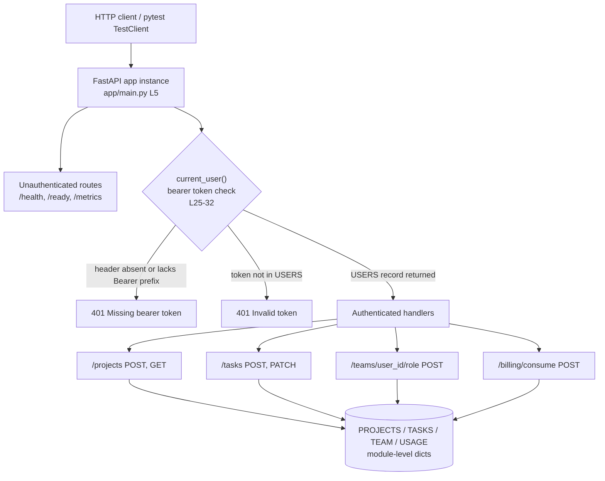

**Core technical approach.** Five design decisions define the system:

1. **Flat, single-module service.** No routers, services, repositories or schemas packages exist; separation is achieved only by declaration order inside `app/main.py`. `app/__init__.py` is empty, so importing the package does not import the service.
2. **Raw-header authentication instead of FastAPI's security machinery.** Protected handlers declare `authorization: str | None = Header(default=None)` and call `current_user()` themselves; no `Depends`, `Security`, OAuth or JWT scheme appears anywhere in the repository. The helper enforces an exact `"Bearer "` prefix via `str.startswith`, strips it with `removeprefix`, and looks the remainder up in `USERS` (`app/main.py`, lines 25–32).
3. **Process-local dictionaries as the data layer.** There is no persistence, no connection pool and no migration path; state is created at import time and shared by every request in the process, which is what lets the test suite import and clear the same dicts the handlers mutate.
4. **Declarative validation via Pydantic plus inline manual checks.** Length limits on `name` and `title` and the integer type of `project_id` are enforced by the models and surface as framework `422`s; business rules — supported status values, role allow-lists, positive units, quota ceiling — are enforced imperatively inside handlers and raised as explicit `HTTPException`s.
5. **Synchronous handlers under ASGI.** Every handler is a plain `def`, so FastAPI dispatches it to its thread pool, and shared mutable dicts are mutated without any locking. The code uses PEP 604 union syntax (`str | None`), which sets a Python 3.10 minimum for the runtime.

**Data flow.** A `POST /projects` request illustrates the whole path: FastAPI validates the body into `ProjectIn` → the handler asks `current_user()` to resolve the bearer token into a `USERS` record → the handler stamps a new dict with `NEXT_PROJECT`, the payload name and `owner_id` taken from that record → the dict is stored in `PROJECTS` and the counter advanced → the stored dict itself is serialised back as the `200` response. Reads are projections over `PROJECTS.values()` filtered by `owner_id`, with the role `owner` short-circuiting the filter (`app/main.py`, line 58). Every `POST` answers `200` rather than `201`, and `PATCH /tasks/{task_id}` returns the mutated task object in place.

### 1.2.3 Success Criteria

Success for this system is measured on two axes: the fidelity of the API contract it encodes, and its fitness as an evaluation target.

**Measurable objectives.**

| Objective | Target | Evidence of the contract |
|---|---|---|
| Complete, reachable HTTP surface | 9 handlers registered, exactly as enumerated in 1.2.2 | `app/main.py` lines 35–110; recursive search for `@app.` returns nine matches |
| Uniform credential enforcement | Every protected route answers `401` with `Missing bearer token` or `Invalid token` before business logic runs | `app/main.py` lines 25–32; `tests/test_api.py` lines 25–26 assert the anonymous case |
| Deterministic request validation | Out-of-range `name`/`title` and non-integer `project_id` are rejected by the framework before handler bodies execute | `app/main.py` lines 16–22 |
| Enumerable quota behaviour | Fifth quota unit succeeds, sixth returns `429 Usage limit reached`; `units < 1` returns `422 Units must be positive` | `app/main.py` lines 97–105 with `USAGE` limit of 5 at line 11 |
| Stable, re-runnable test suite | 3 tests collected under `pytest.ini` discovery, isolated by a per-test state reset | `pytest.ini`; `tests/test_api.py` lines 8–11 |
| Self-contained operation | Service starts with `uvicorn app.main:app --reload` after installing four pinned packages, with no database or configuration | `README.md` lines 11–18; `requirements.txt` |

The three-test baseline could not be executed in this analysis environment — the interpreter has no `fastapi` installed and package installation was refused — so the objective is stated as the contract encoded in `tests/test_api.py`, not as an observed passing run.

**Critical success factors.**

- **Determinism across runs.** `setup_function` clears `PROJECTS` and `TASKS` and resets `USAGE["used"]` before every test (`tests/test_api.py`, lines 8–11); without it the shared process state from earlier tests would leak into later assertions.
- **A defect set that is simultaneously realistic and bounded.** Missing ownership checks, the orphaned `TEAM` map and committed tokens must remain plausible enough to matter and small enough to adjudicate by reading two files.
- **A stable, unversioned contract.** No API versioning prefix exists and the FastAPI `version="1.0.0"` is metadata only (`app/main.py`, line 5); scanners can be re-run against a fixed target without change management.
- **Explicit non-production framing.** The README's "do not deploy" warning (`README.md`, lines 30–31) is what keeps the deliberate weaknesses from being read as backlog items.

**Key performance indicators.** The application exposes no real telemetry — `/metrics` returns `{"requests_total": 0, "uptime_seconds": ...}` regardless of traffic, and `uptime_seconds` is derived from `time.monotonic()` rather than wall-clock time since start (`app/main.py`, lines 108–110). There are therefore no operational KPIs to monitor, and any monitoring of this system would itself be measuring the fixture. The meaningful indicators are properties of the artifact:

| Indicator | Current value | How it is observed |
|---|---|---|
| Source footprint under evaluation | 176 tracked lines across 7 files; 136 lines of code in `app/main.py` + `tests/test_api.py` | `git ls-files`; line counts |
| Endpoint coverage of the test suite | 3 of 9 handlers exercised by at least one assertion (health, project create, project list); 0 assertions for `/ready`, `/tasks`, `/teams`, `/billing`, `/metrics` | `tests/test_api.py` vs `app/main.py` |
| Authentication-policy coverage | Anonymous rejection asserted; invalid-token, member-vs-owner visibility and owner-only role paths unasserted | `tests/test_api.py` lines 25–26 |
| External service dependencies | 0 databases, brokers or third-party APIs | `README.md` line 9; repository-wide search |
| Production readiness | None intended — in-memory state, literal tokens, no logging, no container or CI definitions | `README.md` lines 30–31; repository-wide search |


## 1.3 Scope

The scope of this system is the API surface encoded in `app/main.py` and the evaluation artefacts around it (`tests/test_api.py`, `pytest.ini`, `requirements.txt`). Because the entire runtime is one 110-line module, the boundary is exhaustive rather than representative: anything not listed here does not exist in the repository.

### 1.3.1 In-Scope

#### Core Features and Functionalities

**Must-have capabilities.** Each of these is implemented and reachable; the rule column records the exact condition the handler enforces.

| Capability | Endpoint(s) | Rule enforced | Evidence |
|---|---|---|---|
| Liveness probe | `GET /health` | Always returns `{"status": "ok"}`; no authentication | `app/main.py` lines 35–37 |
| Readiness probe | `GET /ready` | Returns `{"ready": true, "checks": {"storage": "ok"}}`; no authentication, no real dependency check | `app/main.py` lines 40–42 |
| Project creation | `POST /projects` | Bearer token required; `name` 2–80 characters; id from `NEXT_PROJECT`; `owner_id` from the token record | `app/main.py` lines 16–17, 45–52 |
| Project listing | `GET /projects` | Bearer token required; returns the caller's projects, or every project when the token role is `owner` | `app/main.py` lines 55–58 |
| Task creation | `POST /tasks` | Bearer token required; `title` 2–120 characters; `project_id` must exist (`404 Project not found`); new tasks start `open` with `created_by` | `app/main.py` lines 20–22, 61–71 |
| Task status transition | `PATCH /tasks/{task_id}` | Bearer token required; task must exist (`404 Task not found`); status must be `open`, `in_progress` or `done` (`422 Unsupported status`) | `app/main.py` lines 74–83 |
| Role administration | `POST /teams/{user_id}/role` | Caller role must be `owner` (`403 Owner role required`); target user must be in `TEAM` and role must be `owner` or `member` (`404 User or role not found`) | `app/main.py` lines 86–94 |
| Usage metering | `POST /billing/consume` | Bearer token required; `units` defaults to 1; `units < 1` → `422`; exceeding the limit of 5 → `429 Usage limit reached`; otherwise increments `USAGE["used"]` | `app/main.py` lines 11, 97–105 |
| Metrics probe | `GET /metrics` | Returns `requests_total: 0` and `uptime_seconds` from `time.monotonic()`; no authentication | `app/main.py` lines 108–110 |

**Primary user workflows.** Four flows are supported end to end; all assume a running `uvicorn app.main:app` instance and a bearer token from `USERS`.

| # | Workflow | Steps and observed responses |
|---|---|---|
| 1 | Owner creates and lists work | `POST /projects {"name": ...}` → `200` with generated `id` and `owner_id: 1` → `GET /projects` → array containing that project (asserted in `tests/test_api.py` lines 18–22) |
| 2 | Task lifecycle | `POST /projects` → `POST /tasks {"title": ..., "project_id": ...}` → `200` with `status: "open"` → `PATCH /tasks/{id}?status=in_progress` → `200` with the mutated task → `PATCH ...?status=done` |
| 3 | Role administration | `POST /teams/2/role?role=owner` with the owner token → `200 {"user_id": 2, "role": "owner"}` written to `TEAM`; the same call with a member token → `403` |
| 4 | Quota consumption | `POST /billing/consume?units=1` five times → `200` with `used` rising to 5 → a sixth call → `429 Usage limit reached` |

**Essential integrations.** The only integrations are the four declared packages: FastAPI supplies routing, validation errors and OpenAPI generation; Uvicorn serves the ASGI app; Pydantic validates request bodies (imported directly at `app/main.py` line 2 but resolved transitively); `httpx` backs `TestClient` for in-process tests. No authentication provider, database, message broker, payment service or telemetry backend is contacted — the "billing" and "team" endpoints are local simulations.

**Key technical requirements.** Python 3.10 or newer (PEP 604 union syntax `str | None` at `app/main.py` line 25); the four pinned versions in `requirements.txt` installed; the process launched with `app.main:app` as the ASGI target; no environment variables, secrets or configuration files read at runtime; HTTP served at the framework default of `127.0.0.1:8000` per the README's `/docs` link.

#### Implementation Boundaries

**System boundaries.** One process, one module, one ASGI application mounted at the server root with no path prefix and no version segment (`app/main.py` line 5). State is created when the module is imported and never crosses a process boundary; there is no persistence, no cache, no external call. Any second worker or restarted process begins with `PROJECTS`, `TASKS` empty and `USAGE["used"]` at 0.

**User groups covered.** Exactly two principals exist, both resolved from literal tokens, and one anonymous principal that every protected route must reject:

| Principal | Token | Identity | Permissions actually enforced |
|---|---|---|---|
| Owner | `owner-token` | `id: 1`, `role: "owner"` | Creates and lists all projects, creates and updates any task, changes roles, consumes quota |
| Member | `member-token` | `id: 2`, `role: "member"` | Lists only own projects; creates tasks; can update any task and consume quota because those routes perform no ownership check |
| Anonymous | none / malformed | unresolved | Rejected with `401` on every protected route; can reach `/health`, `/ready`, `/metrics` |

No tenant, organisation, group or per-project membership concept exists — `TEAM` is a flat user-id-to-role map (`app/main.py` line 10) that the authorization path never consults.

**Geographic and market coverage.** None. There is no localisation, no region configuration, no currency or tax handling in the quota simulation (usage is an abstract integer against a fixed limit of 5), and no deployment target beyond a developer machine per `README.md` lines 11–18.

**Data domains included.** Five in-memory domains, with the exact fields stored:

| Domain | Storage | Fields |
|---|---|---|
| Credentials and identity | `USERS` dict keyed by token string | `id`, `role` |
| Projects | `PROJECTS` dict keyed by integer id | `id`, `name`, `owner_id` |
| Tasks | `TASKS` dict keyed by integer id | `id`, `title`, `project_id`, `created_by`, `status` |
| Team roles | `TEAM` dict keyed by user id | role string (`owner` / `member`) |
| Usage metering | `USAGE` single dict | `used`, `limit` (fixed at 5) |

Id allocation is monotonic per process via `NEXT_PROJECT` and `NEXT_TASK`, which the create handlers advance through `global` and which nothing resets except a process restart (`app/main.py`, lines 12–13, 47–51, 63–70).

### 1.3.2 Out-of-Scope

#### Excluded Features and Capabilities

A recursive search of every tracked file returns no occurrence of CORS, middleware, `Depends`, `Security`, OAuth, JWT, password hashing, logging, offset/limit pagination, SQL or an ORM. The following are therefore excluded, not merely unfinished:

- Real authentication: no credential issuance, no token expiry, rotation or revocation, no password storage, no OIDC or JWT verification.
- Durable storage: no database, migrations, transactions, backups or data export.
- Observability: no application logging, no request instrumentation (`/metrics` returns a constant `0`), no tracing, no alerting.
- Operational plumbing: no Dockerfile, no compose file, no CI workflow, no linting or type-checking configuration, no deployment manifests.
- API ergonomics: no pagination, filtering, sorting or search on `GET /projects`; no delete or update endpoints for projects; no task listing or task read endpoint; no delete for tasks.
- Correctness hardening the fixture deliberately omits: ownership checks on task mutation and quota consumption, synchronisation of `TEAM` with `USERS`, idempotency, optimistic concurrency, and `201 Created` responses.

#### Future Phase Considerations

The repository states no roadmap and contains no TODO markers, issue templates or versioned milestone. The README instead directs that the fixture stay as it is — self-contained, in-memory and unscanned-environment-free (`README.md`, lines 25–31) — and that its incompleteness is the point. Any extension (persistent storage, real auth, a broadened test suite) would invalidate the known-ground-truth property the fixture exists to provide, so such work belongs to a different artifact rather than a later phase of this one.

#### Integration Points Not Covered

| Integration type | Status in this repository |
|---|---|
| Identity provider (OIDC/SAML/LDAP) | Absent; tokens are literals in `app/main.py` line 7 |
| Relational or document database | Absent; `README.md` line 9 confirms in-memory only |
| Billing or payment processor | Absent; `/billing/consume` mutates a local counter |
| Metrics, tracing or log aggregation backend | Absent; `/metrics` is a static payload |
| CI/CD, registry or deployment platform | Absent; no `.github`, Dockerfile or compose file exists |
| Outbound HTTP or event publishing | Absent; the module imports only FastAPI, Pydantic and `time.monotonic` |

#### Unsupported Use Cases

The system cannot serve, and must not be used for, any of the following: production hosting with real credentials (`README.md`, lines 30–31); multi-user or multi-tenant operation across processes, since state is per-process; audit or compliance reporting, since role changes are unlogged and disconnected from authorization; capacity or performance testing of a real workload, since handlers mutate shared unlocked dicts and all data is resident in memory; and quota enforcement that reflects a real customer balance, since the limit is a constant of 5 with no per-account accounting.


## 1.4 References

- `README.md` — stated purpose as a proactive-insights QA fixture, what the repository contains, local run and test commands, "no external database" and "do not deploy" constraints, and the suggested scan setup (lines 1–31)
- `app/main.py` — the entire service: FastAPI instance and metadata (line 5), in-memory state containers and id allocators (lines 7–13), `ProjectIn`/`TaskIn` request contracts (lines 16–22), `current_user` bearer-token helper (lines 25–32), and all nine route handlers (lines 35–110)
- `app/__init__.py` — empty package marker; established that the package carries no behaviour or re-exports
- `app/` — folder contents confirming a flat, single-module application with no routers, services or schemas layers
- `tests/test_api.py` — the three-test suite, module-level `TestClient`/`OWNER` globals, the `setup_function` state reset, and the asserted contracts for `/health`, `POST`/`GET /projects` and anonymous rejection
- `tests/` — folder contents confirming a single test module with no `conftest.py` or shared helpers
- `pytest.ini` — test discovery configuration (`testpaths = tests`, `python_files = test_*.py`)
- `requirements.txt` — the four pinned dependencies: `fastapi==0.115.12`, `uvicorn==0.34.0`, `pytest==8.3.5`, `httpx==0.28.1`
- Repository git history and branches (`git log`, `git branch -a`, `git diff --stat main 2011_01`) — commit intent ("Add proactive insights testing project"), the three-commit history, and the identity of `main` and `2011_01`


# 2. Product Requirements

## 2.1 Feature Catalog

The catalog enumerates ten features that together account for every behaviour in the repository. Nine of them map onto the nine route handlers in `app/main.py`; the remaining three cover the module-level state containers, the test module and the dependency manifest. Nothing here is a proposal or a roadmap item: each feature exists in the current tree at commit `6e1eebd`, so every status is *Completed* and no feature carries a *Proposed*, *Approved* or *In Development* status.

| ID | Feature | Category | Priority |
|---|---|---|---|
| F-001 | Service Health and Readiness Probes | Operational / Platform | Critical |
| F-002 | Bearer Token Authentication and Principal Resolution | Security | Critical |
| F-003 | Project Creation and Ownership-Scoped Listing | Project Management | Critical |
| F-004 | Task Creation and Status Transition | Task Management | High |
| F-005 | Team Role Administration | Administration | High |
| F-006 | Usage Metering and Quota Enforcement | Billing Simulation | High |
| F-007 | Metrics Probe | Observability | Medium |
| F-008 | Process-Local In-Memory Data Store | Data Management | Critical |
| F-009 | Automated Contract Test Harness | Quality Assurance | High |
| F-010 | Self-Contained Local Runtime and Dependency Pinning | Delivery / Operability | High |

**Priority rubric.** The repository declares no priorities of its own, so the levels above follow one stated rule, applied uniformly and reproducible from `README.md` and `tests/test_api.py`:

| Priority | Rule applied | Features at this level |
|---|---|---|
| Critical | Named in the README's "What is included" list (`README.md` lines 6–9) and/or asserted by the repository's test suite; removing it would remove either the advertised contract or the fixture's ground truth | F-001, F-002, F-003, F-008 |
| High | Implemented and advertised in the README, but with no assertion anywhere in the repository | F-004, F-005, F-006, F-009, F-010 |
| Medium | Implemented but neither advertised nor asserted; its output is deliberately hollow or auxiliary | F-007 |
| Low | Not used — no feature in this repository sits at this level | — |

Two features carry the fixture's deliberately planted weaknesses rather than distinct capabilities: F-005 records roles in a map that authorization never reads, and F-004 and F-006 authenticate callers without checking ownership. Those behaviours are documented where they occur, as observed properties of the features (2.4.4, 2.6.2), and are not promoted into features of their own.

### 2.1.1 F-001 — Service Health and Readiness Probes

| Attribute | Value |
|---|---|
| Unique ID | F-001 |
| Feature Name | Service Health and Readiness Probes |
| Feature Category | Operational / Platform |
| Priority Level | Critical |
| Status | Completed |

**Overview.** Two unauthenticated handlers report service state: `GET /health` returns the literal body `{"status": "ok"}` (`app/main.py` lines 35–37) and `GET /ready` returns `{"ready": true, "checks": {"storage": "ok"}}` (lines 40–42). Both are plain synchronous functions registered on the module-level `FastAPI` instance at import time.

**Business Value.** The fixture exists to be started and then scanned or exercised (`README.md` lines 11–18, 25–28). A zero-credential liveness endpoint is what lets an evaluator's harness confirm the process is serving before it drives the rest of the API, and it removes any need to provision a token just to check that the service is up.

**User Benefits.** Consumer personas and evaluation tooling alike can poll both probes without credentials. Because the README points at the framework's generated `/docs` (`README.md` line 18), the same surface also gives an interactive view of the whole contract without extra documentation work.

**Technical Context.** Neither handler reads application state, so both answer identically whether `PROJECTS` and `TASKS` are empty or full. This matters for the readiness probe: `"storage": "ok"` is a literal in the response body (line 42), not the result of a check against the in-memory store, so `/ready` cannot report a negative state. The two probes are therefore contract checks, not health diagnostics, and they are the only routes whose signatures omit the `authorization` header parameter. Service metadata — title `Proactive Insights Demo API`, version `1.0.0` — is set once on the application instance (line 5) and surfaced through `/openapi.json` and `/docs`.

**Dependencies**

- **Prerequisite features:** none. The feature depends on no other feature and holds no state.
- **System dependencies:** the `app` FastAPI instance (`app/main.py` line 5) and a Python 3.10+ runtime.
- **External dependencies:** `fastapi==0.115.12` for routing and response serialisation; `uvicorn==0.34.0` to serve the ASGI application (`requirements.txt` lines 1–2).
- **Integration requirements:** none. No handler in the repository calls these routes internally, and no other feature consumes their output.

### 2.1.2 F-002 — Bearer Token Authentication and Principal Resolution

| Attribute | Value |
|---|---|
| Unique ID | F-002 |
| Feature Name | Bearer Token Authentication and Principal Resolution |
| Feature Category | Security |
| Priority Level | Critical |
| Status | Completed |

**Overview.** A single helper, `current_user(authorization)` (`app/main.py` lines 25–32), converts an `Authorization` header into a principal record. It rejects a missing header or one that does not begin with the exact string `"Bearer "` with `401 {"detail": "Missing bearer token"}`, strips the scheme with `str.removeprefix`, and returns the record found in `USERS` or raises `401 {"detail": "Invalid token"}`. Six handlers call it explicitly: `create_project`, `list_projects`, `create_task`, `update_task`, `change_role` and `consume_usage`.

**Business Value.** The README's first advertised capability is "authentication-like bearer tokens and role checks" (`README.md` line 6), and this helper is the whole of it. It gives the fixture a uniform, examinable credential boundary that a scanner can reason about, and it produces the two `401` paths that any access-control analysis needs as ground truth.

**User Benefits.** Two personas, `owner` and `member`, are resolvable from fixed tokens (`owner-token` → `{id: 1, role: "owner"}`, `member-token` → `{id: 2, role: "member"}`, line 7), so an evaluator can drive role-differentiated behaviour without an identity provider. Anonymous or malformed callers receive a single, unambiguous rejection.

**Technical Context.** The check is hand-written rather than declarative: no `Depends`, `Security`, OAuth scheme or JWT library appears anywhere in the repository, so each protected handler must remember to call the helper, and the OpenAPI document consequently declares no security scheme and marks `authorization` as an optional header. Tokens never expire and cannot be revoked — `USERS` is a literal dict (line 7) that no handler ever writes, and the same tokens are hard-coded in the test module (`tests/test_api.py` line 5). The helper returns the stored record itself, so handlers receive both `id` and `role` for downstream stamping and gating.

**Dependencies**

- **Prerequisite features:** F-008 — the `USERS` registry lives in the same process-local module state that F-008 describes.
- **System dependencies:** the `USERS` dict (`app/main.py` line 7); `Header(default=None)` extraction and `HTTPException` rendering from FastAPI.
- **External dependencies:** `fastapi==0.115.12`.
- **Integration requirements:** every protected feature (F-003, F-004, F-005, F-006) must invoke the helper itself; the repository contains no middleware or dependency-injection layer that would apply it centrally.

### 2.1.3 F-003 — Project Creation and Ownership-Scoped Listing

| Attribute | Value |
|---|---|
| Unique ID | F-003 |
| Feature Name | Project Creation and Ownership-Scoped Listing |
| Feature Category | Project Management |
| Priority Level | Critical |
| Status | Completed |

**Overview.** `POST /projects` accepts a `ProjectIn` body and stores `{"id", "name", "owner_id"}`, taking the id from the `NEXT_PROJECT` counter and `owner_id` from the authenticated principal (`app/main.py` lines 45–52). `GET /projects` returns a JSON array filtered to the caller's own projects, unless the caller's role is `owner`, in which case every project is returned (lines 55–58).

**Business Value.** This is the fixture's primary resource lifecycle and the only workflow the repository's own suite asserts end to end (`tests/test_api.py` lines 18–22). It gives the fixture a creation path with a generated identifier, an ownership stamp derived from a credential, and a read path whose result set changes with the caller's role — the three ingredients a role-aware access-control analysis needs.

**User Benefits.** An owner sees the whole workspace; a member sees only what they created. Both receive a stable integer id from the creation response, so a test or script can chain a create into a list and compare identifiers without parsing names.

**Technical Context.** `ProjectIn.name` is declaratively constrained to 2–80 characters by Pydantic (`app/main.py` lines 16–17), so out-of-range input is rejected by the framework with a `422` before the handler runs. Creation answers `200`, not `201`, and returns the stored dict object itself; the id allocator advances only after a successful validation, so rejected requests leave no gap in the sequence. The listing filter is a single comprehension over `PROJECTS.values()` with the owner role short-circuiting the ownership test. There is no update, delete, pagination, sorting or search path for projects.

**Dependencies**

- **Prerequisite features:** F-002 (the principal supplies `owner_id` for creation and drives the listing filter) and F-008 (`PROJECTS`, `NEXT_PROJECT`).
- **System dependencies:** `PROJECTS` dict and `NEXT_PROJECT` counter (`app/main.py` lines 8, 12); `ProjectIn` model (lines 16–17).
- **External dependencies:** `fastapi==0.115.12` and, transitively, `pydantic` for body validation.
- **Integration requirements:** F-004 reads `PROJECTS` to confirm a task's `project_id` exists, and F-009 exercises both project endpoints.

### 2.1.4 F-004 — Task Creation and Status Transition

| Attribute | Value |
|---|---|
| Unique ID | F-004 |
| Feature Name | Task Creation and Status Transition |
| Feature Category | Task Management |
| Priority Level | High |
| Status | Completed |

**Overview.** `POST /tasks` validates a `TaskIn` body, confirms the referenced project exists, and stores `{"id", "title", "project_id", "created_by", "status": "open"}` with an id from `NEXT_TASK` (`app/main.py` lines 61–71). `PATCH /tasks/{task_id}` takes a required `status` query parameter, checks that the task exists, checks the value against `{open, in_progress, done}`, and mutates the stored task in place (lines 74–83).

**Business Value.** The README advertises "project and task workflows" (`README.md` line 7); this feature is the child-resource half of that pair. It supplies the fixture's only mutation path against an existing record, which is what makes status-transition validation, check ordering and in-place state change available for analysis.

**User Benefits.** A caller can create a task against any existing project and walk it through three states, receiving the updated task object from every transition. A missing project or task, or an unsupported state, produces a distinct, machine-readable error rather than a silent write.

**Technical Context.** `TaskIn.title` is constrained to 2–120 characters and `project_id` is typed as `int` (lines 20–22); the framework rejects a non-numeric id with `422` while still coercing a numeric string such as `"1"`. The `status` parameter is a **query** parameter, not a body field — `PATCH /tasks/1?status=done` — and its omission is a framework `422`. Checks run in a fixed order: authentication first (`401`), then existence (`404 Task not found`), then value (`422 Unsupported status`), so a nonexistent task with an unsupported status returns `404`. The handler discards the principal returned by `current_user` (line 76) and reads no ownership field, so any valid token can transition any task. There is no task listing, read or delete endpoint.

**Dependencies**

- **Prerequisite features:** F-002 (every route requires a bearer token), F-003 (a task cannot be created unless its project exists), F-008 (`TASKS`, `NEXT_TASK`).
- **System dependencies:** `TASKS` and `PROJECTS` dicts, the `NEXT_TASK` counter (`app/main.py` lines 9, 13) and the `TaskIn` model (lines 20–22).
- **External dependencies:** `fastapi==0.115.12`; `pydantic` transitively for the request model.
- **Integration requirements:** none outward — no other feature reads `TASKS`, and the feature is unasserted by F-009.

### 2.1.5 F-005 — Team Role Administration

| Attribute | Value |
|---|---|
| Unique ID | F-005 |
| Feature Name | Team Role Administration |
| Feature Category | Administration |
| Priority Level | High |
| Status | Completed |

**Overview.** `POST /teams/{user_id}/role` requires an `owner` caller, validates that the target user and the requested role are known, writes the role into the `TEAM` map and echoes `{"user_id": ..., "role": ...}` (`app/main.py` lines 86–94).

**Business Value.** The README advertises "team membership" (`README.md` line 7). The feature provides the fixture's only administrative write path and its only route where the caller's *role* — not merely the validity of their token — decides the outcome, producing the `403` case that complements F-002's `401` cases.

**User Benefits.** An owner can promote or demote the two seeded users and receive confirmation of the recorded value. A member attempting the same call is refused with an explicit `403 Owner role required` rather than a silent no-op.

**Technical Context.** The gate reads the principal's `role` from the `USERS` record (line 89). The write goes to `TEAM` (line 10), a separate user-id-to-role map keyed by integer. These two structures are never synchronised: `current_user` consults only `USERS`, so a recorded role change does not alter any subsequent authorization decision — a promoted member still sees only their own projects, and a demoted owner retains every owner capability. The target-validation branch deliberately conflates two different failures, returning `404 User or role not found` for both an unknown user id and a role outside `{owner, member}`. `role` is a required query parameter, and a caller may address their own id, so self-demotion is accepted at the store level.

**Dependencies**

- **Prerequisite features:** F-002 (the `403` gate depends on the principal's role), F-008 (`TEAM` state).
- **System dependencies:** `TEAM` dict (`app/main.py` line 10) and the `USERS` registry for the role gate (line 7).
- **External dependencies:** `fastapi==0.115.12`.
- **Integration requirements:** none — `TEAM` is written here and read nowhere else in the repository, which is the feature's defining structural property.

### 2.1.6 F-006 — Usage Metering and Quota Enforcement

| Attribute | Value |
|---|---|
| Unique ID | F-006 |
| Feature Name | Usage Metering and Quota Enforcement |
| Feature Category | Billing Simulation |
| Priority Level | High |
| Status | Completed |

**Overview.** `POST /billing/consume` accepts an optional `units` query parameter defaulting to `1`, rejects values below `1` with `422 Units must be positive`, rejects consumption that would exceed the limit of `5` with `429 Usage limit reached`, and otherwise increments `USAGE["used"]` and returns the counter (`app/main.py` lines 97–105, with `USAGE` initialised at line 11).

**Business Value.** The README advertises "a simulated billing limit" (`README.md` line 8). The feature supplies the fixture's quota-denial path — the one place where a legitimate, authenticated request is refused for a business reason rather than an access-control one — and therefore the `429` ground truth an analysis of limit enforcement depends on.

**User Benefits.** A caller always learns the current consumption from the response, so the boundary is observable without a separate reporting endpoint: four units consumed plus one succeeds at `used: 5`, and the next attempt fails without altering the counter.

**Technical Context.** The limit is a constant inside the `USAGE` dict (line 11) with no configuration, per-account accounting or reset endpoint. The counter is process-global: both seeded tokens draw from the same `used` value, so one principal can exhaust another's quota. The check is a read-modify-write over module state performed by a synchronous handler that FastAPI dispatches to a worker thread, with no lock, so concurrent requests can interleave between the ceiling test and the increment. Failed requests — both `422` and `429` — leave the counter untouched, and the response body is the `USAGE` dict itself, including the `limit` field.

**Dependencies**

- **Prerequisite features:** F-002 (a valid bearer token is required before any metering logic runs), F-008 (`USAGE` state).
- **System dependencies:** the `USAGE` dict (`app/main.py` line 11).
- **External dependencies:** `fastapi==0.115.12`.
- **Integration requirements:** none outward — no payment processor, invoice or reporting consumer exists; the response of the endpoint itself is the only view of the counter.

### 2.1.7 F-007 — Metrics Probe

| Attribute | Value |
|---|---|
| Unique ID | F-007 |
| Feature Name | Metrics Probe |
| Feature Category | Observability |
| Priority Level | Medium |
| Status | Completed |

**Overview.** `GET /metrics` returns `{"requests_total": 0, "uptime_seconds": ...}` without authentication (`app/main.py` lines 108–110), where the first value is a hard-coded literal and the second is `round(time.monotonic(), 2)`.

**Business Value.** The endpoint establishes that the fixture exposes a metrics-shaped surface at all, which lets an evaluator's telemetry expectations be exercised — and, because both values are hollow, lets a scanner's observability findings be scored against a known answer.

**User Benefits.** A caller gets a stable, always-parseable metrics body with no credentials, and can distinguish the process's clock source from wall-clock time if they read the payload carefully.

**Technical Context.** `requests_total` never increments: no middleware, counter or instrumentation exists anywhere in the repository, so the value stays `0` after any number of requests. `uptime_seconds` is derived from `time.monotonic()`, whose origin is the platform's monotonic clock (in practice the system boot), not the moment the application started; it therefore reports a large absolute figure rather than an uptime. The route is unauthenticated, unlike every state-bearing route.

**Dependencies**

- **Prerequisite features:** none.
- **System dependencies:** the `time.monotonic` function (`app/main.py` line 3).
- **External dependencies:** `fastapi==0.115.12`.
- **Integration requirements:** none — nothing records request counts for this endpoint to report, and no other feature consumes its output.

### 2.1.8 F-008 — Process-Local In-Memory Data Store

| Attribute | Value |
|---|---|
| Unique ID | F-008 |
| Feature Name | Process-Local In-Memory Data Store |
| Feature Category | Data Management |
| Priority Level | Critical |
| Status | Completed |

**Overview.** All domain state is created as module-level objects when `app.main` is imported: `USERS` (token → principal), `PROJECTS` and `TASKS` (integer-id-keyed dicts), `TEAM` (user id → role), `USAGE` (a single `{"used": 0, "limit": 5}` dict) and the `NEXT_PROJECT` / `NEXT_TASK` allocators (`app/main.py` lines 7–13). The create handlers advance the allocators through `global` declarations (lines 47, 63).

**Business Value.** The README makes self-containment a product property — "No external database or service is required; data is held in memory" (`README.md` line 9) and "Do not configure an environment; this fixture is self-contained" (line 28). The store is what delivers that property: the service is evaluable from a clean checkout with nothing provisioned.

**User Benefits.** A reader can hold the entire data model in view in seven lines, and any state a request creates is visible to the next request in the same process without setup. Evaluators can reset the world by restarting the process rather than cleaning a database.

**Technical Context.** State is per process and per import: a restart, a second worker or a second interpreter begins with `PROJECTS` and `TASKS` empty, `USAGE["used"]` at `0` and the id counters back at `1`. Identifiers are monotonic within a process and never reused; they advance only through successful creation, and no handler resets them. The containers are ordinary module attributes, which makes them importable — the test suite depends on that, importing `PROJECTS`, `TASKS` and `USAGE` directly and mutating them to reset state (`tests/test_api.py` lines 2, 8–11). `USERS` is effectively read-only, since no handler writes it. There is no locking, no transaction boundary and no persistence path.

**Dependencies**

- **Prerequisite features:** none — this is the foundation every state-bearing feature stands on.
- **System dependencies:** Python's module import machinery; the dict type.
- **External dependencies:** none.
- **Integration requirements:** F-003, F-004, F-005 and F-006 read and write these containers directly rather than through an access layer; F-009 imports them to reset state between tests.

### 2.1.9 F-009 — Automated Contract Test Harness

| Attribute | Value |
|---|---|
| Unique ID | F-009 |
| Feature Name | Automated Contract Test Harness |
| Feature Category | Quality Assurance |
| Priority Level | High |
| Status | Completed |

**Overview.** A three-test pytest module (`tests/test_api.py`) drives the application in-process through `fastapi.testclient.TestClient`, with discovery configured to `testpaths = tests` and `python_files = test_*.py` (`pytest.ini` lines 1–3). A module-level `setup_function` clears `PROJECTS` and `TASKS` and resets `USAGE["used"]` before each test (lines 8–11).

**Business Value.** The README advertises "a deliberately small test suite: it covers a few happy paths while leaving important workflows and non-functional behaviours untested" (`README.md` line 8). The harness is therefore a product feature in its own right: it establishes a green baseline and a precisely known coverage gap, both of which an evaluator needs in order to score coverage findings.

**User Benefits.** One command — `pytest -q` (`README.md` line 22) — gives a fast, dependency-light signal that the service contract still holds, with no external services and no fixtures beyond a per-test state reset.

**Technical Context.** The suite asserts three contracts: `GET /health` returning exactly `{"status": "ok"}` (line 15), `POST /projects` returning `200` with the echoed name and an id that then appears in `GET /projects` (lines 18–22), and anonymous `GET /projects` returning `401` (line 26). Everything else — `GET /ready`, `GET /metrics`, both task routes, role administration, quota denial, member-versus-owner visibility, invalid tokens and the request-model validation errors — is unasserted. The reset covers three of the seven state names: `NEXT_PROJECT`, `NEXT_TASK` and `TEAM` survive between tests, which is why the assertions compare identifiers round-trip rather than against literals.

**Dependencies**

- **Prerequisite features:** F-008 (the suite imports and clears the application's containers), F-001, F-002 and F-003 (the three asserted contracts).
- **System dependencies:** `pytest.ini` discovery configuration; the importable `app.main` module and its `app` instance.
- **External dependencies:** `pytest==8.3.5` and `httpx==0.28.1` (`requirements.txt` lines 3–4), the latter backing `TestClient`.
- **Integration requirements:** the module imports the application directly, so tests exercise the ASGI app in-process rather than over the network; there is no `conftest.py` and no shared helper module.

### 2.1.10 F-010 — Self-Contained Local Runtime and Dependency Pinning

| Attribute | Value |
|---|---|
| Unique ID | F-010 |
| Feature Name | Self-Contained Local Runtime and Dependency Pinning |
| Feature Category | Delivery / Operability |
| Priority Level | High |
| Status | Completed |

**Overview.** Four exact `==` pins define the environment — `fastapi==0.115.12`, `uvicorn==0.34.0`, `pytest==8.3.5`, `httpx==0.28.1` (`requirements.txt` lines 1–4) — and the README prescribes the run sequence: create a virtual environment, install the file, launch `uvicorn app.main:app --reload`, and open `http://127.0.0.1:8000/docs` (`README.md` lines 11–18).

**Business Value.** The fixture is only useful if it starts the same way everywhere. Exact pins and a single ASGI entry point give every evaluator a byte-identical dependency set and remove the environment drift that would otherwise make findings non-comparable between runs.

**User Benefits.** Two commands take a clean checkout to a live service with browsable documentation, and the same install satisfies both the runtime and the test suite because there is no development/runtime split.

**Technical Context.** Configuration surface is zero: the application reads no environment variables, secrets or configuration files, and no `.env`, Dockerfile, compose file or CI workflow exists in the repository. `pydantic` is imported directly by `app/main.py` (line 2) but is not pinned, arriving transitively with FastAPI. The runtime requires Python 3.10 or newer because the authentication helper annotates `str | None` (line 25), PEP 604 syntax that earlier interpreters cannot parse. The pins install cleanly and the suite passes under Python 3.12.3.


## 2.2 Functional Requirements Table

Thirty requirements express the ten catalogued features as testable statements. Each feature carries three tables: requirement details, inputs and outputs with acceptance criteria, and validation with security and non-functional requirements. The tables share one requirement-ID column, so a row can be read across all three.

**Identifier scheme.** `F-XXX-RQ-YYY` — the feature number, then a sequence within that feature starting at `001`. Identifiers are stable and are never reused or renumbered; a withdrawn requirement would be marked as such rather than deleted.

**Priority scale.** *Must-Have* means the README advertises the behaviour (`README.md` lines 6–9) or the repository's suite asserts it, and its absence would change the observable contract. *Should-Have* means the behaviour is implemented and reachable but unasserted. *Could-Have* means the behaviour is implemented but incidental to the fixture's purpose. Because coverage in the repository is deliberately thin (`README.md` line 8), these priorities rank the fixture's own evidence, not customer demand.

**Complexity.** Every requirement is rated *Low*: each is implemented by a single handler or helper of at most eleven statements, with no layering, no transaction, no external I/O and no concurrency control beyond dict operations. The rating describes implementation complexity, not risk — the coupling and security consequences of the same statements are recorded in 2.4.

| Feature | Must-Have | Should-Have | Could-Have |
|---|---|---|---|
| F-001 Service Health and Readiness Probes | 1 | 2 | 0 |
| F-002 Bearer Token Authentication | 3 | 0 | 0 |
| F-003 Project Creation and Listing | 2 | 1 | 0 |
| F-004 Task Creation and Status Transition | 2 | 1 | 1 |
| F-005 Team Role Administration | 1 | 2 | 0 |
| F-006 Usage Metering and Quota | 3 | 1 | 0 |
| F-007 Metrics Probe | 0 | 0 | 1 |
| F-008 In-Memory Data Store | 2 | 1 | 0 |
| F-009 Contract Test Harness | 3 | 0 | 0 |
| F-010 Local Runtime and Pinning | 2 | 1 | 0 |
| **Total (30)** | **19** | **9** | **2** |

**Status of every requirement.** All thirty describe behaviour that already exists in `app/main.py`, `pytest.ini`, `requirements.txt` and `tests/test_api.py` at commit `6e1eebd`. This section documents an existing system, so no requirement is a future obligation, and a statement the code does not satisfy would not be a requirement of this system.

**Verification basis.** The repository's own suite asserts four of the thirty requirements directly or partly: F-001-RQ-001, F-002-RQ-001, F-003-RQ-001 and F-003-RQ-002. Every other acceptance criterion below was confirmed by issuing the request against the application running under the pinned stack (`fastapi==0.115.12`, `httpx==0.28.1` via `TestClient`, Python 3.12.3), which is why the criteria state exact status codes and bodies rather than intent.

**Compliance requirements.** One negative statement holds for all thirty requirements and is not repeated per row: no regulatory, licensing, data-protection or accessibility obligation applies, because the repository declares none and restricts use to non-production evaluation — "Do not deploy it or use real credentials" (`README.md` lines 30–31).

### 2.2.1 F-001 Requirements — Service Health and Readiness Probes

| Req ID | Description | Priority | Complexity |
|---|---|---|---|
| F-001-RQ-001 | `GET /health` answers the liveness probe with a fixed body, without credentials | Must-Have | Low |
| F-001-RQ-002 | `GET /ready` answers the readiness probe with a fixed body naming one storage check | Should-Have | Low |
| F-001-RQ-003 | The generated OpenAPI document and `/docs` expose the full nine-operation contract and the application metadata | Should-Have | Low |

| Req ID | Input Parameters | Output / Response | Acceptance Criteria |
|---|---|---|---|
| F-001-RQ-001 | None — no path, query, body or header parameter | `200` with JSON `{"status": "ok"}` | Status is `200`; the body equals exactly `{"status": "ok"}`; the call succeeds with no `Authorization` header (asserted at `tests/test_api.py` line 15) |
| F-001-RQ-002 | None | `200` with `{"ready": true, "checks": {"storage": "ok"}}` | Status is `200`; the body equals exactly that object; the response is identical whether `PROJECTS`, `TASKS` and `USAGE` are empty or populated, because the body is a literal at `app/main.py` line 42 |
| F-001-RQ-003 | None | HTML at `/docs`; JSON at `/openapi.json` | `info.title` is `Proactive Insights Demo API` and `info.version` is `1.0.0`; the document lists 8 paths carrying 9 operations; `ProjectIn` advertises `minLength: 2` and `maxLength: 80`; `TaskIn` requires `title` and `project_id` |

| Req ID | Business Rules and Data Validation | Security Requirements | Performance and Data Requirements |
|---|---|---|---|
| F-001-RQ-001 | No input is accepted, so nothing is validated; the body is a literal | Public by design: no credential is required or inspected | Constant work, no state access, no data retained |
| F-001-RQ-002 | No input is accepted; the check named in the body is not performed | Public by design | Constant work; no store read, so readiness can never report a failure |
| F-001-RQ-003 | Schema is derived from handler signatures, so adding or renaming a parameter changes the contract surface | The document declares no security scheme and marks `authorization` optional even though handlers enforce it | Generated in memory per request; adds no application state |

### 2.2.2 F-002 Requirements — Bearer Token Authentication and Principal Resolution

| Req ID | Description | Priority | Complexity |
|---|---|---|---|
| F-002-RQ-001 | Every protected route rejects a missing or non-`Bearer` `Authorization` header with `401 Missing bearer token` | Must-Have | Low |
| F-002-RQ-002 | The two seeded tokens resolve to principal records; any other token is rejected with `401 Invalid token` | Must-Have | Low |
| F-002-RQ-003 | The resolved principal supplies the identity and role that handlers stamp records with and gate on | Must-Have | Low |

| Req ID | Input Parameters | Output / Response | Acceptance Criteria |
|---|---|---|---|
| F-002-RQ-001 | `Authorization` header absent or without the exact `Bearer ` prefix | `401` with `{"detail": "Missing bearer token"}` | All six protected routes (`POST /projects`, `GET /projects`, `POST /tasks`, `PATCH /tasks/{task_id}`, `POST /teams/{user_id}/role`, `POST /billing/consume`) return `401` with that detail; `bearer owner-token` and `Token owner-token` are both rejected; asserted for `GET /projects` at `tests/test_api.py` line 26 |
| F-002-RQ-002 | `Authorization: Bearer <token>` | Handler response for a known token; `401` with `{"detail": "Invalid token"}` otherwise | `Bearer owner-token` resolves to `{id: 1, role: owner}` and `Bearer member-token` to `{id: 2, role: member}`; `Bearer nope`, an empty `Bearer ` value and `Bearer  owner-token` with a doubled space all yield `401 Invalid token` |
| F-002-RQ-003 | The principal record returned by the helper | `owner_id` on a project, `created_by` on a task, the role comparison on role administration | A project created with `owner-token` stores `owner_id: 1`; created with `member-token`, `owner_id: 2`; `POST /teams/{user_id}/role` compares the principal's `role` against `owner` |

| Req ID | Business Rules and Data Validation | Security Requirements | Performance and Data Requirements |
|---|---|---|---|
| F-002-RQ-001 | Scheme matching is case-sensitive and requires the exact space-delimited prefix (`str.startswith`, then `removeprefix`) | Credential presence is enforced per handler; with no middleware or dependency layer, a new route inherits nothing automatically | One string comparison and one short-circuit per request; no data retained |
| F-002-RQ-002 | Lookup key is the raw token string; there is no expiry, rotation, revocation or hashing | Tokens are literals in source (`app/main.py` line 7) and duplicated in the suite (`tests/test_api.py` line 5); they never stop being valid | O(1) dict lookup; `USERS` is never written at runtime |
| F-002-RQ-003 | The record must be passed on for identity to exist; `update_task` discards it (`app/main.py` line 76) and so performs no identity linkage | Identity is never used for ownership enforcement on task mutation or quota consumption, only for stamping new records | Principal is neither persisted nor logged |

### 2.2.3 F-003 Requirements — Project Creation and Ownership-Scoped Listing

| Req ID | Description | Priority | Complexity |
|---|---|---|---|
| F-003-RQ-001 | `POST /projects` creates a project with a generated id and the caller's ownership | Must-Have | Low |
| F-003-RQ-002 | `GET /projects` returns the caller's projects, or every project when the caller's role is `owner` | Must-Have | Low |
| F-003-RQ-003 | Project names are constrained to 2–80 characters by the request model | Should-Have | Low |

| Req ID | Input Parameters | Output / Response | Acceptance Criteria |
|---|---|---|---|
| F-003-RQ-001 | Body `{"name": string}`; `Authorization: Bearer <token>` | `200` with `{"id": int, "name": string, "owner_id": int}` | Status is `200`, not `201`; the body carries exactly the keys `id`, `name`, `owner_id`; the first creation in a fresh process returns `id: 1` and the next `2`; `name` is echoed verbatim; a creation rejected with `422` consumes no id |
| F-003-RQ-002 | `Authorization: Bearer <token>` | `200` with a JSON array of project objects; `[]` when none are visible | The member token returns only projects whose `owner_id` is `2`; the owner token returns every stored project; an empty store returns `[]`; the created project's `id` appears in the caller's listing (`tests/test_api.py` line 22) |
| F-003-RQ-003 | Body `{"name": string}` | `422` with a Pydantic detail array | `"A"` returns `422` `string_too_short`; 81 characters return `422` `string_too_long`; exactly 80 characters return `200`; a missing field returns `422` `missing` at `loc: ["body", "name"]` |

| Req ID | Business Rules and Data Validation | Security Requirements | Performance and Data Requirements |
|---|---|---|---|
| F-003-RQ-001 | The allocator is post-incremented on `NEXT_PROJECT`; `owner_id` always comes from the token, and a caller-supplied `owner_id` in the body is ignored | Creation requires a valid token; recorded ownership is never re-validated after creation | O(1) insert and increment; stores three fields; lost on restart |
| F-003-RQ-002 | Filter is `owner_id == caller id or role == owner`; no pagination, sorting or search; insertion order is preserved | The owner role widens the result set to every project in the process, by design of the filter | O(n) scan over `PROJECTS.values()` per request; the response embeds the stored dicts |
| F-003-RQ-003 | Length is counted on the decoded string; a whitespace-only name of two or more characters is accepted | Constraint bounds are published in the OpenAPI document | Validation precedes the handler, so a failure performs no store access |

### 2.2.4 F-004 Requirements — Task Creation and Status Transition

| Req ID | Description | Priority | Complexity |
|---|---|---|---|
| F-004-RQ-001 | `POST /tasks` creates an `open` task against an existing project | Must-Have | Low |
| F-004-RQ-002 | `PATCH /tasks/{task_id}` moves a task between the three supported statuses | Must-Have | Low |
| F-004-RQ-003 | Authentication, existence and value checks run in a fixed precedence order | Could-Have | Low |
| F-004-RQ-004 | Titles are constrained to 2–120 characters and `project_id` must be an integer | Should-Have | Low |

| Req ID | Input Parameters | Output / Response | Acceptance Criteria |
|---|---|---|---|
| F-004-RQ-001 | Body `{"title": string, "project_id": int}`; bearer token | `200` with `{"id", "title", "project_id", "created_by", "status": "open"}`; `404` with `{"detail": "Project not found"}` | The created body carries exactly those five keys with `status` set to `open`; an unknown `project_id` (for example `999` or `0`) returns `404 Project not found`; ids begin at `1` per process; a member token may attach a task to any existing project |
| F-004-RQ-002 | Path `task_id: int`; required query `status`; bearer token | `200` with the mutated task object | `status=in_progress` then `status=done` each return `200` and the stored task carries the new value; `status=blocked` returns `422 Unsupported status`; an unknown id returns `404 Task not found` |
| F-004-RQ-003 | Combinations of absent header, unknown id and unsupported status | The single error that precedence selects | No token returns `401` before any lookup; an unknown id combined with an unsupported status returns `404`, because existence is tested first (`app/main.py` lines 78–81); an omitted `status` query returns `422`; a non-integer path returns `422` `int_parsing` |
| F-004-RQ-004 | Body fields `title` and `project_id` | `422` with a Pydantic detail array | `"X"` returns `422` `string_too_short`; 121 characters return `422` `string_too_long`; `"abc"` for `project_id` returns `422` `int_parsing`; the numeric string `"1"` is coerced and accepted |

| Req ID | Business Rules and Data Validation | Security Requirements | Performance and Data Requirements |
|---|---|---|---|
| F-004-RQ-001 | Status is always initialised to `open`; `created_by` comes from the token; project existence is the only referential check | No ownership check: any valid token may attach a task to another principal's project | O(1) insert; five fields stored; no index by `project_id` |
| F-004-RQ-002 | Allowed set is `{open, in_progress, done}`; no transition graph is enforced, so any state may move to any other, including to itself | The principal is authenticated then discarded, so any valid token may transition any task | In-place mutation of the stored object; no history, audit trail or version field |
| F-004-RQ-003 | Precedence is fixed by statement order in the handler rather than by a framework mechanism | Authentication precedes every disclosure of whether a resource exists | Errors return before state is read or written |
| F-004-RQ-004 | Bounds are inclusive at 2 and 120; no trimming, case or character rules | Input limits are disclosed through the OpenAPI schema | Validation precedes the handler; no store access on failure |

### 2.2.5 F-005 Requirements — Team Role Administration

| Req ID | Description | Priority | Complexity |
|---|---|---|---|
| F-005-RQ-001 | Only a principal whose role is `owner` may change a team role | Must-Have | Low |
| F-005-RQ-002 | The target user and the requested role must both be recognised values | Should-Have | Low |
| F-005-RQ-003 | The accepted change is recorded in `TEAM` and echoed to the caller | Should-Have | Low |

| Req ID | Input Parameters | Output / Response | Acceptance Criteria |
|---|---|---|---|
| F-005-RQ-001 | Path `user_id: int`; required query `role`; bearer token | `200` with `{"user_id": int, "role": string}`, or `403` with `{"detail": "Owner role required"}` | The owner token returns `200`; the member token returns `403` with that detail and `TEAM` is unchanged |
| F-005-RQ-002 | `user_id` and `role` values | `404` with `{"detail": "User or role not found"}` | A `user_id` outside `{1, 2}` returns `404`; a `role` outside `{owner, member}` returns `404` with the same detail; a missing `role` returns `422`; a non-integer path returns `422` |
| F-005-RQ-003 | A valid owner calling with a valid target and role | `200` echoing the recorded pair | `TEAM[user_id]` equals the requested role immediately afterwards; `USERS` is unchanged, so that user's subsequent requests behave exactly as before |

| Req ID | Business Rules and Data Validation | Security Requirements | Performance and Data Requirements |
|---|---|---|---|
| F-005-RQ-001 | The gate compares the principal's `role` to the literal `owner`; there is no per-project or per-team scoping | Role decisions read `USERS`, never `TEAM` | One dict lookup; a refusal changes no state |
| F-005-RQ-002 | Unknown-target and unknown-role failures are deliberately indistinguishable | The error detail does not reveal whether a user id exists | O(1) membership tests against a two-entry map |
| F-005-RQ-003 | Roles are stored verbatim as `owner` or `member`; self-targeting is permitted and has no effect | The recorded role has no authorization effect, because the authentication path never reads `TEAM` | O(1) write to process-local state; lost on restart; not logged |

### 2.2.6 F-006 Requirements — Usage Metering and Quota Enforcement

| Req ID | Description | Priority | Complexity |
|---|---|---|---|
| F-006-RQ-001 | `POST /billing/consume` increments the usage counter by `units`, which defaults to 1 | Must-Have | Low |
| F-006-RQ-002 | Non-positive `units` are rejected without changing state | Must-Have | Low |
| F-006-RQ-003 | Consumption that would exceed the limit of 5 is refused without changing state | Must-Have | Low |
| F-006-RQ-004 | The counter is process-global and shared by every principal | Should-Have | Low |

| Req ID | Input Parameters | Output / Response | Acceptance Criteria |
|---|---|---|---|
| F-006-RQ-001 | Query `units: int`, optional, default `1`; bearer token | `200` with `{"used": int, "limit": 5}` | Omitting `units` consumes 1; `units=2` raises `used` by 2; the response echoes the post-increment counter and the constant limit |
| F-006-RQ-002 | `units` of `0` or a negative integer | `422` with `{"detail": "Units must be positive"}` | Both `0` and `-1` return `422` with that detail and `USAGE["used"]` is unchanged afterwards |
| F-006-RQ-003 | `units` such that `used + units > 5` | `429` with `{"detail": "Usage limit reached"}` | From `used = 3`, `units=2` returns `200` and leaves `used = 5`; at `used = 5`, `units=1` returns `429` and the counter stays at `5` |
| F-006-RQ-004 | Any valid token | The same `{"used", "limit"}` pair for both personas | Consumption with `owner-token` followed by `member-token` advances one shared value; no per-principal breakdown appears in any response |

| Req ID | Business Rules and Data Validation | Security Requirements | Performance and Data Requirements |
|---|---|---|---|
| F-006-RQ-001 | `units` is a query parameter; numeric strings are coerced; the limit is a constant inside `USAGE` | Requires a valid token, but the principal is not recorded against the units consumed | Read-modify-write on one dict with no lock, so concurrent requests can interleave between the ceiling test and the increment |
| F-006-RQ-002 | Lower bound is 1; a single request has no upper bound other than the ceiling check | Refusal happens after authentication, so an anonymous caller learns nothing about the quota | No state access on failure |
| F-006-RQ-003 | The comparison is strict (`>`), so reaching exactly the limit is allowed | A refusal discloses the shared `used` value, which reflects other principals' consumption | Two reads and one write on success |
| F-006-RQ-004 | No reset endpoint, no per-account balance, no currency or rate model | One principal can exhaust another's quota because the counter is not keyed by identity | One shared value in process memory, reset only at import |

### 2.2.7 F-007 Requirements — Metrics Probe

| Req ID | Description | Priority | Complexity |
|---|---|---|---|
| F-007-RQ-001 | `GET /metrics` returns a metrics-shaped body with a constant request count and a monotonic-clock figure | Could-Have | Low |

| Req ID | Input Parameters | Output / Response | Acceptance Criteria |
|---|---|---|---|
| F-007-RQ-001 | None | `200` with `{"requests_total": 0, "uptime_seconds": float}` | Status is `200` with no credential; `requests_total` is `0` on every call regardless of traffic volume; `uptime_seconds` is a float rounded to two decimals |

| Req ID | Business Rules and Data Validation | Security Requirements | Performance and Data Requirements |
|---|---|---|---|
| F-007-RQ-001 | No input is accepted; both values are a literal and a clock read | Public by design; exposes no tenant or usage data beyond the figure | Constant work; `requests_total` reflects no instrumentation, and `time.monotonic()` measures from the platform clock origin rather than process start |

### 2.2.8 F-008 Requirements — Process-Local In-Memory Data Store

| Req ID | Description | Priority | Complexity |
|---|---|---|---|
| F-008-RQ-001 | All domain state lives in process memory, with no external store, network call or file I/O | Must-Have | Low |
| F-008-RQ-002 | Identifiers are allocated monotonically per process and never reused | Must-Have | Low |
| F-008-RQ-003 | The state containers are importable module attributes that a consumer can reset directly | Should-Have | Low |

| Req ID | Input Parameters | Output / Response | Acceptance Criteria |
|---|---|---|---|
| F-008-RQ-001 | Import of `app.main` | Seven module-level state names: `USERS`, `PROJECTS`, `TASKS`, `TEAM`, `USAGE`, `NEXT_PROJECT`, `NEXT_TASK` | After import, `PROJECTS == {}`, `TASKS == {}`, `USAGE == {"used": 0, "limit": 5}` and both counters equal `1`; a restart restores exactly those values; no request opens a connection or reads a file |
| F-008-RQ-002 | A successful creation through F-003 or F-004 | The next integer in sequence | Sequential creations return `1`, `2`, `3`; a creation rejected with `422` consumes no id; an id is never reissued within a process, even after a test clears the container |
| F-008-RQ-003 | `from app.main import PROJECTS, TASKS, USAGE` | Mutable references to the live containers | Clearing the imported containers empties what handlers observe, which is how `tests/test_api.py` lines 8–11 isolates each test |

| Req ID | Business Rules and Data Validation | Security Requirements | Performance and Data Requirements |
|---|---|---|---|
| F-008-RQ-001 | No schema, constraint or migration concept exists; keys are integers except `USERS`, which is keyed by token string | No encryption at rest, no access control on the store, no retention or deletion policy | O(1) keyed access; all data resident in memory; lost on restart and invisible to other processes |
| F-008-RQ-002 | A `global` declaration plus post-increment, with the dict key as the only uniqueness guarantee | The caller cannot supply or influence the generated id | Read then increment with no lock, so concurrent creators can collide on one id |
| F-008-RQ-003 | The store is deliberately coupled to its consumers; there is no repository interface or access layer | Any importer can mutate global state, including from another test case | No copy-on-read; handlers return the stored objects themselves |

### 2.2.9 F-009 Requirements — Automated Contract Test Harness

| Req ID | Description | Priority | Complexity |
|---|---|---|---|
| F-009-RQ-001 | Test discovery is restricted to the `tests` directory and `test_*.py` modules | Must-Have | Low |
| F-009-RQ-002 | Application state is reset before each test | Must-Have | Low |
| F-009-RQ-003 | The suite asserts the health contract, the project create-then-list round trip and anonymous rejection | Must-Have | Low |

| Req ID | Input Parameters | Output / Response | Acceptance Criteria |
|---|---|---|---|
| F-009-RQ-001 | A `pytest` invocation at the repository root | The collected node ids | `pytest -q` collects exactly three tests from `tests/test_api.py` and reports `3 passed`; no `conftest.py`, marker, plugin or environment variable is needed |
| F-009-RQ-002 | The `setup_function` hook | Empty `PROJECTS` and `TASKS`, and `USAGE["used"] == 0`, before every test | A test that creates projects or consumes units leaves no residue for the next; `NEXT_PROJECT`, `NEXT_TASK` and `TEAM` are not reset, so no assertion may depend on a literal id |
| F-009-RQ-003 | `TestClient(app)` calls with and without the `OWNER` header | Assertions on status codes and JSON bodies | `/health` returns exactly `{"status": "ok"}`; `POST /projects` returns `200`, echoes the name and its id appears in `GET /projects`; `GET /projects` without a header returns `401` |

| Req ID | Business Rules and Data Validation | Security Requirements | Performance and Data Requirements |
|---|---|---|---|
| F-009-RQ-001 | The glob is narrower than pytest's default, so `*_test.py` modules would not be collected; no alternative `testpaths` is configured | Tests hold literal bearer tokens (`tests/test_api.py` line 5), the same exposure as the application's own | The suite runs in-process in a fraction of a second |
| F-009-RQ-002 | Reset mutates the application's own objects rather than recreating the application | Reset relies on shared global state, so it provides no isolation boundary between parallel runs | Three mutations per test, no I/O |
| F-009-RQ-003 | Assertions target status codes and JSON bodies rather than internal functions | Only the anonymous-rejection case exercises the security boundary | Five HTTP interactions across three tests |

### 2.2.10 F-010 Requirements — Self-Contained Local Runtime and Dependency Pinning

| Req ID | Description | Priority | Complexity |
|---|---|---|---|
| F-010-RQ-001 | Four exact dependency pins and a single ASGI entry point define the runtime | Must-Have | Low |
| F-010-RQ-002 | The application reads no environment variable, secret or configuration file | Should-Have | Low |
| F-010-RQ-003 | The runtime requires Python 3.10 or newer | Must-Have | Low |

| Req ID | Input Parameters | Output / Response | Acceptance Criteria |
|---|---|---|---|
| F-010-RQ-001 | `pip install -r requirements.txt`, then `uvicorn app.main:app --reload` | A service on `127.0.0.1:8000` serving `/docs` and the nine operations | All four pins resolve to the stated versions; `app.main:app` imports and serves every route; `pytest -q` passes under the same pins |
| F-010-RQ-002 | None | Identical behaviour in an empty environment | No `os.environ`, `getenv`, `.env` reader or configuration file exists in the repository; only the uvicorn CLI's own host and port conventions apply |
| F-010-RQ-003 | The interpreter version | A successful import of `app.main` | Import succeeds on 3.12.3; the PEP 604 annotation `str \| None` at `app/main.py` line 25 makes 3.9 and earlier fail to parse the module |

| Req ID | Business Rules and Data Validation | Security Requirements | Performance and Data Requirements |
|---|---|---|---|
| F-010-RQ-001 | Runtime and test dependencies share one file; there is no lock file, hash, private index or development split | Pins are committed and public; no credential store is provisioned by the install | Install needs no post-install step and no outbound service at runtime |
| F-010-RQ-002 | Configuration exists only as code literals: tokens, usage limit, title and version | Demo tokens are committed in source (`app/main.py` line 7) and duplicated in the suite | The process starts with zero external connections and no startup dependency check |
| F-010-RQ-003 | No `python_requires`, packaging metadata or CI matrix declares the floor, so the constraint is implicit in syntax | Not security-relevant | No runtime cost |


## 2.3 Feature Relationships

The ten features are not independent. Six of them converge on one authentication helper, four share the same state containers, and the test harness reaches into the application's internals rather than its HTTP surface. Every relationship below is an edge that exists in the source; no relationship is inferred from naming or intent.

### 2.3.1 Feature Dependency Map

Arrows run from a dependent feature to its prerequisite.

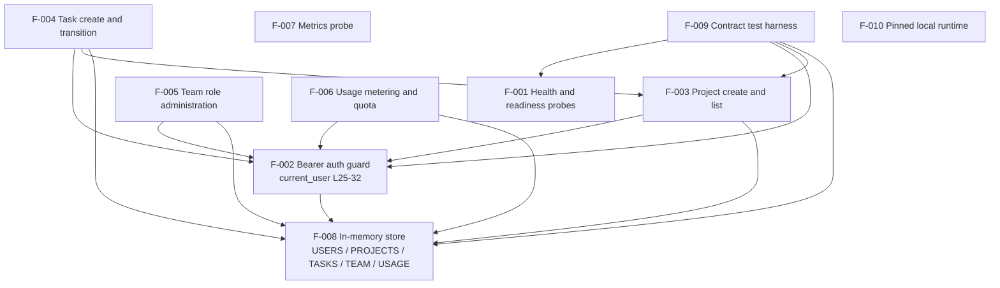

F-001, F-007 and F-010 have no prerequisite features. F-010 is the runtime that carries every other feature but declares no feature-level dependency of its own; F-001 and F-007 depend on nothing and nothing depends on them.

| Feature | Prerequisite features | Dependents | Evidence |
|---|---|---|---|
| F-001 Health and readiness probes | none | F-009 | `app/main.py` lines 35–42 have no parameters; `tests/test_api.py` line 15 asserts the health body |
| F-002 Bearer authentication | F-008 (the `USERS` registry) | F-003, F-004, F-005, F-006, F-009 | `USERS` defined at line 7; helper at lines 25–32 called at lines 48, 57, 64, 76, 88, 99 |
| F-003 Project creation and listing | F-002, F-008 | F-004, F-009 | `current_user` call at line 48; `PROJECTS`/`NEXT_PROJECT` at lines 8, 12; task existence check reads `PROJECTS` at line 65 |
| F-004 Task creation and transition | F-002, F-003, F-008 | none | `current_user` at lines 64, 76; `PROJECTS` membership test at line 65; `TASKS`/`NEXT_TASK` at lines 9, 13 |
| F-005 Team role administration | F-002, F-008 | none | Principal role read at line 89; `TEAM` written at line 93 |
| F-006 Usage metering and quota | F-002, F-008 | none | `current_user` at line 99; `USAGE` at line 11 read and written at lines 102–104 |
| F-007 Metrics probe | none | none | `app/main.py` lines 108–110 read only `time.monotonic` |
| F-008 In-memory store | none | F-002 to F-006, F-009 | Module-level containers at lines 7–13; imported by the suite at `tests/test_api.py` line 2 |
| F-009 Contract test harness | F-001, F-002, F-003, F-008 | none | `tests/test_api.py` lines 1–2 import the app and its containers; three tests assert the three contracts |
| F-010 Local runtime and pinning | none | none (carries all features at run time) | `requirements.txt` lines 1–4; ASGI target `app.main:app` per `README.md` line 16 |

### 2.3.2 Integration Points

| Integration point | Features involved | Mechanism | Evidence |
|---|---|---|---|
| Credential boundary | F-002 with F-003, F-004, F-005, F-006 | Each protected handler declares `authorization: str | None = Header(default=None)` and calls the helper itself | `app/main.py` lines 46, 56, 62, 75, 87, 98 |
| Project registry read | F-004 depends on F-003 | Dict membership test `payload.project_id not in PROJECTS` before a task is stored | `app/main.py` line 65 |
| Ownership filter | F-003 consumes the principal | List comprehension over `PROJECTS.values()` comparing `owner_id` and role | `app/main.py` line 58 |
| Role gate | F-005 consumes the principal | Comparison of the principal's `role` to the literal `owner` | `app/main.py` line 89 |
| Role write | F-005 writes `TEAM` | Direct assignment into a user-id-keyed dict that no handler reads | `app/main.py` lines 91–93 |
| In-process test client | F-009 depends on F-001, F-002, F-003 and F-008 | `TestClient(app)` over the ASGI app plus direct import of the containers, so tests bypass the network and mutate live state | `tests/test_api.py` lines 1–11 |
| ASGI entry point | F-010 carries every feature | `uvicorn app.main:app` imports the module and serves the `app` instance | `README.md` line 16; `app/main.py` line 5 |
| Unauthenticated probes | F-001, F-007 | Handler signatures omit the `authorization` parameter entirely | `app/main.py` lines 36, 41, 109 |

No other integration exists. There is no database driver, identity provider, message broker, telemetry sink, outbound HTTP client, payment processor or file system access anywhere in the repository — the `app/`, `tests/` and root-level configuration were searched in full, and `README.md` line 9 confirms the in-memory design. The list of integrations the system deliberately does not have is in 1.3.2 Out-of-Scope.

### 2.3.3 Shared Components and Common Services

| Shared component | Definition | Consumed by | Evidence |
|---|---|---|---|
| `current_user()` | The only authentication and principal-resolution routine; raises `401` or returns a `USERS` record | F-003, F-004, F-005, F-006, and F-009 indirectly | `app/main.py` lines 25–32 |
| `USERS` registry | Token-string to principal map; immutable at run time | F-002 (lookup), F-005 (role gate) | `app/main.py` line 7 |
| `PROJECTS` and `NEXT_PROJECT` | Project store and its monotonic allocator | F-003 (write, read), F-004 (existence check) | `app/main.py` lines 8, 12, 47–51, 65 |
| `TASKS` and `NEXT_TASK` | Task store and its monotonic allocator | F-004 | `app/main.py` lines 9, 13, 63–70, 77–82 |
| `TEAM` | User-id to role map, written but never read | F-005 | `app/main.py` lines 10, 91–93 |
| `USAGE` | Single usage counter with a fixed limit | F-006 | `app/main.py` lines 11, 102–104 |
| `ProjectIn` / `TaskIn` | Pydantic request contracts providing declarative field validation | F-003, F-004 | `app/main.py` lines 16–22 |
| `HTTPException` convention | Uniform `{"detail": ...}` error body produced by the framework for every business-rule refusal | F-002, F-004, F-005, F-006 | `app/main.py` lines 27, 31, 66, 79, 81, 90, 92, 101, 103 |
| `TestClient` and `OWNER` header | Reusable in-process client and reusable authenticated header dict | F-009 | `tests/test_api.py` lines 4–5 |

The service most features rely on is therefore not a network service but a shared code path: `current_user()` plus the module-level dicts. The following flowchart is the request path common to F-002 through F-006 and is referenced by those features' acceptance criteria.

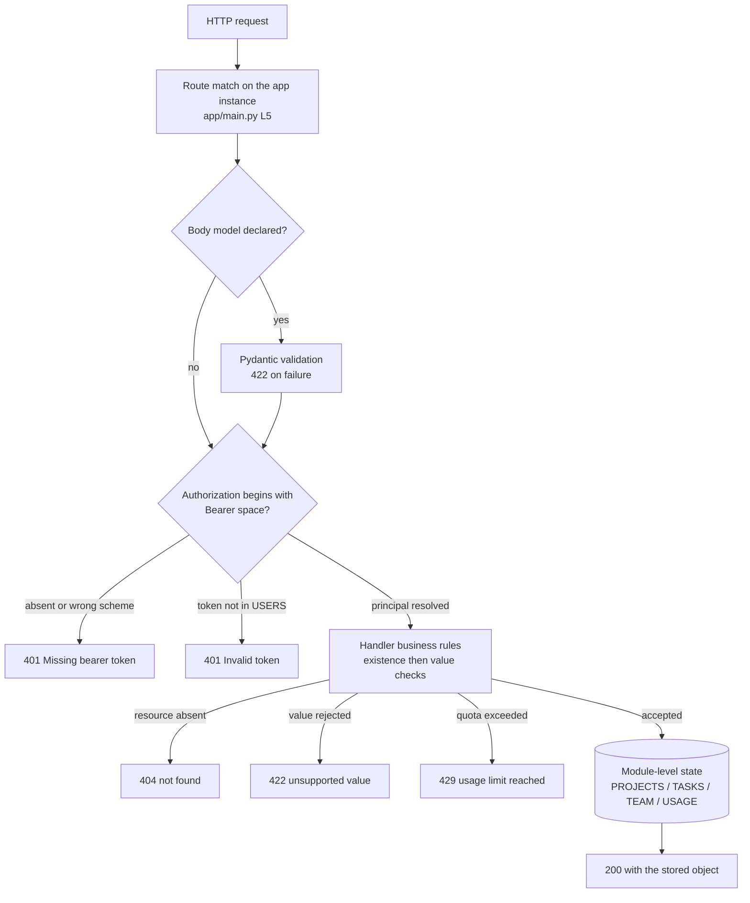


## 2.4 Implementation Considerations

The considerations below are properties of the implementation as written, stated for each feature so that an owner of the fixture knows what may change without invalidating the ground truth the README promises (`README.md` lines 30–31). They also identify the places where the code's shape, rather than its intent, sets the boundary — most of them consequences of one module holding state in dicts behind synchronous handlers.

### 2.4.1 Technical Constraints

| Feature | Constraint | Evidence |
|---|---|---|
| F-001 | Both probe bodies are literals, so a probe cannot reflect real subsystem state without new code; the routes must stay registered on the module-level `app` instance | `app/main.py` lines 35–42 |
| F-002 | Authentication is hand-written per handler: no middleware or dependency layer exists, so a new route inherits no protection; the scheme match is case-sensitive and requires the exact `Bearer ` prefix; the `str | None` annotation sets a Python 3.10 floor | `app/main.py` lines 25–32 |
| F-003 | Validation bounds live in the Pydantic model (2–80 characters); creation answers `200` because no `status_code` or `response_model` is declared, and the response is the stored dict itself | `app/main.py` lines 16–17, 45–52 |
| F-004 | `status` is a required **query** parameter, not a body field; the task object is mutated in place; error precedence is fixed by statement order rather than by a validation framework | `app/main.py` lines 74–83 |
| F-005 | `TEAM` contains exactly two user ids, so target validation is bounded by that literal map; the recorded role cannot affect authorization because the helper reads `USERS` | `app/main.py` lines 10, 86–94 |
| F-006 | The limit is a constant inside `USAGE`, not configuration; `units` arrives as a query parameter; the check-then-increment is unguarded | `app/main.py` lines 11, 97–105 |
| F-007 | `uptime_seconds` is derived from `time.monotonic()`, whose origin is the platform clock, so the figure is not an uptime since start; `requests_total` is a literal | `app/main.py` lines 3, 108–110 |
| F-008 | State is created at import time and mutated through `global` counters, which makes every state-bearing feature process-local and non-restartable | `app/main.py` lines 7–13, 47, 63 |
| F-009 | There is no `conftest.py`; the per-test reset mutates the application's own objects and covers three of the seven state names | `tests/test_api.py` lines 8–11 |
| F-010 | Four exact pins with no lock file or hashes; `pydantic` is imported directly but pinned only transitively; one requirements file serves both runtime and tests | `requirements.txt`; `app/main.py` line 2 |

### 2.4.2 Performance Requirements

The repository states no latency, throughput or concurrency target, and no benchmark, profiling configuration or load test exists. The characteristics below are therefore the observable cost of the implementation, not commitments.

| Feature | Performance characteristic | Evidence |
|---|---|---|
| F-001 | Constant time; no state access | `app/main.py` lines 35–42 |
| F-002 | One string comparison plus one O(1) dict lookup per protected request | `app/main.py` lines 25–32 |
| F-003 | Creation is O(1); listing is O(n) over all projects in the process, and grows without pagination | `app/main.py` lines 45–58 |
| F-004 | O(1) keyed lookup and in-place mutation; no index by project | `app/main.py` lines 61–83 |
| F-005 | O(1) membership tests against a two-entry map | `app/main.py` lines 87–93 |
| F-006 | Two dict reads and one write per successful request; no lock and no retry | `app/main.py` lines 97–105 |
| F-007 | Constant work; one clock read per request | `app/main.py` lines 108–110 |
| F-008 | All data resident in memory, so access cost is dict access; memory grows with the number of stored projects and tasks and is never reclaimed within a process | `app/main.py` lines 7–13 |
| F-009 | The whole suite runs in well under a second in process; observed runtime of `pytest -q` was 0.07 s | `pytest.ini`; `tests/test_api.py` |
| F-010 | Install-from-pins only; no build step, no post-install hook and no outbound connection at run time | `requirements.txt`; `README.md` lines 11–18 |

### 2.4.3 Scalability Considerations

| Feature | Limiting factor | Consequence |
|---|---|---|
| F-001, F-007 | None; both are stateless | They scale horizontally but report on whichever process answers, so metrics from behind a load balancer would not aggregate |
| F-002 | Tokens live in a literal dict, so any additional principal requires a code change | The population of callers cannot grow without a deployment |
| F-003 | `GET /projects` scans the full store and returns every visible record with no pagination or filtering | Response size and scan cost grow linearly with stored projects; an owner sees everything |
| F-004, F-005, F-006 | State is per process and the counters are unguarded | Running more than one worker splits projects, tasks and usage across processes; ids are reissued per worker, and a limit of 5 becomes 5 per worker. Concurrent requests inside one worker can interleave between the ceiling test and the increment (`app/main.py` lines 102–104) or between reading and incrementing `NEXT_PROJECT` / `NEXT_TASK` (lines 47–51, 63–70), because handlers are synchronous functions dispatched to FastAPI's thread pool and no lock protects either sequence |
| F-008 | No persistence, no cache, no eviction | A restart is the only reset mechanism, and it loses all data; the store cannot outlive the process |
| F-009 | The suite shares the application's global state and resets it in place | Parallel test execution (for example `pytest-xdist`) would interleave mutations of the same dicts; tests must run in one process |
| F-010 | Single ASGI entry point with no process manager or container definition | Scaling out is left to whatever launches uvicorn, and any such change breaks F-008's assumptions |

### 2.4.4 Security Implications

| Feature | Control enforced | Not enforced | Evidence |
|---|---|---|---|
| F-001 | None needed: both probes are public and expose no data | Nothing; the readiness body names a storage check that is never performed | `app/main.py` lines 35–42 |
| F-002 | Scheme presence and token membership, with distinct `Missing bearer token` and `Invalid token` details | No expiry, rotation, revocation or hashing; tokens are literals in source and in the test module; the two distinct `401` details let a caller distinguish a missing scheme from an unknown token; the OpenAPI document advertises no security scheme and marks the header optional | `app/main.py` lines 7, 25–32; `tests/test_api.py` line 5 |
| F-003 | A valid token is required and `owner_id` is taken from the token, so a caller cannot forge ownership through the request body | No per-project authorization check beyond the listing filter; no update or delete path exists to protect | `app/main.py` lines 45–58 |
| F-004 | A valid token is required before any lookup | No ownership or role check: the principal is discarded at line 76, so any token may create a task in another principal's project and may transition any task; no audit of who changed what | `app/main.py` lines 61–83 |
| F-005 | Owner-only gate on the caller's role, and an error detail that does not reveal whether a user id exists | Role changes never reach the authorization path, so privilege administration has no security effect; a role write is not logged | `app/main.py` lines 86–94 |
| F-006 | A valid token is required, and both the non-positive and over-limit cases are refused without state change | No per-principal accounting, so one caller can exhaust every other caller's quota; the principal consuming units is not recorded; the unguarded read-modify-write admits race conditions | `app/main.py` lines 97–105 |
| F-007 | Public by design; the payload reveals only a constant and a clock value | No request instrumentation at all, so absence of telemetry cannot be detected from the endpoint itself | `app/main.py` lines 108–110 |
| F-008 | None: the store has no access control, encryption or retention rule | Any importer of `app.main` can read and mutate all state; state is lost on restart with no backup path | `app/main.py` lines 7–13 |
| F-009 | Three assertions including one on anonymous rejection | Bearer tokens are committed in the test module; invalid-token, member-scoping and owner-gate paths are unasserted | `tests/test_api.py` |
| F-010 | Dependencies are exactly pinned, which bounds supply-chain drift at install time | No hashes, lock file or vulnerability scanning; demo credentials are committed and the README prohibits their real-world use | `requirements.txt`; `README.md` lines 30–31 |

The two findings a security review of this fixture is expected to reach — an authorization path that ignores the role store (F-005) and mutation endpoints that authenticate without authorizing (F-004, F-006) — were confirmed against the running application and are consistent with the README's statement that the deficiencies are intentional (`README.md` lines 30–31). They are properties to preserve, not defects to close, for as long as the repository serves as an evaluation fixture.

### 2.4.5 Maintenance Requirements

| Feature | Maintenance requirement | Trigger | Evidence |
|---|---|---|---|
| F-001, F-007 | Probe bodies are contract, not diagnostics: changing either literal breaks any evaluator assertion pinned to it | A requirement for real health or metrics data | `app/main.py` lines 37, 42, 110 |
| F-002 | Every new protected route must call `current_user` explicitly; adding centralized enforcement would change the fixture's known behaviour | Adding a route, or introducing middleware | `app/main.py` lines 25–32, 46–99 |
| F-003 | The `200` status, the three response keys and the ownership filter are the contract asserted by the suite; a `201` or a `response_model` would break it | Any change to the creation response | `tests/test_api.py` lines 18–22 |
| F-004 | Check order is observable: authentication, then existence, then value. Adding a status value requires updating the allow-list at line 80 | Extending the workflow | `app/main.py` lines 76–82 |
| F-005 | Synchronising `TEAM` with `USERS` would silently change documented behaviour for every role-dependent test | Any attempt to fix the disconnected role store | `app/main.py` lines 10, 89–93 |
| F-006 | The limit is referenced by the README as a product property and asserted by no test, so a change would pass the suite unnoticed | Changing the quota | `app/main.py` line 11; `README.md` line 7 |
| F-008 | Adding a field to a stored record changes the response body of every endpoint that returns that record, because responses are the stored dicts themselves | Any data-model change | `app/main.py` lines 49–52, 67–71, 82 |
| F-009 | The suite's thinness is a documented property; extending coverage erases the coverage gap the fixture exists to expose | Any change to test scope | `README.md` line 8 |
| F-010 | Pin bumps require re-running `pytest -q`; `httpx` underpins `TestClient`, and `pydantic` is unpinned, so a FastAPI patch can change validation detail text that no test asserts | Dependency updates | `requirements.txt`; `tests/test_api.py` |

There is no CI workflow, linter, type checker or formatter configured, so every maintenance action above is verified by running `pytest -q` manually (`README.md` lines 20–23).


## 2.5 Traceability Matrix

Every requirement traces to a line of code and, where one exists, to an assertion in the repository. "Runtime check only" means the criterion was confirmed by issuing the request against the application under the pinned stack but is not asserted anywhere in the repository, which is the coverage gap the fixture documents in `README.md` line 8.

### 2.5.1 Requirement-to-Implementation Traceability

| Requirement | Implementation | Verified by | Specification cross-reference |
|---|---|---|---|
| F-001-RQ-001 | `health()` `app/main.py` L36–37 | `tests/test_api.py::test_health_endpoint` | 2.1.1, 2.2.1, 1.3.1 |
| F-001-RQ-002 | `readiness()` L41–42 | Runtime check only | 2.1.1, 2.2.1, 1.3.1 |
| F-001-RQ-003 | `FastAPI(...)` L5 plus handler signatures | Runtime check only (`/openapi.json`) | 2.1.1, 2.2.1, 1.2.2 |
| F-002-RQ-001 | `current_user` L26–27 | `tests/test_api.py::test_missing_token_is_rejected` | 2.1.2, 2.2.2, 1.3.1 |
| F-002-RQ-002 | L28–31 with `USERS` L7 | Runtime check only | 2.1.2, 2.2.2, 1.3.1 |
| F-002-RQ-003 | L49 (`owner_id`), L68 (`created_by`), L89 (role gate) | Partly `test_owner_can_create_and_list_project` | 2.1.2, 2.2.2, 1.3.1 |
| F-003-RQ-001 | `create_project` L46–52 | `tests/test_api.py::test_owner_can_create_and_list_project` | 2.1.3, 2.2.3, 1.3.1 |
| F-003-RQ-002 | `list_projects` L56–58 | Owner case only, same test | 2.1.3, 2.2.3, 1.3.1 |
| F-003-RQ-003 | `ProjectIn` L16–17 | Runtime check only | 2.1.3, 2.2.3, 1.3.1 |
| F-004-RQ-001 | `create_task` L62–71 | Runtime check only | 2.1.4, 2.2.4, 1.3.1 |
| F-004-RQ-002 | `update_task` L75–83 | Runtime check only | 2.1.4, 2.2.4, 1.3.1 |
| F-004-RQ-003 | Statement order L76–81 | Runtime check only | 2.1.4, 2.2.4 |
| F-004-RQ-004 | `TaskIn` L20–22 | Runtime check only | 2.1.4, 2.2.4, 1.3.1 |
| F-005-RQ-001 | Gate L88–90 | Runtime check only | 2.1.5, 2.2.5, 1.3.1 |
| F-005-RQ-002 | Validation L91–92 | Runtime check only | 2.1.5, 2.2.5 |
| F-005-RQ-003 | Write and echo L93–94 | Runtime check only | 2.1.5, 2.2.5, 1.2.1 |
| F-006-RQ-001 | `consume_usage` L98–105 | Runtime check only | 2.1.6, 2.2.6, 1.3.1 |
| F-006-RQ-002 | L100–101 | Runtime check only | 2.1.6, 2.2.6 |
| F-006-RQ-003 | L102–103 | Runtime check only | 2.1.6, 2.2.6 |
| F-006-RQ-004 | `USAGE` L11 | Runtime check only | 2.1.6, 2.2.6 |
| F-007-RQ-001 | `metrics` L109–110 | Runtime check only | 2.1.7, 2.2.7, 1.3.1 |
| F-008-RQ-001 | Containers L7–13 | Runtime check only (import-time state) | 2.1.8, 2.2.8, 1.3.1 |
| F-008-RQ-002 | `global` and increments L47–51, L63–70 | Runtime check only | 2.1.8, 2.2.8 |
| F-008-RQ-003 | Module attributes imported at `tests/test_api.py` L2 | `setup_function` L8–11 (indirectly) | 2.1.8, 2.2.8, 2.1.9 |
| F-009-RQ-001 | `pytest.ini` L1–3 | `pytest -q` collection (3 tests) | 2.1.9, 2.2.9 |
| F-009-RQ-002 | `setup_function` L8–11 | Every test in the module depends on it | 2.1.9, 2.2.9 |
| F-009-RQ-003 | Three test functions L14–26 | Themselves | 2.1.9, 1.2.3 |
| F-010-RQ-001 | `requirements.txt` L1–4; `README.md` L11–18 | `pytest -q` plus a manual uvicorn run | 2.1.10, 2.2.10, 1.3.1 |
| F-010-RQ-002 | Absence of configuration in every file | Runtime check only | 2.1.10, 2.2.10, 1.3.2 |
| F-010-RQ-003 | `str | None` annotation L25 | Import under Python 3.12.3 | 2.1.10, 2.2.10, 1.3.1 |

### 2.5.2 Feature-to-Test Coverage Traceability

| Feature | Endpoints | Repository assertions | Behaviour no repository test covers |
|---|---|---|---|
| F-001 | `GET /health`, `GET /ready` | 1 (`/health` body equality) | The `/ready` body and its independence from store contents |
| F-002 | 6 protected routes via `current_user` | 1 (anonymous `GET /projects` → `401`) | Invalid-token rejection, scheme-case variants, member-versus-owner visibility, the owner-only `403` |
| F-003 | `POST /projects`, `GET /projects` | 2 (create returns `200` with the echoed name; the created id appears in the caller's list) | `422` name bounds, member-only listing, owner-sees-all |
| F-004 | `POST /tasks`, `PATCH /tasks/{task_id}` | 0 | Creation, `404` on missing project, status allow-list, `422` parameter errors, check precedence |
| F-005 | `POST /teams/{user_id}/role` | 0 | Owner gate, target validation, the fact that the write changes no authorization |
| F-006 | `POST /billing/consume` | 0 | Default units, non-positive rejection, the `429` boundary, the shared counter |
| F-007 | `GET /metrics` | 0 | The constant counter and the monotonic clock figure |
| F-008 | No endpoint | Indirect: the per-test reset relies on the containers being importable | Id monotonicity and no-reuse, restart behaviour |
| F-009 | Harness itself | 3 collected tests | The suite's own gap is documented at `README.md` line 8 rather than asserted |
| F-010 | Packaging, no endpoint | Install from pins plus a passing `pytest -q` | Python floor, absence of any configuration surface |

Three of the nine operations are exercised by at least one assertion — `/health`, `POST /projects` and `GET /projects` — and six are not: `/ready`, `/metrics`, `POST /tasks`, `PATCH /tasks/{task_id}`, `POST /teams/{user_id}/role` and `POST /billing/consume`. This matches the coverage statement in 1.2.3 Success Criteria and is the ground truth the fixture is built to provide.


## 2.6 Assumptions, Constraints and Requirement Versioning

### 2.6.1 Assumptions

| ID | Assumption | Basis |
|---|---|---|
| A-01 | The repository is an evaluation fixture, not a product, so requirements describe what the code does rather than what a customer needs | `README.md` line 3 and lines 30–31 |
| A-02 | The deliberately planted weaknesses are properties to preserve, not backlog items to close | `README.md` line 31 states the deficiencies exist "for scanner evaluation only" |
| A-03 | The operating model is one process started as `uvicorn app.main:app`, with no worker pool or reverse proxy | `README.md` line 16; the run command names no worker count |
| A-04 | The two seeded tokens are the whole principal population; no identity provisioning is expected | `USERS` contains exactly two entries (`app/main.py` line 7) |
| A-05 | The runtime is Python 3.10 or newer | The PEP 604 annotation at `app/main.py` line 25 |
| A-06 | The four pinned packages are the complete dependency set, with `pydantic` arriving transitively through FastAPI | `requirements.txt`; `app/main.py` line 2 imports `pydantic` without a pin |
| A-07 | The `main` branch is the baseline for every statement in this section | `README.md` line 27 prescribes scanning the `main` branch; local `main`, `2011_01` and `origin/main` are identical at `6e1eebd` |
| A-08 | No external party consumes this contract, so conventions such as answering `200` instead of `201`, or exposing `status` as a query parameter, are the contract rather than deviations from one | No client, SDK, consumer test or published schema exists in the repository |

### 2.6.2 Constraints and Intentionally Absent Requirements

| Constraint | Effect on the requirement set | Evidence |
|---|---|---|
| Non-production, do-not-deploy intent | No requirement states an availability, recovery, capacity or compliance obligation; every requirement is satisfiable by the process as written | `README.md` lines 30–31 |
| State is process-local and in memory | Requirements are written for a single process; multi-worker, restart-durability and migration scenarios are excluded rather than deferred | `app/main.py` lines 7–13; `README.md` line 9 |
| Credentials are literals in source | Authentication requirements specify scheme and lookup only; issuance, rotation, expiry and revocation are excluded | `app/main.py` line 7; `tests/test_api.py` line 5 |
| Authorization is partial and role-blind in places | Requirements record the enforced control and, in the same row, the control that is absent, so no acceptance criterion implies an ownership check that does not exist | `app/main.py` lines 61–105 |
| The role store is disconnected from authorization | F-005's requirements stop at recording a role; propagation to access decisions is not required because no code path performs it | `app/main.py` lines 10, 25–32 |
| No API versioning | There is no path prefix or version segment; the FastAPI `version` is metadata only, so requirements are not grouped by API version | `app/main.py` line 5 |
| No CI, linter, type checker or formatter | Verification is a manual `pytest -q`; no requirement depends on automated gating | `README.md` lines 20–23 |
| Test coverage is deliberately thin | Coverage requirements are negative: the suite must keep covering the three documented contracts and only those | `README.md` line 8 |

| Candidate requirement | Status | Why it is not in this section |
|---|---|---|
| Task mutation restricted to the task's creator or an owner | Intentionally absent | `update_task` discards the principal at `app/main.py` line 76 and reads no ownership field |
| A recorded role change alters the user's permissions | Intentionally absent | `TEAM` is written at line 93 and read by no handler; authorization reads `USERS` only |
| Usage quota enforced per account | Intentionally absent | `USAGE` is a single shared dict (`app/main.py` line 11) with no principal key |
| `requests_total` reflects observed traffic | Intentionally absent | The value is the literal `0` at `app/main.py` line 110; no instrumentation exists |
| Tokens expire, rotate or can be revoked | Intentionally absent | `USERS` is a literal dict that no handler writes |
| State survives a restart | Intentionally absent | All stores are created at import time; `README.md` line 9 states data is held in memory |
| Every endpoint has test coverage | Intentionally absent | `README.md` line 8 documents the thin suite as a feature of the fixture |

### 2.6.3 Requirement Versions

Every requirement is version 1.0, established against the single baseline commit that contains the whole application. Versions are recorded per feature so that a future change can be attributed without renumbering.

| Feature | Requirement IDs | Version | Baseline |
|---|---|---|---|
| F-001 | F-001-RQ-001 to F-001-RQ-003 | 1.0 | `6e1eebd` |
| F-002 | F-002-RQ-001 to F-002-RQ-003 | 1.0 | `6e1eebd` |
| F-003 | F-003-RQ-001 to F-003-RQ-003 | 1.0 | `6e1eebd` |
| F-004 | F-004-RQ-001 to F-004-RQ-004 | 1.0 | `6e1eebd` |
| F-005 | F-005-RQ-001 to F-005-RQ-003 | 1.0 | `6e1eebd` |
| F-006 | F-006-RQ-001 to F-006-RQ-004 | 1.0 | `6e1eebd` |
| F-007 | F-007-RQ-001 | 1.0 | `6e1eebd` |
| F-008 | F-008-RQ-001 to F-008-RQ-003 | 1.0 | `6e1eebd` |
| F-009 | F-009-RQ-001 to F-009-RQ-003 | 1.0 | `6e1eebd` |
| F-010 | F-010-RQ-001 to F-010-RQ-003 | 1.0 | `6e1eebd` |

Version-control rules applied here:

- **IDs are append-only.** A withdrawn requirement is marked withdrawn and its identifier is never reused, so a traceability reference stays resolvable.
- **A version bumps on observable change.** Changing a status code, a response key, an error detail, a validation bound or a state rule raises the affected requirement to the next minor version; editorial clarification does not.
- **The baseline names the code, not the document.** Each row's baseline commit is the revision whose behaviour the acceptance criteria describe; a commit that changes behaviour without a version bump makes the matrix in 2.5.1 stale.
- **Absent requirements stay absent without a version.** The items in 2.6.2 are not versioned, because adding one would change the fixture's documented ground truth.


## 2.7 References

- `app/main.py` — the entire service: application instance and metadata (line 5), the seven module-level state names (lines 7–13), `ProjectIn` and `TaskIn` request contracts (lines 16–22), the `current_user` bearer-token helper (lines 25–32), and the nine handlers whose behaviour every requirement in 2.2 describes (lines 35–110)
- `app/` — folder contents confirming a flat, single-module application with no routers, services, middleware or security layer, which is why authentication is enforced per handler rather than centrally
- `tests/test_api.py` — the three-test suite, `TestClient` and `OWNER` module globals (lines 4–5), the `setup_function` state reset covering `PROJECTS`, `TASKS` and `USAGE["used"]` only (lines 8–11), and the three asserted contracts (lines 14–26)
- `tests/` — folder contents confirming one test module with no `conftest.py` or shared helper, which bounds F-009's scope
- `pytest.ini` — discovery configuration (`testpaths = tests`, `python_files = test_*.py`) that fixes the collected test population
- `requirements.txt` — the four exact pins (`fastapi==0.115.12`, `uvicorn==0.34.0`, `pytest==8.3.5`, `httpx==0.28.1`) and the absence of a development/runtime split
- `README.md` — the fixture's stated purpose (line 3), the advertised capability list that drives the priority rubric (lines 6–9), the local run and test commands (lines 11–23), the suggested scan setup (lines 25–28), and the non-production constraint (lines 30–31)
- Repository git history — commit `6e1eebd` as the baseline for every requirement version, with `main`, `2011_01` and `origin/main` identical at that revision
- Requests issued against the application under the pinned stack — confirmation of the exact status codes, response bodies, error details, identifier sequences and counter boundaries stated as acceptance criteria in 2.2, and of the three-passing-test baseline for F-009


# 3. Technology Stack

## 3.1 Programming Languages

Python is the only programming language in the repository that produces executable behaviour. The complete implementation is 138 lines across two modules — `app/main.py` (111 lines) and `tests/test_api.py` (27 lines) — and every import in both is either a third-party package or a standard-library module (`app/main.py` lines 1–3, `tests/test_api.py` lines 1–2). No other language appears in any tracked file: there is no JavaScript or TypeScript, no Swift, Kotlin or Objective-C, no shell script, no HCL, and no Dockerfile DSL. The only non-Python artefacts are declarative configuration and prose (`requirements.txt`, `pytest.ini`, `README.md`).

### 3.1.1 Language Inventory by Component

| Component | Language | Version constraint | Evidence |
|---|---|---|---|
| HTTP service — all nine route handlers | Python | 3.10 or newer | `app/main.py` lines 35–110 |
| Request contracts (`ProjectIn`, `TaskIn`) | Python (Pydantic models) | 3.10 or newer | `app/main.py` lines 16–22 |
| Bearer-token authentication helper | Python | 3.10 or newer | `app/main.py` lines 25–32 |
| Process-local data layer (six stores plus two counters) | Python dicts and integers | 3.10 or newer | `app/main.py` lines 7–13 |
| In-process integration tests | Python | 3.10 or newer | `tests/test_api.py` |
| Test discovery configuration | INI | not applicable | `pytest.ini` lines 1–3 |
| Dependency manifest | pip requirements format | not applicable | `requirements.txt` lines 1–4 |
| Developer instructions (venv, pip, uvicorn, pytest) | Markdown with `bash` code fences | not applicable | `README.md` lines 11–23 |

### 3.1.2 Version Floor and Its Source

The repository declares no Python version anywhere. There is no `pyproject.toml`, `setup.py`, `setup.cfg`, `.python-version`, `runtime.txt`, `tox.ini` or `.tool-versions`; the root holds only `README.md`, `pytest.ini`, `requirements.txt`, `app/` and `tests/`. The floor is therefore implicit and is set by the syntax the code uses:

| Constraint | Requirement | Evidence |
|---|---|---|
| PEP 604 union in annotations (`str \| None`) | Python 3.10+ | `app/main.py` line 25, and the same annotation on the `authorization` parameter of all six authenticated handlers (lines 46, 56, 62, 75, 87, 98) |
| `str.removeprefix` | Python 3.9+ | `app/main.py` line 28 |
| Uvicorn 0.34.0 `requires-python` | Python 3.9+ | `requirements.txt` line 2; PyPI metadata for uvicorn 0.34.0 |
| FastAPI 0.115.12 `requires-python` | Python 3.8+ | `requirements.txt` line 1; PyPI metadata for fastapi 0.115.12 |

The effective minimum is **Python 3.10**, imposed by `app/main.py` line 25 rather than by any dependency — the same conclusion recorded in this specification's `1.3 Scope` and `2.4.1 Technical Constraints`. No upper bound exists in the repository; nothing pins a maximum minor version, and nothing in the code would break on 3.11 or 3.12 (the compiled caches present in the working tree, `app/__pycache__/*.cpython-312.pyc`, are tagged for Python 3.12, showing the service has been exercised on that interpreter).

### 3.1.3 Python Features the Implementation Relies Upon

| Feature | Role in the system | Evidence |
|---|---|---|
| Module-level mutable containers | The entire data layer: `USERS`, `PROJECTS`, `TASKS`, `TEAM`, `USAGE` are created at import and mutated in place by handlers | `app/main.py` lines 7–11 |
| `global` rebinding of integer counters | Per-process id allocation for projects and tasks | `app/main.py` lines 12–13, 47, 51, 63, 70 |
| Type annotations on handler parameters | FastAPI derives header extraction, query coercion and validation errors from them; unannotated `metrics()` and `readiness()` take no input | `app/main.py` lines 46, 56, 62, 75, 87, 98; contrast lines 36, 41, 109 |
| Pydantic field metadata | Declarative length bounds (`min_length=2`, `max_length=80` / `120`) that produce `422` before the handler body runs | `app/main.py` lines 16–22 |
| PEP 604 unions | Models an absent `Authorization` header as `None` rather than raising at the framework layer | `app/main.py` line 25 |
| `str.startswith` and `str.removeprefix` | Exact-scheme match on `"Bearer "` and token extraction | `app/main.py` lines 26–28 |
| Set literals | Allow-lists for task status and role values | `app/main.py` lines 80, 91 |
| Dict lookup and membership tests | Token resolution, project existence, task existence, target-user validation | `app/main.py` lines 29, 65, 77, 91 |
| `time.monotonic` and `round` | Supplies `uptime_seconds` on the metrics endpoint | `app/main.py` lines 3, 110 |
| Synchronous `def` handlers | No `async def` or `await` exists in the repository; FastAPI dispatches each handler to its thread pool | `app/main.py` lines 36–109; `tests/test_api.py` lines 8–25 |

Deliberately absent language features, verified by text search across both modules: no `dataclass`, no `match` statement, no walrus operator, no `typing` import (`Optional`, `List`, `Dict`), no f-strings, no classes other than the two Pydantic models, and no return annotations on any function.

### 3.1.4 Constraints and Dependencies Introduced by the Language Choice

- **Interpreter provisioning is manual.** Because no manifest declares the version, a contributor must supply a 3.10+ interpreter themselves; the README's `python -m venv .venv` step (`README.md` line 13) inherits whatever `python` resolves to.
- **Annotations are enforced only where FastAPI consumes them.** There is no type checker (no `mypy`, `pyright` or `ruff` configuration anywhere in the tree), and no handler declares a return type, so response shapes are unverified — a consequence visible in the fact that every POST answers `200` and returns the stored dict itself (`app/main.py` lines 49–52, 67–71).
- **Import has side effects.** `app/main.py` builds all state at module scope (lines 5–13), so `import app.main` — done by uvicorn and by `tests/test_api.py` line 2 — constructs the stores. This is why the suite can reset them via `setup_function` (`tests/test_api.py` lines 8–11) and why a second process starts empty.
- **Concurrency is thread-based, not event-loop-based.** Synchronous handlers share unprotected dicts and counters across thread-pool workers, so the read-modify-write sequences at `app/main.py` lines 47–51, 63–70 and 102–104 are unsynchronised, as recorded in `2.4.3 Scalability Considerations`.
- **No platform-specific code.** The README offers POSIX and Windows activation variants (`README.md` line 14) but the source itself is portable, with no `os`, `sys`, `pathlib` or subprocess usage; the only standard-library import is `time.monotonic`.
- **No configuration surface.** No environment variable is read anywhere (no `os.environ`, `getenv`, `dotenv`, `open()` or config import in either module), so the language choice introduces no external configuration contract.


## 3.2 Frameworks & Libraries

The service is built from two runtime frameworks, one validation library, and a two-package test stack. Four packages are pinned in `requirements.txt`; two more (`pydantic`, `starlette`) are imported or exercised by the code but pinned only through FastAPI's declared dependency ranges. Nothing else is installed — there is no ORM, no HTTP client for outbound calls, no serialization library, no middleware package and no pytest plugin.

### 3.2.1 Core Framework — FastAPI 0.115.12

FastAPI is the application framework and the origin of the HTTP surface. It is imported at `app/main.py` line 1 as `FastAPI, Header, HTTPException` and instantiated once, at module scope:

```python
app = FastAPI(title="Proactive Insights Demo API", version="1.0.0")
```

| Aspect | Implementation | Evidence |
|---|---|---|
| Application instance | One module-level `app`, exported as the ASGI callable that uvicorn loads | `app/main.py` line 5 |
| Routing | Nine decorators — `@app.get` ×4, `@app.post` ×4, `@app.patch` ×1 — with no `APIRouter`, prefix or version segment | `app/main.py` lines 35, 40, 45, 55, 61, 74, 86, 97, 108 |
| Request parsing | `Header(default=None)` for the `Authorization` header; unannotated scalars become query parameters (`task_id: int`, `status: str`, `units: int = 1`) | `app/main.py` lines 46, 75, 87, 98 |
| Error signalling | `HTTPException(status, detail)` is the only error mechanism, used for `401`, `403`, `404`, `422` and `429` | `app/main.py` lines 27, 31, 66, 79, 81, 90, 92, 101, 103 |
| Automated validation | Pydantic model bounds produce `422` responses before a handler body runs | `app/main.py` lines 16–22 |
| Documentation surface | `title` and `version` populate the generated OpenAPI document; FastAPI also serves `/openapi.json` and the Swagger UI at `/docs`, which `README.md` line 18 sends the reader to. Both routes are framework-supplied and are not among the nine handlers | `app/main.py` line 5; `README.md` line 18 |
| Framework features deliberately unused | No `Depends`, `Security`, middleware, CORS, `response_model`, `status_code=201`, router grouping, tags or lifespan hooks appear anywhere in the tree | `app/main.py` (whole file) |

**Justification.** FastAPI is the shortest path to the fixture's stated goal — a compact HTTP service that documents itself. Because every handler parameter is annotated, the framework supplies header extraction, query coercion, validation error bodies and an OpenAPI schema without any hand-written schema or request-parsing code; the entire contract lives in 111 lines. Using it also yields the `/docs` URL the README names as the way to inspect the API (`README.md` line 18).

### 3.2.2 ASGI Server — Uvicorn 0.34.0

Uvicorn is the server that hosts the ASGI application, pinned at `requirements.txt` line 2 and invoked by the README as `uvicorn app.main:app --reload` (`README.md` line 16). The import target is the module-level `app` at `app/main.py` line 5; no factory function or `__main__` block exists.

| Aspect | Fact | Evidence |
|---|---|---|
| Declared form | `uvicorn==0.34.0` — plain distribution, **no `[standard]` extra** | `requirements.txt` line 2 |
| Base dependency set | `click` and `h11`, plus `typing_extensions` on Python ≤3.10; `uvloop`, `httptools`, `watchfiles`, `websockets`, `python-dotenv`, `PyYAML` and `colorama` are supplied only by the `[standard]` extra and are therefore absent | PyPI metadata for uvicorn 0.34.0; `requirements.txt` |
| Runtime invocation | `--reload` only; no `--host`, `--port`, `--workers`, `--log-config` or `--proxy-headers` is specified anywhere | `README.md` line 16 |
| Bind address | The README's development URL, `http://127.0.0.1:8000/docs`, matches uvicorn's default loopback bind and port, since the repository configures neither | `README.md` line 18 |
| HTTP parsing | The pure-Python `h11` implementation, because `httptools` ships only in the `[standard]` extra | PyPI metadata for uvicorn 0.34.0 |

**Compatibility consequence of the missing extra.** `--reload` is an unconditional flag in uvicorn 0.34.0, so the documented command works on a plain install, but the reloader degrades: with `watchfiles` absent, uvicorn imports its `StatReload` supervisor and advertises itself as such at startup, polling the modification time of `.py` files only. File-extension filtering (`--reload-include`, `--reload-exclude`) and non-`.py` watchdog behaviour are unavailable, and every change costs a full process restart. Single-process serving is likewise the default, which is consistent with the process-local state described in `3.5 Databases & Storage`; uvicorn's `--workers` option would split that state across processes.

### 3.2.3 Request Validation — Pydantic (Imported Directly, Pinned Only Transitively)

Pydantic is imported at `app/main.py` line 2 (`BaseModel, Field`) but has no line of its own in `requirements.txt`. Its version is decided by FastAPI 0.115.12's declared range, `pydantic>=1.7.4,<3.0.0` (excluding 1.8, 1.8.1, 2.0.0, 2.0.1 and 2.1.0), which admits both major versions.

| Item | Detail | Evidence |
|---|---|---|
| Models | `ProjectIn` with `name: str = Field(min_length=2, max_length=80)`; `TaskIn` with `title: str = Field(min_length=2, max_length=120)` and `project_id: int` | `app/main.py` lines 16–22 |
| Enforcement point | Bounds are validated by the framework before the handler body executes, so an out-of-range `name` or `title` never reaches `create_project` or `create_task` | `app/main.py` lines 45–52, 61–71 |
| Other coercion | FastAPI routes scalar parameters through Pydantic as well, so `task_id`, `status` and `units` are typed at the boundary; domain rules are still hand-written in the handlers (status allow-list at line 80, `units < 1` at line 100) | `app/main.py` lines 75, 80, 98–101 |
| Version risk | `Field(min_length=…)`/`max_length=…` is valid in both majors but the validation-error message text differs between Pydantic v1 and v2, and no test asserts a validation error body, so a resolver change of major version would be silent | `requirements.txt`; `tests/test_api.py` (three assertions only) |

This is the one direct import in the repository whose version the manifest does not fix — the gap recorded as F-010 in `2.4 Implementation Considerations`.

### 3.2.4 Test Stack — pytest 8.3.5 with httpx 0.28.1

| Package | Pinned | Role | Evidence |
|---|---|---|---|
| pytest 8.3.5 | `requirements.txt` line 3 | Collector, runner and assertion engine; discovery bounded by `pytest.ini` (`testpaths = tests`, `python_files = test_*.py`) | `pytest.ini` lines 1–3; `README.md` line 22 |
| httpx 0.28.1 | `requirements.txt` line 4 | Transport under `fastapi.testclient.TestClient`; a bare FastAPI install does not include it, since httpx appears only in FastAPI's `standard`/`all` extras | `tests/test_api.py` line 1 |

Mechanics of the test harness: `client = TestClient(app)` is created once at module scope and reused (`tests/test_api.py` line 4), so requests are in-process ASGI calls with no socket and no server; the owner's credentials are a module-level dict (`OWNER = {"Authorization": "Bearer owner-token"}`, line 5); `setup_function` clears `PROJECTS` and `TASKS` and resets `USAGE["used"]` before each test (lines 8–11), because the suite mutates the application's own import-time globals.

**Version-compatibility note.** httpx 0.28.0 removed the deprecated `app=` argument that older Starlette `TestClient` implementations passed to `httpx.Client`. Starlette 0.37.2 (2024-03-05) removed that usage, and FastAPI 0.115.12 requires `starlette>=0.40.0,<0.47.0`, so the pinned combination resolves to a compatible Starlette (0.46.x for a current resolve) and `TestClient` works. No pytest plugin, no `conftest.py` and no shared-fixture module exists.

### 3.2.5 Component Dependency Graph

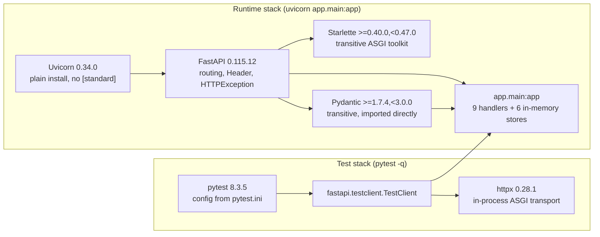

Reading the graph: requests arrive only through uvicorn into the single `app` object; FastAPI supplies routing and delegates body validation to Pydantic and ASGI plumbing to Starlette; the test stack never opens a socket, reaching the same `app` object in-process through httpx. There is no node for a database, cache, message broker or identity provider because none exists.

### 3.2.6 Version Compatibility Matrix

| Component | Constraint declared | Constraint source | Notes |
|---|---|---|---|
| CPython interpreter | ≥ 3.10 | Implied by PEP 604 syntax at `app/main.py` line 25; no manifest | Satisfies FastAPI (≥3.8) and uvicorn (≥3.9) requirements |
| fastapi | `==0.115.12` (released 2025-03-23) | `requirements.txt` line 1 | Requires `pydantic>=1.7.4,<3.0.0` and `starlette>=0.40.0,<0.47.0` |
| uvicorn | `==0.34.0` (released 2024-12-15) | `requirements.txt` line 2 | `requires-python>=3.9`; base deps `click>=7.0`, `h11>=0.8`; `--reload` usable without `watchfiles` via `StatReload` |
| pytest | `==8.3.5` (released 2025-03-02) | `requirements.txt` line 3 | `requires-python>=3.8`; no plugins declared |
| httpx | `==0.28.1` (released 2024-12-06) | `requirements.txt` line 4 | Test-only; requires Starlette ≥0.37.2 for `TestClient`, satisfied through FastAPI's Starlette floor |
| starlette | `>=0.40.0,<0.47.0` | Transitive, via FastAPI | Not listed in `requirements.txt`; supplies `TestClient` and the ASGI toolkit |
| pydantic | `>=1.7.4,<3.0.0` | Transitive, via FastAPI | Not listed in `requirements.txt` despite direct import at line 2; major version is resolver-dependent |
| click, h11, typing_extensions | Minimums only | Transitive, via uvicorn | The only other installed packages on a clean install |

### 3.2.7 Selection Justification and Rejected Framework Alternatives

FastAPI and Uvicorn together satisfy the fixture's five requirements — HTTP routing, request validation, bearer-header extraction, generated API documentation and in-process testability — with four pinned packages and no configuration files. Each choice removes work rather than adding it: FastAPI supplies validation and OpenAPI from type annotations, and httpx-backed `TestClient` lets the suite exercise the real ASGI app without launching uvicorn.

Alternatives from the default stack template that are **not** present, and why:

| Candidate | Present in repository | Assessment |
|---|---|---|
| Flask (template's backend framework) | No — no Flask import or requirement exists | Would require a separate validation library (for example `marshmallow`) and a separate OpenAPI generator to reach the same surface; the template's choice is superseded by FastAPI here |
| Django / DRF | No | An ORM, admin and settings module would contradict the self-contained, in-memory design the README requires (`README.md` line 9) |
| LangChain (template's AI framework) | No | No AI, LLM or retrieval component exists; the only text processing in the code is `str.startswith`/`removeprefix` for token parsing (`app/main.py` lines 26–28) |
| Gunicorn / Hypercorn | No | Uvicorn is the sole server, started interactively; no process manager is declared |
| SQLAlchemy, Alembic, Celery, Redis client | No | No database, migration or task-queue code exists (see `3.5 Databases & Storage`) |


## 3.3 Open Source Dependencies

The repository consumes six open-source Python packages from the Python Package Index (PyPI): four pinned directly in `requirements.txt` and two (`starlette`, `pydantic`) reachable only through FastAPI's declared ranges. Together with three small uvicorn transitives, that is the complete third-party footprint; nothing is vendored, patched or installed from a Git URL, a private index or a system package manager.

### 3.3.1 Directly Declared Dependencies

`requirements.txt` contains four lines, one exact `==` pin per line, with no comments, extras, environment markers, hashes, blank lines or `--index-url`/`--extra-index-url` options:

| Package | Pin | Released | Registry | Scope | Used by | Purpose | License |
|---|---|---|---|---|---|---|---|
| `fastapi` | 0.115.12 | 2025-03-23 | PyPI | Runtime | `app/main.py` line 1 | ASGI framework: routing, header extraction, error responses, OpenAPI generation | MIT |
| `uvicorn` | 0.34.0 | 2024-12-15 | PyPI | Runtime (serving) | `README.md` line 16 | ASGI server that hosts `app.main:app` | BSD-3-Clause |
| `pytest` | 8.3.5 | 2025-03-02 | PyPI | Test only | `tests/test_api.py`; `pytest.ini` | Test collection, fixtures (`setup_function`) and assertions | MIT |
| `httpx` | 0.28.1 | 2024-12-06 | PyPI | Test only | `tests/test_api.py` line 1 | HTTP transport beneath `fastapi.testclient.TestClient` | BSD-3-Clause |

Runtime and test dependencies share this single file, so installing the application also installs the test runner and its transport — the repository has no `requirements-dev.txt`, `pyproject.toml` optional-dependency group, or environment split of any kind.

### 3.3.2 Transitively Supplied Dependencies

| Package | Source of constraint | Constrained range | Why it matters here | License |
|---|---|---|---|---|
| `starlette` | FastAPI 0.115.12 | `>=0.40.0,<0.47.0` | Supplies the ASGI toolkit FastAPI builds on **and** the `TestClient` that `fastapi.testclient` re-exports, which the whole test suite depends on | BSD-3-Clause |
| `pydantic` | FastAPI 0.115.12 | `>=1.7.4,<3.0.0` (excluding 1.8, 1.8.1, 2.0.0, 2.0.1, 2.1.0) | Imported **directly** at `app/main.py` line 2 for `BaseModel`/`Field`, yet never pinned by this repository | MIT |
| `pydantic-core` | pydantic 2.x | pinned by pydantic itself | Compiled validation core pulled in with Pydantic v2 | MIT |
| `click` | uvicorn 0.34.0 | `>=7.0` | Powers the `uvicorn` command-line interface | BSD-3-Clause |
| `h11` | uvicorn 0.34.0 | `>=0.8` | Pure-Python HTTP/1.1 protocol implementation, the only parser available on a plain (non-`[standard]`) install | MIT |
| `typing_extensions` | uvicorn 0.34.0 (Python ≤3.10); starlette/pydantic | minimums only | Backports typing features on older interpreters | PSF-2.0 |

The asymmetry worth recording: `pydantic` and `starlette` are the two packages whose *behaviour* the code and tests most depend on, and they are exactly the two that appear nowhere in the manifest. Their versions are a property of when `pip install -r requirements.txt` runs, not of the repository.

### 3.3.3 Registry and Versioning Policy

| Policy aspect | Observation | Evidence |
|---|---|---|
| Registry | PyPI only; no `--index-url`, no private mirror, no VCS or local-path requirement | `requirements.txt` |
| Pin style | Exact `==` for all four direct dependencies — reproducible in the sense that the same command resolves the same direct versions | `requirements.txt` lines 1–4 |
| Lock file | None: no `poetry.lock`, `Pipfile.lock`, `uv.lock`, `pdm.lock`, `constraints.txt` or `pip-compile` output | Root listing (`README.md`, `pytest.ini`, `requirements.txt`, `app/`, `tests/`) |
| Hashes / integrity | None; no `--require-hashes`, no `--hash=` entries, so artifact integrity rests on PyPI TLS alone | `requirements.txt` |
| Extras | None requested — notably not `uvicorn[standard]`, which is why `watchfiles`, `uvloop`, `httptools` and `websockets` are absent | `requirements.txt` line 2 |
| Environment markers | None; the file is unconditional and platform-agnostic | `requirements.txt` |
| Update automation | None: no Dependabot/Renovate configuration, no CI job, no scheduled bump | absence of `.github/`, `renovate.json`, `.dependabot/` |
| Vulnerability tooling | None: no `pip-audit`, `safety`, SBOM generator or license checker configured | absence of any such configuration or workflow |

### 3.3.4 Licensing

Every package in the footprint carries a permissive license — MIT or BSD-3-Clause — so the combination imposes no copyleft obligation on the fixture and no attribution file is required beyond the packages' own metadata:

| License | Packages |
|---|---|
| MIT | `fastapi`, `pytest`, `pydantic`, `pydantic-core`, `h11` |
| BSD-3-Clause | `uvicorn`, `httpx`, `starlette`, `click` |
| PSF-2.0 | `typing_extensions` |

The repository itself contains no `LICENSE` file; the four `requirements.txt` entries are the only place where its dependency licenses are implied. License identifiers above are read from each package's PyPI metadata at the pinned version, since the repository records none.

### 3.3.5 Supply-Chain Gaps and Security Implications

- **Two behavioural dependencies float.** `pydantic` and `starlette` resolve to whatever their ranges admit at install time. A Pydantic major-version change can alter validation error bodies that no test asserts (only three assertions exist, at `tests/test_api.py` lines 15–26); a Starlette change can alter `TestClient` semantics, on which all three tests depend.
- **No integrity verification.** Exact pins bound direct versions but not the bytes fetched; without hashes or a lock file, an install is only as trustworthy as the index and the network.
- **Install-time network access is the only external contact.** No package declares a post-install hook, and at runtime the code opens no outbound connection — the modules imported are `fastapi`, `pydantic` and `time` only.
- **Demo credentials are committed.** The bearer tokens are literals in `app/main.py` line 7 and again in `tests/test_api.py` line 5; the README states the fixture must not be deployed or used with real credentials (`README.md` lines 30–31), so this is declared ground truth rather than an undiscovered leak.
- **Single flat dependency set.** Because test and runtime requirements are one file, a deployment install necessarily ships pytest and httpx, widening the installed attack surface without any benefit to the served process.


## 3.4 Third-Party Services

The service integrates with no third-party service at run time. It issues no outbound request, holds no service credential, and reads no endpoint URL or API key from configuration — the only three imports are `fastapi`, `pydantic` and `time` (`app/main.py` lines 1–3), and no `os`, `socket` or HTTP client appears in either module. The README confirms the intent: "No external database or service is required; data is held in memory" and the scan setup instructs the operator to "not configure an environment; this fixture is self-contained" (`README.md` lines 9, 28).

### 3.4.1 Runtime Service Integrations

| Integration class | Status | Evidence |
|---|---|---|
| External REST/RPC APIs | None. No base URL, API key, client library or timeout setting exists anywhere in the tree | `app/main.py` (whole file); no configuration file in the root |
| Identity provider / OAuth / OIDC / JWT | None. Authentication is a hand-written header check against a literal dict of two tokens | `app/main.py` lines 7, 25–32 |
| Monitoring, APM or log shipping | None. No logging import, no SDK, no exporter; `/metrics` returns a constant `0` and a clock reading | `app/main.py` lines 108–110 |
| Cloud platform services (compute, storage, queues, secrets) | None. No SDK dependency and no infrastructure definition; the process is started by hand on a developer machine | `README.md` lines 11–18 |
| Payment or billing processor | None. `/billing/consume` mutates a local integer | `app/main.py` lines 97–105 |
| Email, SMS or webhook delivery | None | No mail or webhook client dependency |
| Message broker / cache / search service | None | No client dependency and no connection string |
| Authentication or telemetry secrets in environment | None. No environment variable is read; there is no `.env` file, and none is referenced | no `os.environ`/`getenv`/`dotenv` occurrence in either module |

### 3.4.2 Simulated Services Inside the Process

Three of the API's observable capabilities look like service integrations and are explicitly local simulations. Any architectural assumption that they reach a provider is wrong:

| Endpoint | Simulated external capability | What actually happens | Evidence |
|---|---|---|---|
| `POST /billing/consume` | Usage metering against a subscription plan | `USAGE["used"]` increments against a hard-coded `limit` of 5 in a process-local dict; `429` is raised when the ceiling is crossed | `app/main.py` lines 11, 97–105 |
| `POST /teams/{user_id}/role` | Team/identity administration | The role string is written into the `TEAM` dict; the authentication path never reads `TEAM`, so the write has no effect on authorization | `app/main.py` lines 10, 86–94; helper at lines 25–32 |
| `GET /ready` | Readiness probe over a dependency | Returns `{"ready": true, "checks": {"storage": "ok"}}` as a literal, performing no storage check at all | `app/main.py` lines 40–42 |
| `GET /metrics` | Metrics backend scrape | Returns `requests_total: 0` and `round(monotonic(), 2)` — no request is counted | `app/main.py` lines 108–110 |

### 3.4.3 Development-Time External Touchpoints

Only two external systems are involved, and neither is touched by the running service:

- **PyPI**, contacted once by `pip install -r requirements.txt` (`README.md` line 15) to fetch the four pinned packages and their transitives. Nothing contacts the index at run time.
- **GitHub**, as the code host. The working tree's `origin` remote is `https://github.com/lakshya-blitzy/proactie_insight_testing.git` with local branches `main` and `2011_01`. There is no `.github/` directory, so GitHub Actions, issue templates, Dependabot and repository-level security scanning configuration are all absent — GitHub serves purely as the clone source.

One framework-level nuance: `README.md` line 18 directs the reader to `http://127.0.0.1:8000/docs`, and FastAPI's default documentation UI configuration loads its Swagger UI JavaScript and CSS from the jsDelivr CDN. Opening that page in a browser therefore involves a third-party CDN fetch driven by the browser, not by the served process, and the repository does not override the default asset URLs. The machine-readable document at `/openapi.json` is served locally and needs no CDN.

### 3.4.4 Default-Stack Candidates Explicitly Not Present

The following technologies from the template stack were checked one by one by text search across every file in the repository (including tracked dotfiles) and are absent, not merely under-configured. Each is listed with the basis for its exclusion so the absence is not mistaken for an omission.

| Candidate technology | Template role | Basis for exclusion |
|---|---|---|
| AWS | Cloud platform | No SDK (`boto3`), no region, account or ARN reference, no deployment descriptor; the README targets a developer machine and forbids deployment (`README.md` lines 11–18, 30–31) |
| Docker | Containerization | No `Dockerfile`, `docker-compose.yml`, `.dockerignore` or container reference |
| Terraform | Infrastructure as code | No `.tf` file, module or state reference |
| GitHub Actions | CI/CD | No `.github/workflows`; the suite is run manually with `pytest -q` (`README.md` lines 20–23) |
| Auth0 | Authentication provider | No Auth0 SDK or tenant configuration; tokens are literal strings in source (`app/main.py` line 7) |
| MongoDB | Document database | No `pymongo`/`motor` dependency and no connection string; storage is in-memory dicts (`app/main.py` lines 8–11) |
| LangChain | AI/LLM framework | No AI, prompt, embedding or model-invocation code; the only text operations are token string parsing (`app/main.py` lines 26–28) |
| React, TypeScript, TailwindCSS | Web front end | No `package.json`, no `.ts`/`.tsx` file, no build tooling; the browser-facing surface is FastAPI's generated documentation only |
| React Native | Cross-platform mobile client | No mobile project, manifest or dependency |
| Swift, Kotlin, Objective-C | iOS, Android, macOS native apps | No native source file of any kind in the repository |
| ElectronJS | Desktop application | No `package.json` or main-process entry point |


## 3.5 Databases & Storage

The system uses no database, no cache server and no file-based storage. All persistent-looking state is held in six module-level Python objects created when `app/main.py` is imported, and all of it is discarded when the process exits. The README states this explicitly: "No external database or service is required; data is held in memory" (`README.md` line 9). No database driver, ORM, migration tool or connection string appears in the repository, and `requirements.txt` contains no storage dependency.

### 3.5.1 Storage Architecture

`app/main.py` lines 7–13 constitute the complete data layer:

```python
PROJECTS = {}
TASKS = {}
USAGE = {"used": 0, "limit": 5}
```

These are plain dict and scalar literals at module scope. Handlers mutate them in place through ordinary item assignment, and `create_project` and `create_task` rebind the integer counters `NEXT_PROJECT` and `NEXT_TASK` through `global` declarations (lines 47, 51, 63, 70). There is no repository, DAO or service layer: the handler functions are simultaneously the API surface and the persistence code.

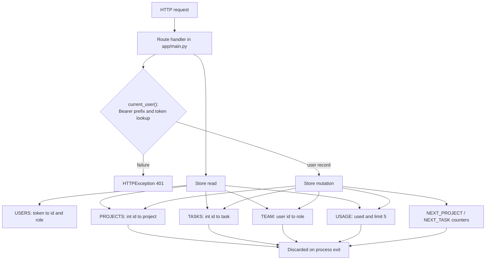

### 3.5.2 Store Inventory

| Store | Type and key | Value shape | Written by | Read by |
|---|---|---|---|---|
| `USERS` | dict, key = bearer token string | `{"id": int, "role": "owner" \| "member"}` | Never (literal seed, line 7) | `current_user` (line 29), `list_projects` role test (line 58), `change_role` gate (line 89) |
| `PROJECTS` | dict, key = integer id | `{"id", "name", "owner_id"}` | `create_project` (line 50) | `create_task` existence check (line 65), `list_projects` (line 58) |
| `TASKS` | dict, key = integer id | `{"id", "title", "project_id", "created_by", "status"}` | `create_task` (line 69), `update_task` in-place mutation (line 82) | `update_task` (line 77) |
| `TEAM` | dict, key = user id | role string `"owner"` / `"member"` | `change_role` (line 93) | `change_role` validation only (line 91) |
| `USAGE` | single dict | `{"used": int, "limit": 5}` | `consume_usage` (line 104) | `consume_usage` ceiling check and response (lines 102–105) |
| `NEXT_PROJECT`, `NEXT_TASK` | module-level integers | monotonically increasing ids | `create_project`, `create_task` via `global` | the same handlers |

No index other than the dict key exists: tasks carry a `project_id` but there is no per-project task collection, and no reverse index from user to project beyond the linear scan in `list_projects` (line 58).

### 3.5.3 Persistence Strategy and Lifecycle

| Property | Behaviour | Evidence |
|---|---|---|
| Durability | None. State lives only in the process's heap and disappears at exit; there is no write path to disk, no serialization call and no backup mechanism | `app/main.py` lines 7–13 |
| Creation | All stores are built at import time, so importing the module (as uvicorn does, and as `tests/test_api.py` line 2 does) constructs a fresh, seeded data set | `app/main.py` lines 7–13; `tests/test_api.py` line 2 |
| Scope | Process-local. Two uvicorn workers, or a reloaded process, hold fully independent copies of projects, tasks and usage; `/billing/consume`'s limit of 5 applies per process | `app/main.py` lines 11, 47, 63 |
| Identity allocation | `NEXT_PROJECT` and `NEXT_TASK` start at 1 per process and never reset except by restart; they are not consulted against existing keys, so ids are unique only within one process lifetime | `app/main.py` lines 12–13, 47–51, 63–70 |
| Schema and migrations | None. Record shapes are dict literals written by the handlers; there is no model for stored data, no versioning and no migration tool | `app/main.py` lines 49, 67–68 |
| Retention and eviction | None. Nothing deletes a project, task or usage record; memory grows for the life of the process and is never reclaimed | no delete route or eviction code exists |
| Test-time lifecycle | The suite mutates the application's own globals directly: `setup_function` calls `PROJECTS.clear()`, `TASKS.clear()` and resets `USAGE["used"] = 0` before each test; `TEAM` and the id counters are not reset | `tests/test_api.py` lines 8–11 |

### 3.5.4 Caching, Sessions and External Storage

- **No cache layer.** The dicts are the only in-memory structure; no TTL, LRU, Redis, Memcached or framework-level cache configuration exists.
- **No session store.** Authentication is stateless per request: the `Authorization` header is re-parsed and re-resolved against `USERS` on every call (`app/main.py` lines 25–32). Nothing is set as a cookie or server-side session; there is no cookie, CORS or middleware configuration in the repository.
- **No file, object or blob storage.** No `open()`, `pathlib`, bucket client or upload endpoint appears in either module.
- **No storage health check.** `GET /ready` returns `{"checks": {"storage": "ok"}}` as a literal (`app/main.py` line 42), so the reported condition is a constant, not a probe of any store.

### 3.5.5 Operational and Security Consequences

- **A restart is a full data loss event.** There is no snapshot, export or replay path; every redeploy begins with `PROJECTS` and `TASKS` empty, `USAGE["used"]` at 0 and ids again starting at 1.
- **Horizontal scale-out is not possible without changing behaviour.** Because state is per process, running more than one worker splits projects, tasks and usage, reissues ids per worker and multiplies the effective usage limit — the constraint recorded in `2.4.3 Scalability Considerations`.
- **Concurrent mutation is unsynchronised.** Handlers are synchronous functions dispatched to FastAPI's thread pool, and none of the read-modify-write sequences (`app/main.py` lines 47–51, 63–70, 102–104) takes a lock, so interleaved requests can duplicate an id or overshoot the usage ceiling.
- **No access control on the store itself.** Any code that imports `app.main` can read and mutate every record — which is precisely how the test suite isolates itself (`tests/test_api.py` lines 2, 8–11). There is no encryption at rest or in memory, no field-level protection and no audit trail of who changed a task, role or usage counter.
- **The chosen storage is a stated fixture property, not a gap to close.** `README.md` lines 30–31 record in-memory storage as intentional and prohibit deployment; replacing it with a database would invalidate the known-ground-truth behaviour the fixture exists to provide.


## 3.6 Development & Deployment

Development happens entirely on a single machine with three command-line tools: `venv`, `pip` and `uvicorn`, plus `pytest` for verification. There is no build system, no container image, no infrastructure definition and no pipeline. The README's two code blocks (`README.md` lines 12–17 and 21–23) are the repository's complete operational documentation.

### 3.6.1 Development Tools

| Tool | Role | Declared where | Notes |
|---|---|---|---|
| CPython 3.10+ | Interpreter | Implied by `app/main.py` line 25; no manifest pins it | No `.python-version`, `runtime.txt`, `tox.ini` or tool-version file |
| `venv` | Isolated environment | `README.md` line 13 | POSIX activation on line 14 with an inline Windows variant |
| `pip` | Dependency installation | `README.md` line 15 | Installs from `requirements.txt`; no index override |
| `uvicorn` CLI | Development server with `--reload` | `README.md` line 16 | Plain install, no `[standard]` extra — see `3.2.2` |
| `pytest` CLI | Test execution | `README.md` line 22 | Configured by `pytest.ini` |
| Linter / formatter / type checker | None | — | No `ruff`, `flake8`, `black`, `isort`, `mypy`, `pyright` or `pre-commit` configuration exists; the `.gitignore`-free root contains no tool configuration at all |
| Editor or IDE configuration | None | — | No `.vscode/`, `.idea/` or `.editorconfig`; `.DS_Store` is committed, indicating macOS authoring |

### 3.6.2 Environment Setup and Dependency Installation

The documented sequence is `python -m venv .venv`, activate, then `pip install -r requirements.txt` (`README.md` lines 13–15). Because `requirements.txt` mixes runtime and test packages in one file (`3.3.1`), this single install produces both the serving environment and the test environment. No environment variable, `.env` file, profile or secret is required or read: the service has no configuration surface, which is why the README's scan setup says "Do not configure an environment; this fixture is self-contained" (`README.md` line 28).

### 3.6.3 Build System

There is none. The repository contains no `pyproject.toml`, `setup.py`, `setup.cfg`, `MANIFEST.in`, `Makefile`, `justfile` or build script, so:

- The application runs directly from a source checkout; nothing is compiled or packaged into a wheel, and nothing is published to an index.
- `app/` is a regular package marked only by a byte-empty `app/__init__.py` — its sole purpose is to make `app.main` a valid import target for `uvicorn` and for `tests/test_api.py` line 2.
- The only version string in the repository is the FastAPI application version `"1.0.0"` at `app/main.py` line 5, which appears in the generated OpenAPI document rather than in any packaging metadata.
- There is no dependency-resolution step beyond `pip` reading four exact pins; no lock file is generated (`3.3.3`).

### 3.6.4 Test Configuration and Execution

`pytest.ini` is the only tool configuration file in the repository, three lines long:

```ini
[pytest]
testpaths = tests
python_files = test_*.py
```

| Setting | Effect |
|---|---|
| `testpaths = tests` | A bare `pytest` invocation collects only the `tests/` directory |
| `python_files = test_*.py` | Narrows collection from pytest's default `test_*.py` *and* `*_test.py` patterns to the single prefix form |
| Absent keys | No `addopts`, markers, `filterwarnings`, `minversion`, coverage options, `env` settings or plugin list |

The suite is run with `pytest -q` (`README.md` line 22) from the repository root, where `app` is importable. It consists of three tests in one module (`tests/test_api.py` lines 14–26), executed in-process against the shared `TestClient`. Two constraints follow from the design and matter to anyone automating them: tests must run in a single process, because `setup_function` mutates the application's own globals (lines 8–11), and they must not run in parallel for the same reason. Coverage is deliberately partial — the README calls the small suite a fixture property (`README.md` line 8).

### 3.6.5 Containerization, Infrastructure as Code and CI/CD

| Capability | Status | Consequence |
|---|---|---|
| `Dockerfile` / `docker-compose.yml` / `.dockerignore` | Absent | No reproducible runtime image; the environment is whatever the developer's interpreter and `pip` produce |
| Container registry or image-publish step | Absent | Nothing is distributed as an artefact |
| Terraform, CloudFormation, Pulumi, Kubernetes or Helm manifests | Absent | No declarative environment exists; there is no host, cluster or networking definition |
| `.github/workflows/`, GitLab CI, Jenkinsfile, CircleCI or any pipeline definition | Absent | Nothing runs the tests automatically; the only gate is a developer issuing `pytest -q` |
| Deployment/rollback automation, release tagging process | Absent | Git history shows three commits (`Initial commit`, `Add proactive insights testing project`, `Resolve README merge conflict`) and no release automation |
| Dependency or security scanning | Absent | No SBOM, `pip-audit`, `safety`, CodeQL or Dependabot configuration (`3.3.5`) |

### 3.6.6 Deployment Requirements and Prohibitions

Nothing in the repository describes a deployment; the README positively forbids one: "Do not deploy it or use real credentials" (`README.md` line 31). Should the service be started outside a developer laptop, the following requirements are the ones the code and README together impose:

| Requirement | Detail | Evidence |
|---|---|---|
| Interpreter | CPython 3.10 or newer | `app/main.py` line 25 |
| Packages | The four pins in `requirements.txt` installed into the environment that runs the process | `requirements.txt` |
| Launch command | An ASGI server pointed at `app.main:app`; uvicorn is the only one documented | `README.md` line 16 |
| Working directory | The repository root, so that `app` resolves as a package | `app/__init__.py`; `README.md` lines 11–17 |
| Process count | Exactly one worker, because all state is process-local (`3.5.3`) | `app/main.py` lines 7–13 |
| Network bind | Not specified in the repository; the README's `http://127.0.0.1:8000/docs` matches uvicorn's default loopback bind and port | `README.md` line 18 |
| Configuration | None — no environment variables, secrets, volumes or mounted files | no configuration read in either module |
| Health checks | `/health` and `/ready` exist and are unauthenticated, but nothing wires them into a supervisor; `/ready` performs no real check | `app/main.py` lines 35–42 |
| Logging | Left entirely to uvicorn's default console output; the application logs nothing | no logging import in either module |

### 3.6.7 Development Workflow as It Actually Exists

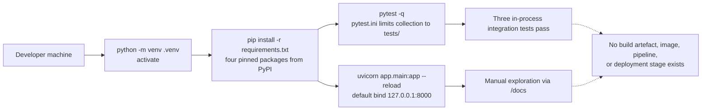

The two branches are independent: serving the app and running the suite never interact through a network, and neither produces an artefact the other consumes. Verification is manual at both ends — a human reads `/docs` for behaviour and a human reads the pytest summary for regressions.


## 3.7 References

### 3.7.1 Repository Files and Folders

- `README.md` — the only operational documentation: venv/pip/uvicorn setup (lines 11–18), `pytest -q` (lines 20–23), the statement that data is held in memory and no external service is required (line 9), the scan setup requiring no environment (line 28), and the prohibition on deployment with real credentials (lines 30–31).
- `requirements.txt` — the four exact `==` pins (`fastapi==0.115.12`, `uvicorn==0.34.0`, `pytest==8.3.5`, `httpx==0.28.1`), the absence of extras, hashes and a dev split.
- `pytest.ini` — `testpaths = tests` and `python_files = test_*.py`, and the absence of `addopts`, markers and plugin configuration.
- `app/main.py` — the whole service: framework and library imports (lines 1–3), the FastAPI instance and its `1.0.0` version (line 5), the six in-memory stores and two counters (lines 7–13), the Pydantic request models (lines 16–22), the bearer-token helper (lines 25–32), the nine route handlers (lines 35–110), and the synchronous, lock-free handler style.
- `app/__init__.py` — byte-empty package marker whose only role is to make `app.main` importable.
- `tests/test_api.py` — the in-process `TestClient` harness (line 4), the literal bearer header (line 5), the `setup_function` reset of application globals (lines 8–11) and the three integration tests (lines 14–26).
- `app/__pycache__/__init__.cpython-312.pyc`, `app/__pycache__/main.cpython-312.pyc` — compiled caches in the working tree tagged for CPython 3.12, the only evidence of the interpreter the service was exercised on.
- `.pytest_cache/` — untracked pytest cache from local runs, confirming the suite is executed locally rather than in a pipeline.
- Repository root — the complete inventory used to establish what does not exist: `README.md`, `pytest.ini`, `requirements.txt`, `app/`, `tests/` (plus `.git/`, `.pytest_cache/`, `.DS_Store`); no `pyproject.toml`, `setup.py`, `Dockerfile`, `.github/`, `.gitignore`, `.env`, `LICENSE` or lock file.
- `app/` — folder containing the entire runnable service (two files, no sub-packages).
- `tests/` — folder containing the entire test surface (one module, no `conftest.py` or fixtures package).

### 3.7.2 External Sources

- [web] PyPI JSON metadata for `fastapi` 0.115.12 — release date (2025-03-23), `requires-python >=3.8`, the `pydantic` and `starlette` ranges, the MIT license, and the fact that `httpx` and `uvicorn[standard]` appear only in the `standard`/`all` extras.
- [web] FastAPI release notes and migration guide — the `starlette>=0.40.0,<0.47.0` range introduced in 0.115.10, and that Pydantic v1 and v2 were both supported at 0.115.x.
- [web] Google Open Source Insights (deps.dev) requirements for `fastapi` 0.115.12 — the `starlette` and `pydantic` dependency specifiers used in `3.2.6`.
- [web] FastAPI "Testing" documentation — that `fastapi.testclient` re-exports Starlette's `TestClient` and requires `httpx` to be installed separately.
- [web] Starlette release notes and the `TestClient` `app=` removal diff (PR #2526) — the 0.37.2 fix that makes `TestClient` compatible with httpx 0.28.
- [web] httpx CHANGELOG — the 0.28.0 removal of the deprecated `app=` argument and the 0.28.1 (2024-12-06) release.
- [web] PyPI JSON metadata for `uvicorn` 0.34.0 — release date (2024-12-15), `requires-python >=3.9`, base dependencies `click`/`h11`, and the `[standard]`-only dependencies.
- [web] Uvicorn documentation (settings, installation, supervisors at tag 0.34.0) — the unconditional `--reload` flag and the `StatReload` fallback used when `watchfiles` is not installed.
- [web] PyPI JSON metadata and changelog for `pytest` 8.3.5 — release date (2025-03-02) and `requires-python >=3.8`.
- [web] PyPI metadata and deps.dev license records for `starlette` 0.46.2, `pydantic`/`pydantic-core` 2.x, `click`, `h11` and `typing_extensions` — the license and transitive-constraint facts in `3.3.2` and `3.3.4`.


# 4. Process Flowchart

## 4.1 System Workflows

Every workflow in this system is a single synchronous request–response exchange handled entirely inside one Python process. There is no session, no background worker, no scheduled job and no outbound call: `app/main.py` imports only `fastapi`, `pydantic` and `time.monotonic` (lines 1–3), and a repository-wide text search over every code-bearing file finds no client library, no queue, no scheduler and no lifecycle hook. Each request therefore begins at the HTTP edge, passes the framework's request validation, passes or fails the hand-written credential check, executes one handler body, and terminates in a `200` JSON body or in a single `HTTPException` detail. State produced by one request is visible to the next only because the same process memory holds it (`PROJECTS`, `TASKS`, `TEAM`, `USAGE` at lines 8–11).

### 4.1.1 Core Business Processes

Nine journeys account for all behaviour. The identifiers below are used by the diagrams in 4.4 and map one-to-one onto the catalogued features of section 2.1.

| ID | Journey | Actor | Request | Feature / requirement |
|---|---|---|---|---|
| J-01 | Liveness and readiness polling | Any caller, no credential | `GET /health`, `GET /ready` | F-001-RQ-001, F-001-RQ-002 |
| J-02 | Contract discovery | Any caller | `GET /docs`, `GET /redoc`, `GET /openapi.json` | F-001-RQ-003 |
| J-03 | Project creation | Bearer principal | `POST /projects` + JSON body | F-003-RQ-001, F-003-RQ-003 |
| J-04 | Project listing | Bearer principal | `GET /projects` | F-003-RQ-002 |
| J-05 | Task creation | Bearer principal | `POST /tasks` + JSON body | F-004-RQ-001, F-004-RQ-004 |
| J-06 | Task status transition | Bearer principal | `PATCH /tasks/{task_id}?status=…` | F-004-RQ-002, F-004-RQ-003 |
| J-07 | Role administration | Owner principal | `POST /teams/{user_id}/role?role=…` | F-005-RQ-001 … 003 |
| J-08 | Quota consumption | Bearer principal | `POST /billing/consume?units=…` | F-006-RQ-001 … 004 |
| J-09 | Metrics scrape | Any caller | `GET /metrics` | F-007-RQ-001 |

**J-03 Project creation, step by step.** The body is parsed into `ProjectIn`, so a `name` shorter than 2 or longer than 80 characters terminates the request with a framework `422` before the handler body runs (lines 16–17) — this rejection happens even when no credentials are supplied, because framework validation precedes the handler. With a valid body, `current_user` enforces the credential (`401` on either branch, lines 25–32). The handler then builds `{"id": NEXT_PROJECT, "name": payload.name, "owner_id": user["id"]}`, stores it in `PROJECTS`, and post-increments the counter under a `global` declaration (lines 47–51). The stored dict itself is returned as the `200` body. No uniqueness rule applies to `name`: a second `POST` with `"P1"` yields a distinct id and a duplicate name. A `422` consumes no id, because the allocator advances only after validation succeeds.

**J-06 Task status transition, step by step.** `status` is a required **query** parameter, not a body field (line 75); a JSON body yields `422` because the query parameter is then missing. After authentication the handler loads the task, so an unknown id returns `404 Task not found` **before** the value check runs (lines 77–81). A value outside `{open, in_progress, done}` returns `422 Unsupported status`; the comparison is case-sensitive, so `DONE` is refused. Otherwise the stored dict is mutated in place (line 82) and echoed. The principal returned by `current_user` is discarded at line 76, so any valid token can transition any task, and no transition graph restricts the move — `done` may return to `open`.

**Decision points.** Every branch in the system is a total of eleven decision statements, all in `app/main.py`.

| # | Decision | Line | True path | False path |
|---|---|---|---|---|
| D1 | Body matches `ProjectIn` / `TaskIn`, and path/query values parse as `int` | 16–22, 75, 87, 98 | Handler invoked | `422` detail array from FastAPI |
| D2 | `Authorization` present and starting with the exact `"Bearer "` prefix | 26–27 | D3 | `401 Missing bearer token` |
| D3 | Token present in `USERS` | 29–31 | Principal record | `401 Invalid token` |
| D4 | Referenced project exists in `PROJECTS` | 65–66 | Task stored | `404 Project not found` |
| D5 | Task id exists in `TASKS` | 77–79 | D6 | `404 Task not found` |
| D6 | `status` in `{open, in_progress, done}` | 80–81 | Task mutated | `422 Unsupported status` |
| D7 | Caller's `role` equals `owner` | 89–90 | D8 | `403 Owner role required` |
| D8 | `user_id` in `TEAM` **and** `role` in `{owner, member}` | 91–92 | `TEAM` written | `404 User or role not found` |
| D9 | `units >= 1` | 100–101 | D10 | `422 Units must be positive` |
| D10 | `USAGE["used"] + units <= 5` | 102–103 | Counter incremented | `429 Usage limit reached` |
| D11 | Caller owns the project **or** caller role is `owner` | 58 | Project listed | Project omitted from the array |

**Terminal outcomes.** An exchange ends in exactly one of: a `200` body carrying the stored or computed object; `401`, `403`, `404`, `422` or `429` with a `{"detail": …}` body; or, for unrouted requests, the framework's own `404`. Two paths terminate as framework artifacts rather than designed errors — `GET /tasks` returns `405` because `/tasks` is registered only for `POST`, and `DELETE` or `PUT` on `/projects/{id}` returns `404` because no such operation is registered. Confirmed against a running instance: `POST` answers `200` and never `201`.

**Error handling paths within the journeys.** The precedence is fixed by statement order, not by a framework mechanism, and it is observable:

- Framework validation outranks authentication (D1 before D2), so an anonymously submitted malformed body returns `422`, not `401`.
- Authentication outranks every business rule (D2–D3 before D4–D10), so an anonymous caller never learns whether a resource exists, and an anonymous `POST /billing/consume?units=0` returns `401` rather than the `422` its value would earn once authenticated.
- Existence outranks value validity (D5 before D6), so a nonexistent task with an unsupported status returns `404`.
- The role gate outranks the target check (D7 before D8), so a member receives `403` even when the target user or role would also have been invalid.

**High-level system workflow.** The diagram draws the four system boundaries as swim lanes: the caller, the FastAPI framework, the route-handler layer, and process memory. Public routes bypass the credential lane entirely; no route writes outside the memory lane.

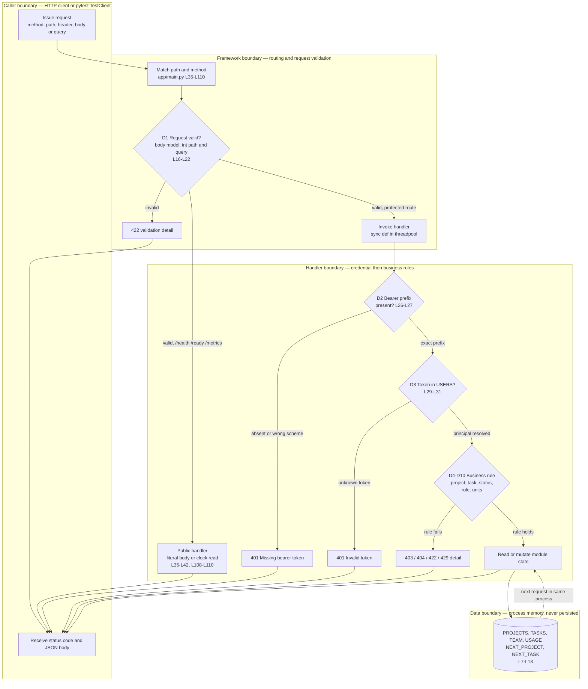

### 4.1.2 Integration Workflows

The system has no outbound integration. It calls no database, broker, cache, identity provider or third-party API, reads no environment variable or file, and holds no credentials beyond two literals in source (line 7). The integration surface is therefore three boundaries and nothing more.

| Boundary | Direction | Mechanism | Data crossing it | Evidence |
|---|---|---|---|---|
| HTTP edge | Inbound | ASGI over `uvicorn app.main:app` (README line 16) or in-process ASGI through `fastapi.testclient.TestClient` | Method, path, `Authorization` header, JSON body, query parameters; JSON response | `requirements.txt` lines 1–2; `tests/test_api.py` lines 1–4 |
| Process memory | Internal | Module-level dicts and integer counters, accessed directly by handlers | `USERS`, `PROJECTS`, `TASKS`, `TEAM`, `USAGE`, `NEXT_PROJECT`, `NEXT_TASK` | `app/main.py` lines 7–13 |
| Test harness | Inbound, in-process | `TestClient(app)` shared by three tests; `setup_function` clears two containers and resets one counter before each test | The same live dicts the handlers mutate | `tests/test_api.py` lines 4, 8–11 |

**API interaction flow.** Because there is no upstream system, the only API interaction is caller-to-service. The sequence below traces the two most informative paths in one diagram: a successful `POST /projects`, and a `POST /billing/consume` that is authenticated, value-checked and then refused by the quota ceiling. Note that the credential helper is called inline by each handler rather than injected as a dependency, so there is no central authentication step in the pipeline.

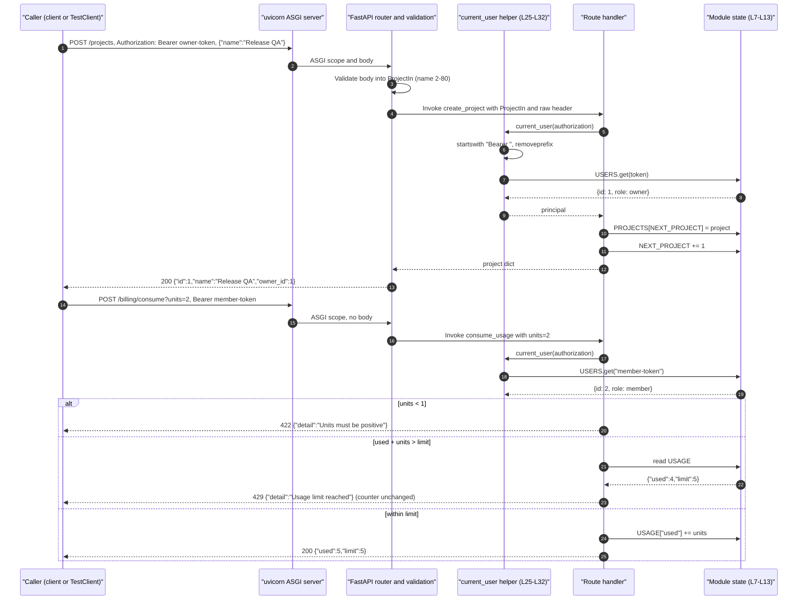

**Event processing flows.** None exist. No handler emits an event, publishes a message, schedules work or invokes a callback; a search for `BackgroundTask`, `lifespan`, `on_event` and any queue or broker client returns no match in the repository. Nothing observes a completed request, which is also why `GET /metrics` can only report a hard-coded `requests_total` of `0` (line 110).

**Batch processing sequences.** The service contains no batch or scheduled process. The only repeated, ordered sequence in the repository is the test harness: `pytest` collects `tests/test_api.py` through `testpaths = tests` and `python_files = test_*.py` (`pytest.ini` lines 2–3), and `setup_function` runs before each test to clear `PROJECTS` and `TASKS` and reset `USAGE["used"]` (lines 8–11). That reset does not cover `NEXT_PROJECT`, `NEXT_TASK` or `TEAM`, so ids keep climbing within a run and assertions compare identifiers round-trip rather than against literals. Running the suite in this analysis environment produced `3 passed`.

**Startup and shutdown sequences.** Neither exists: importing `app.main` creates the `FastAPI` instance and the state containers, and that import is the whole of startup. `app/__init__.py` is empty, so importing the `app` package alone does not build the service. There is no shutdown hook, so nothing flushes, closes or persists state — the process ending is the end of the data.


## 4.2 Flowchart Requirements

A flowchart of this system is complete only when it obeys the rules below. They are derived from the code rather than imposed on it, so each requirement names the construct in `app/main.py` that the diagram must mirror.

| Requirement | Applies to | Rule |
|---|---|---|
| Start and end points | Every diagram | Begin at the caller's request and end at exactly one exit: a `200` body, or one of `401`, `403`, `404`, `422`, `429`, or the framework's unrouted `404` / `405`. No diagram may end without an exit node. |
| Process steps | Every diagram | Each step must correspond to a statement group in `app/main.py`; a step that exists in no source line is a diagram defect. |
| Decision diamonds | Every diagram | A diamond appears only for D1–D11 of section 4.1.1, or for a framework-level parse failure. Eleven diamonds cover the whole system; a diagram using more has invented a branch. |
| System boundaries | Request-path diagrams | Draw as separate subgraphs: caller, FastAPI framework, handler layer, process memory. The credential helper is a step inside the handler layer, never a boundary of its own, because no middleware or dependency performs it. |
| User touchpoints | Caller-facing diagrams | Mark the two points where an actor interacts: the request the actor composes and the status/body the actor receives. Automated callers (`TestClient`, scanners, probes) occupy the same lane as a human client; the code does not distinguish them. |
| Error states | Every diagram | Label the node with the status code **and** the literal `detail` string, because the same code carries different meanings — `422` is a Pydantic array for D1 but the literal `Unsupported status` or `Units must be positive` for D6 and D9. |
| Recovery paths | Error-bearing diagrams | A recovery edge exists only where a caller action can succeed: a valid token after `401`, an existing project id after `404`, a supported value after `422`, a smaller `units` value after `429`. There is no server-side recovery edge, because no retry, fallback or reset mechanism exists. |
| Timing annotations | Every diagram | Mark only what the code observes. There is no SLA, timeout, retry budget or `Retry-After` header anywhere in the repository; the sole time value is `round(monotonic(), 2)` at line 110. |

### 4.2.1 Diagram Conventions

The diagrams in 4.1 and 4.4 follow one set of conventions so they can be read together.

- **Node identifiers** are diagram-local; the semantic anchors are the `D`-numbers for decisions and the `L`-numbers for source lines, both carried in node labels.
- **Node shapes** are fixed by meaning: stadium for a request entry or a terminal response, rectangle for a process step, diamond for a decision, cylinder for a module-level container, and a dashed edge for a relationship that holds across requests rather than within one.
- **Error nodes** carry a distinct identifier prefix (`E…`) and the status code in the label, so a reader can count error paths independently of the happy path.
- **Boundary subgraphs** carry one lane each and never contain an edge out of their own lane except through an explicitly drawn transition; process memory is drawn as a sink that handlers write to and, for reads, as a source.
- **One invariant is stated rather than drawn** wherever the code repeats it: on every rejection path the stored state is unchanged. This holds for D4 (nothing stored before the check), D5–D6 (mutation happens last), D8–D9 (write happens last) and D10 (`429` returns before the increment), and it is the property a flowchart of a stateful handler most easily misrepresents.
- **Version and title** are omitted from the diagrams: `1.0.0` at line 5 is metadata surfaced only through `/openapi.json` and plays no role in any flow.

### 4.2.2 Validation Rules and Authorization Checkpoints

Validation happens in two layers that must be drawn apart, because they fail in opposite order relative to authentication: the framework validates the request *before* the handler exists on the call stack, while the handler authenticates before it applies any business rule.

| Rule | Layer | Enforcement | Failure | Requirement |
|---|---|---|---|---|
| `name` length 2–80 | Framework (Pydantic `ProjectIn`) | `app/main.py` lines 16–17 | `422` `string_too_short` / `string_too_long` | F-003-RQ-003 |
| `title` length 2–120 | Framework (`TaskIn`) | Lines 20–21 | `422` `string_too_short` / `string_too_long` | F-004-RQ-004 |
| `project_id` is an integer | Framework (`TaskIn`) | Line 22 | `422` `int_parsing`; a numeric string such as `"1"` is coerced and accepted | F-004-RQ-004 |
| `task_id`, `user_id` are integers | Framework (path) | Lines 75, 87 | `422` `int_parsing` | F-004-RQ-003, F-005-RQ-002 |
| `status` query parameter present | Framework (required query) | Line 75 | `422` `missing` at `["query","status"]`; a JSON body does not satisfy it | F-004-RQ-003 |
| `role` query parameter present | Framework | Line 87 | `422` `missing` | F-005-RQ-002 |
| Exact `Bearer ` prefix, case-sensitive | Handler | Lines 26–27 | `401 Missing bearer token` | F-002-RQ-001 |
| Token exists in `USERS` | Handler | Lines 29–31 | `401 Invalid token` | F-002-RQ-002 |
| Referenced project exists | Handler | Lines 65–66 | `404 Project not found` | F-004-RQ-001 |
| Task id exists | Handler | Lines 77–79 | `404 Task not found` | F-004-RQ-002 |
| Status in `{open, in_progress, done}` | Handler | Lines 80–81 | `422 Unsupported status`; case-sensitive | F-004-RQ-002 |
| Caller role is `owner` | Handler | Lines 89–90 | `403 Owner role required` | F-005-RQ-001 |
| Target user and role recognised | Handler | Lines 91–92 | `404 User or role not found` for both conditions | F-005-RQ-002 |
| `units >= 1` | Handler | Lines 100–101 | `422 Units must be positive` | F-006-RQ-002 |
| `used + units <= 5` | Handler | Lines 102–103 | `429 Usage limit reached`; equality is allowed | F-006-RQ-003 |

Rules the code does **not** contain must not appear in a flowchart: no project-name uniqueness, no title trimming or character rules, no status-transition graph, no per-project or per-team scoping, no rate limit, no idempotency key, no request-size cap beyond the two string lengths, and no ownership check on task mutation or quota consumption. Unknown JSON body fields are silently discarded by Pydantic, so a caller-supplied `owner_id` in `POST /projects` is ignored and the token's id is stamped instead.

**Authorization checkpoints.** Six routes require a credential; three do not. The role gate exists on exactly one route, and no route performs an ownership gate on a write.

| Route | Credential checkpoint | Role checkpoint | Ownership checkpoint | Consequence drawn in the flow |
|---|---|---|---|---|
| `GET /health`, `GET /ready`, `GET /metrics` | None | None | None | Public lane; the diagram must not draw a `401` edge |
| `POST /projects` | `current_user` (line 48) | None | None — `owner_id` comes from the token | Authenticated create; no role branch |
| `GET /projects` | `current_user` (line 57) | `role == owner` widens the result set (line 58) | Filter on `owner_id` for a member | Single decision D11 inside the handler |
| `POST /tasks` | `current_user` (line 64) | None | **None** — a member may attach a task to another principal's project | No ownership branch exists to draw |
| `PATCH /tasks/{task_id}` | `current_user` (line 76), principal discarded | None | **None** — any valid token transitions any task | The resolved principal leaves the flow immediately |
| `POST /teams/{user_id}/role` | `current_user` (line 88) | Owner required (lines 89–90) | None; self-targeting is permitted | The only `403` edge in the system |
| `POST /billing/consume` | `current_user` (line 99), principal discarded | None | None — one shared counter is drained by either token | No per-principal branch exists |

Because `USERS` is a source literal that no handler writes (line 7) and `TEAM` is written but never read by the authentication path (lines 10, 25–32), a diagram must not draw an edge from `POST /teams/{user_id}/role` back into authorization. A role written to `TEAM` has no effect on any later decision, which is observable: after promoting user 2 to `owner` in `TEAM`, that user's `GET /projects` still returns only their own project.

**Regulatory compliance checks.** None exist and none are declared. The repository states that it is a synthetic QA fixture which must not be deployed or used with real credentials (`README.md` lines 30–31); there is no audit log, no data-retention or deletion path, no PII handling, no encryption, no consent step and no licensing obligation recorded anywhere in the tree. A flowchart for this system therefore carries no compliance gate, and drawing one would misrepresent the code. The nearest observable is the absence itself: nothing records who consumed quota or who transitioned a task, so no evidentiary trail can be produced from the running system.

### 4.2.3 Timing, SLA and Concurrency Considerations

No timing contract exists in the repository. There is no timeout configuration, no retry budget, no circuit breaker, no rate limiter and no queue depth to bound; a text search for `timeout`, `retry`, `backoff` and `circuit` over every code-bearing file returns no match. The only time value the system reads is `time.monotonic()` (`app/main.py` line 3), and it is used solely to populate `uptime_seconds` in the metrics body (line 110), rounded to two decimals. That value measures from the platform's monotonic-clock origin — in practice system boot — not from process start, so a flowchart must not label it as process uptime.

| Timing consideration | Observed reality | Diagram consequence |
|---|---|---|
| Response deadline | None configured; nothing in the code can block on I/O | No deadline node; latency is bounded by in-memory dict operations and Pydantic validation |
| Quota window | None — the counter has no period, reset or expiry | Draw the ceiling as a monotonic lifetime total, not a per-period allowance |
| Retry guidance for `429` | No `Retry-After` header; the exception carries only a `detail` string | No "wait and retry" edge from the quota refusal unless it is labelled unrecoverable-in-process |
| Long-running work | None; every handler is a plain `def` with no `await`, no sleep and no background task | No asynchronous or wait-state nodes |
| Startup readiness | `/ready` returns a literal `storage: ok` (line 42) and performs no probe | Draw `/ready` as a terminal literal response, not as a gate on a dependency |
| Measurement basis for tests | The suite runs in-process through `TestClient`, completing in a fraction of a second | Timing must not appear as an acceptance factor in any test-derived flow |

**Concurrency.** Handlers are synchronous functions, so FastAPI dispatches each to its worker thread pool, and the module-level containers are mutated with no lock, no atomic compare-and-set and no database isolation — a search for `threading`, `asyncio.Lock` and any transaction primitive finds nothing. Three read-modify-write sequences are therefore interleavable:

- `create_project` reads `NEXT_PROJECT`, stores under that key, then increments (lines 47–51). Two concurrent creators can read the same counter value, so one project can overwrite the other under a shared id.
- `create_task` performs the same pattern on `NEXT_TASK` (lines 63–70).
- `consume_usage` tests `USAGE["used"] + units > USAGE["limit"]` and only then increments (lines 102–104). Two concurrent requests can both pass the ceiling test, so the counter can exceed `5`.

A correct flowchart shows these as a single process step, because the code has no fence around them. Where a diagram needs to convey the risk, it should annotate the step as a check-then-act on shared memory rather than draw a locking step that the source does not contain. There is also no transaction boundary to draw: a failing request leaves state untouched only because each mutation is the last statement in its handler, not because anything rolls back.

**State isolation across processes.** `uvicorn app.main:app --reload` (`README.md` line 16) starts a single process with no `--workers` argument, so the in-memory store is the only copy. A second process, a restart, or a reload begins with `PROJECTS` and `TASKS` empty, `USAGE["used"]` at `0` and both counters at `1` — verified by reloading the module and observing an empty project list. Any diagram that spans more than one process would contradict the code.


## 4.3 Technical Implementation

Two mechanisms carry every workflow: module-level memory that handlers mutate directly, and `HTTPException`s that handlers raise directly. Neither has a coordinating layer — there is no repository, no service object, no middleware, no dependency injection and no exception translator — so the implementation of state and the implementation of failure are both visible in single statements.

### 4.3.1 State Management

The entire data layer is fourteen lines of declarations at import time (`app/main.py` lines 5–13). Nothing else in the repository creates state.

| State | Type and initial value | Written by | Read by | Lifetime |
|---|---|---|---|---|
| `USERS` | dict, two literal tokens → `{id, role}` (line 7) | Nothing — never mutated at runtime | `current_user` (line 29) | Process |
| `PROJECTS` | dict, `{}` keyed by int id (line 8) | `create_project` (line 50) | `list_projects` (line 58), `create_task` (line 65) | Process |
| `TASKS` | dict, `{}` keyed by int id (line 9) | `create_task` (line 69), `update_task` (line 82) | `update_task` (line 77) | Process |
| `TEAM` | dict, `{1: "owner", 2: "member"}` (line 10) | `change_role` (line 93) | Nothing | Process |
| `USAGE` | dict, `{"used": 0, "limit": 5}` (line 11) | `consume_usage` (line 104) | `consume_usage` (line 102) | Process |
| `NEXT_PROJECT` | int, `1` (line 12) | `create_project` via `global` (lines 47, 51) | `create_project` (line 49) | Process |
| `NEXT_TASK` | int, `1` (line 13) | `create_task` via `global` (lines 63, 70) | `create_task` (line 67) | Process |

**State transitions.** Only task records and the quota counter have a transition model, and both are unconstrained relative to their intent.

- A task record moves `absent → open` at creation (line 68) and thereafter between `open`, `in_progress` and `done` in any direction, including back to `open` from `done` and onto itself (lines 80–82). No history, version or timestamp is recorded.
- `USAGE["used"]` advances monotonically by `units` up to the ceiling of `5` and never decreases; no handler resets it. `USAGE["limit"]` is a constant that nothing writes.
- A project record has no transition at all: it is created and thereafter immutable, since no update or delete operation exists.
- `USERS` never transitions, which is why `POST /teams/{user_id}/role` can change `TEAM` without changing any authorization outcome.

**Data persistence points.** There are none. No handler opens a file, a socket or a connection; the only writes go to the dicts above. The consequence is directly observable: reloading `app.main` resets `PROJECTS` to `{}`, `USAGE` to `{"used": 0, "limit": 5}` and both counters to `1`, and a restart therefore discards every project, task, role change and consumed unit. Because `uvicorn app.main:app --reload` starts a single process (`README.md` line 16), no second copy exists to recover from — the store is the process.

**Caching requirements.** None exist, and one aliasing property deserves note because it affects what a flow diagram may assume about isolation. Handlers return the stored dict objects themselves rather than copies: `create_project` returns `project` after inserting it (lines 49–52), `update_task` returns the same object it mutated (line 83), and `list_projects` serialises the live dicts from `PROJECTS.values()` (line 58). Responses are therefore snapshots taken at serialisation time; any later mutation of the same object is not visible to a client that already received a response, and no handler reads a cached copy in preference to the store.

**Transaction boundaries.** None. Each handler is a single function with no fenced region, no lock and no rollback, so the only atomicity guarantee is statement order:

- In `create_project` the store insert (line 50) precedes the counter increment (line 51); both occur after every validation, so a rejected request changes nothing, and no failure mode exists between the two statements other than an unhandled interpreter error.
- In `create_task` the existence check (lines 65–66) precedes both the insert and the increment, so an orphan task is never stored.
- In `update_task` and `change_role` the mutation is the final statement after all gates, so a refusal leaves the store byte-identical.
- In `consume_usage` the ceiling test and the increment are two separate statements on shared memory (lines 102–104); with synchronous handlers running in FastAPI's thread pool this is a check-then-act window, so concurrent requests can interleave and push `used` past `5`. The same unsynchronized pattern applies to the id allocators, where two concurrent creators can both read the same `NEXT_PROJECT` value and overwrite one another's record.

**External state control.** The test harness mutates the application's containers directly: `setup_function` clears `PROJECTS` and `TASKS` and assigns `USAGE["used"] = 0` before each test (`tests/test_api.py` lines 8–11). `NEXT_PROJECT`, `NEXT_TASK` and `TEAM` are outside that reset, so identifiers keep advancing within a run and no assertion may depend on a literal id. The three collected tests pass under this arrangement (`3 passed`).

### 4.3.2 Error Handling

Every application-level failure is one of nine `raise HTTPException(...)` statements. A repository-wide search confirms there is no `try`, no `except`, no logging call and no error-reporting integration in any tracked file, so the pattern is uniform: a handler detects a violation, raises, and FastAPI renders `{"detail": …}` with the given status.

| Status | Literal detail | Raised at | Trigger | State after |
|---|---|---|---|---|
| `401` | `Missing bearer token` | Line 27 | Header absent, or not starting with the exact `"Bearer "` prefix | Unchanged |
| `401` | `Invalid token` | Line 31 | Prefix present but the remainder is not a key in `USERS` | Unchanged |
| `404` | `Project not found` | Line 66 | `project_id` in the task body is not a key in `PROJECTS` | Unchanged |
| `404` | `Task not found` | Line 79 | Path `task_id` is not a key in `TASKS` | Unchanged |
| `422` | `Unsupported status` | Line 81 | `status` outside `{open, in_progress, done}`, case-sensitive | Unchanged |
| `403` | `Owner role required` | Line 90 | Caller's `USERS` role is not `owner` | Unchanged |
| `404` | `User or role not found` | Line 92 | `user_id` absent from `TEAM`, **or** `role` outside `{owner, member}` | Unchanged |
| `422` | `Units must be positive` | Line 101 | `units < 1` | Unchanged |
| `429` | `Usage limit reached` | Line 103 | `USAGE["used"] + units > 5` | Unchanged |

Three further error shapes come from the framework rather than the code, and a flowchart must distinguish them because their bodies differ:

| Shape | Source | Body |
|---|---|---|
| `422` validation array | Pydantic models and typed path/query parameters (lines 16–22, 75, 87, 98) | `{"detail": [{"type", "loc", "msg", "input", "ctx"}]}`, e.g. `string_too_short`, `int_parsing`, `missing` |
| `404` unrouted | Starlette routing for any path with no handler | `{"detail": "Not Found"}` |
| `405` method mismatch | Starlette routing where the path exists with another method | `{"detail": "Method Not Allowed"}`, as observed for `GET /tasks` |

**Retry mechanisms.** None are implemented server-side: no request is retried, no operation is idempotent by design, and a `429` carries no `Retry-After` header. Retry behaviour is therefore entirely a caller decision, and the code gives it no help — a retried `POST /projects` or `POST /tasks` creates a second record, because nothing deduplicates by name, title or idempotency key. The only safe retries are read-only ones (`GET /health`, `GET /ready`, `GET /metrics`, `GET /projects`) and the value-corrected retries of `PATCH` and the two query-driven `POST`s, which are naturally repeatable at the state level.

| Status | Caller-side recovery that can succeed |
|---|---|
| `401 Missing bearer token` / `Invalid token` | Resend with `Authorization: Bearer owner-token` or `Bearer member-token`; no issuance or refresh path exists |
| `404 Project not found` | Create the project first, then retry with its id |
| `404 Task not found` | Retry against a task id that an earlier `POST /tasks` returned |
| `422` validation array or literal detail | Correct the field, path type, or query parameter and resend |
| `403 Owner role required` | Use the owner token; no other route grants the role the gate reads |
| `429 Usage limit reached` | Send fewer `units`, or none at all if at least one unit of headroom remains — equality with the limit is permitted, so `used = 4` accepts `units = 1` |
| `404 Task not found` after exhaustion | No in-process recovery; only a process restart resets `USAGE["used"]` to `0` |

**Fallback processes.** None exist. No handler degrades to a default value, a cached response, a partial success or an empty result on failure: a rejection aborts the request and returns the detail. The nearest thing to a fallback is the visibility filter in `list_projects`, which returns `[]` rather than an error when the caller can see nothing (line 58) — an empty result, not a degraded one.

**Error notification flows.** None. Nothing observes or records a failure: there is no logger, no counter, no trace emitter and no dead-letter path, and `GET /metrics` cannot report error volume because `requests_total` is the literal `0` at line 110 and no instrumentation increments it. The response body is the entire notification channel, which means an error is visible only to the caller that caused it. If an unexpected exception did escape a handler, FastAPI's default `500` handling would apply with no logging configuration in the repository, so the only record would be whatever the ASGI server writes to its own output.

**Recovery procedures.** The system offers exactly one: restart the process, which restores `PROJECTS` and `TASKS` to empty, `TEAM` to its two seeded roles, `USAGE["used"]` to `0` and both counters to `1`. That is how a drained quota is restored, how polluted demo data is cleared, and how the test suite gets a clean world between runs. Any flowchart that needs a "reset" state must route it through process restart, not through an endpoint, because no reset, flush or administrative route exists.


## 4.4 Required Diagrams

This sub-section holds the diagram set required of the specification: one flow per catalogued behaviour, one consolidated error-handling flowchart, and the state models. The two diagrams that span the whole system — the high-level workflow in 4.1.1 and the integration sequence in 4.1.2 — are referenced rather than repeated here.

| Required diagram | Delivered in | Scope |
|---|---|---|
| High-level system workflow | 4.1.1 | Full request path with caller, framework, handler and memory lanes |
| Integration sequence diagram | 4.1.2 | Caller → server → router → credential helper → handler → memory, with the quota branch |
| Detailed flow, project lifecycle (F-003) | 4.4.1 | `POST /projects` and `GET /projects` |
| Detailed flow, task lifecycle (F-004) | 4.4.2 | `POST /tasks` and `PATCH /tasks/{task_id}` |
| Detailed flow, role administration (F-005) | 4.4.3 | `POST /teams/{user_id}/role` |
| Detailed flow, quota consumption (F-006) | 4.4.4 | `POST /billing/consume` |
| Detailed flow, operational probes (F-001, F-007) | 4.4.5 | `GET /health`, `GET /ready`, `GET /metrics` |
| Error handling flowchart | 4.4.6 | Every failure outcome in precedence order, with its recovery edge |
| State transition diagrams | 4.4.7 | Task status model and quota counter model |

### 4.4.1 Project Workflow Diagram (F-003)

Creation is the only path that writes `PROJECTS`; listing is the only path that reads it. The two diagrams share the credential ladder and diverge at the store.

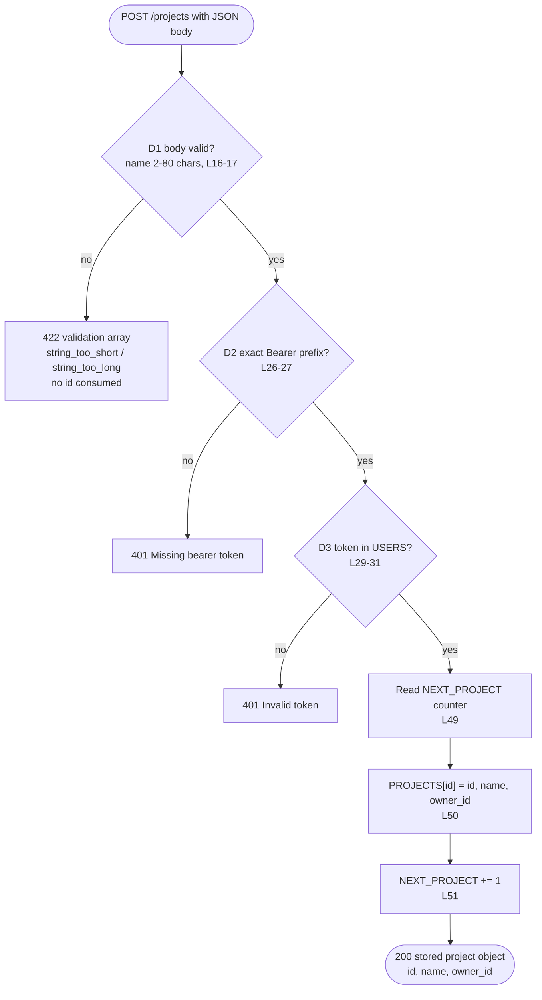

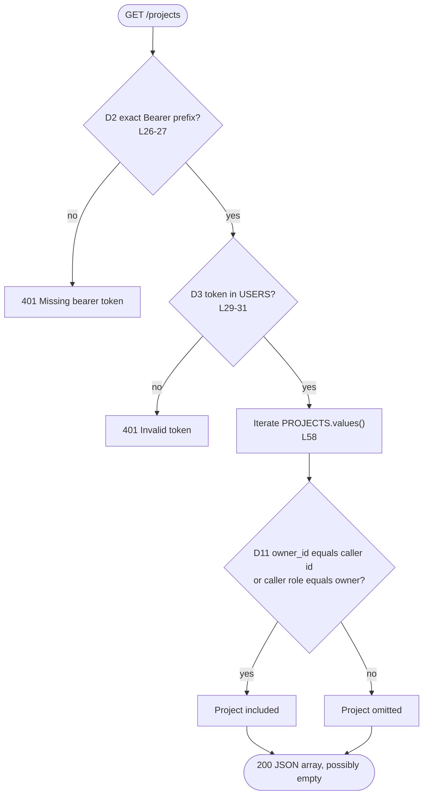

The listing filter is the system's only ownership-sensitive branch, and it is also the only place the `owner` role widens visibility. Because the role comes from `USERS` and never from `TEAM`, a role granted through `POST /teams/{user_id}/role` does not widen this array. Confirmed: the member token returns one project whether `TEAM[2]` reads `member` or `owner`. Two absences belong in the same picture — there is no update, delete, pagination or search operation on projects, so no edge leaves the store once a record is written.

### 4.4.2 Task Workflow Diagram (F-004)

Creation is gated on a project existing; transition is gated on a task existing and a status being supported. Neither route involves an ownership decision, which is the structural property the diagram must not hide.

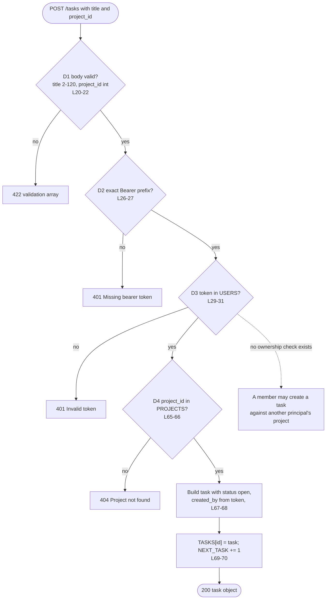

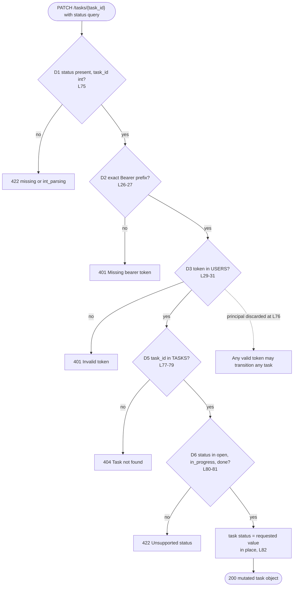

Two ordering facts make these diagrams unambiguous. Existence is tested before the status value, so a nonexistent task with an unsupported status yields `404`, not `422`. And a missing `status` query parameter fails in the framework before authentication, so an anonymous malformed `PATCH` yields `422` rather than `401` — the reverse of the precedence inside the handler.

### 4.4.3 Team Role Administration Diagram (F-005)

This is the only route with a role gate and the only writer of a container that nothing reads.

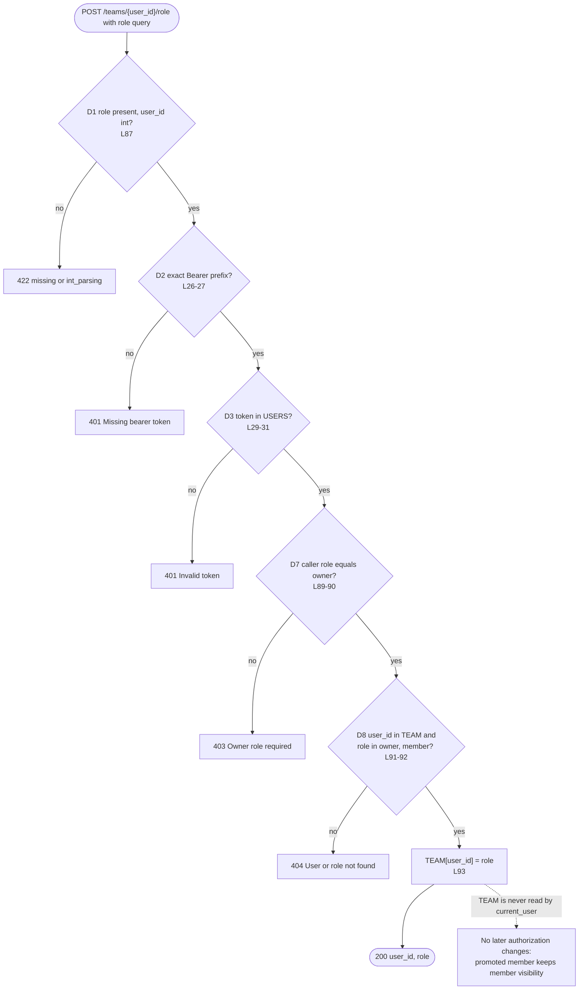

The two failure branches are deliberately indistinguishable at D8: an unknown user id and an unknown role produce the same status and the same detail, so the refusal discloses nothing about which condition failed. The role gate at D7 reads `USERS`, which no handler writes, so the only way to obtain the gate's permission is to present the owner token.

### 4.4.4 Usage Metering and Quota Flow (F-006)

The quota is one counter shared by every principal, with no period, no key and no reset endpoint.

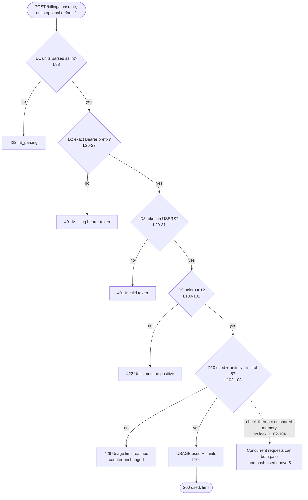

The comparison is strict (`>`), so reaching the ceiling exactly is allowed: from `used = 4`, `units = 1` returns `200` and `used = 5`; the next request of any positive size returns `429`. Neither refusal carries a `Retry-After` header, and no server-side path restores the counter except a process restart. Because the principal is authenticated and discarded (line 99), the flow has no per-caller branch at all — either token can exhaust the quota the other depends on.

### 4.4.5 Operational Probe and Metrics Flow (F-001, F-007)

The three unauthenticated routes are terminal: they read no state and cannot fail once the framework has routed them.

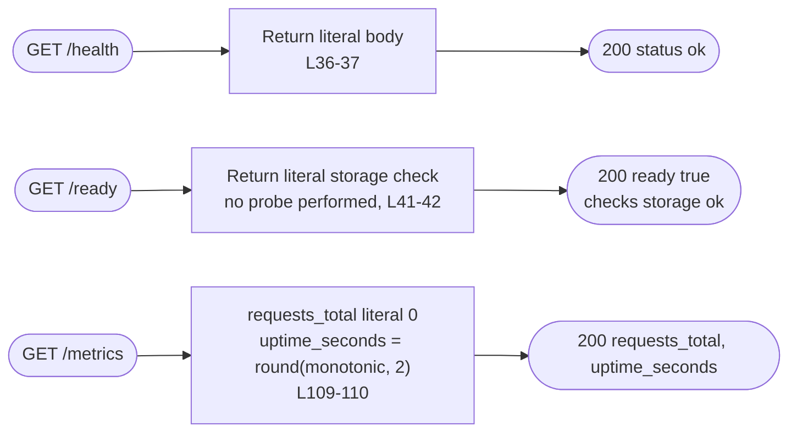

No credential edge enters these routes, so a diagram that routes them through the authentication ladder is wrong. Both probe bodies are literals, which is why `/ready` cannot report a storage failure and why `/metrics` reports `requests_total` of `0` after any volume of traffic — no instrumentation exists anywhere in the repository. The `uptime_seconds` figure derives from the platform monotonic clock rather than process start; an observed value of `3327814.18` on a process started seconds earlier shows the difference.

### 4.4.6 Error Handling Flowchart

One diagram covers every failure the system can produce and places them in the precedence the code actually applies: routing, then framework validation, then authentication, then business rules.

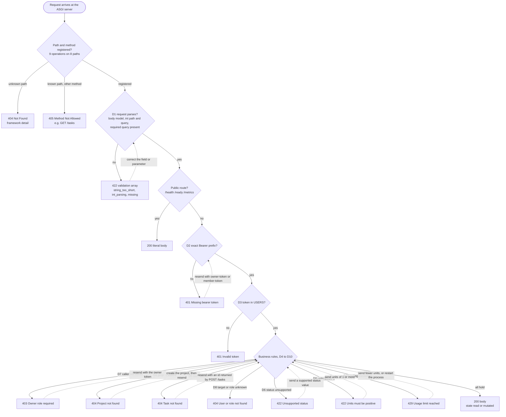

| Failure class | Recoverable by the caller | Recovery edge the diagram carries |
|---|---|---|
| `401` (both details) | Yes, deterministically | Supply one of the two seeded tokens; no refresh or issuance path exists |
| `403` | Yes, by switching principal | Supply the owner token; no route grants the role the gate reads |
| `404` on a project reference | Yes, after a prerequisite | Create the project, then reuse its id |
| `404` on a task reference | Yes, after a prerequisite | Use an id returned by a successful `POST /tasks` |
| `404` on a team target | Only by choosing a seeded user id | `TEAM` is seeded with users `1` and `2` |
| `422` validation array | Yes | Correct the body field, path type or query parameter |
| `422` business values | Yes | Send a supported status, or `units` of at least `1` |
| `429` | Partly | Reduce `units` if headroom remains; otherwise only a process restart clears the counter |
| `405` / unrouted `404` | No | No operation exists; the contract is nine routes |

No edge in this diagram leads to a retry, a queue, a fallback or a notification, because the code contains none. The only server-side remediation in the system is restarting the process, which resets every container described in 4.3.1.

### 4.4.7 State Transition Diagrams

Two records carry a meaningful state model. The task model has every transition, because the code validates the target value but never the source; the quota model is monotonic until the process ends.

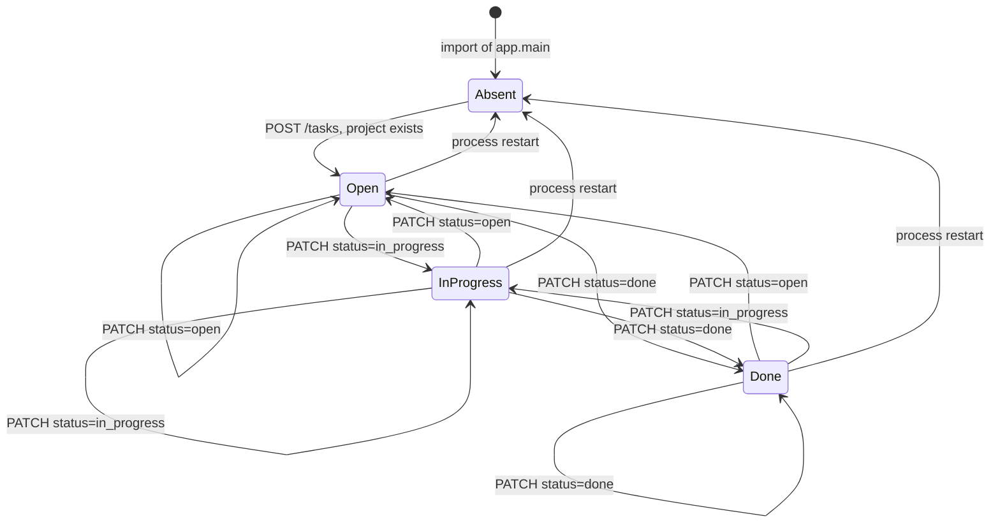

The twelve transitions are the Cartesian product of the three statuses, which is the point: no edge is forbidden, so a completed task can be reopened and no history of the reversal is kept. Two further states never appear because no code creates them — `closed`, `blocked` or any other value is refused at D6 with `422 Unsupported status`, and the refusal leaves the record in its previous state. Project records have no diagram because they have no transition: created once, never updated, never deleted.

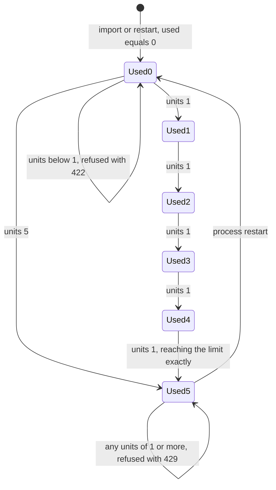

Intermediate values are reachable only through the accepted increments shown; a single request may jump directly from any value to any higher one up to `5`, which is why the `units 5` edge leaves `Used0`. The counter never decreases while the process lives, no key separates one principal's consumption from another's, and the `limit` field is likewise never written. The only exit from `Used5` back to `Used0` is the restart edge, the system's sole recovery mechanism.


## 4.5 References

- `app/main.py` — the entire runnable service in 110 lines: `FastAPI` instance and version (L5), the seven state names including `USERS`, `PROJECTS`, `TASKS`, `TEAM`, `USAGE`, `NEXT_PROJECT`, `NEXT_TASK` (L7–13), request models `ProjectIn` and `TaskIn` (L16–22), the `current_user` helper (L25–32), and the nine route handlers of L35–110 that supply every process step, decision point and error outcome documented here.
- `tests/test_api.py` — the in-process `TestClient` harness, the `OWNER` header literal, the three collected tests (L14–26) and the `setup_function` state reset (L8–11) that defines the only repeated sequence in the repository.
- `pytest.ini` — test discovery configuration (`testpaths = tests`, `python_files = test_*.py`) that fixes the batch sequence described in 4.1.2.
- `requirements.txt` — the four exact pins (`fastapi==0.115.12`, `uvicorn==0.34.0`, `pytest==8.3.5`, `httpx==0.28.1`) that bound the runtime and test boundaries.
- `README.md` — the declared purpose as a synthetic QA fixture (L3), the in-memory and self-contained operating model (L9, L28), the `uvicorn app.main:app --reload` entry point (L16), the `/docs` reference (L18), and the non-production warning (L30–31) that establishes the absence of regulatory obligations.
- `app/__init__.py` — byte-for-byte empty, establishing that importing the package does not start the service, so startup consists of importing `app.main` alone.
- `app/` — flat package containing the single runtime module and no layers between handlers and state.
- `tests/` — the repository's only verification surface, with no `conftest.py`, fixtures or helper modules.

Verification performed against the code in this repository: `pytest -q` collected three tests and reported `3 passed`; the full request matrix (all nine operations, both seeded tokens, missing and malformed credentials, invalid bodies, unsupported statuses, unknown ids, quota boundary at five units, concurrent-free sequencing) was issued through `fastapi.testclient.TestClient` against `app.main:app`, and every status code, `detail` string, state mutation and ordering claim in this section was observed rather than inferred. No web sources were consulted; every statement derives from the files listed above and from these executions.


# 5. System Architecture

## 5.1 High-Level Architecture

### 5.1.1 System Overview

**Architecture style.** The service is a single-process, single-module, synchronous ASGI monolith. The five concerns normally separated into tiers — HTTP routing, request validation, credential resolution, business rules and data storage — are declared together in `app/main.py` (111 lines). `app/__init__.py` is byte-for-byte empty and the only other code in the repository is the 27-line module `tests/test_api.py`; there is no `routers/`, `services/`, `repositories/` or `schemas/` package, no configuration file, and no outbound network call anywhere in the Python source. Operationally the system is two tiers: an ASGI server process (uvicorn 0.34.0) and the application object that process hosts. The data tier is the process heap, so the store shares the application's lifetime exactly.

**Rationale.** `README.md` line 3 describes the artifact as "a compact FastAPI service designed as a test fixture for repository-level proactive insights", and lines 30–31 make that framing binding: "This is a synthetic QA fixture, not a production application ... Do not deploy it or use real credentials." Under that constraint, structural minimalism is the requirement rather than a compromise: every architectural claim in this section is verifiable by reading two files, and each deliberate weakness — process-local state, literal tokens, absent logging — stays small enough to adjudicate. The consequences of that choice are recorded per decision in 5.3.

**Key architectural principles and patterns.**

| Principle | Realisation | Evidence |
|---|---|---|
| Annotation is the contract | Two Pydantic models plus typed handler parameters are the only schema definition; FastAPI renders OpenAPI 3.1.0 from them | `app/main.py` L16–22, L75, L87, L98; `app.openapi()["openapi"] == "3.1.0"` |
| Explicit guard instead of dependency injection | Each protected handler declares an optional `Authorization` header and calls `current_user()` as its first statement; no `Depends`, `Security`, `middleware` or router-level dependency exists (zero matches for each; `app.router.dependencies == []`) | `app/main.py` L25–32, L46, L56, L62, L75, L87, L98 |
| One error channel | Every business-rule failure is a raised `HTTPException(status, detail)`; the repository contains no `try` and no `except` | `app/main.py` L27, L31, L66, L79, L81, L90, L92, L101, L103 |
| State as module globals | Seven objects created at import time act as both wiring and store; handlers mutate them in place | `app/main.py` L7–13, L50, L69, L82, L93, L104 |
| Uniform synchronous execution | All nine handlers are plain functions, so Starlette dispatches them through its thread pool rather than an event loop | `app/main.py` (nine `@app.` decorators, no `async def`); installed `starlette/routing.py` L66 |
| Documentation as a generated surface | `/openapi.json`, `/docs`, `/redoc` and `/docs/oauth2-redirect` are framework-supplied routes, not handlers | route-table inspection of the `app` object |
| Testability by shared process state | The suite imports the application's own globals and clears them between tests instead of using fixtures or a database | `tests/test_api.py` L2, L8–11 |

**System boundaries and major interfaces.**

- **Inbound boundary — HTTP over ASGI.** `README.md` line 16 starts the service as `uvicorn app.main:app --reload` with no `--host`, `--port` or `--workers`, so the documented address is uvicorn's default loopback bind, `http://127.0.0.1:8000/docs` (line 18). The listening socket is the only ingress: there is no message consumer, scheduler, CLI or background job in the repository.
- **Public API interface.** Nine routes are registered over five capabilities (project, task, team, usage, operations); six of them pass through the bearer guard and `/health`, `/ready` and `/metrics` do not. Their parameters and status codes are enumerated from `app/main.py` L35–110 and analysed in `1.2 System Overview` and `4.3 Technical Implementation`; architecturally, the salient fact is that the surface has no version prefix while the OpenAPI document advertises `version="1.0.0"` purely as metadata (L5).
- **Internal interface — the module namespace.** `tests/test_api.py` line 2 imports `app, PROJECTS, TASKS, USAGE` and its `setup_function` (L8–11) clears them. That is the system's only internal module boundary, and it is crossed by reaching into globals rather than through a defined interface, which makes the store's shape part of the test contract (see 5.4.5).
- **Outbound boundary — none from Python.** No HTTP client, socket, file or subprocess is opened by application code. The only egress in the product is browser-side: the rendered `/docs` HTML references `swagger-ui-dist@5` CSS and JavaScript on `cdn.jsdelivr.net` plus a favicon on `fastapi.tiangolo.com`, and `/redoc` references `redoc@next` on the same CDN plus Google Fonts. The API therefore works offline while its documentation UI does not.
- **Trust boundary.** The `Authorization` header is the only identity input. Past the guard, any code path can read or mutate every record; there is no per-record ownership enforcement on tasks or billing (5.4.4).

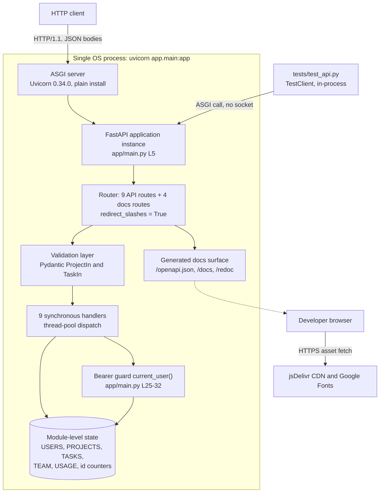

### 5.1.2 Core Components Table

There is no deployment separation inside the process, so a "component" here is a responsibility boundary declared in `app/main.py`, plus the two components that sit outside it (the ASGI host and the test harness). Components 1–11 are runtime; component 12 exists only under pytest.

| Component | Primary responsibility | Key dependencies |
|---|---|---|
| 1. ASGI runtime host (`uvicorn app.main:app`) | Hosts the application, accepts TCP, parses HTTP/1.1, emits server output | uvicorn 0.34.0 with its base dependencies (`click`, `h11`); no `[standard]` extra |
| 2. Application instance and router (`app`, L5) | Registers 9 API routes and 4 framework routes; owns OpenAPI metadata | FastAPI 0.115.12, Starlette 0.46.2 |
| 3. Request-validation layer (`ProjectIn` L16–17, `TaskIn` L20–22) | Rejects malformed or out-of-range input before any handler statement executes; produces the framework 422 body | pydantic 2.14.2, imported directly at L2 but pinned only transitively |
| 4. Authentication guard (`current_user`, L25–32) | Converts a bearer header into a `USERS` record, or raises 401 | `USERS` map (L7) |
| 5. Project handlers (`create_project` L45–52, `list_projects` L55–58) | Create a project with a server-assigned id; list the projects a caller may see | guard, `PROJECTS`, `NEXT_PROJECT` |
| 6. Task handlers (`create_task` L61–71, `update_task` L74–83) | Create an `open` task on an existing project; transition its status | guard, `PROJECTS`, `TASKS`, `NEXT_TASK` |
| 7. Team administration handler (`change_role` L86–94) | Owner-only write of a role into `TEAM` | guard, caller role from `USERS`, `TEAM` |
| 8. Usage metering handler (`consume_usage` L97–105) | Meter `units` against the fixed limit of 5; refuse overspend with 429 | guard, `USAGE` |
| 9. Operational probe handlers (`health` L35–37, `readiness` L40–42, `metrics` L108–110) | Return static liveness and readiness bodies; report a request count and an uptime value | `time.monotonic` only |
| 10. In-memory state store (L7–13) | Holds all identity, project, task, role and usage data for the process lifetime | none; Python built-ins only |
| 11. Generated documentation surface (4 routes) | Serves the OpenAPI 3.1.0 document and the Swagger UI / ReDoc pages | FastAPI defaults; the browser fetches CDN assets |
| 12. Test harness (`tests/test_api.py`) | Drives the real application in-process; resets three stores between tests | pytest 8.3.5, httpx 0.28.1, `fastapi.testclient` |

| Component | Integration points | Critical considerations |
|---|---|---|
| 1. ASGI runtime host | Sole ingress; forwards every request into the router | Single process, so state is never shared; no host, port or worker setting exists in the repository |
| 2. Application instance and router | Called by uvicorn and by `TestClient`; serves the docs routes it registers | No user middleware (`app.user_middleware == []`); three default exception handlers; `debug` is False |
| 3. Request-validation layer | Invoked by the router before handlers; emits 422 | Validates only `name`, `title` and `project_id`; business rules stay imperative (L80, L91, L100) |
| 4. Authentication guard | Called explicitly at L48, L57, L64, L76, L88, L99 | Case-sensitive `"Bearer "` prefix, no expiry, no revocation, no `WWW-Authenticate` header |
| 5. Project handlers | Write and read `PROJECTS` | Listing filters on `owner_id` or role `owner` (L58); no update or delete operation exists |
| 6. Task handlers | Write and read `TASKS`; read `PROJECTS` for the existence check | Neither route checks ownership; `status` is a query parameter, not a body field (L75) |
| 7. Team administration handler | Writes `TEAM` | `TEAM` is never read by the guard, so a role change alters no access decision (verified: owner promotes user 2, `USERS` unchanged) |
| 8. Usage metering handler | Reads and writes `USAGE` | Quota is global, not per user: any valid token spends the same 5 units |
| 9. Operational probe handlers | Reached without credentials | `/ready` reports a literal `storage: ok`; `/metrics` returns a constant 0 and a boot-relative monotonic value |
| 10. In-memory state store | Read and written by handlers and by the test harness (L2, L8–11) | Process-local, unsynchronised, unbounded growth, lost on restart (see `3.5 Databases & Storage`) |
| 11. Generated documentation surface | Reached by browsers; generated from the router's routes | Documents only 200 and 422 per route; 401, 403, 404 and 429 are undocumented and no `securitySchemes` are declared |
| 12. Test harness | Imports the app object and three globals; opens no socket | Shares process state with the application; resets `PROJECTS`, `TASKS` and `USAGE["used"]` but not `TEAM` or the id counters |

### 5.1.3 Data Flow Description

**Request pipeline.** Every API request traverses six stages in a fixed order; the order itself is the architecture, because no middleware or dependency layer can reorder or short-circuit them.

1. **Transport.** uvicorn accepts the TCP connection, parses HTTP/1.1 through `h11`, and hands an ASGI scope to the application.
2. **Routing.** Starlette's router matches method and path against the 13 registered routes. `redirect_slashes` is True, so `GET /health/` answers 307 to `/health`; an unmatched path yields `404 {"detail":"Not Found"}` and a known path with the wrong method yields 405 (verified for `GET /tasks`).
3. **Validation.** Body routes bind JSON to `ProjectIn` or `TaskIn`; scalar parameters are coerced into `task_id: int`, `status: str`, `role: str`, `units: int = 1` and the optional `authorization` header. Failure returns the framework 422 array (`{"detail": [{"type": "string_too_short", ...}]}`) before any handler statement runs.
4. **Authentication.** The handler's first statement calls `current_user()`, which converts the header into a `USERS` record or raises 401.
5. **Domain work.** The handler reads and mutates the module globals under inline rules.
6. **Serialisation.** The returned dict or list is rendered as JSON with status 200. No route sets `status_code`, so nothing in the system answers 201 or 204.

**Flow by capability.**

| Flow | Path through components | State effect | Response |
|---|---|---|---|
| Create project | Router → `ProjectIn` → `create_project` → guard → store | `PROJECTS[NEXT_PROJECT]` insert, then counter increment (L50–51) | 200 with the stored dict, including `owner_id` from the token |
| List projects | Router → `list_projects` → guard → store scan | none | 200 with a filtered list; empty list when a member owns nothing |
| Create task | Router → `TaskIn` → `create_task` → guard → project existence → store | `TASKS[NEXT_TASK]` insert with `status: "open"`, then counter increment (L69–70) | 200 with the task, or 404 `Project not found` |
| Update task | Router → `update_task` → guard → task lookup → status allow-list → in-place mutation | `TASKS[id]["status"]` overwritten (L82) | 200 with the mutated task, or 404 / 422 |
| Change role | Router → `change_role` → guard → owner check → target validation → store | `TEAM[user_id]` overwritten (L93) | 200 with `user_id` and `role`, or 403 / 404 |
| Consume usage | Router → `consume_usage` → guard → positivity check → ceiling check → increment | `USAGE["used"]` increased (L104) | 200 with the usage dict, 422, or 429 |
| Probes and metrics | Router → handler | none | Static bodies; `/metrics` reports `requests_total: 0` |

**Integration patterns and protocols.** Transport is request/response HTTP/1.1 with JSON bodies and JSON responses; there is no streaming, long-polling, webhook, event or queue. Credentials are re-supplied on every call, since no cookie, session or middleware exists to carry state between requests. The test path swaps the socket for an in-process ASGI transport (`fastapi.testclient.TestClient` over httpx), so routing, validation, guard and handlers execute identically without uvicorn.

**Data transformation points.**

| Transformation | Input shape | Output shape | Location |
|---|---|---|---|
| Body binding | JSON object | `ProjectIn` / `TaskIn` instance | Framework, driven by L16–22 |
| Record construction | Validated model plus guard record | Flat dict with server-assigned `id` and derived `owner_id` or `created_by` | L49, L67–68 |
| Identity resolution | Raw header string | `{"id": int, "role": str}` from `USERS` | L25–32 |
| Error rendering | `HTTPException` or validation error | `{"detail": ...}` with the exception's status | Framework exception handlers; nine raise sites |
| Response rendering | Live dict or list of dicts | JSON document | Return statements at L37, L42, L52, L58, L71, L83, L94, L105, L110 |

**Key data stores and caches.** Seven module-level objects hold all state: `USERS` (token → id and role, never mutated), `PROJECTS` (int id → record), `TASKS` (int id → record), `TEAM` (user id → role, written but never read outside its own handler), `USAGE` (`used` plus a constant `limit` of 5), and the `NEXT_PROJECT` / `NEXT_TASK` allocators rebound through `global`. There is no cache layer, no TTL and no index beyond the dictionary key — a task carries `project_id` but no per-project collection exists, and nothing evicts or deletes. Handlers return the stored objects themselves rather than copies (`create_project` L49–52, `update_task` L82–83, `list_projects` L58), so a response is a serialisation-time snapshot of live memory; no read path ever prefers a cached copy over the store. Because every handler runs on the thread pool and no lock exists, multi-statement sequences such as the ceiling check at L102 followed by the increment at L104 are check-then-act windows (details in `3.5.5` and `4.3.1`).

### 5.1.4 External Integration Points

No outbound business integration exists: the Python code opens no socket, reads no file and calls no third-party API (zero matches for `requests.`, `httpx` usage inside `app/`, `open(` and `os.environ`). The integration surface is therefore inbound transport, the test transport, and the browser-side asset dependencies of the documentation pages.

| System name | Integration type | Protocol and format |
|---|---|---|
| HTTP API consumers | Inbound synchronous request/response | HTTP/1.1 over the uvicorn socket; JSON bodies and JSON responses; bearer token in the `Authorization` header |
| Uvicorn ASGI server | In-process hosting contract | ASGI3 callable `app.main:app`; server invoked from the command line only (`README.md` L16) |
| pytest `TestClient` over httpx | In-process test transport | ASGI call with no socket; JSON request and response objects |
| Developer browser and Swagger UI assets | Outbound, browser-originated | HTTPS GET of `swagger-ui-dist@5` and `redoc@next` bundles from `cdn.jsdelivr.net`, plus a favicon and Google Fonts |
| Python package index | Build-time artifact retrieval | HTTPS via `pip install -r requirements.txt` (`README.md` L15); four exact pins, no private index or hash verification |

| System name | Data exchange pattern | SLA requirements |
|---|---|---|
| HTTP API consumers | Caller-initiated, one request per response; no retry, idempotency key or backpressure mechanism on the server side | None stated. No timeout, retry, rate limit or availability target appears anywhere in the repository |
| Uvicorn ASGI server | One process serves all requests; no worker pool configuration, no health-driven restart | None stated; the documented command is a development invocation with `--reload` |
| pytest `TestClient` over httpx | Synchronous in-process calls sharing the application's globals | Three tests, expected to pass in well under a second (observed: 3 passed in 0.07s) |
| Browser and Swagger UI assets | One-shot page load fetching third-party bundles; no pinning of the CDN assets in the repository | None stated; `/docs` and `/redoc` degrade without internet access |
| Python package index | One-shot install at environment build time | None stated; no lockfile, no hashes, no vulnerability gate |

There is no identity provider, API gateway, database, cache, message broker, mail or payment service to enumerate. The `POST /billing/consume` route is a local counter against a hard-coded limit of 5, not an integration with a billing system, and `POST /teams/{user_id}/role` mutates a local dictionary rather than calling a directory service.


## 5.2 Component Details

### 5.2.1 ASGI Runtime Host and Application Instance

- **Purpose and responsibilities.** Uvicorn hosts the application object; the object itself registers all 13 routes, owns the OpenAPI metadata (`title="Proactive Insights Demo API"`, `version="1.0.0"`) and carries the three default exception handlers. Together they form the entire runtime: there is no worker manager, no reverse proxy and no process supervisor in the repository.
- **Technologies and frameworks.** uvicorn 0.34.0 pinned as a plain distribution (`requirements.txt` L2), so HTTP parsing uses `h11` and the reload supervisor falls back to stat polling; FastAPI 0.115.12 on Starlette 0.46.2 (`app/main.py` L1, L5).
- **Key interfaces and APIs.** The ASGI3 callable `app.main:app` invoked as `uvicorn app.main:app --reload` (`README.md` L16); no factory function, no `--host`, `--port` or `--workers` flag, and no `__main__` block. `app.user_middleware` is empty, `app.router.dependencies` is empty and `app.debug` is False, so no request passes through application-installed middleware.
- **Data persistence requirements.** None. The host holds no state; everything the system remembers lives in the module globals of the imported module, which is why a reload is a full reset.
- **Scaling considerations.** Serving is single-process by default. Because state is process-local, adding uvicorn workers would give each worker an independent copy of `PROJECTS`, `TASKS`, `TEAM` and `USAGE`, re-issue ids from 1 and multiply the effective 5-unit quota — the single strongest constraint on horizontal scale in the system.

### 5.2.2 Request Validation Layer

- **Purpose and responsibilities.** Convert JSON bodies and scalar parameters into typed Python values, and reject anything out of contract before a handler body executes. It is the only declarative rule layer in the system.
- **Technologies and frameworks.** pydantic 2.14.2, imported directly at `app/main.py` L2 but absent from `requirements.txt`, so its resolution is decided by FastAPI's declared range (`>=1.7.4,<3.0.0`). Field bounds come from `Field(min_length=2, max_length=80)` for `ProjectIn.name` and `Field(min_length=2, max_length=120)` for `TaskIn.title`, with `TaskIn.project_id` typed as `int` (L16–22).
- **Key interfaces and APIs.** Framework-generated 422 responses with a `detail` array whose entries carry `type`, `loc`, `msg`, `input` and `ctx` (observed: `string_too_short` for `{"name": "x"}`). Scalar coercion covers `task_id: int` and `user_id: int` from the path, `status: str`, `role: str` and `units: int = 1` from the query, and the optional `authorization` header.
- **Data persistence requirements.** None; the models are transient request-scoped values and no stored record is modelled by a Pydantic class.
- **Scaling considerations.** Stateless and cheap, but the boundary is thin: only three fields are validated here, while status allow-lists (L80), role allow-lists (L91) and unit positivity (L100) are enforced imperatively inside handlers, so the contract is split across two mechanisms and neither OpenAPI nor the models express the business rules.

### 5.2.3 Authentication Guard

- **Purpose and responsibilities.** Resolve the caller's identity from a bearer token and refuse the request when it cannot. It is the only authentication mechanism in the system and it is invoked by convention, not by the framework.
- **Technologies and frameworks.** Plain Python on `fastapi.HTTPException`: `str.startswith("Bearer ")` followed by `str.removeprefix` and a `USERS` dictionary lookup (L25–32). No dependency injection, no `Security` scheme, no OAuth2 or JWT handling, no password hashing, and no `securitySchemes` entry in the generated OpenAPI document.
- **Key interfaces and APIs.** `current_user(authorization: str | None)` returning `{"id": int, "role": str}`; raises `401 Missing bearer token` when the header is absent or lacks the exact prefix (L26–27) and `401 Invalid token` when the token is not a `USERS` key (L30–31). Callers are the six protected handlers, each passing its own `Header(default=None)` value (L48, L57, L64, L76, L88, L99).
- **Data persistence requirements.** Reads `USERS` only (L7); the map is a literal seed with two entries (`owner-token` → id 1, `member-token` → id 2) and nothing in the codebase ever writes to it, so identities are fixed for the process lifetime.
- **Scaling considerations.** Verification is a constant-time dictionary lookup with no external call, so it adds no latency and needs no shared cache. The limits are horizontal rather than vertical: tokens are identical in every replica, cannot be rotated without a code change, and the prefix comparison is case-sensitive (verified: `bearer owner-token` is rejected), so no standard client normalisation applies.

### 5.2.4 Project and Task Handlers

- **Purpose and responsibilities.** The business core: `create_project` (L45–52) allocates an id and stamps the caller as owner; `list_projects` (L55–58) projects the store down to what the caller may see; `create_task` (L61–71) creates an `open` task against an existing project; `update_task` (L74–83) transitions a task's status.
- **Technologies and frameworks.** FastAPI decorators `@app.post`/`@app.get`/`@app.patch` on synchronous functions; `Header`, `HTTPException` and the `global` statement are the only mechanisms used. No service, repository or transaction abstraction sits between handler and dictionary.
- **Key interfaces and APIs.** `POST /projects` with a `ProjectIn` body; `GET /projects` with no parameters beyond the header; `POST /tasks` with a `TaskIn` body; `PATCH /tasks/{task_id}` with `task_id` in the path and `status` as a **required query parameter**, not a body field (L75). Errors: 404 `Project not found` (L66), 404 `Task not found` (L79), 422 `Unsupported status` (L81).
- **Data persistence requirements.** `PROJECTS` keyed by integer id with the record shape `{"id", "name", "owner_id"}`; `TASKS` keyed by integer id with `{"id", "title", "project_id", "created_by", "status"}`; `NEXT_PROJECT` and `NEXT_TASK` counters rebound through `global` (L47, L51, L63, L70). Nothing is written to disk and nothing is deleted.
- **Scaling considerations.** `list_projects` is an O(n) scan of every project on each call with no index (L58), and the visibility rule itself is asymmetric: a member sees only projects whose `owner_id` matches, while any caller whose token carries role `owner` sees the whole store. Neither task route checks ownership or project membership, so any valid token can create a task on any project and patch any task by id. The unsynchronised read-modify-write on the counters (L47–51, L63–70) allows two concurrent creators to reuse an id.

### 5.2.5 Team Administration and Usage Metering Handlers

- **Purpose and responsibilities.** `change_role` (L86–94) writes a role for a target user behind an owner-only gate; `consume_usage` (L97–105) meters consumption against the fixed limit of 5 and refuses overspend.
- **Technologies and frameworks.** Synchronous FastAPI handlers with query-parameter coercion (`role: str`, `units: int = 1`) and inline `HTTPException` gates. No role-management service, no metering table, no clock or period boundary.
- **Key interfaces and APIs.** `POST /teams/{user_id}/role?role=...` — owner required (403 `Owner role required`, L90), target and role validated (404 `User or role not found`, L92). `POST /billing/consume?units=N` — `units` defaults to 1 (L98), a value below 1 yields 422 `Units must be positive` (L101), and crossing the ceiling yields 429 `Usage limit reached` (L103).
- **Data persistence requirements.** `TEAM` (user id → role) and `USAGE` (`used`, `limit`). Both are process-local; `USAGE["limit"]` is a constant no handler writes and `USAGE["used"]` only ever increases.
- **Scaling considerations.** Two structural gaps govern this component. First, `TEAM` is written but never read by any authorization decision: the guard consults `USERS`, so promoting user 2 to `owner` returns success while `USERS["member-token"]["role"]` stays `member` (verified) — role administration is architecturally disconnected from enforcement. Second, usage is global rather than per user or per tenant, and the ceiling test at L102 and increment at L104 are separate statements executed on the thread pool, so concurrent requests can both pass the check and overshoot the limit. Only a process restart resets `used`.

### 5.2.6 Operational Probe Handlers

- **Purpose and responsibilities.** Give an orchestrator or scanner something to call: `health` (L35–37), `readiness` (L40–42) and `metrics` (L108–110).
- **Technologies and frameworks.** FastAPI `@app.get` on synchronous functions. `/metrics` uses `time.monotonic` (imported at L3) and `round(..., 2)`; no metrics library, exporter or instrumentation hook exists.
- **Key interfaces and APIs.** `GET /health` returns `{"status": "ok"}`; `GET /ready` returns `{"ready": true, "checks": {"storage": "ok"}}`; `GET /metrics` returns `{"requests_total": 0, "uptime_seconds": <float>}`. All three are unauthenticated.
- **Data persistence requirements.** None — every value is a literal apart from the monotonic reading.
- **Scaling considerations.** The probes are honest about liveness but not about health: `/ready` reports a constant storage check rather than interrogating any store, `requests_total` is the literal `0` regardless of traffic, and `uptime_seconds` is `time.monotonic()`, which on Linux counts from host boot (observed 3328049.99 seconds, roughly 38 days, immediately after start). A monitor reading these values would therefore conclude the service is idle and long-lived while it is being exercised.

### 5.2.7 In-Memory State Store

- **Purpose and responsibilities.** Hold every record the system knows: identity seeds, projects, tasks, team roles, usage and id allocation (L7–13).
- **Technologies and frameworks.** Python built-in `dict` and `int` objects created at import time. No ORM, driver, schema, migration or serialisation library is involved, and the record shapes exist only as dictionary literals written by handlers (L49, L67–68).
- **Key interfaces and APIs.** Not an API but a namespace: handlers mutate it by item assignment, and the test harness reaches it through `from app.main import app, PROJECTS, TASKS, USAGE` (`tests/test_api.py` L2) then clears it in `setup_function` (L8–11).
- **Data persistence requirements.** None by design. Lifetime equals process lifetime; there is no write path to disk, no snapshot, no export and no retention or eviction rule. Restart restores the seeded values only.
- **Scaling considerations.** Because the store is the process, every scaling property is inverted: replicas cannot share data, restarts lose everything, memory grows without bound as records accumulate, and concurrent access is unsynchronised even though handlers run on multiple threads. The full inventory and lifecycle analysis is in `3.5 Databases & Storage`.

### 5.2.8 Generated Documentation Surface

- **Purpose and responsibilities.** Expose the contract the code declares. FastAPI registers `GET`/`HEAD` routes for `/openapi.json`, `/docs`, `/docs/oauth2-redirect` and `/redoc`, all served from the same router as the API.
- **Technologies and frameworks.** FastAPI's built-in OpenAPI 3.1.0 generator plus its bundled Swagger UI and ReDoc HTML; `title` and `version` from L5 populate the document's `info` block.
- **Key interfaces and APIs.** `/openapi.json` returns a document whose `components` contain only `schemas` — no `securitySchemes` — whose six authenticated routes declare `authorization` as an optional header parameter, and whose documented responses are limited to `200` and `422`. The 401, 403, 404 and 429 paths that the handlers actually raise appear nowhere in the document.
- **Data persistence requirements.** None; the document is generated per request from the route table.
- **Scaling considerations.** Static and cacheable, but the pages are not self-contained: the rendered HTML references `swagger-ui-dist@5` assets on `cdn.jsdelivr.net`, a favicon on `fastapi.tiangolo.com` and Google Fonts for ReDoc, so an air-gapped deployment loses the documentation UI even though the API remains reachable. As a contract artifact the surface is also incomplete by construction: query-parameter placement of `status` and `role` and the undocumented error statuses make the generated document a weaker description of the API than `app/main.py` itself.

### 5.2.9 Test Harness

- **Purpose and responsibilities.** Verify a subset of the contract in-process and prove that the application boots.
- **Technologies and frameworks.** pytest 8.3.5 configured by `pytest.ini` (`testpaths = tests`, `python_files = test_*.py`), `fastapi.testclient.TestClient` over httpx 0.28.1, and plain `assert` statements. There is no `conftest.py`, no fixture module and no plugin.
- **Key interfaces and APIs.** One module-scope client (`client = TestClient(app)`, L4), one credential dictionary (`OWNER = {"Authorization": "Bearer owner-token"}`, L5), a `setup_function` that clears `PROJECTS` and `TASKS` and resets `USAGE["used"]` (L8–11), and three tests: `GET /health` body equality (L14–15), owner project create plus list id round-trip (L18–22), and anonymous rejection (L25–26).
- **Data persistence requirements.** None of its own; it depends on the application's globals and mutates them, which is why the reset hook exists.
- **Scaling considerations.** Coverage is deliberately partial: of nine handlers only three are asserted, and no test covers `/ready`, either task route, role administration, quota denial, member visibility or metrics. The suite shares process state with the application, so tests are order-sensitive by construction and the reset is mandatory; it does not reset `TEAM` or the id counters, so no assertion may depend on a literal id.

### 5.2.10 Component Interaction Diagram

The diagram shows which components may call which. Two edges are notable: the guard sits between handlers and the identity store rather than in front of the router (a handler can forget to call it), and the docs surface reads only the router, never the store.

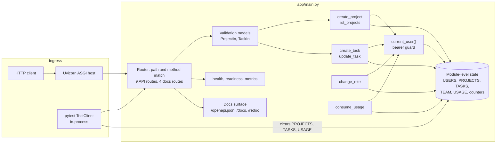

### 5.2.11 State Transition Diagrams

Only two entities in the system have a transition model: task records and the usage counter. Projects have no transition at all (created and thereafter immutable, since no update or delete handler exists), and `USERS` never transitions, which is exactly why role administration through `TEAM` cannot change access.

| Entity | States | Permitted transitions | Guarding rule |
|---|---|---|---|
| Task | absent, `open`, `in_progress`, `done` | absent → `open` at creation; then any state to any state, including self-transitions | Record must exist (L77–79) and the target must be in the three-value allow-list (L80–81) |
| Usage counter | 0 to 5 used units | `used` increases by `units` while `used + units <= 5`; never decreases | `units >= 1` (L100–101) and ceiling check (L102–103) |
| Project | created | none | no update or delete route exists |

```mermaid
stateDiagram-v2
    [*] --> Absent
    Absent --> Open: POST /tasks accepted (L67-71)
    Open --> InProgress: PATCH status=in_progress (L82)
    Open --> Done: PATCH status=done (L82)
    Open --> Open: PATCH status=open (L82)
    InProgress --> Open: PATCH status=open (L82)
    InProgress --> Done: PATCH status=done (L82)
    Done --> Open: PATCH status=open (L82)
    Done --> InProgress: PATCH status=in_progress (L82)
    Done --> Done: PATCH status=done (L82)
```

```mermaid
stateDiagram-v2
    [*] --> Available
    Available --> Available: consume accepted, used increases (L104)
    Available --> Rejected: used + units exceeds 5, returns 429 (L102-103)
    Rejected --> Available: caller retries with fewer units
    Available --> Exhausted: used reaches the limit of 5
    Exhausted --> Rejected: any further positive units
    Exhausted --> [*]: process restart resets used to 0
```

### 5.2.12 Sequence Diagrams for Key Flows

**Authenticated write that succeeds** — the only path that mutates two stores and one counter.

```mermaid
sequenceDiagram
    autonumber
    participant C as HTTP client
    participant U as Uvicorn
    participant R as Router
    participant V as Pydantic validation
    participant H as create_task handler
    participant G as current_user()
    participant S as Module state
    C->>U: POST /tasks with Bearer token and JSON body
    U->>R: ASGI scope and body
    R->>V: bind TaskIn
    V-->>R: TaskIn instance or 422 array
    R->>H: invoke handler on thread pool
    H->>G: authorization header value
    G->>S: USERS.get(token)
    S-->>G: user record or None
    G-->>H: id and role of the caller
    H->>S: project_id membership check (L65)
    H->>S: TASKS[NEXT_TASK] insert (L69)
    H->>S: NEXT_TASK increment (L70)
    H-->>C: 200 with the new task
```

**Rejection paths** — the guard fails before domain work, and a missing record fails after it.

```mermaid
sequenceDiagram
    autonumber
    participant C as HTTP client
    participant R as Router
    participant H as Protected handler
    participant G as current_user()
    participant S as Module state
    C->>R: GET /projects with no Authorization header
    R->>H: invoke list_projects
    H->>G: None
    G-->>H: raise HTTPException 401
    H-->>C: 401 Missing bearer token
    C->>R: PATCH /tasks/99?status=done with a valid token
    R->>H: invoke update_task
    H->>G: authorization header value
    G-->>H: user record
    H->>S: TASKS.get(99)
    S-->>H: None
    H-->>C: 404 Task not found
    C->>R: PATCH /tasks/1?status=blocked with a valid token
    H-->>C: 422 Unsupported status
```

**Quota exhaustion** — the check-then-act window that makes 429 advisory under concurrency.

```mermaid
sequenceDiagram
    autonumber
    participant C as HTTP client
    participant H as consume_usage
    participant S as USAGE dict
    C->>H: POST /billing/consume?units=2 with a valid token
    H->>S: read used and limit (L102)
    S-->>H: used = 4, limit = 5
    H-->>C: 429 Usage limit reached
    Note over C,H: A retry with units=1 is accepted because equality with the limit is allowed
    Note over H,S: The check at L102 and the increment at L104 are separate unsynchronised statements, so two concurrent callers can both pass the check and overshoot 5
```


## 5.3 Technical Decisions

### 5.3.1 Architecture Style: Flat Single-Module Monolith

**Context.** The artifact exists to be scanned, not operated (`README.md` L3, L30–31). The design goal is therefore that the whole system be readable, reproducible and defect-bearing in a bounded amount of code.

| Option | Verdict | Rationale and trade-off |
|---|---|---|
| Flat single-module monolith | Adopted | 111 lines hold routing, validation, guard, rules and state; any claim is checkable in one file. Trade-off: no seam at which storage or authentication could be replaced |
| Layered packages (routers, services, repositories, schemas) | Rejected | Would add four imports and indirection to a system whose longest function is eight statements, and would move the interesting decisions away from the endpoints a scanner reads |
| Microservices or separate auth/data services | Rejected | Each would need its own process, configuration and transport, contradicting "No external database or service is required" (`README.md` L9) |
| Serverless functions | Rejected | Module-global state would not survive between invocations, so project and usage behaviour would change |

**Decision.** One module, no layering inside it. Separation exists only as declaration order: application instance (L5), state (L7–13), models (L16–22), guard (L25–32), then handlers (L35–110).

**Consequences.** The design is maximally inspectable and minimally extensible. Every concern is coupled to every other: the guard is a plain function that handlers must remember to call, the store is a set of names any code can mutate, and a second module would immediately raise questions (shared state, duplicate `app` objects) that the current shape forbids.

### 5.3.2 Communication Pattern: Synchronous Request/Response over ASGI

**Context.** The only caller classes are HTTP clients and an in-process test client; no long-running work, no fan-out, no background processing exists.

| Option | Verdict | Rationale and trade-off |
|---|---|---|
| Synchronous handlers under ASGI | Adopted | Every handler is `def`, so Starlette runs it on the worker-thread pool; the code needs no `await`, and blocking dictionary access is safe for the event loop |
| `async def` handlers | Rejected | There is no I/O to await — no database, HTTP call, queue or file — so coroutines would add syntax without concurrency benefit and would expose shared dicts to interleaved event-loop execution |
| Message queue or event bus | Not present | Nothing in the repository produces or consumes events; usage metering is a local counter, not a published event |
| Streaming or webhooks | Not present | No handler returns a stream, `StreamingResponse`, `EventSource` or callback URL |

**Decision.** Plain request/response HTTP/1.1 with JSON bodies. The test transport substitutes an in-process ASGI call for the socket, which keeps the same code path under test.

**Consequences.** Because handlers run on a thread pool, concurrent requests execute on multiple threads against unsynchronised dictionaries: the id allocators (L47–51, L63–70) and the quota check-then-act (L102–104) are genuinely racy, and no transaction boundary exists to compensate. Latency is dominated by routing and serialisation, so the pattern is fast for the workload but unguarded for it.

### 5.3.3 Data Storage: Process-Local Dictionaries

**Context.** The fixture must run with no external service, and its data must be resettable so that repeated scans see the same starting state.

| Option | Verdict | Rationale and trade-off |
|---|---|---|
| Module-level dictionaries | Adopted | Zero dependencies, zero configuration, instant reset by restart or by `setup_function`; record shapes stay visible at the write site (L49, L67–68) |
| Embedded SQLite file | Rejected | Introduces a migration concern and persistent files between runs, and would make the test reset a file operation rather than a `clear()` |
| External relational database with an ORM | Rejected | Requires a server, connection configuration and a schema toolchain — all excluded by `README.md` L9 and absent from `requirements.txt` |
| Document store or key-value service | Rejected | Same exclusion; would also make `/ready`'s storage claim a real dependency |

**Decision.** Seven import-time objects own all state, and handlers are simultaneously the API surface and the persistence code.

**Consequences.** Durability, multi-replica consistency and concurrency safety are all absent by construction (full analysis in `3.5 Databases & Storage`). Two further effects are architectural rather than incidental: the module namespace becomes the test contract (`tests/test_api.py` L2, L8–11), and the response objects are the stored objects, so serialisation is the only copy boundary in the system.

### 5.3.4 Caching Strategy: No Cache Layer

**Context.** The fixture performs only dictionary reads and linear projections; the heaviest read is `list_projects`, an O(n) filter over every stored project (L58).

| Option | Verdict | Rationale and trade-off |
|---|---|---|
| No cache | Adopted | Every read is recomputed from authoritative in-memory state, so there is no invalidation problem and no stale-read class of defect; the store is already in the fastest memory available |
| Response cache or TTL cache | Rejected | Would duplicate data that is already local and introduce invalidation on four write paths for no measurable gain |
| Redis or Memcached | Rejected | An external service contradicts the self-contained requirement and would be the system's only real dependency |
| HTTP caching headers | Not present | No handler sets `Cache-Control`, `ETag` or `Last-Modified`; nothing about cacheability is expressed to clients |

**Decision.** No cache anywhere, and no cache metadata on responses. The only memoisation-like behaviour is definitional: the openapi document is generated per request from the route table.

**Consequences.** Read cost scales linearly with stored records and is paid on every request. The architecture is immune to cache-invalidation defects but is equally without any mechanism to defend a hot read path — acceptable here because the store is bounded by process memory and nothing deletes records.

### 5.3.5 Security Mechanism: Static Bearer Tokens with Inline Role Gates

**Context.** The system needs a visible, incomplete authorization story: enough authentication to exercise protected routes, structured weaknesses for a scanner to find.

| Option | Verdict | Rationale and trade-off |
|---|---|---|
| Opaque tokens in a literal map, resolved by a helper | Adopted | Two identities (`owner-token`, `member-token`) in one line (L7); the guard is eight lines and every failure mode is visible |
| FastAPI `Depends` with `Security` and an `HTTPBearer` scheme | Rejected | Would place the credential check in front of the handler automatically and register `securitySchemes` in OpenAPI, hiding the very gap the fixture exists to expose |
| OAuth2 / OIDC with an external identity provider | Rejected | An external service, plus client registration and token lifetime handling; incompatible with the self-contained requirement |
| JWT with signature verification and expiry | Rejected | Adds a key-management concern and removes the trivially guessable tokens the fixture depends on |

**Decision.** Raw `Authorization` header parsing with an exact `"Bearer "` prefix (L26–28), a `USERS` lookup (L29–31), and role checks written inline where they apply — `user["role"] != "owner"` for role administration (L89) and `user["role"] == "owner"` as a listing short-circuit (L58).

**Consequences.**

| Property | Implementation | Verified behaviour |
|---|---|---|
| Credential issuance | none | Tokens exist only as source literals; there is no route that creates, rotates or revokes one |
| Token lifetime | none | No expiry claim, no issued-at, no clock comparison anywhere |
| Failure signalling | `HTTPException(401, detail)` | Returns `{"detail": "..."}` with no `WWW-Authenticate` header, so no standard client challenge is emitted |
| Prefix handling | `str.startswith("Bearer ")` | Case-sensitive: `bearer owner-token` is rejected with 401 |
| Role source of truth | `USERS` | `TEAM` is written by `change_role` and read by nothing else, so role changes never affect access |
| Object-level authorization | none on tasks or billing | Any valid token can create a task on any project, patch any task, and spend the shared quota |
| Contract visibility | none | No `securitySchemes`; the `authorization` header appears as an optional parameter on six routes, and no 401/403 is documented |

### 5.3.6 Decision Tree Diagram

The tree reconstructs the decision path the architecture embodies, ending at the artifacts each branch produced. Following the fixture branch reproduces the repository exactly; the other branches mark where this design would stop being viable.

```mermaid
flowchart TD
    Q1{"Deliverable is a self-contained evaluation fixture?<br/>README L3, L30-31"}
    Q1 -->|"yes"| Q2{"Must records survive a process restart?"}
    Q1 -->|"no"| Elsewhere["A production architecture applies<br/>out of scope for this repository"]
    Q2 -->|"no"| D1["Process-local dictionaries<br/>ADR-003, L7-13"]
    Q2 -->|"yes"| ExtDB["External database and migrations required<br/>absent, see 3.5"]
    D1 --> Q3{"Is any read path expensive enough to cache?"}
    Q3 -->|"no"| D2["No cache layer, no cache headers<br/>ADR-004"]
    Q3 -->|"yes"| Cache["Cache plus invalidation on four write paths<br/>not present"]
    D2 --> Q4{"Do handlers perform awaitable I/O?"}
    Q4 -->|"no"| D3["Synchronous handlers on the thread pool<br/>ADR-006"]
    Q4 -->|"yes"| Async["Async handlers and cancellation handling<br/>not present"]
    D3 --> Q5{"Must the authorization contract be enforced by the framework?"}
    Q5 -->|"no"| D4["Inline guard call per handler<br/>ADR-005, L25-32"]
    Q5 -->|"yes"| Formal["Depends plus Security and securitySchemes<br/>absent, see 5.3.5"]
    D4 --> Q6{"Is observability owned by the platform or the app?"}
    Q6 -->|"app"| D5["Logging, tracing and real metrics<br/>absent"]
    Q6 -->|"platform"| D6["Static probes and constant metrics only<br/>ADR-009, L108-110"]
    D5 --> Outcome["Layered, operated service"]
    D6 --> Outcome2["This repository: 111-line fixture"]
```

### 5.3.7 Architecture Decision Records

| ID and decision | Context and rationale | Status | Consequences |
|---|---|---|---|
| ADR-001 Single-module monolith | Fixture must be adjudicable by reading two files; layering would relocate the decisions away from the endpoints | Accepted, implemented (L1–110) | No substitution seam; all concerns share one namespace |
| ADR-002 FastAPI 0.115.12 on uvicorn 0.34.0 | Type annotations supply validation, OpenAPI and `/docs` with four pinned packages and no configuration | Accepted (`requirements.txt`) | pydantic version delegated to FastAPI's range; docs UI depends on CDN assets |
| ADR-003 Process-local dictionaries for all state | No external service may be required, and reset must be trivial | Accepted (L7–13) | No durability, no multi-replica consistency, unsynchronised mutation, test coupling to globals |
| ADR-004 No cache layer and no cache metadata | Store already lives in process memory; invalidation would add defect surface without benefit | Accepted | Linear reads on every request; no defence of a hot read path |
| ADR-005 Raw bearer header with an explicit guard call | Framework-native security would automate enforcement and document the scheme, removing the intended gap | Accepted (L25–32) | Guard can be omitted by a handler; no securitySchemes; no expiry, revocation or `WWW-Authenticate`; tokens committed in source |
| ADR-006 Synchronous handlers | No awaitable I/O exists, and blocking dictionary access must not block an event loop | Accepted (nine `def` handlers) | Thread-pool dispatch with no locking, so id allocation and quota checks are racy |
| ADR-007 Uniform 200 responses, no `response_model` | Returning the stored dict keeps handler and contract identical and the code short | Accepted (no `status_code=` or `response_model` anywhere) | No 201/204 semantics; response shapes documented only generically; clients receive live-dict snapshots |
| ADR-008 Deliberately partial test suite | Coverage gaps must remain detectable by a scanner | Accepted (`tests/test_api.py`, 3 tests) | 6 of 9 handlers unasserted; test module carries a hardcoded owner token |
| ADR-009 Observability delegated to the platform | The fixture ships no logging or metric instrumentation | Accepted (zero `logging`/`logger` matches) | `/metrics` reports a constant 0 and a boot-relative uptime; failures are visible only to the caller |

The records are not independent. ADR-003 constrains what ADR-004 can mean, ADR-005 is what makes ADR-001's flat layout risky, and ADR-006 is the reason ADR-003's unsynchronised writes matter.

```mermaid
flowchart LR
    ADR001["ADR-001<br/>single-module monolith"]
    ADR003["ADR-003<br/>process-local dictionaries"]
    ADR004["ADR-004<br/>no cache layer"]
    ADR005["ADR-005<br/>inline bearer guard"]
    ADR006["ADR-006<br/>synchronous handlers"]
    ADR008["ADR-008<br/>partial test suite"]
    ADR009["ADR-009<br/>observability delegated"]
    ADR001 --> ADR003
    ADR001 --> ADR005
    ADR003 --> ADR004
    ADR003 --> ADR006
    ADR003 --> ADR008
    ADR005 --> ADR009
    ADR006 --> ADR003
```


## 5.4 Cross-Cutting Concerns

### 5.4.1 Monitoring and Observability

Three unauthenticated routes constitute the entire observability surface: `/health`, `/ready` and `/metrics` (L35–42, L108–110). There is no agent, exporter, tracing hook, structured event or alerting integration in the repository, so what these routes return is all an external monitor can ever know.

| Signal | Route | Value returned | Fitness as a signal |
|---|---|---|---|
| Liveness | `GET /health` | `{"status": "ok"}` literal | Adequate: proves the process is serving and the router is working |
| Readiness | `GET /ready` | `{"ready": true, "checks": {"storage": "ok"}}` literal | Misleading: the storage check is a constant, not a probe of any store |
| Traffic | `GET /metrics` → `requests_total` | Constant `0` | Unusable: nothing increments it, so volume is invisible |
| Uptime | `GET /metrics` → `uptime_seconds` | `round(time.monotonic(), 2)` | Wrong quantity: `monotonic()` counts from an arbitrary epoch (host boot on Linux). Observed 3328049.99 seconds immediately after start |

Consequences for operations:

- **No request accounting.** Because no counter is incremented anywhere, error rates, latency distributions and saturation cannot be derived from the application at all.
- **Readiness cannot gate rollout.** A replica that had lost all its records would still answer `ready: true` with `storage: "ok"`, so a load balancer could never detect the loss of the thing that matters.
- **No dependency to watch.** With zero external services there is no downstream health to aggregate, which is also why the gaps above have no operational impact inside the fixture's stated scope (`README.md` L30–31).

### 5.4.2 Logging and Tracing

A repository-wide search of every tracked file returns zero matches for `logging`, `logger`, `log`, tracing, OpenTelemetry or correlation identifiers. The application emits nothing.

| Layer | What is recorded | Evidence |
|---|---|---|
| Application code | Nothing: no logger is created, no handler is configured, no message is emitted | zero matches in `app/main.py` |
| Failure paths | Every rejection is a response body only; a raised `HTTPException` is rendered and discarded | nine raise sites, no `except` block anywhere |
| Request identity | No request id, trace id, span or `X-Request-ID` propagation exists | zero matches for header echo or id generation |
| Server | Whatever uvicorn prints under its own default logging configuration; the repository supplies no `--log-config` and no logging settings | `README.md` L16 sets only `--reload` |
| Tests | pytest's own collection and assertion output only | `tests/test_api.py`, `pytest.ini` |

The practical effect is that a failure is observable exactly once, by the caller that caused it, and is unrecoverable afterwards: nothing associates a 429 with the token that triggered it, and nothing distinguishes a 401 caused by a missing header from one caused by a bad token after the response is sent.

### 5.4.3 Error Handling Patterns

Every application-level failure uses the same channel: a handler raises `HTTPException(status, detail)` and FastAPI renders `{"detail": "..."}`. The pattern is uniform because there is no alternative — no `try`, no `except`, no custom exception class and no application-registered exception handler exists (`app.exception_handlers` contains only FastAPI's three defaults: `StarletteHTTPException`, `RequestValidationError`, `WebSocketRequestValidationError`).

| Category | Status values used | Where it originates | Body shape |
|---|---|---|---|
| Credential failures | 401 | Guard, L27 and L31 | `{"detail": "Missing bearer token"}` or `{"detail": "Invalid token"}` |
| Missing resource | 404 | Handlers, L66, L79, L92 | `{"detail": "..."}` with the specific message |
| Role gate | 403 | `change_role`, L90 | `{"detail": "Owner role required"}` |
| Domain rule violations | 422, 429 | L81, L101, L103 | `{"detail": "Unsupported status"}`, `{"detail": "Units must be positive"}`, `{"detail": "Usage limit reached"}` |
| Contract violations | 422 | Framework, driven by models and typed parameters | `{"detail": [{"type", "loc", "msg", "input", "ctx"}]}` |
| Unknown path or method | 404, 405 | Starlette's router | `{"detail": "Not Found"}`, `{"detail": "Method Not Allowed"}` |
| Unexpected exception | 500 | Starlette `ServerErrorMiddleware` | Plain `Internal Server Error`; `app.debug` is False, so no traceback is exposed |

```mermaid
flowchart TD
    Req["Incoming request"] --> Route{"Path and method match a route?"}
    Route -->|"no such path"| E404S["404 detail: Not Found"]
    Route -->|"method not allowed"| E405S["405 detail: Method Not Allowed"]
    Route -->|"matched"| Val{"Body and parameter validation"}
    Val -->|"invalid"| E422V["422 validation array<br/>type, loc, msg"]
    Val -->|"valid"| Auth{"Bearer prefix present and token known?"}
    Auth -->|"missing or wrong prefix"| E401A["401 Missing bearer token"]
    Auth -->|"token not in USERS"| E401B["401 Invalid token"]
    Auth -->|"resolved"| Rule{"Inline business rule"}
    Rule -->|"project id absent"| E404P["404 Project not found"]
    Rule -->|"task id absent"| E404T["404 Task not found"]
    Rule -->|"status not in allow-list"| E422S["422 Unsupported status"]
    Rule -->|"caller role is not owner"| E403R["403 Owner role required"]
    Rule -->|"target user or role unknown"| E404U["404 User or role not found"]
    Rule -->|"units below 1"| E422U["422 Units must be positive"]
    Rule -->|"used plus units exceeds 5"| E429Q["429 Usage limit reached"]
    Rule -->|"passes"| Work["Mutate module state"]
    Work --> Crash{"Unhandled exception?"}
    Crash -->|"no"| OK["200 JSON response"]
    Crash -->|"yes"| E500["500 Internal Server Error"]
```

Every terminal error node returns to the caller and stops there: nothing is logged, counted, retried or notified. Server-side retry and idempotency do not exist, a 429 carries no `Retry-After`, and a retried `POST /projects` or `POST /tasks` creates a duplicate record because nothing deduplicates by name, title or idempotency key. The detailed per-status recovery guidance is in `4.3.2`; the architectural point here is that failure handling has one entry point and no exit path other than the response body.

### 5.4.4 Authentication and Authorization Framework

Authentication is a single helper, authorization is a small set of inline conditions, and the two are connected only by what a handler chooses to do with the record the helper returns.

| Identity | Token literal | Record in `USERS` | Used for |
|---|---|---|---|
| Owner | `owner-token` | `{"id": 1, "role": "owner"}` (L7) | Full project visibility (L58), role administration (L89), all other protected routes |
| Member | `member-token` | `{"id": 2, "role": "member"}` (L7) | Own-project visibility only; all other protected routes |

| Control | Implemented | Evidence |
|---|---|---|
| Credential extraction | Exact `"Bearer "` prefix, then `removeprefix` | L26–28; case-sensitive, verified by a rejected lowercase header |
| Credential verification | Membership test against a two-entry literal map | L29–31 |
| Authentication failure | 401 with a distinct message per cause, no `WWW-Authenticate` header | L27, L31; verified absent in the response |
| Role check on administration | Caller's `USERS` role must be `owner` | L88–90 |
| Row-level filter on listing | `owner_id` match, or role `owner` | L58 |
| Ownership check on task routes | None | L61–83: any valid token may act on any project or task |
| Ownership check on quota | None; the 5-unit pool is shared by all callers | L97–105 |
| Role change affecting access | None; `TEAM` is written but never read by the guard | L10, L29, L93; verified that promoting user 2 leaves `USERS` unchanged |
| Token lifetime, rotation, revocation | None | No expiry, no issued-at, no revocation route |
| Transport security | None configured; no TLS termination, HSTS or CORS policy in the repository | zero matches for `middleware`, `CORS`, `https` in application code |

The resulting model is authentication-only for task and billing routes, with one genuine authorization gate (role administration) and one row filter (project listing). The gap between `TEAM` and `USERS` is the system's most consequential authorization defect: role administration reports success while changing nothing observable.

### 5.4.5 Performance Requirements and SLAs

No SLA, SLO, RTO, RPO, throughput target or latency budget is declared anywhere in the repository — zero matches for `timeout`, `retry`, `rate`, `limit` other than the usage ceiling, and no documentation of expectations beyond the README's local-run instructions. Performance characteristics therefore have to be read off the implementation.

| Characteristic | Observed property | Evidence |
|---|---|---|
| Point reads and writes | Constant-time dictionary access; no I/O, no serialisation to disk | L50, L65, L77, L93, L104 |
| Listing cost | Linear scan of every stored project per call, with no index | L58 |
| Payload bounds | `name` 2–80 characters, `title` 2–120 characters; no limit on record count or request size beyond the framework's behaviour | L17, L21 |
| Concurrency model | Synchronous handlers bound to Starlette's worker-thread limiter, which the repository does not configure; a single process serves all requests | nine `def` handlers; `starlette/routing.py` L66 |
| Backpressure and protection | None: no rate limiting, no timeout, no circuit breaker, no queue depth limit | zero matches |
| Metabolic cost per request | Routing, Pydantic binding and JSON rendering only | measured over the suite's in-process calls |
| Verification speed | The full three-test suite completes in 0.07s in this environment | `python3 -m pytest -q` |

Two performance consequences follow from earlier decisions rather than from any tuning: memory grows monotonically because nothing deletes records, and the effective concurrency ceiling is the thread-pool size, past which requests queue rather than fail. Any latency or availability commitment would have to be made by a caller or a platform layer, not by this system.

### 5.4.6 Disaster Recovery Procedures

There is no backup, replication, snapshot, journal or export path. The only recovery mechanism in the system is process restart, which restores the seeded literals and discards everything else.

| Failure mode | Impact | Recovery procedure | Irrecoverable loss |
|---|---|---|---|
| Process crash or restart | All records gone; `USAGE["used"]` back to 0; ids restart at 1 | Restart `uvicorn app.main:app` | Every project, task, role change and consumed unit |
| Reload during development | Same as a crash, because `--reload` starts a fresh process | None needed; the reset is the intended behaviour | All in-memory state |
| Quota exhaustion (429) | All callers blocked from consuming further units | Restart the process; no administrative reset route exists | The consumed-unit history |
| Corrupted or unintended record | No update or delete operation exists for projects; tasks can only change status | Restart the process | All records |
| Token compromise | The compromised token grants that identity until the code changes | Edit the `USERS` literal and redeploy | Not applicable — tokens are static |
| Documentation UI unavailable | `/docs` and `/redoc` fail to render without internet access to jsDelivr and Google Fonts | Reach the API directly or read `/openapi.json` | Not applicable |
| Storage-layer outage | Cannot occur; there is no storage dependency | Not applicable | Not applicable |

Recovery objectives are undefined because durability is not a property of the design: the recovery point is the last restart, and the recovery time is the time to start one process. This is coherent with the fixture framing (`README.md` L30–31) and is the reason a restart is the documented way to reset state for both operators and tests.


## 5.5 References

Every statement in this section was verified against the checkout or the installed runtime; no external web source was consulted.

- `app/main.py` — the entire service: application instance and OpenAPI metadata (L5), the seven state objects (L7–13), request models (L16–22), the bearer guard (L25–32) and all nine handlers (L35–110). Source of every route, status code, state mutation and error literal cited here.
- `app/__init__.py` — empty package marker; importing `app` does not import the service, which is why the state objects are created only when `app.main` is imported.
- `tests/test_api.py` — the complete test harness: module-scope `TestClient` (L4), owner credential literal (L5), the `setup_function` state reset (L8–11) and the three assertions (L14–22, L25–26).
- `requirements.txt` — the four exact pins (fastapi 0.115.12, uvicorn 0.34.0, pytest 8.3.5, httpx 0.28.1) that bound the runtime and test stacks; note the absence of pydantic and starlette.
- `pytest.ini` — discovery configuration (`testpaths = tests`, `python_files = test_*.py`) that defines which of the two folders is the verification surface.
- `README.md` — fixture framing and non-production constraint (L3, L30–31), the self-contained requirement (L9), the run command and default address (L12–18), and the test command (L21–23).
- `app/` — folder containing the single-module package; its two children (empty `__init__.py`, `main.py`) establish that there is no layering to document.
- `tests/` — folder containing the sole test module; no `conftest.py`, fixtures or helpers, which is why the app's globals serve as the test interface.
- Installed `starlette/routing.py` (site-packages, outside the checkout) — line 66 wraps non-async endpoints in `functools.partial(run_in_threadpool, func)`, establishing that every handler executes on the anyio worker-thread pool rather than the event loop.
- Installed distribution metadata for uvicorn 0.34.0 and fastapi 0.115.12 — confirmed the base dependency set (`click`, `h11`, conditional `typing-extensions`), the absence of the `[standard]` extras (watchfiles, httptools, uvloop are not installed), the Starlette range `>=0.40.0,<0.47.0` and the pydantic range `>=1.7.4,<3.0.0`.
- Runtime introspection of the `app` object — route inventory (9 API routes plus `/openapi.json`, `/docs`, `/docs/oauth2-redirect`, `/redoc`), empty `user_middleware`, empty router dependencies, `debug` False, three default exception handlers, OpenAPI 3.1.0 document, and live response checks for 401 without `WWW-Authenticate`, case-sensitive prefix rejection, 405, 404 `Not Found`, 307 trailing-slash redirect, 422 validation array, 429 quota refusal, member visibility and the `TEAM`/`USERS` disconnect.


# 6. SYSTEM COMPONENTS DESIGN

## 6.1 Core Services Architecture

### 6.1.1 Architecture Applicability Determination

**Core Services Architecture is not applicable for this system.** The repository holds exactly one deployable unit — the ASGI callable `app.main:app` declared at `app/main.py` L5 — and one runtime process that hosts it. Routing, request validation, credential resolution, business rules and data storage all live in that 111-line module; `app/__init__.py` is byte-for-byte empty and exists only to make `app.main` importable. The tracked file set contains no second application, no background worker, no scheduler and no external service: `README.md`, `app/__init__.py`, `app/main.py`, `pytest.ini`, `requirements.txt`, `tests/test_api.py` (plus a committed `.DS_Store`). A scan of every Python source for HTTP clients, sockets, brokers, queues and cache clients returns zero matches, so no component of this system ever calls another over a network.

| Distributed capability this section would normally document | Status | Evidence |
|---|---|---|
| Independently deployable services with published contracts | Absent — one callable is the whole system | `app/main.py` L5; single tracked package `app/` |
| Inter-service calls (RPC, messaging, events) | Absent — components share Python objects in one heap | zero matches for client libraries or queues; mutations at L50, L69, L82, L93, L104 |
| Registry-based or DNS-based service discovery | Absent — the code chooses no address and reads no configuration | zero matches for `os.environ`; `README.md` L16 passes no `--host` or `--port` |
| Load balancer tier, replicas, circuit breakers, retries | Absent — nothing to balance between and nothing to protect a caller from | zero matches for `retry`, `timeout`, `circuit`, `breaker`, `worker`, `replica` |

The absence is deliberate and binding rather than accidental: `README.md` L30–31 states the artifact is "a synthetic QA fixture, not a production application" whose in-memory storage exists "for scanner evaluation only" and instructs "Do not deploy it". Distributed machinery would contradict that purpose, so the section reports the single-process architecture rather than inventing service boundaries it does not have.

What the remainder of this section therefore establishes:

- **6.1.2 Service Components** — the responsibility boundaries that *do* exist inside the process (six handler groups, one identity guard, one shared store), how they are kept apart (`current_user()` calls, not middleware), and every inter-service mechanism that is absent.
- **6.1.3 Scalability Design** — the measured reasons the deployment cannot be scaled horizontally (process-local globals, per-process id counters) and the concurrency, memory and throughput ceilings that govern vertical capacity.
- **6.1.4 Resilience Patterns** — the fault isolation the framework provides, the restart-only recovery model, and the single deliberate degradation policy (the 5-unit usage ceiling).
- **6.1.5 Required Diagrams** — service interaction, scalability and resilience views as Mermaid diagrams.

Throughout, a "service" means a responsibility boundary declared in `app/main.py`, aligned with the component table in `5.1.2`, not a separately deployed process. Component inventories, data flow and external integration points are documented in `5.1.1`, `5.1.3` and `5.1.4` and are referenced rather than repeated here.


### 6.1.2 Service Components

#### 6.1.2.1 Service Boundaries and Responsibilities

The only enforceable boundary in the codebase is a handler's first statement: `current_user(authorization)` resolves the bearer header into a `{"id", "role"}` record or raises 401 (`app/main.py` L25–32, called at L48, L57, L64, L76, L88, L99). There is no router-level dependency, no middleware and no injection framework (`app.user_middleware == []`, `app.router.dependencies == []`, zero matches for `Depends`), so a boundary is a convention that each handler re-applies rather than something the framework enforces.

| Service unit | Responsibility | State read or written | Boundary enforcement |
|---|---|---|---|
| Identity guard (`current_user`, L25–32) | Convert a bearer token into `{id, role}` | `USERS` (read only, L7) | Case-sensitive `Bearer ` prefix, then map lookup; no expiry or revocation |
| Projects (`create_project` L45–52, `list_projects` L55–58) | Create a project with a server-assigned id; list what the caller may see | `PROJECTS`, `NEXT_PROJECT` | Guard on both routes; listing filters on `owner_id` or role `owner` (L58) |
| Tasks (`create_task` L61–71, `update_task` L74–83) | Create an `open` task on an existing project; transition its status | `TASKS`, `NEXT_TASK`; reads `PROJECTS` (L65) | Guard only; no ownership check on either route |
| Team administration (`change_role` L86–94) | Owner-only write of a role | `TEAM` (write, L93); caller role from `USERS` (L89) | Caller must be `owner`, else 403 |
| Usage metering (`consume_usage` L97–105) | Meter `units` against a fixed ceiling of 5 | `USAGE` (L11) | Guard only; the 5-unit pool is shared by every token |
| Operational probes (`health` L35–37, `readiness` L40–42, `metrics` L108–110) | Static liveness, readiness and metric bodies | none | None — all three are unauthenticated |

Coupling between these units is direct state sharing, not contractual calls:

- **Task ↔ Project.** `create_task` validates the project by dictionary membership (`if payload.project_id not in PROJECTS`, L65). In a service architecture this would be a synchronous call to a project service or a replicated local view; here it is a read of another unit's store, so the two cannot be separated or versioned independently.
- **Team ↔ Identity.** `TEAM` is written (L93) but the guard reads `USERS` (L29), so role administration changes no access decision. The two role stores never converge (detailed in `5.4.4`).
- **Test harness ↔ every unit.** `tests/test_api.py` L2 imports `PROJECTS`, `TASKS` and `USAGE` and L8–11 clears them between tests. The store's shape is therefore part of the external contract: hiding state behind a repository interface would break the suite.

#### 6.1.2.2 Inter-Service Communication Patterns

No component-to-component communication exists. Every interaction is either an inbound request into the process or an in-heap object mutation.

| Interaction | Transport and format | Where observed |
|---|---|---|
| API consumer → application | HTTP/1.1, JSON bodies and responses, bearer credential in a header | `README.md` L18 documents `http://127.0.0.1:8000/docs`; ASGI target at `app/main.py` L5 |
| Test harness → application | In-process ASGI call through `TestClient` over httpx, no socket | `tests/test_api.py` L1–4 |
| Browser → generated docs | HTTPS GET of Swagger UI / ReDoc asset bundles from jsDelivr and Google Fonts | FastAPI's four framework-supplied docs routes |
| Unit → unit | Shared Python objects in one interpreter; no serialisation, no versioning | Mutations at L50, L69, L82, L93, L104; cross-read at L65 |

Three consequences follow, and each is observable in the code:

- **No wire contract between units, so schema drift is silent until runtime.** A record missing a key that another unit reads fails only when that path executes: injecting `PROJECTS[999] = {"id": 999}` (no `owner_id`) makes `GET /projects` raise and return `500 Internal Server Error`, because the filter at L58 indexes `p["owner_id"]` directly.
- **No partial failure.** An in-process fault propagates as an exception inside the caller's own request rather than as a timeout or error payload from a peer, so there is nothing for a caller to retry or compensate.
- **Nothing to protect.** With no outbound call, the circuit-breaker, timeout and retry concerns of a distributed system have no counterpart (see 6.1.2.4); the external integration surface is limited to the four inbound-only interactions in `5.1.4`.

#### 6.1.2.3 Service Discovery and Load Balancing

**Service discovery: absent.** The repository contains no registry client, no service name, no DNS reference and no configuration read (zero matches for `os.environ`). The listening address is chosen entirely by the invocation: `README.md` L16 starts `uvicorn app.main:app --reload` with no `--host`, `--port` or `--workers`, and L18 documents uvicorn's default loopback bind, `http://127.0.0.1:8000/docs`. A consumer discovers the interface out of band, from the generated OpenAPI 3.1.0 document at `/openapi.json` and the Swagger UI at `/docs`, which describe schemas but document only 200 and 422 per route (`5.1.2`, component 11).

**Load balancing: no balancing tier exists.** There is no proxy, upstream list, weight or sticky-session setting in the repository, and a balancer in front of this system could only spread requests across replicas whose stores are disjoint (6.1.3.1). The work-splitting that does happen is inside the single process:

| In-process mechanism | Value | Effect |
|---|---|---|
| uvicorn accept backlog | 2,048 connections (default) | Queues TCP connections when handlers are busy |
| uvicorn keep-alive timeout | 5 s (default) | Closes idle persistent connections |
| anyio worker-thread limiter | 40 tokens (anyio 4.16.0 default) | Caps simultaneous execution of the nine synchronous handlers |

Measured on one uvicorn process against a pooled client over loopback (`GET /health`): 3,188 req/s at 10 concurrent connections, 2,641 req/s at 40, and 2,125 req/s at 100. Throughput falls once concurrency exceeds the 40-token thread budget, so additional concurrency neither fails nor helps — it queues. These numbers are indicative measurements of this host, not declared targets; the repository states no throughput, latency or availability objective (`5.4.5`).

#### 6.1.2.4 Circuit Breaker, Retry and Fallback Mechanisms

None of the three patterns is implemented, and the nearest behaviour in each case is a weaker, non-recovering variant.

| Pattern | Implemented | Nearest behaviour in the code | Consequence |
|---|---|---|---|
| Circuit breaker | No — zero matches for `circuit`, `breaker` | The usage ceiling returns 429 once `used + units > limit` (`app/main.py` L102–103) | Fail-closed and permanent: no half-open probe, no recovery transition, no `Retry-After`; only a process restart clears it |
| Timeout or deadline | No — zero matches for `timeout` | uvicorn's 5 s keep-alive applies to idle sockets only | A slow request holds one of the 40 thread slots for as long as it runs |
| Server-side retry | No | — | A failed request is final; recovery is the client's responsibility, and `5.4.3` records the guidance |
| Idempotency | No | Ids are allocated per attempt (L50–51, L69–70) | A retried `POST /projects` or `POST /tasks` creates a duplicate record; nothing deduplicates by name, title or key |
| Fallback or degraded read | No | — | No cached copy and no default response: a failing route fails entirely (verified with the corrupt-record probe in 6.1.4.1) |
| Bulkhead | No | — | Every capability shares the same 40-token pool, so one slow route consumes capacity from all others |

The quota ceiling deserves separate note because it is the only behaviour in the system that resembles automatic rejection: it is a global counter, not a per-menu breaker, and it never resets on its own. Five sequential `POST /billing/consume` calls succeed (200) and the sixth returns `429 {"detail": "Usage limit reached"}` with no indication of when or whether capacity returns.


### 6.1.3 Scalability Design

#### 6.1.3.1 Horizontal and Vertical Scaling Approach

The service scales in one direction only. Horizontal scaling is blocked at the data layer, not at the packaging layer: all state is created at import time as module globals (`app/main.py` L7–13) and lives in the interpreter heap, so each additional process starts with its own copy.

| Scaling move | Result today | Evidence |
|---|---|---|
| Start a second process or pass `uvicorn --workers 2` | Two independent stores; both id counters start at 1, so `POST /projects` issues duplicate ids across workers; each process meters its own 5 usage units | L7–13; uvicorn documents `--workers` as defaulting to `$WEB_CONCURRENCY` or 1 and "not valid with --reload", which is exactly how `README.md` L16 launches it |
| Run container replicas behind a balancer | Same partitioning, plus requests split across disjoint datasets so a client sees records appear and vanish between calls | no container, CI or infrastructure artefact exists (`3.6.5`) |
| Add sticky sessions at a proxy | Not configured anywhere; would at best mask the partitioning and still lose all data of a replaced instance | no proxy or session configuration in the repository |
| Fork a worker and observe isolation | A child process that writes `PROJECTS[1]` and `NEXT_PROJECT = 2` leaves the parent's store empty and its counter at 1 | process-isolation probe against the unmodified module |

Vertical scaling is the only supported axis: give the single process a faster core and more memory. Its concurrency ceiling is fixed by the worker-thread limiter that Starlette dispatches the nine synchronous handlers through — anyio's default of 40 tokens (anyio 4.16.0) — so at most 40 handler executions run at once while further requests queue at the socket. Because Python-level work holds the GIL except during I/O, and the application performs no I/O, added cores do not raise that ceiling; only a shorter per-request CPU path does. There is also no data-access interface to swap for a shared store: every handler dereferences the globals inline (L50, L58, L65, L77, L93, L102–104), so a hosted database or cache cannot be introduced without rewriting the handlers.

#### 6.1.3.2 Auto-Scaling Triggers and Rules

No auto-scaling rule, policy or orchestrator manifest exists, and — more decisively — none of the signals an autoscaler would consume are usable.

| Candidate trigger | Signal available | Fitness |
|---|---|---|
| Request rate or queue depth | `GET /metrics` → `requests_total`, a constant `0` (L110) | Unusable: no counter is ever incremented |
| Error rate or latency | Nothing recorded — no logging, metric or trace anywhere (`5.4.2`) | Absent |
| Liveness | `GET /health` → literal `{"status": "ok"}` (L37) | Proves the process serves; says nothing about health |
| Readiness | `GET /ready` → literal `storage: "ok"` (L42) | Misleading: it stays `ready: true` while `GET /projects` returns 500 (verified in 6.1.4.1) |
| Restart or crash detection | `uptime_seconds` = `round(monotonic(), 2)` (L110) | Wrong quantity: `time.monotonic()` counts from an arbitrary epoch (host boot on Linux — observed 3,328,302.68 s immediately after start) |

Even a functioning scale-out rule would be harmful here: adding instances splits the dataset as 6.1.3.1 shows. The only correct scaling rule for this architecture is the one `3.6.6` records as a deployment requirement — keep exactly one worker process.

#### 6.1.3.3 Resource Allocation Strategy

Nothing is allocated or bounded by the repository. No CPU or memory limit, no `--limit-concurrency`, `--limit-max-requests`, `--workers` or graceful-shutdown timeout is set (uvicorn's defaults for those four are `None`, `None`, `1` and `None`), and the thread pool is left at anyio's default rather than configured at application start.

| Resource | Allocation today | Determined by |
|---|---|---|
| CPU | One process's worth of execution; no parallelism beyond threads | uvicorn default `workers = 1` |
| Handler concurrency | 40 simultaneous synchronous handlers, then queuing | anyio 4.16.0 default thread limiter (40 tokens) |
| Network queueing | 2,048 pending connections; 5 s keep-alive | uvicorn defaults (`backlog`, `timeout_keep_alive`) |
| Memory | Baseline interpreter plus framework (~45 MiB RSS observed at 46,288 KiB) then unbounded growth | L7–13; no delete path exists for any store |

Growth was measured directly: creating 20,000 projects raised resident memory by 8,248 KiB, roughly **422 bytes per project record**, and all 20,000 remained in `PROJECTS` afterwards. Because no route deletes a project, task or usage record, memory is a monotonically increasing function of traffic for the life of the process — the only resource limit is the host's memory.

#### 6.1.3.4 Performance Optimization Techniques

The optimizations present are structural rather than tuned: they come from the workload being trivial and in-memory.

| Technique | Where | Effect |
|---|---|---|
| Dictionary-keyed store | L50, L65, L77, L93, L104 | Constant-time reads and writes; no I/O on the request path |
| Synchronous handlers offloaded to the thread pool | nine `def` handlers; Starlette dispatch | The event loop stays free to accept and read sockets while handlers run |
| Validation confined to two body models | `ProjectIn` L16–17, `TaskIn` L20–22 | Malformed bodies fail with 422 before any handler statement executes |
| No outbound calls of any kind | zero matches for HTTP clients, sockets, files | No network or disk latency to budget for |

Measured baseline on one uvicorn process over loopback — indicative of this host, not a stated target (`5.4.5` declares none):

| Measurement | Result |
|---|---|
| Sequential `GET /health` (500 requests) | 3,255 req/s, p50 0.30 ms, p95 0.35 ms |
| 3,000 requests at 10 concurrent connections | 3,188 req/s |
| 3,000 requests at 40 concurrent connections | 2,641 req/s |
| 3,000 requests at 100 concurrent connections | 2,125 req/s |

Techniques deliberately or incidentally absent: pagination and filtering on `GET /projects` (L58 scans every stored project per call, making listing O(n) in the record count), any index from `owner_id` to projects, a cache layer (zero `cache` matches outside `.pytest_cache`), response compression, connection pooling (nothing outbound to pool), keep-alive tuning, and copies of stored records — handlers return the live dicts themselves (L49–52, L58, L83). The first two limits to bind as data grows are therefore listing latency and process memory, in that order.

#### 6.1.3.5 Capacity Planning Guidelines

The repository states no capacity target, and `5.4.5` records that absence explicitly. The rules below are derived from the measured behaviour above and from the constraints the code imposes; they describe what this architecture can absorb, not a service commitment.

| Dimension | Planning rule | Basis |
|---|---|---|
| Instance count | Exactly one process. Treat extra workers or replicas as data loss, not capacity | L7–13; process-isolation probe |
| Concurrency budget | Plan for ≤ 40 in-flight requests per process; throughput peaked near 10 concurrent connections here and declined to 2,125 req/s at 100 | anyio 40-token limiter; measurements in 6.1.3.4 |
| Memory | Budget ~45 MiB baseline plus ~0.42 KiB per project and a similar figure per task, with no upper bound | RSS probe over 20,000 creates; no delete path |
| Usage quota | Exactly 5 successful `/billing/consume` calls per process lifetime, shared by all tokens | L11, L102–104; the sixth call returns 429 |
| Availability and recovery | No RTO or RPO to plan against; the recovery point is the last restart | 6.1.4.2; `5.4.6` |

Worked example from the measured figures: 100,000 stored projects imply roughly 45 MiB + 41 MiB ≈ 86 MiB of resident memory, comfortably inside a small VM — the practical ceiling on this service is therefore how long it runs and how many writes it takes, not the machine size.


### 6.1.4 Resilience Patterns

#### 6.1.4.1 Fault Tolerance Mechanisms

Fault tolerance is limited to what the ASGI framework provides around a single request. The application itself contains no recovery code: there is no `try`, no `except`, no custom exception class and no registered exception handler, and every business failure is a raised `HTTPException` rendered by FastAPI (`5.4.3`).

| Mechanism | Present | Scope of protection | Evidence |
|---|---|---|---|
| Exception isolation per request | Yes, framework-provided | One request; the process keeps serving | Starlette's `ServerErrorMiddleware` returns `500 Internal Server Error` with no traceback because `app.debug` is False |
| Handler-level recovery or compensation | No | — | zero `try`/`except` matches; nine raise sites |
| Deadline, timeout or cancellation of handler work | No | — | zero `timeout` matches; the 5 s keep-alive covers only idle sockets |
| Bulkhead or per-route concurrency limit | No | — | all nine handlers share the single 40-token worker-thread pool |
| Replica or standby to absorb a process loss | No | — | one process, one heap (6.1.4.4) |
| Supervisor restart, health-driven replacement | No | — | no Dockerfile, systemd unit, Kubernetes manifest or CI definition (`3.6.5`) |
| Graceful shutdown drain | Framework default only | Connections at process exit | uvicorn's `timeout_graceful_shutdown` default is `None`; the README sets no option |

The boundary between "isolated" and "not isolated" was tested by injecting one malformed record. With `PROJECTS[999] = {"id": 999}` (no `owner_id`), the filter at L58 raises and `GET /projects` answers `500 Internal Server Error`, while `GET /health` and `GET /ready` still answer 200 with `{"ready": true, "checks": {"storage": "ok"}}` and `POST /projects` still succeeds. Two properties follow:

- **Failures are contained per request but not per record.** One bad record permanently disables an entire capability, and the API offers no repair path — there is no update or delete route for projects, and tasks can only change status (L74–83). Recovery means restarting the process, which discards everything else too.
- **Degradation is invisible to any supervisor.** A process serving 500s on its main read route reports itself live and ready, so no health-checked platform could evict it (`5.4.1`).

#### 6.1.4.2 Disaster Recovery Procedures

The only recovery procedure in the system is to start the process again, exactly as `README.md` L16 documents. Because state is created at import time (`app/main.py` L7–13), a restart reconstructs precisely the seed literals — the two `USERS` tokens, `TEAM` with users 1 and 2, `USAGE = {"used": 0, "limit": 5}` and both id counters at 1 — and discards every project, task, role change and consumed unit since the process started.

| Property | Value | Evidence |
|---|---|---|
| Backup mechanism | None — no snapshot, journal, dump or export route | zero matches for backup or export paths in the application |
| Restore procedure | Restart the ASGI process from the source checkout | L7–13; `README.md` L16 |
| Recovery point objective | The last restart: every write since process start is lost | process-local state only |
| Recovery time objective | One process start; the full three-test suite completes in 0.07 s, so boot and import are sub-second here | `python -m pytest -q`; state is built from literals with no I/O at import |
| Data that survives a restart | Seed literals only, because they are source code | L7, L10, L11, L12–13 |

Two operational consequences belong to the architecture rather than to procedure. First, a restart is the only administrative action the system supports: it is the only way to clear an exhausted usage quota (the sixth `/billing/consume` keeps returning 429 until then) and the only way to clear a corrupt record. Second, `--reload` in the documented launch command means development itself is a continuous restart loop, so state loss is the normal developer experience and no test covers persistence for the reason that none exists. Per-failure-mode procedures and irrecoverable-loss accounting are tabulated in `5.4.6`; the storage rationale is in `3.5`.

#### 6.1.4.3 Data Redundancy Approach

There is no redundancy at any layer: one copy of each record, in one interpreter's heap, for the life of one process. No replication, write-ahead log, snapshot, volume mount, cache replica or secondary index exists.

| Data set | Where it lives | Redundancy | Recovery if the process dies |
|---|---|---|---|
| `USERS` token map | Literal at L7 | None at runtime; reproducible from git because it is code | Restored by import |
| `TEAM` roles | Literal at L10, mutated at L93 | None | Restored to the seed values; role changes lost |
| `PROJECTS`, `TASKS` | Dicts created empty at L8–9, written at L50, L69 | None | Lost entirely |
| `USAGE` counter and limit | Literal at L11, incremented at L104 | None | `used` reset to 0; the 5-unit ceiling restored |
| `NEXT_PROJECT`, `NEXT_TASK` | Integers at L12–13, rebound through `global` | None | Reset to 1, so ids restart and can collide with previously issued ids held by clients |

Within a process there is also no defensive copy to fall back on: handlers return the stored objects themselves (`create_project` L49–52, `list_projects` L58, `update_task` L82–83), so a response is a serialisation-time view of live memory rather than an independent version. Combined with the absence of any write path that can repair a project record, this makes corruption unrecoverable in-band, as the 6.1.4.1 probe showed.

#### 6.1.4.4 Failover Configurations

No failover configuration exists at any layer: no standby instance, replica set, leader election, health-checked rotation or retry-to-secondary logic. The two probe routes that a platform would use exist and are unauthenticated (`/health` L35–37, `/ready` L40–42), but nothing in the repository consumes them and `3.6.6` records that no supervisor wiring exists.

| Failover layer | Configured | Result |
|---|---|---|
| Process (supervisor restart) | No | A crash is a total outage until a human relaunches uvicorn |
| Instance (second replica promoted) | No | Starting a second instance does not fail over: it serves an empty, divergent store and reissues ids from 1 (L7–13; isolation probe in 6.1.3.1) |
| Client (retry against another endpoint) | No client code exists in the repository | Callers must implement their own, and a retried write duplicates a record (6.1.2.4) |
| Data (replicated store) | No | Nothing to promote or replay |

The architectural point is sharper than "failover is absent": adding a second instance would *convert an availability incident into a silent data-loss incident*, because a request routed to the standby would neither see the primary's records nor fail — it would succeed against a different dataset. Failover is therefore not merely unimplemented but incompatible with the current state model.

#### 6.1.4.5 Service Degradation Policies

One deliberate degradation policy exists: the usage ceiling. Every other form of degradation is an unplanned failure with no policy attached.

| Trigger | Policy | Blast radius | Recovery |
|---|---|---|---|
| Sixth usage unit consumed | `429 {"detail": "Usage limit reached"}` from L102–103; fail-closed, no `Retry-After`, no notification | Every caller and every token, because `USAGE` is one global counter | Process restart — no reset route exists |
| One corrupt or legacy record | Unhandled exception → `500 Internal Server Error` on the affected route | The whole listing capability, permanently | Manual repair plus restart |
| Thread-pool saturation | Requests queue at the socket (backlog 2,048); no application-level shed, queue cap or timeout | All capabilities, since the pool is shared | Load drop or completion of in-flight work |
| Process crash or restart | Total outage, then a fully reset service | Whole system | Relaunch; all records lost (6.1.4.2) |

What the policy deliberately does *not* include: a read-only mode, partial or truncated results, cached responses served in place of live data, per-tenant quotas, priority for operational routes, or a backpressure signal to callers. Degradation is all-or-nothing per route, and the quota ceiling is the only case where the system rejects work it could technically perform — which is why it is the sole example of a designed grace limit rather than an incidental failure.


### 6.1.5 Required Diagrams

Three diagrams cover the required views. Each is drawn only from elements verified in `app/main.py`; because the system has one process and no peers, the "service interaction" view shows handlers sharing a store rather than services exchanging messages.

| Diagram | Shows | Detailed in |
|---|---|---|
| 6.1.5.1 Service interaction | The six handler groups, the identity guard, the shared heap store, and the three real client relationships (HTTP consumer, in-process test harness, docs browser) | 6.1.2.1, 6.1.2.2 |
| 6.1.5.2 Scalability architecture | The supported single-process vertical topology versus the state partitioning that extra workers or replicas produce | 6.1.3.1, 6.1.3.3 |
| 6.1.5.3 Resilience pattern implementation | Where a request fails or succeeds, the per-request exception boundary, the quota ceiling, and restart-driven recovery | 6.1.4.1, 6.1.4.2, 6.1.4.5 |

#### 6.1.5.1 Service Interaction Diagram

Every arrow into the router is an inbound request; no arrow leaves the process except the browser's documentation assets. The guard and all handler groups read and write the same store, which is why 6.1.2.1 and 6.1.2.2 treat the boundaries as conventions rather than contracts.

```mermaid
flowchart LR
    Consumer["API consumer<br/>HTTP client"]
    Harness["pytest TestClient<br/>in-process ASGI"]
    Browser["Developer browser"]
    subgraph Process["Single uvicorn process: app.main:app"]
        Router["Router<br/>9 API routes + 4 docs routes"]
        Identity["Identity guard current_user()<br/>L25-32"]
        Projects["Project handlers<br/>L45-58"]
        Tasks["Task handlers<br/>L61-83"]
        Team["Role handler<br/>L86-94"]
        Usage["Usage handler<br/>L97-105"]
        Ops["Probes and metrics<br/>L35-42, L108-110"]
        Store[("Shared module state<br/>USERS, PROJECTS,<br/>TASKS, TEAM, USAGE, counters")]
    end
    CDN["jsDelivr and Google Fonts"]
    Consumer -->|"HTTP/1.1 JSON, bearer header"| Router
    Harness -->|"ASGI call, no socket"| Router
    Router --> Identity
    Router --> Projects
    Router --> Tasks
    Router --> Team
    Router --> Usage
    Router --> Ops
    Identity --> Store
    Projects --> Store
    Tasks --> Store
    Team --> Store
    Usage --> Store
    Browser -->|"GET /docs and /openapi.json"| Router
    Browser -->|"HTTPS asset fetch"| CDN
```

#### 6.1.5.2 Scalability Architecture Diagram

The supported branch is a single worker with its own heap store; the unsupported branch shows what a second and third worker produce — independent stores, id counters that both begin at 1, and a usage quota metered per process instead of per system.

```mermaid
flowchart TB
    Traffic["Client traffic"]
    Note["Duplicate ids across workers;<br/>5-unit quota per process"]
    subgraph Supported["Supported today: one process, vertical scaling only"]
        W1["Single uvicorn worker<br/>workers = 1 default"]
        Pool["AnyIO thread pool<br/>40 tokens"]
        MemA[("Heap store A<br/>PROJECTS, TASKS, USAGE")]
        W1 --> Pool
        Pool --> MemA
    end
    subgraph Unsupported["Unsupported: extra workers or replicas"]
        W2["Worker 1<br/>NEXT_PROJECT = 1"]
        W3["Worker 2<br/>NEXT_PROJECT = 1"]
        MemB[("Heap store B")]
        MemC[("Heap store C")]
        W2 --> MemB
        W3 --> MemC
    end
    Traffic --> W1
    Traffic -.->|"not configured"| W2
    Traffic -.->|"not configured"| W3
    MemA -.->|"no shared store,<br/>no shared counters"| Note
    MemB -.-> Note
    MemC -.-> Note
```

#### 6.1.5.3 Resilience Pattern Implementation Diagram

The diagram traces how a request either returns a JSON response or stops at an error path, marks the single deliberate degradation policy, and shows that the only recovery transition in the system is a restart that restores seed literals and loses all records.

```mermaid
flowchart TD
    Req["Request enters the single process"] --> Val{"Valid body and parameters?"}
    Val -->|"no"| V422["422 validation array"]
    Val -->|"yes"| Auth{"Bearer token present in USERS?"}
    Auth -->|"no"| A401["401 fail closed<br/>no retry, no fallback"]
    Auth -->|"yes"| Rule{"Inline business rule passes?"}
    Rule -->|"no"| R4xx["403 / 404 / 422 / 429<br/>response only: no log, no counter"]
    Rule -->|"yes"| Mut["Mutate module globals in place"]
    Mut --> Boom{"Unhandled exception?"}
    Boom -->|"no"| Ok["200 JSON from the live dict"]
    Boom -->|"yes"| E500["500 Internal Server Error<br/>isolated to this request"]
    E500 --> Health["/health 200 and /ready ready:true<br/>so a supervisor sees a healthy process"]
    Quota["USAGE used reaches 5"] --> Block["429 for every caller<br/>until the process restarts"]
    Block --> Crash["Process crash or restart"]
    Crash --> Seed["Seed literals restored<br/>all records lost"]
    Seed --> Health
```

Read together, the three diagrams state the section's conclusion: the system is a single process whose components communicate through memory rather than messages, whose only scaling axis is the size of that process, and whose only recovery mechanism is restarting it.


### 6.1.6 References

- `app/main.py` — the entire service: module-level state `USERS`, `PROJECTS`, `TASKS`, `TEAM`, `USAGE`, `NEXT_PROJECT`, `NEXT_TASK` (L7–13); the `current_user` guard (L25–32); the nine handlers (L35–110); the 5-unit ceiling and its 429 (L11, L102–104); the static `/metrics` body (L108–110).
- `app/__init__.py` — empty package marker; establishes that `app.main` is the only importable application surface.
- `app/` — the single tracked package, containing no router, service, schema, repository or configuration sub-package.
- `tests/test_api.py` — in-process `TestClient` harness importing the application's globals (L2) and clearing them between tests (L8–11); the three tests that constitute the suite.
- `tests/` — the repository's complete test surface; no `conftest.py` or fixtures, which is why shared process state is the test contract.
- `README.md` — fixture framing and the instruction not to deploy (L30–31); in-memory storage with no external service (L9); launch command with no host, port or worker option (L16); documented loopback address (L18).
- `pytest.ini` — test discovery settings only; no markers, plugins or environment configuration.
- `requirements.txt` — the four exact pins that define the runtime (fastapi 0.115.12, uvicorn 0.34.0) and the test transport (pytest 8.3.5, httpx 0.28.1).
- Installed runtime packages inspected for host-side defaults: uvicorn 0.34.0 (`workers`, `backlog`, `timeout_keep_alive`, `timeout_graceful_shutdown`, `limit_concurrency`, `limit_max_requests` defaults and the `--workers` help text), anyio 4.16.0 (default worker-thread limiter of 40 tokens), starlette 0.46.2 (thread-pool dispatch and `ServerErrorMiddleware` behaviour).
- Sibling specification sections cross-referenced rather than duplicated: `5.1.1`–`5.1.4` (architecture style, component table, data flow, integration points), `5.4.1` (observability signals), `5.4.3` (error handling and absence of retries), `5.4.4` (authentication and authorization), `5.4.5` (performance requirements and SLAs), `5.4.6` (per-failure-mode disaster recovery), `3.5` (in-memory storage), `3.6.5` and `3.6.6` (absence of CI/CD and the single-worker deployment requirement).

No web sources were consulted; every claim above is drawn from the repository files listed or from the pinned packages installed in this environment.


## 6.2 Database Design

### 6.2.1 Database Design Applicability Determination

**Database Design is not applicable to this system.** The repository contains no database management system, no driver, no ORM, no schema file, no migration tool and no file-based persistence. The service's entire data layer is six module-level Python objects created when `app/main.py` is imported (L7–13), and every one of them is destroyed when the process exits.

| Evidence | What it establishes |
|---|---|
| `requirements.txt` — four exact pins (`fastapi==0.115.12`, `uvicorn==0.34.0`, `pytest==8.3.5`, `httpx==0.28.1`) | No database driver, ORM, migration tool or cache client is a dependency of the service or of its tests |
| Tracked file set: `README.md`, `pytest.ini`, `requirements.txt`, `app/__init__.py`, `app/main.py`, `tests/test_api.py` | No `migrations/` directory, no `.sql`, `.db` or schema artefact, no `Dockerfile` or compose file that could declare a database service |
| Searches of every tracked source file for `sqlalchemy`, `alembic`, `sqlite`, `postgres`, `psycopg`, `redis`, `mongo`, `pymysql`, `asyncpg`, `tortoise`, `peewee`, `sqlmodel` | Zero matches outside `.pytest_cache` documentation noise |
| Searches of `app/` for `open(`, `Path(`, `json.dump`, `pickle`, `shelve` | Zero matches — no write path to disk, object store or blob store exists |
| `README.md` L9: "No external database or service is required; data is held in memory" | The absence is stated by the project itself, not merely observed |
| `README.md` L30–31: "a synthetic QA fixture, not a production application … Do not deploy it" | The absence is intentional and binding: in-memory storage is a property of the fixture, not an unfinished implementation |

What the system *does* hold is a genuine, if minimal, data model: four keyed collections plus a counter pair, mutated by the nine route handlers in `app/main.py`. Because that model defines the record shapes, relationships, enforced constraints and access paths that a schema would otherwise define, the remainder of this section documents it in the terms this section's scope requires — and marks each DBMS-specific mechanism as absent, naming the evidence that shows its absence.

| Capability in scope | Status | Evidence |
|---|---|---|
| Schema, entities and relationships | Present, but as Python literals and dict keys — no DDL, no declared entity model, no relationship constraints | `app/main.py` L7–13, L49, L67–68 |
| Indexes and constraints | Only the dict hash key exists; three enforced conditions live in handler `if` statements | L29, L65, L80, L91, L100–103 |
| Partitioning, replication, backup, failover | Absent at every layer; a restart discards all records | L7–13; no supervisor, volume or replication configuration |
| Migrations, schema versioning, archival | Absent; the schema is whatever the source revision says it is | no migration directory; no version, timestamp or soft-delete field in any record |
| Caching, connection pooling, read/write splitting | Absent; there are no connections and no cache tier to configure | zero matches for cache/TTL/LRU patterns; no driver |
| Audit and access controls at the data layer | Absent; any code that imports `app.main` reads and writes every record | `tests/test_api.py` L2, L8–11 does exactly that |

Storage mechanics, restart semantics and the single-process constraint are documented in `3.5 Databases & Storage` and `6.1 Core Services Architecture`; authorization behaviour is in `5.4.4`. This section states the data model itself, its constraints and access paths, and the operational properties that follow from it.


### 6.2.2 Schema Design

The system's schema exists only as the shape of the Python objects the handlers write. Nothing declares it: `app/main.py` contains no `response_model`, and the generated OpenAPI 3.1.0 document gives every route an empty 200 schema (`{}`), with `components.schemas` holding only the two request models `ProjectIn` and `TaskIn` plus FastAPI's own validation schemas. A stored record's keys are therefore known to the reader only by reading the dict literals at L49 and L67–68.

#### 6.2.2.1 Logical Entity Model and Relationships

Six logical entities exist. Four are keyed mappings, one is a singleton counter record, and one is a pair of scalar counters that behave like sequence objects.

```mermaid
erDiagram
    USER_ACCOUNT {
        string token PK
        int id
        string role
    }
    PROJECT {
        int id PK
        string name
        int owner_id FK
    }
    TASK {
        int id PK
        string title
        int project_id FK
        int created_by FK
        string status
    }
    TEAM_ROLE {
        int user_id PK
        string role
    }
    USAGE_METER {
        int used
        int limit
    }
    ID_SEQUENCE {
        int next_project
        int next_task
    }
    USER_ACCOUNT ||--o{ PROJECT : "owns via owner_id"
    PROJECT ||--o{ TASK : "groups via project_id"
    USER_ACCOUNT ||--o{ TASK : "creates via created_by"
    USER_ACCOUNT ||--o| TEAM_ROLE : "same id, no linked key"
    USAGE_METER ||--o{ USER_ACCOUNT : "one global pool for all tokens"
```

| Relationship | Cardinality | Enforcement | Evidence |
|---|---|---|---|
| `USER_ACCOUNT` → `PROJECT` | 1 : 0..N | Partial — `owner_id` is taken from the resolved token, never from the request body, so it always names a real account; no route re-validates it afterwards | `app/main.py` L49, L58 |
| `PROJECT` → `TASK` | 1 : 0..N | Partial — membership in `PROJECTS` is checked once at creation; no cascade, no orphan repair, no delete route can break it | L65–68 |
| `USER_ACCOUNT` → `TASK` | 1 : 0..N | None — `created_by` is stamped at creation (L68) and never read by any handler, so it is write-only provenance | L68 |
| `USER_ACCOUNT` → `TEAM_ROLE` | 1 : 0..1 | None — the two stores share integer ids but nothing joins them: `change_role` writes `TEAM` (L93) while `current_user` reads `USERS` (L29) | L7, L10, L29, L93 |
| `USAGE_METER` → every token | 1 : N | None — the meter holds no account, tenant or period column, so all callers draw on one counter | L11, L102–105 |

Three structural consequences follow, and each is visible in the code:

- **Primary keys are the dict keys, and there is no candidate key anywhere else.** `PROJECTS` and `TASKS` are keyed by server-assigned integers and `USERS` by token string, but no uniqueness is enforced on any business attribute: two projects named `"Dup"` were accepted in a direct probe, receiving ids 1 and 2. `TEAM` is keyed by user id and is closed — `change_role` rejects a `user_id` absent from `TEAM` with 404 (L91), so no third account can ever be given a role.
- **The role attribute is duplicated without being linked.** `USERS[*]["role"]` gates `POST /teams/{user_id}/role` and the visibility filter in `list_projects`; `TEAM[user_id]` is written by the same route. After `POST /teams/2/role?role=owner` returned 200, `TEAM` read `{1: "owner", 2: "owner"}` while `USERS["member-token"]["role"]` remained `"member"` — the write has no effect on any access decision (`5.4.4`).
- **There is no time dimension.** No record carries a created, updated, versioned or soft-deleted column, and no handler writes one, so the model cannot answer "when", "by which actor on update" or "what changed" (`6.2.4.2`).

#### 6.2.2.2 Data Models and Record Structures

**Project record** (`PROJECTS[id]`, written at L49, returned at L52 and L58)

| Field | Type and origin | Constraint | Enforcement |
|---|---|---|---|
| `id` | `int`, from `NEXT_PROJECT` | Positive, sequential within one process; never checked against existing keys | L49–51 |
| `name` | `str` from body | Length 2–80 characters | `ProjectIn` L16–17 (422 before the handler runs) |
| `owner_id` | `int` from the token record | Must be the caller's own `id` | L48–49; not client-settable |

**Task record** (`TASKS[id]`, written at L67–69)

| Field | Type and origin | Constraint | Enforcement |
|---|---|---|---|
| `id` | `int`, from `NEXT_TASK` | Positive, sequential within one process | L67, L69–70 |
| `title` | `str` from body | Length 2–120 characters | `TaskIn` L20–22 (422) |
| `project_id` | `int` from body | Must exist in `PROJECTS` at creation | L65 (404 "Project not found") |
| `created_by` | `int` from the token record | None; never read afterwards | L68 |
| `status` | `str`, seeded `"open"` | On update, only `open` / `in_progress` / `done` | L68 (creation), L80–81 (422 "Unsupported status") |

**Account record** (`USERS[token]`, literal at L7) — `token` (`str`, key), `id` (`int`, 1 or 2) and `role` (`str`, `"owner"` or `"member"`). Nothing writes it at runtime, so it is immutable for the life of the process.

**Role record** (`TEAM[user_id]`, literal at L10, written at L93) — `user_id` (`int`, key) and `role` (`str`). The accepted value set `{"owner", "member"}` is checked inline at L91; the key must already exist in `TEAM`.

**Usage meter** (`USAGE`, literal at L11) — a row with no key: `used` (`int`, incremented at L104) and `limit` (`int`, literal `5`, never writable). `units` is validated to be `>= 1` at L100–101, and `used + units > limit` is the ceiling at L102–103.

**Identity sequences** (`NEXT_PROJECT`, `NEXT_TASK`, L12–13) — two module integers rebound through `global` at L47/L51 and L63/L70. They are the counterpart of a sequence object, with two differences that matter: they start at 1 on every import, and they are never reconciled against the store, so clearing `PROJECTS` does not reset the counter (a probe that cleared the store and created again received id 3) and a restart reissues ids that live clients still hold (`6.1.4.3`).

| Property absent from every record | Effect on the model |
|---|---|
| Timestamps (`created_at`, `updated_at`) | No ordering basis other than dict insertion order; no time-based retention or archival is possible |
| Optimistic-concurrency version or ETag | `PATCH /tasks/{task_id}` is unconditional last-write-wins (L82) |
| Soft-delete or state column | Records cannot be retired; nothing is ever removed (`6.2.3.2`) |
| Tenant, workspace or period column | One global `USAGE` counter and one flat `PROJECTS` namespace serve every token |
| Foreign keys on `TEAM` and `TASKS.created_by` | Cross-store references can drift with no detection |

#### 6.2.2.3 Indexing Strategy

The only index in the system is the Python dictionary hash table. Four access paths exploit it; one does not, and that one is the listing route.

| Access path | Structure used | Complexity | Evidence |
|---|---|---|---|
| Token → account | `USERS.get(token)` | O(1) hash lookup | L29 |
| Project id → project (referential check) | `payload.project_id not in PROJECTS` | O(1) membership test | L65 |
| Task id → task (update) | `TASKS.get(task_id)` | O(1) hash lookup | L77 |
| User id → role (team write) | `user_id not in TEAM`, `TEAM[user_id] = role` | O(1) membership test and assignment | L91–93 |
| Owner → projects (listing) | `[p for p in PROJECTS.values() if ...]` | O(n) full scan per request, no pagination | L58 |

The linear scan is the model's only secondary read, and it degrades as the store grows. Timing the same list-comprehension predicate in-process over synthetic records gave a median of 0.193 ms at 1,000 records, 0.323 ms at 10,000 and 0.936 ms at 50,000, i.e. cost proportional to project count for every listing call.

| Index that a relational design would carry | Present | Consequence |
|---|---|---|
| Secondary index on `PROJECTS.owner_id` | No | Every call to `GET /projects` inspects every project, including other owners' |
| Secondary index on `TASKS.project_id` | No | Tasks cannot be retrieved by project at all — no route exposes that filter |
| Unique index on `PROJECT.name` | No | Duplicate names accepted (probe: ids 1 and 2 both named `"Dup"`) |
| Index on `USERS.role` | No | Role-wide selection would require a scan; only per-token role lookup exists |

Because records are plain dicts, the keys of a document are also unconstrained: a record inserted without `owner_id` makes the L58 predicate raise `KeyError`, which surfaces as `500 Internal Server Error` on every later listing while `/health` and `/ready` keep reporting success.

#### 6.2.2.4 Partitioning, Replication and Backup Architecture

All three mechanisms are absent, and their absence is the reason the deployment is limited to a single process (`6.1.3.1`).

| Mechanism | Configuration in repository | Observable consequence |
|---|---|---|
| Partitioning | None — one dict per entity, no shard key, no range or list split | All projects and tasks of every owner live in one dictionary in one heap |
| Replication | None — no replica set, follower, log shipping or snapshot transfer | Starting a second process yields a second, independent, diverging dataset; ids restart at 1 and the 5-unit usage pool is per process |
| Backup | None — no dump, export, snapshot or save endpoint; zero matches for `open(`, `pickle` or `json.dump` in `app/` | The only recovery point is the last process start; every record written since is unrecoverable (`6.1.4.2`, `5.4.6`) |
| Failover / standby | None — no supervisor, health-driven replacement or manifest | A crash is a total outage, and promoting a second instance would serve an empty dataset rather than the lost one |

The seed literals are the one part of the dataset that survives a restart, because they are source code: `USERS` (L7), `TEAM` (L10) and `USAGE` (L11) are recreated verbatim on import, while `PROJECTS` and `TASKS` are recreated empty (L8–9). Restart therefore restores a fixed two-account, two-role, zero-usage starting state and loses everything else. The replication view is drawn in `6.2.6.3`.


### 6.2.3 Data Management

#### 6.2.3.1 Migration Procedures and Versioning Strategy

No migration procedure exists because no migration is possible or necessary: the dataset has no lifetime beyond the process, so a shape change is applied by editing the dict literals and handler code and restarting, which recreates the dataset from scratch. There is no `alembic.ini`, no `migrations/` directory, no schema-version marker and no runtime check that compares the stored shape with the expected one.

| Change type | Procedure today | Risk carried |
|---|---|---|
| Add or rename a record field | Edit the dict literal in the creating handler (L49, L67–68) and every reader of it (L58, L77, L82); restart the process | Old in-memory records with the previous shape are not migrated; a rename breaks readers with `KeyError` until restart (the corrupt-record probe in `6.2.2.3`) |
| Change a field constraint | Edit `ProjectIn` / `TaskIn` (`L16–22`) or the inline `if` at L80 | Only new ingress is validated; nothing re-validates records already in the store |
| Change seed accounts, roles or the usage limit | Edit literals L7, L10, L11 | Takes effect for every subsequent start; the values are code, so the change is reviewable in git |
| Change an id-allocation rule | Edit `NEXT_PROJECT` / `NEXT_TASK` handling (L47–51, L63–70) | Ids already issued to clients are not reconciled, and a restart reissues them from 1 (`6.1.4.3`) |

**Versioning** exists at exactly one level and it is metadata only: `FastAPI(title="Proactive Insights Demo API", version="1.0.0")` (`app/main.py` L5) publishes `1.0.0` as `info.version` in the OpenAPI document. Routes are unversioned — there is no `/v1` path segment and no content-negotiation header — so a breaking record-shape change cannot coexist with a previous contract. Nothing versions individual records: there is no `version`, `revision` or `updated_at` column, and responses carry no `ETag` (a `GET /projects` response was observed with only `content-type` and `content-length`), so a client cannot detect that a record changed or condition a write on its version.

#### 6.2.3.2 Archival and Retention Policies

Nothing is archived, expired or deleted. No route removes a project, task, account, role or usage record; `app/` contains no `delete`, `pop`, `del`, `__delitem__` or `clear` call. Retention is exactly the life of the process.

| Data set | Retention today | Purge mechanism |
|---|---|---|
| `PROJECTS`, `TASKS` | Until the process exits | None in the application; only process termination reclaims the memory |
| `USAGE.used` | Until the process exits | None; the counter only ever increases, and the sixth unit is refused rather than rolled over (L102–103) |
| `TEAM` role changes | Until the process exits | None; the value reverts to the literal at L10 on restart |
| `USERS`, `USAGE.limit` | Never change — never written | Not applicable; they are immutable literals |

Memory is therefore a monotone function of traffic: `6.1.3.3` measured roughly 422 bytes of resident memory per stored project record over 20,000 creations, with all 20,000 still present afterwards, and the same absence of a delete path applies to tasks. The only routine reset in the repository is the test harness, which clears `PROJECTS` and `TASKS` and zeroes `USAGE["used"]` before each test (`tests/test_api.py` L8–11); it deliberately leaves `TEAM` and both id counters untouched, which is why ids keep climbing across a test run.

#### 6.2.3.3 Data Storage and Retrieval Mechanisms

A write is a three-step in-heap operation performed inside the handler: build a dict literal, bind it into the module dict under a freshly allocated integer key, then advance the counter through the `global` declaration.

```python
project = {"id": NEXT_PROJECT, "name": payload.name, "owner_id": user["id"]}
PROJECTS[NEXT_PROJECT] = project
NEXT_PROJECT += 1
```

A read is equally direct: `USERS.get(token)` for identity (L29), a membership test for the project reference (L65), `TASKS.get(task_id)` for updates (L77), and a comprehension over `PROJECTS.values()` for listing (L58).

| Operation | Storage call | Scope | Notes |
|---|---|---|---|
| Insert project | `PROJECTS[id] = {...}` | One dict entry | Store write precedes counter increment; both are unguarded by any lock |
| Insert task | `TASKS[id] = {...}` | One dict entry | Preceded by the only referential read in the system (L65) |
| Update task status | In-place mutation of the stored dict (`task["status"] = status`) | One field of one entry | The same object that listing and creation returned |
| Read listing | Full scan of `PROJECTS.values()` | Every project | Filtered by `owner_id` for a member, unfiltered for an owner (L58) |

Four retrieval properties shape what clients can rely on:

- **Retrieval by primary key only.** There is no query language, no filter parameter, no `limit`/`offset`, no sort key and no projection; the only request parameters across the nine routes are `task_id`, `user_id`, `role`, `status`, `units` and the `authorization` header.
- **Order is insertion order, not id order.** The listing returns dict values in insertion order — a probe creating projects with ids 1, 2, 3 received `[1, 2, 3]`, and clearing the dict and reinserting changes that order. Nothing sorts by `id` or by name.
- **Handlers return the stored objects, not copies.** `create_project`, `list_projects` and `update_task` return the dict references themselves (L52, L58, L83), so the response body is a serialisation of live memory, and any in-process caller that holds the reference holds authoritative state — which is how the test suite mutates the application's data (`tests/test_api.py` L8–11).
- **Each mutation is atomic, but a request is not a transaction.** A single dict assignment or field assignment cannot half-complete, and there is no multi-record write in the system; the closest thing to a transactional sequence is the store-then-increment pair in the two create handlers, which no `try`/`except` and no lock protects. A 200-request, 16-thread probe of `POST /projects` produced 200 unique ids, so interleaving was not observable in practice, but nothing in the code enforces that outcome.

#### 6.2.3.4 Caching Policies

There is no cache in any layer. `app/` contains zero matches for `cache`, `TTL`, `lru`, `LRU` or `memo`, no cache client appears in `requirements.txt`, and no framework-level cache configuration exists — there is no middleware in the application at all.

| Cache layer | Present | Reason |
|---|---|---|
| Application object cache | No | The module dicts are the primary store, not a cache in front of one; there is no backing store to be stale against |
| Query or response cache | No | Reads are in-heap; the only cost worth caching (`GET /projects` at L58) is recomputed on every call |
| HTTP cache contract | No | Responses set no `Cache-Control`, `ETag` or `Last-Modified`, so clients have no validator and no freshness instruction from the server |
| Shared cache tier (Redis, Memcached) | No | Not a dependency; the deployment is a single process with no external service (`3.5`) |

Caching is neither needed for correctness nor available for optimisation: every read already resolves against authoritative in-memory state, so a cache could only add staleness. The one read that would benefit — the full scan in `list_projects` — is in the application's own heap, so a cache of its result would have to be invalidated on every project creation, which no code does.


### 6.2.4 Compliance Considerations

#### 6.2.4.1 Data Retention Rules, Privacy Controls and Data Classification

The model holds four kinds of data and treats none of them differently.

| Data item | Classification | Where it lives | Exposure |
|---|---|---|---|
| `owner-token`, `member-token` and their two account records | Credential | `app/main.py` L7 in plaintext source; `tests/test_api.py` L5 repeats the owner token | Committed to git history, served to any holder, never rotated or revoked |
| User ids 1 and 2 with roles | Identity attribute, no personal detail | `USERS` L7, `TEAM` L10 | Returned in project and task bodies as `owner_id` / `created_by` |
| Project `name` (2–80 chars), task `title` (2–120 chars) | User-supplied content; may carry personal or business data if a caller puts it there | `PROJECTS`, `TASKS` in memory | Returned by `GET /projects` to every owner-role caller and to the record's own owner |
| `USAGE` counter and the fixed limit of 5 | Operational metric | `USAGE` L11 | Returned by `POST /billing/consume` to any authenticated caller |

No privacy control is implemented, in the strict sense that none is needed for the fixture's own data — it holds no names, addresses, emails or free-form identifiers beyond the two integer account ids — and none would be available if it did:

- **No erasure path.** There is no delete or redact route for a project or a task, so a selective erasure request cannot be served through the API. The only erasure available is total: restarting the process discards every record.
- **No read restriction below the role level.** `list_projects` returns a record to its owner or to any caller whose token role is `"owner"` (L58); there is no per-record ACL, no sharing rule and no redaction of fields.
- **No encryption at any layer.** Nothing is written at rest to encrypt, and no TLS, certificate or key configuration exists in the repository; `README.md` L18 documents the plain-HTTP address `http://127.0.0.1:8000/docs`.
- **No data classification, retention schedule or DPA-style policy artefact.** Not present in the repository, and `3.5` records that the in-memory store is an intentional fixture property rather than an unfinished control.

Retention is therefore governed by nothing but process lifetime (`6.2.3.2`), and the effective safeguard is the project's own instruction that the service is a QA fixture whose demo tokens and in-memory storage are "for scanner evaluation only" and must not be deployed or used with real credentials (`README.md` L30–31).

#### 6.2.4.2 Audit Mechanisms and Access Controls

**Audit: none exists.** `app/` contains no `logging` or `logger` usage, no audit collection, no request log and no change history; `GET /metrics` returns a hard-coded `requests_total` of `0` (L110), so not even a request count is recorded. Attribution is limited to two stamped fields and stops there:

| Event | Actor recorded | Change recorded | Evidence |
|---|---|---|---|
| Project created | `owner_id` = caller | The record itself, for the life of the process | L49 |
| Task created | `created_by` = caller | The record itself | L68 |
| Task status changed | None | New value only; previous value and actor are not kept | L82–83 |
| Role changed | None | New role echoed; the prior value and acting user are not kept | L93–94 |
| Usage consumed | None (any token) | Running total only; no per-caller attribution | L104 |

**Access controls at the data layer: absent.** Authorization is decided in handler code from the token record, never by the store: `PROJECTS`, `TASKS`, `TEAM` and `USAGE` are module globals with no ownership of their own, and `tests/test_api.py` L2 and L8–11 demonstrate that any importer can read and mutate all of them.

| Control a database would enforce | Implemented in this system | Gap |
|---|---|---|
| Authentication of every write | Yes — `current_user` runs first in all six authenticated handlers (L48, L57, L64, L76, L88, L99) | Tokens are static literals with no expiry, rotation or revocation |
| Role-based write restriction | Only on `POST /teams/{user_id}/role`, which requires the caller's token role to be `"owner"` (L89) | `PATCH /tasks/{task_id}` and `POST /billing/consume` accept any valid token |
| Row-level (per-record) ownership check | No | Any token can change any task's status; any token can attach a task to any existing project |
| Consistency between the role store and the authorization path | No | `change_role` writes `TEAM` (L93) while authorization reads `USERS` (L29), so a granted role changes nothing |
| Storage-level access control or encryption | No | Records are ordinary Python objects, readable by any code in the process |

#### 6.2.4.3 Backup and Fault Tolerance Policies

No backup policy exists because there is no durable copy of anything to back up. The data model's entire fault-tolerance posture follows from that single fact.

| Policy area | Position in this system | Consequence |
|---|---|---|
| Backup schedule and retention | None — no dump, snapshot, export route or file write anywhere in `app/` | Every write since process start is unrecoverable after a restart |
| Recovery point objective | The last process start, and nothing finer | Loss window equals process uptime |
| Recovery time objective | One process start from the source checkout | State is rebuilt from literals, so import is fast and deterministic |
| Corrupt-record tolerance | None — no validation, no repair route | One record missing a field read at L58 makes every subsequent `GET /projects` return `500` while `/health` and `/ready` still answer 200 |
| Redundancy | None — one copy of each record in one heap | No standby to promote; a second instance would serve a different, empty dataset (`6.2.2.4`) |

Fault tolerance stops at the request boundary: Starlette isolates an unhandled exception to the request that raised it, so the process keeps serving other routes, but nothing isolates a *record*. Because there is no update or delete route for projects and no re-validation of stored data, an in-band repair is impossible — recovery means restarting, which discards every record along with the bad one (`6.1.4.1`, `5.4.6`). The same reasoning makes backup policy and retention policy a single decision here: data is retained only in memory, so there is no older copy to restore and no archive to consult.


### 6.2.5 Performance Optimization

#### 6.2.5.1 Query Optimization Patterns

There is no query planner, no optimizer, no statistics catalogue and no join engine — every access path is a line of Python. The optimizations that exist are structural consequences of using dicts as tables.

| Pattern | Where | Effect on data access |
|---|---|---|
| Primary-key hash lookup instead of a scan | `USERS.get(token)` L29, `TASKS.get(task_id)` L77, `TEAM[user_id]` L91–93 | Constant-time identity, update and role resolution regardless of store size |
| Membership test instead of an existence query | `payload.project_id not in PROJECTS` L65 | Constant-time referential check; the only cross-store validation in the system |
| No join, ever | Single-collection reads only | Cross-entity reads are avoided by duplicating values onto the child record (`created_by`, `owner_id`) rather than resolving them |
| Ingress validation before the handler | `ProjectIn` L16–17, `TaskIn` L20–22 | Malformed bodies fail with 422 before any store access |
| No sort, no projection, no pagination | `list_projects` L58 | Saves sort cost but returns every visible record at full width on every call |
| One dict write per mutation | L50, L69, L82 | No write amplification and no index maintenance to pay for |

The single unoptimised path is the listing predicate, and it dominates as the store grows. Measured end-to-end through `TestClient` against the unmodified handlers:

| Stored projects | Median `GET /projects` | Response body |
|---|---|---|
| 100 | 1.37 ms | 3.5 KiB |
| 1,000 | 4.35 ms | 36.9 KiB |
| 10,000 | 32.88 ms | 388.5 KiB |
| 20,000 | 64.65 ms | 798.6 KiB |

The cost is linear in project count and roughly doubles with each doubling of the store, which is what a full scan plus full serialisation produces. Two techniques that would normally flatten this curve are unavailable: there is no secondary index on `owner_id` to replace the scan, and there is no `limit`/`offset` parameter on the route to bound the result. A member-role caller with few projects pays the same scan cost as an owner, because the filter is applied after iterating every record.

#### 6.2.5.2 Caching Strategy, Connection Pooling and Read/Write Splitting

| Optimisation | Present | Why, or what stands in its place |
|---|---|---|
| Response or object caching | No | Reads already resolve from authoritative in-heap state, so a cache could only add staleness (`6.2.3.4`). The result of the L58 scan is recomputed per call; caching it would require invalidation on every project creation, which no code does |
| Connection pooling | No connections to pool | The application opens no socket, holds no session and issues no query; its data access is attribute access on a dict |
| Nearest analogue to a pool | The worker-thread limiter that dispatches the handlers | The ten synchronous functions in `app/main.py` run in Starlette's thread pool, capped by anyio's default 40 tokens (`6.1.2.3`), so at most 40 handler executions touch the store concurrently |
| Read/write splitting | No | One store serves both directions; there is no replica to route a read to (`6.2.2.4`) |
| Transaction isolation level | Not applicable | No transaction concept exists; a read sees any write that has already occurred in the same heap, so the strongest possible read-your-writes guarantee is free, and there is no snapshot, lock or version to configure |
| Read consistency or staleness window | Zero by construction | Both readers and writers are the same interpreter; `GET /projects` always reflects the latest in-heap mutations |

The absence of pooling and splitting is not a deficiency to be optimised away in this architecture — it removes an entire latency budget. A request touches no network hop and no disk, which is why the measured `/health` path sustains thousands of requests per second per process (`6.1.3.4`) while the listing route, the only one that does real work, degrades linearly with the number of stored records.

#### 6.2.5.3 Batch Processing Approach

Batching is not offered at any layer. Each of the nine routes handles exactly one entity per call: one project created, one task created, one task status changed, one role written. There is no bulk endpoint, no array-bodied request model, no multi-record transaction, no chunked iteration and no idempotency key.

| Batch capability | Status | Detail |
|---|---|---|
| Bulk insert / update / delete | Absent | The request models are singular scalars (`ProjectIn`, `TaskIn`); no route accepts a list |
| Multi-unit metering | Present, in the narrowest sense | `POST /billing/consume?units=N` adds `N` to one counter in a single step, bounded by `used + units <= limit` (L102–104); `limit` is 5, so the largest possible batch is 5 minus what is already used |
| Transaction boundary spanning records | Absent | Each mutation is one dict assignment; a client needing two related writes (project then task) makes two round-trips with no atomicity between them |
| Bulk load path | In-process only | Importing `app.main` and assigning into `PROJECTS`/`TASKS` directly — the approach the test suite uses (`tests/test_api.py` L8–11) — loaded 50,000 records in 7.0 ms (about 7.1 million records per second), which is the speed of plain dict insertion and confirms that per-request overhead, not storage, is the cost of the HTTP path |

Two practical consequences follow. First, populating the model must go through one authenticated request per record, so a 10,000-record fixture requires 10,000 round-trips that each append to a structure whose listing cost is already growing (`6.2.5.1`). Second, because ids are allocated per attempt and no idempotency key exists, a retried or duplicated write is not deduplicated — a batch driver must tolerate duplicate records or restart the process and repopulate from the beginning.


### 6.2.6 Required Diagrams

The three required views are drawn from the objects and handlers verified in `app/main.py`. The logical entity relationships are shown as an ERD in `6.2.2.1`; the diagrams below add the physical store layout, the read and write data flow, and the replication position.

#### 6.2.6.1 Database Schema Diagram

The physical schema is the module namespace of `app/main.py`: six objects, each with a key type, a value shape and a set of handlers that touch it. No DDL, index definition or constraint object exists, so everything a schema diagram would normally annotate — key, cardinality, enforced condition — is annotated here from the code that writes it.

```mermaid
flowchart TB
    subgraph Heap["In-heap store: created at import, lost at exit"]
        USERS["USERS<br/>dict token to record<br/>seed L7, never written"]
        TEAM["TEAM<br/>dict user_id to role<br/>seed L10, written L93"]
        PROJECTS["PROJECTS<br/>dict int id to project<br/>empty L8, written L50"]
        TASKS["TASKS<br/>dict int id to task<br/>empty L9, written L69"]
        USAGE["USAGE<br/>single row used and limit<br/>seed L11, written L104"]
        SEQ["NEXT_PROJECT, NEXT_TASK<br/>scalar counters<br/>L12-13, rebound L51 and L70"]
    end
    subgraph Writer["Handlers that write"]
        CreateProject["create_project L45-52"]
        CreateTask["create_task L61-71"]
        UpdateTask["update_task L74-83"]
        ChangeRole["change_role L86-94"]
        Consume["consume_usage L97-105"]
    end
    subgraph Reader["Handlers that read"]
        Guard["current_user L25-32"]
        ListProjects["list_projects L55-58"]
    end
    CreateProject -->|"assign PROJECTS[id]<br/>then increment"| PROJECTS
    CreateProject --> SEQ
    CreateTask -->|"membership test L65"| PROJECTS
    CreateTask -->|"assign TASKS[id]<br/>then increment"| TASKS
    CreateTask --> SEQ
    UpdateTask -->|"in-place field write L82"| TASKS
    ChangeRole -->|"key must exist L91"| TEAM
    Consume -->|"increment with ceiling L102-104"| USAGE
    Guard -->|"token lookup L29"| USERS
    ListProjects -->|"predicate on owner_id L58"| PROJECTS
    Guard -->|"role read L58, L89"| USERS
```

| Store | Key | Value shape | Constraint actually enforced |
|---|---|---|---|
| `USERS` | bearer token `str` | `id`, `role` | Exact `Bearer ` prefix, then key must exist (L26–31) |
| `TEAM` | user id `int` | role `str` | Key must already be present; value in `{owner, member}` (L91) |
| `PROJECTS` | id `int` | `id`, `name`, `owner_id` | `name` length 2–80 at ingress only (L16–17) |
| `TASKS` | id `int` | `id`, `title`, `project_id`, `created_by`, `status` | `title` length 2–120; `project_id` must exist at creation; `status` in three values on update |
| `USAGE` | none (single row) | `used`, `limit` | `units >= 1` and `used + units <= 5` (L100–104) |
| `NEXT_PROJECT`, `NEXT_TASK` | none (scalars) | `int` | Monotonic per process; never reconciled with store keys |

#### 6.2.6.2 Data Flow Diagram

Both directions pass through the same objects. The write path builds a literal, validates the referential edge, stores, then advances the counter; the read path resolves the token, scans the collection, applies the visibility predicate and serialises the live records.

```mermaid
flowchart TD
    Req["HTTP request with bearer header"] --> Model{"Ingress model valid?<br/>ProjectIn or TaskIn"}
    Model -->|"no"| V422["422 before any store access"]
    Model -->|"yes"| Auth{"Token present in USERS?"}
    Auth -->|"no"| A401["401, no store touched"]
    Auth -->|"yes"| Op{"Operation"}
    Op -->|"create project"| Ref{"Reference checks"}
    Ref --> StoreP["PROJECTS[id] = record"]
    StoreP --> IncP["NEXT_PROJECT += 1"]
    Op -->|"create task"| Ref2{"project_id in PROJECTS?"}
    Ref2 -->|"no"| A404["404 Project not found"]
    Ref2 -->|"yes"| StoreT["TASKS[id] = record with status open"]
    StoreT --> IncT["NEXT_TASK += 1"]
    Op -->|"update task"| Mut["TASKS[id].status = value"]
    Op -->|"change role"| TeamW["TEAM[user_id] = role"]
    Op -->|"consume usage"| UseW["USAGE.used += units"]
    Op -->|"list projects"| Scan["Scan PROJECTS.values()"]
    Scan --> Filter{"owner_id equals caller<br/>or caller role is owner?"}
    Filter -->|"yes"| Out["Serialise live record, no schema declared"]
    Filter -->|"no"| Skip["Record omitted"]
    StoreP --> Out
    StoreT --> Out
    Mut --> Out
    TeamW --> Out
    UseW --> Out
    IncP --> Out
    IncT --> Out
```

The flow shows three properties that a database-backed flow would not have: no durable sink appears on any path (every arrow terminates in memory), the response is produced by serialising the same object that was just mutated rather than by re-reading a store, and the read path borrows no index — `Scan` always touches every record.

#### 6.2.6.3 Replication Architecture Diagram

There is one stateful node and no replication path of any kind: no follower, no log, no snapshot target, no standby. The unsupported branch records what the same topology becomes if a second process is started, which is the reason `6.1.3.5` constrains the deployment to exactly one worker.

```mermaid
flowchart TB
    Clients["API clients and test harness"]
    subgraph Supported["Supported: one node, no replication"]
        Node1["Single uvicorn process<br/>app.main:app"]
        Heap1[("Heap store<br/>USERS, TEAM, PROJECTS,<br/>TASKS, USAGE, counters")]
        Sink["Durable sink:<br/>none configured"]
        Node1 --> Heap1
        Heap1 -.->|"no snapshot, no log,<br/>no export route"| Sink
    end
    subgraph Unsupported["Unsupported: second node with no replication"]
        Node2["Second process<br/>NEXT_PROJECT = 1"]
        Heap2[("Independent heap<br/>empty PROJECTS and TASKS")]
        Node3["Third process<br/>NEXT_PROJECT = 1"]
        Heap3[("Independent heap<br/>usage limit 5 per process")]
        Node2 --> Heap2
        Node3 --> Heap3
    end
    Clients -->|"all traffic"| Node1
    Clients -.->|"would split traffic,<br/>not configured"| Node2
    Clients -.-> Node3
    Heap1 -.->|"nothing shipped"| Heap2
    Heap1 -.->|"nothing shipped"| Heap3
    Heap2 -.-> Divergence["Diverging keyspaces:<br/>duplicate ids, per-process quota"]
    Heap3 -.-> Divergence
```

Read together, the three diagrams state the section's conclusion: the schema is the shape of six Python objects, all data flows through them without leaving the process, and the single node that holds them has no copy anywhere else.


### 6.2.7 References

- `app/main.py` — the entire data layer and every access path: module-level stores `USERS` (L7), `PROJECTS` (L8), `TASKS` (L9), `TEAM` (L10), `USAGE` (L11) and counters `NEXT_PROJECT`/`NEXT_TASK` (L12–13); ingress models `ProjectIn` (L16–17) and `TaskIn` (L20–22); the `current_user` token lookup (L25–32); the record literals written by `create_project` (L49–51) and `create_task` (L67–70); the referential membership check (L65); the status update and its three-value constraint (L77–83); the role write (L91–93); the usage ceiling (L100–104); and the hard-coded `requests_total` of 0 (L110).
- `app/__init__.py` — empty package marker; establishes that `app.main` is the sole module containing state or behaviour.
- `app/` — the whole application package; searched exhaustively for storage, migration, cache and serialisation code, with zero matches for `open(`, `pickle`, `json.dump`, `logging`, `os.environ`, `response_model`, `try`/`except`, `TTL`/`LRU` and any delete or clear call.
- `tests/test_api.py` — proof that the store's shape is part of the public contract: it imports `PROJECTS`, `TASKS` and `USAGE` (L2) and clears or resets them before each test (L8–11), leaving `TEAM` and the id counters untouched; also holds the hard-coded owner token (L5).
- `tests/` — the complete test surface (one module, no `conftest.py`), which is why no fixture-based data isolation exists.
- `README.md` — the in-memory storage statement (L9), the launch command and plain-HTTP docs address (L16, L18) and the fixture framing that forbids deployment and real credentials (L30–31).
- `requirements.txt` — the four exact pins (`fastapi==0.115.12`, `uvicorn==0.34.0`, `pytest==8.3.5`, `httpx==0.28.1`) that establish the absence of any database driver, ORM or cache client.
- `pytest.ini` — test discovery only; no environment or data configuration.
- Sibling specification sections referenced rather than duplicated: `3.5` (in-memory storage architecture and store inventory), `6.1.2.3` and `6.1.3.3`–`6.1.3.5` (single-process concurrency ceiling, measured memory growth, capacity rules), `6.1.4.1`–`6.1.4.3` (corrupt-record isolation, restart-only recovery, absence of redundancy), `5.4.4` (authorization behaviour and the unlinked role stores), `5.4.6` (per-failure-mode recovery).

No web sources were consulted; every claim rests on the repository files listed above or on probes executed against the unmodified application.


## 6.3 Integration Architecture

### 6.3.1 API Design

The system performs no outbound integration. `app/main.py` imports only `fastapi`, `pydantic` and `time.monotonic` (L1–3), opens no socket, reads no configuration value and calls no external endpoint; the tracked file set contains no broker, scheduler, gateway, proxy or infrastructure definition. For those concerns — message processing, third-party services, gateway configuration, external service contracts — **Integration Architecture is not applicable for this system**, and 6.3.2 and 6.3.3 record the evidence behind that verdict.

What exists is the reciprocal integration role: the service is itself an integration endpoint that external consumers call. Nine routes registered on one FastAPI instance (`app/main.py` L5, L35–110) form a single synchronous HTTP contract, and every property of that contract — transport, credential, authorization, error envelope, version and documentation — is derived from annotations in that one module. This sub-section specifies that inbound contract; 6.3.4 draws it.

| Integration concern | Applies | Basis |
|---|---|---|
| Inbound API contract for external consumers | Yes — the only integration surface | Nine routes at L35–110; OpenAPI 3.1.0 served at `/openapi.json` |
| Outbound calls to external services | No | Zero matches for HTTP clients, `socket`, `urllib`, `boto3`, `redis`, SMTP; no URL or credential in the repository |
| Message processing (queues, streams, events, batch) | No | Zero matches for broker clients, `BackgroundTasks`, `lifespan`, `cron`, `schedule` |
| API gateway, proxy or TLS terminator | No | uvicorn binds the socket directly; no proxy, ingress or certificate artefact exists |
| Versioned external service contract | No | One version string in OpenAPI metadata; no versioned path, header or media type |

#### 6.3.1.1 Protocol Specification

| Property | Value in this system | Evidence |
|---|---|---|
| Application protocol | HTTP/1.1 over TCP, parsed by uvicorn 0.34.0 through `h11`; no HTTP/2, no WebSocket route (only FastAPI's default `WebSocketRequestValidationError` handler is registered, with no socket endpoint to use it) | `requirements.txt`; uvicorn introspection (`http="auto"`, `ws="auto"`); route table contains no `WebSocketRoute` |
| Transport security | Cleartext HTTP. No certificate or key anywhere; uvicorn `ssl_keyfile` and `ssl_certfile` default to `None` and the documented launch sets neither | `README.md` L16, L18; `Config` defaults |
| Listen address | uvicorn's default loopback bind, `http://127.0.0.1:8000` | `README.md` L16 (no `--host`/`--port`), L18 |
| Payload format | JSON request bodies for the two `POST` body routes; every success body is JSON; UTF-8 by framework default, no `charset` parameter emitted | `app/main.py` L16–22; probe of response headers (`content-type: application/json` only) |
| Framing | Whole-document JSON responses with `content-length`; no chunked streaming, no SSE, no long-polling, no webhook callback | probe: response headers are exactly `content-length` and `content-type` |
| Redirects | `redirect_slashes` enabled: `GET /health/` answers `307` with `Location: /health` | probe of `follow_redirects=False` |
| Content negotiation | None. `Accept` is ignored; JSON is the only representation; no compression, no `ETag`, no `Last-Modified`, no `Cache-Control` | `app.user_middleware == []`, so no gzip or caching middleware exists |
| Cross-origin access | Not permitted. No CORS configuration exists, and `OPTIONS /projects` answers `405` with `allow: POST` and no `Access-Control-*` headers, so a browser preflight from another origin fails | zero `CORS`/`middleware` matches; `OPTIONS` probe |

Two consequences matter to an integrator. First, the API is consumable from server-side clients and from the same-origin Swagger UI at `/docs`, but not from JavaScript running on a different origin, because the preflight never succeeds. Second, the contract is cleartext and unauthenticated at the transport layer: the bearer token crosses the wire unencrypted and must be protected by the calling deployment.

Success and failure are signalled entirely by status code plus a JSON `detail` member:

| Status | Meaning in this contract | Emitted at |
|---|---|---|
| `200` | Every successful call. No route sets `status_code`, so nothing answers `201` and no `Location` header accompanies a creation | all nine handlers (L37–110) |
| `307` | Trailing-slash redirect to the canonical path | framework (`redirect_slashes`) |
| `401` | Missing or malformed `Authorization`, or unknown token | L27, L31 |
| `403` | Caller's token role is not `owner` on the role-administration route | L90 |
| `404` | Unknown project (`Project not found`), unknown task (`Task not found`), unknown user or role (`User or role not found`), or unmatched path (`Not Found`) | L66, L79, L92; framework router |
| `405` | Known path, unsupported method (`Method Not Allowed`, with an `allow` header) | framework router |
| `422` | Two distinct bodies under one status: the framework validation array, or a single business-rule string (`Unsupported status` L81, `Units must be positive` L101) | L81, L101; framework validation |
| `429` | Global usage ceiling of 5 units exhausted (`Usage limit reached`) | L103 |
| `500` | Unhandled exception, rendered by Starlette's `ServerErrorMiddleware` with no traceback in the body | framework (reproducible by corrupting a stored record) |

The `422` duplication is the single most error-prone part of the contract: a consumer must branch on the type of `detail`, because validation failures return an array of `{type, loc, msg, input, ctx}` objects while domain failures return a bare string. Error `loc` paths are stable enough to bind client-side field mapping — `["body","name"]` for a short project name, `["query","status"]` for a `PATCH` sent without the required query parameter, `["path","task_id"]` for a non-integer path segment.

#### 6.3.1.2 Endpoint and Parameter Contract

| Method and path | Inputs | Credential | Success body |
|---|---|---|---|
| `GET /health` | none | none | `{"status": "ok"}` |
| `GET /ready` | none | none | `{"ready": true, "checks": {"storage": "ok"}}` |
| `POST /projects` | JSON body `ProjectIn{name: str, 2–80 chars}` | bearer | `{id, name, owner_id}` from the stored record |
| `GET /projects` | none | bearer | array of the caller's projects; every project when the token role is `owner` |
| `POST /tasks` | JSON body `TaskIn{title: str, 2–120 chars, project_id: int}` | bearer | `{id, title, project_id, created_by, status: "open"}` |
| `PATCH /tasks/{task_id}` | path `task_id: int`; required query `status` | bearer | the mutated task record |
| `POST /teams/{user_id}/role` | path `user_id: int`; required query `role` | bearer (owner role) | `{"user_id": ..., "role": ...}` |
| `POST /billing/consume` | optional query `units: int = 1` | bearer | `{"used": ..., "limit": 5}` |
| `GET /metrics` | none | none | `{"requests_total": 0, "uptime_seconds": <monotonic clock>}` |

The shape of that table carries five integration hazards, each observable in the code:

- **State changes travel in query strings.** `PATCH /tasks/{task_id}` reads `status` from the query (L75), `POST /teams/{user_id}/role` reads `role` from the query (L87), and `POST /billing/consume` reads `units` from the query (L98). Sending a conventional JSON body instead is rejected — `PATCH /tasks/1` with `{"status": "done"}` answers `422` for the missing query field — so a resource-oriented client library will fail against this API until adjusted.
- **Creates are not idempotent.** Ids come from in-process counters (`NEXT_PROJECT` L12, `NEXT_TASK` L13, incremented at L51 and L70), so two identical retried `POST /tasks` calls produce two records (observed ids 2 and 3). No idempotency key, deduplication or `Location` echo exists; only the four `GET` routes and `PATCH` are safe to repeat.
- **`PATCH` is idempotent by assignment.** The handler writes an absolute status value (L82), so replaying the same request returns the same body; this is the only mutating route a retry policy may replay safely.
- **Listing is unbounded.** `GET /projects` scans the whole store per call (L58) and returns one array with no pagination, filter, sort or `limit` parameter, so response size grows with the number of stored projects and a consumer cannot request a window.
- **The surface is not repairable.** No route updates or deletes a project, tasks accept only a status change, and no route resets usage. An integrator that writes a record it later needs corrected has no in-band remedy, which 6.1.4.2 records as the reason recovery means a process restart.

The task lifecycle is also unconstrained: the allow-list at L80 accepts `open`, `in_progress` and `done` in any order, with no transition rules and no ownership check, so the state machine an integrating workflow would rely on must be enforced by the client.

#### 6.3.1.3 Authentication Method

Authentication is a hand-written bearer-token check, not a protocol implementation.

| Aspect | Implementation | Evidence |
|---|---|---|
| Credential | Static shared secret in the `Authorization` header, exactly `Bearer <token>` | L26–28 |
| Credential store | Literal dict `USERS` mapping `"owner-token"` → `{id: 1, role: "owner"}` and `"member-token"` → `{id: 2, role: "member"}`; never written at run time and replaced only by a code change | L7 |
| Validation | Exact, case-sensitive prefix test, then dictionary lookup of the remainder | L26 (`startswith("Bearer ")`), L28–29 |
| Failure responses | `401 {"detail": "Missing bearer token"}` for absent or wrong-prefix headers; `401 {"detail": "Invalid token"}` for an unknown token | L27, L31 |
| Challenge metadata | None. The `401` carries only `content-length` and `content-type`; no `WWW-Authenticate` header, so an RFC 7235 challenge cannot be issued or discovered | probe of `401` response headers |
| Lifetime and rotation | Token lifetime equals process lifetime; no expiry, refresh, revocation, introspection or rotation route exists | no route writes `USERS` |
| Declaration in the contract | Each protected route declares `authorization` as an **optional header parameter** (`required: false`, `anyOf: [string, null]`); `components.securitySchemes` is absent and no operation has a `security` requirement | `/openapi.json` probe |
| Credential handling by clients | Must be added by hand. Because the document declares no security scheme, generated clients do not attach the header automatically, and the API answers `401` if it is missing | `/openapi.json` probe; L27 |

Case sensitivity is enforced and observable: `Authorization: bearer owner-token` returns `401`, while `Bearer owner-token` returns `200`. The token is also the whole identity — `current_user` returns the `{id, role}` record straight out of `USERS`, and every handler that stamps `owner_id` or `created_by` takes it from there (L48–49, L64, L67–68). Nothing about the caller is carried in the request body, which is why a client cannot impersonate another user through payload fields.

`README.md` L30–31 fixes the security posture: the artifact is a synthetic QA fixture whose demo tokens must not be used with real credentials. The credentials are literals in source and are duplicated in the test suite (`tests/test_api.py` L5), so they are public by construction.

#### 6.3.1.4 Authorization Framework

Authorization is a single role claim (`owner` or `member`) resolved from the token map and enforced at exactly two sites. There is no policy engine, scope, permission matrix, tenant identifier or per-record ACL anywhere in the repository.

| Route | Enforcement | Consequence for an integrator |
|---|---|---|
| `GET /projects` | Row filter: the caller's own projects, plus every project when `user["role"] == "owner"` (L58) | Visibility differs by role; a member legitimately receives `[]` while data exists |
| `POST /teams/{user_id}/role` | Caller's role must be `owner`, else `403 {"detail": "Owner role required"}` (L89–90) | The only route where role is decisive |
| `POST /projects` | Authentication only; `owner_id` is stamped from the token (L49) | Any valid token creates a project it owns |
| `POST /tasks` | Authentication plus project existence (L65–66) | Any token may attach a task to any existing project |
| `PATCH /tasks/{task_id}` | Authentication only; the stored `created_by` is never compared (L76–82) | Any valid token may change any task's status |
| `POST /billing/consume` | Authentication only; the counter is global (L99–104) | Any token spends the same 5-unit pool |
| `GET /health`, `GET /ready`, `GET /metrics` | None | Unauthenticated; safe for probes and scrapers |

Two properties of this model directly constrain integration design.

- **Role administration has no effect on access.** `change_role` writes `TEAM` (L93) while the guard reads `USERS` (L29), and no other code path reads `TEAM`. An owner can promote user 2 to `owner` and receive `200 {"user_id": 2, "role": "owner"}`, yet the `member-token` caller still resolves to `role: "member"` and still sees only its own projects. An integration that treats `POST /teams/{user_id}/role` as provisioning will silently fail to grant anything.
- **A caller cannot discover its own role.** There is no identity or `me` route, and the token response carries no role echo, so role can only be inferred from behaviour (whether `GET /projects` returns foreign projects) or supplied out of band. `403` on the single owner-gated route is the only direct signal.

#### 6.3.1.5 Rate Limiting and Quota Strategy

No rate limiting exists. The only rejection mechanism in the system is a global usage counter, which is a quota and not a per-client limit.

| Control | Status | Observed behaviour |
|---|---|---|
| Per-client or per-token rate limit | Absent | Zero matches for rate-limit, throttle or limiter code; `app.user_middleware == []`; no counter is incremented per request |
| Per-token quota | Absent | `USAGE` is one dict for the whole process (L11), so any token can exhaust any other's headroom |
| Global usage ceiling | Present, 5 units | `429 {"detail": "Usage limit reached"}` when `used + units > limit` (L102–103); fail-closed with no `Retry-After`, no reset route and no recovery except a restart |
| Concurrency backpressure | Absent at the application layer | Requests queue on uvicorn's 2,048-connection backlog and behind the 40-token worker-thread limiter; no `503`, no shed, no timeout |
| Retry guidance | None documented | No `Retry-After` header is ever emitted; `README.md` states no client behaviour |

The practical strategy for an integrating consumer follows from those rows and from 6.1.2.4:

- Treat `429` as terminal for the lifetime of the deployment. It is a single global pool of five units; the sixth successful unit never arrives without a restart, and the response gives no hint of when service resumes.
- Budget for queuing rather than rejection. Excess concurrency produces rising latency, not errors, because nothing sheds load; a client timeout is the only failure signal it will see.
- Retry only reads and the idempotent `PATCH`. Retrying `POST /projects`, `POST /tasks` or `POST /billing/consume` duplicates state or burns quota, and `/billing/consume` cannot refund.
- Do not expect per-tenant isolation of capacity: one noisy consumer depletes the quota for every other consumer of the same process.

#### 6.3.1.6 Versioning Approach

| Versioning mechanism | Present | Evidence |
|---|---|---|
| URL path prefix (`/v1/...`) | No | Every route is bare: `/projects`, `/tasks`, `/teams/{user_id}/role`, `/billing/consume` (L45–110) |
| Version header or query parameter | No | Zero matches for a version parameter; no middleware to read one |
| Media-type versioning | No | `application/json` only |
| Application version string | Yes, metadata only | `FastAPI(title="Proactive Insights Demo API", version="1.0.0")` (L5), surfaced as `info.version` in the OpenAPI document |
| Deprecation or sunset signalling | No | No `Deprecation`/`Sunset` header, no retired route, no changelog |
| Environment or branch awareness | No | Zero `os.environ` matches; the code cannot tell which deployment it runs in |

The contract is therefore unversioned. `1.0.0` describes the document, not the wire contract: it changes only when the literal at L5 changes, and no path, header or content type carries a compatibility boundary. A breaking change — renaming a field, moving `status` from query to body, tightening a `Field` bound — reaches consumers with no in-band signal that anything changed, and there is no deprecation window because there is no route-level version to run in parallel.

The one durable versioning artefact an integrator can rely on is the machine-readable document at `/openapi.json`, which is generated from the live route table. The workable practice is to capture that document when integration begins and diff it against a candidate deployment before trusting a change; the repository itself stores no pinned copy, and 5.1.3 records that the file is generated on request rather than committed.

#### 6.3.1.7 Documentation Standards

| Artifact | Served by | Content | Gap |
|---|---|---|---|
| `/openapi.json` | FastAPI default `openapi_url` | OpenAPI **3.1.0** document: `info` (title, version `1.0.0`), `paths` for the nine routes, `components.schemas` for `ProjectIn`, `TaskIn`, `HTTPValidationError` and `ValidationError` | No `servers`, no `contact`, no `license`, no `tags`, no `securitySchemes` |
| `/docs` | Swagger UI page generated by FastAPI | Interactive console over the same document | Loads `swagger-ui-dist@5` CSS/JS from `cdn.jsdelivr.net` and its favicon from `fastapi.tiangolo.com`; blank without internet access |
| `/redoc` | ReDoc page generated by FastAPI | Reference-style rendering of the same document | Loads `redoc@next` from `cdn.jsdelivr.net` and fonts from `fonts.googleapis.com`; also unpinned |
| `/docs/oauth2-redirect` | FastAPI default | OAuth2 redirect helper | Dead surface: no OAuth2 flow or security scheme is configured to use it |

Per-operation documentation is thin and auto-derived, because the module carries no docstrings and no route metadata:

| Documented field | Value produced | Integrator impact |
|---|---|---|
| `summary` | Title-cased function name — `Health`, `Create Project`, `Update Task`, `Consume Usage` | Readable, but carries no semantics beyond the name |
| `operationId` | Auto-generated from function and route — e.g. `create_project_projects_post`, `update_task_tasks__task_id__patch` | Usable for client method naming; unstable if the function is renamed |
| `description`, `tags`, `examples` | Absent | No grouping and no example payloads in the console |
| Response schema for `200` | `{"description": "Successful Response", "content": {"application/json": {"schema": {}}}}` — an empty schema, because no route declares `response_model` | Generated clients cannot type any success body; all response models must be written by hand from 6.3.1.2 |
| Documented error responses | `422` only (where a body or parameters exist); `401`, `403`, `404`, `429` are absent from every operation | A generated client treats the system's real failure modes as unexpected and will not raise typed errors for them |

Documentation is therefore accurate about inputs and silent about outputs and failures. The repository adds nothing beyond it: `README.md` L18 simply points a reader at `http://127.0.0.1:8000/docs`, and no hand-written endpoint reference, Postman collection or example request exists in the tree.


### 6.3.2 Message Processing

The system contains no messaging infrastructure of any kind. Every unit of work in the repository is a synchronous function executed inside the caller's own HTTP request; nothing is queued, deferred, published, consumed, streamed or scheduled. The four areas this sub-section would normally document — event processing, queue architecture, stream processing, batch flows — are therefore empty, and the evidence below establishes that emptiness rather than describing mechanisms that do not exist.

| Message-processing capability | Status | Evidence |
|---|---|---|
| Message broker or queue client (Kafka, RabbitMQ, Redis, SQS) | Absent | Zero matches for `kafka`, `pika`, `celery`, `redis`, `boto3`, `queue`, `broker`; `requirements.txt` pins only fastapi, uvicorn, pytest and httpx |
| Producer or consumer role | Absent | No component emits or receives a message; the only network boundary is the inbound HTTP socket |
| Event bus, pub/sub or domain events | Absent | No handler publishes anything; state changes at L50, L69, L82, L93, L104 mutate dicts and return the result |
| Stream processing, SSE or long-polling | Absent | Responses are whole JSON documents; no `StreamingResponse`, no `websocket` route, no chunked transfer |
| Background or deferred work | Absent | Zero matches for `BackgroundTasks`, `lifespan`, `on_event`, `asyncio.create_task`; all nine handlers are plain `def` |
| Scheduler, cron or periodic job | Absent | Zero matches for `cron`, `schedule`, `apscheduler`; there is no worker process to host one |
| Batch job, ETL or bulk import/export | Absent | No file handling, no bulk endpoint, no pagination cursor, no export route |
| Dead-letter queue, retry queue or compensation log | Absent | Zero matches for `retry`, `dead`, `outbox`; failure is rendered as a status code and discarded |

#### 6.3.2.1 Event Processing Patterns

State changes are silent. A successful `POST /projects`, `POST /tasks`, `PATCH /tasks/{task_id}`, `POST /teams/{user_id}/role` or `POST /billing/consume` produces exactly two artefacts: the mutated module global and the JSON response body returned to the caller. No event is emitted, no audit record or history entry is written, no webhook is called and no counter is incremented — `GET /metrics` reports `requests_total: 0` as a literal regardless of traffic (L110), so even request volume leaves no trace.

The only pattern in the system that resembles asynchronous integration is **polling**, and it is entirely pull-based:

| Polled surface | Payload | What a poller can actually learn |
|---|---|---|
| `GET /health` | `{"status": "ok"}` (L37) | That the process is serving; no health information |
| `GET /ready` | `{"ready": true, "checks": {"storage": "ok"}}` (L42) | Nothing dynamic — the body is a literal, so it stays green while real routes fail |
| `GET /metrics` | `{"requests_total": 0, "uptime_seconds": round(monotonic(), 2)}` (L110) | No throughput, no error rate, no latency; `uptime_seconds` is a host-boot-relative monotonic reading, not process age |

An integrating consumer that needs to know whether something changed must re-read `GET /projects` and diff the array itself. Because listing is unpaginated and returns the caller's own records (or all of them for an owner, L58), that diff is the system's only change-detection mechanism.

#### 6.3.2.2 Message Queue and Stream Processing Architecture

Neither exists. What replaces them is a single in-request pipeline: transport → routing → validation → guard → handler → serialisation, executed to completion before the response is written (pipeline detail in 5.1.3). Three properties of that synchronous model matter when reasoning about integration behaviour.

- **Concurrency comes from the thread pool, not from a dispatcher.** All nine handlers are synchronous `def` functions, so Starlette runs them on the worker-thread pool (anyio's 40-token default). Up to 40 handlers can be executing simultaneously in one process, each mutating the same module globals.
- **Nothing serialises access to shared state.** There is no lock, no `asyncio` primitive and no atomic operation in the module. Multi-statement sequences are read-modify-write windows: id allocation reads `NEXT_PROJECT` into the record and writes `PROJECTS[...]` before incrementing (L49–51, and identically L67–70 for tasks), and the usage ceiling checks `used + units` at L102 before incrementing at L104. Under concurrent callers two requests can read the same counter value, so the second write can replace the first record at the same key, and the quota check can be exceeded. These are code-level windows rather than measured failures, but nothing in the module prevents them.
- **There is no ordering guarantee between requests.** Completion order is whatever the thread pool produces; the only ordering the system observes is the sequential order of statements inside one handler. An integrator that needs a guaranteed sequence — create a project, then its task — must await each response before issuing the next call, because `POST /tasks` validates the project's existence at L65 and would answer `404 Project not found` if it arrived first.

The absent mechanisms have no in-system substitute: no outbox to replay a lost write, no queue to absorb a burst, no consumer group to parallelise work and no checkpoint to resume from. Capacity is the single process (6.1.3), and durability is the process lifetime (3.5).

#### 6.3.2.3 Batch Processing Flows

No batch flow exists: no endpoint accepts a collection, no job reads a file, no route exports or imports records, and no operation continues after its response is written. The nearest structural analogues are narrow and should not be mistaken for batch processing:

| Candidate | What it actually is | Evidence |
|---|---|---|
| `POST /billing/consume?units=<n>` | One synchronous increment of a single integer by `n`, still one request and one mutation | L98, L104 |
| `GET /projects` over a large store | A single-call full scan returned as one array; O(n) in records stored, with no windowing | L58; no pagination parameters in the OpenAPI document |
| `setup_function` in the test suite | Three in-process resets of `PROJECTS`, `TASKS` and `USAGE["used"]` before each test; test-only, never reachable over HTTP | `tests/test_api.py` L8–11 |

Because creates commit per request and no route can delete a record, the practical consequence of "no batching" is that a consumer needing to load many records must issue one request per record, each with its own credential and each subject to the shared quota described in 6.3.1.5. There is no bulk path and no compensating delete, so a partially complete load cannot be rolled back through the API.

#### 6.3.2.4 Error Handling Strategy

Error handling is uniform and entirely synchronous: a failing operation raises, the caller's own request ends with a status code, and nothing is retried, queued, compensated or recorded.

| Layer | Mechanism | What is lost |
|---|---|---|
| Validation | Pydantic rejects the body or parameter before the handler runs; the framework returns the `422` array | Nothing — no state was touched |
| Business rule | `HTTPException` raised at seven sites (L27, L31, L66, L79, L81, L90, L92, L101, L103) with a string `detail` | Nothing — each raise precedes the mutation it guards |
| Unexpected fault | Uncaught exception → Starlette `ServerErrorMiddleware` → `500 Internal Server Error` | The cause: no traceback in the body, no log line, no error counter |
| Retry, backoff, dead-letter | None implemented | A failed operation is final; recovery is the caller's decision (6.1.2.4) |
| Compensation or rollback | None implemented | A write that succeeded cannot be reversed; no delete or reset route exists |

Two consequences follow for anyone integrating against the system. First, the failure signal is the status code alone — there is no error correlation id, no structured error code and no request echo, so an integrator's log entry cannot be tied back to a specific server-side event because the server records none. Second, the two `422` shapes (validation array versus business-rule string) mean the error-handling branch of a client is not uniform across routes, and a client that assumes `detail` is always a string will break on the first validation failure.


### 6.3.3 External Systems

The service integrates with no external system at run time. It issues no outbound request, holds no service credential, reads no endpoint URL and ships no infrastructure definition: `app/main.py` imports only `fastapi`, `pydantic` and `time.monotonic` (L1–3), the tracked file set is seven files, and the only URL in it is the loopback documentation address in `README.md` L18. **Integration Architecture is not applicable for this system** with respect to third-party services, legacy interfaces and gateway configuration; the tables below record what that means concretely, and 3.4 records the same conclusion dependency by dependency.

#### 6.3.3.1 Third-Party Integration Patterns

No runtime third-party integration exists in any of the conventional forms.

| Integration class | Status | Basis |
|---|---|---|
| Partner or vendor REST/SOAP/gRPC API | None | No HTTP client in the source, no base URL, no API key, no timeout setting |
| Identity provider (OAuth2, OIDC, SAML, Auth0) | None | Authentication is a header check against a literal dict at L7 and L25–32 |
| Payment, billing or subscription service | None | `POST /billing/consume` increments a local integer (L104); no processor, no currency, no invoice |
| Email, SMS or push delivery | None | No `smtplib`, no mail SDK, no queue, no template |
| Cloud storage, object store or CDN write path | None | No SDK, no bucket, no upload or download route |
| Monitoring, APM, tracing or log shipper | None | No exporter, no SDK, no `logging` import; `/metrics` is a constant |
| Search, cache or document store | None | Zero matches for cache or search clients; all state is process memory |
| Secrets manager or configuration service | None | Zero matches for `os.environ`, `getenv` or a settings module |

The only third-party systems the product touches at all are reached by a browser or by a developer, never by the served process:

| System | Direction and moment | Protocol | What the repository pins |
|---|---|---|---|
| Python package index (PyPI) | Developer, at `pip install -r requirements.txt` | HTTPS | Four exact versions in `requirements.txt`; no hashes, no lockfile, no private index |
| GitHub (`origin`) | Developer, clone and push | HTTPS Git | Remote `https://github.com/lakshya-blitzy/proactie_insight_testing.git`; branches `main` and `2011_01` |
| `cdn.jsdelivr.net` — `swagger-ui-dist@5` | Browser, on every `/docs` page load | HTTPS GET | Nothing: the version selector `@5` floats, so the Swagger UI build is whatever the CDN serves |
| `cdn.jsdelivr.net` — `redoc@next` | Browser, on every `/redoc` page load | HTTPS GET | Nothing: `@next` floats by design |
| `fastapi.tiangolo.com` | Browser, favicon on `/docs` and `/redoc` | HTTPS GET | Nothing |
| `fonts.googleapis.com` | Browser, on every `/redoc` page load | HTTPS GET | Nothing |

Two integration properties follow. First, **the API itself works offline while its documentation does not**: `/openapi.json` is generated locally, but `/docs` and `/redoc` render blank without internet access because their JavaScript comes from a CDN. Second, **the documentation surface is a supply-chain dependency the repository does not control** — the CDN URLs are FastAPI defaults with floating major or `next` tags, so a change upstream alters the rendered console with no change in this repository.

#### 6.3.3.2 Legacy System Interfaces

None exist. There is no legacy counterpart of any kind: no relational or mainframe database driver, no fixed-width or CSV file exchange, no SFTP or batch file drop, no CORBA or SOAP adapter, no message-format translator, no data migration script, and no vendored copy of an older protocol implementation. The dependency list is four modern Python packages (`requirements.txt`), the framework surface is the current FastAPI router, and the only persistence is a Python dictionary created at import time (L8–11).

Where a legacy interface would normally hold the system of record, this system holds nothing across restarts; `5.4.6` and `3.5` record that consequence. The nearest thing to a migration or seed process is the literal initialisation of `USERS`, `TEAM`, `USAGE`, `NEXT_PROJECT` and `NEXT_TASK` in source (L7–13), which is re-applied on every process start rather than imported from an external system.

#### 6.3.3.3 API Gateway Configuration

There is no gateway, reverse proxy, ingress or service mesh in the repository, and none is required by the documented launch. uvicorn binds the socket itself and serves the application directly (`README.md` L16), so every gateway function is either absent or left to the server's defaults.

| Gateway capability | Configuration | Observable consequence |
|---|---|---|
| TLS termination | None — no certificate or key in the repository; uvicorn `ssl_keyfile`/`ssl_certfile` are `None` | Traffic, including the bearer token, is cleartext |
| Host/port mapping | None — no `--host`, `--port` or `--root_path` in the documented command; defaults are `127.0.0.1:8000` | Reachable only from the local host unless the operator overrides the bind |
| Authentication offload | None — credential checking happens inside handlers (L25–32) | Every route must re-implement the guard; there is no gateway policy layer |
| Rate limiting, WAF, request-size limits | None | The only rejection is the application's own 5-unit quota (L102–103) |
| CORS and preflight handling | None | A cross-origin preflight receives `405` with `allow: POST` and no `Access-Control-*` headers |
| Path rewrite or routing rules | None — `root_path` is `''` and routes are bare (`/projects`, `/tasks/...`) | The API cannot be mounted under a prefix without code or server changes |
| Load balancing or upstream pool | None — one process, one socket | Concurrency is bounded by the worker-thread pool (6.1.3.3) |
| Proxy-header trust | uvicorn default: `proxy_headers=True`, trusted client list `127.0.0.1` | Verified: a request from loopback carrying `X-Forwarded-For: 203.0.113.9` is logged with that client address, so a same-host proxy is trusted while a remote one is not |
| Access logging | No application logging; uvicorn's default access log is the only server-side record, and `README.md` L16 does not disable it | Verified in the server output: `INFO: 127.0.0.1:41438 - "GET /health HTTP/1.1" 200 OK`, with no request body, credential or correlation id |

The last two rows are the practical integration notes. Request lines exist in server output, so a front-end proxy can correlate traffic at the transport level, but the application contributes no application-level event to match them against. And because only loopback peers are trusted for forwarded headers, a proxy deployed on a different host would have its `X-Forwarded-*` values ignored unless `FORWARDED_ALLOW_IPS` is set at launch — a change the repository does not make and does not document.

#### 6.3.3.4 External Service Contracts

No external service contract exists: no SLA, no rate agreement, no data-processing arrangement, no credential to rotate, no schema shared with another team. The contracts that do exist are internal or framework-level, and they are the ones an integrator actually depends on:

| Contract | Counterparty | Where it is defined | Stability |
|---|---|---|---|
| ASGI3 application callable | uvicorn, and `TestClient` under pytest | `app.main:app` (L5); `README.md` L16 | Implicit in the framework; the name is the only deployment interface |
| HTTP route and parameter surface | External API consumers | Decorators and signatures at L35–110; rendered at `/openapi.json` | Unversioned; changes only with a redeploy (6.3.1.6) |
| Bearer credential format | API consumers | L25–32; tokens at L7 | Two static literals; no issuance, expiry or rotation |
| JSON error envelope | API consumers | Seven raise sites and the framework handlers | `{"detail": <string or array>}`; two shapes under `422` |
| In-memory store shape | `tests/test_api.py` L2, L8–11 | `app/main.py` L7–13 | Coupled to the tests: adding a store field the suite does not clear leaks state between tests |

Four capabilities that look like external contracts are explicitly local simulations, and treating any of them as an integration point is the most likely misreading of this API: `POST /billing/consume` meters against a hard-coded limit of 5 rather than a billing provider (L11, L97–105); `POST /teams/{user_id}/role` writes a dictionary the authorization path never reads (L93 versus L29); `GET /ready` returns a literal `storage: "ok"` without checking anything (L42); and `GET /metrics` returns `requests_total: 0` while counting nothing (L110). `3.4.2` records the same four rows from the third-party perspective.

#### 6.3.3.5 External Dependencies

The runtime and test dependencies are exactly the four pins in `requirements.txt`; every other package present is transitive. Versions below are the ones resolved in this working environment.

| Dependency | Role | Declared | Role in integration |
|---|---|---|---|
| `fastapi` | ASGI framework, routing, validation binding, OpenAPI generation | `==0.115.12` | Produces the contract and the docs surface; supplies the `422` and error rendering |
| `uvicorn` | ASGI server | `==0.34.0` | Sole ingress: HTTP/1.1 parsing, proxy-header trust, access log, loopback default bind |
| `pytest` | Test runner | `==8.3.5` | Runs `tests/` only; not a runtime dependency |
| `httpx` | Transport under `fastapi.testclient` | `==0.28.1` | Test-only; no application code imports it |
| `starlette` (transitive) | Routing, thread-pool dispatch, `ServerErrorMiddleware` | resolved 0.46.2 | Determines the `500` behaviour and the concurrency ceiling |
| `pydantic` (transitive) | Body models and field constraints | resolved 2.14.2 | Produces the validation array and its `loc` paths |
| `anyio` (transitive) | Worker-thread limiter | resolved 4.16.0 | Caps simultaneous synchronous handlers (40 tokens) |
| `h11` (transitive) | HTTP/1.1 protocol state machine | resolved 0.16.0 | Enforces HTTP/1.1 only; no HTTP/2 support in this install |

There is no dependency on any external service, and no dependency whose absence would degrade the API at run time. The only dependencies whose absence changes behaviour at request time are the CDN-hosted documentation assets described in 6.3.3.1, which affect `/docs` and `/redoc` rendering only.


### 6.3.4 Required Diagrams

Four diagrams cover the required views. Each is drawn only from elements verified in `app/main.py` and from probes of the running application, and each states what the system actually does where a conventional integration pattern would normally appear.

| Diagram | Requirement it satisfies | Shows |
|---|---|---|
| 6.3.4.1 Integration flow | Integration flow diagram | The three real client relationships (HTTP consumer, in-process test harness, docs browser) and the absence of any outbound call |
| 6.3.4.2 API architecture | API architecture diagram | Route groups, the explicit guard, validation, the documented status codes per route and the shared store |
| 6.3.4.3 Message flow | Message flow diagram | The single synchronous request path, with the queue, worker, stream and batch paths marked as not present |
| 6.3.4.4 Sequence diagrams | Sequence diagrams for key flows | Authenticated create and list, rejection paths, quota exhaustion, and the role-administration divergence |

#### 6.3.4.1 Integration Flow Diagram

Every solid arrow into the process is an inbound request; no arrow leaves it. The only browser-originated egress is the documentation assets fetched from CDNs, which the served process never contacts itself.

```mermaid
flowchart LR
    Consumer["Server-side API consumer<br/>HTTP/1.1 client"]
    Browser["Developer browser"]
    Harness["pytest TestClient<br/>in-process ASGI, no socket"]
    subgraph Runtime["Single uvicorn process: no gateway, no TLS"]
        Socket["uvicorn listener<br/>127.0.0.1:8000, HTTP/1.1 via h11"]
        Router["Starlette router<br/>9 API routes plus 4 docs routes"]
        Guard["current_user guard<br/>L25-32"]
        Handlers["9 synchronous handlers<br/>L35-110"]
        Docs["Docs surface<br/>openapi.json, docs, redoc"]
        State[("Module globals<br/>USERS, PROJECTS, TASKS,<br/>TEAM, USAGE, counters")]
    end
    CDN["cdn.jsdelivr.net,<br/>fonts.googleapis.com,<br/>fastapi.tiangolo.com"]
    Consumer -->|"cleartext HTTP, JSON body, bearer header"| Socket
    Harness -->|"ASGI call shares the process globals"| Router
    Socket --> Router
    Router --> Docs
    Router --> Guard
    Guard -->|"401 response on missing or invalid token"| Consumer
    Guard --> Handlers
    Handlers --> State
    Browser -->|"GET /docs or /redoc"| Socket
    Browser -->|"HTTPS asset GET"| CDN
    Docs -.->|"page HTML references CDN bundles"| CDN
```

#### 6.3.4.2 API Architecture Diagram

The diagram separates the three unauthenticated routes from the six guarded ones and lists the status codes each route actually emits. Note that the guard sits beside the handlers rather than in front of the router: it is each handler's first statement, so a route that forgets to call it is unprotected (none currently does).

```mermaid
flowchart TB
    Uvicorn["uvicorn 0.34.0 listener<br/>cleartext HTTP, no proxy or gateway"]
    Router["Starlette router<br/>redirect_slashes, framework 404 and 405"]
    Validation["Pydantic validation<br/>ProjectIn L16-17, TaskIn L20-22"]
    Guard["current_user L25-32<br/>exact Bearer prefix, USERS lookup"]
    Store[("Module globals L7-13<br/>USERS, PROJECTS, TASKS, TEAM, USAGE")]
    subgraph OpenRoutes["Unauthenticated routes"]
        Health["GET /health returns 200"]
        Ready["GET /ready returns 200"]
        Metrics["GET /metrics returns 200"]
    end
    subgraph GuardedRoutes["Bearer-guarded routes"]
        CreateProject["POST /projects returns 200, 401, 422"]
        ListProjects["GET /projects returns 200, 401, 422"]
        CreateTask["POST /tasks returns 200, 401, 404, 422"]
        UpdateTask["PATCH /tasks/task_id returns 200, 401, 404, 422"]
        ChangeRole["POST /teams/user_id/role returns 200, 401, 403, 404, 422"]
        Consume["POST /billing/consume returns 200, 401, 422, 429"]
    end
    Uvicorn --> Router
    Router --> Health
    Router --> Ready
    Router --> Metrics
    Router --> Validation
    Validation --> CreateProject
    Validation --> CreateTask
    Router --> Guard
    Guard --> ListProjects
    Guard --> UpdateTask
    Guard --> ChangeRole
    Guard --> Consume
    CreateProject --> Store
    ListProjects --> Store
    CreateTask --> Store
    UpdateTask --> Store
    ChangeRole --> Store
    Consume --> Store
```

#### 6.3.4.3 Message Flow Diagram

There is no message flow: no publish, no queue, no consumer, no stream and no scheduled job. The diagram therefore shows the one path that exists — a request executed to completion in the caller's own thread — and marks the messaging paths that are absent, so the absence is unambiguous rather than an omission.

```mermaid
flowchart LR
    Req["Caller issues one request"] --> Parse["uvicorn parses HTTP/1.1"]
    Parse --> Match["Router matches one of 9 routes"]
    Match --> Valid{"Body or parameter valid?"}
    Valid -->|"no"| V422["422 validation array<br/>no state touched"]
    Valid -->|"yes"| Auth{"Bearer token found in USERS?"}
    Auth -->|"no"| A401["401 detail string"]
    Auth -->|"yes"| Work["Handler mutates module globals<br/>L50, L69, L82, L93, L104"]
    Work --> Resp["200 JSON body<br/>work unit ends with the response"]
    subgraph Absent["Not present in this system"]
        Broker["Message broker or queue"]
        Worker["Consumer, worker or scheduler"]
        Stream["Stream, SSE or long poll"]
        Batch["Batch or cron job"]
    end
    Resp -.->|"no publish step exists"| Broker
    Work -.->|"no deferred execution exists"| Worker
    Resp -.->|"no streaming path exists"| Stream
    Work -.->|"no scheduled path exists"| Batch
```

#### 6.3.4.4 Sequence Diagrams for Key Flows

**Authenticated creation and listing.** The guard resolves the token into an identity record that the handler then stamps onto the stored record, and the listing filter applies the role rule at L58.

```mermaid
sequenceDiagram
    participant Client as API consumer
    participant Server as uvicorn plus FastAPI
    participant Guard as current_user
    participant Store as Module globals
    Client->>Server: POST /projects with name Release QA, Authorization Bearer owner-token
    Server->>Server: validate ProjectIn, name 2 to 80 characters
    Server->>Guard: current_user of the header
    Guard->>Store: look up USERS owner-token
    Store-->>Guard: id 1, role owner
    Guard-->>Server: identity record
    Server->>Store: write PROJECTS at NEXT_PROJECT, then increment
    Server-->>Client: 200 with id, name and owner_id 1
    Client->>Server: GET /projects with the same bearer header
    Server->>Guard: current_user of the header
    Guard-->>Server: id 1, role owner
    Server->>Store: scan PROJECTS, keep owner matches or all when role is owner
    Server-->>Client: 200 with the array of projects
```

**Rejection paths.** Three distinct rejections share one envelope shape but two `detail` types, and the guard's `401` carries no challenge header, so a client cannot negotiate the scheme.

```mermaid
sequenceDiagram
    participant Client as API consumer
    participant Server as FastAPI
    participant Guard as current_user
    Client->>Server: POST /projects with name of one character
    Server-->>Client: 422 array, loc body.name, type string_too_short
    Client->>Server: GET /projects with no Authorization header
    Server->>Guard: current_user of None
    Guard-->>Server: raise 401 Missing bearer token
    Server-->>Client: 401 detail string, no WWW-Authenticate header
    Client->>Server: GET /projects with Authorization bearer lowercase
    Server->>Guard: current_user of the header
    Guard-->>Server: raise 401 Invalid token, prefix is case sensitive
    Server-->>Client: 401 detail string
```

**Quota exhaustion across consumers.** The usage pool is one global counter, so one consumer's spend denies every other consumer, and nothing replenishes it until the process restarts.

```mermaid
sequenceDiagram
    participant A as Consumer A owner token
    participant B as Consumer B member token
    participant Server as FastAPI
    participant Usage as USAGE counter L11
    A->>Server: POST /billing/consume with units 3
    Server->>Usage: check used plus 3 against limit 5, then set used to 3
    Server-->>A: 200 with used 3 and limit 5
    B->>Server: POST /billing/consume with units 3
    Server->>Usage: used plus 3 exceeds 5
    Server-->>B: 429 Usage limit reached, no Retry-After
    B->>Server: GET /metrics
    Server-->>B: 200 with requests_total 0 and an uptime value
    Note over A,B: Only a process restart restores the 5 unit pool
```

**Role administration divergence.** The role write succeeds and changes nothing about authorization, because the guard reads `USERS` while the handler writes `TEAM`.

```mermaid
sequenceDiagram
    participant Owner as Owner token caller
    participant Member as Member token caller
    participant Server as FastAPI
    participant Users as USERS L7
    participant Team as TEAM L10
    Owner->>Server: POST /teams/2/role with role owner
    Server->>Users: read caller role, owner
    Server->>Team: write TEAM at user 2 as owner
    Server-->>Owner: 200 with user_id 2 and role owner
    Member->>Server: GET /projects with member token
    Server->>Users: read caller role, still member
    Server-->>Member: 200 empty array, TEAM never consulted
```

Read together, the diagrams state the section's conclusion: the system is one inbound HTTP contract in front of process memory. Its integration architecture is the contract's shape and its limits — an unversioned, unauthenticated-at-the-edge, untrusted-header-tolerant surface that gives consumers status codes and JSON but no events, no streams, no queue and no outbound dependency.


### 6.3.5 References

- `app/main.py` — the entire integration surface: the FastAPI instance and version literal (L5); the `USERS` token map (L7) and the `current_user` guard (L25–32); the nine route decorators and handler signatures with their query, path, header and body parameters (L35–110); the two pydantic request models and field bounds (L16–22); the status codes and `detail` strings (L27, L31, L66, L79, L81, L90, L92, L101, L103); the in-memory store mutated at L50, L69, L82, L93, L104; the static `/metrics` body (L110); and the absence of any outbound client, middleware, logging or configuration read.
- `app/__init__.py` — byte-for-byte empty package marker; establishes that `app.main` is the only importable application module and that the tracked file set is seven files.
- `app/` — the single tracked package; contains no router, schema, client, gateway or configuration module.
- `tests/test_api.py` — the only automated consumer of the contract: `TestClient` in-process transport (L1–4), the owner bearer header (L5), the assertion that `POST /projects` answers `200` (L20), the `401` expectation for a missing token (L26), and the store resets in `setup_function` (L8–11) that make the module globals part of the contract.
- `tests/` — complete test surface; no `conftest.py`, fixtures or HTTP-level test against a live socket.
- `README.md` — fixture framing and the prohibition on deployment and real credentials (L30–31); the statement that no external database or service is required (L9); the install, launch and test commands (L13–23); the single URL in the repository, the loopback docs address (L18); the self-contained scan instructions (L27–28).
- `requirements.txt` — the four exact dependency pins (fastapi 0.115.12, uvicorn 0.34.0, pytest 8.3.5, httpx 0.28.1) that define the runtime and the test transport.
- `pytest.ini` — test discovery settings only (`testpaths`, `python_files`); no environment, marker or plugin configuration, and therefore no integration configuration.
- Repository metadata — `git remote -v` (origin `https://github.com/lakshya-blitzy/proactie_insight_testing.git`) and `git branch -a` (`main`, `2011_01`), establishing the only developer-facing external systems.
- Installed packages inspected for framework behaviour and defaults: fastapi 0.115.12 and starlette 0.46.2 (OpenAPI 3.1.0 generation, default docs routes, `redirect_slashes`, `ServerErrorMiddleware`), pydantic 2.14.2 (validation array and `loc` paths), uvicorn 0.34.0 (`proxy_headers=True`, `forwarded_allow_ips` resolving to `127.0.0.1`, empty `root_path`, `ssl_keyfile`/`ssl_certfile` `None`, `workers` `None`, `backlog` 2048, default access log verified by running the server), anyio 4.16.0 (40-token worker-thread limiter), httpx 0.28.1 (test transport).
- Runtime probes of the application object and a live uvicorn process: the `/openapi.json` document (openapi 3.1.0, absent `securitySchemes`, optional `authorization` header parameter, empty `200` response schema, auto-derived `operationId` and `summary`, `422` only), `/docs` and `/redoc` HTML asset URLs, `307` on a trailing slash, `405` on `OPTIONS` with no CORS headers, both `422` body shapes, `401` headers without `WWW-Authenticate`, idempotent `PATCH` versus duplicated retried `POST`, the global quota `429`, and `X-Forwarded-For` trust from a loopback peer.
- Sibling specification sections referenced rather than duplicated: `3.4` (third-party services and simulated integrations), `3.5` (in-memory storage), `5.1.2`–`5.1.4` (component table, request pipeline, external integration points), `5.4.4` (authentication and authorization), `5.4.6` (recovery), `6.1.2.4` (retry, circuit breaker and idempotency), `6.1.3.3` (concurrency and resource allocation), `6.1.4.2` (restart-only recovery).
- No web sources were consulted. The three external hosts named in 6.3.3.1 (`cdn.jsdelivr.net`, `fonts.googleapis.com`, `fastapi.tiangolo.com`) are reported from the HTML that the running application serves for `/docs` and `/redoc`, not from documentation read elsewhere.


## 6.4 Security Architecture

### 6.4.1 Security Architecture Applicability and Posture

The service implements exactly two security mechanisms, both hand-written in `app/main.py`: a bearer-token guard (`current_user`, L25–32) that authenticates six of the nine routes, and a single role condition that gates team-role administration (L88–90) alongside an ownership filter on project listing (L58). Those mechanisms are executable and observable, so this section documents them in full.

Every other control a security architecture normally specifies — multi-factor authentication, sessions, password policy, encryption, key management, masking and audited compliance controls — has no implementation anywhere in the tracked file set. The absence is deliberate and stated by the repository itself: `README.md` L30–31 declares the artifact a synthetic QA fixture with in-memory storage and demo tokens, and forbids deployment or the use of real credentials. For those areas the verdict is **not applicable to this system**, and the practices the project follows in their place are recorded at the end of this sub-section.

| Security domain | Applicability | Mechanism or gap | Evidence |
|---|---|---|---|
| Authentication | Applicable, implemented | Static bearer-token map resolved per request | `app/main.py` L7, L25–32, header parameters at L46, L56, L62, L75, L87, L98 |
| Multi-factor authentication | Not applicable | No second factor of any kind | zero matches for `mfa`, `otp`, `totp`, `webauthn`, `2fa` across all tracked files |
| Session management | Not applicable (stateless) | No session identifier, cookie or server-side session store; the token itself is the session | zero matches for `session`, `cookie`; probe: credential accepted only from the `Authorization` header, `?authorization=` returns 401 |
| Token lifetime and rotation | Not implemented | Validity equals process lifetime; no issuance, expiry, refresh or revocation path | no route writes `USERS` (L7); zero matches for `expiry`, `expires`, `revoke`, `rotation`, `jwt`, `jose` |
| Password policy | Not applicable | No password credential exists to apply a policy to | zero matches for `password`, `bcrypt`, `scrypt`, `argon2`, `hashlib`; no auth library in `requirements.txt` |
| Role-based access control | Applicable, partial | Two roles carried in the token record, enforced at two sites | L7, L58, L89–90 |
| Permission management | Not implemented | No permission table; the role write path is inert | L10 and L93 written, L29 reads `USERS` instead |
| Resource-level authorization | Partial | Ownership filter on listing only; task and billing routes check nothing | L58 versus L61–71, L74–83, L97–105 |
| Audit logging | Not implemented | Server access lines are the only record; the application emits nothing | zero matches for `audit`, `trail`, `logging`; live uvicorn output shows status lines only |
| Encryption in transit | Not implemented | Cleartext HTTP, no TLS listener, no certificate | responses carry no `strict-transport-security`; an HTTPS attempt on the same port fails the handshake |
| Key and secret management | Not implemented | Tokens are source literals, duplicated in the test suite | L7; `tests/test_api.py` L5; zero matches for `secrets`, `vault`, `kms`, `keystore` |
| Data masking | Not implemented | Stored records are returned verbatim, including `owner_id` and `created_by` | L50–52, L68–71, L83; no `response_model` on any route |
| Compliance controls | Not claimed | Fixture framing; no retention, erasure, evidence or encryption control | `README.md` L9, L30–31 |

The posture this produces is best described as a demonstration of authentication and role checking, not a security architecture. A caller who holds either demo token has that identity's full access, and the identity set is public by construction: the two token literals appear in `app/main.py` L7 and again in `tests/test_api.py` L5, and `README.md` L6 advertises the mechanism. That is acceptable for a scanner fixture and disqualifying for anything else, which is the boundary the README draws.

**Standard practices followed in place of the absent controls.** The controls the repository does exercise are the ordinary ones a framework supplies, and each is verifiable:

| Practice | How it is realised | Verification |
|---|---|---|
| Fail-closed guard on every protected route | Each of the six guarded handlers calls `current_user` before touching state; a route that omitted it would be unprotected, and none does | L46–48, L56–57, L62–64, L76, L88, L99 |
| Server-side identity only | `owner_id` and `created_by` are stamped from the resolved token, never from the request body | L49, L67–68; the models declare only `name`, `title` and `project_id` (L16–22), so unknown body fields are ignored |
| Input constraints before handler logic | Pydantic bounds reject out-of-range payloads with 422 ahead of the guard and the business rules | L17 (`name` 2–80), L21 (`title` 2–120), typed query parameters at L75 and L87 |
| No internal detail on failure | Errors are `{"detail": "<string>"}` only; unexpected faults render a bare 500 with `app.debug` False | nine raise sites; framework `ServerErrorMiddleware` default |
| Exact dependency pinning | Every direct dependency is pinned with `==`, making installs reproducible and scannable | `requirements.txt`: `fastapi==0.115.12`, `uvicorn==0.34.0`, `pytest==8.3.5`, `httpx==0.28.1` |
| Loopback-only default binding | The documented launch sets no `--host`, so uvicorn listens on the local host only | `README.md` L16, L18; live probe reachable only on loopback |

Four practices that would normally accompany those are absent and are recorded as gaps rather than omissions: no `WWW-Authenticate` challenge on 401, no security headers on any response, no TLS termination, and no audit record identifying the principal behind a state change.

### 6.4.2 Authentication Framework

Authentication in this system is one function and one dictionary. `current_user` (`app/main.py` L25–32) reads the `authorization` header, requires the literal prefix `"Bearer "`, strips it, and looks the remainder up in the module-level `USERS` map (L7). Every other authentication concept — identities with lifecycle, credentials that can be rotated, sessions, factors — is absent, and the sub-sections below record each area of the required framework at the level the code supports.

#### 6.4.2.1 Identity Management

The identity directory is a two-entry literal created at import time. Tokens are the primary key rather than a derived secret, which inverts the usual model: there is no account that owns a credential, only a credential that maps to a record.

| Identity | Token (primary key) | Record in `USERS` | How the identity is used |
|---|---|---|---|
| Owner | `owner-token` | `{"id": 1, "role": "owner"}` | `owner_id` on created projects (L49), `created_by` on tasks (L67), role gate at L89, full visibility at L58 |
| Member | `member-token` | `{"id": 2, "role": "member"}` | Same stamping behaviour, but the listing filter restricts it to its own projects (L58) |

There is no account lifecycle at all. No route creates, lists, reads, updates or deletes an identity; there is no `GET /me`, no profile attribute, no email address, and no password field. `USERS` is never written at run time — the guard only reads it (L29) and no handler assigns to it — so an identity exists for exactly as long as the deployed code says it does.

A second, unlinked directory exists in parallel. `TEAM` (L10) maps user id to role and is written by `change_role` (L93) but never read by the guard or by any other route. The two directories therefore diverge silently: promoting user 2 returns `200 {"user_id": 2, "role": "owner"}` and leaves `USERS["member-token"]` at `{"id": 2, "role": "member"}`, verified by probing the member token after the promotion (still `401`-free but still scoped to its own projects). Identity, as far as authentication is concerned, lives only in `USERS`; `TEAM` is an authorization artefact that is consulted by nothing, which 6.4.3.2 records as the permission-management gap.

Identity scoping has one more property worth stating plainly: there is no tenant, workspace or account boundary. User ids come from `USERS`, project and task ids come from separate counters (`NEXT_PROJECT` L12, `NEXT_TASK` L13) in one global namespace, and `TEAM` keys merely coincide numerically with the `USERS` ids. Any caller can therefore reference any object id it can guess, which the resource-authorization probes in 6.4.3.3 confirm.

#### 6.4.2.2 Token Handling and Credential Verification

The credential is an opaque static string presented in the standard `Authorization` header. Handling is a five-step parse with no library and no protocol behind it.

| Header value sent | Result | Detail returned |
|---|---|---|
| *(no header)* | 401 | `Missing bearer token` (L27) |
| `owner-token` (no scheme) | 401 | `Missing bearer token` (prefix test fails, L26) |
| `bearer owner-token` (lowercase scheme) | 401 | `Missing bearer token` — the prefix test is case-sensitive |
| `Bearer ` (empty credential) | 401 | `Invalid token` (empty string is not a key in `USERS`) |
| `Bearer owner-token ` (trailing space) | 401 | `Invalid token` — no trimming is performed |
| `Bearer  owner-token` (double space) | 401 | `Invalid token` — only one space is stripped |
| `Bearer <unknown>` | 401 | `Invalid token` (L31) |
| `Bearer owner-token` | 200 | identity `{"id": 1, "role": "owner"}` |

| Token-handling property | Behaviour | Evidence |
|---|---|---|
| Credential source | `Authorization` header only; a query-string or cookie equivalent is not accepted | L46 `Header(default=None)`; probe: `?authorization=Bearer owner-token` returns 401 |
| Comparison method | Plain dict membership lookup, not a constant-time comparison | L29; zero matches for `hmac`, `compare_digest` |
| Length bound | None in application code; an 8 KB and a 20 KB credential both returned `Invalid token` without error | probe |
| Lifetime | Process lifetime; no `exp`, `iat`, signature or introspection | zero matches for `jwt`, `jose`, `expiry`, `revoke`; no route writes `USERS` |
| Rotation and revocation | Absent. Changing a token requires editing L7 and redeploying, and there is no route that can invalidate a credential | L7 is a literal; no write path |
| Brute-force resistance | Absent: no attempt counter, lockout, delay or rate limiter exists, so 401s are unlimited and cost nothing | `app.user_middleware == []`; zero matches for rate/token counters |
| Challenge metadata | None: the 401 carries only `content-length` and `content-type`, no `WWW-Authenticate` | probe of 401 headers |
| Declaration to clients | Not declared. `components.securitySchemes` is absent and each route documents `authorization` as an optional header, so generated clients do not attach it | `/openapi.json` probe |
| Denial-of-service surface from parsing | Bounded only by the server's header limits; parsing itself is a prefix test and a hash lookup | L26–29 |

Two security consequences follow from this design rather than from any defect in it. First, because the credential is a static opaque secret with no signature, there is no token-forgery or algorithm-confusion class of attack — a caller cannot mint an identity, only guess one. Second, because nothing throttles guessing and the error messages distinguish "missing" from "invalid", the two literals in L7 are the entire confidentiality boundary of the mechanism; the README's instruction not to use real credentials (L31) is the only control protecting it.

#### 6.4.2.3 Multi-Factor Authentication

Multi-factor authentication is **not applicable to this system**. No second factor exists in any form: there is no one-time-password generator, no TOTP seed, no push or SMS provider, no hardware-key or WebAuthn endpoint, and no recovery code — a repository-wide search returns zero matches for `mfa`, `otp`, `totp`, `webauthn` and `2fa`. The single credential per identity is the single factor, and it is a static literal in source (L7) whose possession is the whole of the proof.

Introducing a second factor here would not be a configuration change but a redesign, because the mechanism has no place to put one: there is no enrollment flow (no route writes `USERS`), no per-identity secret storage that could hold a TOTP seed, no challenge/response state anywhere in the request pipeline, and no session to mark as "partially authenticated". The standard practice the project relies on instead is to keep the fixture credential-free in the sense that matters — it is explicitly a demo token that must never be linked to a real identity (`README.md` L30–31).

#### 6.4.2.4 Session Management

The service is fully stateless with respect to authentication. There is no session object, no session identifier, no `Set-Cookie`, no cookie parser and no server-side session store: zero matches for `session` or `cookie` across the tracked files, and the guard resolves identity afresh from the header on every request (L25–32). The bearer token *is* the session, in the sense that it carries the entire authenticated state and is presented on each call.

| Session property | Behaviour | Consequence |
|---|---|---|
| Establishment | None; there is no login route, so no session is ever created | A client authenticates implicitly by holding a token |
| Statefulness | None; the process keeps no record that a token was used | Concurrent use of one token from any number of clients is indistinguishable and unlimited |
| Idle and absolute timeout | Absent; validity ends only when the process restarts | A leaked token is valid for the deployment's lifetime |
| Logout and revocation | Absent; no route can end a credential's validity | The only revocation is editing L7 and redeploying |
| Binding to client | None; no IP, user-agent or origin binding | A stolen token is usable from any network location the server is bound to |
| Fixation and CSRF exposure | Structurally absent: with no cookie or ambient credential, a browser cannot be induced to authenticate a cross-site request | A genuine benefit of the stateless design |
| Cross-origin use | Browser JavaScript from another origin cannot call the API because no CORS policy exists | Limits browser-based token abuse, at the cost of legitimate cross-origin use (6.3.1.1) |

The diagram in 6.4.6.1 traces the per-request resolution that replaces session state.

#### 6.4.2.5 Password Policies

Passwords do not exist in this system, so no password policy is applicable or implemented. There is no user-managed secret, no registration or reset flow, no complexity, length, history or aging rule, and no breach-corpus check. Repository-wide searches return zero matches for `password`, `bcrypt`, `scrypt`, `argon2`, `hashlib` and `secrets`, and `requirements.txt` contains no hashing or identity library to apply one with.

The only secret material in the system is the pair of token literals at `app/main.py` L7. The practice applied to them, in place of a password policy, is disclosure rather than protection: `README.md` L6 and L30–31 state that the tokens are demo values and that real credentials must not be used, and the test suite repeats them at `tests/test_api.py` L5. Any future credential of this kind would need, at minimum, a hashing function and a comparison that is not a plain dictionary lookup — neither of which is present today, as 6.4.4.1 and 6.4.4.2 record.


### 6.4.3 Authorization System

Authorization exists as a role claim on the resolved identity plus three hand-written conditions in handler bodies. There is no policy engine, no permission registry, no scope or tenant, no per-object access-control list, and no enforcement layer separate from the handlers themselves.

#### 6.4.3.1 Role-Based Access Control

Two roles exist, `owner` and `member`, and each identity carries exactly one of them in its `USERS` record (L7). The role is not a separate lookup: it arrives with the authentication result, because `current_user` returns the whole `{"id", "role"}` record (L32) and handlers read `user["role"]` directly.

| Role | Claimed where | Effective privilege in code | Verified behaviour |
|---|---|---|---|
| `owner` | `USERS["owner-token"]["role"]` (L7) | Passes the role gate at L89; listing filter returns every project at L58; otherwise identical to `member` | Owner sees all projects; owner alone can call `POST /teams/{user_id}/role` (403 for a member) |
| `member` | `USERS["member-token"]["role"]` (L7) | Fails the role gate; listing filter returns only projects whose `owner_id` matches | Member's `GET /projects` returns `[]` while the owner's returns the full set; member receives `403 Owner role required` on role administration |

The model is flat and has no hierarchy. `owner` is not a super-privilege that unlocks more of the API: it widens project visibility and satisfies one gate, while every other protected route treats both roles identically — a member can create tasks on another user's project and change any task's status, as 6.4.3.3 shows. There is also no scope dimension, no role for a service account and no way for a caller to read its own role, because no identity route exists.

Role assignment does not work. `change_role` writes `TEAM` (L93) while every authorization decision reads `USERS` (L29, L58, L89), and no code path reads `TEAM`. An owner can promote user 2 and receive `200 {"user_id": 2, "role": "owner"}`; the member token still resolves to `role: "member"` and still lists only its own projects. Any access review that trusts this endpoint would report a privilege grant that never took effect.

#### 6.4.3.2 Permission Management

Permission management is **not implemented**. There is no permission catalogue, no role-to-permission mapping, no grant or delegation route, and no per-object ACL anywhere in the tracked files: the only authorization primitives in the repository are the two role strings and one integer equality test on `owner_id` (L58).

| Capability a permission system provides | Status here | Nearest artefact |
|---|---|---|
| Permission definitions and role mapping | Absent | The two role literals in `USERS` (L7) are the whole vocabulary |
| Grant, revoke, or delegate a permission | Absent as an effective operation | `POST /teams/{user_id}/role` (L86–94) writes `TEAM`, which nothing reads |
| Inspect effective permissions | Absent | No `me`, role or permission route; role is inferable only from behaviour |
| Administrative boundary on who may grant | Present but inert | Owner-only gate at L89–90 protects an operation with no security effect |
| Separation of duties | Absent | One role grants itself and others; there is no second approver, no self-grant restriction |

The practical conclusion for a reviewer is that role administration is a demonstrated endpoint, not a working control: it enforces the correct gate, validates its inputs, and changes a dictionary that no access decision consults. Fixing it would require the guard to read `TEAM` (or `change_role` to write `USERS`), which is a code change the repository does not make.

#### 6.4.3.3 Resource Authorization

Resource-level decisions are the weakest part of the model. Only one route makes a decision about a specific object, and it makes it as a filter rather than as a check.

| Route | Authentication | Object-level decision in code | Verified effect |
|---|---|---|---|
| `GET /projects` (L55–58) | Required | Filter: `owner_id == user["id"] or role == "owner"` | Member sees `[]`; owner sees all — the only working resource rule |
| `POST /projects` (L45–52) | Required | None needed; `owner_id` is stamped from the token (L49) | Caller can only create projects it owns |
| `POST /tasks` (L61–71) | Required | Project existence only (L65–66); ownership of the project never tested | Member created a task on the owner's project: 200 |
| `PATCH /tasks/{task_id}` (L74–83) | Required | Existence only (L77–79); `created_by` never compared | Member set the owner's task to `done`: 200, record mutated |
| `POST /teams/{user_id}/role` (L86–94) | Required | Role gate (L89) plus target validity (L91) | Correct gate, inert effect (6.4.3.2) |
| `POST /billing/consume` (L97–105) | Required | None; the counter is process-global (L11) | Member spent all 5 units; the owner's next call returned 429 |
| `GET /health`, `/ready`, `/metrics` (L35–42, L108–110) | None | None | Publicly readable, including uptime from `/metrics` |

Two consequences follow directly from those rows. First, **authenticated is treated as authorized** on the task and billing routes: possession of any valid credential confers write access to every task and a share of the single quota pool, so one caller can deny service to all others by exhausting five units (verified: member consumed 5, owner then received `429 Usage limit reached`). Second, **the 404 responses are an existence oracle**: `POST /tasks` answers `404 Project not found` for an id that is absent and proceeds for one that exists, so any authenticated caller can enumerate which project ids exist by probing with a benign title — a real but minor information leak, since ids are small sequential integers.

#### 6.4.3.4 Policy Enforcement Points

All enforcement is in-line statements at the top of handler bodies. There is no middleware, no router-level dependency and no declared security requirement: `app.user_middleware == []`, `app.router.dependencies == []`, and the OpenAPI document contains no `securitySchemes` and no `security` on any operation, with `authorization` declared instead as an optional header parameter on each protected route.

| Enforcement point | Location | Covers | Failure mode if omitted |
|---|---|---|---|
| Authentication guard | `user = current_user(authorization)` as the first statement of six handlers | All six protected routes | The route becomes anonymous; nothing else would stop it |
| Role gate | `if user["role"] != "owner": raise 403` (L89–90) | `POST /teams/{user_id}/role` only | Role administration opens to any authenticated caller |
| Row filter | List comprehension in `list_projects` (L58) | `GET /projects` only | Every caller sees every project |
| Input guard | Pydantic bounds (L17, L21) and typed query parameters (L75, L87) | All body and parameter parsing | Malformed input reaches handler logic |
| Absent: edge enforcement | No proxy, gateway or middleware performs authentication, rate limiting or transport security | — | Every control depends on handler discipline, and the credential crosses the wire in cleartext (6.4.4.4) |

Because the guard is copied into each handler rather than attached to the router, the security property is "each route remembers to call it". All six currently do, in the order *validate → authenticate → authorize → mutate*, which is why an unauthenticated request with an invalid body receives 422 rather than 401 — a deliberate consequence of framework-level validation running before the handler body. A new route added without the call would be silently public, and nothing in the repository — no test, no middleware, no schema-level security declaration — would detect it.

#### 6.4.3.5 Audit Logging

Audit logging is **not implemented**. The application emits nothing: zero matches for `logging`, `logger`, `audit`, `trail` or any correlation identifier, no `try`/`except` that could record a failure, and no persistence layer that could retain an event. Every state change (L50, L69, L82, L93, L104) leaves only the mutated dictionary and the response body.

| Event class | Server-side record | Identifies the principal | Retention |
|---|---|---|---|
| Successful authenticated call | uvicorn access line: `127.0.0.1:41796 - "GET /projects HTTP/1.1" 401 Unauthorized` — client address, method, path, status | No: the token and resolved user id are never logged | stdout only, no file, no rotation, no shipping |
| Rejected credential (401/403) | Same access line, status only | No: a missing header and an unknown token differ only in the response detail, which is not logged | stdout only |
| State change (create, status change, role change, quota spend) | Same access line; no body, no before/after values, no target id | No | stdout only |
| Unexpected fault (500) | Status line plus whatever the server prints; the traceback is not exposed to the client and not recorded by the application | No | stdout only |
| Denial of the shared quota (429) | Status line only | No | stdout only |

The nearest thing to an audit trail is therefore the ASGI server's access log, which records *that* a request happened but never *who* made it, *what* it targeted or *what changed* — and because it depends on `README.md` L16 launching uvicorn with default settings, it is not configured, persisted or protected by the repository at all. Test coverage of security behaviour is equally thin: `tests/test_api.py` L25–26 asserts only that a missing token yields 401, and no test exercises an invalid token, a 403, cross-tenant task mutation or quota isolation, so a regression in any of those would go unnoticed.


### 6.4.4 Data Protection

Data protection in this system rests on one property — nothing is persisted — and on no cryptographic mechanism whatsoever. There is no encryption, hashing, key material or masking logic in the tracked files: searches return zero matches for `encrypt`, `decrypt`, `hashlib`, `hmac`, `secrets`, `tls`, `ssl`, `cert`, `mask` and `redact`, and `requirements.txt` pins no cryptographic library.

#### 6.4.4.1 Encryption Standards

| Data state | Protection applied | Basis |
|---|---|---|
| In transit | None. HTTP/1.1 in cleartext; uvicorn's `ssl_keyfile` and `ssl_certfile` are unset, the documented launch adds no TLS option, and no certificate or key file exists in the repository | `README.md` L16, L18; live probe: `https://127.0.0.1:8022/health` fails the handshake (`wrong version number`, code `000`) |
| At rest (application) | Not applicable — there is no persistence. `PROJECTS`, `TASKS`, `USERS`, `TEAM` and `USAGE` exist only as process memory (L7–11) and vanish on restart | `README.md` L9; `app/main.py` L7–13 |
| At rest (credentials) | None. Tokens are plaintext string literals in source, with no hashing or derivation of any kind | L7; no hashing library present |
| Integrity of credentials | None. Authorization is a dictionary membership test (L29), not a signature or MAC verification, so there is no cryptographic binding between the credential and the server | L29; zero `hmac`/`jose`/`jwt` matches |
| Sensitive payloads in the response | None. Bodies are serialised as-is; no field is encrypted, redacted or withheld | L50–52, L68–71, L83 |

Because the system holds no disk state, "encryption at rest" has no surface to protect and is correctly **not applicable**. Transport encryption is a different matter: it is absent, and the bearer token — the sole credential — crosses the wire in cleartext on every request. The consequence is concrete rather than theoretical: any party able to observe the loopback or LAN path between client and server obtains a credential that is valid for the lifetime of the process (6.4.2.2). No standard is configured, so no cipher suite, protocol version or certificate policy can be stated.

#### 6.4.4.2 Key Management

There is no key management, because there are no keys: no symmetric key, no signing key, no certificate, no KMS client, no vault integration and no environment-based secret injection. Searches return zero matches for `keystore`, `vault`, `kms`, `secrets` and `os.environ`, and the repository contains no `.env` file, no configuration module and no settings object. Credential values are therefore inseparable from the source tree.

| Key-management concern | Status | Evidence |
|---|---|---|
| Secret storage | Source literals at `app/main.py` L7; repeated in `tests/test_api.py` L5 | L7; test file L5 |
| Secret externalisation | Absent. No environment variable, config file or secret store is read anywhere | zero `os.environ` / `getenv` matches |
| Rotation | Absent. Changing a token means editing L7 and redeploying; no route or procedure exists | no write to `USERS` |
| Separation of environments | Absent. One literal serves every deployment, and the code cannot tell where it runs | zero environment reads |
| History exposure | Present and permanent. Commit `d71e73c` introduced the tokens and they remain retrievable from git history, so deleting the line today would not unpublish them | `git log -S"owner-token"` → `d71e73c`; `git show d71e73c:app/main.py` L7 |
| Accident prevention | Absent. The repository has no `.gitignore`, so any `.env` or credential file added later would be tracked by default | root listing contains no `.gitignore` |

The practical posture is the one the README states: the tokens are demo values, published in the repository and in its history, and must never be reused (`README.md` L30–31). The only key-material-adjacent discipline the project does observe is exact pinning of dependencies in `requirements.txt`, which protects reproducibility rather than secrets.

#### 6.4.4.3 Data Masking Rules

Data masking is **not implemented**, and no rule exists to say which fields should be hidden. Handlers return the stored dictionary itself rather than a projection: `create_project` returns the inserted record (L50–52), `list_projects` returns the stored records, `create_task` and `update_task` return the stored task (L68–71, L83), and no route declares a `response_model`, so FastAPI performs no output filtering.

| Data element | Stored as | Returned to callers | Masking or access control |
|---|---|---|---|
| Project `name` (2–80 chars, free text) | Plain string in `PROJECTS` (L8) | Full value to the owner and to every caller with role `owner` | None. Free text can carry personal data and is returned verbatim |
| `owner_id`, `created_by` | Integer identity ids (L49, L67) | Full value | None; internal identifiers are disclosed to any authorised reader |
| Task `title`, `status`, `project_id` | Plain values in `TASKS` (L9) | Full value, including on mutation | None |
| Bearer token | Literal in source (L7) | Never echoed in a body | Not masked, but not exposed over HTTP either |
| Usage counters | `{"used", "limit"}` (L11) | Returned to the caller that consumes units | None — the global counter is a side channel revealing every other caller's consumption |

Three exposure channels deserve naming. First, **the shared quota discloses other callers' activity**: `POST /billing/consume` returns the global `used` value (L105), so one caller learns how much another has spent. Second, **the public schema discloses the entire attack surface**: `/openapi.json`, `/docs` and `/redoc` answer 200 without credentials, so route names, parameter shapes and field bounds are enumerable before any authentication. Third, **error messages disclose resource existence**: a member probing `POST /tasks` learns from `404 Project not found` (L66) versus `200` whether a given project id exists (6.4.3.3). The data model itself contains no password, email, address or payment field, so there is nothing of that kind to mask — but there is also no mechanism that would mask it if it existed.

#### 6.4.4.4 Secure Communication

Every response the application produces is served in cleartext over HTTP/1.1, with a minimal header set and no transport or browser-facing security control.

| Control | Status | Observed |
|---|---|---|
| TLS / HTTPS | Absent | Plain-HTTP listener only; an HTTPS request to the same port fails the TLS handshake |
| HSTS (`Strict-Transport-Security`) | Absent | Not present on any response |
| Content-Security-Policy | Absent | `/docs` and `/redoc` serve third-party scripts with no policy restricting them |
| `X-Content-Type-Options`, `X-Frame-Options`, `Referrer-Policy` | Absent | Response headers are limited to `date`, `server`, `content-length`, `content-type` |
| Server banner | Disclosed | `server: uvicorn` on every response |
| CORS policy | Absent | `OPTIONS` on a protected path returns `405` with no `Access-Control-*` headers, so cross-origin browser use fails closed (6.3.1.1) |
| Credential with `WWW-Authenticate` challenge | Absent | 401 responses carry no challenge header |
| Third-party assets on documentation pages | Present, unpinned | `/docs` loads `swagger-ui-bundle.js` and `swagger-ui.css` from `https://cdn.jsdelivr.net/npm/swagger-ui-dist@5/` and a favicon from `https://fastapi.tiangolo.com`; `/redoc` loads `redoc@next` from `cdn.jsdelivr.net` and fonts from `fonts.googleapis.com` |

The third-party asset row is the one communication risk the repository actually exercises: the documentation pages execute JavaScript from two external origins whose versions float (`@5`, `@next`), with no CSP and no integrity attribute to constrain what is loaded. The API itself makes no outbound call, so its own traffic is entirely inbound cleartext.

Any deployment outside the fixture's stated scope would need a TLS terminator in front of the process, HSTS and the standard response-header set, a CSP for the documentation routes, and suppression of the server banner — none of which exists here, and none of which `README.md` L30–31 permits an operator to skip by deploying.

#### 6.4.4.5 Compliance Controls

No compliance framework is claimed, targeted or evidenced by the repository, and the README excludes the system from production use: it is a "synthetic QA fixture, not a production application" whose in-memory storage, demo tokens and incomplete test coverage "are for scanner evaluation only", with an explicit instruction not to deploy it or use real credentials (`README.md` L30–31). There is no data-processing agreement, no privacy notice, no licence file, no security policy document and no control evidence of any kind in the tracked files.

| Compliance control area | Status in this system | Consequence for any regulated use |
|---|---|---|
| Lawful basis, consent, privacy notice | Not addressed; no such artefact exists | No basis documented for processing personal data placed in project or task names |
| Data subject access and erasure | Not implementable: no read-back of a specific record and no delete route exist; state is lost only on restart | An erasure or access request could not be honoured |
| Retention and disposal | Undefined: records live for the process lifetime and are erased by restart, not by policy | No retention schedule, no deletion evidence |
| Audit trail and accountability | Absent; only uvicorn access lines exist and they identify no principal (6.4.3.5) | Access to sensitive records could not be evidenced |
| Encryption and confidentiality | Absent in transit and for credentials (6.4.4.1) | Fails any control set requiring encrypted transport |
| Access review and least privilege | Partial and misleading: role administration has no effect (6.4.3.2) | Reviews would report grants that do not exist |
| Vulnerability management | Exact pinning only; no lockfile, no hashes, no SBOM, no scanner configuration, no dependency audit in the repository | Patch level is reproducible but not continuously verified |
| Change control | Git history with an `origin` remote and two branches (`main`, `2011_01`); no review template, no CI workflow, no signed commits | No enforced gate between change and deployment |
| Data residency and cross-border transfer | Not applicable at the application level: the process calls no external service and stores nothing off-host | Only browser-loaded documentation assets leave the host |

The correct reading of that table is not that the system fails compliance — it is that the system is out of compliance scope. Every gap above is a direct consequence of the fixture's design (no persistence, no real identities, no deployment), and each one is closed by the README's prohibition rather than by a control. Were the API to be promoted to a real service, the minimum control set would begin with transport encryption, externalised and rotatable credentials, a working role store, and an audit record that identifies the principal behind every state change.


### 6.4.5 Security Control Matrix

The matrix below consolidates every control this section examined into one view: what the control is expected to achieve, what the repository actually implements, and the risk that remains. Status values are `Implemented`, `Partial`, `Not implemented`, or `Not applicable` where the system has no surface the control could act on.

| Control domain | Control expectation | Status | Residual risk |
|---|---|---|---|
| Credential verification | Only a recognised credential grants an identity | Implemented: exact-prefix parse and `USERS` lookup (L25–32) | Credentials are public literals (L7); no constant-time compare |
| Credential confidentiality | Credentials are secret and rotatable | Not implemented | Two static tokens valid for process lifetime; committed in source and git history (6.4.4.2) |
| Challenge protocol | Server states the accepted scheme on 401 | Not implemented | Clients cannot discover the scheme programmatically; no `WWW-Authenticate` |
| Brute-force resistance | Guessing is throttled and detectable | Not implemented | Unlimited 401s; no counter, delay or lockout |
| Multi-factor authentication | A second factor gates sensitive actions | Not applicable | Single static factor; no enrollment or challenge surface (6.4.2.3) |
| Session management | Sessions expire, can be ended, and are client-bound | Not applicable (stateless) | A leaked token is valid until redeploy; no logout or revocation (6.4.2.4) |
| Password policy | User secrets meet complexity and hashing standards | Not applicable | No password credential exists (6.4.2.5) |
| Role enforcement | Roles map to permissions and are enforced server-side | Partial | Two roles enforced at two sites; `owner` grants no extra object rights (6.4.3.1) |
| Permission administration | Grants change effective access | Not implemented | Role changes write `TEAM` (L93) which no decision reads (6.4.3.2) |
| Resource authorization | Callers act only on objects they own | Partial: listing filter only (L58) | Any token can create tasks on any project and change any task status; quota is shared (6.4.3.3) |
| Policy enforcement architecture | One central point enforces policy for all routes | Partial: per-handler guard, no middleware or security scheme | A new route omitting the guard is silently public (6.4.3.4) |
| Audit logging | Every access and state change is attributed and retained | Not implemented | uvicorn access lines only, no principal, no retention (6.4.3.5) |
| Encryption in transit | Credentials and payloads are protected on the wire | Not implemented | Cleartext HTTP; token observable on the path (6.4.4.1) |
| Encryption at rest | Stored data is encrypted | Not applicable | No persistence; state exists only in process memory |
| Key and secret management | Secrets are externalised, injected and rotated | Not implemented | Source literals, no environment or store integration, no `.gitignore` (6.4.4.2) |
| Data minimisation and masking | Responses disclose only necessary fields | Not implemented | Full records returned; shared counter leaks other callers' usage (6.4.4.3) |
| Secure communication headers | HSTS, CSP and browser hardening are set | Not implemented | No security headers; `server: uvicorn` disclosed; CDN scripts unpinned (6.4.4.4) |
| Compliance evidence | Retention, erasure and audit are demonstrable | Not claimed | No retention policy, no erasure path, no evidence trail (6.4.4.5) |
| Security regression tests | Controls are asserted by automated tests | Not implemented beyond one case | Only a missing-token 401 is tested (`tests/test_api.py` L25–26); no invalid-token, 403, or cross-tenant case |

**Residual risk register.** Five risks follow from those rows and are worth isolating because each is reachable with a single ordinary request.

| Risk | How it is reached | Present mitigation |
|---|---|---|
| Credential disclosure | Read L7 or `tests/test_api.py` L5, or observe a cleartext request | None beyond the README's prohibition on real credentials |
| Cross-tenant data modification | Present either token; `PATCH /tasks/{any id}?status=done` returns 200 | None |
| Quota denial of service | Spend five units with any token; every other caller then receives 429 | None; only a process restart restores the pool |
| False assurance from role administration | Call `POST /teams/{id}/role` as owner, receive 200, observe no access change | None; the response actively misleads |
| Identity impersonation by header forgery | Not possible: the token is the whole identity and is not derived from any client-supplied identity field | Structural (L49, L67–68 stamp identity from `USERS`) |

**Remediation set.** Should the artefact ever leave fixture scope, the changes that close the largest gaps are grouped by priority below; none is present in the repository today.

| Priority | Gap | Minimum change required |
|---|---|---|
| 1 | Cleartext transport | Terminate TLS in front of the process or configure uvicorn with a certificate; add HSTS |
| 1 | Static public credentials | Move tokens out of source into injected configuration, add rotation and revocation, remove the duplicated test credential |
| 1 | Missing object-level authorization | Compare `owner_id`/`created_by` against the resolved identity on task and billing routes and return 403 on mismatch |
| 2 | Inert role administration | Make the guard read the same store that `change_role` writes, or write `USERS` directly |
| 2 | No audit trail | Emit a structured record per state change carrying identity id, route, target id and outcome, and persist it |
| 3 | No throttling or lockout | Add per-identity attempt limiting and a `WWW-Authenticate` challenge on 401 |
| 3 | No security regression tests | Assert invalid-token 401, member 403, cross-tenant rejection and quota isolation in the suite |


### 6.4.6 Required Diagrams

Three diagrams cover the required views. Each is drawn from the nine handlers in `app/main.py` and from probes of the running application, and each shows what the system actually does where a conventional architecture would place a control that does not exist.

| Diagram | Requirement satisfied | What it establishes |
|---|---|---|
| 6.4.6.1 Authentication flow | Authentication flow diagram | The five-step parse, the three rejection points, and the identity record that every downstream decision consumes |
| 6.4.6.2 Authorization flow | Authorization flow diagram | That every route beyond `GET /projects` and the role gate proceeds on authentication alone |
| 6.4.6.3 Security zones | Security zone diagram | That no trust boundary exists between client and process, and that credentials and records share one unencrypted zone |

#### 6.4.6.1 Authentication Flow Diagram

```mermaid
flowchart TD
    Req["Request to one of six guarded routes"] --> HasHdr{"Authorization header present?"}
    HasHdr -->|"absent"| E401A["401 Missing bearer token, L27"]
    HasHdr -->|"present"| Prefix{"Exact prefix Bearer with capital B and one space?"}
    Prefix -->|"no: lowercase scheme, no scheme, wrong separator"| E401B["401 Missing bearer token, L27"]
    Prefix -->|"yes"| Strip["removeprefix, leaving the credential string, L28"]
    Strip --> Lookup{"Credential is a key in the USERS map?"}
    Lookup -->|"no: empty, padded, unknown"| E401C["401 Invalid token, L31"]
    Lookup -->|"yes"| Identity["Identity record id and role, L32"]
    Identity --> Handler["Handler runs with the resolved identity"]
    Handler --> Stamp["owner_id or created_by stamped from identity, L49 and L67"]
    E401A --> Client["Client receives a detail string only: no WWW-Authenticate, no challenge"]
    E401B --> Client
    E401C --> Client
```

The flow has no session step and no cache: every request repeats the parse and the lookup, and the only state carried forward is the identity record returned at L32. All three rejection paths terminate in a plain-text `detail` member, so a client cannot learn the accepted scheme from the response — only from the source or the documentation pages.

#### 6.4.6.2 Authorization Flow Diagram

```mermaid
flowchart TD
    Id["Authenticated identity: id and role"] --> Route{"Which route is being served?"}
    Route -->|"GET /projects"| Filter{"Record owner_id equals caller id, or role is owner?"}
    Filter -->|"yes"| Include["Project included in the response array"]
    Filter -->|"no"| Exclude["Project omitted from the response array"]
    Route -->|"POST /projects"| Stamp["owner_id stamped from identity, L49"]
    Route -->|"POST /tasks and PATCH /tasks/id"| Exists{"Target project or task exists?"}
    Exists -->|"no"| E404["404 Project not found, L66, or Task not found, L79"]
    Exists -->|"yes"| NoOwner["No ownership comparison exists, so the mutation proceeds, L69 and L82"]
    Route -->|"POST /teams/user_id/role"| RoleGate{"Caller role is owner?"}
    RoleGate -->|"no"| E403["403 Owner role required, L90"]
    RoleGate -->|"yes"| TeamWrite["TEAM written at L93; USERS untouched, so access does not change"]
    Route -->|"POST /billing/consume"| Quota{"used plus units within the global limit of 5?"}
    Quota -->|"no"| E429["429 Usage limit reached, L103"]
    Quota -->|"yes"| Spend["Shared counter incremented, L104"]
```

Read top to bottom, the diagram shows that five of the six guarded routes reach a mutation without a single comparison between the caller and the object. The two nodes that do compare — the listing filter and the role gate — are the only authorization decisions in the system, and the role gate's success branch changes a store that the authentication path never reads.

#### 6.4.6.3 Security Zone Diagram

```mermaid
flowchart LR
    subgraph ZoneClient["Zone 1: untrusted client"]
        Consumer["API consumer holding a demo token"]
        Browser["Developer browser"]
    end
    subgraph ZoneTransport["Zone 2: transport, cleartext and unauthenticated at the edge"]
        Cleartext["HTTP/1.1 on loopback by default: no TLS, no HSTS, no CSP, no security headers"]
    end
    subgraph ZoneProcess["Zone 3: single application process"]
        subgraph ZonePublic["Public surface, no credential required"]
            DocsRoutes["docs, redoc, openapi.json"]
            Probes["health, ready, metrics"]
        end
        subgraph ZoneGuarded["Guarded surface"]
            Guard["current_user, L25-32"]
            Handlers["Six protected handlers, L45-105"]
            OwnerGate["owner role gate, L89-90"]
        end
    end
    subgraph ZoneMemory["Zone 4: process memory, plaintext and non-persistent"]
        UsersStore["USERS token literals, L7"]
        DataStores["PROJECTS, TASKS, TEAM, USAGE, L8-11"]
    end
    subgraph ZoneThird["Zone 5: third-party origins reached by the browser only"]
        Cdn["cdn.jsdelivr.net, fonts.googleapis.com, fastapi.tiangolo.com"]
    end
    Consumer -->|"bearer token in cleartext"| Cleartext
    Browser -->|"page request in cleartext"| Cleartext
    Cleartext --> DocsRoutes
    Cleartext --> Probes
    Cleartext --> Guard
    Guard -->|"read"| UsersStore
    Guard --> Handlers
    Handlers --> OwnerGate
    Handlers -->|"read and write"| DataStores
    OwnerGate -->|"write TEAM only"| DataStores
    Browser -->|"asset GET over HTTPS"| Cdn
    DocsRoutes -.->|"served HTML references the CDN bundles"| Cdn
```

The zone picture contains one genuine boundary and two absences. The boundary is between the browser and the third-party origins, where assets are fetched over HTTPS from hosts the repository does not control and whose versions float (`swagger-ui-dist@5`, `redoc@next`). The absences are the trust boundary that should separate client from process — there is none, because cleartext HTTP reaches the router directly — and any protection around stored secrets, because the credential map sits in the same unencrypted memory zone as the business records and is read by the very guard that serves requests.


### 6.4.7 References

- `app/main.py` — the entire security implementation: the `USERS` credential-and-role map (L7), the stateless state containers `PROJECTS`, `TASKS`, `TEAM`, `USAGE` and the id counters (L8–13), the pydantic request bounds (L16–22), the `current_user` guard with its exact `Bearer ` prefix test and both 401 details (L25–32), the six `authorization` header parameters (L46, L56, L62, L75, L87, L98), identity stamping of `owner_id` and `created_by` (L49, L67–68), the sole object-level listing filter (L58), the missing ownership checks on task creation, task mutation and quota consumption (L61–71, L74–83, L97–105), the owner role gate and its `TEAM` write (L86–94), the shared usage counter (L11, L97–105), and the three unauthenticated routes whose bodies are literals or host-clock readings (L35–42, L108–110).
- `app/__init__.py` — byte-for-byte empty package marker; establishes that `app.main` is the only application module and that the security surface is confined to one file.
- `app/` — the single tracked package; contains no middleware, security, identity, crypto or configuration module.
- `tests/test_api.py` — the only security assertion in the suite (`test_missing_token_is_rejected`, L25–26) and the second copy of the owner credential (`OWNER` header dict, L5), establishing both the test-coverage gap and the credential-duplication fact.
- `tests/` — complete test surface; no `conftest.py`, no fixtures, and no test for invalid tokens, 403 responses, cross-tenant mutation or quota isolation.
- `README.md` — the security framing: bearer tokens and role checks advertised as "authentication-like" (L6), in-memory storage with no external service (L9), the local launch command that adds no TLS option (L16) and the loopback documentation URL (L18), and the prohibition on deployment and real credentials (L30–31).
- `requirements.txt` — the four exact pins (`fastapi==0.115.12`, `uvicorn==0.34.0`, `pytest==8.3.5`, `httpx==0.28.1`), establishing that no authentication, cryptographic, session or logging library is a declared dependency.
- `pytest.ini` — test discovery settings only; no security-relevant configuration.
- `.git` history — commit `d71e73c` ("Add proactive insights testing project") introduced the credential literals and they remain retrievable with `git log -S"owner-token"` and `git show d71e73c:app/main.py`; remote `origin` and branches `main` and `2011_01` establish the available change-control surface. No `.gitignore` and no licence or security-policy file exist in the tracked set.
- Installed packages inspected for behaviour and defaults (fastapi 0.115.12, starlette 0.46.2, pydantic 2.14.2, uvicorn 0.34.0) — OpenAPI 3.1.0 generation without `securitySchemes`, default documentation routes, default response header set, and uvicorn's `ssl_keyfile`/`ssl_certfile`/`--host` defaults.
- Runtime probes of the application — TestClient and a live uvicorn process established: anonymous 200 on `/docs`, `/redoc`, `/openapi.json`, `/metrics`, `/health` and `/ready`; the `401` header set without `WWW-Authenticate`; credential parsing outcomes for lowercase scheme, missing scheme, empty, padded and oversized values; rejection of a query-string credential; cross-tenant task creation and mutation as a member; cross-principal quota exhaustion producing `429` for the other identity; the inert role promotion observed directly in `USERS` and `TEAM`; response headers limited to `date`, `server: uvicorn`, `content-length` and `content-type`; a failed TLS handshake against the plain-HTTP port; and the CDN asset URLs embedded in the `/docs` and `/redoc` HTML.
- Sibling specification sections referenced rather than duplicated: `3.3` (open-source dependency posture), `3.5` (in-memory storage), `4.3.2` (per-status error detail), `5.4.4` (authentication and authorization at the cross-cutting level), `5.4.6` (restart-only recovery, including token-compromise handling), `6.3.1.3` and `6.3.1.4` (API-level authentication method and authorization framework), `6.3.3.3` (absence of a gateway and TLS terminator), `6.2` (data model and absence of persistence).
- No web sources were consulted for this section; every statement rests on the repository files, its git history, or probes of the running application.


## 6.5 Monitoring and Observability

### 6.5.1 Monitoring Applicability Statement

**Detailed Monitoring Architecture is not applicable for this system.**

The repository's entire observability surface is three unauthenticated `GET` routes in `app/main.py`: `/health` (L35–37), `/ready` (L40–42) and `/metrics` (L108–110). No metrics library, logging configuration, tracer, exporter, alert rule, dashboard definition or synthetic probe exists among the six tracked files. A text search of every tracked file for `logging`, `logger`, `metric`, `monitor`, `prometheus`, `opentelemetry`, `sentry`, `datadog`, `trace`, `telemetry`, `alert`, `dashboard`, `sla`, `slo` and `observab` returns exactly two matches, both the route declaration at `app/main.py` L108–109. `requirements.txt` pins four packages — `fastapi`, `uvicorn`, `pytest`, `httpx` — none of which is an observability library, and the documented launch command supplies only `--reload` (`README.md` L16), so there is no logging configuration, no instrumentation hook and no agent to deploy.

There is also nothing of the kind monitoring exists to observe. One process serves an in-memory dictionary layer (`app/main.py` L7–13) with no database, cache, queue, broker or third-party API call, so there is no downstream dependency whose health could degrade and no cross-service request to trace. `README.md` L30–31 declares the repository a synthetic QA fixture whose in-memory storage, demo tokens and incomplete coverage exist for scanner evaluation, and it prohibits deployment; there is therefore no environment in which an alert could page a responder.

The basic monitoring practices that apply instead are five, and all of them are manual or external to the repository:

| Practice | Mechanism | Operator action |
|---|---|---|
| Liveness | Poll `GET /health` (`app/main.py` L35–37) | Restart the process on any non-200 or connection refusal |
| Readiness, advisory only | `GET /ready` (`app/main.py` L40–42) | Read as informational; it cannot detect state loss |
| Request history | uvicorn's default access log on stdout | Capture the terminal transcript; it is the only per-request record |
| Behavioural smoke test | `pytest -q` (`README.md` L22) | Run before and after any change |
| Recovery and target identity | Process restart; `GET /openapi.json` for title and version (`app/main.py` L5) | Restart to reset all state; read the OpenAPI document to confirm which build is running |

Everything below in 6.5.2 through 6.5.7 still covers each area the specification requires, but it does so in three consistent terms: what exists in the repository, why it is insufficient even for a single-process fixture, and the minimum practice an operator follows in its place. Content labelled *proposed* is operational guidance rather than behaviour observed in the code; content labelled with a verified value was produced by running the service.

The boundary is worth stating plainly because it bounds every later claim: monitoring here is external polling of two constant endpoints plus whatever the ASGI server prints to a terminal. Should the service ever leave fixture status, the instrumentation gaps enumerated in 6.5.4.5 would have to be closed before any threshold in 6.5.5 or any objective in 6.5.6 could be measured.


### 6.5.2 Monitoring Infrastructure

The infrastructure that would normally carry metrics, logs, traces, alerts and dashboards is absent at every layer the specification asks about. What exists is confined to two places: route handlers inside the application process, and the console output of the ASGI server that uvicorn provides by default.

| Layer | Provided by the repository | Consequence |
|---|---|---|
| Application metrics | `GET /metrics` returning two keys (`app/main.py` L108–110) | Two values, one hard-coded and one measured against the wrong clock |
| Application logging | Nothing: no logger is created, configured or called | A rejection or a failure leaves no application-side record |
| Server logging | uvicorn's default access and error loggers, unconfigured (`README.md` L16 sets only `--reload`) | Request lines with status codes but no timestamp, latency or identity |
| Trace propagation | Nothing: `app.user_middleware` is empty and no `@app.middleware` exists | No point at which a trace or request identifier could enter or leave |
| Alerting | Nothing | No signal is ever compared against a condition |
| Dashboards | Nothing; Swagger UI at `/docs` is the only rendered interface (`README.md` L18) | No visualisation of health, traffic or quota exists |

#### 6.5.2.1 Metrics Collection

`/metrics` is the sole collection point and the only route without an `authorization` parameter (compare `app/main.py` L108–110 with L56, L62, L75, L87, L98). It returns a two-key JSON document whose values are computed in one expression; `from time import monotonic` at L3 is the only timing import in the repository.

| Key | Expression | Verified behaviour | Defect |
|---|---|---|---|
| `requests_total` | Literal `0` (L110) | Still `0` after 30 rejected requests and 5 successful consuming calls | Nothing increments it, so volume, error rate and traffic mix cannot be derived |
| `uptime_seconds` | `round(monotonic(), 2)` (L110) | Read `3329392.07` seconds — about 38.5 days — within milliseconds of process start | Host monotonic clock, not process age: it resets or jumps on host reboot and differs between hosts |

No interception point exists where a counter could be maintained. The middleware stack is empty, so a request cannot be observed in transit, and no handler increments a metrics value: the only increments in the file are `NEXT_PROJECT` (L51), `NEXT_TASK` (L70) and `USAGE["used"]` (L104), none of which feeds the `/metrics` payload. The endpoint also speaks the wrong protocol for a shipper: it emits `content-type: application/json`, whereas a Prometheus scrape expects the text exposition format, so a scrape configuration pointed at this path would fail to parse it. Collection today therefore means a human or an ad-hoc script reading a JSON body.

*Proposed* minimum, were collection needed: one ASGI middleware that increments a request counter and a labelled status counter, process start time captured once at import so `uptime_seconds` measures the process rather than the host, and an exporter emitting the text exposition format. None of these exists in the repository.

#### 6.5.2.2 Log Aggregation

The application emits nothing. Neither `app/main.py` nor `tests/test_api.py` imports `logging` or calls a logger or `print`, and not one of the nine `HTTPException` raise sites (L27, L31, L66, L79, L81, L90, L92, L101, L103) produces a record: a 401, 403, 404, 422 or 429 exists only as a response body, and once the response is sent the event is unrecoverable.

The only request-level record comes from uvicorn, which enables its access log by default and is neither reconfigured nor replaced by the repository. Running the documented command produced this line on stdout for each request and this banner on stderr at startup:

```text
INFO:     127.0.0.1:44646 - "GET /health HTTP/1.1" 200 OK
INFO:     Started server process [52311]
INFO:     Uvicorn running on http://127.0.0.1:8123 (Press CTRL+C to quit)
```

| Field | In the access line | Consequence for triage |
|---|---|---|
| Client address and port | Yes | Distinguishes callers only by ephemeral port |
| Method and path | Yes | Identifies the route that was hit |
| Status code | Yes | The one dimension available for error-rate reasoning |
| Timestamp | No | Lines cannot be ordered in time without the collector's own receipt time |
| Duration | No | No latency can be recovered from logs at all |
| Caller identity | No | A 429 cannot be tied to the token that caused it |
| Request or trace id | No | Lines cannot be grouped into a single interaction |

Nothing aggregates these lines. There is no shipper, sink, rotation policy, retention rule or log-based metric: the destination is the stdout and stderr of the terminal that launched the process, and closing that terminal ends the history. No `logging.config.dictConfig`, `--log-config` flag, sidecar or agent appears anywhere in the repository.

For an unhandled exception the record is worse still: `app.debug` is `False`, so the caller receives a plain 500 body and the only traceback appears on stderr from uvicorn's error logger. Because the codebase contains no `try`/`except`, every unexpected failure takes this path.

*Proposed* minimum: one structured line per request carrying timestamp, request id, route, status and duration, redirected to a file that is rotated, with the identity field added at the guard in `current_user` (L25–32) where the token is already resolved.

#### 6.5.2.3 Distributed Tracing

There is no tracing of any kind: no OpenTelemetry SDK, no span, no `traceparent` or `X-Request-ID` handling, and no correlation identifier in any response header — a `/health` response carries only `content-length` and `content-type`. With an empty middleware stack there is not even a place where context could be injected or extracted.

Even if a tracer were added, it would emit single-span traces, because a request never leaves the process: the handlers read and write module dictionaries (`app/main.py` L8–11) and call nothing over the network. The useful residue of a span would be the per-route duration that the access log also omits.

| Capability | Present | Where it would have to be added |
|---|---|---|
| Context propagation | No | ASGI middleware reading and writing a correlation header |
| Span creation per request | No | The same middleware, wrapping the route call |
| Correlation id in the response | No | Response headers set by that middleware |
| Correlation id in logs | No | A logging configuration plus the access-log format |

#### 6.5.2.4 Alert Management

No alerting artefact exists: no rule file, no threshold table in code, no evaluator, no receiver, no webhook, and no reference to any notification service. No severity model, deduplication key, silence window or delivery guarantee is defined, because there is no alert pipeline to define them for.

The single threshold enforced in code is a business guard, not an alert: `USAGE = {"used": 0, "limit": 5}` (L11) is compared at L102 and produces `429 Usage limit reached`. It emits no signal beyond the response itself, carries no `Retry-After`, and — because the meter is returned only by the consuming route (L105) — cannot be read without spending a unit.

| Alertable signal | Source available today | Reliability as a trigger |
|---|---|---|
| Process alive and routing | `GET /health` 200 | High: the cheapest proof the interpreter and router work |
| Request status mix | uvicorn access-log status field | Medium: needs capture, and cannot attribute failures to a caller |
| Quota exhaustion | 429 lines in the access log | High for detection, low for diagnosis: the pool is global |
| Restart or redeploy | `Started server process [pid]` banner on stderr | High, but only if the transcript is retained |

*Proposed* minimum rule set, with severities and conditions, is given in 6.5.5.2. Any such rule must live in an external monitor, since nothing inside the repository evaluates a condition.

#### 6.5.2.5 Dashboard Design

No dashboard definition exists in any form — no Grafana provisioning, no dashboard-as-code, no static status page. The only rendered interface is Swagger UI at `/docs` (`README.md` L18), which is generated from `/openapi.json` and shows no **Authorize** control because the document declares no `securitySchemes`; exploration of protected routes therefore requires an explicit header, for example:

```bash
curl -s -H "Authorization: Bearer owner-token" http://127.0.0.1:8000/projects
```

A fixture-status dashboard can only be assembled from external observation, and most of its panels would be flat lines rather than series:

| Panel | Data source | Implementable today |
|---|---|---|
| Process up | Probe of `GET /health` | Yes, as a synthetic probe |
| Request rate | Count of access-log lines per interval | Yes, if stdout is captured |
| Status mix (401/403/404/422/429/500) | Access-log status field | Yes, if stdout is captured |
| Quota state | `USAGE["used"]` versus `limit` 5 (L11) | Only by consuming a unit, or by inferring from 429s |
| Project count | Length of `GET /projects` with an owner token (L58) | Yes, but the count resets on restart |
| Latency, memory, task count | None | No: no timing, memory or task-listing route exists |

The panel arrangement proposed for such a view is diagrammed in 6.5.7.3.


### 6.5.3 Observability Patterns

The system exhibits three of the five observability patterns the specification asks about, and each of the three in a nominal form: two literal health endpoints, domain state held in memory with no export path, and a single process whose capacity is fixed by the ASGI server rather than by the application. Two patterns — performance metrics and SLA monitoring — have no implementation at all.

#### 6.5.3.1 Health Checks

Two unauthenticated routes answer health questions, and both return constants rather than observations.

| Path | Declared at | Semantics today | Fitness as a signal |
|---|---|---|---|
| `/health` | `app/main.py` L35–37 | Returns the literal `{"status": "ok"}`; inspects nothing | Adequate for liveness: proves the process accepts connections and the router resolves |
| `/ready` | `app/main.py` L40–42 | Returns `{"ready": true, "checks": {"storage": "ok"}}`; `storage` is a string literal | Misleading as readiness: it never reads `PROJECTS`, `TASKS`, `TEAM` or `USAGE` (L8–11) |

Neither handler contains a branch, a dependency call or a timeout, so neither can return a non-200 unless the interpreter cannot serve at all. The consequence is demonstrated by the test suite: even after `setup_function` clears `PROJECTS` and `TASKS` (`tests/test_api.py` L8–11), `/ready` still reports `storage: "ok"`, and a process that had lost every record would answer identically. There are no cache headers, no startup-versus-liveness distinction, no graceful-shutdown drain, and nothing in the repository consumes the endpoints automatically — there is no `HEALTHCHECK` directive, supervisor configuration or orchestrator probe anywhere in the tree.

*Proposed* practice, given those endpoints: poll `/health` on a 30-second interval with a three-consecutive-failure threshold and restart as the only remediation; read `/ready` for information but never to gate traffic, since it cannot distinguish a healthy process from an empty one; confirm the running build through `/openapi.json`'s title and version rather than through any health payload.

#### 6.5.3.2 Performance Metrics

No latency, throughput, error-rate or saturation instrument exists. `/metrics` cannot stand in for any of them: `requests_total` is the literal `0` and `uptime_seconds` measures the host clock. The four RED signals and the two USE signals therefore have no in-process source, and only their external proxies are available.

| Signal | Instrumented | Best available proxy |
|---|---|---|
| Rate | No | Count of uvicorn access-log lines per interval |
| Errors | No | Access-log status field; no per-route or per-caller breakdown |
| Duration | No | Client-side timing of an external probe only |
| Saturation | No | Thread-pool ceiling of 40, unconfigured, with queue depth invisible |
| Utilisation | No | Operating-system measurement of the process (memory, CPU) |

What the implementation implies about performance can be read from the code, but none of it is measured anywhere. Dictionary lookups and writes are constant-time (L50, L65, L77, L93, L104). Project listing is a linear scan of every stored project on each call (L58). Payload size is bounded by Pydantic only in field length (`name` 2–80 at L17, `title` 2–120 at L21), not in request count or body size. All nine handlers are synchronous `def` functions, so they run on anyio's default pool of 40 worker threads; the repository configures no limiter, so the forty-first concurrent request waits rather than being rejected, and with no timeout and no rate limiting a slow or hostile caller can occupy a worker indefinitely. One process serves all of it, because the state it mutates is process-local.

#### 6.5.3.3 Business Metrics

The domain counters that a business dashboard would want already exist as module state, but no route exports them and no record carries a timestamp, so none can be turned into a series.

| Business event | Route and line range | Recorded in | Externally visible |
|---|---|---|---|
| Project created | `POST /projects`, L45–52 | `PROJECTS` dict, id from `NEXT_PROJECT` | Only by listing as an owner (L58), after the fact |
| Task created | `POST /tasks`, L61–71 | `TASKS` dict, status `open` | No: no task listing route exists |
| Task status changed | `PATCH /tasks/{task_id}`, L74–83 | Mutates the task dict in place | No: the previous status is overwritten, not recorded |
| Role changed | `POST /teams/{user_id}/role`, L86–94 | `TEAM` dict | No, and the change has no behavioural effect because `current_user` reads `USERS` (L29) |
| Quota consumed or exhausted | `POST /billing/consume`, L97–105 | `USAGE` dict | Partially: the response returns `USAGE`, and exhaustion surfaces as 429 |

Three consequences follow. First, observing the quota consumes it: `USAGE` is returned only by the route that increments it (L104–105), so a monitoring loop against that endpoint would exhaust the five-unit pool by design. Second, the pool is global rather than per-caller — after `owner-token` consumed five units, `member-token` also received 429 — so no per-tenant business metric is expressible even in principle. Third, task cardinality is entirely unobservable: the OpenAPI document exposes `POST /tasks` and `PATCH /tasks/{task_id}` and no read route, so nothing short of process introspection can count tasks.

#### 6.5.3.4 SLA Monitoring

No service-level objective, indicator, error budget or reporting interval is declared anywhere in the repository — zero matches for `sla`, `slo`, `timeout`, `retry` or `error budget` across every tracked file, consistent with 5.4.5. Nothing samples availability, nothing computes a success ratio, and no reporting artefact is produced.

| Dimension | Declared target | Measurable today | Minimum approach if one were adopted |
|---|---|---|---|
| Availability | None | Only externally, by probing `/health` | Probe success ratio over a rolling window |
| Latency | None | Not at all: no timing anywhere | Client-side probe timing against a fixed URL |
| Error rate | None | Only from captured access-log statuses | Status-code ratio per interval |
| Durability | None | Not at all | Undefined: a restart discards all records |

The 5-unit quota guard at L11 and L102 is a domain rule, not a service-level threshold: it constrains how much billing usage may be recorded, not how reliably the service responds. SLA requirements are set out in 6.5.6.

#### 6.5.3.5 Capacity Tracking

Capacity is fixed by the design rather than tracked by it. Every record lives in a module dictionary that nothing ever removes: there is no delete route in the exposed path set (`/billing/consume`, `/health`, `/metrics`, `/projects`, `/ready`, `/tasks`, `/tasks/{task_id}`, `/teams/{user_id}/role`), so `PROJECTS` and `TASKS` grow monotonically and only a restart reclaims memory. `NEXT_PROJECT` and `NEXT_TASK` increase without bound (L51, L70).

| Resource | Growth or limit | Ceiling | Observable today |
|---|---|---|---|
| Project records | One per `POST /projects` | None | Owner-scoped count via `GET /projects` (L58) |
| Task records | One per `POST /tasks` | None | No: no listing route |
| Monotonic ids | Incremented per create | Python integer bound only | No |
| Concurrent handlers | anyio worker pool of 40, unconfigured | 40 simultaneous sync handlers; the rest queue | No queue-depth or rejection signal |
| Billing units | `USAGE` limit of 5 (L11) | 5 units, global to all callers | Only by consuming a unit |

The practical ceiling on this system under load is therefore the forty-thread limit, past which requests wait in the event loop's thread queue with no shed and no visibility, and the practical ceiling on its lifetime is memory, which grows with created records and is released only by restarting the process.


### 6.5.4 Incident Response

No incident-response machinery exists in the repository: no alert route, no escalation path, no runbook, no post-mortem template and no improvement backlog. The response model is instead implied by the operating model the README describes — a single developer, a single machine, a virtual environment and a `--reload` server (`README.md` L11–18, L26–28) — and by the prohibition on deployment (`README.md` L31), which removes the population a paging path would serve. Each area is documented below as the state that exists, followed by the minimum practice that reconstructs it.

#### 6.5.4.1 Alert Routing

Nothing routes an alert, because nothing generates one. There is no rule evaluator, no receiver, no webhook, no chat integration, no SMTP configuration and no on-call tooling referenced in any tracked file. The only destinations a signal can reach are the stdout and stderr of the terminal running uvicorn and the summary output of `pytest -q`.

| Signal | Route today | Destination | Notes |
|---|---|---|---|
| Liveness failure | None automatic; an observer must poll `/health` | Whoever is watching the terminal | Nothing performs the poll |
| Server errors and tracebacks | uvicorn error logger | stderr of the launching terminal | Volatile unless the transcript is saved |
| Request statuses including 429 | uvicorn access logger | stdout of the launching terminal | Ordered only by arrival |
| Test regressions | `pytest -q` exit status | The developer's console | No automation invokes it |

*Proposed* minimum routing, external to the repository and adequate for a fixture: a scheduled probe of `/health` from the same host whose failure is written to the operator's own channel, and a periodic review of a captured access log for 429 and 500 lines. No rule can be hosted inside the application, since it neither logs nor counts what a rule would evaluate.

#### 6.5.4.2 Escalation Procedures

No severity taxonomy, response-time commitment, rotation, contact list or ownership declaration exists. The repository contains no `CODEOWNERS`, `MAINTAINERS`, `CONTRIBUTING`, issue template or pull-request template, so even the identity of a responder is undefined by the codebase.

| Level | Trigger | Responsible party | Action |
|---|---|---|---|
| 1 | Probe failure, 429 on every consuming call, unexpected 500 | The developer running the process | Apply the matching runbook in 6.5.4.3; restart if unresolved |
| 2 | Behaviour contradicts the code or a test cannot be made to pass | The repository maintainer who owns `app/main.py` and `requirements.txt` | Reproduce with `pytest -q`, change code, re-verify |
| 3 | Anything requiring a host, network or vendor commitment | None exists | Out of scope: no deployment, hosting or third party is part of this system |

The ladder is *proposed*, and its top rung is deliberately empty. Because there is no platform owner and no production environment, every escalation must be resolvable at level 1 or 2, and every runbook therefore terminates in a restart, a code edit or a re-run of the test suite.

#### 6.5.4.3 Runbooks

The repository publishes no runbook: there is no `docs/` directory, and `README.md` documents only how to run the service (L11–18) and the tests (L20–23). The procedures below are reconstructed from the handlers, and every recovery step is a statement about what the code permits.

| ID | Symptom | First check | Recovery action |
|---|---|---|---|
| RB-1 | `/health` unreachable or connection refused | Is a process listening on loopback port 8000? | Recreate the environment and relaunch `uvicorn app.main:app --reload` (`README.md` L13–16), then re-probe `/health` |
| RB-2 | Every `POST /billing/consume` returns 429 | The 429 itself is the evidence; the meter cannot be read directly | Restart the process: no administrative reset route exists and `USAGE["used"]` returns to 0 |
| RB-3 | 401 on requests the caller believes are authenticated | Header must begin with the exact, case-sensitive `Bearer ` prefix (L26–28) | Send a token from the two literals in `USERS` (L7), by `curl` rather than through Swagger UI |
| RB-4 | `GET /projects` returns `[]` and ids restart at 1 | Whether the server stderr shows `Started server process [pid]` | Accept as designed: in-memory state (L8–13) does not survive a restart; recreate records |
| RB-5 | `pytest -q` failures after a change | Whether tests ran in one process, serially | Re-run serially; `setup_function` (`tests/test_api.py` L8–11) mutates the application's own globals |
| RB-6 | Uncertainty about which build is running | `GET /openapi.json` title and version (L5) | Relaunch from the intended checkout and confirm the version again |

Three of these runbooks hinge on a non-obvious detail of the implementation. For RB-2, reading the quota is not possible without spending a unit, because `USAGE` is returned only by the route that increments it (L104–105), so the 429 response is the only non-destructive evidence of exhaustion. For RB-3, the documented UI cannot supply the credential: `/openapi.json` declares no `securitySchemes`, so Swagger UI renders no **Authorize** control and every protected call must carry an explicit header. For RB-4, `uptime_seconds` is useless as restart evidence, because it reads the host monotonic clock rather than the process age (verified at `3329392.07` seconds immediately after start); the startup banner on stderr is the only proof that a new process came up.

#### 6.5.4.4 Post-Mortem Process

No post-mortem process is defined: there is no template, incident log, severity definition, review cadence or retrospective artefact in the repository, and the three commits in the git history (`Initial commit`, `Add proactive insights testing project`, `Resolve README merge conflict`) are the only change record.

| Post-mortem element | Evidence available | Constraint |
|---|---|---|
| Timeline | uvicorn access lines in arrival order | Lines carry no timestamp, so ordering depends on the capture, not the log |
| Impact | Count of 4xx and 5xx statuses in a captured transcript | No per-caller attribution and no request id |
| Root cause | Handler source at the cited line range, plus the response detail string | The records that would show state at failure time are in memory and are destroyed by the restart that follows |
| Follow-up actions | None recorded anywhere | No tracker, no template, no owner |

The dominant constraint is that the recovery action destroys the evidence: the process restart that clears a stuck quota or an exhausted state also erases every record that a review would examine. A review is therefore limited to what was captured before the restart — status codes and startup banners — which is enough to classify an incident but not to attribute it to a caller or a moment.

#### 6.5.4.5 Improvement Tracking

Nothing tracks improvement: no backlog file, no issue templates, no roadmap, no metrics review and no re-check of an earlier action. What the repository does offer is a small, enumerable and testable set of gaps, each of which can be closed inside `app/main.py` and gated by a test in the existing suite.

| Gap | Evidence | Proposed remediation |
|---|---|---|
| MO-1 Traffic invisible | `requests_total` is the literal `0` (L110), verified unchanged across 35 requests | Add one ASGI middleware that increments a request counter |
| MO-2 Uptime measures the host | `round(monotonic(), 2)` (L110) returned ~38.5 days at start | Capture process start time once at import and subtract it |
| MO-3 Readiness cannot fail | `checks.storage` is a string literal (L42) | Read the actual stores, or withdraw the endpoint |
| MO-4 No application logging | No `logging` import; nine raise sites emit nothing | Log rejections and unhandled exceptions with a request id |
| MO-5 Access log lacks timestamp and latency | uvicorn default format emits `client_addr - request_line status_code` | Supply a log configuration with time and duration fields |
| MO-6 No latency measurement | No timer anywhere; `monotonic` is used only for uptime | Time each request in the same middleware as MO-1 |
| MO-7 Task cardinality unobservable | No `GET /tasks` in the exposed path set | Add a read route, scoped like `GET /projects` (L58) |
| MO-8 Quota unreadable without spending | `USAGE` returned only by the consuming route (L105) | Add a read-only usage route |
| MO-9 Observability untested | The three tests cover `/health`, project create/list and a 401 only (`tests/test_api.py` L14–26) | Add contract tests for `/ready` and `/metrics`, which would have caught MO-1 and MO-2 |

Because the suite runs in one process against the application's own globals (3.6.4), each remediation above is verifiable with a test that asserts the new signal's value or its change across requests. That makes `pytest -q` the only improvement-tracking gate the repository needs, provided the gap list is carried in the same commit as the fix.


### 6.5.5 Metrics Catalog and Alert Threshold Matrix

No metric is defined, named or exported by the application beyond the two keys of `/metrics` (L108–110). The catalog below therefore separates what the service actually emits from the signals an external observer can construct around it, and the threshold matrices that follow are operator policy, since no evaluator exists in the repository.

#### 6.5.5.1 Metrics Catalog

| Metric | Definition and derivation | Source and type | Current value |
|---|---|---|---|
| `requests_total` | Total requests served, as declared by the service | `app/main.py` L110; hard-coded integer | `0`, constant — verified unchanged across 35 requests |
| `uptime_seconds` | Uptime of the service, as declared | `app/main.py` L110; `round(monotonic(), 2)` | Host clock: `3329392.07` s at first call, ~38.5 days |
| `health_probe_success` | `GET /health` returned 200 with `status: ok` | External probe; gauge 0 or 1 | 1 while the process serves |
| `ready_probe_success` | `GET /ready` returned 200 with `ready: true` | External probe; gauge 0 or 1 | 1 while the process serves; never 0 for lost state |
| `access_request_count` | Access-log lines per interval | uvicorn stdout; count | Available only if the transcript is captured |
| `access_error_count` | Access-log lines whose status is 400 or above | uvicorn stdout; count | Same capture requirement; no per-route split |
| `process_restart_count` | Occurrences of `Started server process [pid]` | uvicorn stderr; count | Only if stderr is captured |
| `quota_used` | `USAGE["used"]` against `limit` 5 (L11) | In-memory state; exposed only by a consuming call (L105) | 0–5; unreadable without spending a unit |
| `quota_exhausted_count` | Count of `429 Usage limit reached` responses (L103) | Access-log status field | Detectable only through capture |
| `project_count` | Length of `GET /projects` with an owner token (L58) | External call; count | Resets to 0 on every restart |

Two properties of this catalog matter more than its contents. Every row below the first two is constructed outside the process, so its accuracy is bounded by the capture and polling discipline of the operator rather than by the application. And no row carries a dimension — no route, caller, status or tenant label — because nothing in the application records one.

#### 6.5.5.2 Alert Threshold Matrix

The thresholds below are the minimum a probe-based monitor needs for this system. The only threshold the code enforces itself is the quota comparison at L102 against `USAGE["limit"]` of 5 (L11); every other row exists only if an operator configures it externally.

| Signal | Warning | Critical | Automated action available today |
|---|---|---|---|
| `GET /health` status | One consecutive non-200 | Three consecutive failures within 90 s | None: an evaluator must be external; the sole remediation is a restart |
| `GET /health` transport | One connection refusal | Three refusals within 90 s, or no response at all for 10 min | None |
| `GET /ready` status | Non-200 | Not applicable: the payload is a literal and cannot reflect state | None; treat as informational and never gate traffic on it |
| Access-log 5xx | One 500 within 15 min | Three 500s within 15 min | None; `app.debug` is False, so the traceback exists only on stderr |
| Access-log 429 | Any 429 | Every consuming call returning 429 | None; a restart resets `USAGE` because no reset route exists |
| Access-log 401/403 | More than 10 % of lines in an interval | Total authenticated traffic replaced by 401s | None; the cause is a client-side token error (RB-3) |
| Absence of traffic | No `/health` line for 10 min | Not applicable | None: a prober outage and a silent service are indistinguishable |
| `uptime_seconds` trend | Any decrease between reads | Not applicable | None: a decrease means the host clock reset, not that the service restarted |

#### 6.5.5.3 Business Threshold Matrix

| Condition | Derivation | Severity | Response |
|---|---|---|---|
| Quota exhausted | `USAGE["used"] + units > 5` for every caller (L102) | Warning (informational) | Restart the process to reset the pool; the shared pool means one caller can block all others |
| Shared-pool starvation | A `member-token` caller receives 429 after another caller consumed the units | Warning | Recognise as designed behaviour, not a defect in the token |
| Missing project reference | `POST /tasks` returns `404 Project not found` (L66) | Informational | Client error: the project id must exist in `PROJECTS` |
| Unsupported status value | `PATCH /tasks/{task_id}` returns `422 Unsupported status` (L81) | Informational | Client error: only `open`, `in_progress`, `done` are accepted |
| Role change not applied | `POST /teams/{user_id}/role` succeeds but `USERS` is unchanged (L93 versus L29) | Warning | Known gap: `TEAM` is written and never read, so the operation has no effect |
| State lost after restart | `PROJECTS` and `TASKS` empty, ids restarting at 1 (L12–13) | Warning per occurrence | Recreate records; there is no persistence layer to restore from |

Each row above is detectable only as a pattern in response bodies or access-log statuses; none has a counter behind it, and none can raise an alert without an external evaluator.


### 6.5.6 SLA Requirements

The repository declares no service-level agreement, objective, indicator or error budget. A search of every tracked file returns no match for `SLA`, `SLO`, `error budget`, `availability`, `latency target`, `timeout` or `retry`; `README.md` describes only how to install, run and test the fixture locally (L11–23), and its final section prohibits deployment (L30–31). There is consequently no commitment to monitor and no counterparty to monitor it for.

| Attribute | Position in the repository | Consequence |
|---|---|---|
| Availability target | None declared | Nothing to report against; only an external probe produces evidence |
| Latency objective | None declared | Not measurable: no request timing exists in code or logs |
| Error-rate budget | None declared | Derivable only by counting statuses in a captured access log |
| Throughput commitment | None declared | Bounded implicitly by 40 concurrent sync handlers in one process |
| Recovery point objective | Undefined | The last restart: every project, task, role change and consumed unit is lost |
| Recovery time objective | Undefined | The time to re-run `uvicorn app.main:app` in a prepared environment |
| Support hours and maintenance window | None declared | No operator, rotation or hosted environment exists |

Three commitments are nonetheless implied by the design, and they can be stated because the code enforces them rather than documents them. Recovery is a restart: it restores the seeded literals in `app/main.py` L7–13 and discards everything else, so the recovery point is zero records and the recovery time is one process start. Availability is single-process availability: there is no replica and no failover, and since all state is process-local (5.4.6), a second replica could not share it. And the quota ceiling of five units (L11) is a functional limit on billing traffic, not a service-level threshold — it constrains how much usage may be recorded, not how reliably the service responds.

An SLA can only be monitored against instrumentation that exists, and none of the following does: a request counter, a latency histogram, a per-status counter, a per-caller identity in logs, or a durable record of state. The catalog in 6.5.5.1 lists the signals that are available instead, and 6.5.4.5 lists the changes required to make the missing ones measurable. Until those changes are made, any external SLA claim about this system is a claim about the probe rather than about the service.


### 6.5.7 Required Diagrams

Three diagrams describe the monitoring position. The first shows where signals originate and which consumers exist; the second shows the alert flow, with the evaluator and receiver outside the repository; the third shows the panel layout a fixture-status dashboard would use, distinguishing panels that can be built from those that cannot.

#### 6.5.7.1 Monitoring Architecture

Solid edges are interfaces that exist and work; dashed edges are layers that no file in the repository provides.

```mermaid
flowchart TB
    subgraph AppProcess["Application process: uvicorn app.main:app, one worker"]
        Router["FastAPI router<br/>app/main.py L5"]
        HealthRoute["GET /health<br/>literal status ok"]
        ReadyRoute["GET /ready<br/>literal storage ok"]
        MetricsRoute["GET /metrics<br/>requests_total 0<br/>uptime_seconds host clock"]
        Store[("Module dicts<br/>PROJECTS TASKS TEAM USAGE")]
        Router --> HealthRoute
        Router --> ReadyRoute
        Router --> MetricsRoute
        Router --> Store
    end

    subgraph ServerLayer["ASGI server layer: uvicorn defaults"]
        AccessLog["Access log on stdout<br/>no timestamp, no latency"]
        ErrorLog["Error log on stderr<br/>start banner and tracebacks"]
    end

    subgraph Consumers["Signal consumers: outside the repository"]
        Prober["Operator or external probe"]
        Capture["Terminal capture<br/>manual transcript"]
    end

    subgraph Absent["Absent layers: no file in the repository"]
        Agent["Metrics agent or exporter"]
        Shipper["Log shipper, rotation, retention"]
        Tracer["Tracer or span collector"]
        Alerter["Alert evaluator and receiver"]
        Dash["Dashboard backend"]
    end

    Prober -->|"HTTP GET, unauthenticated"| HealthRoute
    Prober --> ReadyRoute
    Prober --> MetricsRoute
    Capture --> AccessLog
    Capture --> ErrorLog
    Agent -.->|"not implemented"| MetricsRoute
    Shipper -.->|"not implemented"| AccessLog
    Tracer -.->|"not implemented"| Router
    Alerter -.->|"not implemented"| Prober
    Dash -.->|"not implemented"| Prober
```

The diagram makes the central architectural fact explicit: every solid path ends at a route that returns a constant or at a console stream, and every solid consumer is outside the process. A monitor therefore sees liveness and a status-code stream, and nothing about rate, duration, caller or stored state.

#### 6.5.7.2 Alert Flow

No component in the repository evaluates a condition, so the flow below is the minimum an operator must assemble externally. Its terminal step — recording the transcript and raising an improvement item against 6.5.4.5 — is the only feedback loop the system supports.

```mermaid
flowchart TD
    Tick["Interval elapses, 30 s suggested"] --> Probe["Probe GET /health"]
    Probe --> Alive{"HTTP 200 with status ok?"}
    Alive -->|"yes"| Reset["Reset consecutive failure count"]
    Alive -->|"no or no response"| Count["Increment consecutive failure count"]
    Count --> Threshold{"Count reaches 3?"}
    Threshold -->|"no"| Tick
    Threshold -->|"yes"| Notify["Notify the operator<br/>no receiver exists in code"]
    Notify --> Cause{"Cause identified?"}
    Cause -->|"state stuck or process dead"| Restart["Restart uvicorn app.main:app"]
    Cause -->|"token or payload error"| ClientFix["Correct the request: RB-3 or RB-2"]
    Restart --> Verify["Re-probe /health and run pytest -q"]
    ClientFix --> Verify
    Verify --> Record["Capture the transcript<br/>raise the improvement item"]
    Record --> Tick
    Reset --> Tick
```

Two properties of this flow are consequences of the code rather than of the diagram. Escalation has no rung above the operator (6.5.4.2), so `Notify` must reach a person directly. And because a restart erases the records that would explain the failure (6.5.4.4), the capture at `Record` has to happen before the restart, which is why the transcript rather than the process state is the evidence of record.

#### 6.5.7.3 Dashboard Layout

```mermaid
flowchart TB
    subgraph RowOne["Row 1: availability, built from a probe"]
        direction LR
        R1A["Process up<br/>GET /health every 30 s"] --> R1B["Probe success ratio<br/>rolling 24 h"] --> R1C["Restart count<br/>Started server process lines"]
    end

    subgraph RowTwo["Row 2: traffic and errors, built from the access log"]
        direction LR
        R2A["Request rate<br/>lines per interval"] --> R2B["Status mix<br/>401 403 404 422 429 500"] --> R2C["Quota state<br/>used versus limit 5"]
    end

    subgraph RowThree["Row 3: capacity and known gaps"]
        direction LR
        R3A["Concurrency ceiling<br/>40 sync worker threads"] --> R3B["Project count<br/>owner-scoped listing"] --> R3C["Not available<br/>latency, memory, task count"]
    end
```

The rows follow the order of trustworthiness. Row 1 is reliable because it depends only on a probe that either receives a 200 or does not. Row 2 is reliable only in proportion to how faithfully stdout is captured, and it is the sole source of error-rate and quota information. Row 3 is present to state what the dashboard cannot show: the concurrency ceiling is a fixed property of the thread pool rather than a measurement, project count resets on every restart, and latency, memory and task count have no source at all.


### 6.5.8 References

- `app/main.py` — the entire service: `app` instance and version (L5), seeded state (L7–13), `current_user` guard (L25–32), `/health` (L35–37), `/ready` (L40–42), the seven business handlers (L45–105) and `/metrics` (L108–110)
- `app/__init__.py` — empty package marker that makes `app.main` importable
- `tests/test_api.py` — three integration tests (L14–26) and the `setup_function` state reset (L8–11) that bounds both state isolation and observability of stored records
- `pytest.ini` — collection configuration (`testpaths`, `python_files`) and the absence of coverage or plugin settings
- `requirements.txt` — the four exact pins, confirming no metrics, logging or tracing library is installed
- `README.md` — run command with `--reload` only (L16), `/docs` URL (L18), test command (L22), scan setup (L25–28) and the prohibition on deployment (L30–31)
- `app/` — flat package containing one module, the sole source of behaviour
- `tests/` — the repository's complete automated test surface, one module, no `conftest.py`
- repository root — six tracked files from `git ls-files`, establishing the absence of CI workflows, container definitions, infrastructure manifests, logging configuration and alerting rules
- uvicorn 0.34.0 installed configuration — access log enabled by default, format `%(client_addr)s - "%(request_line)s" %(status_code)s`, access stream stdout, error stream stderr; verified against emitted output
- anyio 4.16.0 asyncio backend — `CapacityLimiter(40)` as the unconfigured ceiling for synchronous handlers

Cross-referenced specification sections: 3.6.4 and 3.6.5 for test and CI/CD context, 5.4.3 for error-handling patterns, 5.4.5 for the absence of performance requirements, and 5.4.6 for restart-based recovery.


## 6.6 Testing Strategy

### 6.6.1 Testing Approach

The repository's testing strategy is one 27-line module, `tests/test_api.py`, containing three pytest functions that drive the complete FastAPI application in-process. Everything an enterprise strategy normally specifies beyond that — unit isolation, mocking layers, end-to-end suites, CI triggers, coverage gates, performance thresholds — is absent, and the absence is declared rather than accidental: `README.md` L30–31 states the project is a synthetic QA fixture whose "intentionally incomplete test coverage" exists for scanner evaluation, and `README.md` L8 advertises the small suite as one of the fixture's properties.

For the scope the repository claims, the required verdict is: **Detailed Testing Strategy is not applicable for this system**, in the sense that no comprehensive strategy is claimed, enforced or measurable here, no pipeline executes the suite, and the README forbids deployment (`README.md` L31). A real, executable suite does exist, though, and it is the only automated verification the project has, so the sub-sections below document it exactly as implemented, then record each absent dimension with the evidence that establishes the absence and what a future implementation would need.

| Testing dimension | Status in this repository | Evidence |
|---|---|---|
| Test runner and collection | Implemented: pytest 8.3.5, discovery bounded to `tests/` | `requirements.txt` L3; `pytest.ini` L1–3 |
| Automated suite | Implemented: 3 integration tests in 1 module, `3 passed in 0.07s` observed | `tests/test_api.py` L14–26 |
| Unit-level isolation and mocking | Not implemented: zero mocks, zero fixtures, no `conftest.py` | `tests/test_api.py` (whole file); no `conftest.py` in `tests/` |
| Coverage instrumentation and thresholds | Not implemented: no `coverage`/`pytest-cov` package or configuration | `requirements.txt` (4 lines); `pytest.ini` (3 lines) |
| CI execution and automated triggers | Not implemented: no workflow, hook or pipeline definition | no `.github/`, `Jenkinsfile`, `.gitlab-ci.yml`, `tox.ini`, `noxfile.py`, `Makefile` |
| End-to-end, UI and cross-browser testing | Not applicable: no UI, no browser driver, no deployment target | `app/` holds one module with nine HTTP handlers |
| Performance and load testing | Not applicable: no load tool, no threshold, no timing endpoint that could support an assertion | `app/main.py` L108–110; `requirements.txt` |
| Security regression testing | Partial: one assertion (missing token → 401) of nine raise sites | `tests/test_api.py` L25–26; `app/main.py` L27, L31, L66, L79, L81, L90, L92, L101, L103 |

The testing tool inventory is correspondingly short. Every entry below is present in the repository; every row of the second table is a tool the strategy would need and does not have.

| Tool | Version | Role | Evidence |
|---|---|---|---|
| pytest | 8.3.5 | Collection, execution, assertion rewriting, `setup_function` hook, cacheprovider | `requirements.txt` L3; `README.md` L22 |
| httpx | 0.28.1 | Transport beneath `fastapi.testclient.TestClient`; no socket is opened | `requirements.txt` L4; `tests/test_api.py` L1 |
| `fastapi.testclient.TestClient` | shipped with fastapi 0.115.12 | In-process ASGI client bound to the module-level `app` | `tests/test_api.py` L1, L4 |
| `pytest.ini` | n/a | `testpaths = tests`, `python_files = test_*.py` | `pytest.ini` L1–3 |
| `.pytest_cache/` | n/a | Cacheprovider output: `v/cache/nodeids`, `lastfailed`, `stepwise` | `.pytest_cache/v/cache/`; own `.gitignore` contains `*` |

| Absent tool | Class of capability it would supply | Current substitute |
|---|---|---|
| `coverage` / `pytest-cov` | Statement and branch coverage measurement, thresholds | None; coverage can only be reasoned about from the endpoint inventory |
| `pytest-xdist` | Parallel execution | None, and unsafe here (shared process state, `6.6.2`) |
| `pytest-mock`, `unittest.mock` usage | Isolation of the auth guard and state stores | Direct manipulation of `PROJECTS`, `TASKS`, `USAGE` imported from the app |
| `hypothesis` | Property-based input generation for the bounded models | Three hard-coded literals |
| `pytest-benchmark`, `locust`, `k6` | Latency and throughput measurement | None; `/metrics` cannot supply a baseline (`6.6.1.3`) |
| `playwright`, `selenium` | Browser automation | None; `/docs` is created and served by FastAPI, not by this repository |

One environment detail matters for reproducing those results: the pinned set declares no pytest plugin, yet the observed run emitted a `PytestDeprecationWarning` from `pytest_asyncio/plugin.py:300`, which means that plugin was present in the interpreter's site-packages rather than installed from `requirements.txt`. A clean `python -m venv` followed by `pip install -r requirements.txt` (`README.md` L13–15) yields a four-package environment with no plugins. Untracked bytecode in `tests/__pycache__/` shows the module compiled under both `pytest-8.3.5` (the pin) and `pytest-9.2.0`, so the suite has been run against a version the repository does not declare.

#### 6.6.1.1 Unit Testing

**Frameworks and tools.** pytest 8.3.5 is the only test framework (`requirements.txt` L3, `README.md` L22). There is no `unittest` import, no `TestCase` subclass, no third-party assertion library, and no plugin declared. Assertions are bare `assert` statements, so pytest's assertion rewriting produces the diff on failure. Discovery is constrained entirely by `pytest.ini`:

```ini
[pytest]
testpaths = tests
python_files = test_*.py
```

`testpaths` confines a bare `pytest` invocation to `tests/`; `python_files` narrows collection from pytest's default pair of patterns (`test_*.py` and `*_test.py`) to the single prefix form. No `addopts`, marker registration, `filterwarnings`, `minversion` or coverage option is configured, so the runner's defaults apply to everything else.

**Test organization structure.** The structure is flat and contains no shared test support code.

| Path | Size | Content |
|---|---|---|
| `tests/` | 1 child | No `conftest.py`, no `__init__.py`, no `fixtures/`, no helper module |
| `tests/test_api.py` | 27 lines, 4 top-level definitions, 0 classes | 2 module globals, 1 `setup_function`, 3 test functions |
| `app/` | 2 files | `app/__init__.py` (empty) and `app/main.py`, the sole unit under test |

One structural consequence deserves naming: although pytest is a unit-test framework, **no unit test exists**. All three tests cross an HTTP boundary through `TestClient` and land in a route handler, so they are integration tests (the classification `tests/` records). Nothing tests `current_user` (L25–32), `ProjectIn` (L16–17) or `TaskIn` (L20–22) in isolation, and no test calls a handler function directly. Because `app/main.py` has no internal modules, there is also no unit smaller than a handler to test.

**Mocking strategy.** There is none, and there is almost nothing to mock: the application makes no outbound call and reaches no external system, so the suite runs against the real `app` object with its real dictionaries. Isolation is achieved by *mutating the application's own module state* instead of substituting it. `tests/test_api.py` L2 imports `PROJECTS`, `TASKS` and `USAGE` out of the application and L8–11 clears them before every test, which makes the suite white-box and tightly coupled to `app/main.py`'s internals.

| Dependency that would normally be mocked | Treatment today | Consequence |
|---|---|---|
| Credential directory `USERS` (`app/main.py` L7) | Not mocked; the real literal tokens are used via `OWNER` (`tests/test_api.py` L5) | Tests depend on production credential literals — the duplication recorded in `6.4.4.2` |
| In-memory stores `PROJECTS`, `TASKS`, `USAGE` | Cleared directly through imported references (`tests/test_api.py` L9–11) | Any rename in `app/main.py` breaks collection with `ImportError` |
| `TEAM` (`app/main.py` L10) | Neither cleared nor mocked | A future test that writes `TEAM` would leak its change into later tests |
| Time source `monotonic` (`app/main.py` L3, L110) | Not patched | `/metrics` cannot be asserted deterministically; no test attempts it |

There is no seam for injection: `current_user` reads the module-global `USERS` directly (L29) and every handler calls it by name, so verifying an authorization branch without the real token requires patching module attributes (for example `monkeypatch.setattr(main, "USERS", …)`) — a pattern the suite does not use.

**Code coverage requirements.** None are defined, measured or enforced. `requirements.txt` pins no coverage tool, `pytest.ini` sets no `--cov` option, and no `.coveragerc`, `pyproject.toml` or CI step supplies one, so the suite computes no coverage figure. Coverage must therefore be read from the endpoint and branch inventory:

| Endpoint (handler lines) | Exercised | What remains unasserted |
|---|---|---|
| `GET /health` (L35–37) | Yes, `test_health_endpoint` | Nothing material; body is a literal |
| `GET /ready` (L40–42) | No | Entire payload, including the `checks.storage` member |
| `POST /projects` (L45–52) | Yes, `test_owner_can_create_and_list_project` | `name` bound violations (422), `owner_id` stamping for a member |
| `GET /projects` (L55–58) | Yes, same test | Member scoping and the owner's cross-user visibility |
| `POST /tasks` (L61–71) | No | `404 Project not found`, `created_by` stamping, the literal `open` status |
| `PATCH /tasks/{task_id}` (L74–83) | No | `404 Task not found`, `422 Unsupported status`, in-place mutation |
| `POST /teams/{user_id}/role` (L86–94) | No | `403 Owner role required`, `404 User or role not found`, the inert `TEAM` write |
| `POST /billing/consume` (L97–105) | No | `422 Units must be positive`, `429 Usage limit reached`, counter growth, cross-caller isolation |
| `GET /metrics` (L108–110) | No | Both members; the response is unauthenticated and never probed |
| `/openapi.json`, `/docs`, `/redoc` | No | The generated schema, which is the machine-readable contract |

| Raise site | Status and detail | Asserted by the suite |
|---|---|---|
| `app/main.py` L27 | 401 `Missing bearer token` | Yes — `test_missing_token_is_rejected` asserts only the status code |
| `app/main.py` L31 | 401 `Invalid token` | No |
| `app/main.py` L66 | 404 `Project not found` | No |
| `app/main.py` L79 | 404 `Task not found` | No |
| `app/main.py` L81 | 422 `Unsupported status` | No |
| `app/main.py` L90 | 403 `Owner role required` | No |
| `app/main.py` L92 | 404 `User or role not found` | No |
| `app/main.py` L101 | 422 `Units must be positive` | No |
| `app/main.py` L103 | 429 `Usage limit reached` | No |
| Pydantic bounds, L16–22 | 422 framework validation body | No |

The measured baseline is therefore 3 of 9 routes and 1 of 9 explicit raise sites. No line-coverage percentage is reported here because the repository instruments nothing; asserting one would not be evidence-based. Recommended targets, absent from the repository, appear in `6.6.3`.

**Test naming conventions.** Names are full behavioural sentences in snake_case under pytest's `test_` prefix, which is what `python_files = test_*.py` requires of the module and what collection requires of the functions:

- `test_health_endpoint` — subject only, no behaviour clause.
- `test_owner_can_create_and_list_project` — actor, capability and both operations.
- `test_missing_token_is_rejected` — condition and outcome.

No `Test*` class groups anything, no `parametrize` ids exist, and the only non-test definition is `setup_function`, the module-level pytest hook that pytest itself recognises rather than collects. The recorded node ids confirm the flat naming (`tests/test_api.py::test_health_endpoint`, `::test_missing_token_is_rejected`, `::test_owner_can_create_and_list_project` in `.pytest_cache/v/cache/nodeids`).

**Test data management.** Data is inline literals plus two module-level globals, reset per test by one hook:

| Element | Value | Location |
|---|---|---|
| Shared client | `client = TestClient(app)`, created once per module | `tests/test_api.py` L4 |
| Authenticated header dict | `OWNER = {"Authorization": "Bearer owner-token"}` | `tests/test_api.py` L5 |
| Request payloads | `{"name": "Release QA"}`; no task or billing payload exists | `tests/test_api.py` L19 |
| Reset hook | `PROJECTS.clear()`, `TASKS.clear()`, `USAGE["used"] = 0` | `tests/test_api.py` L9–11 |

The reset is incomplete in a way that constrains every future test. `setup_function` clears the stores but leaves `NEXT_PROJECT` and `NEXT_TASK` (`app/main.py` L12–13) untouched, so ids increase monotonically for the life of the pytest process; a probe run ended with `NEXT_PROJECT = 3` and `NEXT_TASK = 2`. The current tests are written to tolerate this — `test_owner_can_create_and_list_project` compares the created id to the listed id instead of asserting `1` — and any new test that hard-codes an id would fail depending on collection order. `TEAM` is likewise never reset, so a test that promotes a user would contaminate later tests within the same process, and `USERS` is never mutated by any route, so no credential leakage is possible. There are no fixtures, no factories, no `pytest.mark.parametrize` tables, no seeded random data and no external data files.

#### 6.6.1.2 Integration Testing

**Service integration test approach.** Integration testing is the only level the repository implements, and it integrates in-process rather than over the network. `client = TestClient(app)` (`tests/test_api.py` L4) binds the ASGI application directly, so each call traverses FastAPI routing, Pydantic validation, the `current_user` guard, the handler body and the module-level dictionaries without a socket, a uvicorn process or a port. That choice is what makes the suite runnable in `0.07 s` and it is also why no integration concern the process boundary would introduce — headers on the wire, HTTP/1.1 framing, reload behaviour — is covered: the only exercise of those is the manual `uvicorn app.main:app --reload` loop in `README.md` L16, which no automation repeats.

| Integration boundary | Covered by the suite | Mechanism |
|---|---|---|
| HTTP request → route → handler | Partly: 3 of 9 routes | `TestClient` method calls |
| Handler → Pydantic model validation | Partly: `ProjectIn` success only; `TaskIn` never | Real models, no mocks |
| Handler → `current_user` guard | One branch: absent header | Real `USERS` literals |
| Handler → in-memory store | Write and read-back for `PROJECTS` only | Imported store references |
| Process → server (socket, uvicorn) | No | Not exercised; no live-server test exists |
| Process → external service or database | Not applicable: none exists | `README.md` L9; no outbound client in `app/` |

Because every test shares one client bound to one imported module, the suite is a single-process integration run against shared global state. That is why the isolation hook exists at all, and why the suite must not be split across processes (`6.6.2`).

**API testing strategy.** The strategy is status-code and JSON-body assertion on the response object, with no schema validation, no negative-case sweep and no contract test against the generated OpenAPI document. The three assertions that exist are:

```python
assert client.get("/health").json() == {"status": "ok"}
assert created.status_code == 200
assert client.get("/projects", headers=OWNER).json()[0]["id"] == created.json()["id"]
```

| Contract element the strategy relies on | How the suite handles it | Risk if the contract shifts |
|---|---|---|
| Success status is `200` for every POST (no `201` is emitted anywhere) | Asserted once, on `POST /projects` | A change to `status_code=201` would fail one test and pass silently for the other three POST routes |
| Error bodies are `{"detail": "<string>"}` | Never asserted; even the 401 test checks only the status | Error text can change freely without detection |
| Bearer scheme is exactly `Bearer ` with a capital B | Only the absent-header case is tested | The case-sensitivity and no-trimming behaviours observed on L26–28 are unprotected |
| Scalar inputs are query parameters (`status`, `role`, `units`) | Never exercised | The `PATCH`/`teams`/`billing` calling conventions are undocumented by tests |
| Ordering of `GET /projects` output | Relies on the first element being the just-created project | Depends on dict insertion order plus the `setup_function` clear; a non-cleared store would make `[0]` a different record |

The most valuable cheap addition, given what already exists, is an assertion on the OpenAPI document — `GET /openapi.json` returns 200 without credentials and would catch a removed route or a changed parameter shape in one test. The repository does not make that assertion.

**Database integration testing.** Not applicable. There is no database, connection, migration or query layer: `PROJECTS`, `TASKS`, `TEAM` and `USAGE` are process-memory dictionaries created at import (`app/main.py` L8–11), `README.md` L9 states no external database or service is required, and `requirements.txt` pins no driver or ORM. The consequence for testing is that "integration with storage" reduces to reading and writing those dictionaries, which the current reset hook does directly; the compensating gap is that nothing tests persistence, because nothing persists.

**External service mocking.** Not applicable, and the absence is verifiable rather than assumed: `app/main.py` imports only `fastapi`, `pydantic` and `time.monotonic` (L1–3), makes no outbound HTTP call, and `requirements.txt` lists no client library beyond httpx, which serves only as the `TestClient` transport. No `responses`, `respx`, `vcrpy`, `requests-mock` or `freezegun` exists, and no test patches anything.

**Test environment management.** There is exactly one environment, created by hand from `README.md` L13–15, and it is identical to the serving environment because `requirements.txt` mixes runtime and test packages:

| Environment property | Value | Evidence |
|---|---|---|
| Creation | `python -m venv .venv`, activate, `pip install -r requirements.txt` | `README.md` L13–15 |
| Configuration required | None: no `.env`, no environment variable, no profile | `README.md` L28; `app/main.py` reads no configuration |
| Interpreter | CPython ≥3.10 implied by PEP 604 syntax; 3.12.3 observed running the suite | `app/main.py` L25; observed run |
| Working directory | Repository root, so `app` resolves as an importable package | `app/__init__.py`; `tests/test_api.py` L2 |
| Matrix, containers, service dependencies | None | no `Dockerfile`, no `tox.ini`, no compose file |
| Isolation between test runs | None beyond a fresh process | `setup_function` (`tests/test_api.py` L8–11) |

The working-directory requirement is a real operational constraint: `tests/test_api.py` L2 imports the top-level `app` package, so a runner that does not place the repository root on `sys.path` fails at collection with `ModuleNotFoundError: No module named 'app'`. pytest supplies that path automatically when invoked from the rootdir, which is why `README.md` L22 gives no path argument.

#### 6.6.1.3 End-to-End Testing

**E2E test scenarios.** No automated end-to-end scenario exists: nothing starts uvicorn, opens a socket or drives the documented `/docs` UI. The manual equivalent is the README's development loop — launch with `uvicorn app.main:app --reload` (`README.md` L16) and inspect `http://127.0.0.1:8000/docs` (L18) — which is human-verified and produces no artifact. The workflows that a real E2E suite would need to cover, and that are untested at every level, are the four the README advertises (`README.md` L7): project creation then listing as both roles; project → task → status transition; owner-driven team role change; and usage consumption until the limit of 5 is reached and `429` is returned.

| Candidate E2E scenario | Business rule it would prove | Current coverage |
|---|---|---|
| Owner creates a project, member cannot see it, owner can | Ownership-scoped visibility (`app/main.py` L58) | Happy path only, owner side only |
| Member creates a task on the owner's project, either party closes it | Task lifecycle and the missing ownership check (L61–71, L74–83) | None |
| Owner promotes a member, then the member's visibility changes | Role administration (L86–94) | None — and the rule is not implemented, since `TEAM` is never read |
| One caller consumes the full quota, a second caller is refused | Per-caller quota isolation (L97–105) | None; the counter is global and shared |
| Restart the process and confirm state loss | Documented in-memory semantics (`README.md` L9) | None; requires a live server |

**UI automation approach.** Not applicable: the system has no user interface of its own. The only browser-rendered pages are `/docs` and `/redoc`, generated and served by FastAPI from the OpenAPI schema, and they exercise framework code rather than repository code. No Playwright, Selenium, Cypress or WebDriver dependency, configuration or test exists. The one UI-adjacent assertion worth having — that `/docs` and `/openapi.json` return 200 without credentials — is absent, as `6.6.1.2` records.

**Test data setup and teardown.** Setup is the single `setup_function` hook (`tests/test_api.py` L8–11); teardown does not exist at any scope. There is no `teardown_function`, no `yield` fixture, no session- or module-scoped fixture, and no mechanism that returns the process to a pristine state between runs — a fresh interpreter is the only true reset, because `USERS`, `TEAM` and the id counters are built once at import (`app/main.py` L7–13). Three practical consequences follow: the id counters advance for the life of the session, so tests must compare ids rather than pin them; a test that mutates `TEAM` leaks into later tests; and a test that exhausts the quota is saved only by the `USAGE["used"] = 0` line, not by any teardown.

**Performance testing requirements.** There are none, and the application cannot currently supply the baseline one would need. No load generator, benchmark harness or timing assertion exists in the repository, `requirements.txt` pins no such tool, and `/metrics` (`app/main.py` L108–110) is not a usable measurement source: `requests_total` is the hard-coded literal `0`, so it never reflects traffic, and `uptime_seconds` is `round(monotonic(), 2)`, an absolute reading of the host's monotonic clock rather than a duration since process start — a probe of a freshly imported app returned `3329605.41`, which is the host uptime, not the service's. A performance requirement therefore has no instrument to test against; establishing one would first mean making `/metrics` report real counters (`6.5 Monitoring and Observability` covers the observability gap).

| Performance concern | Instrument present | Threshold defined | Note |
|---|---|---|---|
| Request latency | None | No | No timing assertion in the suite |
| Throughput / concurrency | None | No | Single-process, in-memory design (`app/main.py` L7–13) |
| Quota-limit behaviour under load | Only the `429` branch (L103) | No | Untested even functionally |
| Suite runtime as a regression signal | pytest's own duration line | No | Observed `0.07 s` for 3 tests |

**Cross-browser testing strategy.** Not applicable. No browser-facing application code exists in the repository; the documentation pages are framework-supplied and load their assets from third-party CDNs (`6.4.4.4`), which the project does not test or pin.


### 6.6.2 Test Automation

Automation in this repository means one thing: a developer types `pytest -q` from the repository root (`README.md` L22) and reads the console summary. No server runs the suite, nothing fires on a commit, no artifact is produced, and no result is retained beyond the local `.pytest_cache`. The matrix below is the full automation posture; the sub-sections that follow take each row in turn.

| Test level | Scope in this repository | Tool | Automation status |
|---|---|---|---|
| Unit | None exists (no isolated handler, guard or model test) | pytest 8.3.5 | Not implemented |
| Integration (in-process ASGI) | 3 tests over 3 of 9 routes | pytest + `TestClient`/httpx | Implemented, manual invocation only |
| End-to-end (live server) | None | — | Not implemented |
| UI / browser | Not applicable (no repository UI) | — | Not applicable |
| Security regression | 1 assertion (missing token → 401) | pytest | Partial |
| Performance / load | None | — | Not applicable |

**CI/CD integration.** There is no continuous-integration or continuous-delivery integration of any kind. The repository contains no `.github/workflows/` directory, no `Jenkinsfile`, `.gitlab-ci.yml`, `.circleci/config.yml`, `azure-pipelines.yml`, `tox.ini`, `noxfile.py`, `Makefile` or `justfile`; a repository-wide text search for pipeline markers across every Python, INI, Markdown, text, YAML and JSON file returns only `pytest.ini` L1, `requirements.txt` L3 and the four `pytest` mentions in `README.md`. Git history consists of three commits (`Initial commit`, `Add proactive insights testing project`, `Resolve README merge conflict`) on branches `main` and `2011_01`, with no release automation, no status checks and no test artifact. Nothing prevents a commit whose suite fails; the only gate is a reviewer asking whether `pytest -q` was run.

Because the dependency set and the run command are already deterministic — four exact pins in `requirements.txt` and a single documented command — a minimal pipeline would need no repository change beyond one workflow file: create a CPython environment, `pip install -r requirements.txt`, then `python -m pytest -q` from the repository root. The working-directory requirement noted in `6.6.1.2` is the one condition such a job must respect, and the absence of a database, service container or secret (`README.md` L28) is what keeps the job a single unprivileged step.

**Automated test triggers.** None exist at any lifecycle point. There is no `pre-commit` configuration, no git hook in the tree, no file watcher beyond uvicorn's own `--reload` for the server, and no scheduled job. The suite's only trigger is a human command, which is why the observed pass record is a console line rather than a stored report. The `.pytest_cache/v/cache/lastfailed` file shows `{}` and `stepwise` shows `[]`, consistent with a local, complete run and no prior failures cached.

**Parallel test execution.** The suite runs serially, and it is not parallelisable as written. Every test shares one module-level `TestClient` bound to one imported `app` object, and `setup_function` (`tests/test_api.py` L8–11) clears and rewrites the application's own module-level dictionaries — `PROJECTS`, `TASKS`, `USAGE` (`app/main.py` L8–11). Under `pytest-xdist` those clears would execute in different worker processes and interleave arbitrarily, so tests would observe each other's writes and the monotonic `NEXT_PROJECT`/`NEXT_TASK` counters (`app/main.py` L12–13) would diverge per worker. No `pytest-xdist` dependency, `-n` option or distribution mode is configured; the parallel-safety constraint is a property of the design, not a missing flag. Serial execution is also amply fast: three tests complete in `0.07 s`.

**Test reporting requirements.** Reporting is pytest's default terminal output and nothing else. `-q` (`README.md` L22) prints a progress line and a one-line summary — observed as `3 passed, 1 warning in 0.07s` — and the only machine-readable record is the cacheprovider directory:

| Artifact | Location | Content observed | Retained or published |
|---|---|---|---|
| Console summary | stdout | `3 passed, 1 warning in 0.07s` | No; lost when the terminal closes |
| Node-id cache | `.pytest_cache/v/cache/nodeids` | The 3 test node ids, sorted | Locally, untracked (`*` in the cache's own `.gitignore`) |
| Failure cache | `.pytest_cache/v/cache/lastfailed` | `{}` | Locally, untracked |
| Warning summary | stdout | One `DeprecationWarning` from `starlette/testclient.py:37` | No |
| JUnit XML, HTML, coverage report, dashboard | — | None produced | No |

No `junitxml`, `html` or `--cov-report` option appears in `pytest.ini`, and no reporting plugin is pinned, so there is no format a CI system could ingest today. The one warning the suite emits originates in third-party code (`starlette`'s `anyio.abc.BlockingPortal` alias), and because `filterwarnings` is unset it appears on every run; a `filterwarnings` entry is the cheapest way to make the output stable, and the repository does not have one.

**Failed test handling.** Failures are handled entirely by pytest's defaults: an `AssertionError` with the rewritten assertion diff, a non-zero exit status, and a summary line naming the failing node id. The cacheprovider adds `--lf`/`--ff` capability through `lastfailed`, and there is no retry plugin, no quarantine marker, no rerun-on-failure logic and no notification path — a failure is visible only to the person who ran the command. No custom `--maxfail`, `-x` or exit-code configuration is set in `pytest.ini`.

**Flaky test management.** No flakiness policy, marker, rerun count or quarantine directory exists, and none is needed for the three current tests, which are deterministic: they use a fixed payload, a fixed token, in-process calls with no network, and an explicit state reset. Three latent fragilities would produce order- or session-dependent failures if the suite grows, and each is worth recording because it constrains any new test:

| Fragility | Mechanism | Mitigation the suite relies on today |
|---|---|---|
| Id counters never reset | `setup_function` omits `NEXT_PROJECT` and `NEXT_TASK` (`app/main.py` L12–13) | Assertions compare ids instead of pinning them |
| `TEAM` never reset | No test writes `TEAM`; a future one would leak | Scope is avoided rather than cleaned |
| First-element assumption | `client.get("/projects").json()[0]` (`tests/test_api.py` L22) depends on insertion order and on `PROJECTS.clear()` | The reset hook runs before every test |
| Shared client and shared module state | One `TestClient` for the whole module; no fixture teardown | Serial execution in a single process |

The robust patterns for closing those gaps are the ones the suite does not yet use: an `autouse` fixture that resets the counters through `monkeypatch`, parameterised tables for the auth matrix, and one assertion on `/openapi.json` as a route-level contract check. They are shown as example patterns in `6.6.3`, since they would change what the suite measures.


### 6.6.3 Quality Metrics

No quality metric is defined, measured or enforced by the repository. There is no coverage threshold, no required pass rate, no performance budget, no quality gate and no test documentation beyond one README line. What exists is a measured baseline, recorded here from an actual run, and a set of targets that follow from the gaps — each labelled as a target rather than a current property, because nothing in the tree would enforce it.

| Metric | Measured baseline | Target | Enforced today |
|---|---|---|---|
| Tests collected | 3, in 1 module | Maintain every route covered at least once | No |
| Pass rate | `3 passed`, 0 failed, 0 skipped, 0 xfail | 100% | No pipeline to check |
| Suite runtime | `0.07 s` on CPython 3.12.3 | Stay under a few seconds so it stays runnable by hand | No |
| Route coverage | 3 of 9 handlers exercised | 9 of 9 | No |
| Explicit error-path coverage | 1 of 9 raise sites asserted | Every `HTTPException` asserted with status and `detail` | No |
| Statement/branch coverage | Not instrumented | Instrument and hold a floor once measured | No |

**Code coverage targets.** None are implemented. Since the repository measures nothing (`6.6.1.1`), targets below are stated per surface and are intentionally derived from the endpoint and raise-site inventory rather than from an invented percentage. Adopting them requires only adding `pytest-cov` to `requirements.txt` and a `--cov=app` option to `pytest.ini`; neither exists.

| Surface | Current | Target once instrumented | Why it matters here |
|---|---|---|---|
| Route handlers | 3 of 9 | 9 of 9 (100% of `app/main.py` L35–110) | Six routes have never been executed by any automated test |
| Error branches | 1 of 9 raise sites | 9 of 9 plus both Pydantic 422 paths | Every detail string in the system is currently free to change silently |
| Authorization branches | 1 of 4 (`current_user` absent-header) | 4 of 4: absent, wrong prefix, unknown token, valid token | The guard is the only security control (`6.4.5`) |
| Statement coverage of `app/main.py` | Uninstrumented | Not less than 90% once measured | 111 lines, of which the untested handlers are roughly half |

**Test success rate requirements.** The observed rate is 100% (`3 passed in 0.07s`) with one third-party warning and no skips or expected failures, and `.pytest_cache/v/cache/lastfailed` holds `{}`, consistent with a clean run. No requirement formalises that rate: there is no required check, no threshold, no tolerance for a failing or skipped test, and no mechanism that would notice a suite that stopped collecting — a collection error (`ModuleNotFoundError: No module named 'app'`, which occurs whenever the rootdir is not on `sys.path`) is distinguishable from a pass only by reading the exit status.

**Performance test thresholds.** None exist, and the system provides no instrument that could enforce one (`6.6.1.3`): no load generator is pinned, no timing assertion is written, and `/metrics` returns a hard-coded `requests_total` of `0` alongside an absolute `monotonic()` reading that measured `3329605.41` on a freshly imported app — host uptime, not service uptime. The only performance figure the repository produces is pytest's own `0.07 s` duration line, which is a suite-runtime observation, not a service threshold.

**Quality gates.** There is no gate between a change and a merge, and none between a merge and a run. Git history shows three commits on `main` and `2011_01` with no status checks, no review template and no signed-commit policy; no linter, formatter or type checker is configured (`3.6.1`), so style and typing are not gated either. The de facto gates are all manual, and worth stating plainly so nobody assumes more:

| Gate | Mechanism | Automated |
|---|---|---|
| Tests pass before sharing a change | Developer runs `pytest -q` (`README.md` L22) | No |
| Dependencies resolvable and pinned | Four exact `==` pins in `requirements.txt` | No |
| Scope restriction honoured | Prohibition on deployment and real credentials (`README.md` L31) | No |
| Style, types, import order | Nothing configured | No |

**Documentation requirements.** The only documented testing instruction is a four-line block: `pytest -q` under a "Run tests" heading (`README.md` L20–23), supported by the fixture caveat that the coverage is deliberately small (`README.md` L8). There is no test plan, no test-strategy document, no per-test docstring (the three test functions are bare), no `tests/README`, no coverage badge, and no recorded expected result. A reader of `tests/test_api.py` learns the intended contract from the assertions alone — which, given that only three exist, is the section's central documentation problem.

**Security testing requirements.** Only one security property is asserted: `GET /projects` without an `Authorization` header returns `401` (`tests/test_api.py` L25–26), and even that checks the status code without the `detail` string. Every other control `6.4 Security Architecture` documents is untested, including several that a single request would verify. The table lists the assertions a security requirement would specify, each with the behaviour an observed probe confirmed, so a new test can be written against a known expectation.

| Security property | Behaviour observed today | Asserted by the suite |
|---|---|---|
| A malformed or unknown credential is refused | `Bearer nope` → `401 {"detail":"Invalid token"}`; wrong scheme → 401 | No |
| A member cannot administer roles | Member calls `POST /teams/1/role` → `403 Owner role required` | No |
| A member cannot mutate another user's task | Member patches the owner's task → 200, record mutated (the check is absent) | No — the rule itself is missing |
| The quota is not cross-caller | Member consumes 5 units, owner then receives 429 | No |
| Role changes take effect | `TEAM` is written, `USERS` is not read from `TEAM`, so access never changes | No |

Two of those rows describe defects rather than coverage gaps: the missing object-level authorization and the inert role store are recorded in `6.4.3.2`, `6.4.3.3` and the residual risk register of `6.4.5`. A regression test cannot be written for a rule that is not implemented — the value of writing the test first is precisely that it would fail.

**Test execution resource requirements.** Requirements are minimal, which is one genuine strength of the current setup and the reason it survives without a pipeline:

| Resource | Requirement | Basis |
|---|---|---|
| Interpreter | One CPython process, ≥3.10 (3.12.3 observed) | `app/main.py` L25; observed run |
| Packages | Four pinned distributions, installed once per environment | `requirements.txt` |
| Network | Only for `pip install`; the suite itself opens no socket | `tests/test_api.py` L4 |
| Datastores, containers, secrets | None | `README.md` L9, L28 |
| CPU and wall time | Single core, `0.07 s` for the current suite | Observed run |
| Isolation | One process; no parallelism | `6.6.2` |

**Example test patterns.** The patterns below fit the existing design and close the gaps named above; each is written against behaviour confirmed by probing the application, so a failure would be a real signal rather than a typo. They are illustrative of the strategy the repository lacks, not code the repository contains.

Auth matrix, replacing the single 401 case with every branch of `current_user` (`app/main.py` L25–32):

```python
@pytest.mark.parametrize("hdr", [{}, {"Authorization": "owner-token"}, {"Authorization": "Bearer nope"}])
def test_projects_rejects_bad_credentials(hdr):
    assert client.get("/projects", headers=hdr).status_code == 401
```

Complete state reset, adding the counters and the role store that `setup_function` misses (`app/main.py` L10–13):

```python
@pytest.fixture(autouse=True)
def reset_state(monkeypatch):
    monkeypatch.setattr(main, "NEXT_PROJECT", 1); monkeypatch.setattr(main, "NEXT_TASK", 1)
```

Quota isolation, asserting the rule the shared counter breaks (`app/main.py` L97–105); it would currently fail with 429:

```python
assert client.post("/billing/consume", params={"units": 5}, headers=MEMBER).status_code == 200
assert client.post("/billing/consume", params={"units": 1}, headers=OWNER).status_code == 200
```

Route-contract check against the generated schema, which costs one request and catches any removed route or reshaped parameter:

```python
paths = client.get("/openapi.json").json()["paths"]
assert {"/health", "/ready", "/projects", "/tasks", "/metrics"} <= set(paths)
```


### 6.6.4 Required Diagrams

Three diagrams cover the required views. Each is drawn from the files that implement the suite — `pytest.ini`, `tests/test_api.py` and `app/main.py` — and from an observed run, and each shows the absent stages alongside the present ones rather than implying machinery that does not exist.

| Diagram | Requirement satisfied | What it establishes |
|---|---|---|
| 6.6.4.1 Test execution flow | Test execution flow | The single manual trigger, the per-test reset, and the two exit paths — one of which no pipeline consumes |
| 6.6.4.2 Test environment architecture | Test environment architecture | That one hand-built environment serves both running and testing, with no CI host, database, container or socket |
| 6.6.4.3 Test data flow | Test data flow | How a literal payload travels through guard and store to two assertions, and which state the reset hook leaves behind |

#### 6.6.4.1 Test Execution Flow

```mermaid
flowchart TD
    Trigger["Developer runs pytest -q from the repository root, README L22"] --> Config["pytest.ini: testpaths = tests, python_files = test_*.py"]
    Config --> Collect["Collection: 3 test functions in tests/test_api.py"]
    Collect --> ImportMod["Import tests/test_api.py L1-2: binds app plus the module globals"]
    ImportMod --> Setup["setup_function L8-11: clear PROJECTS and TASKS, set USAGE used = 0"]
    Setup --> Call["client.get or client.post through TestClient, in-process ASGI, no socket"]
    Call --> Handler["Handler executes: guard, business rule, store write"]
    Handler --> Assert{"Assertions hold?"}
    Assert -->|"yes"| More{"Tests remaining?"}
    More -->|"yes"| Setup
    More -->|"no"| Pass["Summary: 3 passed, exit code 0, lastfailed = {}"]
    Assert -->|"no"| Fail["AssertionError with rewritten diff, node id cached in lastfailed, exit code 1"]
```

The flow has no entry point other than a human command: nothing upstream triggers `pytest`, and the terminal summary at the end is consumed by nobody. Every iteration re-enters at `setup_function`, which is what keeps the exported stores clean between tests, and the import step happens once per process — the point at which `USERS`, `PROJECTS`, `TASKS`, `TEAM`, `USAGE`, `NEXT_PROJECT` and `NEXT_TASK` (`app/main.py` L7–13) are created and never recreated.

#### 6.6.4.2 Test Environment Architecture

```mermaid
flowchart LR
    subgraph Host["Developer machine: the only test environment"]
        subgraph VEnv["Virtual environment .venv, README L13-15"]
            Runner["pytest 8.3.5 CLI, configured by pytest.ini"]
            Suite["tests/test_api.py: 3 tests, 2 globals, setup_function"]
            Transport["fastapi.testclient.TestClient over httpx 0.28.1"]
            AppObj["app.main app object with 9 routes"]
            Globals["Module globals: USERS, PROJECTS, TASKS, TEAM, USAGE, NEXT_PROJECT, NEXT_TASK"]
        end
        Console["Terminal summary and .pytest_cache"]
    end
    subgraph Absent["Absent from the environment"]
        NoCI["No CI runner, workflow file or pipeline"]
        NoDB["No database, broker or service container"]
        NoSocket["No listening socket: nothing binds a port"]
    end
    Runner --> Suite
    Suite --> Transport
    Transport --> AppObj
    AppObj --> Globals
    Suite -.->|"clears and reads"| Globals
    Runner --> Console
    NoCI -.->|"would host"| Runner
    NoDB -.->|"not required"| AppObj
    NoSocket -.->|"not opened"| Transport
```

The picture contains one environment and no tiers: because `requirements.txt` mixes runtime and test packages, the `.venv` that serves `uvicorn` is the same one that runs `pytest`, and the only boundary the suite crosses is an in-process function call from `TestClient` into the ASGI application. The three absent nodes are the architecture the strategy lacks — a runner to execute the suite automatically, a datastore to integrate against, and a socket-level surface on which end-to-end tests could operate.

#### 6.6.4.3 Test Data Flow

```mermaid
flowchart TD
    Reset["setup_function L8-11: PROJECTS.clear, TASKS.clear, USAGE used = 0"] --> Post
    Hdr["OWNER header dict L5: Authorization Bearer owner-token"] --> Post["client.post /projects with name Release QA, L19"]
    Body["Body literal L19: name Release QA"] --> Post
    Post --> Guard["current_user L25-32 resolves the token to id 1, role owner"]
    Guard --> Write["create_project L49-51 stores the record and increments NEXT_PROJECT"]
    Write --> Resp["200 response carrying id, name and owner_id"]
    Resp --> Check["Assert status 200 and name echo, L20-21"]
    Check --> Get["client.get /projects with OWNER, L22"]
    Get --> Filter["list_projects L58 returns own records, or all for an owner"]
    Filter --> Check2["Assert first listed id equals the created id"]
    Reset -.->|"not reset by the hook"| Drift["NEXT_PROJECT, NEXT_TASK and TEAM persist across tests"]
```

Data enters the suite only as literals inside the test module — one header dictionary, one `name` string, no task or billing payload — and the identity is never supplied by the test: `owner_id` is stamped from the resolved token (`app/main.py` L49), which is why the second assertion can compare ids rather than names. The dotted edge records the one leak in the reset: the counters and `TEAM` survive the hook, so ids advance monotonically for the life of the process and a future test writing `TEAM` would contaminate later ones.


### 6.6.5 References

- `tests/test_api.py` — the entire automated test surface: the `TestClient(app)` binding and `OWNER` header literal (L4–5), the `setup_function` reset that clears `PROJECTS` and `TASKS` and rewinds `USAGE["used"]` but not the id counters or `TEAM` (L8–11), and the three tests whose assertions define every behaviour the suite verifies (L14–26).
- `tests/` — established the shape of the test package: one module, no `conftest.py`, no `__init__.py`, no fixtures, helpers or data files, and no parametrisation or class grouping.
- `pytest.ini` — the only tool configuration in the repository: `testpaths = tests` and `python_files = test_*.py` (L1–3), and the absence of `addopts`, markers, `filterwarnings`, coverage options or plugin settings.
- `app/main.py` — the unit under test: `USERS`, `PROJECTS`, `TASKS`, `TEAM`, `USAGE`, `NEXT_PROJECT` and `NEXT_TASK` created at import (L7–13), the bounded `ProjectIn` and `TaskIn` models (L16–22), `current_user` with its four branches (L25–32), the nine handlers (L35–110), the nine `HTTPException` raise sites (L27, L31, L66, L79, L81, L90, L92, L101, L103), the unauthenticated `GET /metrics` returning a literal `requests_total` of `0` and an absolute `monotonic()` reading (L108–110), and the query-parameter calling conventions at L75, L87 and L98.
- `app/__init__.py` — byte-empty package marker; establishes that `app.main` is the sole import target for both uvicorn and `tests/test_api.py` L2, and therefore the working-directory requirement for running the suite.
- `app/` — contains one module and no internal subunits, which is why no unit test smaller than a handler is possible.
- `requirements.txt` — the four exact pins that constitute the whole environment: `fastapi==0.115.12`, `uvicorn==0.34.0`, `pytest==8.3.5`, `httpx==0.28.1` (L1–4); establishes that no coverage, mocking, parallelism, property-based, benchmark, load or browser tool is declared.
- `README.md` — the fixture framing and deliberately small suite (L8), the self-contained no-database property (L9), the environment build and launch commands (L13–18), the single documented test command `pytest -q` (L20–23), the instruction to configure no environment for scanning (L28), and the prohibition on deployment and real credentials (L30–31).
- `.pytest_cache/v/cache/nodeids`, `lastfailed`, `stepwise` — recorded the three collected node ids, an empty failure cache and an empty stepwise list; the cache's own `.gitignore` containing `*` established that no test result is tracked.
- `tests/__pycache__/test_api.cpython-312-pytest-8.3.5.pyc` and `...-pytest-9.2.0.pyc` — evidence that the module has been compiled and executed under both the pinned pytest 8.3.5 and an unpinned pytest 9.2.0 from the environment's own site-packages.
- `.git` history and refs — three commits (`10ef954` Initial commit, `d71e73c` Add proactive insights testing project, `6e1eebd` Resolve README merge conflict), branches `main` and `2011_01` plus `origin`; established that no pipeline, status check, hook or release automation has ever existed in the repository.
- Observed test runs and application probes — `python -m pytest -q` returned `3 passed, 1 warning in 0.07s` on CPython 3.12.3 with pytest 8.3.5, the warning originating at `starlette/testclient.py:37`; a `TestClient` probe of all nine routes established the status codes and `detail` strings the suite does and does not assert, that all POST routes answer 200 rather than 201, that `TEAM` writes leave `USERS` unchanged, that a member's quota consumption produces 429 for the owner, that `NEXT_PROJECT` and `NEXT_TASK` advance monotonically past a `setup_function` reset, and that `uptime_seconds` reported `3329605.41` for a freshly imported app.
- Sibling specification sections referenced rather than duplicated: `3.2.4` (test stack, pins and pytest mechanics), `3.6.4` (test configuration and the single-process constraint), `6.4.3.3` and `6.4.5` (untested authorization rules and the residual risk register), `6.5` (the observability gap behind `/metrics`), `3.6.5` (absence of CI/CD and containerization).
- No web sources were consulted for this section; every statement rests on the repository files, its git and pytest caches, or observed executions of the application.


# 7. User Interface Design

## 7.1 Core UI Technologies

The repository ships no bespoke front end. A text search of every tracked file for `<html`, `<script`, `<style`, `.css`, `.jsx`, `.tsx`, `templates`, `StaticFiles` and `Jinja2` returns no matches, `requirements.txt` pins no UI framework, and the tree contains no `package.json`, bundler configuration, static-asset folder or stylesheet. The only user interface the running service serves is the pair of interactive API-documentation pages that FastAPI generates from the application's own OpenAPI document — Swagger UI at `/docs` and ReDoc at `/redoc` — and `README.md` line 18 names `/docs` as the way to inspect the service. Those two pages are the subject of this section; no other screen, form, component or theme exists in the repository.

### 7.1.1 Rendering Path Inside the Service

`app/main.py` line 5 constructs the application with a title and a version and nothing else:

```python
app = FastAPI(title="Proactive Insights Demo API", version="1.0.0")
```

Because no `docs_url`, `redoc_url`, `openapi_url` or `swagger_ui_parameters` argument is passed, every documentation setting keeps its framework default. The live instance confirms the resolved values.

| Setting | Resolved value | Source |
|---|---|---|
| `openapi_url` | `/openapi.json` | framework default; `app.openapi_url` |
| `docs_url` | `/docs` | framework default; `app.docs_url` |
| `redoc_url` | `/redoc` | framework default; `app.redoc_url` |
| `swagger_ui_oauth2_redirect_url` | `/docs/oauth2-redirect` | framework default; `app.swagger_ui_oauth2_redirect_url` |
| `swagger_ui_parameters` | `None` — no override of any Swagger UI option | `app.swagger_ui_parameters` |
| OpenAPI specification version | `3.1.0` | `app.openapi_version` |
| Application description, contact, licence | empty | `app.description`, `app.contact`, `app.license_info` |

FastAPI registers four documentation routes during startup, all with `include_in_schema=False` so none appears as an operation in the specification (`fastapi/applications.py`, installed FastAPI 0.115.12, lines 999–1049). The HTML for both pages is produced on every request by `fastapi/openapi/docs.py` (`get_swagger_ui_html`, `get_redoc_html`), which builds a plain f-string and returns it as an `HTMLResponse`. No template engine participates: the repository imports neither Jinja2 nor `StaticFiles`, and the rendered pages contain no server-side placeholders other than the title, the specification URL and the asset URLs.

| Surface | Route | Renderer | Content type | Page title |
|---|---|---|---|---|
| Swagger UI | `GET /docs` | `get_swagger_ui_html` | `text/html; charset=utf-8` | `Proactive Insights Demo API - Swagger UI` |
| ReDoc | `GET /redoc` | `get_redoc_html` | `text/html; charset=utf-8` | `Proactive Insights Demo API - ReDoc` |
| Specification | `GET /openapi.json` | framework OpenAPI generator | `application/json` | — |
| OAuth2 popup target | `GET /docs/oauth2-redirect` | `get_swagger_ui_oauth2_redirect_html` | `text/html; charset=utf-8` | `Swagger UI: OAuth2 Redirect` |

### 7.1.2 Client-Side Technologies

All rendering logic is third-party and is loaded at page view from public CDNs; the repository authors no client code at all.

| Technology | Loaded from | Role in the interface |
|---|---|---|
| Swagger UI 5 (`swagger-ui-bundle.js`) | `https://cdn.jsdelivr.net/npm/swagger-ui-dist@5/swagger-ui-bundle.js` | Interactive operation list, "Try it out" request builder, response viewer |
| Swagger UI 5 stylesheet (`swagger-ui.css`) | `https://cdn.jsdelivr.net/npm/swagger-ui-dist@5/swagger-ui.css` | All layout and typography of `/docs` |
| ReDoc (`redoc.standalone.js`) | `https://cdn.jsdelivr.net/npm/redoc@next/bundles/redoc.standalone.js` | Read-only three-panel rendering of the same specification at `/redoc` |
| Google Fonts — Montserrat 300/400/700, Roboto 300/400/700 | `https://fonts.googleapis.com/css?family=...` | ReDoc typography only |
| Favicon | `https://fastapi.tiangolo.com/img/favicon.png` | Browser-tab icon on both pages |
| Spec fetch | same-origin `/openapi.json` | The only first-party data the widgets read |

Both CDN references are floating tags — `swagger-ui-dist@5` and `redoc@next` — so the rendering, interactions and appearance of both pages can change without any change in this repository. Section 6.4.4.4 records the corresponding security consequence: no Content-Security-Policy and no Subresource Integrity attribute constrains those third-party scripts.

The Swagger UI widget is initialised with the following options, taken from the rendered `/docs` HTML (`swagger_ui_default_parameters` in `fastapi/openapi/docs.py`, left unmodified by the application):

| Option | Value | Effect on the interface |
|---|---|---|
| `dom_id` | `#swagger-ui` | Mount point for the widget |
| `layout` | `BaseLayout` | Standard single-column operation list, no topbar-only variant |
| `deepLinking` | `true` | Each operation is addressable by a URL fragment derived from its `operationId`, so a specific operation can be linked directly |
| `showExtensions` | `true` | Vendor extensions in the specification would be displayed (the document defines none) |
| `showCommonExtensions` | `true` | Common parameter extensions displayed (none defined) |
| `oauth2RedirectUrl` | `window.location.origin + '/docs/oauth2-redirect'` | Wired but inert: the specification declares no OAuth2 security scheme, so no authorisation flow runs |
| `presets` | `apis` + `SwaggerUIStandalonePreset` | Enables the standard operation/response renderers |

### 7.1.3 Asset and Data Path

```mermaid
flowchart LR
    subgraph BrowserSide["Developer browser — no repository-authored asset"]
        Page["Documentation page"]
        Widget["Swagger UI 5 or ReDoc bundle"]
    end
    subgraph AppProcess["Single FastAPI process — app.main:app"]
        DocsRoute["GET /docs and GET /redoc — HTML built by fastapi.openapi.docs"]
        SpecRoute["GET /openapi.json — OpenAPI 3.1.0 document"]
        Operations["Eight API operations: /health, /ready, /projects, /tasks, /tasks/{task_id}, /teams/{user_id}/role, /billing/consume, /metrics"]
    end
    subgraph PrivateOrigins["Third-party origins"]
        CdnHost["cdn.jsdelivr.net and fonts.googleapis.com"]
        IconHost["fastapi.tiangolo.com favicon"]
    end
    Page -->|"HTTP GET, no credential"| DocsRoute
    DocsRoute -->|"HTML referencing the CDN bundles"| Page
    Page --> Widget
    Widget -->|"asset GET over HTTPS"| CdnHost
    Page -->|"favicon GET over HTTPS"| IconHost
    Widget -->|"spec fetch at page load"| SpecRoute
    SpecRoute -->|"paths, parameters, schemas"| Widget
    Widget -->|"Try it out — request issued by the browser"| Operations
    Operations -->|"JSON result or detail error"| Widget
```

Reading the diagram: the only server-side contribution to the interface is two static HTML strings and the specification document; everything the developer sees and clicks is fetched from a CDN into the browser, and every API call the widget makes originates in the browser rather than in the server process.

### 7.1.4 Client Requirements Implied by the Stack

| Requirement | Basis |
|---|---|
| JavaScript enabled | ReDoc renders a `<noscript>` notice instead of content; Swagger UI is entirely script-driven |
| Outbound HTTPS to `cdn.jsdelivr.net`, `fonts.googleapis.com` and `fastapi.tiangolo.com` | Both HTML pages reference assets on those hosts; with no local copies, the pages do not work offline |
| Same-origin access to the API | No CORS middleware exists (`app.user_middleware == []`), so a documentation page cannot be served from a different origin and still call the API |
| Manually supplied bearer token | No security scheme is declared, so the widget offers no "Authorize" dialog and no credential is cached across operations |
| Modern evergreen browser | Required by the Swagger UI 5 and current ReDoc bundles; the repository constrains nothing further |
| Viewport handling | The `/redoc` template emits `<meta name="viewport" content="width=device-width, initial-scale=1">`; the `/docs` template emits no viewport meta at all, so Swagger UI's mobile scaling is left to browser defaults |


## 7.2 UI Use Cases

No human end-user workflow exists in this repository. Every use case the interface supports is performed by a developer, a QA engineer or an automated scanner working through the generated documentation pages, and every one of them is a thin wrapper over a single HTTP call the widget issues. The nine use cases below are the complete set the interface affords; any goal beyond them requires a separate HTTP client, because the repository provides no other screen.

| ID | Actor | Goal | Entry screen | Operations exercised | Observable success signal |
|---|---|---|---|---|---|
| UC-1 | Any visitor, no credential | Read the whole API contract: operations, parameters, bodies, component schemas | `/docs` or `/redoc` | `GET /openapi.json` | Page renders eight operations and four component schemas; both documentation routes answer 200 anonymously |
| UC-2 | Developer verifying the happy path | Create a project, list it, then create a task inside it and move the task to `done` | `/docs` | `POST /projects`, `GET /projects`, `POST /tasks`, `PATCH /tasks/{task_id}` | `200` carrying the new id, then a task whose `status` changes from `open` to `done` |
| UC-3 | Developer comparing roles | See how the owner and member tokens differ on listing | `/docs` | `GET /projects` with each token | Owner receives every project; member receives only its own, `[]` when it owns none |
| UC-4 | Developer comparing roles | Demonstrate that role administration is owner-only | `/docs` | `POST /teams/{user_id}/role` | Member token: `403 Owner role required`; owner token: `200 {"user_id": …, "role": …}` |
| UC-5 | Developer | Drive the simulated billing limit to its ceiling | `/docs` | `POST /billing/consume` | `200` responses reporting `used` up to `5`, then `429 Usage limit reached` |
| UC-6 | Operator or scanner | Confirm liveness, readiness and metrics without a credential | `/docs` | `GET /health`, `GET /ready`, `GET /metrics` | `{"status": "ok"}`, `{"ready": true, …}`, and the metrics object |
| UC-7 | QA engineer | Compare the declared constraints with the validator's actual rejection | `/docs` | `POST /projects`, `POST /tasks` with out-of-range bodies | `422` whose `detail` array names the offending field path and the violated bound |
| UC-8 | Reviewer | Read the specification as continuous documentation rather than an interactive console | `/redoc` | `GET /openapi.json` | Three-panel narrative rendering of the same eight operations, suitable for browser printing |
| UC-9 | Scanner or repository reviewer | Start from the surface the README points at when evaluating the fixture | `/docs` | All eight operations | The page's operation list matches `README.md`'s description of the service |

### 7.2.1 Preconditions the Interface Imposes on a Use Case

The interface cannot create the state a use case assumes; the operator must build it in the right order, and every ordering rule is visible only as an error.

| Precondition | Why the interface imposes it | Evidence |
|---|---|---|
| A bearer token must be typed into the `authorization` field before any protected call | No security scheme is declared, so there is no persistent "Authorize" dialog | absence of `securitySchemes` in `/openapi.json`; `current_user` at `app/main.py` lines 25–32 |
| A project must exist before a task can reference it | `create_task` rejects an unknown `project_id` with `404 Project not found` | `app/main.py` lines 65–66 |
| The project id must be read from the `POST /projects` response | No route returns a single project, so there is nothing to look up; the id is only in the creation echo and in `GET /projects` | `app/main.py` lines 45–58 |
| A task id must exist before its status can be changed | `update_task` answers `404 Task not found` for an absent id | `app/main.py` lines 77–79 |
| State must be rebuilt after a restart | All stores are process memory, so every id restarts at 1 and every list empties | `app/main.py` lines 8–13; `README.md` line 9 |
| Quota must not be exhausted by earlier use cases | The counter is process-global with a fixed limit of 5, so a prior use case can leave later ones answering `429` | `app/main.py` line 11, lines 102–103 |

### 7.2.2 Goals the Interface Does Not Support

These gaps follow directly from the route list: the application exposes four documentation routes and eight API operations, with no `DELETE` operation anywhere and no read-one endpoint for either resource.

| Goal a user interface would normally serve | Nearest mechanism available | Why the interface cannot serve it |
|---|---|---|
| Sign in, sign out, manage a profile | Paste a demo token into a header field | No login, logout or identity route exists |
| Browse, open, rename or delete a project | `POST /projects` and `GET /projects` only | No read-one, update or delete route for projects |
| See a task list or a task's history | `POST /tasks` and `PATCH /tasks/{task_id}` only | No list or read-one route for tasks; a status change returns the mutated record only |
| Administer the team through a console | `POST /teams/{user_id}/role` | No membership list; the write target ids are `1` and `2` from the source, and the write has no effect on authorisation (Section 6.4.3.2) |
| Watch usage against the limit | The `used`/`limit` body of `POST /billing/consume` | No read-only usage route, so the counter is only visible as a side effect of spending |
| Reach a landing page or navigation shell | None | `GET /` returns `404 {"detail": "Not Found"}` |


## 7.3 UI / Backend Interaction Boundaries

The interface has exactly one backend: the same uvicorn listener that serves the HTML also serves `/openapi.json` and every API operation, so there is no intermediate tier, no server-side session and no rendering service. Three boundaries therefore define the interface's behaviour — the transport (same origin, no CORS, no cookies), the request the widget assembles, and the response it displays.

### 7.3.1 Transport Boundary

| Property | Behaviour at the boundary | Evidence |
|---|---|---|
| Origin | HTML and API are served by one listener on one host and port; the widget reads a relative `/openapi.json` | `README.md` line 18; rendered `/docs` HTML (`url: '/openapi.json'`) |
| Credential | A bearer token typed into a per-operation header field, sent verbatim as `Authorization`; no cookie, no session identifier, no browser storage | `current_user`, `app/main.py` lines 25–32; absence of `securitySchemes` |
| CORS | No middleware is installed (`app.user_middleware == []`); a preflight `OPTIONS /projects` returns `405` with no `Access-Control-*` header | Section 6.3.1.1, Section 6.4.4.4 |
| Cross-origin consequence | A UI hosted on another origin cannot call this API from a browser; the only workable deployment is same-origin, as the defaults already are | same evidence as above |
| CSRF | Structurally absent: with no cookie or ambient credential the browser cannot be induced to authenticate a cross-site request | Sections 6.4.2.4, 6.4.4.4 |
| Transport security | Cleartext HTTP; the typed token crosses the wire unprotected | Section 6.4.4.1 |
| Asset trust | Both pages execute third-party JavaScript from `cdn.jsdelivr.net` with no CSP and no integrity attribute | Section 6.4.4.4; rendered HTML |
| Path handling | The router redirects slashes, so `/health/` answers `307` to `/health` and the widget follows it; no operation tolerates a trailing slash directly | live probe of the running app |

### 7.3.2 Request Boundary — What the Widget Sends

| Operation | Controls the widget renders | Wire form the server receives |
|---|---|---|
| `GET /health`, `GET /ready`, `GET /metrics` | Execute button only | No headers, no parameters |
| `POST /projects` | `authorization` header field; JSON body editor built from `ProjectIn` (no example is declared, so the editor is populated from the schema) | `Authorization: Bearer <token>`, body `{"name": "<2–80 chars>"}` |
| `GET /projects` | `authorization` header field | `Authorization: Bearer <token>` |
| `POST /tasks` | `authorization` header field; JSON body editor built from `TaskIn` | Body `{"title": "<2–120 chars>", "project_id": <int>}` |
| `PATCH /tasks/{task_id}` | `task_id` path field; required `status` query field rendered as free text; `authorization` header | `PATCH /tasks/1?status=done` |
| `POST /teams/{user_id}/role` | `user_id` path field; required `role` query field rendered as free text; `authorization` header | `POST /teams/2/role?role=owner` |
| `POST /billing/consume` | Optional `units` integer query field, defaulting to `1`; `authorization` header | `POST /billing/consume?units=3` |

Three properties of that table are consequences of the schema rather than of any UI code. First, `authorization` is documented as an *optional* string header with no description, so the widget renders it as an optional field on each protected operation and offers no "Authorize" dialog; because no security scheme is declared, the value is not shared between operations and must be retyped for each one. Second, `status` and `role` are plain `string` parameters with no enumerated values, so the widget can only offer a free-text field; the accepted sets live in handler code (`app/main.py` line 80 for `open`/`in_progress`/`done`, line 91 for `owner`/`member`) and are invisible to the interface. Third, `status`, `role` and `units` are query parameters, not body fields — a distinction the widget makes visible only by placing them in the parameter list rather than in the JSON editor.

### 7.3.3 Response Boundary — What the Widget Displays

| Status | Documented in the specification shown to the user | What the interface displays |
|---|---|---|
| `200` | Yes, but with an empty schema (`schema: {}`), because no handler declares a `response_model` | The raw JSON that came back, with no example, no schema and no field descriptions |
| `422` (framework validation) | Yes — `HTTPValidationError` | Raw JSON whose `detail` is an array of `{type, loc, msg}` entries naming the offending field |
| `422` (handler business rule) | Yes, but under the same generic reference | Raw JSON whose `detail` is a plain string — `Unsupported status` or `Units must be positive` — a different shape for the same status code |
| `401`, `403`, `404`, `429` | No | Raw JSON with a single `detail` string, e.g. `Missing bearer token`, `Invalid token`, `Owner role required`, `Project not found`, `Task not found`, `User or role not found`, `Usage limit reached` |
| `404` / `405` from the framework | No | `{"detail": "Not Found"}` or `{"detail": "Method Not Allowed"}` |

The practical effect is that the interface is a reliable window onto error behaviour and a poor one onto success behaviour: every failure the service can produce is visible as it happens, but nothing in the contract tells a reader what a `200` body contains. A developer consulting `/docs` before calling an operation learns the request shape and the validation rules, then must infer the resource shape from the in-memory dictionaries in `app/main.py` lines 49–50 and 67–68. Sections 6.3.1.1 and 6.3.1.2 record the same gap from the API-contract side.

### 7.3.4 Ordering Rules the Boundary Enforces

The sequence in which the server evaluates a request is visible in the interface as the order in which errors appear, and it is not the order a reader of the operation list would predict.

| Rule | What the user observes | Evidence |
|---|---|---|
| Framework validation runs before the handler, so before authentication | An unauthenticated `POST /projects` with `{"name": "X"}` returns `422`, not `401` | Section 4.3.2; `app/main.py` lines 16–17, 45–48 |
| Authentication runs before every in-handler domain rule | `PATCH /tasks/1?status=blocked` without a token returns `401`, not `422`; with a token it returns `422` | `app/main.py` lines 76, 80–81 |
| Existence is checked before domain validation on tasks | `PATCH /tasks/999?status=blocked` returns `404 Task not found`, not `422` | `app/main.py` lines 77–81 |
| Retrying a request is safe only for `PATCH` | Repeating `PATCH /tasks/1?status=done` returns an identical body; repeating `POST /tasks` creates another task | Section 5.4.3; live probes |
| No state is pushed to the browser | Every screen reflects state only at the moment a request is executed; nothing streams, subscribes or polls | no WebSocket, SSE or polling code exists |

### 7.3.5 End-to-End Interaction Sequence

```mermaid
sequenceDiagram
    participant Dev as Developer browser
    participant Docs as GET /docs
    participant Cdn as cdn.jsdelivr.net
    participant Spec as GET /openapi.json
    participant Api as API operation
    Dev->>Docs: GET /docs, no credential
    Docs-->>Dev: HTML referencing swagger-ui CSS and JS
    Dev->>Cdn: GET swagger-ui-bundle.js and swagger-ui.css
    Cdn-->>Dev: Widget code
    Dev->>Spec: GET /openapi.json, no credential
    Spec-->>Dev: Eight paths and four component schemas
    Note over Dev: Type Bearer owner-token into the authorization field
    Dev->>Api: POST /projects with header and JSON name
    Api-->>Dev: 200 project record carrying id 1
    Dev->>Api: POST /tasks with project_id 1 read from the previous body
    Api-->>Dev: 200 task with status open
    Dev->>Api: PATCH /tasks/1?status=done
    Api-->>Dev: 200 task with status done
    Dev->>Api: PATCH /tasks/1?status=blocked
    Api-->>Dev: 422 detail Unsupported status
    Dev->>Api: POST /billing/consume?units=3 repeated until the limit
    Api-->>Dev: 200 used 5 then 429 Usage limit reached
```

The diagram shows the two boundaries in one view: the specification fetch is anonymous and cached by the widget for the life of the page, while every operation call is an independent browser request that carries the typed token and returns state only in its own response.


## 7.4 UI Schemas

The interface has no schema of its own. There is no client-side form definition, no component library and no state model: the single schema the interface renders is the OpenAPI 3.1.0 document that the application generates from its own type annotations, served at `GET /openapi.json` and consumed by both widgets. Everything the user sees in either documentation page is a projection of that one document, so its contents and its omissions are the interface's schema.

### 7.4.1 Document Envelope

| Element | Value in this service | Interface consequence |
|---|---|---|
| `openapi` | `3.1.0` | Both widgets render the 3.1 dialect |
| `info.title` | `Proactive Insights Demo API` | Shown in the Swagger UI topbar and the ReDoc header and used in both page titles |
| `info.version` | `1.0.0` | Shown beside the title as the API version badge |
| `paths` | eight paths carrying nine operations | The entire operation list of both screens |
| `components.schemas` | `ProjectIn`, `TaskIn`, `ValidationError`, `HTTPValidationError` | The request-body editors and the validation-error renderer |
| `tags` | absent | No grouping is declared, so Swagger UI places every operation in one default group and ReDoc renders a flat method list |
| `security` / `securitySchemes` | absent | No "Authorize" dialog; the token is a per-operation header field |
| `servers` | absent | Requests are issued against the page's own origin; no environment or host selector is offered |
| `description`, operation descriptions, parameter descriptions | absent on the document, on all nine operations and on all eleven parameters | The interface shows auto-generated summaries only, derived from handler names (`Health`, `Readiness`, `Create Project`, `List Projects`, `Create Task`, `Update Task`, `Change Role`, `Consume Usage`, `Metrics`) |
| `operationId` | derived from function and path, e.g. `create_project_projects_post`, `update_task_tasks__task_id__patch` | Because `deepLinking` is enabled, these values become the URL fragments that address individual operations |

### 7.4.2 Component Schemas

| Schema | Properties and constraints | Required | Rendered as |
|---|---|---|---|
| `ProjectIn` | `name`: string, `minLength` 2, `maxLength` 80 | `name` | JSON body editor for `POST /projects`, one string field |
| `TaskIn` | `title`: string, `minLength` 2, `maxLength` 120; `project_id`: integer | `title`, `project_id` | JSON body editor for `POST /tasks`, one string field plus one integer field |
| `ValidationError` | `loc`: array of string or integer; `msg`: string; `type`: string | all three | The item shape of a `422` body, displayed as raw JSON; no field is interactive |
| `HTTPValidationError` | `detail`: array of `ValidationError` | none declared | Named as the `422` response model for the seven operations that accept input |

The bounds in `ProjectIn` and `TaskIn` are the only client-visible validation rules in the system, and they come straight from the pydantic `Field` declarations at `app/main.py` lines 16–22:

```python
class TaskIn(BaseModel):
    title: str = Field(min_length=2, max_length=120)
    project_id: int
```

### 7.4.3 Parameter Schemas

| Parameter | Operations | Declared type and position | Rendered as |
|---|---|---|---|
| `authorization` | the six protected operations | string or null, header, `required: false`, no description | Optional single-line text field labelled `authorization` |
| `task_id` | `PATCH /tasks/{task_id}` | integer, path, required | Required path field |
| `status` | `PATCH /tasks/{task_id}` | string, query, required, **no enum** | Required free-text field; accepted values `open`, `in_progress`, `done` exist only in handler code (line 80) |
| `user_id` | `POST /teams/{user_id}/role` | integer, path, required | Required path field |
| `role` | `POST /teams/{user_id}/role` | string, query, required, **no enum** | Required free-text field; accepted values `owner`, `member` exist only in handler code (line 91) |
| `units` | `POST /billing/consume` | integer, query, optional, default `1` | Optional numeric field pre-filled with `1` |

### 7.4.4 Schema Gaps and Their Interface Consequence

| Gap | Why it exists | What the user experiences |
|---|---|---|
| No response schemas | No handler declares a `response_model`, so every `200` response is documented as `schema: {}` | The success pane shows the live body but no example, no field list and no way to tell that `GET /projects` returns an array while `POST /projects` returns an object |
| Error responses undocumented | Only `200` and the framework's `422` are declared; `HTTPException` raises are never added to the operation | `401`, `403`, `404` and `429` appear unannounced; a reader of the contract cannot learn that a token is required, that ownership does not matter, or that a quota exists |
| No enumerated values | `status` and `role` are plain `str` parameters validated by hand | The widget cannot offer a dropdown; a user discovers the allowed set by provoking `422 Unsupported status` or `404 User or role not found` |
| No security scheme | The guard is a hand-written header lookup rather than a declared dependency | No credential is remembered between operations and no scheme is advertised beyond the field name |
| Inconsistent `422` shape | Framework validation emits an array `detail`; handler rules raise a string `detail` | Two visually different payloads appear under the same documented status and model reference |
| No examples | No `example` or `examples` is set on any model or parameter | Editors are populated from bare schema types; every value must be typed by hand |

### 7.4.5 Control Derivation

| Schema construct | Control the widgets produce | Screen |
|---|---|---|
| An operation with a `requestBody` referencing a component schema | Expandable JSON editor pre-populated from the schema properties | `/docs` (editable), `/redoc` (read-only sample) |
| A required path parameter | Mandatory inline field in the operation row | `/docs` |
| A query parameter, required or optional with a default | Inline field, marked required or pre-filled | `/docs` |
| A header parameter | Inline field in the parameter table, never masked | `/docs` |
| A documented response without a schema | Response row with code and description only | both |
| A `$ref` to `HTTPValidationError` | Response row that expands into the nested validation model | both |

Because every one of those controls is derived at page load from the document, a change to a type annotation in `app/main.py` changes the interface without any change to the interface code — and a missing annotation, such as a response model, silently removes a control that a reader would otherwise expect.


## 7.5 Screens

The repository contains no image, mockup or design file, so the screens below are described from the HTML the server actually returns and from the widgets that HTML loads. Four routes render a screen and one further view is produced by the browser itself.

| ID | Screen | Route | Purpose |
|---|---|---|---|
| S-1 | Documentation console (Swagger UI) | `GET /docs` | Browse and execute all nine operations |
| S-2 | Reference document (ReDoc) | `GET /redoc` | Read the same specification as continuous documentation |
| S-3 | Specification source | `GET /openapi.json` | The raw OpenAPI 3.1.0 document, browser-rendered |
| S-4 | OAuth2 callback placeholder | `GET /docs/oauth2-redirect` | Empty redirect target with no configured flow |
| S-5 | Operation result view | inside S-1 | Response code, headers and body of an executed request |
| S-6 | Direct API response view | any API route opened in a browser | Raw JSON for `{"/health", "/ready", "/projects", "/tasks", "/billing/consume", "/metrics"}` |

```mermaid
flowchart TD
    Browser["Developer browser"] --> Root{"Navigate to a path"}
    Root -->|"/docs"| S1["S-1 Documentation console<br/>title: Proactive Insights Demo API - Swagger UI"]
    Root -->|"/redoc"| S2["S-2 Reference document<br/>title: Proactive Insights Demo API - ReDoc"]
    Root -->|"/openapi.json"| S3["S-3 Specification source<br/>application/json"]
    Root -->|"/docs/oauth2-redirect"| S4["S-4 OAuth2 callback placeholder<br/>only reached by an OAuth2 flow, none configured"]
    Root -->|"/" or any unregistered path"| Absent["No screen: 404 Not Found as JSON"]
    S1 --> S5["S-5 Operation result view<br/>executed inside the console"]
    S1 --> SpecFetch["Fetches /openapi.json at load"]
    S2 --> SpecFetch
    Root -->|"an API route"| S6["S-6 Direct API response view<br/>raw JSON, or detail error for a guarded route"]
```

### 7.5.1 S-1 Documentation Console (`/docs`)

The page body is a single `<div id="swagger-ui">` mount point that Swagger UI fills at load. Its structure follows the specification exactly: a topbar carrying the title `Proactive Insights Demo API` and the version badge `1.0.0`; no authorisation control, because no security scheme is declared; one collapsible block per path, each showing a method badge (`GET`, `POST`, `PATCH`), the auto-generated summary, the parameter table, an optional request-body editor and a Responses section; and, at the foot of the page, a schemas section rendering the four component models. A "Try it out" control on each operation opens the editable form, `Execute` issues the request, and the result area shows the status code, the response headers and the raw body. Two "Try it out" panels can be open at once, and the token must be entered in each.

### 7.5.2 S-2 Reference Document (`/redoc`)

The page contains a `<redoc spec-url="/openapi.json">` element loaded by `redoc.standalone.js`, which renders the same document as a three-panel reference: a persistent left index of operations, a central reading column with the responses and models expanded inline, and a code-sample panel. It is read-only — no operation can be executed — and it is the screen best suited to reading the whole contract, printing it, or reviewing it against an implementation. A `<noscript>` message is the only fallback if JavaScript is unavailable.

### 7.5.3 S-3 Specification Source (`/openapi.json`)

The generated document, served as `application/json`, that both other screens consume. Opened directly in a browser it is rendered by the browser's own JSON viewer, and it is the artefact any external tool would read. It contains the eight paths, nine operations, four component schemas and no security, tag or server declarations.

### 7.5.4 S-4 OAuth2 Callback Placeholder (`/docs/oauth2-redirect`)

A framework-supplied HTML page titled `Swagger UI: OAuth2 Redirect`. The Swagger UI initialisation points `oauth2RedirectUrl` at it, but the specification declares no OAuth2 flow, so no interactive path in either screen reaches this page. It exists as an addressable route that renders an otherwise empty document.

### 7.5.5 S-5 Operation Result View (Inside S-1)

Not a route but a region of S-1, and the only place where runtime behaviour becomes visible. After `Execute` it displays the status code, the response headers (`content-type`, `content-length`, `date`, `server: uvicorn` — no security headers, Section 6.4.4.4) and the raw JSON body. Successful bodies are shown as returned, without a schema, because the document declares none; failures are shown as the `detail` payload described in 7.3.3.

### 7.5.6 S-6 Direct API Response View

Opening any API route in a browser produces the browser's rendering of the JSON response — `{"status": "ok"}` at `/health`, `{"ready": true, "checks": {"storage": "ok"}}` at `/ready`, the metrics object at `/metrics`, `{"detail": "Missing bearer token"}` on a guarded route with no credential, and `{"detail": "Not Found"}` for any unregistered path including `/`. This is the only screen available for a route when the documentation page is unreachable, for example when the CDN assets cannot be fetched.

### 7.5.7 Screens the Product Does Not Have

| Screen a full product would require | Present in repository | Nearest substitute |
|---|---|---|
| Landing page, navigation shell or dashboard | No — `GET /` returns `404` | None; the README names `/docs` instead |
| Sign-in / credential entry screen | No | Per-operation `authorization` field in S-1 |
| Project list or project detail screen | No | `GET /projects` response in S-5 |
| Task board, task detail or status editor | No | `PATCH /tasks/{task_id}` in S-1 |
| Team administration screen | No | `POST /teams/{user_id}/role` in S-1 |
| Usage or billing screen | No | The `used`/`limit` body returned by `POST /billing/consume` |
| Dedicated error page | No | JSON `detail` bodies only; no HTML error template exists |
| Offline or CDN-failure fallback screen | No | The mount element stays empty; the repository defines no fallback content |


## 7.6 User Interactions

Every interaction in the interface has the same shape: a control, one HTTP request, and a result pane. There are no modal flows, confirmation dialogs, wizards, toasts, keyboard shortcuts or undo. The table below lists the interactions the interface actually offers, with the response the application was observed to return.

| Interaction | Control used | Request issued | Observed result |
|---|---|---|---|
| Load the console | Open `/docs` | `GET /docs`, then `GET /openapi.json` | Page renders nine operations and four schemas, anonymously |
| Expand an operation | Click the operation block | None | Parameter table, body editor and `200`/`422` response rows appear |
| Enter a credential | Type into the `authorization` field, then `Execute` | Header `Authorization: Bearer <token>` on the call | Without the prefix or with an unknown token: `401 Missing bearer token` / `401 Invalid token` |
| Create a project | "Try it out" on `POST /projects`, edit the JSON body, `Execute` | `POST /projects` | `200 {"id": 1, "name": "Alpha", "owner_id": 1}` |
| Submit an out-of-range name | Edit `name` to one character | `POST /projects` | `422` with `detail[0].loc = ["body","name"]` and `msg = "String should have at least 2 characters"` |
| List projects as owner | `Try it out` on `GET /projects` | `GET /projects` | Every project in the store |
| List projects as member | Same, with `Bearer member-token` | `GET /projects` | Only projects owned by user 2; `[]` when it owns none |
| Create a task | `Try it out` on `POST /tasks`, body `{"title": "Write docs", "project_id": 1}` | `POST /tasks` | `200 {"id": 1, "title": "Write docs", "project_id": 1, "created_by": 1, "status": "open"}` |
| Create a task against a missing project | Set `project_id` to `999` | `POST /tasks` | `404 {"detail": "Project not found"}` |
| Change a task status | `Try it out` on `PATCH /tasks/{task_id}`, `task_id` = `1`, `status` = `done` | `PATCH /tasks/1?status=done` | `200` with `status` now `done` |
| Enter an unsupported status | Set `status` to `blocked` | Same call | `422 {"detail": "Unsupported status"}` |
| Change a task that does not exist | Set `task_id` to `999` | `PATCH /tasks/999?status=blocked` | `404 {"detail": "Task not found"}` — existence is checked before the status rule |
| Administer a role as a member | `POST /teams/{user_id}/role`, `Bearer member-token`, `role` = `owner` | Same call | `403 {"detail": "Owner role required"}` |
| Administer a role as the owner | `Bearer owner-token`, `user_id` = `2`, `role` = `owner` | Same call | `200 {"user_id": 2, "role": "owner"}` with no observable effect on the member token |
| Enter an unknown role | `role` = `admin` | Same call | `404 {"detail": "User or role not found"}` — a validation failure reported as "not found" |
| Consume usage | `Try it out` on `POST /billing/consume`, `units` = `3` | `POST /billing/consume?units=3` | `200 {"used": 3, "limit": 5}` |
| Enter zero units | `units` = `0` | Same call | `422 {"detail": "Units must be positive"}` |
| Exhaust the quota | Repeat `units` = `3`, then `1`, then `1` | Same call | `200` up to `used: 5`, then `429 {"detail": "Usage limit reached"}` |
| Probe without a credential | `Try it out` on `GET /health`, `/ready` or `/metrics` | Unauthenticated call | `200` in all three cases |
| Read instead of execute | Open `/redoc` | `GET /redoc`, then `GET /openapi.json` | The same nine operations rendered read-only |

### 7.6.1 First Interaction Sequence

1. Open `/docs`. The page title is `Proactive Insights Demo API - Swagger UI`; the widget fetches `/openapi.json` and lists the nine operations under one default group. No credential prompt appears, because no security scheme is declared.
2. Expand `POST /projects`. The parameter table shows the optional `authorization` header; the request-body editor shows a single `name` string.
3. Select "Try it out", type `Bearer owner-token` into `authorization`, set `name` to `Release QA`, and select `Execute`. The result pane shows `200` and the created record, including the new integer `id`.
4. Expand `POST /tasks`, select "Try it out", type the token again, and submit `{"title": "Write docs", "project_id": <id from step 3>}`. The result pane shows the task with `status: "open"`.
5. Expand `PATCH /tasks/{task_id}`, set `task_id` to the task id and `status` to `done`, and execute. The result pane shows the same record with `status: "done"`; repeating the call returns the identical body.

### 7.6.2 Interaction Constraints the User Must Work Around

| Constraint | What the user must do | Why |
|---|---|---|
| The token is not remembered | Retype the bearer token in every operation's field | No security scheme exists, so the widget has no credential store |
| Nothing survives a reload | Rebuild any ids or values after refreshing the page | The widget holds state only in the page; the server keeps no session |
| Ids must be copied between operations | Read the project id from the creation response before creating a task | No read-one route exists for either resource, and no control links one operation to another |
| Allowed status and role values are undiscoverable | Provoke the error (`422 Unsupported status`, `404 User or role not found`) or read the source | Neither parameter declares an `enum` |
| Role administration returns false confirmation | Ignore the success body and re-check listing behaviour | The write lands in `TEAM`, which no authorisation decision reads (Section 6.4.3.2) |
| Quota is consumed by earlier interactions | Restart the process, or expect `429` | The counter is process-global with a fixed limit of five (`app/main.py` line 11) |
| Errors arrive only as raw payloads | Read the JSON `detail` | No error banner, toast or inline field highlighting is authored by the repository |

### 7.6.3 Feedback, State and Accessibility Characteristics

| Aspect | Behaviour |
|---|---|
| Feedback channel | Exclusively the response pane of S-1 (or the browser's JSON view for S-6); success and failure are distinguished only by status code and body |
| Optimistic updates | None; the interface never mutates its display from a request it has not seen answered |
| Latency feedback | None authored by the repository; the widget's own in-flight indicator is the only signal |
| Undo or cancel | None; every executed request has already changed server state, and no compensating operation exists (`DELETE` and `PUT` are unregistered) |
| Accessibility | No accessibility attribute, label override, ARIA annotation, focus management or keyboard shortcut is authored here; all of it is inherited from the Swagger UI 5 and ReDoc bundles |
| Localisation | None; the interface text is English and comes from the widgets, the specification summaries and the `detail` strings in `app/main.py` |


## 7.7 Visual Design Considerations

No visual design exists in the repository: there is no stylesheet, no logo, no icon set, no colour palette, no typography specification and no design file. Every visual property of both screens comes from the upstream Swagger UI 5 and ReDoc bundles with their stock settings, and the only content the repository contributes is a title, a version string and the specification itself.

| Visual dimension | `/docs` (Swagger UI 5) | `/redoc` (ReDoc) |
|---|---|---|
| Theme | Stock light theme from `swagger-ui.css`; no theme, layout variant or dark-mode option is configured (`app.swagger_ui_parameters` is `None`) | Stock light theme from the ReDoc bundle; no options are passed to the `<redoc>` element |
| Layout | Single-column `BaseLayout`: topbar, then one collapsible block per operation, then a schemas section | Three panels: persistent left operation index, central reading column, code-sample column |
| Typography | Bundled with the widget stylesheet; the repository declares none | Montserrat for headings and Roboto for body text, fetched from Google Fonts, with the widget's fallbacks |
| Colour semantics | Supplied entirely by the widget: a per-method colour for `GET`/`POST`/`PATCH` badges, and distinct styling for successful and failed responses | Method badges and model styling from the bundle |
| Branding | Page title `Proactive Insights Demo API - Swagger UI`; topbar shows the API title and the `1.0.0` version badge | Page title `Proactive Insights Demo API - ReDoc`; header repeats the title and version |
| Favicon | `https://fastapi.tiangolo.com/img/favicon.png` — the framework's icon, not a project asset | Same framework favicon |
| Responsiveness | No `<meta name="viewport">` is emitted, so mobile scaling is left to browser defaults | `<meta name="viewport" content="width=device-width, initial-scale=1">` with the template's comment that it is needed for adaptive design |
| Print | Not designed for printing | Continuous-document layout, which makes it the practical view for reading or printing the contract |

### 7.7.1 Information Hierarchy Consequences

| Content decision in the specification | Visual effect |
|---|---|
| No `tags` on any operation | Every operation sits in one undifferentiated default group; there is no visible project/task/team/billing grouping even though the paths fall into those families |
| Summaries auto-derived from handler names | Headings read `Health`, `Readiness`, `Create Project`, `List Projects`, `Create Task`, `Update Task`, `Change Role`, `Consume Usage`, `Metrics` — usable but uneven, and the two probes read as terse labels rather than as operations |
| No `description` anywhere | No explanatory prose appears on any screen; nothing explains the token format, the fixed quota of five, or that role changes do not affect authorisation |
| No examples on models or parameters | Request-body editors open with empty or placeholder values, so every body must be typed from scratch |
| `schema: {}` on every `200` | The success pane of an executed request is the visually emptiest region of the screen, while the failure panes — the only ones with a modelled body — are the most structured |
| `401`, `403`, `404`, `429` undocumented | The most consequential outcomes have no presence in the still-unexecuted screen; a reader sees only `200` and `422` until something goes wrong |
| No security scheme | The topbar has no authorisation control, so the credential requirement is invisible until a guarded call is executed and returns `401` |

### 7.7.2 Visual Risks Inherent to the Stack

| Risk | Basis |
|---|---|
| Appearance can change without a repository change | Both asset URLs use floating tags, `swagger-ui-dist@5` and `redoc@next`, so any upstream release inside those ranges restyles or re-lays-out the screens |
| A blank page is the only offline state | With no locally served copies of the bundles and no fallback content, an unreachable CDN leaves the mount element empty; the repository defines no alternative |
| Third-party origin trust | Both screens fetch executable assets from `cdn.jsdelivr.net` (and fonts from `fonts.googleapis.com`) with no CSP and no Subresource Integrity attribute (Section 6.4.4.4) |
| Framework icon in the browser tab | The favicon points at `fastapi.tiangolo.com`, so the interface is visually branded as the framework rather than as this service |
| No accessibility authoring | No ARIA attributes, focus styles, contrast choices or keyboard affordances are defined by the repository; all of them are the widgets' defaults |

### 7.7.3 Constraints Any Future Visual Design Would Inherit

| Constraint | Why it follows from the current design |
|---|---|
| Any new UI must be served from the same origin | No CORS middleware exists, so a separately hosted front end could not call the API from a browser |
| Visual error handling must accommodate bare `detail` strings | Failures return `{"detail": "<string>"}` with no field-level structure except in framework validation errors, and no error codes beyond the HTTP status |
| Success rendering cannot rely on response schemas | No handler declares a `response_model`, so nothing machine-readable describes a `200` body |
| Credential entry must be explicit per request | There is no login route, session or cookie, so a UI would have to carry the bearer token itself and could not persist it server-side |
| Status and role inputs need their own option lists | The specification declares no `enum` for `status` or `role`; the allowed values exist only at `app/main.py` lines 80 and 91 |
| The screens are developer-facing by design | The README positions the service as a QA fixture whose only documented entry point is `/docs` (`README.md` line 18) and forbids production use (`README.md` lines 30–31) |


## 7.8 References

- `app/main.py` — the entire application, and the origin of every contract the interface renders: the `FastAPI(title="Proactive Insights Demo API", version="1.0.0")` instance with no documentation overrides (line 5), the demo token registry (line 7), the usage limit of five (line 11), the `ProjectIn` and `TaskIn` field bounds (lines 16–22), the `current_user` guard and its `401` details (lines 25–32), and the nine handlers whose signatures and annotations become the operations, parameters and response codes shown on screen (lines 35–110). The `status` allow-list at line 80 and the `role` allow-list at line 91 are the only places the accepted values exist, since neither parameter is an `enum`.
- `app/__init__.py` — empty package marker; establishes that no module other than `app.main` contributes to the interface.
- `app/` — the only package in the repository; it contains no templates, static assets, CSS, JavaScript or front-end module.
- `tests/test_api.py` — the module-level `TestClient(app)` (line 4) and the owner credential header (line 5) used to drive the interface's operations in-process; it contains no UI, browser or documentation-route assertion.
- `tests/` — the complete test surface; no screen-level or documentation-route test exists.
- `README.md` — line 18 (`Open http://127.0.0.1:8000/docs.`) is the sole documented entry point and the only statement that a user interface exists; line 9 explains the in-memory storage that makes every interaction non-persistent; lines 30–31 frame the service as a synthetic QA fixture that must not be deployed.
- `requirements.txt` — the four exact pins (`fastapi==0.115.12`, `uvicorn==0.34.0`, `pytest==8.3.5`, `httpx==0.28.1`), establishing that no front-end framework, template engine, asset pipeline or UI library is a declared dependency.
- `pytest.ini` — test discovery settings only; carries no UI relevance.
- `fastapi/openapi/docs.py` (installed FastAPI 0.115.12) — `swagger_ui_default_parameters` (lines 13–21: `dom_id`, `BaseLayout`, `deepLinking`, `showExtensions`, `showCommonExtensions`), the default asset URLs for `swagger-ui-dist@5` and `redoc@next`, the favicon URL, and the `get_swagger_ui_html`, `get_redoc_html` and `get_swagger_ui_oauth2_redirect_html` templates that produce the screens verbatim.
- `fastapi/applications.py` (installed FastAPI 0.115.12) — the default `docs_url="/docs"`, `redoc_url="/redoc"`, `openapi_url="/openapi.json"` and `swagger_ui_oauth2_redirect_url="/docs/oauth2-redirect"` arguments, and the startup wiring that registers the four documentation routes with `include_in_schema=False` (lines 399–451, 999–1049).
- Runtime probes of the application — `GET /docs`, `/redoc`, `/openapi.json`, `/docs/oauth2-redirect` all answering `200`, with the exact HTML, titles, asset URLs, page metadata and the absence of a viewport meta tag on `/docs`; `GET /` answering `404 {"detail": "Not Found"}`; the generated OpenAPI 3.1.0 document (eight paths, nine operations, component schemas `ProjectIn`, `TaskIn`, `ValidationError`, `HTTPValidationError`, no `securitySchemes`, no `tags`, no `servers`, no descriptions, no examples, empty `200` schemas); and the interaction outcomes recorded in 7.6 — `200` project and task creation, `422` validation and business-rule bodies, `401`/`403`/`404`/`429` detail strings, and the inert role change.
- Sibling specification sections referenced rather than duplicated: `3.2` (FastAPI and documentation-route provenance), `4.3.2` (error-detail inventory and validation-before-authentication ordering), `5.4.3` (idempotency and retry behaviour), `6.3.1.1` and `6.3.1.2` (API contract and absent response models), `6.4.3.2` (inert role administration), `6.4.4.1` (cleartext transport) and `6.4.4.4` (third-party CDN assets, absent CSP and SRI, absent CORS).
- No web sources were consulted for this section; every statement rests on the repository files, the installed framework source, or probes of the running application.


# 8. Infrastructure

## 8.1 Deployment Environment

**Detailed Infrastructure Architecture is not applicable for this system.**

The repository defines no deployment target. Its seven tracked files — `.DS_Store`, `README.md`, `app/__init__.py`, `app/main.py`, `pytest.ini`, `requirements.txt`, `tests/test_api.py` — include no container definition, no infrastructure-as-code, no orchestration manifest, no reverse-proxy configuration, no CI workflow and no packaging manifest; an existence probe of the repository root for `Dockerfile`, `docker-compose.yml`, `.dockerignore`, `.github/`, `.gitlab-ci.yml`, `.circleci/`, `Jenkinsfile`, `Makefile`, `tox.ini`, `noxfile.py`, `pyproject.toml`, `setup.py`, `setup.cfg`, `MANIFEST.in`, `.env`, `Procfile`, `systemd/`, `nginx.conf`, `k8s/`, `helm/`, `terraform/` and `charts/` returned nothing. The only documented runtime is `uvicorn app.main:app --reload`, executed on a developer machine (`README.md` line 16), and `README.md` line 31 forbids anything more: "This is a synthetic QA fixture, not a production application. […] Do not deploy it or use real credentials." All application state is created as module-level dictionaries at import (`app/main.py` lines 7–13), so a deployment has no data to persist, migrate or fail over.

What follows therefore records the environment the code actually runs in, the constraints any future environment would inherit, and the minimal build and distribution requirements — not a production topology, because none exists.

### 8.1.1 Target Environment Assessment

| Environment attribute | Finding | Evidence |
|---|---|---|
| Environment type | None declared. The only supported context is one developer workstation, i.e. on-premises by default; no cloud, hybrid or multi-cloud definition exists | `README.md` lines 11–18 |
| Deployment artefacts | No container image, machine image, wheel, sdist or release bundle is produced by anything in the repository | root existence probe; `3.6.3` |
| Runtime entry point | ASGI application object `app.main:app`, served by uvicorn — the only server among the four pins | `app/main.py` line 5; `requirements.txt` line 2 |
| Network binding | Not declared. uvicorn's own defaults apply: host `127.0.0.1`, port `8000`, matching the documented docs URL, so the service is loopback-only unless the launcher overrides it | `README.md` line 18; uvicorn 0.34.0 `Config` defaults |
| Configuration surface | Zero environment variables, config files, secrets or CLI flags are read by application code; the repository reads no `os.environ` value at all | no configuration access in `app/main.py` or `tests/test_api.py` |
| Geographic distribution | Not applicable. A single process on loopback has no region, zone, replica or latency-distribution concern | `README.md` line 28 ("this fixture is self-contained") |
| Process count | Exactly one. All state lives in the process, so a second worker starts empty and diverges | `app/main.py` lines 7–13; `3.6.6` |
| Persistence tier | None. No database, volume, bind mount or cache client exists | `3.5.3` |

**Resource requirements.** The figures below are measured on a single-process uvicorn 0.34.0 instance of this application on CPython 3.12.3.

| Resource | Requirement | Measured evidence |
|---|---|---|
| CPU | One core. 1 vCPU serves ~3,000 requests/s on loopback; extra cores add nothing because handlers are synchronous and the process is the unit of state | sequential `GET /health`: 3,074 req/s (p50 0.31 ms, p95 0.36 ms); concurrency 10: 2,945 req/s (p95 6.3 ms); concurrency 40: 2,335 req/s (p95 28.9 ms); concurrency 100: 2,207 req/s (p95 72.6 ms), all responses 200 |
| Memory | ~43–45 MiB resident for the whole process; no growth path except stored request data, which is never deleted | RSS 43,568 KiB (42.5 MiB) at idle; 45,188 KiB (44.1 MiB) after ~4,000 requests |
| Concurrency ceiling | At most 40 synchronous handlers execute at once per process (anyio's default 40-token thread limiter); beyond it requests queue rather than fail | latency growth with no errors from concurrency 10 → 100; peak observed thread count 7 |
| Storage | ~12.2 MiB for the entire resolved dependency closure; zero bytes of application data on disk | summed distribution sizes: `pydantic_core` 5.1 MiB, `pydantic` 1.9 MiB, `pytest` 1.1 MiB, `fastapi` 0.6 MiB, remainder under 0.5 MiB each |
| Network | Loopback TCP only, plain HTTP; no inbound firewall rule is needed while bound to `127.0.0.1`, and the application makes no outbound calls | uvicorn bind defaults; no HTTP client usage in `app/main.py` |

**Sizing guidelines.**

| Tier | vCPU / RAM | Disk | Notes |
|---|---|---|---|
| Minimum that runs the fixture | 1 / 128 MiB | 64 MiB free plus pip cache | Measured footprint is 42.5–44.1 MiB RSS and 12.2 MiB of packages; below ~128 MiB RAM the interpreter and page cache starve |
| Recommended if a host were ever granted | 1 / 512 MiB | 1 GiB | Matches the smallest Lightsail and DigitalOcean tiers; leaves headroom for the interpreter, pip cache and log buffers |
| Maximum useful size | 1 / 512 MiB | 1 GiB | Additional vCPU or RAM cannot be consumed: one worker, 40-handler thread ceiling, in-memory corpus bounded by request volume |

**Compliance and regulatory requirements.** The repository declares none, and several concerns cannot be met at all in the current form.

| Compliance concern | Status | Evidence |
|---|---|---|
| Regulated data handling | No handling exists. The only credentials are two literal demo tokens; `README.md` line 31 forbids real credentials | `app/main.py` line 7; `README.md` line 31 |
| Data residency / sovereignty | Not applicable: nothing is persisted and no server-side third party is contacted. The sole external fetches are browser-side CDN assets for `/docs` and `/redoc` | `6.4.4.4`; `7.x` |
| Encryption in transit | Absent. uvicorn serves plain HTTP on loopback; no TLS listener, certificate or terminator is configured anywhere | live probe: `https://` to the port fails TLS negotiation |
| Encryption at rest | Not applicable — there is no at-rest data | `3.5.3` |
| Retention and deletion | No retention policy and no delete endpoint; state survives only until the process restarts, and project/task records have no removal path | nine routes, none `DELETE` |
| Accountability and audit | No audit trail. uvicorn's stdout access log is the only record, carrying client address, request line and status only | `6.5`; `6.4` audit findings |
| Supply-chain compliance | Four top-level pins, no lock file, no hashes, no SBOM, no `pip-audit`/CodeQL/Dependabot configuration | `requirements.txt`; `3.3` |

**Infrastructure cost estimates.** The environment as designed costs nothing: it is a laptop, and the only network dependency at build time is the public package index.

| Cost basis | Specification | List price (2026-11-20) | Monthly for this system |
|---|---|---|---|
| Developer workstation (the designed target) | Existing laptop or desktop; committed `.DS_Store` indicates macOS authoring | No cloud charge | $0.00 |
| AWS Lightsail Linux bundle | 512 MB RAM, 2 vCPU, 20 GB SSD, 1 TB transfer, public IPv4 | $5.00/month | $5.00 |
| Amazon EC2 `t4g.nano` | 2 vCPU, 0.5 GiB, US East (N. Virginia), Linux on-demand | $0.0042/hour (~$3.07/month), excluding EBS, egress and public IPv4 | ≥ $3.07 |
| DigitalOcean Basic Droplet | 512 MiB RAM, 1 vCPU, 10 GiB SSD, 500 GiB transfer | $4.00/month | $4.00 |
| Hetzner Cloud CX23 | 2 shared vCPU, 4 GB RAM, 40 GB NVMe, 20 TB traffic, IPv4 included | €5.99/month (≈ $6.49) | ≈ $6.49 |
| GitHub Actions (if a pipeline were added) | Standard Linux 2-core runner; this suite needs one run of 0.07 s | $0.006/minute; $12 of included compute on the Free plan; free and unlimited on public repositories | $0.00 |

These are list prices for the smallest host that would run the process; they are illustrative only, since `README.md` line 31 prohibits deploying the fixture at all.

### 8.1.2 Environment Management

No management plane exists: no infrastructure as code, no configuration management, no promotion path, no backup.

| Management capability | Present | Detail and consequence |
|---|---|---|
| Infrastructure as Code | No | No Terraform, CloudFormation, Pulumi, Ansible, Kubernetes or Helm file exists. The environment is whatever `pip install -r requirements.txt` produces on a given host, reproducible only to the four top-level pins — transitives such as `starlette`, `pydantic`, `anyio` and `pydantic-core` are resolved fresh at each install |
| Configuration management | No | No variable, file, profile or secret is consumed; `README.md` line 28 tells the operator to configure nothing ("Do not configure an environment; this fixture is self-contained") |
| Environment promotion | No | One environment only. No staging or production definition, no artefact to promote, no gate between stages (`8.7.4`) |
| Release versioning | No | The only version string is `FastAPI(title=…, version="1.0.0")` at `app/main.py` line 5, which appears in the OpenAPI document and nowhere else. Git holds three commits, two branches (`main`, `2011_01`) and no tags |
| Provisioning procedure | Manual | The bash block at `README.md` lines 12–17 is the whole procedure: create a `venv`, activate it, `pip install -r requirements.txt`, start uvicorn |
| Backup | Not possible | There is nothing to back up; the dictionaries at `app/main.py` lines 7–13 are destroyed with the process, and the test suite itself relies on mutating them in-process |
| Disaster recovery | Restart-only | Recovery point = the moment the process last started; recovery time = interpreter start until "Application startup complete" (sub-second; the server was accepting requests within 3 s of launch). Recovery is re-running the documented launch command, which restores an empty system, not the lost records |
| Rollback of a bad change | Manual | Check out the previous commit and restart the process. With no artefact registry there is no previously-built image or wheel to fall back to (`8.5.2`) |
| Log retention | No | uvicorn emits access lines to stdout and startup lines to stderr; nothing rotates, ships, indexes or archives them |

**Routine maintenance procedures.**

| Procedure | Action | Trigger | Risk |
|---|---|---|---|
| Reset demo state | Restart the uvicorn process; module state is rebuilt at import | Polluted or exhausted in-memory data | Ids restart at 1, `USAGE.used` returns to 0, `TEAM` reverts |
| Recreate the environment | `rm -rf .venv && python -m venv .venv && pip install -r requirements.txt` | Dependency edit or host change | Transitive versions may drift because no lock file pins them |
| Verify behaviour | `pytest -q` — three tests in 0.07 s, single process, never in parallel | Before each commit, by hand | Coverage is deliberately partial; most workflows are unasserted (`6.6`) |
| Check liveness | `GET /health`, `GET /ready` | Ad hoc | `/ready` returns a static body and proves nothing about dependencies |
| Refresh dependencies | Edit the four pins, reinstall, re-run `pytest -q` | No schedule defined | No vulnerability scan, SBOM or automated advisory check runs |

### 8.1.3 Minimal Build and Distribution Requirements

There is no build system (`3.6.3`): "build" means creating an interpreter environment, and "distribution" means handing over the source tree.

| Requirement | Value | Evidence |
|---|---|---|
| Interpreter | CPython 3.10 or newer — the PEP 604 union `str \| None` at `app/main.py` line 25 needs 3.10, as do `pydantic` 2.x and `anyio` 4.x; verified on 3.12.3 | `app/main.py` line 25; package metadata |
| Environment isolation | A `venv` at the repository root; nothing is installed system-wide | `README.md` lines 13–14 |
| Dependencies | Exactly four pins in one file shared by runtime and tests: `fastapi==0.115.12`, `uvicorn==0.34.0`, `pytest==8.3.5`, `httpx==0.28.1`; resolved closure 12.2 MiB | `requirements.txt` |
| Install command | `pip install -r requirements.txt`, requiring egress to PyPI; no vendored wheels, no index override, no hashes | `README.md` line 15 |
| Working directory | Repository root, so `app` resolves as a package via the byte-empty `app/__init__.py` | `app/__init__.py` |
| Launch command | `uvicorn app.main:app`; the README adds `--reload`, which is a development convenience and is rejected together with `--workers` | `README.md` line 16; uvicorn 0.34.0 CLI help |
| Worker count | One, and only one: additional workers would each hold an independent empty store | `app/main.py` lines 7–13 |
| Bind address | Must be supplied by the operator to serve beyond loopback; uvicorn defaults to `127.0.0.1:8000` | `README.md` line 18 |
| Build artefact | None. The git working tree is the artefact; nothing is compiled, packaged or published | `3.6.3` |

**External dependencies.**

| Dependency | Kind | Consumed when | Impact if unavailable |
|---|---|---|---|
| PyPI (default index) | Package registry | Build/install only | The environment cannot be created; there is no lock file or wheel cache in the repository to restore it from |
| `github.com/lakshya-blitzy/proactie_insight_testing` | Source of truth; branches `main` and `2011_01` | Clone/fetch | No code to run and no history to roll back to |
| Loopback TCP port 8000 | Local endpoint | Runtime | uvicorn fails to bind; the port must be free, and a second instance on the same port cannot start |
| `cdn.jsdelivr.net` (`swagger-ui-dist@5`, `redoc@next`) | Browser asset host | Every `/docs` or `/redoc` page load | The documentation UI does not render offline; this is the only runtime third-party fetch, and it happens in the browser, not the server |
| `fonts.googleapis.com`, `fastapi.tiangolo.com/img/favicon.png` | Browser asset host | `/redoc`, page favicon | Cosmetic degradation only |
| Server-side outbound services | None | — | The application makes no outbound call: no database, queue, cache, identity provider or telemetry endpoint |


## 8.2 Cloud Services

**Cloud Services are not applicable for this system.**

No cloud provider is selected, referenced or required anywhere in the repository. `requirements.txt` contains four packages — `fastapi==0.115.12`, `uvicorn==0.34.0`, `pytest==8.3.5`, `httpx==0.28.1` — and none of them is a cloud SDK, storage client, messaging client, managed-database driver or secrets client. A case-insensitive scan of every tracked file returns zero occurrences of `aws`, `gcp`, `azure`, `s3`, `lambda`, `cloud`, `kubernetes`, `terraform`, `prometheus`, `grafana`, `datadog`, `sentry` or `otel`, and the application reads no credential, region, endpoint or bucket name (`app/main.py`, all 111 lines). `README.md` line 9 states the position directly: "No external database or service is required; data is held in memory."

| Cloud capability | Present in the system | Where cloud services would otherwise appear |
|---|---|---|
| Managed compute (VM, container service, PaaS, serverless) | No — the process is started by hand with `uvicorn app.main:app` on a workstation | `README.md` line 16 is the only launch instruction |
| Managed database or cache | No — state is module-level dictionaries created at import | `app/main.py` lines 7–13 |
| Object storage or filesystem service | No — nothing is written to disk or read from it; no `open()` call exists | `app/main.py`; `tests/test_api.py` |
| Managed identity or secrets service | No — two literal demo tokens are hard-coded | `app/main.py` line 7 |
| Queue, event bus or scheduler | No — all nine handlers are synchronous request/response | `app/main.py` lines 35–110 |
| Observability SaaS or log sink | No — uvicorn writes access lines to stdout and nothing ships them | `6.5` |
| CDN or edge network owned by the system | No — the browser fetches `/docs` assets from a public CDN, which is a client-side convenience rather than a system service | `7.x`; `6.4.4.4` |
| Server-side outbound network dependency | None — the application issues no HTTP request to any external system | `6.3` |

Three cloud-shaped dependencies do touch the project, but none of them constitutes infrastructure for the running system: PyPI supplies packages at install time (`README.md` line 15), GitHub hosts the source (`origin` = `https://github.com/lakshya-blitzy/proactie_insight_testing.git`), and jsDelivr serves the Swagger UI and ReDoc bundles to a browser. The service itself would run identically on a disconnected machine once its four pins are installed — which is precisely why high-availability design, cost-optimisation levers such as reserved capacity or autoscaling, and cloud compliance considerations (regions, data residency, shared-responsibility controls) have no subject matter here. Those concerns are recorded as absent in `8.1.1` (compliance table) and `8.1.1` cost table, and any future hosting decision would have to start from the constraints in `3.6.6` — most importantly the single-worker requirement.


## 8.3 Containerization

**Containerization is not applicable for this system.**

The repository ships no container definition of any kind. A direct existence probe confirms that `Dockerfile`, `docker-compose.yml`, `docker-compose.yaml` and `.dockerignore` are absent from the checkout, together with any registry credential, image tag or build script; the seven tracked files are `.DS_Store`, `README.md`, `app/__init__.py`, `app/main.py`, `pytest.ini`, `requirements.txt` and `tests/test_api.py`. There is consequently no container platform selection, base image, image-versioning scheme, build-optimisation technique or image-scanning requirement to document — the documented run procedure is a `venv` on the host (`README.md` lines 12–17), and `README.md` line 31 forbids deploying the fixture, which is the usual reason an image would be built.

Should an image ever be produced, these are the constraints the code and documentation impose, stated as requirements rather than as an existing design:

| Container concern | Constraint derived from the repository | Evidence |
|---|---|---|
| Base image | Must provide CPython 3.10+; a slim or Alpine base needs a wheel-compatible platform because `pydantic-core` is a compiled extension | `app/main.py` line 25; resolved dependency closure |
| Build steps | `pip install -r requirements.txt` only — no compilation, no assets, no front-end toolchain, resulting in a ~12.2 MiB dependency layer | `requirements.txt` |
| Process model | Exactly one worker process; the container's entrypoint must not add `--workers`, because each worker would hold a separate empty store | `app/main.py` lines 7–13; `3.6.6` |
| Working directory | The repository root inside the image, so that `app` imports as a package | `app/__init__.py` |
| Bind address | Must be overridden to `0.0.0.0` (uvicorn's default is `127.0.0.1`) for traffic to cross the container boundary | uvicorn 0.34.0 `Config` defaults |
| Volumes | None. There is no writable data path, so any mount would carry nothing across a container replacement | `3.5.3` |
| Health check | `GET /health` is a usable liveness endpoint (200, unauthenticated); `GET /ready` answers 200 unconditionally from a hard-coded body and must not be treated as a dependency probe | `app/main.py` lines 35–42 |
| Configuration and secrets | No variable or file is read; two demo tokens are compiled into the image, so an image built from this repository must never be published or run with real credentials | `app/main.py` line 7; `README.md` line 31 |
| Image versioning | Nothing to version against — the only version string is `"1.0.0"` in the FastAPI constructor and Git holds no tags | `app/main.py` line 5 |
| Image scanning | No scanner, SBOM or pinning-by-digest exists; scanning would currently report the four direct pins only, with transitives unverifiable because there is no lock file | `requirements.txt` |

Containerisation would also make the fixture's state model more fragile rather than more portable: stopping a container discards every project, task, role change and usage unit, exactly as restarting the process does today (`8.1.2`).


## 8.4 Orchestration

**Orchestration is not applicable for this system.**

No orchestrator, cluster or scheduler is referenced: there is no Kubernetes, Helm, Amazon ECS/EKS, Nomad, Docker Swarm or systemd unit in the checkout, no cluster manifest, no service definition and no autoscaling policy. There is nothing for an orchestrator to manage beyond a single process started by hand from `README.md` line 16, and the application's own design defeats the two mechanisms every orchestrator depends on — replica-level consistency and readiness signalling.

| Orchestration capability | Status | Reason |
|---|---|---|
| Cluster architecture | None | No cluster, node pool, namespace or scheduling constraint exists; the only topology possible is one process on one host |
| Service deployment strategy (rolling, blue-green, canary) | Not viable | There is no versioned artefact to roll out (`8.3`), and every replica would own an independent state store, so a rollout produces divergent services rather than a new version of one |
| Horizontal scaling | Unsafe | Verified with `uvicorn app.main:app --workers 2`: four sequential `POST /projects` calls all returned 200, yet `GET /projects` returned only two records on every read — writes made by one worker were invisible to the other, and both workers had independently allocated project ids 1 and 2. Process isolation is the root cause: a child process that sets `PROJECTS[1]`, `NEXT_PROJECT = 99` and `USAGE["used"] = 5` leaves the parent reporting `PROJECTS={}`, `NEXT_PROJECT=1`, `USAGE={'used': 0, 'limit': 5}` |
| Auto-scaling triggers | None usable | The only metric surface is `GET /metrics`, which returns a hard-coded `requests_total: 0` and a host-relative `uptime_seconds`; no CPU, queue-depth, latency or in-flight signal is exposed, and no orchestrator integration exists (`6.5`) |
| Resource allocation policies | Undefined | No request/limit, QoS class or cgroup configuration exists anywhere; the practical budget is the measured 42.5–44.1 MiB RSS and one core (`8.1.1`) |
| Health and readiness gating | Misleading | `GET /health` returns 200 and is usable as a liveness signal, but `GET /ready` returns a static `{"ready": true, "checks": {"storage": "ok"}}` without probing anything (`app/main.py` lines 40–42), so a readiness gate would pass even with a corrupt store |
| Graceful shutdown and draining | Undefined | No lifespan, startup or shutdown handler exists; uvicorn's own `timeout_graceful_shutdown` default is unset, and no keep-alive or drain policy is declared |
| Service discovery, load balancing | Not applicable | A single loopback-bound process requires neither |

Single-process operation is the only mode the code supports, which is why `3.6.6` records "Process count: exactly one" as a deployment requirement, and why any future orchestrator would first need the state externalised away from `app/main.py` lines 7–13.


## 8.5 CI/CD Pipeline

No continuous integration or continuous delivery system exists. The repository contains no `.github/workflows/`, `.gitlab-ci.yml`, `Jenkinsfile`, `.circleci/`, `azure-pipelines.yml`, `tox.ini`, `noxfile.py` or `Makefile`, no build script and no automation of any kind; the only quality gate is a developer typing `pytest -q` (`README.md` line 22). What follows records the pipeline that exists (a manual procedure) and the shape a real pipeline would take if one were added — every element is marked with which of the two it describes.

### 8.5.1 Build Pipeline

| Pipeline element | Current state | Evidence |
|---|---|---|
| Source control | Git repository, remote `origin` = `https://github.com/lakshya-blitzy/proactie_insight_testing.git`, branches `main` and `2011_01` (identical trees), three commits (`Initial commit`, `Add proactive insights testing project`, `Resolve README merge conflict`), no tags | `git log`, `git branch -a`, `git tag -l` |
| Triggers | None. Nothing runs on push, pull request, tag or schedule — there is no CI configuration to hold a trigger | root existence probe |
| Build environment | CPython 3.10+, `pip`, `venv`, egress to PyPI; no compiler, system library, Node toolchain or asset step is needed because `uvicorn` is installed without the `[standard]` extra and the packages ship wheels for mainstream platforms. Verified on CPython 3.12.3 | `requirements.txt`; `3.2.2` |
| Dependency management | One file, four exact `==` pins, runtime and test dependencies mixed; no lock file, no hashes, no constraints file, no index override, so the transitive set (`starlette` 0.46.2, `pydantic` 2.14.2, `pydantic-core` 2.50.2, `anyio` 4.16.0, `h11` 0.16.0 and the rest) is resolved afresh at each install | `requirements.txt`; `3.3` |
| Artefact generation | None. There is no `pyproject.toml`, `setup.py`, `setup.cfg` or `MANIFEST.in`, so nothing is compiled, wheeled, versioned or published; the git commit is the only distributable unit | `3.6.3` |
| Artefact storage | None. No registry, image repository, package index or release asset exists | root existence probe |
| Automated tests | Three tests in `tests/test_api.py`, run with `pytest -q`, completing in 0.07 s. They must run in a single process and never in parallel because `setup_function` (lines 8–11) mutates the application's own module globals | `pytest.ini`; observed `3 passed, 1 warning in 0.07s` |
| Lint, format, type, security gates | None. No `ruff`, `flake8`, `black`, `isort`, `mypy`, `pyright`, `pip-audit`, `safety`, CodeQL, Dependabot, SBOM or coverage configuration exists | root existence probe; zero matching keywords in tracked files |

A minimal pipeline that respects the repository's own constraints would contain exactly these stages:

| Stage | Command | Passing condition | Notes |
|---|---|---|---|
| Provision | `python -m venv .venv && pip install -r requirements.txt` | Resolver succeeds for the four pins | Only networked step; no cache or lock file to reuse |
| Test | `pytest -q` | `3 passed`, exit code 0 | Serial, single process, ~0.07 s; the only gate that currently exists |
| Package | *(nothing)* | — | There is no build backend; the source tree itself is the output |
| Publish | *(nothing)* | — | No registry, index or release channel is configured |

### 8.5.2 Deployment Pipeline

| Pipeline element | Current state | Consequence |
|---|---|---|
| Deployment strategy | Single-instance replace (stop the process, start it again). No blue-green, canary or rolling strategy is implemented or implementable | With no versioned artefact and all state inside the process, two versions cannot run side by side and no traffic split can be measured |
| Environment promotion workflow | None. Only a developer machine exists; there is no dev → staging → production path, no approval gate and no configuration difference to promote between (`8.7.4`) | Every change reaches "production" only as a manual action on one host |
| Rollback procedure | Manual: `git checkout <previous commit>` (or `git revert`) followed by restarting uvicorn. There is no image, wheel or release tag to redeploy | Rollback restores code, never data: the in-memory store is already empty after any restart, so recovery point is the last process start (`8.1.2`) |
| Post-deployment validation | Manual and weak. `GET /health` returns 200 and is the only trustworthy signal; `GET /ready` returns a static `{"ready": true, "checks": {"storage": "ok"}}` regardless of state, so it cannot detect a broken store. `pytest -q` is the only behavioural check and it runs in-process, not against the deployed instance | A deployment can be declared successful without proving any endpoint beyond `/health` is functional |
| Release management | None. The single version string `"1.0.0"` lives in `FastAPI(title=…, version="1.0.0")` (`app/main.py` line 5) and surfaces only in the OpenAPI document; there are no tags, changelog, release notes or deployment record | The running build is identifiable only by the git commit the host happens to have checked out |
| Deployment triggers | None. Deployment is the documented manual launch command `uvicorn app.main:app --reload` (`README.md` line 16), where `--reload` additionally restarts the process on every source change — acceptable for a laptop, unsuitable for anything shared | Because `--reload` and `--workers` are mutually exclusive, the documented command also fixes the process count at one |
| Deployment validation gate | None | `README.md` line 31 in fact forbids deployment: "Do not deploy it or use real credentials" |

Because every restart discards all data, the practical deployment contract for this system is: **any deployment is also a full data reset.** That single property is what rules out blue-green, canary and rolling strategies, and it is the first thing a future pipeline would have to change — by moving the dictionaries at `app/main.py` lines 7–13 into an external store — before promotion, rollback or traffic-splitting stages could mean anything.


## 8.6 Infrastructure Monitoring

Infrastructure monitoring is limited to what the process emits by accident: uvicorn's console access log and three unauthenticated endpoints, one of which reports fabricated values. There is no agent, exporter, time-series store, dashboard, alert rule, log shipper or health supervisor anywhere in the repository — zero occurrences of `prometheus`, `grafana`, `datadog`, `sentry`, `otel`, `telemetry`, `logging` or `logger` in any tracked file, and `app/main.py` contains no logging statement at all. Section `6.5` documents the observability design from the application side; this sub-section states the infrastructure consequences.

| Signal source | What it actually reports | Trustworthy | Detail |
|---|---|---|---|
| `GET /health` | `{"status": "ok"}`, unauthenticated, always 200 while the process runs | Yes, as liveness only | `app/main.py` lines 35–37. It proves the event loop answers; it proves nothing about the stores, ports or dependencies |
| `GET /ready` | `{"ready": true, "checks": {"storage": "ok"}}` — a literal constant | No | `app/main.py` lines 40–42. The "storage" check is hard-coded; injecting a corrupt `PROJECTS` record still leaves it answering 200 |
| `GET /metrics` | `{"requests_total": 0, "uptime_seconds": <round(monotonic(), 2)>}` | No | `app/main.py` lines 108–110. The counter is a literal `0` and never increments; `uptime_seconds` is the host's monotonic clock, observed around 3.3 million seconds (~38 days) for a process started seconds earlier, so it misreports process age entirely |
| uvicorn access log (stdout) | `127.0.0.1:53974 - "GET /health HTTP/1.1" 200 OK` | Partially | Emitted by uvicorn 0.34.0 with `access_log=True`; carries client address, request line and status — no timestamp, latency, byte count, principal or request id, and nothing collects it |
| uvicorn startup log (stderr) | `Started server process [pid]`, `Waiting for application startup.`, `Application startup complete.`, `Uvicorn running on http://127.0.0.1:8000` | Yes | The only reliable deployment record; it is printed to a terminal and lost when the shell closes |
| Process gauges (external) | RSS 43,568 KiB idle → 45,188 KiB after ~4,000 requests; thread count 1 → 7 | Yes, but only if an operator measures them | Measured with `ps` during verification; nothing in the system exports them |

**Resource monitoring approach.** None exists. The one resource behaviour worth watching is memory: the stores at `app/main.py` lines 7–13 only grow — there is no delete route, no TTL and no eviction — at roughly 422 bytes per project measured over 20,000 created records. In the absence of an exporter, the practical minimum is an external check of the process's resident memory and thread count, together with a TCP check of the listening port; the process cannot report either itself.

**Performance metrics collection.** None is collected. The measured envelope below is the only performance characterisation available, and it has to be reproduced by hand with a load generator:

| Dimension | Measured value | Implication for monitoring |
|---|---|---|
| Sequential throughput, loopback | 3,074 req/s, p50 0.31 ms, p95 0.36 ms | A healthy single process answers in sub-millisecond time on loopback |
| Throughput at concurrency 10 / 40 / 100 | 2,945 / 2,335 / 2,207 req/s; p95 6.3 / 28.9 / 72.6 ms | Latency, not error rate, is the saturation signal; no request ever failed |
| Concurrency ceiling | 40 simultaneous synchronous handlers per process (anyio thread limiter default) | Queueing beyond 40 is expected behaviour, indistinguishable from a fault without latency monitoring |
| Application startup | "Application startup complete" within seconds of launch; test suite 0.07 s | Restart-based recovery is fast enough that restart counts are a useful proxy for instability |

**Cost monitoring and optimisation.** There is no cost telemetry and nothing to optimise: the system consumes no metered cloud resource (`8.2`), and the only costs are the host and the operator's time. `POST /billing/consume` at `app/main.py` lines 97–105 is a demo quota counter (`USAGE = {"used": 0, "limit": 5}`) that simulates a commercial limit; it meters nothing about the infrastructure and must not be mistaken for resource accounting. If the fixture were ever hosted, the optimisation levers are structural rather than financial: one shared-core instance at the smallest tier is sufficient, the measured 42.5–44.1 MiB RSS leaves no case for a larger instance, and CI minutes cost nothing because the suite finishes in 0.07 s (`8.1.1` cost table).

**Security monitoring.** Absent. No authentication-failure counter exists although 401 responses are the most common error class; no rate limiter, lockout or anomaly detector is present; and nothing records who called what. The sole security-relevant record is uvicorn's access line, which shows the client address and status — enough to notice a burst of 401s by eye in a terminal, not enough to alert on, correlate or investigate. `/docs`, `/redoc`, `/openapi.json`, `/metrics`, `/health` and `/ready` are anonymously reachable, so the endpoint surface advertises itself to any client that can reach the port (`6.4`).

**Compliance auditing.** Absent, and structurally impossible without change. No audit log, principal attribution, retention policy or immutable store exists; the application writes nothing to disk, and the access log is neither timestamped nor persisted. Because the only credentials are two literal demo tokens and the README forbids real ones (`README.md` line 31), the fixture has no audit population to protect — but that also means any attempt to evidence "who changed this role" or "who consumed quota" from the running system would fail.

**Minimum monitoring a host would need.** The following thresholds follow from the measurements above and are the smallest set that would make the process observable without changing its code:

| Check | Threshold / method | Rationale |
|---|---|---|
| Listening port reachable | `GET /health` returns 200 within 1 s | The only endpoint whose answer is meaningful; also detects a dead process |
| Resident memory | Warn above 2× the 44 MiB baseline; investigate at 250 MiB | Unbounded store growth with no delete path |
| Thread count | Warn above 40 | Signals saturation at the anyio thread ceiling |
| Request latency | p95 above 100 ms at moderate concurrency | Latency degrades before requests fail (p95 72.6 ms at concurrency 100) |
| Restart count | Any unexpected restart is a full data-loss event | `8.1.2` recovery point is the last process start |
| Access-log 401 volume | Manual review; no automation possible | No counters or alerting exist for authentication failures |


## 8.7 Required Diagrams

All four diagrams describe the environment that exists — one developer workstation running one uvicorn process — and mark the deployment stages that do not exist. Absent stages are drawn as labelled nodes so that the gap is explicit rather than implied.

### 8.7.1 Infrastructure Architecture Diagram

```mermaid
flowchart TB
    subgraph WS["Developer workstation — the only defined environment"]
        Browser["Browser<br/>http://127.0.0.1:8000/docs"]
        subgraph VENV[".venv — CPython 3.10+"]
            PKGS["Four pinned packages<br/>fastapi 0.115.12 · uvicorn 0.34.0<br/>pytest 8.3.5 · httpx 0.28.1"]
            subgraph PROC["uvicorn process — single worker"]
                APP["FastAPI app.main:app<br/>9 synchronous handlers"]
                STORE["In-memory stores<br/>USERS · PROJECTS · TASKS<br/>TEAM · USAGE · id counters"]
            end
            SUITE["pytest suite<br/>3 tests via in-process TestClient"]
        end
        PKGS --> PROC
        APP --> STORE
        Browser -->|"HTTP :8000"| APP
        SUITE -->|"import app.main"| APP
    end
    PYPI[("PyPI index")]
    CDN[("jsDelivr CDN<br/>swagger-ui and redoc bundles")]
    PYPI -.->|"pip install -r requirements.txt<br/>build time only"| PKGS
    Browser -.->|"HTTPS asset fetch"| CDN
```

The diagram shows why there is no infrastructure to scale: `STORE` lives inside `PROC`, so neither a second process, a second host nor a second replica can share it (`8.4`), and `STORE` has no disk counterpart to survive a restart.

### 8.7.2 Network Architecture Diagram

```mermaid
flowchart LR
    CLIENT["Local client<br/>curl · browser · TestClient"]
    subgraph HOST["Single host — no network boundary defined by the repository"]
        LOOP["Loopback interface 127.0.0.1"]
        SRV["uvicorn listener<br/>default port 8000<br/>plain HTTP, no TLS"]
        EDGEABSENT["No reverse proxy · no TLS terminator<br/>no inbound firewall rule · no CORS"]
        LOOP --- SRV
        SRV --- EDGEABSENT
    end
    CLIENT -->|"TCP :8000"| LOOP
    SRV -->|"HTML and JSON responses"| BROWSER["Browser rendering /docs or /redoc"]
    BROWSER -->|"HTTPS 443 outbound"| PUB[("Public CDNs: jsdelivr,<br/>fonts.googleapis.com,<br/>fastapi.tiangolo.com")]
    EGRESS["Application egress: none"] -.-> SRV
```

The only network edge the application requires is inbound loopback on port 8000; the only outbound edge is the browser fetching documentation assets, which originates on the workstation and never touches the service process. Requesting the port over `https://` fails TLS negotiation, and responses carry only `date`, `server: uvicorn`, `content-length` and `content-type` (`6.4`).

### 8.7.3 Deployment Workflow Diagram

```mermaid
flowchart TD
    A["git clone or checkout<br/>branch main or 2011_01"] --> B["python -m venv .venv"]
    B --> C["pip install -r requirements.txt<br/>transitives resolved from PyPI"]
    C --> D{"Resolver succeeded?"}
    D -- "No" --> D1["No lock file to restore<br/>adjust pins and retry"]
    D1 --> C
    D -- "Yes" --> E["pytest -q<br/>3 passed in 0.07 s"]
    E --> F{"Suite green?"}
    F -- "No" --> F1["Fix locally<br/>no CI reports it"]
    F1 --> E
    F -- "Yes" --> G["uvicorn app.main:app<br/>default 127.0.0.1:8000"]
    G --> H["Manual probe<br/>GET /health 200 · GET /ready 200"]
    H --> I["Manual use through /docs"]
    I -.-> J["Absent stages: build artefact ·<br/>registry push · promotion gate ·<br/>post-deployment validation ·<br/>automated rollback"]
```

Every gate in this workflow is a human decision; the two decision diamonds are checks an operator performs by reading terminal output, not conditions a pipeline evaluates.

### 8.7.4 Environment Promotion Flow

```mermaid
flowchart LR
    COMMIT["Commit to main or 2011_01"] --> DEV["Developer environment<br/>the only environment that exists"]
    DEV -->|"no gate, no artefact"| STG["Staging<br/>not defined"]
    STG -->|"not defined"| PRD["Production<br/>prohibited by README.md line 31"]
    DEV --> RB["Rollback: git checkout previous commit<br/>plus restart, which resets all data"]
    RB --> DEV
    DEV -.-> GAPS["Promotion preconditions absent:<br/>versioned artefact · external state store ·<br/>meaningful readiness probe · approval gate"]
```

There is exactly one environment, so promotion has no source-and-destination pair. The two nodes to its right exist only to show where a promotion flow would attach: staging has no definition of any kind, and production is excluded by the repository's own documentation rather than by a missing configuration.


## 8.8 References

- `README.md` — the only operational documentation: `uvicorn app.main:app --reload` launch command (line 16), docs URL `http://127.0.0.1:8000/docs` (line 18), `pytest -q` (line 22), "in-memory storage and no external service" (line 9), "Do not configure an environment" (line 28), and the deployment prohibition "Do not deploy it or use real credentials" (line 31)
- `app/main.py` — the entire service: `FastAPI(title="Proactive Insights Demo API", version="1.0.0")` (line 5), literal demo tokens (line 7), process-local stores `PROJECTS`/`TASKS`/`TEAM`/`USAGE` and id counters (lines 7–13), PEP 604 union requiring Python 3.10 (line 25), `GET /health` (lines 35–37), static `GET /ready` (lines 40–42), nine synchronous handlers, demo quota `POST /billing/consume` (lines 97–105), and `GET /metrics` with hard-coded `requests_total` and host-relative `uptime_seconds` (lines 108–110)
- `app/__init__.py` — byte-empty package marker that makes the repository root the required working directory
- `app/` — folder containing the only executable code; its two files bound the whole buildable surface
- `requirements.txt` — the complete dependency manifest: `fastapi==0.115.12`, `uvicorn==0.34.0`, `pytest==8.3.5`, `httpx==0.28.1`, with no lock file, hashes, extras or index options
- `pytest.ini` — `testpaths = tests`, `python_files = test_*.py`; the only tool configuration in the repository
- `tests/test_api.py` — three tests (lines 14–26) and `setup_function` (lines 8–11) that mutates application globals, which forces serial single-process execution
- `tests/` — folder containing the only automated verification; no `conftest.py`, fixtures, mocks or performance tests
- `.DS_Store` — committed macOS metadata, the only evidence of the authoring platform
- Absent artefacts verified by direct existence probe of the repository root: `Dockerfile`, `docker-compose.yml`/`.yaml`, `.dockerignore`, `.github/`, `.gitlab-ci.yml`, `.circleci/`, `Jenkinsfile`, `azure-pipelines.yml`, `Makefile`, `tox.ini`, `noxfile.py`, `pyproject.toml`, `setup.py`, `setup.cfg`, `MANIFEST.in`, `.env`, `Procfile`, `systemd/`, `nginx.conf`, `k8s/`, `helm/`, `terraform/`, `charts/` — nothing was found, and `git tag -l` is empty
- Local runtime verification (uvicorn 0.34.0 / CPython 3.12.3) — `Config` defaults `host=127.0.0.1`, `port=8000`, `workers=None`, `backlog=2048`, `timeout_keep_alive=5`, `access_log=True`, `proxy_headers=True`, `forwarded_allow_ips=None`; CLI help for `--workers` ("Defaults to the $WEB_CONCURRENCY environment variable if available, or 1. Not valid with --reload") and `--forwarded-allow-ips` (default `127.0.0.1`, `*` trusts everything); measured RSS 43,568→45,188 KiB, throughput 3,074 req/s sequential and 2,207–2,945 req/s at concurrency 10–100, `pytest -q` → `3 passed in 0.07s`, and the two-worker divergence probe
- [web] [Amazon Lightsail Pricing](https://aws.amazon.com/lightsail/pricing) — $5.00/month smallest Linux bundle with IPv4 (512 MB RAM, 2 vCPU, 20 GB SSD, 1 TB transfer); $3.50/month IPv6-only variant
- [web] [AWS EC2 on-demand price list, Linux, US East (N. Virginia)](https://b0.p.awsstatic.com/pricing/2.0/meteredUnitMaps/ec2/USD/current/ec2-ondemand-without-sec-sel/US%20East%20(N.%20Virginia)/Linux/index.json) and [InstanceFinder: t4g.nano](https://instancefinder.com/aws/i/t4g.nano.html) — `t4g.nano` at $0.0042/hour, ≈$3.07/month at 730 hours, excluding EBS, egress and public IPv4
- [web] [DigitalOcean Droplet Pricing](https://www.digitalocean.com/pricing/droplets) — 512 MiB Basic Droplet at $4.00/month, 1 GiB at $6.00/month
- [web] [Hetzner Cloud — cost-optimized plans](https://www.hetzner.com/cloud/cost-optimized) — CX23 (2 shared vCPU, 4 GB, 40 GB NVMe, 20 TB traffic) at €5.99/month including IPv4, €5.49/month without; CX22 deprecated
- [web] [GitHub Actions runner pricing](https://docs.github.com/en/billing/reference/actions-runner-pricing) — standard Linux 2-core $0.006/minute, 1-core $0.002/minute, arm64 2-core $0.005/minute; larger runners billed even on public repositories
- [web] [GitHub Actions billing — included compute](https://docs.github.com/en/billing/concepts/product-billing/github-actions) — GitHub Free includes $12 of compute (≈2,000 Linux 2-core minutes), Pro/Team $18, Enterprise Cloud $300
- [web] [GitHub-hosted runners reference](https://docs.github.com/en/actions/reference/runners/github-hosted-runners) — standard GitHub-hosted runners are free and unlimited on public repositories


# 9. Appendices

## 9.1 Additional Technical Reference

This appendix holds the reference material the preceding sections cite in prose but do not tabulate: the complete HTTP contract, the error vocabulary, the record shapes behind it, the generated OpenAPI metadata, the pinned environment, the observed behaviour baseline and the tracked file manifest.

All of it is drawn from `app/main.py` (111 lines, the entire service), `tests/test_api.py`, `requirements.txt`, `pytest.ini`, `README.md`, the three-commit git history, and probes of the application with `fastapi.testclient.TestClient` on CPython 3.12.3. Where a fact is already discussed elsewhere, the appendix gives the precise value and cross-references the section holding the analysis rather than repeating it. Line references of the form `L25–32` point at `app/main.py` unless another file is named.

### 9.1.1 Provenance of the Reference Data

Each table below rests on a named artefact, and each artefact contributes to more than one table. The map records that relationship so a reader can re-derive any value from the repository instead of trusting the transcription.

```mermaid
flowchart LR
    subgraph Sources["Evidence sources"]
        MainFile["app/main.py<br/>9 handlers, 9 raise sites,<br/>7 state containers"]
        TestFile["tests/test_api.py<br/>3 tests, reset hook"]
        Pins["requirements.txt<br/>4 exact pins"]
        Config["pytest.ini<br/>discovery only"]
        Readme["README.md<br/>fixture framing, commands"]
        History["git history<br/>3 commits, 2 branches"]
        Probes["Runtime probes<br/>openapi.json, TestClient, pytest"]
    end
    subgraph Tables["Appendix tables"]
        T1["9.1.2 Endpoint reference"]
        T2["9.1.3 Error catalogue"]
        T3["9.1.4 State and record shapes"]
        T4["9.1.5 OpenAPI reference"]
        T5["9.1.6 Versions and commands"]
        T6["9.1.7 Behaviour baseline"]
        T7["9.1.8 File manifest"]
    end
    MainFile --> T1
    MainFile --> T2
    MainFile --> T3
    TestFile --> T6
    Pins --> T5
    Config --> T5
    Readme --> T5
    History --> T7
    Probes --> T1
    Probes --> T4
    Probes --> T6
```

### 9.1.2 Endpoint Reference

The application registers nine API routes through nine `@app.` decorators (`L35`, `L40`, `L45`, `L55`, `L61`, `L74`, `L86`, `L97`, `L108`). FastAPI additionally mounts four documentation routes on the same router. Every route is a synchronous function; no route declares a `response_model`, so responses are the stored dictionaries themselves.

| Method and path | Authentication | Parameters | Result and errors the code can produce |
|---|---|---|---|
| `GET /health` (`L35–37`) | None | None | `200 {"status": "ok"}` |
| `GET /ready` (`L40–42`) | None | None | `200 {"ready": true, "checks": {"storage": "ok"}}` — both the flag and the check are literals |
| `GET /metrics` (`L108–110`) | None | None | `200 {"requests_total": 0, "uptime_seconds": <float>}`; `requests_total` is never incremented and `uptime_seconds` is `round(time.monotonic(), 2)` |
| `POST /projects` (`L45–52`) | Bearer | JSON body `ProjectIn` (`name`, 2–80 chars) | `200 {"id", "name", "owner_id"}`; `422` body validation |
| `GET /projects` (`L55–58`) | Bearer | None beyond the header | `200` array — own projects for `member`, all projects for `owner`; `401` |
| `POST /tasks` (`L61–71`) | Bearer | JSON body `TaskIn` (`title` 2–120 chars, `project_id` int) | `200 {"id", "title", "project_id", "created_by", "status": "open"}`; `404 Project not found`; `422` body validation |
| `PATCH /tasks/{task_id}` (`L74–83`) | Bearer | Path `task_id` (int, required); query `status` (required, not a body field) | `200` mutated task; `404 Task not found`; `422 Unsupported status` |
| `POST /teams/{user_id}/role` (`L86–94`) | Bearer, caller role must be `owner` | Path `user_id` (int, required); query `role` (required) | `200 {"user_id", "role"}`; `403 Owner role required`; `404 User or role not found` |
| `POST /billing/consume` (`L97–105`) | Bearer | Query `units` (int, optional, default `1`) | `200 {"used", "limit"}`; `422 Units must be positive`; `429 Usage limit reached` |

| Documentation route | Methods | Authentication | Content |
|---|---|---|---|
| `/openapi.json` | `GET`, `HEAD` | None | Generated OpenAPI 3.1.0 document (9.1.5) |
| `/docs` | `GET`, `HEAD` | None | Swagger UI page titled "Proactive Insights Demo API - Swagger UI" |
| `/docs/oauth2-redirect` | `GET`, `HEAD` | None | OAuth2 redirect helper emitted by the framework |
| `/redoc` | `GET`, `HEAD` | None | ReDoc page titled "Proactive Insights Demo API - ReDoc" |

Three contract conventions hold across every route and matter to any client written against them: **every successful response is `200`** (no `POST` returns `201` and no `Location` header is set anywhere); **scalar modifiers are query parameters**, not body fields (`status`, `role`, `units`); and **authentication is an optional header parameter** in the generated document rather than a declared security scheme.

### 9.1.3 Error Response Catalogue

Application failures are raised as `fastapi.HTTPException(status, detail)` at nine sites and rendered as `{"detail": "<string>"}`. Everything a request can fail on is listed here, including the failures the framework produces before or instead of a handler body.

| Status and detail | Raised at | Trigger | Documented in OpenAPI |
|---|---|---|---|
| `401 Missing bearer token` | `L26–27` | No `authorization` header, or a value that does not begin with the exact prefix `"Bearer "` — lowercase `bearer` is rejected because `str.startswith` is case-sensitive | No |
| `401 Invalid token` | `L30–31` | The stripped credential is not a key in `USERS` — unknown, empty (`"Bearer "`), padded (`"Bearer  owner-token"`, `"Bearer owner-token "`) | No |
| `404 Project not found` | `L65–66` | `payload.project_id` is not a key in `PROJECTS` | No |
| `404 Task not found` | `L77–79` | `TASKS.get(task_id)` is `None`; checked before the status allow-list, so an unknown task with an invalid status returns 404 | No |
| `422 Unsupported status` | `L80–81` | `status` is not one of `open`, `in_progress`, `done` (case-sensitive) | No |
| `403 Owner role required` | `L89–90` | The caller's `USERS` role is not `owner` | No |
| `404 User or role not found` | `L91–92` | `user_id` is not a key in `TEAM`, or `role` is not `owner`/`member` — one message covers both conditions | No |
| `422 Units must be positive` | `L100–101` | `units < 1` | No |
| `429 Usage limit reached` | `L102–103` | `USAGE["used"] + units > USAGE["limit"]` (limit 5); reaching the limit exactly is accepted | No |
| `422` validation array | Framework, before the handler body | Body or parameter fails the declared contract; `detail` is an array of `{type, loc, msg, input, ctx}` objects, e.g. `string_too_short` for `{"name": "x"}` | Yes (the only documented failure) |
| `404 {"detail": "Not Found"}` | Starlette router | No route matches the path | No |
| `405 {"detail": "Method Not Allowed"}` | Starlette router | Path exists with a different method, e.g. `GET /tasks`; an `allow` header is returned | No |
| `307` redirect | `router.redirect_slashes` | Trailing-slash variant of a registered path, e.g. `GET /health/` | No |
| `500 Internal Server Error` | Starlette `ServerErrorMiddleware` | Unhandled exception in a handler; `app.debug` is `False`, so no traceback is disclosed | No |

The evaluation order is fixed and observable: framework validation, then authentication, then domain rules. An unauthenticated `POST /projects` with a one-character name therefore returns `422` from the framework rather than `401`, while `POST /billing/consume?units=0` without a header returns `401` because the unit check sits inside the handler body after `current_user`. Full per-status recovery guidance is in 4.3.2, and the absence of `Retry-After`, logging and retry behaviour is recorded in 5.4.3.

### 9.1.4 State Containers and Record Shapes

All state is created at import time as module-level objects (`L7–13`), which is the totality of the data model. Section 6.2 states the design consequences; the appendix records the exact shapes a caller receives.

| Container | Key and record shape | Written by | Seed value at import |
|---|---|---|---|
| `USERS` | token string → `{"id": int, "role": str}` | Nothing at run time; the literal is the whole directory | `{"owner-token": {"id": 1, "role": "owner"}, "member-token": {"id": 2, "role": "member"}}` |
| `PROJECTS` | `int` id → `{"id", "name", "owner_id"}` | `create_project` (`L50`) | `{}` |
| `TASKS` | `int` id → `{"id", "title", "project_id", "created_by", "status"}` | `create_task` (`L69`), mutated in place by `update_task` (`L82`) | `{}` |
| `TEAM` | `int` user id → role string | `change_role` (`L93`); never read by any authorization decision | `{1: "owner", 2: "member"}` |
| `USAGE` | fixed keys `{"used": int, "limit": int}` | `consume_usage` (`L104`); `limit` is never written | `{"used": 0, "limit": 5}` |
| `NEXT_PROJECT` | `int` monotonic counter | `create_project` via `global` (`L47`, `L51`) | `1` |
| `NEXT_TASK` | `int` monotonic counter | `create_task` via `global` (`L63`, `L70`) | `1` |

Two request contracts are the only declarative rules in the system; everything else is an inline condition inside a handler.

| Model | Fields and bounds | Enforced by | Failure form |
|---|---|---|---|
| `ProjectIn` (`L16–17`) | `name: str`, `min_length=2`, `max_length=80` | pydantic 2.x via `Field` | `422` array: `string_too_short` / `string_too_long` |
| `TaskIn` (`L20–22`) | `title: str`, 2–120 chars; `project_id: int` | pydantic 2.x via `Field` and the `int` annotation | `422` array: `string_too_short` / `string_too_long` / `int_parsing` |

Business rules sit outside those models: the status allow-list (`L80`), the role allow-list (`L91`) and unit positivity (`L100`) are checked imperatively after authentication, which is why neither the models nor the OpenAPI document express them. Unknown body fields are ignored, so `owner_id` and `created_by` can only ever come from the resolved token (`L49`, `L67–68`).

### 9.1.5 Generated OpenAPI Document Reference

`GET /openapi.json` is generated per request from the route table. Its metadata is `openapi: 3.1.0`, `info.title: "Proactive Insights Demo API"`, `info.version: "1.0.0"` — the last of which is the only version identifier in the repository and is metadata only, since no path is version-prefixed.

| Operation | `operationId` (auto-derived) | Documented responses | Declared parameters |
|---|---|---|---|
| `GET /health` | `health_health_get` | `200` | none |
| `GET /ready` | `readiness_ready_get` | `200` | none |
| `GET /metrics` | `metrics_metrics_get` | `200` | none |
| `POST /projects` | `create_project_projects_post` | `200`, `422` | `authorization` header, optional; body `ProjectIn` |
| `GET /projects` | `list_projects_projects_get` | `200`, `422` | `authorization` header, optional |
| `POST /tasks` | `create_task_tasks_post` | `200`, `422` | `authorization` header, optional; body `TaskIn` |
| `PATCH /tasks/{task_id}` | `update_task_tasks__task_id__patch` | `200`, `422` | `task_id` path (required), `status` query (required), `authorization` header (optional) |
| `POST /teams/{user_id}/role` | `change_role_teams__user_id__role_post` | `200`, `422` | `user_id` path (required), `role` query (required), `authorization` header (optional) |
| `POST /billing/consume` | `consume_usage_billing_consume_post` | `200`, `422` | `units` query (optional, default 1), `authorization` header (optional) |

The document contains 8 paths and 9 operations (two paths carry two methods each), and the following absences are structural rather than accidental:

- **No security declaration.** `components` contains only `schemas` (`ProjectIn`, `TaskIn`, `HTTPValidationError`, `ValidationError`); there is no `securitySchemes` and no operation-level `security`, so a generated client will not attach the credential at all.
- **No response schemas.** Every `200` response declares the empty schema `{}` because no route has a `response_model`, so the shapes in 9.1.4 exist only in the handler code.
- **No undocumented-error surface.** The 401, 403, 404 and 429 paths that the handlers actually raise appear nowhere; `422` is the only failure a client can discover from the schema.
- **No descriptive metadata.** No `tags`, no `description`, no `summary` beyond the title-cased function name, no `examples`, no `servers`, no contact or licence block.

Section 7.4 records the document as a UI contract; section 5.2.8 records its role as a component.

### 9.1.6 Environment, Versions and Commands

`requirements.txt` is the whole dependency declaration: four exact `==` pins, no extras, no markers, no hashes, no index options and no runtime/test split.

| Component | Declared pin | Version observed in the verified environment | Role |
|---|---|---|---|
| `fastapi` | `0.115.12` | 0.115.12 | Application framework: routing, `Header`, `HTTPException`, OpenAPI generation, `TestClient` |
| `uvicorn` | `0.34.0` | 0.34.0 | ASGI server, installed as the plain distribution (no `[standard]` extra), so HTTP parsing uses `h11` |
| `pytest` | `8.3.5` | 8.3.5 | Test runner configured by `pytest.ini` |
| `httpx` | `0.28.1` | 0.28.1 | Transport beneath `fastapi.testclient.TestClient`; no socket is opened |
| `pydantic` | not pinned (transitive) | 2.14.2 | Request validation; resolved from FastAPI's declared range |
| `starlette` | not pinned (transitive) | 0.46.2 | ASGI toolkit providing routing, `TestClient` and the default error handlers |
| CPython | not declared | 3.12.3 | The PEP 604 union `str \| None` at `L25` sets a floor of 3.10 |

| Command | Purpose | Result observed |
|---|---|---|
| `python -m venv .venv` then `pip install -r requirements.txt` | Build the environment (`README.md` L13–15) | Four pinned distributions plus transitives; resolved closure ≈12.2 MiB |
| `uvicorn app.main:app --reload` | Development server (`README.md` L16) | Serves on uvicorn's defaults, `127.0.0.1:8000`; `--reload` cannot be combined with `--workers` |
| `pytest -q` | Run the suite (`README.md` L22) | `3 passed, 1 warning in 0.07s` |
| `python -m pytest -q` | Equivalent without relying on the console script | `3 passed, 1 warning in 0.07s` |
| `python -c "from app.main import app; app.openapi()"` | Regenerate the contract without starting a server | OpenAPI 3.1.0, 8 paths, 9 operations |

Two runtime constraints follow from the design rather than from configuration. First, all commands must run **from the repository root**, because `tests/test_api.py` L2 and uvicorn both import the top-level `app` package; a runner that does not place the root on `sys.path` fails collection with `ModuleNotFoundError`. Second, the service must run as **exactly one worker process**, because `USERS`, `PROJECTS`, `TASKS`, `TEAM` and `USAGE` are per-process objects — the multi-worker behaviour and its consequences are analysed in 3.6.6 and 5.2.1.

### 9.1.7 Verified Behaviour Baseline

These are observed results, not intentions. They give a future change a fixed reference point, and they can be reproduced with the three-line probe that follows the table.

| Probe | Observed response | Why it matters |
|---|---|---|
| `GET /projects` with no header | `401 {"detail": "Missing bearer token"}` | Only security property the suite asserts (`tests/test_api.py` L25–26) |
| `GET /projects` with `Authorization: Bearer nope` | `401 {"detail": "Invalid token"}` | Unasserted by the suite; distinguishes unknown credential from absent scheme |
| `GET /projects` with `Authorization: bearer owner-token` | `401 {"detail": "Missing bearer token"}` | Prefix comparison is case-sensitive; no client normalisation applies |
| `PATCH /tasks/1` with a valid token and no `status` query | `422` | `status` is a required query parameter, which callers routinely send in the body instead |
| `POST /projects` with a valid token | `200`, not `201`, and no `Location` header | The contract never emits `201`, so clients must not expect creation semantics |
| `GET /tasks` | `405 {"detail": "Method Not Allowed"}` | No task listing route exists; the path exists only for `POST` |
| `GET /health/` | `307` redirect to `/health` | `router.redirect_slashes` is enabled by default |
| `GET /` | `404 {"detail": "Not Found"}` | No root route is defined |
| `POST /billing/consume` six times with `units=1` | Five `200` responses, then `429 Usage limit reached`; `used` stays at 5 | The limit is inclusive and the counter is process-global, shared by every caller |
| `POST /teams/2/role?role=owner` as owner | `200 {"user_id": 2, "role": "owner"}` while `USERS["member-token"]["role"]` stays `"member"` | Role administration writes `TEAM`, which no authorization decision reads |
| `GET /metrics` after any amount of traffic | `{"requests_total": 0, ...}` | Nothing increments the counter; the field cannot be used as a traffic signal |
| `GET /docs`, `/redoc`, `/openapi.json` anonymously | `200` for all three | The entire route and parameter surface is publicly enumerable |
| `pytest -q` | `3 passed, 1 warning in 0.07s` | Baseline suite result on CPython 3.12.3 for the pinned stack |

```python
from fastapi.testclient import TestClient
from app.main import app
print(TestClient(app).get("/projects").status_code)   # 401, no header sent
```

### 9.1.8 Tracked File Manifest

`git ls-files` returns seven paths, three of which carry behaviour or configuration and one of which is macOS metadata.

| Path | Lines | Role in the system |
|---|---|---|
| `app/main.py` | 111 | The entire service: `FastAPI` instance, seven state containers, two request models, `current_user`, nine handlers |
| `app/__init__.py` | 0 | Empty package marker; makes `app.main` importable without importing the service |
| `tests/test_api.py` | 27 | The only test module: module-level `TestClient`, `OWNER` header, `setup_function` reset, three tests |
| `requirements.txt` | 4 | All dependency declarations: four exact `==` pins |
| `pytest.ini` | 3 | `testpaths = tests`, `python_files = test_*.py`; no other pytest configuration |
| `README.md` | 32 | Fixture framing, run and test commands, scan setup, prohibition on deployment |
| `.DS_Store` | binary | macOS Finder metadata; carries no application meaning |

Nothing else is tracked: no `Dockerfile`, compose file, CI workflow, `pyproject.toml`, `setup.py`, `setup.cfg`, `tox.ini`, `noxfile.py`, `Makefile`, `.env`, `.gitignore`, lock file, migrations directory or database artefact exists in the tree, and no `.blitzyignore` file is present. Untracked working-directory artefacts are limited to `.pytest_cache/` and `__pycache__/` bytecode, and `.pytest_cache/` carries its own `.gitignore` containing `*`.

## 9.2 Glossary

The definitions below fix the meaning of terms as this specification uses them. Each entry names the code construct or section that gives the term its local sense, so the definition can be checked rather than taken on trust. Where a common industry meaning differs from the meaning here, the entry says so explicitly.

| Term | Meaning in this specification | Anchor |
|---|---|---|
| Allow-list | The explicit membership test that admits only the enumerated values — `{"open", "in_progress", "done"}` for task status (`L80`) and `{"owner", "member"}` for roles (`L91`). The comparison is case-sensitive and lives in handler code, not in a validation model. | `app/main.py` L80, L91; 5.2.2 |
| Application instance | The single `FastAPI(...)` object bound to the module global `app` (`L5`). It carries the OpenAPI metadata, registers nine API routes plus four documentation routes, and is the uvicorn entry point. | `app/main.py` L5; 5.2.1 |
| Authentication guard | The function `current_user(authorization)` (`L25–32`). It is not middleware and not a FastAPI dependency: each of the six protected handlers calls it by name as its first statement. | `app/main.py` L25–32; 5.2.3, 6.4.2 |
| Bearer token | The opaque credential a caller presents in the `Authorization` header after the literal prefix `"Bearer "`. In this system it is a static string that is also a key in `USERS`; it is not a signed or expiring token. | `app/main.py` L7, L26–29; 6.4.2.2 |
| Business rule | A rule enforced imperatively inside a handler body rather than declaratively in a request model — supported status values, role allow-list, positive units, quota ceiling. Such failures surface as a plain-string `detail`, unlike framework validation failures which surface as an array. | `app/main.py` L80, L91, L100, L102; 5.2.2 |
| Capability area | A functional grouping of handlers used in the specification to describe the API surface: operational probes, project management, task management, team administration, usage metering. | 1.2.2, 2.1 |
| Check-then-act window | The unsynchronised read-modify-write pattern in `consume_usage` (`L102` then `L104`) and in both id counters (`L47–51`, `L63–70`). Handlers are synchronous and run on a worker-thread pool, so two concurrent callers can both pass the check; this is a design observation, not a reproduced failure. | `app/main.py` L102–104; 4.3.1, 5.2.5 |
| Contract violation | A request that does not satisfy the declared contract — an out-of-range `name` or `title`, a non-integer `project_id`, `task_id`, `user_id` or `units`, or a missing required query parameter. Always raised by the framework as `422` before the handler body runs. | `app/main.py` L16–22; 9.1.3 |
| Demo token | The two credential literals `owner-token` and `member-token` (`L7`). `README.md` L30–31 designates them demo values that must never correspond to a real identity. | `app/main.py` L7; `README.md` L6, L30–31 |
| Existence oracle | An error message that discloses whether a resource exists. `POST /tasks` answers `404 Project not found` for an absent id and proceeds for a present one, so any authenticated caller can enumerate project ids. | `app/main.py` L65–66; 6.4.3.3 |
| Fail-closed | The property that a request is refused when the guard cannot resolve an identity. Every protected handler authenticates before touching state, so a handler that omitted the call would be silently public — which is why the property depends on handler discipline rather than on a central enforcement point. | `app/main.py` L46–48, L56–57, L62–64, L76, L88, L99; 6.4.1 |
| Fixture / synthetic QA fixture | The artifact's stated purpose: a repository built to be scanned and evaluated, not operated. The term signals that in-memory storage, published credentials and partial coverage are intentional properties rather than defects to be fixed. | `README.md` L3, L30–31; 1.2.1 |
| Happy path | An ordinary success flow exercised without edge cases. `README.md` L8 describes the suite as covering "a few happy paths"; in this document the term is confined to that usage. | `README.md` L8; 6.6.1 |
| Id allocator | The integer counters `NEXT_PROJECT` and `NEXT_TASK` (`L12–13`), advanced inside `create_project` and `create_task` through the `global` statement. They are separate from the stores they number, so clearing a store does not rewind its counter and ids are never reused. | `app/main.py` L12–13, L47, L51, L63, L70; 6.2 |
| In-memory state store | The collection of module-level dictionaries that constitutes the entire data layer: `USERS`, `PROJECTS`, `TASKS`, `TEAM`, `USAGE`, plus the two counters. The specification also calls the whole collection "state containers" and, when emphasising scope, "process-local storage". | `app/main.py` L7–13; 3.5, 5.2.7, 9.1.4 |
| Liveness probe | `GET /health`, which answers `{"status": "ok"}` whenever the process can serve a request. It proves the router works and says nothing about dependencies or data. | `app/main.py` L35–37; 5.4.1 |
| Module-level state | Objects created once when `app.main` is imported and shared by every request in that process. This is why a restart is a full reset, and why a second process starts empty. | `app/main.py` L7–13; 5.2.7 |
| Node id | pytest's identifier for one collected test, e.g. `tests/test_api.py::test_health_endpoint`. The suite has exactly three, recorded in `.pytest_cache/v/cache/nodeids`. | `tests/test_api.py`; 6.6.1.1 |
| Operation ID | The `operationId` FastAPI derives from the handler function and route (`health_health_get`, `create_project_projects_post`, …). It is the only machine-readable name a client generator receives, since no route carries a `summary` or `tags`. | 9.1.5; 6.3.1 |
| Owner | One of the two roles, carried in the `USERS` record `{"id": 1, "role": "owner"}`. It grants full project visibility (`L58`) and satisfies the role gate on team administration (`L89`); it confers no additional rights on the task or billing routes. | `app/main.py` L7, L58, L89; 6.4.3.1 |
| Member | The other role, carried in `{"id": 2, "role": "member"}`. It restricts project listing to records whose `owner_id` matches the caller, and it fails the role gate with `403`. | `app/main.py` L7, L58, L90; 6.4.3.1 |
| Principal | The authenticated identity a request acts as, resolved from the token into `{"id": int, "role": str}`. Nothing records the principal after the response is sent, which is why no audit trail can identify who changed what. | `app/main.py` L32; 6.4.3.5 |
| Process-local | Scoped to a single operating-system process. Applying the term to the data layer means a restart destroys it and a second worker cannot see it. | 3.5.3, 5.2.1, 8.1.1 |
| Quota | The fixed allowance of five units in `USAGE` (`L11`) that `POST /billing/consume` meters. It is global rather than per-caller, is never reset by an endpoint, and is inclusive — the fifth unit succeeds and the sixth is refused. | `app/main.py` L11, L97–105; 6.4.3.3 |
| Readiness probe | `GET /ready`, which answers `{"ready": true, "checks": {"storage": "ok"}}`. Both members are literals: the route does not interrogate any store, so it cannot detect the loss of the data it reports on. | `app/main.py` L40–42; 5.4.1 |
| Request contract | The pydantic model that declares a request body: `ProjectIn` (`name`, 2–80 characters) and `TaskIn` (`title`, 2–120 characters, `project_id` integer). The term is used narrowly — only these two models exist, and they cover three fields in total. | `app/main.py` L16–22; 5.2.2 |
| Reset hook | The module-level pytest function `setup_function` (`tests/test_api.py` L8–11) that clears `PROJECTS` and `TASKS` and rewinds `USAGE["used"]` before every test. It does not reset `TEAM` or either id counter. | `tests/test_api.py` L8–11; 6.6.1.1 |
| Route handler | A synchronous `def` decorated with a method and path that implements one API operation. There are nine; none is `async`, so FastAPI runs each on a worker thread. | `app/main.py` L35–110; 5.2.4 |
| Row-level filter | The single object-level authorization expression in the system: the list comprehension at `L58` that includes a project when `owner_id` equals the caller's id or the caller's role is `owner`. It filters a listing; it does not guard a mutation. | `app/main.py` L58; 6.4.3.3 |
| Seeded literal | A value written directly in source and never recomputed: the two `USERS` entries, the `TEAM` map, `USAGE["limit"]` of 5, and every response body on `/health` and `/ready`. A restart restores exactly these values and nothing else. | `app/main.py` L7, L10, L11, L35–42; 5.2.7 |
| Tenant | In this specification the term names *another identity's data*, used in phrases such as "cross-tenant mutation". The system has no tenant, workspace or account boundary: one global id namespace serves everything, and `TEAM` keys merely coincide numerically with `USERS` ids. | 6.4.2.1, 6.4.3.3 |
| Thread pool (worker-thread limiter) | The anyio capacity limiter Starlette uses to execute synchronous handlers off the event loop. Its default of 40 concurrent executions is the process's practical concurrency ceiling, and the repository does not configure it. | 4.3.1, 5.4.5, 8.1.1 |
| Transitive dependency | A package installed because a pinned package requires it, rather than because `requirements.txt` names it — `pydantic`, `starlette`, `anyio`, `h11` and their dependencies. None is locked in the repository, so their versions are resolved at each install. | `requirements.txt`; 3.3, 9.1.6 |
| Uptime (as reported) | The value `/metrics` returns in `uptime_seconds`. It is `round(time.monotonic(), 2)`, an absolute reading of the host's monotonic clock rather than a duration since process start, so it has no relationship to how long the service has been running. | `app/main.py` L108–110; 5.4.1 |
| Usage unit | The indivisible quantity metered by `POST /billing/consume`. `units` defaults to 1, must be at least 1, and is charged against the global quota whether or not the caller owns the work being metered. | `app/main.py` L97–105; 6.4.3.3 |
| White-box test | A test that depends on the implementation's internal structure. All three tests are white-box: they import `PROJECTS`, `TASKS` and `USAGE` from the application and mutate them directly, so renaming any of those objects breaks collection. | `tests/test_api.py` L2, L8–11; 6.6.1.1 |

Three pairs of terms are easy to conflate, and the distinction matters when reading the rest of the document. **Authentication** establishes who is calling and is implemented once; **authorization** decides what that caller may do and exists as one role gate plus one listing filter. **Validation** rejects malformed input and is declarative (pydantic); **business rules** reject well-formed but disallowed input and are imperative (handler conditions). **Process-local state** is the design ("state lives in the process"); **persistence** is the capability the design lacks, and the specification never claims the former provides the latter.

## 9.3 Acronyms

Every acronym below appears in this specification or in the repository's own documentation. Expansions are given in the sense the document uses them, and each row names a section where the term carries weight so a reader can check the usage rather than guess at it.

| Acronym | Expansion | Where it is used |
|---|---|---|
| API | Application Programming Interface | Throughout; the surface is the nine HTTP routes in `app/main.py` (9.1.2) |
| ASGI | Asynchronous Server Gateway Interface | The interface between uvicorn and the `app` object (5.2.1, 8.1.1) |
| CLI | Command-Line Interface | The `uvicorn` and `pytest` invocations in `README.md` L16, L22 (9.1.6) |
| CPython | The C implementation of Python | The interpreter that runs the service and the suite, 3.12.3 observed (9.1.6) |
| HTTP | Hypertext Transfer Protocol | The only protocol the service speaks; HTTP/1.1 in cleartext (6.4.4.4) |
| ID | Identifier | Project, task and user identifiers: sequential integers from the `NEXT_PROJECT` / `NEXT_TASK` counters (9.1.4) |
| JSON | JavaScript Object Notation | Every request body and response body, including the OpenAPI document (9.1.5) |
| OpenAPI | Open Application Programming Interface (specification) | The generated contract at `/openapi.json`, version 3.1.0 (9.1.5) |
| PEP | Python Enhancement Proposal | PEP 604 union syntax (`str \| None`) that sets the CPython 3.10 floor (9.1.6) |
| UI | User Interface | Only the framework-supplied Swagger UI and ReDoc pages, at `/docs` and `/redoc` (9.1.2, 7.5) |
| URL | Uniform Resource Locator | The documented `http://127.0.0.1:8000/docs` and the CDN asset URLs (7.5, 6.4.4.4) |

| Acronym | Expansion | Where it is used |
|---|---|---|
| ACL | Access Control List | Cited as the per-object permission structure the system does not have (6.4.3.2) |
| CORS | Cross-Origin Resource Sharing | Absent policy; a browser preflight receives `405` with no `Access-Control-*` header (6.3.1.1, 6.4.4.4) |
| CSP | Content Security Policy | Absent header; the `/docs` and `/redoc` pages load third-party scripts unrestricted (6.4.4.4) |
| CSRF | Cross-Site Request Forgery | Structurally inapplicable: no cookie or ambient credential exists (6.4.2.4) |
| HMAC | Hash-based Message Authentication Code | Cited as the verification primitive that is absent; token checks use a plain dictionary lookup (6.4.2.2) |
| HSTS | HTTP Strict Transport Security | Absent `Strict-Transport-Security` header (6.4.4.4) |
| HTTPS | Hypertext Transfer Protocol Secure | Not served; an HTTPS attempt against the plain-HTTP port fails the TLS handshake (6.4.4.1) |
| JWT | JSON Web Token | Absent; tokens are opaque static strings with no signature, claims or expiry (6.4.2.2) |
| KMS | Key Management Service | Cited as the key store the system does not integrate with (6.4.4.2) |
| MAC | Message Authentication Code | Cited alongside signatures as absent credential-integrity verification (6.4.4.1) |
| MFA | Multi-Factor Authentication | Not applicable: one static factor exists and there is no enrollment surface (6.4.2.3) |
| OAuth 2.0 | Open Authorization, version 2 | Not implemented; FastAPI still mounts the `/docs/oauth2-redirect` helper route (5.2.3, 9.1.2) |
| RBAC | Role-Based Access Control | Partial: two roles enforced at two sites — the listing filter and the role gate (6.4.3.1) |
| TLS | Transport Layer Security | Not configured; the credential crosses the wire in cleartext (6.4.4.1) |
| TOTP | Time-based One-Time Password | Cited as the absent second-factor mechanism (6.4.2.3) |
| WebAuthn | Web Authentication | Cited as the absent hardware-key mechanism (6.4.2.3) |
| WWW-Authenticate | World Wide Web Authenticate (response header) | Not sent on any `401`; the scheme is discoverable only from source or the docs pages (6.4.2.2) |

| Acronym | Expansion | Where it is used |
|---|---|---|
| CDN | Content Delivery Network | `cdn.jsdelivr.net` and `fonts.googleapis.com` supply the documentation UI assets (6.4.4.4, 8.1.6) |
| CI/CD | Continuous Integration / Continuous Delivery | Absent: no workflow file, hook or pipeline exists anywhere (6.6.2, 8.5) |
| CPU | Central Processing Unit | Sizing guidance: one core serves ~3,000 requests/s on loopback (8.1.1) |
| DR | Disaster Recovery | Restart-only; recovery point is the last process start (5.4.6, 8.1.2) |
| E2E | End-to-End | No live-server or browser test exists; all three tests are in-process (6.6.1.3) |
| IaC | Infrastructure as Code | Absent: no Terraform, CloudFormation, Pulumi, Ansible, Kubernetes or Helm file (8.1.2) |
| KPI | Key Performance Indicator | No operational KPI is exposed; `/metrics` reports a literal zero (1.2.3, 5.4.1) |
| ORM | Object-Relational Mapper | Absent; records are plain dictionaries in module globals (3.5, 5.2.7) |
| PyPI | Python Package Index | The only build-time network dependency, for `pip install -r requirements.txt` (8.1.6) |
| QA | Quality Assurance | The README describes the repository as a synthetic QA fixture (1.2.1, `README.md` L30–31) |
| RAM | Random Access Memory | Sizing guidance: ~43–45 MiB resident for the whole process (8.1.1) |
| RPO | Recovery Point Objective | Undefined: durability is not a property of the design (5.4.6) |
| RSS | Resident Set Size | The measured memory figure used for sizing (8.1.1) |
| RTO | Recovery Time Objective | Effectively the interpreter start time; no objective is declared (5.4.6, 8.1.2) |
| SBOM | Software Bill of Materials | Absent; no lock file, hashes or dependency audit exists (3.3, 6.4.4.5) |
| SLA | Service Level Agreement | None declared for the system (5.4.5) |
| SLO | Service Level Objective | None declared; listed alongside SLA as absent instrumentation targets (5.4.5) |
| SQL | Structured Query Language | No database or query layer exists (3.5) |
| vCPU | Virtual Central Processing Unit | Cloud sizing comparisons in the cost estimate (8.1.1) |
| XML | Extensible Markup Language | Format of a JUnit test report, which the suite does not produce (6.6.2) |
| YAML | YAML Ain't Markup Language | The format of the CI workflow files the repository does not contain (6.6.2) |

**Identifier schemes.** Two internal identifier families are used in sections 2 and 4 and are not acronyms: feature identifiers of the form `F-001` … `F-010`, and requirement identifiers of the form `F-XXX-RQ-YYY` (feature, then requirement). They exist only in the specification's traceability tables — no source file, route or record uses them.

**Three names that are not acronyms.** `pytest`, `pydantic`, `uvicorn`, `starlette` and `httpx` are distribution names, not abbreviations; `h11` is an HTTP/1.1 protocol library whose name reflects the protocol version; and `anyio` is the async-IO library Starlette uses to dispatch the nine synchronous handlers. The specification preserves their lowercase spellings.

## 9.4 References

Every statement in this section rests on the repository's tracked files, its git history, or a probe of the application. No web source was consulted for the appendix; the external versions, defaults and licence facts used elsewhere in the specification are cited in the sections that use them (3.2, 3.3, 8.1).

**Repository files and folders**

- `app/main.py` — the entire service and the source of nearly every appendix value: the FastAPI instance and its `title`/`version` metadata (L5); the seven state containers and their seeds (L7–13); the `ProjectIn` and `TaskIn` bounds (L16–22); `current_user` with its exact `Bearer ` prefix test and both 401 details (L25–32); the nine handlers with their line ranges, parameters and success bodies (L35–110); the nine `HTTPException` raise sites and detail strings (L27, L31, L66, L79, L81, L90, L92, L101, L103); and the literal probe bodies with the `time.monotonic()` reading (L35–42, L108–110).
- `app/__init__.py` — byte-empty package marker; establishes that `app.main` is the sole import target and therefore that commands must run from the repository root.
- `app/` — the single tracked package; confirmed that no other module, middleware, schema or configuration file exists.
- `tests/test_api.py` — the three tests, the module-level `TestClient` and `OWNER` header literal (L4–5), and the `setup_function` reset that omits `TEAM` and both id counters (L8–11); establishes the "3 passed" baseline and the white-box coupling to application globals.
- `tests/` — complete test surface: one module, no `conftest.py`, no fixtures, no data files.
- `requirements.txt` — the four exact pins and the absence of any dev/test split, lock file, hashes or index options; the basis for the version table in 9.1.6.
- `pytest.ini` — `testpaths = tests` and `python_files = test_*.py` (L1–3); the only tool configuration in the repository.
- `README.md` — the fixture framing and the "not a production application" prohibition (L30–31), the "authentication-like bearer tokens" description (L6), the deliberately small suite (L8), the no-database statement (L9), the environment build and `uvicorn app.main:app --reload` launch (L13–18), the `pytest -q` command (L20–23) and the self-contained scan setup (L25–28).
- `.DS_Store` — tracked macOS metadata; recorded in 9.1.8 as the only non-functional tracked file.
- `.pytest_cache/` — untracked pytest cache providing the three node ids and an empty `lastfailed`; its own `.gitignore` contains `*`.
- `.git` history and refs — three commits (`10ef954` Initial commit, `d71e73c` Add proactive insights testing project, `6e1eebd` Resolve README merge conflict), branches `main` and `2011_01`, remote `origin`, and no tags, `.gitignore`, licence or packaging manifest.

**Verified runtime evidence**

- Generated OpenAPI document from the imported app: `openapi: 3.1.0`, `info.title` "Proactive Insights Demo API", `info.version` "1.0.0", 8 paths, 9 operations, the nine `operationId` values, documented response codes (`200` alone on the three probe routes; `200` and `422` elsewhere), `securitySchemes` absent, and `authorization` present as an optional header parameter on the six protected routes.
- Route table inspection: four framework routes (`/openapi.json`, `/docs`, `/docs/oauth2-redirect`, `/redoc`, each `GET` and `HEAD`) plus the nine API routes, and nine `@app.` decorators in `app/main.py`.
- `python3 -m pytest -q` on CPython 3.12.3 with fastapi 0.115.12, starlette 0.46.2, pydantic 2.14.2, uvicorn 0.34.0, httpx 0.28.1 and pytest 8.3.5: `3 passed, 1 warning in 0.07s`.
- `TestClient` probes establishing every row of the 9.1.7 baseline: `200` (never `201`) on `POST /projects`; the three distinct 401 outcomes for absent, unknown and lowercase-scheme credentials; `422` for a missing required `status` query parameter; `405` on `GET /tasks`; `307` on `GET /health/`; anonymous `200` on `/docs`, `/redoc` and `/openapi.json`; `404` on `/`.
- Existence probes over the repository root confirming the absence of `Dockerfile`, `docker-compose.yml`, `.dockerignore`, `.github/`, `.gitlab-ci.yml`, `Jenkinsfile`, `Makefile`, `tox.ini`, `noxfile.py`, `pyproject.toml`, `setup.py`, `setup.cfg`, `.env`, `.gitignore`, `Procfile`, `.coveragerc`, `requirements-dev.txt`, `poetry.lock` and `requirements.lock`, and that no `.blitzyignore` file exists anywhere in the tree.

**Sibling specification sections referenced rather than duplicated**

- `1.2 System Overview` and `1.3 Scope` — project framing, capability areas and vocabulary the glossary adopts.
- `4.3 Technical Implementation` — state-transition rules, concurrency behaviour and the per-status error guidance that 9.1.3 points to.
- `5.2 Component Details` and `5.4 Cross-Cutting Concerns` — component boundaries, the observability surface, the authentication model and restart-only recovery.
- `3.5 Databases & Storage` and `6.2 Database Design` — the process-local data layer and the absence of persistence or schema management.
- `6.4 Security Architecture` — the security acronyms expanded in 9.3 and the enforcement analysis behind 9.1.3.
- `6.5 Monitoring and Observability` — why `/metrics` cannot be used as a traffic or uptime signal.
- `6.6 Testing Strategy` — the suite's coverage, reset hook, node ids and absent automation.
- `7.5 Screens` — the documentation UI as the only user-facing surface.
- `8.1 Deployment Environment` and `8.5 CI/CD Pipeline` — the "not applicable" environment verdicts and the sizing figures echoed in 9.1.6.

